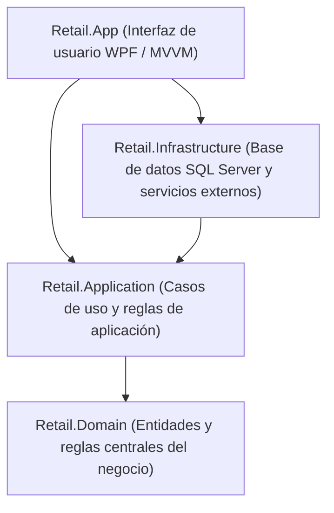

# Retail - Sistema de Gestión y Punto de Venta (POS)

¡Bienvenido al repositorio de **Retail**! Este proyecto es un sistema de escritorio para la administración integral de una librería y comercio minorista. Permite gestionar ventas en mostrador, control de stock, compras a distribuidores, padrón de clientes con cuentas corrientes y facturación.

Está desarrollado sobre **.NET 8 LTS** y **C# 12**, utilizando **WPF** para la interfaz visual y **SQL Server** con **Entity Framework Core 8** para el almacenamiento de datos.

---

## 🏛️ Arquitectura del Sistema

El proyecto está organizado siguiendo principios de arquitectura limpia para mantener el código ordenado, mantenible y fácil de entender:



### Proyectos de la solución

* **[`src/Retail.Domain`](file:///c:/Users/lucas/Proyectos/retail/src/Retail.Domain/):** Contiene las entidades principales (`Articulo`, `Venta`, `Cliente`, `TurnoCaja`, `Compra`, etc.) y las reglas del negocio. No depende de ninguna librería externa.
* **[`src/Retail.Application`](file:///c:/Users/lucas/Proyectos/retail/src/Retail.Application/):** Servicios de aplicación que coordinan las acciones del usuario, validaciones con FluentValidation y transferencia de datos (DTOs).
* **[`src/Retail.Infrastructure`](file:///c:/Users/lucas/Proyectos/retail/src/Retail.Infrastructure/):** Acceso a base de datos con Entity Framework Core 8, consultas SQL optimizadas, importación de planillas Excel y seguridad de contraseñas.
* **[`src/Retail.App`](file:///c:/Users/lucas/Proyectos/retail/src/Retail.App/):** La aplicación de escritorio WPF, sus ventanas, estilos visuales y la configuración de inicio.

---

## 📋 Requisitos Previos

Antes de comenzar, asegúrate de contar con lo siguiente en tu equipo:

1. **Windows 10 o Windows 11 (64 bits).**
2. **[.NET 8.0 SDK](https://dotnet.microsoft.com/download/dotnet/8.0)** (versión 8.0.x o superior).
3. **SQL Server Express con la instancia `SQLEXPRESS`.** Es el motor de desarrollo, de las pruebas de integración y del CI (el mismo que usará una instalación real de mostrador). Instalación rápida desde una terminal:
   ```powershell
   winget install Microsoft.SQLServer.2022.Express
   ```
   Durante la instalación conserva el nombre de instancia por defecto `SQLEXPRESS` (servicio `MSSQL$SQLEXPRESS`). El usuario de Windows con el que ejecutas la app debe poder crear bases de datos (lo habitual si instalaste con ese mismo usuario como administrador).

---

## 🚀 Guía de Puesta en Marcha y Despliegue

Sigue estos pasos para dejar el sistema funcionando en pocos minutos:

### 1. Clonar el repositorio
Abre una terminal y clona el proyecto en tu carpeta preferida:
```bash
git clone https://github.com/tu-usuario/retail.git
cd retail
```

### 2. Configurar la Base de Datos en `appsettings.json`
Abre el archivo [`src/Retail.App/appsettings.json`](file:///c:/Users/lucas/Proyectos/retail/src/Retail.App/appsettings.json) y define tu cadena de conexión en la propiedad `DefaultConnection`.

La cadena por defecto ya apunta a la instancia local `.\SQLEXPRESS`, por lo que normalmente no hace falta cambiar nada:
```json
{
  "ConnectionStrings": {
    "DefaultConnection": "Server=.\\SQLEXPRESS;Database=RetailDb;Trusted_Connection=True;TrustServerCertificate=True;MultipleActiveResultSets=true"
  }
}
```

> **¿Vienes de LocalDB?** Las versiones anteriores usaban `(localdb)\mssqllocaldb`. Esa base **no se migra automáticamente** a Express. La aplicación ya no crea la base al arrancar: ejecuta `dotnet run --project src/Retail.Cli -- migrar` y después `dotnet run --project src/Retail.Cli -- inicializar` (primer Gerente) contra `.\SQLEXPRESS`. Los datos de prueba que tuvieras en LocalDB no se trasladan (puedes borrarlos con `sqllocaldb stop mssqllocaldb` y `sqllocaldb delete mssqllocaldb` si ya no los necesitas).

Si tu instancia tiene otro nombre o usas autenticación de SQL Server, ajusta la cadena:

* **Con tu usuario de Windows en otra instancia (Autenticación integrada):**
```json
{
  "ConnectionStrings": {
    "DefaultConnection": "Server=localhost\\SQLEXPRESS;Database=RetailDb;Trusted_Connection=True;MultipleActiveResultSets=true;TrustServerCertificate=True"
  }
}
```

* **Con usuario y contraseña de SQL (por ejemplo, `sa`):**
```json
{
  "ConnectionStrings": {
    "DefaultConnection": "Server=localhost\\SQLEXPRESS;Database=RetailDb;User Id=sa;Password=TuPasswordSegura!;MultipleActiveResultSets=true;TrustServerCertificate=True"
  }
}
```

> **Nota:** El parámetro `TrustServerCertificate=True` es necesario para evitar errores de certificados al conectarte a instancias locales de SQL Server.

---

### 3. Preparar la Base de Datos (`Retail.Cli`)
La aplicación **no modifica la base al arrancar**: la crea y la actualiza la herramienta de comandos `Retail.Cli` (RF-23). La primera vez, desde la raíz del repositorio:

```bash
dotnet run --project src/Retail.Cli -- migrar        # crea la base y aplica las migraciones
dotnet run --project src/Retail.Cli -- inicializar   # crea el primer Gerente (pide usuario, email y contraseña)
dotnet run --project src/Retail.Cli -- datos-demo    # opcional: un proveedor, categorías y marcas de ejemplo
```

> **Copias de seguridad:** `dotnet run --project src/Retail.Cli -- backup` genera una copia completa y verificada en el directorio de `BackupSettings` (`C:\RetailData\Backups` por defecto, con un manifiesto `.json` por copia). `migrar` toma una copia previa automáticamente cuando la base ya tiene datos.

> **Copia automática diaria (instalación en la PC de la librería):** después de instalar y de ejecutar `Retail.Cli.exe migrar`, abre PowerShell **como administrador** y ejecuta una sola vez `.\registrar-tarea-backup.ps1` (viene en el ZIP, junto a `Retail.Cli.exe`). Registra la tarea programada «Retail POS - Copia de seguridad diaria», que corre `Retail.Cli.exe backup` todos los días a las 21:00 como `SYSTEM` (con `-Hora "22:30"` cambias la hora) y, si la PC estaba apagada a esa hora, hace la copia al encenderla (y espera hasta 2 minutos a que SQL Server termine de arrancar). El script también crea la carpeta de respaldos accesible solo para Administradores, `SYSTEM`, el servicio de SQL Server y la cuenta de la aplicación (sin «Usuarios» ni «Usuarios autenticados»), y le da al login `NT AUTHORITY\SYSTEM` los permisos mínimos en SQL Server (sin acceso a usuarios ni contraseñas). Instancia, base y carpeta salen del `appsettings.json` junto a `Retail.Cli.exe` (se pueden forzar con `-Instancia`, `-BaseDeDatos` y `-Directorio`). Si lo ejecutas con una cuenta de administrador distinta a la que usa Retail POS, indica esta última con `-UsuarioApp "EQUIPO\usuario"`.
>
> **La tarea no ejecuta el `Retail.Cli.exe` del ZIP, sino una copia protegida en `C:\Program Files\Retail POS\Cli`.** Corre como `SYSTEM`: si apuntara a una carpeta donde un usuario común puede escribir (Descargas, tu perfil), cualquiera podría reemplazar el ejecutable y ejecutar código con esos privilegios. El script copia ahí toda la carpeta (ejecutable, bibliotecas y `appsettings.json`), deja allí los logs (`C:\Program Files\Retail POS\Cli\logs`, solo para administradores) y se niega a continuar si esa carpeta quedara escribible por usuarios sin privilegios. **Vuelve a ejecutar `.\registrar-tarea-backup.ps1` después de actualizar la aplicación** (para refrescar esa copia), **después de restaurar una copia de seguridad** (los permisos de la tarea viven dentro de la base: una copia anterior al script no los tiene; la restauración te avisa) y después de migraciones que agreguen tablas usadas por la copia.
>
> Para verificar: `Start-ScheduledTask -TaskName "Retail POS - Copia de seguridad diaria"` y revisa la pantalla **Respaldos** (la copia figura como *Automática*) o los logs en `C:\Program Files\Retail POS\Cli\logs`. Para quitarla: `.\registrar-tarea-backup.ps1 -Desregistrar` (conserva las copias, el login y la copia de la herramienta; con `-RevocarPermisos` ofrece además quitar el permiso `CREATE ANY DATABASE` si el script lo había concedido). Con `-WhatIf` ves qué haría sin cambiar nada.

> **Después de cada `git pull` que traiga migraciones**, vuelve a ejecutar `migrar`. Si te olvidas, la aplicación no abre el login y te indica el comando. `dotnet run --project src/Retail.Cli -- estado` muestra el diagnóstico completo.

---

### 4. Ejecutar la Aplicación e Iniciar Sesión
```bash
dotnet run --project src/Retail.App/Retail.App.csproj
```

Ingresa con el Gerente que creaste con `inicializar`. No hay usuarios ni contraseñas por defecto: el resto de las cuentas se crea desde el módulo **Usuarios**.

---

### 5. Generar el Ejecutable para Mostrador (Publicación)
Si quieres empaquetar el sistema para instalarlo en la computadora de la librería sin necesidad de instalar .NET SDK en esa máquina, puedes generar un ejecutable único y auto-contenido:

```bash
dotnet publish src/Retail.App/Retail.App.csproj -c Release -r win-x64 --self-contained true -p:PublishSingleFile=true -p:IncludeNativeLibrariesForSelfExtract=true -o ./publish/Retail-POS
dotnet publish src/Retail.Cli/Retail.Cli.csproj -c Release -r win-x64 --self-contained true -p:PublishSingleFile=true -p:IncludeNativeLibrariesForSelfExtract=true -o ./publish/Retail-POS
```

La carpeta `publish/Retail-POS/` queda con `Retail.App.exe`, `Retail.Cli.exe` y el `appsettings.json` que comparten. En la PC de la librería se ejecuta `Retail.Cli.exe migrar` y `Retail.Cli.exe inicializar` antes del primer uso.

---

## 🛠️ Tecnologías Utilizadas

* **C# 12 / .NET 8 LTS**
* **WPF** (Windows Presentation Foundation) con `CommunityToolkit.Mvvm`
* **Entity Framework Core 8** (SQL Server Express)
* **FluentValidation** para validación de datos
* **MiniExcel** para importación ágil de listas de proveedores
* **BCrypt.Net-Next** para encriptación de contraseñas
* **Serilog** para registro de eventos y logs locales

---

## 📚 Documentación Adicional

Si quieres profundizar en el diseño y los requerimientos del sistema:
* [Especificación de Requisitos de Software (ERS)](file:///c:/Users/lucas/Proyectos/retail/docs/ERS%20-%20Libreria%20POS.md)
* [Mapa Semántico y Guía del Repositorio](file:///c:/Users/lucas/Proyectos/retail/docs/MAPA_DEL_PROYECTO.md)
* [Manual del Sistema de Persistencia](file:///c:/Users/lucas/Proyectos/retail/docs/SISTEMA_DE_PERSISTENCIA.md)
* [Manual del Sistema de Diseño UI](file:///c:/Users/lucas/Proyectos/retail/docs/SISTEMA_DE_DISENO.md)
* [Estrategia de Integración Continua (CI/CD)](file:///c:/Users/lucas/Proyectos/retail/docs/SISTEMA_DE_CI_CD.md)
