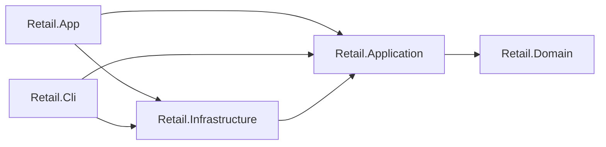

# Retail

Sistema de escritorio para administrar una librería: ventas de mostrador, stock, compras a distribuidores, clientes con cuenta corriente, caja, importación de listas de precios en Excel y copias de seguridad de la base. Está pensado para el personal de mostrador y para el gerente del comercio.

Es un proyecto académico de cátedra. El código sigue Clean Architecture, DDD y MVVM, y está escrito para poder explicarse y defenderse.

## Stack

| Componente | Tecnología |
| :--- | :--- |
| Lenguaje y runtime | C# 12, .NET 8 LTS |
| Interfaz | WPF, MVVM con CommunityToolkit.Mvvm 8.3.2, WPF-UI 4.0.0 |
| Persistencia | Entity Framework Core 8.0.11, SQL Server Express |
| Validación | FluentValidation 11.11.0 |
| Planillas de proveedores | MiniExcel 1.34.2 |
| Contraseñas | BCrypt.Net-Next 4.0.3 |
| Logs | Serilog 4.2.0 |
| Pruebas | xUnit, FluentAssertions, NSubstitute |

## Puesta en marcha

Requisitos: Windows 10 u 11, [.NET 8 SDK](https://dotnet.microsoft.com/download/dotnet/8.0) y SQL Server Express.

```powershell
winget install Microsoft.SQLServer.2022.Express
```

**1. Clonar el repositorio.**

```bash
git clone https://github.com/lucaskruzolek/retail.git
cd retail
```

**2. Revisar la cadena de conexión.** `src/Retail.App/appsettings.json` apunta a `Server=.;Database=RetailDb;Trusted_Connection=True;...`, es decir, a la instancia por defecto de SQL Server de tu equipo. El instalador de SQL Server Express, en cambio, crea por defecto una instancia con nombre, `.\SQLEXPRESS`. En ese caso no hace falta editar el archivo: la configuración también lee variables de entorno, y `ConnectionStrings__DefaultConnection` tiene prioridad sobre la del archivo. Para dejarla fija en tu usuario de Windows (y abrir una consola nueva después):

```powershell
[Environment]::SetEnvironmentVariable("ConnectionStrings__DefaultConnection", "Server=.\SQLEXPRESS;Database=RetailDb;Trusted_Connection=True;TrustServerCertificate=True;MultipleActiveResultSets=true", "User")
```

Para una sola sesión alcanza con `$env:ConnectionStrings__DefaultConnection = "..."`.

**3. Crear la base.** La aplicación no crea ni modifica la base al arrancar: eso lo hace `Retail.Cli`.

```bash
dotnet run --project src/Retail.Cli -- migrar        # crea la base y aplica las migraciones
dotnet run --project src/Retail.Cli -- inicializar   # crea el primer Gerente (pide usuario, email y contraseña)
dotnet run --project src/Retail.Cli -- cargar-diccionarios   # taxonomía y diccionarios de clasificación
dotnet run --project src/Retail.Cli -- datos-demo    # opcional: proveedor, categorías y marcas de ejemplo
```

`dotnet run --project src/Retail.Cli -- estado` informa si la base está al día. Repetí `migrar` después de cada `git pull` que traiga migraciones nuevas.

**4. Ejecutar la aplicación.**

```bash
dotnet run --project src/Retail.App/Retail.App.csproj
```

No hay usuarios ni contraseñas por defecto. Ingresá con el Gerente que creaste en el paso 3; las demás cuentas se crean desde el módulo Usuarios.

Para el desarrollo, `appsettings.json` ya trae `"UseMockArca": true` (no se necesitan certificados fiscales) y los tickets se escriben en la carpeta `debug-tickets` en lugar de una impresora térmica.

### Tests

```bash
dotnet test Retail.sln
```

La suite completa corre en el CI de cada Pull Request. En local alcanza con correr las suites que toca tu cambio: la tabla está en [AGENTS.md](AGENTS.md), sección «Bucle de Verificación». Los tests de integración usan SQL Server Express.

### Scripts útiles

Se ejecutan desde la raíz del repositorio con `powershell -ExecutionPolicy Bypass -File scripts\<nombre>.ps1`.

| Script | Para qué sirve |
| :--- | :--- |
| `iniciar-demo.ps1` | Abre la aplicación contra la base `RetailDemo`, sin tocar `RetailDb`. Con `-Preparar` la crea con 6 meses de operación simulada. |
| `registrar-tarea-backup.ps1` | Registra la tarea programada diaria de copia de seguridad (`Retail.Cli backup`). Requiere administrador y la instalación publicada. |
| `restore-retail.ps1` | Restaura la base desde una copia `.bak` (envoltorio de `Retail.Cli restaurar`). |
| `audit-xaml.ps1` | Verifica que los recursos `{StaticResource}` y `{DynamicResource}` de las vistas existan. Hay que correrlo al tocar XAML. |
| `generar-manual-pdf.ps1` | Regenera el PDF del manual de usuario a partir de `docs/MANUAL_DE_USUARIO.md` (requiere Node.js y Edge). |

## Estructura de la solución



| Proyecto | Responsabilidad |
| :--- | :--- |
| `src/Retail.Domain` | Entidades, raíces de agregado y reglas de negocio. Sin dependencias externas. |
| `src/Retail.Application` | Casos de uso, DTOs, contratos (interfaces) y validadores. |
| `src/Retail.Infrastructure` | EF Core, repositorios, migraciones, importación de Excel, respaldos y seguridad. |
| `src/Retail.App` | Interfaz WPF: vistas, ViewModels, estilos y arranque. Nunca toca el `DbContext`. |
| `src/Retail.Cli` | Herramienta de línea de comandos para migrar, inicializar, respaldar y restaurar la base. |
| `tests/` | Pruebas de Dominio, Aplicación, Infraestructura (integración) y App (humo y capturas). Ver [tests/README.md](tests/README.md). |

La dependencia siempre apunta hacia el Dominio, y el compilador lo hace cumplir.

## Documentación

Toda la documentación técnica (arquitectura, persistencia, diseño de interfaz, logging, CI/CD, flujos y guía de defensa) está reunida en el portal para desarrolladores: abrí [`wiki/index.html`](wiki/index.html) con doble clic en el navegador. Accesos directos:

* [Especificación de requisitos (ERS)](<docs/ERS - Libreria POS.md>)
* [Mapa del proyecto](docs/MAPA_DEL_PROYECTO.md)
* [Manual de usuario](docs/MANUAL_DE_USUARIO.md)
* [Roadmap de implementación](<docs/Roadmap de Implementacion.md>)
* [AGENTS.md](AGENTS.md): reglas de arquitectura y convenciones de código

## Cómo contribuir

* Trabajá en una rama propia y abrí un Pull Request a `main`. El otro autor lo revisa antes del merge.
* El CI corre en cada Pull Request: compilación en Release, tests y `dotnet format --verify-no-changes`.
* Las advertencias del compilador son errores (`TreatWarningsAsErrors`). Antes de subir, corré `dotnet format Retail.sln`.
* Estilo Allman (llaves en línea nueva), 4 espacios en C# y XAML, 2 en JSON y YAML. Los archivos usan finales de línea CRLF.
* Si agregás, renombrás o borrás archivos estructurales, actualizá `docs/MAPA_DEL_PROYECTO.md`.

## Autores

* Lucas Kruzolek ([@lucaskruzolek](https://github.com/lucaskruzolek))
* Pablo Fernandez ([@PabloCF2001](https://github.com/PabloCF2001))

Repositorio: <https://github.com/lucaskruzolek/retail>. Para reportar un problema: [issues](https://github.com/lucaskruzolek/retail/issues).
