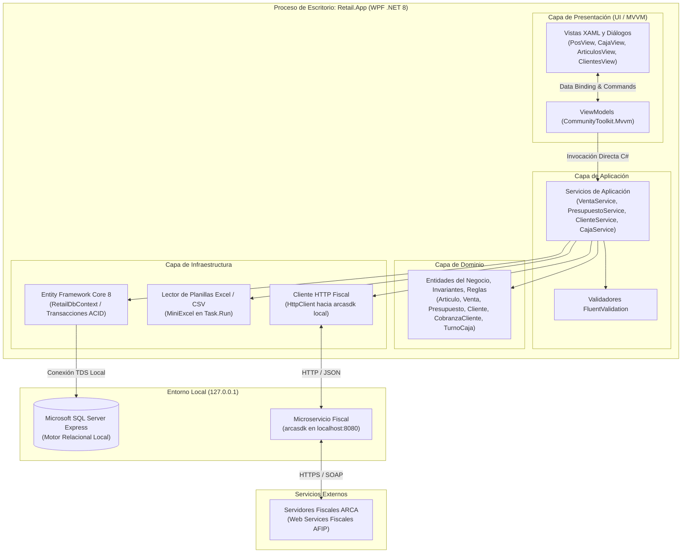

# Especificación de Requisitos de Software (ERS)

### Proyecto: Retail (Sistema ERP & Punto de Venta para Librería)
**Fecha:** Octubre de 2026  
**Versión:** 3.3 (Clean Desktop Monolith con Cobranzas Multimedio, Recálculo Automático de Precios y Tablero Gerencial con Reportes Exportables)

---

# Contenido {#contenido}

1. [Introducción](#1-introducción)
   - 1.1 [Propósito](#11-propósito)
   - 1.2 [Alcance del Producto](#12-alcance-del-producto)
   - 1.3 [Personal Involucrado](#13-personal-involucrado)
   - 1.4 [Definiciones, Acrónimos y Abreviaturas](#14-definiciones-acrónimos-y-abreviaturas)
2. [Descripción General](#2-descripción-general)
   - 2.1 [Perspectiva del Producto y Arquitectura del Sistema](#21-perspectiva-del-producto-y-arquitectura-del-sistema)
   - 2.2 [Funcionalidad del Producto (Módulos)](#22-funcionalidad-del-producto-módulos)
   - 2.3 [Características de los Usuarios](#23-características-de-los-usuarios)
   - 2.4 [Restricciones](#24-restricciones)
3. [Requisitos Específicos](#3-requisitos-específicos)
   - 3.1 [Requisitos Comunes de los Interfaces](#31-requisitos-comunes-de-los-interfaces)
     - 3.1.1 [Interfaces de Usuario (IU)](#311-interfaces-de-usuario-iu)
     - 3.1.2 [Interfaces de Software (IS)](#312-interfaces-de-software-is)
     - 3.1.3 [Interfaces de Comunicación (IC)](#313-interfaces-de-comunicación-ic)
   - 3.2 [Requisitos Funcionales (RF)](#32-requisitos-funcionales-rf)
   - 3.3 [Requisitos No Funcionales (RNF)](#33-requisitos-no-funcionales-rnf)
     - 3.3.1 [Requisitos de Rendimiento](#331-requisitos-de-rendimiento)
     - 3.3.2 [Seguridad](#332-seguridad)
     - 3.3.3 [Disponibilidad y Tolerancia a Fallos](#333-disponibilidad-y-tolerancia-a-fallos)
4. [Apéndice](#4-apéndice)
   - 4.1 [Diagrama Entidad-Relación (DER)](#41-diagrama-entidad-relación-der)
   - 4.2 [Matriz de Trazabilidad de Requisitos](#42-matriz-de-trazabilidad-de-requisitos)

---

# 1. Introducción {#1-introducción}

## 1.1. Propósito {#11-propósito}
El propósito del presente documento es especificar de manera formal y rigurosa los requisitos funcionales, no funcionales, reglas de negocio, interfaces y modelo de datos para el diseño y desarrollo del sistema **"Retail"**, una solución integral de gestión comercial, Punto de Venta (POS), facturación electrónica e inventario para librerías y comercios minoristas bajo los estándares **IEEE 830** e **ISO/IEC/IEEE 29148**.

## 1.2. Alcance del Producto {#12-alcance-del-producto}
El sistema **"Retail"** está diseñado como una **aplicación monolítica de escritorio limpia (Clean Desktop Monolith)** en Windows (.NET 8 / WPF / C# 12).

El producto unifica en un único proceso ejecutable la interfaz visual de mostrador, los servicios de orquestación de negocio y el acceso a datos sobre una base de datos relacional local (**Microsoft SQL Server Express**). Se integra en el entorno local con el microservicio `arcasdk` para la obtención de CAE y emisión fiscal ante ARCA (AFIP), incorporando además gestión de clientes con cobranzas multimedio de cuentas corrientes, recálculo automático de precios por compras, presupuestador independiente y un tablero gerencial con reportes de ventas, rentabilidad e inventario exportables a Excel y PDF.

## 1.3. Personal Involucrado {#13-personal-involucrado}

| Nombre | Fernandez, Pablo |
| :---- | :---- |
| Email | pablofernandez.12@gmail.com |

| Nombre | Kruzolek, Lucas |
| :---- | :---- |
| Email | lucaskruzolek@gmail.com |

## 1.4. Definiciones, Acrónimos y Abreviaturas {#14-definiciones-acrónimos-y-abreviaturas}

* **Clean Desktop Monolith:** Arquitectura en la que todas las capas lógicas (UI, Dominio, Aplicación, Persistencia) se ejecutan en un mismo proceso de sistema operativo en la máquina de mostrador, conservando un estricto desacoplamiento lógico interno.
* **WPF / MVVM:** Windows Presentation Foundation con patrón Model-View-ViewModel (`CommunityToolkit.Mvvm`).
* **Presupuesto Comercial:** Propuesta temporal de precios con vigencia configurable (15 días por defecto, editable al emitir) que congela el precio pactado durante su validez y **no reserva ni descuenta stock físico**. Al expirar, pierde el congelamiento de precios sin bloqueo destructivo, permitiendo conciliar y actualizar importes a catálogo vigente al momento de cobrarlo.
* **Cobranza de Cuenta Corriente:** Registro formal del pago de saldo deudor por parte de un cliente mediante múltiples medios de pago (efectivo, transferencia/QR, tarjeta), impactando en la caja del turno activo y emitiendo recibo oficial no fiscal.
* **Arqueo Ciego de Efectivo:** Procedimiento de control de caja donde el cajero declara únicamente el dinero físico en efectivo sin conocer el saldo teórico calculado por el sistema.
* **Cierre de Lote POS:** Conciliación externa del total recaudado por medios electrónicos (tarjetas de crédito/débito, QR) emitido por la terminal física de cobro adquirente (Posnet/Payway/MercadoPago).
* **Markup sobre Costo:** Porcentaje de recargo aplicado sobre el costo de reposición para calcular automáticamente el precio de venta sugerido: $\text{Precio} = \text{Costo} \times (1 + \frac{\text{Margen}}{100})$.
* **Índice Filtrado (Filtered Index):** Característica de base de datos que restringe la evaluación de unicidad exclusivamente a filas donde la columna no es nula (`[codigo_barras] IS NOT NULL`), permitiendo múltiples registros con valor `NULL` para productos artesanales o servicios.
* **Presentación de Venta:** Forma en que la tienda vende un producto (por ejemplo, pack x100 o unidad suelta). Cada presentación es un artículo propio, con su precio de venta, *markup* y stock independientes.
* **Artículo de Compra:** Presentación que la librería adquiere al distribuidor; es la única que se vincula con su ítem de `CATALOGOS_PROVEEDORES`.
* **Presentación Derivada:** Artículo que se obtiene abriendo un artículo de compra (su *origen*), que contiene una cantidad fija de unidades. No se vincula directamente al catálogo del proveedor.
* **Fraccionamiento:** Operación de inventario que abre unidades de un artículo de compra: descuenta del stock del origen y acredita al de su presentación derivada la cantidad equivalente en unidades.
* **Margen Bruto:** Diferencia entre el ingreso neto de lo vendido (precio menos descuento prorrateado) y su costo de reposición registrado al momento de la venta. Se expresa en pesos y como porcentaje del ingreso neto.
* **Prorrateo de Descuento:** Reparto del descuento global de una venta entre sus ítems en proporción al subtotal de cada uno: $\text{Descuento}_i = \text{Descuento} \times \frac{\text{Subtotal}_i}{\text{Subtotal}}$.
* **Valorización de Inventario:** Capital inmovilizado en góndola: $\sum \text{StockActual} \times \text{CostoReposicion}$.
* **Artículo sin Movimiento:** Artículo con stock disponible que no registra ventas en una cantidad configurable de días.
* **Rubro:** Agrupación de categorías; primer nivel de la clasificación de artículos (Rubro → Categoría).

---

# 2. Descripción General {#2-descripción-general}

## 2.1. Perspectiva del Producto y Arquitectura del Sistema {#21-perspectiva-del-producto-y-arquitectura-del-sistema}

---

## 2.2. Funcionalidad del Producto (Módulos) {#22-funcionalidad-del-producto-módulos}

### Módulo I: Catálogo e Inventario
* **Mantenimiento de Artículos (CRUD):** Código de barras (opcional o autogenerado, soportando múltiples `NULL` para productos artesanales y servicios), descripción, categoría, marca, costo de reposición, margen de ganancia (*Markup %*), precio de venta, stock actual y stock mínimo.
* **Administración de la Clasificación:** rubros, categorías y marcas definidos por el comercio (alta, renombrado y baja lógica bloqueada si están en uso).
* **Sugerencia de Clasificación:** categoría y marca sugeridas al incorporar artículos de un proveedor, siempre con confirmación del usuario.
* **Vinculación con Catálogos de Distribuidores:** Enlace de artículos propios con listas de proveedores para actualización automática de costos.
* **Importador Masivo:** Procesamiento en segundo plano (`Task.Run`) de planillas Excel (.xlsx) o CSV leídas directamente de disco local con mapeo dinámico de columnas.
* **Presentaciones de Venta y Fraccionamiento:** Venta por unidad de productos adquiridos en packs, con stock independiente por presentación, costo derivado del pack y fraccionamiento explícito.

### Módulo II: Punto de Venta (POS) y Cobros Multimedio
* **Terminal de Ventas de Alta Velocidad:** Lectura de códigos de barra, búsqueda incremental por texto, teclado F1-F12 y cálculo de vuelto.
* **Cobros Multimedio:** Efectivo, tarjetas de débito/crédito, transferencias/QR y **Cuenta Corriente** (para clientes habilitados).
* **Asociación de Clientes:** Selección rápida de cliente para emisión de Factura A o Factura B identificada.

### Módulo III: Presupuestador Independiente
* **Emisión de Presupuestos:** Registro de cotizaciones temporales en la entidad `PRESUPUESTOS` con validez configurable (15 días por defecto) y congelamiento del precio unitario pactado (`precio_unitario_pactado`). **No afecta stock ni turno de caja**.
* **Recuperación y Conversión en POS:** Carga del presupuesto por número. Si está dentro de su vigencia, respeta los precios pactados congelados. Si se encuentra vencido, detecta las variaciones frente a los precios actuales de `ARTICULOS` y despliega un diálogo de conciliación no bloqueante para actualizar a valores vigentes y continuar la venta. En ambos casos, audita disponibilidad física de stock ($\text{StockActual} \ge \text{CantidadPresupuestada}$). Al cobrarse, genera una nueva `VENTA` en el turno activo y marca el presupuesto como `CONVERTIDO`.

### Módulo IV: Gestión de Clientes y Cobranzas de Cuentas Corrientes
* **Padrón de Clientes (ABM):** Registro de CUIT/DNI, Razón Social, Condición frente al IVA (Responsable Inscripto, Monotributo, Consumidor Final) y domicilio fiscal.
* **Cuentas Corrientes Comerciales:** Límite de crédito asignado y saldo deudor para compras a plazo.
* **Circuito de Cobranza Multimedio:** Diálogo modal dedicado para registrar pagos de saldos de clientes con Efectivo, Transferencia/QR o Tarjeta. Imputa la cancelación en la cuenta del cliente, ingresa los fondos en el turno activo de caja y emite comprobante oficial de recibo.

### Módulo V: Caja y Tesorería
* **Apertura de Turno:** Registro del fondo de cambio inicial.
* **Movimientos Varios:** Ingresos y retiros justificados en efectivo.
* **Arqueo Ciego de Efectivo:** El cajero declara únicamente el dinero físico contado en efectivo. El sistema calcula faltante/sobrante y provee un total informativo de cobros electrónicos para cotejar con el cierre de lote del POS físico.
* **Estado:** ✅ Implementado (Fases 1-4 completadas, fase 5 pendiente)

### Módulo VI: Facturación Fiscal Electrónica (ARCA)
* **Automatización Tributaria:** Si la venta está asociada a un cliente Responsable Inscripto, emite **Factura A** automáticamente; en cualquier otro caso, emite **Factura B**.
* **Contingencia y Consola de Reintentos:** Si `arcasdk` no responde o no hay Internet, la venta se concluye normalmente como `ERROR_FISCAL_REINTENTABLE` con el motivo del fallo (`motivo_error`), permitiendo su reintento en lote desde la Consola Fiscal gerencial.

### Módulo VII: Gestión de Compras y Distribuidores
* **Registro de Compras:** Ingreso de comprobantes de distribuidores con incremento automático de stock y **recálculo automático e inmediato del precio de venta sugerido** en base al markup configurado.

### Módulo VIII: Tablero Gerencial y Reportes
* **Tablero de Indicadores:** Vista de entrada con los indicadores clave del período (ventas, margen bruto, stock crítico, valorización) y su variación frente al período anterior.
* **Reportes Parametrizables:** Ventas por período, ranking de artículos, rentabilidad, stock crítico con valorización y artículos sin movimiento, filtrables por fechas, categoría, marca y cajero.
* **Exportación:** Cada reporte se exporta a Excel (.xlsx) para análisis y a PDF para impresión o archivo, con los filtros aplicados.

---

## 2.3. Características de los Usuarios {#23-características-de-los-usuarios}

| Rol de Usuario | Permisos Autorizados | Restricciones |
| :--- | :--- | :--- |
| **Cajero** | Acceso exclusivo al POS, cobros multimedio, búsqueda y alta rápida de clientes, emisión de presupuestos, cobranza de cuentas corrientes, apertura de turno y declaración del arqueo físico de efectivo. | No accede a costos de reposición, márgenes de ganancia, compras, importador masivo ni consola fiscal. |
| **Encargado** | ABM de artículos, importación masiva de planillas, registro de compras y actualización automática de precios, apertura y cierre de caja, consulta de cuentas corrientes. | No puede administrar usuarios ni modificar configuraciones fiscales. |
| **Gerente** | Administración integral de usuarios y asignación de cualquier rol, consola de reintentos fiscales ARCA, tablero gerencial y reportes de ventas, rentabilidad e inventario con exportación (RF-24 a RF-26), límites de cuenta corriente, **backup manual y restauración de la base de datos (con reautenticación)**. | Máxima autoridad del sistema y responsable de los datos personales que almacena (Ley 25.326). Debe existir al menos uno activo. |
| **Administrador** *(opcional, delegado por el Gerente)* | Soporte técnico: alta, edición, baja y blanqueo de contraseña de Cajeros y Encargados; consulta del historial de backups y del estado del sistema. | No opera el POS ni la caja. Sin acceso a la consola fiscal ni a los reportes. No puede crear Gerentes ni Administradores, ni ejecutar backups manuales o restauraciones. El sistema puede operar sin ningún Administrador activo. |

**Reglas generales de cuentas:**
* Toda cuenta creada o cuya contraseña sea blanqueada por otro usuario deberá cambiar su contraseña en el primer inicio de sesión.
* Cada usuario puede registrar un **email de recuperación**, obligatorio para el rol Gerente. La recuperación de contraseña de un Gerente se realiza **exclusivamente por correo electrónico** (funcionalidad futura); mientras tanto, un Gerente que olvida su contraseña puede ser blanqueado desde la aplicación por otro Gerente. No existe recuperación local por herramienta de comandos: cualquier persona con acceso al equipo podría usarla para tomar la cuenta.

---

## 2.4. Restricciones {#24-restricciones}

* **Arquitectura Monolítica Limpia:** Desacoplamiento estricto de capas; las vistas en XAML no referencian `DbContext`.
* **WPF Dispatcher:** Ninguna operación pesada de base de datos, lectura de archivos o llamada HTTP a `arcasdk` se ejecutará en el hilo de UI.
* **Criptografía de Contraseñas:** Hashing unidireccional seguro mediante BCrypt o PBKDF2.
* **Índice Filtrado para Artesanías:** La base de datos debe soportar múltiples productos con código de barras `NULL` sin infringir la unicidad de los códigos asignados.
* **Defensa en Profundidad en Base de Datos (CHECK Constraints):** El motor relacional (SQL Server) impone restricciones declarativas no eludibles para garantizar que precios, costos, subtotales, totales, márgenes y límites de crédito sean no negativos ($\ge 0$), que cantidades y montos imputados sean estrictamente positivos ($> 0$), y que el stock físico no pueda registrar valores negativos (`[stock_actual] >= 0 OR [es_servicio] = 1`), previniendo corrupción física ante accesos fuera de la aplicación.

---

# 3. Requisitos Específicos {#3-requisitos-específicos}

## 3.1. Requisitos Comunes de los Interfaces {#31-requisitos-comunes-de-los-interfaces}

### 3.1.1. Interfaces de Usuario (IU) {#311-interfaces-de-usuario-iu}

| ID | Nombre | Descripción |
| :--- | :--- | :--- |
| **IU-01** | **Autenticación** | Pantalla de inicio para ingreso de usuario y contraseña con controles `PasswordBox`. Valida credenciales e inicializa el contexto de sesión en memoria (`CurrentUserSession`). |
| **IU-02** | **Punto de Venta (POS)** | Pantalla de alta velocidad optimizada para teclado (F1-F12) y lector de barras. Permite seleccionar cliente (por defecto Consumidor Final), modal de cobro multimedio (efectivo con cálculo de vuelto, tarjetas, QR, cuenta corriente) y botón para recuperar presupuestos con verificación de stock y alerta de precios. |
| **IU-03** | **Turnos y Arqueo Ciego** | Formulario para ingresar el saldo inicial de caja. Al cierre, el cajero declara a ciegas únicamente el efectivo físico contado. Emite el acta comparando el saldo teórico de efectivo vs declarado y muestra el total informativo de operaciones electrónicas para conciliar con el cierre de lote POS. |
| **IU-04** | **Catálogo de Artículos** | ABM de artículos y servicios: descripción, código de barras (opcional/nulable para artesanías), categoría, marca, stock mínimo, markup % y cálculo en tiempo real del precio de venta. Incluye el acceso a la administración de rubros, categorías y marcas. |
| **IU-05** | **Proveedores e Importador** | Asistente para abrir archivos locales (.xlsx / .csv) con mapeo visual de columnas y barra de progreso en segundo plano. Incluye explorador y curaduría de catálogos de distribuidores con filtros por estado (sin vincular / ya en tienda) y acciones de incorporación rápida (individual y en lote) o vinculación a artículos existentes. Al incorporar, muestra por cada artículo la categoría y la marca sugeridas (RF-27), con su motivo y confianza, para aceptarlas o corregirlas. |
| **IU-06** | **Compras** | Registro de facturas de distribuidores con detalle de artículos, cantidades y costos unitarios, recalculando automáticamente los precios de venta de los artículos ingresados. |
| **IU-07** | **Consola Fiscal** | Panel gerencial que lista ventas en `ERROR_FISCAL_REINTENTABLE` con fecha, comprobante interno y motivo de error (`motivo_error`), permitiendo reintento en lote hacia ARCA. |
| **IU-08** | **Usuarios** | Panel para alta, baja lógica, asignación de roles (Cajero, Encargado, Gerente, Administrador), email de recuperación y blanqueo de contraseñas. El Administrador solo gestiona Cajeros y Encargados. |
| **IU-09** | **Clientes y Cuentas Corrientes** | Vista para gestión del padrón de clientes: CUIT/DNI, Razón Social, Condición IVA, domicilio, límite de crédito, consulta de saldo y botón modal para **Registrar Cobranza Multimedio** (efectivo, tarjeta, transferencia/QR) con emisión de recibo. |
| **IU-10** | **Respaldo y Restauración** | Panel gerencial con el historial de copias de seguridad (fecha, tipo, usuario, tamaño, estado), botón de **backup manual** y asistente de **restauración** con confirmación explícita, ambos previa reautenticación del Gerente. El Administrador accede en modo de solo lectura. |
| **IU-11** | **Tablero Gerencial y Reportes** | Panel exclusivo del Gerente con tarjetas de indicadores y su variación frente al período anterior, gráficos de evolución de ventas y de rentabilidad por categoría, selector de reporte, panel de filtros (rango de fechas, agrupación, categoría, marca, cajero según el reporte), grilla de resultados y acciones **Exportar a Excel** y **Exportar a PDF**. La consulta y la exportación se ejecutan en segundo plano con indicador de progreso. |

---

### 3.1.2. Interfaces de Software (IS) {#312-interfaces-de-software-is}

| ID | Nombre | Descripción |
| :--- | :--- | :--- |
| **IS-01** | **Servicios de Aplicación C#** | Contratos de interfaz tipados expuestos a los ViewModels (`IVentaService`, `IPresupuestoService`, `IClienteService`, `ICajaService`, `IInventarioService`, `ICompraService`, `IFiscalService`, `IAuthService`, `IBackupService`, `IReporteService`). |
| **IS-02** | **Acceso a Datos EF Core 8** | Interfaz `IRetailDbContext` e `IUnitOfWork` que coordina transacciones ACID en Microsoft SQL Server. |
| **IS-03** | **Servicio Fiscal arcasdk** | Cliente HTTP tipado (`IArcaClient`) que despacha comprobantes a `http://localhost:8080` con timeout de 10s. |
| **IS-04** | **Herramienta de Comandos `Retail.Cli`** | Ejecutable de consola que reutiliza los servicios de aplicación para administrar la base fuera de la interfaz gráfica: `migrar` (con backup previo), `inicializar` (primer Gerente), `datos-demo`, `backup`, `restaurar` y `estado`. Ningún comando otorga acceso a una cuenta existente. Invocable por el Programador de tareas de Windows mediante scripts PowerShell. |
| **IS-05** | **Generación de Documentos Exportables** | Componentes de infraestructura que escriben los reportes en archivos locales elegidos por el usuario: libros Excel (.xlsx) mediante `MiniExcel` y documentos PDF mediante una biblioteca de composición de PDF, con los gráficos renderizados fuera de pantalla. La capa de Aplicación entrega los datos del reporte y desconoce el formato de salida. |

---

### 3.1.3. Interfaces de Comunicación (IC) {#313-interfaces-de-comunicación-ic}

| ID | Nombre | Descripción |
| :--- | :--- | :--- |
| **IC-01** | **Comunicación en Memoria** | Llamadas asíncronas C# (`async/await`) en el mismo proceso de sistema operativo. |
| **IC-02** | **Conexión TDS Local** | Conexión local a SQL Server Express (instancia `.\SQLEXPRESS`) vía memoria compartida o `127.0.0.1:1433`. |

---

## 3.2. Requisitos Funcionales (RF) {#32-requisitos-funcionales-rf}

| ID | Nombre | Descripción |
| :--- | :--- | :--- |
| **RF-01** | **Autenticación y Sesión** | El sistema debe validar usuario y contraseña contra el hash BCrypt/PBKDF2 en la base local, inicializando el contexto de usuario en memoria con sus permisos asignados. |
| **RF-02** | **Gestión de Sesión Local** | El sistema debe permitir el cambio rápido de usuario o cierre de sesión desde la ventana principal sin reiniciar la aplicación. |
| **RF-03** | **Administración de Usuarios** | El sistema debe permitir al Gerente crear, modificar, aplicar baja lógica y restablecer contraseñas de usuarios, asignando roles (Cajero, Encargado, Gerente, Administrador). El Administrador puede realizar las mismas operaciones solo sobre Cajeros y Encargados. Toda cuenta creada o blanqueada por otro usuario queda marcada para cambio obligatorio de contraseña en su próximo inicio de sesión. El email de recuperación es obligatorio para el rol Gerente. Solo un Gerente desbloquea una cuenta de Administrador bloqueada (RF-22). |
| **RF-04** | **Mantenimiento de Artículos y de su Clasificación** | Registro y modificación de artículos propios y servicios (fotocopias, anillados), requiriendo: descripción, código de barras (opcional/nulable, admitiendo múltiples productos artesanales con `NULL` mediante índice filtrado), categoría, marca (opcional), stock actual, stock mínimo y precio de venta. La clasificación se define en dos niveles, **Rubro → Categoría**: el artículo se asigna a una categoría, nunca a un rubro, y su rubro se deriva a través de ella; no existen más niveles. Un artículo sin marca (`IdMarca` nulo) es válido y se informa como "Sin marca". El sistema permite administrar, desde el catálogo de artículos, los **rubros**, las **categorías** (cada una pertenece a un único rubro) y las **marcas**: alta, renombrado, listado con filtro de texto y cantidad de artículos de cada ítem, y baja lógica. El nombre de un rubro, categoría o marca es obligatorio, de hasta 100 caracteres, y **único entre los registros activos**, sin distinguir mayúsculas ni acentos. Renombrar es libre, porque todo se referencia por identificador. La baja lógica se **bloquea** si el rubro tiene categorías activas, o si la categoría o la marca tienen artículos asignados (incluidos los dados de baja, para preservar los reportes históricos). Pueden administrar la clasificación el Gerente y el Encargado; el Cajero no, y la restricción se valida en la capa de aplicación y no solo en la interfaz. |
| **RF-05** | **Vinculación con Catálogos y Curaduría** | Enlace opcional de un artículo propio a un registro de `CATALOGOS_PROVEEDORES` con un *Markup %*. Al actualizarse el costo del distribuidor mediante planillas, recalcula automáticamente el precio de venta sugerido. Permite incorporar nuevos artículos a la tienda directamente desde el catálogo del proveedor (individualmente o en lote) o asociar ítems del proveedor a artículos propios preexistentes (con sugerencia automática por coincidencia de código de barras). Cada ítem del catálogo se vincula, como máximo, a un único artículo de compra; al actualizarse su costo, el nuevo valor se propaga también a las presentaciones derivadas de ese artículo (RF-21). La clasificación sugerida al incorporar se rige por RF-27. |
| **RF-06** | **Baja Lógica de Artículos** | Aplicar borrado lógico (`deleted_at IS NOT NULL`) para ocultar artículos en el POS conservando intacto su historial. |
| **RF-07** | **Importación Masiva en Segundo Plano** | Carga de archivos locales Excel (.xlsx) o CSV mapeando columnas de distribuidor (Código, Descripción, Costo y, opcionalmente, rubro, categoría y marca del proveedor, que se conservan como texto del proveedor) sin congelar la UI mediante `MiniExcel` (`Task.Run`). La ingesta alimenta la base de referencia `CATALOGOS_PROVEEDORES` (evitando sobrecargar el inventario propio), actualiza atómicamente los costos y precios de los artículos ya vinculados, y deja disponibles los registros restantes para su incorporación selectiva. |
| **RF-08** | **Alertas de Stock Mínimo** | Disparar advertencias visuales en catálogo y panel del Encargado cuando $\text{StockActual} \le \text{StockMinimo}$. |
| **RF-09** | **Ventas y Cobros Multimedio** | Registrar ventas ágiles en mostrador permitiendo asociar un cliente (Consumidor Final por defecto) y cobrar mediante efectivo, tarjetas, transferencias o Cuenta Corriente (si el cliente está habilitado y tiene saldo disponible). |
| **RF-10** | **Descuento Atómico de Stock** | Al confirmarse el cobro, el sistema debe descontar de forma síncrona el stock de los artículos vendidos dentro de una transacción ACID local. Cada presentación descuenta su propio stock. Si el stock de una presentación derivada no alcanza para la venta, el POS ofrece fraccionar su artículo de origen (RF-21), sin ejecutarlo de forma automática. |
| **RF-11** | **Emisión de Presupuestos Independientes** | Guardar cotizaciones en la entidad `PRESUPUESTOS` con vigencia temporal configurable (15 días por defecto, editable al emitir), congelando el `precio_unitario_pactado` en `DETALLE_PRESUPUESTOS`. **No descuenta stock ni afecta la caja**. |
| **RF-12** | **Conversión de Presupuesto a Venta y Conciliación Adaptativa** | Recuperar un presupuesto en el POS. Si está vigente, respeta los precios pactados; si venció, no bloquea destructivamente la operación sino que audita aumentos de catálogo y permite conciliar/actualizar a precios vigentes vía alerta en UI. En ambos casos audita stock físico ($\text{StockActual} \ge \text{CantidadPresupuestada}$). Al confirmarse el cobro, registra la nueva venta en el turno activo y marca el presupuesto como `CONVERTIDO`. |
| **RF-13** | **Apertura de Turno de Caja** | Exigir al cajero ingresar el saldo inicial de efectivo en `TURNOS_CAJA` antes de habilitar cobros en el POS. |
| **RF-14** | **Movimientos Varios de Caja** | Registrar ingresos y retiros justificados de efectivo durante el turno (`MOVIMIENTOS_CAJA`). |
| **RF-15** | **Arqueo Ciego de Efectivo y Cierre** | Al cerrar turno, el cajero declara a ciegas únicamente el efectivo físico contado. El sistema calcula la diferencia ($\text{declarado} - \text{teórico}$) y exhibe el total de operaciones electrónicas para cotejar con el cierre de lote del POS físico. |
| **RF-16** | **Emisión Fiscal Asíncrona ARCA** | Despachar el comprobante a `arcasdk`: emite **Factura A** automáticamente si el cliente asociado es Responsable Inscripto; en cualquier otro caso, emite **Factura B**. |
| **RF-17** | **Contingencia Fiscal Resiliente** | Si `arcasdk` no responde o no hay Internet, la venta se concluye, descuenta stock, guarda el motivo del fallo en `motivo_error`, fija el estado en `ERROR_FISCAL_REINTENTABLE` e imprime comprobante interno no fiscal. |
| **RF-18** | **Consola de Reintentos Fiscales** | Panel exclusivo para el Gerente que lista ventas en contingencia y permite reintentar su emisión secuencial en lote ante ARCA. |
| **RF-19** | **Registro de Compras y Recálculo Automático de Precios** | Registro de facturas de distribuidores incrementando el stock físico y actualizando el costo de reposición. **Requisito de negocio fundamental:** Si el costo unitario de compra se incrementa, el sistema recalculará automáticamente el `precio_venta` según la fórmula $\text{CostoReposicion} \times (1 + \frac{\text{Markup}}{100})$. El stock ingresado incrementa el artículo de compra; las presentaciones derivadas reciben unidades exclusivamente mediante fraccionamiento (RF-21). |
| **RF-20** | **Gestión Integral de Clientes y Cobranza Multimedio** | ABM de clientes con CUIT/DNI, Razón Social, Condición IVA, límite de crédito comercial y registro de cobranzas de cuentas corrientes (`COBRANZAS_CLIENTES`) admitiendo pagos en efectivo (suman a la gaveta de caja) o electrónicos (transferencia/tarjeta), reduciendo la deuda y emitiendo recibo de pago. |
| **RF-21** | **Presentaciones de Venta y Fraccionamiento** | Permitir definir una presentación derivada de un artículo de compra indicando las unidades que contiene cada origen (entero ≥ 1). Cada derivado tiene un único origen y la derivación es de un solo nivel: un derivado no puede ser origen de otro ni vincularse a un catálogo de proveedor. El costo de reposición del derivado es $\frac{\text{Costo del origen}}{\text{Unidades por origen}}$, redondeado a 2 decimales, y se recalcula cada vez que cambia el costo del origen (planilla o compra), aplicando el *markup* propio de cada presentación. Fraccionar $n$ unidades del origen resta $n$ de su stock y suma $n \times \text{Unidades por origen}$ al derivado en una única transacción ACID; la operación se rechaza si el origen no tiene stock suficiente. |
| **RF-22** | **Respaldo y Restauración de la Base de Datos** | El sistema debe generar copias completas de la base (`.bak`) de forma manual, por decisión del Gerente o del Administrador previa reautenticación, y de forma automática y periódica. Cada operación queda registrada en la entidad `REGISTROS_BACKUP` con fecha, tipo (manual, automático, previo a restauración, previo a migración), usuario responsable, archivo, tamaño, hash SHA-256 y estado. Toda copia se verifica (`CHECKSUM` + `VERIFYONLY`). La restauración la ejecuta un Gerente con su contraseña, o un Administrador que reingresa su propia contraseña y cuenta con la autorización de un Gerente que ingresa su usuario y contraseña en ese momento (control dual); el registro conserva a ambos. Genera antes una copia de seguridad del estado actual, conserva el historial de respaldos y advierte sobre la conciliación de numeración fiscal con ARCA. Tras tres autorizaciones fallidas consecutivas, la cuenta del Administrador queda bloqueada hasta que un Gerente la desbloquee. |
| **RF-23** | **Administración de la Base por Comandos** | La actualización del esquema (migraciones), la creación del primer Gerente (solo si no existe ninguno), la carga opcional de datos de demostración, la carga de la taxonomía semilla y de los diccionarios de clasificación (RF-27), los respaldos automáticos fuera de horario y la restauración ante desastres se ejecutan con una herramienta de línea de comandos independiente de la interfaz gráfica. Al iniciar, la aplicación verifica que el esquema esté al día y que exista al menos un Gerente; si no, bloquea el acceso con un mensaje accionable. |
| **RF-24** | **Tablero Gerencial de Indicadores** | Exclusivo del Gerente. Muestra para el período elegido (por defecto, el mes en curso): total vendido, cantidad de ventas, margen bruto en pesos y en porcentaje, y la variación porcentual de cada uno frente a un período de comparación **calendario**: si el rango está dentro de un solo mes y empieza el día 1, el mismo tramo del mes anterior (el mes completo si el rango termina el último día del mes); si empieza el 1 de enero y abarca más de un mes del mismo año, el mismo tramo del año anterior; en cualquier otro caso, el período inmediatamente anterior de igual duración. La pantalla informa las fechas del período de comparación. Además, la cantidad de artículos con stock bajo mínimo (RF-08) y la valorización actual del inventario. Incluye un gráfico de evolución de ventas y uno de margen bruto por categoría. Los períodos se interpretan en la hora local del comercio (las ventas se registran en UTC). Si el período anterior no tiene ventas, la variación se informa como no disponible en lugar de calcularse. |
| **RF-25** | **Reportes Gerenciales Parametrizables** | Exclusivo del Gerente. Consideran solo ventas sin baja lógica. (a) **Ventas por período:** total, cantidad de ventas, descuentos y el desglose del total por medio de pago (efectivo, tarjeta de débito, tarjeta de crédito, transferencia/QR y cuenta corriente), agrupados por día, semana o mes; filtros: rango de fechas y cajero. La suma de los medios de pago de cada período coincide con su total, porque los pagos de una venta cubren exactamente su importe (RF-09). (b) **Ranking de artículos:** los N más y menos vendidos (10 por defecto), por unidades o por importe; filtros: rango, categoría y marca. (c) **Rentabilidad:** ingreso neto, costo y margen bruto ($ y %) agrupados por categoría, marca o artículo; filtros: rango, categoría y marca. El margen de cada ítem es $(\text{SubtotalItem} - \text{Descuento prorrateado}) - \text{CostoUnitario} \times \text{Cantidad}$. Para que el margen histórico no cambie con las actualizaciones de precios (RF-07, RF-19), cada ítem vendido conserva el costo de reposición vigente al momento de la venta (`costo_unitario` en `DETALLE_VENTAS`), igual que conserva su precio. (d) **Stock crítico y valorización:** artículos con $\text{StockActual} \le \text{StockMinimo}$, su faltante y la valorización del inventario a costo de reposición y a precio de venta; filtros: categoría y marca. (e) **Artículos sin movimiento:** artículos con stock mayor a cero sin ventas en los últimos N días (90 por defecto), con su última fecha de venta y el capital inmovilizado. Los reportes (d) y (e) excluyen los servicios. Los filtros se validan: fecha desde ≤ fecha hasta, fecha hasta no posterior a hoy, fecha desde no anterior a la primera venta registrada (sin ventas, el primer día del mes en curso) y N positivo. Para acotar el volumen de resultados sin paginar datos ya agregados, el rango tiene un largo máximo: 366 días al agrupar por día, 5 años por semana y 10 años por mes o en los demás reportes con período. Los importes se redondean a 2 decimales con el criterio monetario único del sistema. |
| **RF-26** | **Exportación de Reportes** | El Gerente puede exportar el tablero y cada reporte a Excel (.xlsx) y a PDF con exactamente los datos y filtros visibles en pantalla. Todo archivo incluye un encabezado con el nombre del reporte, los filtros aplicados, la fecha y hora de generación y el usuario que lo generó. En Excel, los importes y cantidades se escriben como valores numéricos (no como texto) para poder operar con ellos; el PDF incluye las tablas y los gráficos del reporte en formato A4 apto para impresión. El usuario elige la ubicación con el diálogo de guardado del sistema operativo, con un nombre sugerido `Reporte-<tipo>-<desde>-<hasta>`. Si el archivo no puede escribirse (por ejemplo, porque está abierto en otra aplicación), el sistema informa el motivo y permite reintentar sin perder el reporte generado. |
| **RF-27** | **Sugerencia de Clasificación** | Al incorporar artículos del catálogo de un proveedor, el sistema sugiere para cada uno una categoría y una marca a partir de la descripción y del código de barras, indicando el motivo y la confianza de la sugerencia. El sistema se abstiene cuando la confianza no alcanza el umbral que el sistema calibra en cada entrenamiento. Ninguna sugerencia se aplica sin confirmación del usuario. El modelo de categorías se reentrena localmente con los artículos confirmados, sin conexión a Internet. |

---

## 3.3. Requisitos No Funcionales (RNF) {#33-requisitos-no-funcionales-rnf}

* **RNF-01 (Rendimiento POS):** Respuesta en mostrador (búsqueda y adición de ítems) $< 50$ ms (típico $< 15$ ms in-process).
* **RNF-02 (Responsividad de UI):** Operaciones pesadas en segundo plano con `Task.Run` para no bloquear el Dispatcher de WPF.
* **RNF-03 (Estabilidad y Memoria):** Consumo de RAM $\le 300$ MB y ausencia de fugas de memoria en jornadas continuas.
* **RNF-04 (Criptografía):** Hashing seguro de contraseñas con PBKDF2 o BCrypt con salt.
* **RNF-05 (Seguridad de Persistencia):** Instancia local de SQL Server con permisos restringidos a nivel de sistema operativo.
* **RNF-06 (Control de Acceso RBAC):** Restricción de vistas y acciones según el rol del usuario autenticado en memoria.
* **RNF-07 (Tolerancia a Fallos Fiscales):** Continuidad operativa total de ventas ante cortes de Internet (Contingencia RF-17).
* **RNF-08 (Integridad ACID y Respaldos):** Transacciones atómicas locales. Respaldo completo diario automático y bajo demanda (RF-22), en un directorio dedicado fuera del perfil de usuario, con verificación de integridad y política de retención configurable.
* **RNF-09 (Rendimiento de Reportes):** Filtrado, agrupación y agregación de los reportes se ejecutan en el motor de base de datos, sin materializar ventas en memoria. El tablero y cada reporte responden en menos de 2 s con un año de operación (referencia: 50.000 ventas y 200.000 ítems vendidos) y la exportación se ejecuta en segundo plano, respetando RNF-02 y RNF-03.

---

# 4. Apéndice {#4-apéndice}

## 4.1. Diagrama Entidad-Relación (DER) {#41-diagrama-entidad-relación-der}

*(Consulte el archivo [DER.mmd](file:///c:/Users/lucas/Proyectos/retail/DER.mmd) para la especificación formal en Mermaid).*

---

## 4.2. Matriz de Trazabilidad de Requisitos {#42-matriz-de-trazabilidad-de-requisitos}

| Requisito Funcional | Interfaz de Usuario | Interfaz de Software | Tablas Principales Afectadas |
| :--- | :--- | :--- | :--- |
| **RF-01, RF-02** | `IU-01` (Autenticación) | `IS-01` (`IAuthService`) | `USUARIOS`, `ROLES` |
| **RF-03** | `IU-08` (Gestión Usuarios) | `IS-01` (`IAuthService`) | `USUARIOS`, `ROLES` |
| **RF-04, RF-05, RF-06** | `IU-04` (Catálogo Propio) | `IS-01` (`IInventarioService`, `IRubroService`, `ICategoriaService`, `IMarcaService`) | `ARTICULOS`, `CATALOGOS_PROVEEDORES`, `RUBROS`, `CATEGORIAS`, `MARCAS` |
| **RF-07** | `IU-05` (Importador Masivo) | `IS-01` (`IInventarioService`), `IS-02` | `CATALOGOS_PROVEEDORES`, `ARTICULOS` |
| **RF-08** | `IU-04` (Catálogo / Dashboard) | `IS-01` (`IInventarioService`) | `ARTICULOS` |
| **RF-09, RF-10** | `IU-02` (Punto de Venta) | `IS-01` (`IVentaService`), `IS-03` | `VENTAS`, `DETALLE_VENTAS`, `PAGOS_VENTA`, `ARTICULOS`, `CLIENTES` |
| **RF-11, RF-12** | `IU-02` (Presupuestador) | `IS-01` (`IPresupuestoService`) | `PRESUPUESTOS`, `DETALLE_PRESUPUESTOS`, `VENTAS`, `ARTICULOS` |
| **RF-13, RF-14, RF-15** | `IU-03` (Turnos y Arqueo Ciego) | `IS-01` (`ICajaService`) | `TURNOS_CAJA`, `MOVIMIENTOS_CAJA`, `COBRANZAS_CLIENTES` |
| **RF-16, RF-17, RF-18** | `IU-07` (Consola Fiscal) | `IS-01` (`IFiscalService`), `IS-03` | `COMPROBANTES_FISCALES`, `VENTAS`, `CLIENTES` |
| **RF-19** | `IU-06` (Compras) | `IS-01` (`ICompraService`) | `COMPRAS`, `DETALLE_COMPRAS`, `ARTICULOS`, `PROVEEDORES` |
| **RF-20** | `IU-09` (Clientes y Cobranzas) | `IS-01` (`IClienteService`) | `CLIENTES`, `COBRANZAS_CLIENTES`, `TURNOS_CAJA` |
| **RF-21** | `IU-04` (Catálogo Propio), `IU-02` (Punto de Venta) | `IS-01` (`IInventarioService`) | `ARTICULOS` |
| **RF-22** | `IU-10` (Respaldo y Restauración) | `IS-01` (`IBackupService`), `IS-04` | `REGISTROS_BACKUP`, `USUARIOS` |
| **RF-23** | — (línea de comandos) | `IS-04` | `__EFMigrationsHistory`, `USUARIOS`, `ROLES`, `RUBROS`, `CATEGORIAS`, `MARCAS`, `PROVEEDORES` |
| **RF-24, RF-25, RF-26** | `IU-11` (Tablero Gerencial y Reportes) | `IS-01` (`IReporteService`), `IS-05` | `VENTAS`, `DETALLE_VENTAS`, `ARTICULOS`, `CATEGORIAS`, `MARCAS`, `USUARIOS` |
| **RF-27** | `IU-05` (Proveedores e Importador: modal de incorporación), `IU-04` (Catálogo Propio: administración de la clasificación) | `IS-01` (`IClasificacionService`) | `ARTICULOS`, `CATALOGOS_PROVEEDORES`, `PROVEEDORES`, `CATEGORIAS`, `MARCAS` |
