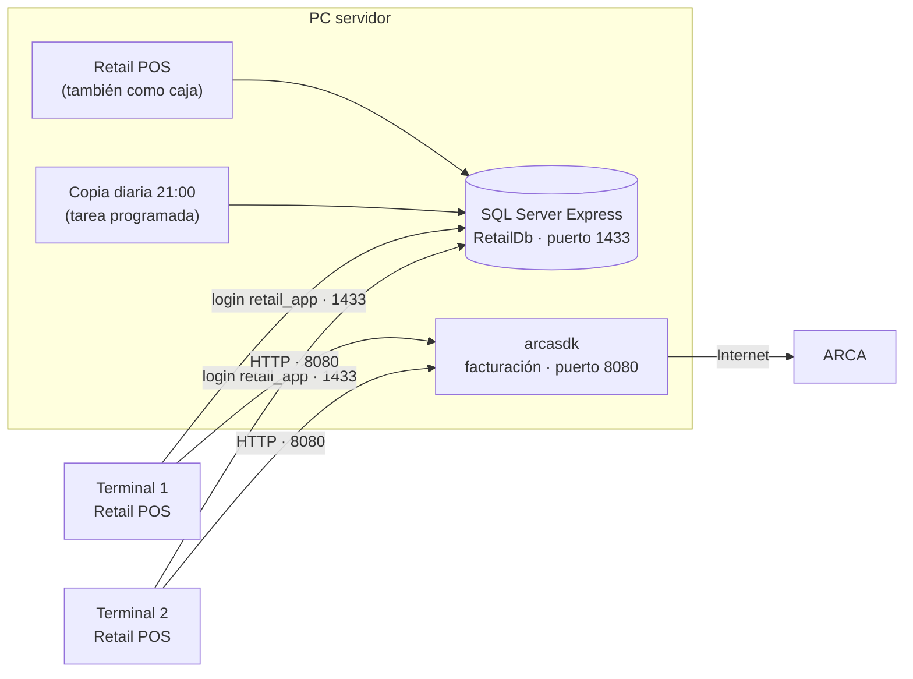
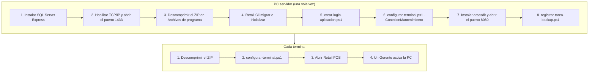

# Instalación de Retail POS en red (varias cajas)

Guía para la persona que instala el sistema en el local. No hace falta saber programar: son pasos para copiar y pegar en
PowerShell. Si el local tiene **una sola PC**, no necesita esta guía: alcanza con instalar SQL Server Express, descomprimir
el ZIP, ejecutar `Retail.Cli migrar` y `Retail.Cli inicializar`, y abrir la aplicación.

## 1. Cómo queda armado

Una PC del local es **el servidor**: tiene la base de datos (SQL Server Express), el servicio de facturación electrónica
(`arcasdk`) y hace las copias de seguridad. Las demás PC son **terminales**: tienen la aplicación y se conectan al servidor
por la red del local. La PC servidor también puede usarse como caja.



Qué se hace dónde:

| Tarea | Dónde |
| :--- | :--- |
| Base de datos, copias de seguridad, restauración, actualizar la base (`Retail.Cli migrar`) | **Solo en la PC servidor** |
| Facturación electrónica (`arcasdk`) | **Solo en la PC servidor** |
| Vender, cobrar, cerrar caja, consultar el historial de copias | Cualquier PC |

Desde una terminal, la pantalla de copias muestra el historial pero no permite crear ni restaurar copias: lo explica con un
aviso. Es a propósito: restaurar reemplaza la base de **todas** las cajas.

## 2. Qué necesita antes de empezar

* El ZIP de la versión (`Retail-POS-win-x64.zip`) descargado de la página de versiones del proyecto.
* Una cuenta de **administrador de Windows** en cada PC.
* Las PC conectadas a la misma red del local, con la red marcada como **Privada** (Configuración > Red e Internet).
* En la PC servidor: el instalador de SQL Server Express (2019 o 2022) y el certificado fiscal de ARCA.
* Un nombre para cada PC que no cambie (el servidor sobre todo). Para ver el de una PC: `hostname`.
* Una **contraseña para la aplicación** (la va a pedir varias veces; anótela en un lugar seguro). Tiene que ser larga y
  tener mayúsculas, minúsculas y números.

Todos los comandos se escriben en PowerShell abierto con **Ejecutar como administrador**. Si Windows no deja ejecutar los
scripts, antes escriba en esa misma ventana: `Set-ExecutionPolicy -Scope Process -ExecutionPolicy Bypass`.

## 3. Orden de la instalación



## 4. PC servidor (una sola vez)

### 4.1 Instalar SQL Server Express

Ejecute el instalador de SQL Server Express (instalación **Básica**) con el nombre de instancia por defecto `SQLEXPRESS`.
Al terminar, el servicio de Windows se llama `MSSQL$SQLEXPRESS`. Hágalo con la cuenta de administrador que va a usar para
instalar todo lo demás: esa cuenta queda como administradora de la base.

### 4.2 Habilitar TCP/IP y abrir el puerto 1433

Por defecto SQL Server Express solo acepta conexiones desde la propia PC. Estos comandos lo abren a la red del local con el
puerto fijo 1433:

```powershell
# 1. Habilitar TCP/IP con el puerto fijo 1433
$instancia = (Get-ItemProperty 'HKLM:\SOFTWARE\Microsoft\Microsoft SQL Server\Instance Names\SQL').SQLEXPRESS
$tcp = "HKLM:\SOFTWARE\Microsoft\Microsoft SQL Server\$instancia\MSSQLServer\SuperSocketNetLib\Tcp"
Set-ItemProperty -Path $tcp -Name Enabled -Value 1
Set-ItemProperty -Path "$tcp\IPAll" -Name TcpPort -Value "1433"
Set-ItemProperty -Path "$tcp\IPAll" -Name TcpDynamicPorts -Value ""

# 2. Reiniciar el servicio para que rija
Restart-Service -Name 'MSSQL$SQLEXPRESS' -Force

# 3. Permitir el puerto 1433 en el Firewall de Windows (solo redes Privadas y de dominio)
New-NetFirewallRule -DisplayName "Retail POS - SQL Server (1433)" -Direction Inbound -Protocol TCP -LocalPort 1433 -Action Allow -Profile Private,Domain
```

Lo mismo se puede hacer con el programa **SQL Server Configuration Manager**: Configuración de red de SQL Server >
Protocolos de SQLEXPRESS > TCP/IP > Habilitado; en la pestaña *Direcciones IP*, en **IPAll**, dejar vacío *Puertos
dinámicos TCP* y poner `1433` en *Puerto TCP*; reiniciar el servicio.

Comprobación (desde la propia PC servidor): `Test-NetConnection -ComputerName localhost -Port 1433` debe decir
`TcpTestSucceeded : True`.

### 4.3 Descomprimir la aplicación

Descomprima el ZIP en `C:\Program Files\Retail POS` **como administrador** (clic derecho en PowerShell > Ejecutar como
administrador, y luego `Expand-Archive`):

```powershell
Expand-Archive -Path "$env:USERPROFILE\Downloads\Retail-POS-win-x64.zip" -DestinationPath "C:\Program Files\Retail POS" -Force
cd "C:\Program Files\Retail POS"
```

Debe ser una carpeta que solo los administradores puedan modificar: la tarea de copias corre con máximos privilegios y el
script de la tarea se niega a seguir si cualquiera puede cambiar los archivos. Los pasos siguientes se ejecutan desde esa
carpeta.

### 4.4 Crear la base y el primer Gerente

```powershell
.\Retail.Cli.exe migrar
.\Retail.Cli.exe inicializar
.\Retail.Cli.exe cargar-diccionarios
```

`migrar` crea la base `RetailDb` y le aplica el esquema. `inicializar` crea la cuenta del primer Gerente (pide usuario y
contraseña; anótelas). `cargar-diccionarios` carga las listas de clasificación del catálogo. Esto va **antes** de crear el
login de la aplicación porque ese login necesita que la base ya exista.

### 4.5 Crear el login de la aplicación

```powershell
.\crear-login-aplicacion.ps1 -ReiniciarServicio
```

El script pide la contraseña de la aplicación dos veces (sin mostrarla). Hace tres cosas:

1. Activa la autenticación **mixta** ("SQL Server y Windows") y, con `-ReiniciarServicio`, reinicia SQL Server para que
   rija. Si prefiere reiniciarlo usted fuera del horario de venta, ejecútelo sin ese parámetro y reinicie el servicio
   después.
2. Crea el login `retail_app`.
3. Le da **solo** lo que la aplicación necesita (leer y escribir datos, y ejecutar los procedimientos). No puede cambiar
   la estructura de la base, ni hacer ni restaurar copias: si una terminal se viera comprometida, no alcanza para borrar la
   base.

Se puede volver a ejecutar sin problema (por ejemplo, para cambiar la contraseña o después de restaurar una copia antigua).

### 4.6 Configurar el propio servidor

```powershell
.\configurar-terminal.ps1 -Servidor ".\SQLEXPRESS" -ConexionMantenimiento -ProbarConexion
```

Pide la contraseña del paso anterior. Escribe `C:\ProgramData\Retail\appsettings.local.json` con la conexión de la
aplicación (con el login `retail_app`; la contraseña se guarda **cifrada** y solo sirve en esta PC) y, por el parámetro
`-ConexionMantenimiento`, una segunda conexión local con su usuario de Windows que se usa **solo** para las copias bajo
demanda, la restauración y la actualización de la base. `-ProbarConexion` verifica que todo funcione: debe decir
«Prueba de conexión: correcta».

### 4.7 Facturación electrónica (`arcasdk`)

El servicio `arcasdk` se instala **solo en la PC servidor**, con el certificado fiscal de ARCA, según su propia
documentación. Dos requisitos para que las terminales lo usen:

* Tiene que escuchar en el puerto **8080** y aceptar conexiones de la red (no solo de `localhost`).
* Abra el puerto en el Firewall de Windows:

```powershell
New-NetFirewallRule -DisplayName "Retail POS - Facturación (8080)" -Direction Inbound -Protocol TCP -LocalPort 8080 -Action Allow -Profile Private,Domain
```

El certificado fiscal **nunca** se copia a las terminales: ellas le piden las facturas al servidor.

### 4.8 Registrar la copia de seguridad diaria

```powershell
.\registrar-tarea-backup.ps1
```

Crea la tarea «Retail POS - Copia de seguridad diaria» (todos los días a las 21:00; si la PC estaba apagada, corre al
encenderla). Solo funciona en la PC servidor: si lo ejecuta en una terminal se niega y le indica qué hacer. Detalles en la
guía de copias de seguridad del manual.

## 5. Cada terminal

1. **Descomprima el ZIP** en `C:\Program Files\Retail POS`, igual que en el servidor (paso 4.3). No ejecute `migrar`,
   `inicializar` ni el registro de la tarea: eso es solo del servidor.
2. **Configure la PC.** En PowerShell como administrador, en esa carpeta (reemplace `PCSERVIDOR` por el nombre de la PC
   servidor):

   ```powershell
   .\configurar-terminal.ps1 -Servidor "PCSERVIDOR,1433" -ProbarConexion
   ```

   Pide la contraseña de la aplicación. Si la prueba de conexión dice «correcta», está lista. Usa el puerto 1433 directo
   (`PCSERVIDOR,1433`) para no depender del servicio *SQL Server Browser*; la dirección de facturación queda en
   `http://PCSERVIDOR:8080`. Si en el servidor usó otro puerto de facturación, agregue `-UrlFiscal "http://PCSERVIDOR:PUERTO"`.
3. **Abra Retail POS** (`Retail.App.exe`; puede crear un acceso directo en el escritorio).
4. **Un Gerente activa la PC.** En el primer arranque, la aplicación avisa que la PC no está activada como terminal. Un
   Gerente inicia sesión en esa PC y, en la ventana «Activar esta PC», elige si es una terminal nueva o reemplaza a una
   existente. Desde ese momento cualquier usuario puede iniciar sesión.

## 6. Actualizar la aplicación

Cuando haya una versión nueva:

1. Pida que **cierren Retail POS en todas las PC** (idealmente fuera del horario de venta).
2. En **cada PC** (servidor y terminales), descomprima el ZIP nuevo sobre `C:\Program Files\Retail POS` como administrador
   (`Expand-Archive ... -Force`). **La configuración de la PC no se pierde**: vive en `C:\ProgramData\Retail`, fuera de esa
   carpeta, y el ZIP nunca la toca. No hace falta volver a ejecutar `configurar-terminal.ps1`.
3. En la **PC servidor**, actualice la base. `migrar` cambia la estructura, y el login `retail_app` a propósito no tiene
   permiso para eso. No hace falta hacer nada especial: en la PC servidor `Retail.Cli` usa la **conexión de
   mantenimiento** (la que escribió `configurar-terminal.ps1 -ConexionMantenimiento`, con su usuario de Windows):

   ```powershell
   cd "C:\Program Files\Retail POS"
   .\Retail.Cli.exe migrar
   ```

   `migrar` toma antes una copia de seguridad verificada. Después, si la versión agregó tablas que usa la copia de
   seguridad, vuelva a ejecutar `.\registrar-tarea-backup.ps1` y `.\crear-login-aplicacion.ps1` (los permisos viven dentro
   de la base).
4. Abra primero la PC servidor y después las terminales.

Una terminal con una versión **más vieja** que la base no arranca: la aplicación avisa que hay que actualizarla.

## 7. Cuando algo falla

| Síntoma | Causa probable | Qué hacer |
| :--- | :--- | :--- |
| «Login failed for user 'retail_app'» o la prueba de conexión falla con un error de inicio de sesión | La contraseña no coincide, o SQL Server todavía no se reinició con la autenticación mixta | En el servidor, vuelva a ejecutar `.\crear-login-aplicacion.ps1 -ReiniciarServicio` y en la terminal `.\configurar-terminal.ps1 ...` con **la misma** contraseña |
| «Login failed for user 'NOMBREPC\usuario'» (un usuario de Windows en lugar de `retail_app`) | La terminal no tiene el archivo local: sigue conectando con el usuario de Windows | Ejecute `.\configurar-terminal.ps1` en esa PC. En una red sin dominio, el usuario de Windows de la terminal no existe para el servidor |
| «A network-related or instance-specific error» / no se encuentra el servidor | Nombre mal escrito, el puerto 1433 cerrado o TCP/IP deshabilitado | Desde la terminal: `Test-NetConnection -ComputerName PCSERVIDOR -Port 1433`. Si falla, revise el firewall del servidor (paso 4.2) y que las dos PC estén en red Privada |
| «La contraseña de la base guardada en appsettings.local.json no se puede descifrar en esta PC» | El archivo se copió desde otra PC, o se reinstaló Windows | Vuelva a ejecutar `.\configurar-terminal.ps1` en **esa** PC. Cada PC cifra la contraseña para sí misma |
| «Esta PC no está activada como terminal de la librería» | Primer arranque en una PC nueva (o se borró `C:\ProgramData\Retail\terminal.json`) | Un Gerente inicia sesión en esa PC y la activa (paso 5.4) |
| «… ya tiene una sesión abierta en la terminal «X»» | Cada usuario puede tener una sola sesión a la vez | Cierre la aplicación en esa otra PC, o espere 3 minutos si esa PC se apagó. |
| Las copias y la restauración no se pueden usar en una terminal | Es a propósito: solo se hacen en la PC servidor | Hágalo en la PC servidor. El historial se ve desde cualquier PC |
| Restaurar espera a que se desconecten terminales | La restauración avisa a las otras cajas y espera a que terminen la venta | Pida que cierren la aplicación; pasado el plazo puede elegir «restaurar igual» (las desconecta) |
| `registrar-tarea-backup.ps1` dice «Este script se ejecuta solo en la PC servidor» | Se ejecutó en una terminal | No hace falta: la copia diaria la hace el servidor. En las terminales use `configurar-terminal.ps1` |
| Horarios o avisos que no coinciden entre las cajas | Los relojes de las PC están desfasados | Active la sincronización horaria de Windows en **todas** las PC (Configuración > Hora e idioma > Fecha y hora > Sincronizar ahora, y «Establecer la hora automáticamente»). Las sesiones y los avisos de mantenimiento dependen de la hora |

Los registros de la aplicación están en `%LOCALAPPDATA%\Retail POS\logs` del usuario que la usa.

## 8. Resumen de comandos

| Dónde | Comando | Cuándo |
| :--- | :--- | :--- |
| Servidor | `.\Retail.Cli.exe migrar`, `.\Retail.Cli.exe inicializar` | Una vez al instalar (`migrar` también al actualizar) |
| Servidor | `.\crear-login-aplicacion.ps1 -ReiniciarServicio` | Una vez; de nuevo si se restaura una copia antigua |
| Servidor | `.\configurar-terminal.ps1 -Servidor ".\SQLEXPRESS" -ConexionMantenimiento -ProbarConexion` | Una vez |
| Servidor | `.\registrar-tarea-backup.ps1` | Una vez; de nuevo si se restaura una copia antigua |
| Cada terminal | `.\configurar-terminal.ps1 -Servidor "PCSERVIDOR,1433" -ProbarConexion` | Una vez por PC |

Más información técnica para quien mantiene el sistema: [`SISTEMA_DE_PERSISTENCIA.md`](SISTEMA_DE_PERSISTENCIA.md) (configuración
en capas y contraseña cifrada), [`SISTEMA_DE_CI_CD.md`](SISTEMA_DE_CI_CD.md) (contenido del ZIP) y la
[auditoría de concurrencia multiterminal](auditorias/auditoria-concurrencia-multiterminal.md).
