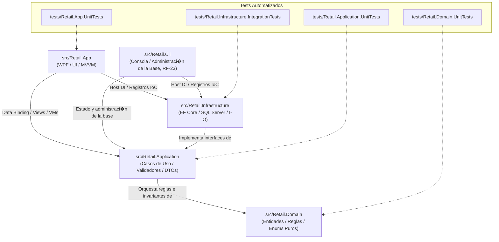

# Mapa Sem�ntico y Gu�a de Navegaci�n del Proyecto Retail

### Prop�sito del Documento
Este documento sirve como **�ndice sem�ntico condensado** para desarrolladores humanos y **agentes de c�digo** (IA). Permite ubicar con exactitud qu� archivo, clase y capa es responsable de cada caso de uso del sistema, optimizando el consumo de tokens y previniendo b�squedas ciegas en el repositorio.

---

## ??? Topolog�a de Capas y Proyectos (.NET 8)

---

## ?? Cat�logo de Archivos por Capa y Responsabilidad

### 1. Capa de Dominio: `src/Retail.Domain` (Sin dependencias externas)

| Componente | Ubicaci�n Relativa | Responsabilidad y Rol DDD | Requisitos Vinculados |
| :--- | :--- | :--- | :--- |
| **Abstracciones Base** | [`Common/BaseEntity.cs`](file:///c:/Users/lucas/Proyectos/retail/src/Retail.Domain/Common/BaseEntity.cs) | Identidad, auditor�a temporal (`CreatedAt`) y borrado l�gico (`DeletedAt`, `MarkAsDeleted()`, `Restore()`). | Transversal |
| **Marcador DDD** | [`Common/IAggregateRoot.cs`](file:///c:/Users/lucas/Proyectos/retail/src/Retail.Domain/Common/IAggregateRoot.cs) | *Marker Interface* que restringe qu� entidades pueden tener Repositorio propio. | Transversal |
| **Redondeo Monetario** | [`Common/ReglasMonetarias.cs`](file:///c:/Users/lucas/Proyectos/retail/src/Retail.Domain/Common/ReglasMonetarias.cs) | **�nico punto de redondeo monetario** del sistema: 2 decimales, alej�ndose del cero en el punto medio (D-06). Lo usan `Articulo` y los reportes gerenciales. | `RF-08`, `RF-25` |
| **Reglas de Datos Maestros** | [`Common/ReglasTexto.cs`](file:///c:/Users/lucas/Proyectos/retail/src/Retail.Domain/Common/ReglasTexto.cs), [`ReglasContacto.cs`](file:///c:/Users/lucas/Proyectos/retail/src/Retail.Domain/Common/ReglasContacto.cs), [`ReglasDocumento.cs`](file:///c:/Users/lucas/Proyectos/retail/src/Retail.Domain/Common/ReglasDocumento.cs) | **�nica fuente de verdad** de normalizaci�n y formato: nombres de persona, raz�n social, domicilio y nombre de usuario; email y tel�fono; DNI, CUIT/CUIL (d�gito verificador m�dulo 11) y pasaporte. Cada regla expone `Normalizar*` (forma can�nica), `EsValido*` (predicado que reutilizan los validadores de Application) y `Exigir*` (normaliza o lanza `DomainException`, lo usan los agregados). | `RF-03`, `RF-05`, `RF-20` |
| **Reglas de Catalogaci�n** | [`Common/ReglasCodigoBarras.cs`](file:///c:/Users/lucas/Proyectos/retail/src/Retail.Domain/Common/ReglasCodigoBarras.cs), [`Common/ReglasClasificacion.cs`](file:///c:/Users/lucas/Proyectos/retail/src/Retail.Domain/Common/ReglasClasificacion.cs) | Track 6.6. **`ReglasCodigoBarras`**: forma can�nica GS1 (`NormalizarGtin`: EAN-13, EAN-8, UPC-A y GTIN-14 con verificador recalculado, M-28; descarta los de circulaci�n restringida) y prefijo del titular de 7 d�gitos (`ObtenerPrefijoTitular`, `ExigirPrefijoTitular`). **`ReglasClasificacion`**: forma de comparaci�n de t�rminos y alias (may�sculas sin tildes, `NormalizarTexto`), t�rmino de una sola palabra, alias y texto de clasificaci�n del proveedor; y las reglas de descripci�n del motor (`LimpiarDescripcion`, `PrimeraPalabra`, `TerminoDeDescripcion`, `PalabrasParaMarca`). Ambas reproducen `ml/scripts/comun.py`; la paridad la verifica `ParidadReglasTextoTests` con los casos de `ml/paridad/reglas-texto-referencia.json`. [`ReglasOrigenClasificacion`](file:///c:/Users/lucas/Proyectos/retail/src/Retail.Domain/Common/ReglasOrigenClasificacion.cs) deriva el origen de una clasificaci�n confirmada compar�ndola con la sugerencia (M-34). | `RF-27` |
| **Excepciones de Dominio** | [`Exceptions/`](file:///c:/Users/lucas/Proyectos/retail/src/Retail.Domain/Exceptions/) | Cat�logo de 16 excepciones tipadas de negocio derivadas de [`DomainException.cs`](file:///c:/Users/lucas/Proyectos/retail/src/Retail.Domain/Exceptions/DomainException.cs) que custodian las invariantes de todos los agregados. | Transversal |
| . *Stock / G�ndola* | [`Exceptions/StockInsuficienteException.cs`](file:///c:/Users/lucas/Proyectos/retail/src/Retail.Domain/Exceptions/StockInsuficienteException.cs) | Venta o reserva que supera el stock f�sico disponible en cat�logo. | `RF-10`, `RF-12` |
| . *Caja y Tesorer�a* | [`Exceptions/CajaCerradaException.cs`](file:///c:/Users/lucas/Proyectos/retail/src/Retail.Domain/Exceptions/CajaCerradaException.cs), [`TurnoYaAbiertoException.cs`](file:///c:/Users/lucas/Proyectos/retail/src/Retail.Domain/Exceptions/TurnoYaAbiertoException.cs), [`SaldoCajaInsuficienteException.cs`](file:///c:/Users/lucas/Proyectos/retail/src/Retail.Domain/Exceptions/SaldoCajaInsuficienteException.cs), [`TurnoYaCerradoException.cs`](file:///c:/Users/lucas/Proyectos/retail/src/Retail.Domain/Exceptions/TurnoYaCerradoException.cs) | Custodia de turnos activos, apertura �nica y retiros limitados al efectivo real en gaveta. | `RF-13`, `RF-14`, `RF-15` |
| . *Presupuestos* | [`Exceptions/PresupuestoVencidoException.cs`](file:///c:/Users/lucas/Proyectos/retail/src/Retail.Domain/Exceptions/PresupuestoVencidoException.cs), [`PresupuestoYaConvertidoException.cs`](file:///c:/Users/lucas/Proyectos/retail/src/Retail.Domain/Exceptions/PresupuestoYaConvertidoException.cs) | Control de vigencia temporal, conciliaci�n de precios y bloqueo de reutilizaci�n de cotizaciones ya cobradas. | `RF-11`, `RF-12` |
| . *Clientes / Cta Cte* | [`Exceptions/LimiteCreditoExcedidoException.cs`](file:///c:/Users/lucas/Proyectos/retail/src/Retail.Domain/Exceptions/LimiteCreditoExcedidoException.cs), [`CuentaCorrienteNoHabilitadaException.cs`](file:///c:/Users/lucas/Proyectos/retail/src/Retail.Domain/Exceptions/CuentaCorrienteNoHabilitadaException.cs), [`CobranzaExcedeDeudaException.cs`](file:///c:/Users/lucas/Proyectos/retail/src/Retail.Domain/Exceptions/CobranzaExcedeDeudaException.cs) | L�mite de cr�dito autorizado, habilitaci�n de cuenta corriente y cobros que no superen la deuda. | `RF-09`, `RF-20` |
| . *Venta y Mostrador* | [`Exceptions/MontoPagoInsuficienteException.cs`](file:///c:/Users/lucas/Proyectos/retail/src/Retail.Domain/Exceptions/MontoPagoInsuficienteException.cs), [`VentaVaciaException.cs`](file:///c:/Users/lucas/Proyectos/retail/src/Retail.Domain/Exceptions/VentaVaciaException.cs) | Cancelaci�n exacta del importe ($\sum \text{Pagos} = \text{Total}$; el vuelto se calcula en el mostrador) y prohibici�n de venta sin �tems. | `RF-09` |
| . *Usuarios y Seguridad* | [`Exceptions/UltimoGerenteException.cs`](file:///c:/Users/lucas/Proyectos/retail/src/Retail.Domain/Exceptions/UltimoGerenteException.cs), [`CredencialesInvalidasException.cs`](file:///c:/Users/lucas/Proyectos/retail/src/Retail.Domain/Exceptions/CredencialesInvalidasException.cs), [`UsuarioInactivoException.cs`](file:///c:/Users/lucas/Proyectos/retail/src/Retail.Domain/Exceptions/UsuarioInactivoException.cs), [`OperacionNoAutorizadaException.cs`](file:///c:/Users/lucas/Proyectos/retail/src/Retail.Domain/Exceptions/OperacionNoAutorizadaException.cs), [`CuentaBloqueadaException.cs`](file:///c:/Users/lucas/Proyectos/retail/src/Retail.Domain/Exceptions/CuentaBloqueadaException.cs) | Invariante de existencia de al menos un Gerente activo, autenticaci�n segura y rechazo de operaciones fuera de la autoridad del rol (la matriz vive en `Usuario.PuedeGestionarCuentasDeRol`). Bloqueo del Administrador tras 3 autorizaciones fallidas con la credencial de un Gerente (`Usuario.IntentosAutorizacionFallidos`, `EstaBloqueada` derivada, D-31 del Track 6.3.1). | `RF-01`, `RF-03`, `RF-22`, `RNF-06` |
| **Enumeraciones Puras** | [`Enums/`](file:///c:/Users/lucas/Proyectos/retail/src/Retail.Domain/Enums/) | 17 enums: [`RolUsuarioEnum`](file:///c:/Users/lucas/Proyectos/retail/src/Retail.Domain/Enums/RolUsuarioEnum.cs), [`FiltroStockArticuloEnum`](file:///c:/Users/lucas/Proyectos/retail/src/Retail.Domain/Enums/FiltroStockArticuloEnum.cs), [`MedioPagoEnum`](file:///c:/Users/lucas/Proyectos/retail/src/Retail.Domain/Enums/MedioPagoEnum.cs), [`EstadoTurnoEnum`](file:///c:/Users/lucas/Proyectos/retail/src/Retail.Domain/Enums/EstadoTurnoEnum.cs), [`TipoMovimientoCajaEnum`](file:///c:/Users/lucas/Proyectos/retail/src/Retail.Domain/Enums/TipoMovimientoCajaEnum.cs), [`EstadoPresupuestoEnum`](file:///c:/Users/lucas/Proyectos/retail/src/Retail.Domain/Enums/EstadoPresupuestoEnum.cs), [`EstadoFiscalEnum`](file:///c:/Users/lucas/Proyectos/retail/src/Retail.Domain/Enums/EstadoFiscalEnum.cs), [`TipoComprobanteFiscalEnum`](file:///c:/Users/lucas/Proyectos/retail/src/Retail.Domain/Enums/TipoComprobanteFiscalEnum.cs), [`CondicionIvaEnum`](file:///c:/Users/lucas/Proyectos/retail/src/Retail.Domain/Enums/CondicionIvaEnum.cs), [`TipoDocumentoEnum`](file:///c:/Users/lucas/Proyectos/retail/src/Retail.Domain/Enums/TipoDocumentoEnum.cs), [`EstadoVinculacionCatalogoEnum`](file:///c:/Users/lucas/Proyectos/retail/src/Retail.Domain/Enums/EstadoVinculacionCatalogoEnum.cs) (RF-05), [`TipoBackupEnum`](file:///c:/Users/lucas/Proyectos/retail/src/Retail.Domain/Enums/TipoBackupEnum.cs), [`EstadoBackupEnum`](file:///c:/Users/lucas/Proyectos/retail/src/Retail.Domain/Enums/EstadoBackupEnum.cs) y [`OrigenRestauracionEnum`](file:///c:/Users/lucas/Proyectos/retail/src/Retail.Domain/Enums/OrigenRestauracionEnum.cs) (RF-22), [`OrigenClasificacionEnum`](file:///c:/Users/lucas/Proyectos/retail/src/Retail.Domain/Enums/OrigenClasificacionEnum.cs) y [`TipoEquivalenciaEnum`](file:///c:/Users/lucas/Proyectos/retail/src/Retail.Domain/Enums/TipoEquivalenciaEnum.cs) (RF-27), [`EstadoPedidoEnum`](file:///c:/Users/lucas/Proyectos/retail/src/Retail.Domain/Enums/EstadoPedidoEnum.cs) (RF-28; se persiste como texto). | Transversal |
| **Agregado Venta** | [`Entities/Venta.cs`](file:///c:/Users/lucas/Proyectos/retail/src/Retail.Domain/Entities/Venta.cs) | **Ra�z de Agregado.** Custodia el total, �tems y pagos de la venta en mostrador: f�brica `Registrar`, `AgregarItem` (referencia al art�culo por Id), `AplicarDescuento`, `ImputarPago` (rechaza cuenta corriente del Consumidor Final) y `ValidarCierre` (la suma de los pagos debe igualar el total). Expone `TotalEfectivo`, `TotalElectronico` y `TotalCuentaCorriente` para imputar la caja. `IdCliente = null` es Consumidor Final (D-10). | `RF-09`, `RF-10` |
| **Entidad Detalle Venta**| [`Entities/DetalleVenta.cs`](file:///c:/Users/lucas/Proyectos/retail/src/Retail.Domain/Entities/DetalleVenta.cs) | Entidad interna del agregado `Venta` (art�culo vendido, cantidad, precio, subtotal y `CostoUnitario`: foto del costo de reposici�n al vender, base del margen hist�rico). Constructor `internal`: solo se crea con `Venta.AgregarItem`, que rechaza repetir un art�culo con otro precio u otro costo. | `RF-09`, `RF-25` |
| **Entidad Pago Venta** | [`Entities/PagoVenta.cs`](file:///c:/Users/lucas/Proyectos/retail/src/Retail.Domain/Entities/PagoVenta.cs) | Entidad interna del agregado `Venta` (medio de pago, monto neto, referencia; el vuelto se calcula en el mostrador). Constructor `internal`: solo se crea con `Venta.ImputarPago`. | `RF-09` |
| **Comprobante Fiscal** | [`Entities/ComprobanteFiscal.cs`](file:///c:/Users/lucas/Proyectos/retail/src/Retail.Domain/Entities/ComprobanteFiscal.cs) | Entidad interna del agregado `Venta` con datos de AFIP/ARCA (CAE, PV, motivo de error). | `RF-16`, `RF-17` |
| **Agregado Presupuesto**| [`Entities/Presupuesto.cs`](file:///c:/Users/lucas/Proyectos/retail/src/Retail.Domain/Entities/Presupuesto.cs) | **Ra�z de Agregado.** Cotizaci�n temporal (15 d�as) independiente de caja y stock. | `RF-11`, `RF-12` |
| **Detalle Presupuesto** | [`Entities/DetallePresupuesto.cs`](file:///c:/Users/lucas/Proyectos/retail/src/Retail.Domain/Entities/DetallePresupuesto.cs)| Entidad interna del presupuesto con precios pactados congelados. | `RF-11` |
| **Agregado Art�culos** | [`Entities/Articulo.cs`](file:///c:/Users/lucas/Proyectos/retail/src/Retail.Domain/Entities/Articulo.cs) | **Ra�z de Agregado.** Cat�logo, stock, markup, categor�a y marca opcionales, y soporte de c�digo nulable para artesan�as. Presentaciones derivadas (`IdArticuloOrigen`, `UnidadesPorOrigen`, `DefinirComoPresentacionDe`, `RecalcularCostoDesdeOrigen`), movimientos de stock validados (`DescontarStock`, `IncrementarStock`) y redondeo monetario �nico `AwayFromZero` (D-06). Categor�a y marca encapsuladas con su origen (`OrigenCategoria`, `OrigenMarca`; Track 6.6, M-30): se asignan con `Clasificar` (incorporaci�n) o `ActualizarDatos` (edici�n manual: lo que cambia pasa a `Manual`); marca nula con origen es "Sin marca" confirmada. | `RF-04`, `RF-05`, `RF-06`, `RF-08`, `RF-21`, `RF-27` |
| **Servicios de Dominio** | [`Services/ServicioFraccionamiento.cs`](file:///c:/Users/lucas/Proyectos/retail/src/Retail.Domain/Services/ServicioFraccionamiento.cs) | Operaciones sin estado que coordinan m�s de una ra�z de agregado. `Fraccionar(origen, derivado, cantidad)` valida todo antes de mutar: resta del origen y suma al derivado, o no toca ninguno. `CalcularOrigenesNecesarios(faltantes, unidadesPorOrigen)` da el m�nimo de or�genes a abrir (divisi�n entera redondeada hacia arriba), que usa el POS para ofrecer fraccionar. | `RF-10`, `RF-21` |
| **Rubros, Categor�as y Marcas**| [`Entities/Rubro.cs`](file:///c:/Users/lucas/Proyectos/retail/src/Retail.Domain/Entities/Rubro.cs), [`Categoria.cs`](file:///c:/Users/lucas/Proyectos/retail/src/Retail.Domain/Entities/Categoria.cs), [`Marca.cs`](file:///c:/Users/lucas/Proyectos/retail/src/Retail.Domain/Entities/Marca.cs), [`Exceptions/ClasificacionEnUsoException.cs`](file:///c:/Users/lucas/Proyectos/retail/src/Retail.Domain/Exceptions/ClasificacionEnUsoException.cs) | Clasificaci�n de art�culos en dos niveles (Rubro ? Categor�a) y fabricantes, encapsulados con `Crear`/`Renombrar` y la regla de nombre de `ReglasTexto`; la excepci�n rechaza la baja de un elemento en uso (Track 6.5). `Marca` custodia adem�s sus diccionarios de catalogaci�n (Track 6.6): [`AliasMarca`](file:///c:/Users/lucas/Proyectos/retail/src/Retail.Domain/Entities/AliasMarca.cs) y [`PrefijoEanMarca`](file:///c:/Users/lucas/Proyectos/retail/src/Retail.Domain/Entities/PrefijoEanMarca.cs), entidades internas creadas solo con `AgregarAlias`/`AgregarPrefijo`; su baja da de baja tambi�n sus diccionarios. | `RF-04`, `RF-27` |
| **T�rminos de Catalogaci�n** | [`Entities/TerminoClasificacion.cs`](file:///c:/Users/lucas/Proyectos/retail/src/Retail.Domain/Entities/TerminoClasificacion.cs) | **Ra�z de Agregado** (Track 6.6, M-27). Primera palabra de una descripci�n ? categor�a sugerida, o t�rmino ambiguo (`IdCategoria = null`, `EsAmbiguo` derivado) que se resuelve con sus pares. Referencia a la categor�a solo por Id. Entidad interna [`Entities/ParClasificacion.cs`](file:///c:/Users/lucas/Proyectos/retail/src/Retail.Domain/Entities/ParClasificacion.cs) (Fase 5, M-48): "t�rmino ambiguo + segunda palabra" ? categor�a, o par ignorado (`IdCategoria = null`, P-4); solo existe mientras el t�rmino es ambiguo (P-3: `AsignarCategoria` y la baja del t�rmino dan de baja sus pares). La segunda palabra sale de `ReglasClasificacion.SegundaPalabra`, con paridad contra `ml/scripts/e6_comun.py`. | `RF-27` |
| **Agregado Clientes** | [`Entities/Cliente.cs`](file:///c:/Users/lucas/Proyectos/retail/src/Retail.Domain/Entities/Cliente.cs) | **Ra�z de Agregado.** Padr�n con CUIT/DNI, condici�n IVA, l�mite de cr�dito, saldo de cuenta corriente, custodia de deuda e invariante de bloqueo de soft delete con saldo pendiente. Identificaci�n y contacto encapsulados: solo se crea con `Cliente.Crear(...)` y se modifica con `ActualizarDatos(...)`. El nombre se valida como nombre de persona con DNI, CUIL o pasaporte y como raz�n social con CUIT (`Cliente.EsNombreValido`); el documento se guarda en forma can�nica (solo d�gitos) y email y tel�fono normalizados. | `RF-20` |
| **Cobranza Cliente** | [`Entities/CobranzaCliente.cs`](file:///c:/Users/lucas/Proyectos/retail/src/Retail.Domain/Entities/CobranzaCliente.cs) | Registro de pago de deuda multimedio con impacto en cuenta corriente y caja. | `RF-20` |
| **Agregado Turno Caja**| [`Entities/TurnoCaja.cs`](file:///c:/Users/lucas/Proyectos/retail/src/Retail.Domain/Entities/TurnoCaja.cs) | **Ra�z de Agregado.** Apertura, saldo te�rico de efectivo, cierre y arqueo ciego. | `RF-13`, `RF-15` |
| **Movimiento Caja** | [`Entities/MovimientoCaja.cs`](file:///c:/Users/lucas/Proyectos/retail/src/Retail.Domain/Entities/MovimientoCaja.cs) | Entidad interna de caja para ingresos y retiros extraordinarios justificados. | `RF-14` |
| **Agregado Compras** | [`Entities/Compra.cs`](file:///c:/Users/lucas/Proyectos/retail/src/Retail.Domain/Entities/Compra.cs) | **Ra�z de Agregado.** Facturas de distribuidores con rec�lculo autom�tico de precios por markup. | `RF-19` |
| **Detalle Compra** | [`Entities/DetalleCompra.cs`](file:///c:/Users/lucas/Proyectos/retail/src/Retail.Domain/Entities/DetalleCompra.cs) | Entidad interna de compra con cantidades y costo de reposici�n unitario. | `RF-19` |
| **Agregado Usuarios** | [`Entities/Usuario.cs`](file:///c:/Users/lucas/Proyectos/retail/src/Retail.Domain/Entities/Usuario.cs), [`Rol.cs`](file:///c:/Users/lucas/Proyectos/retail/src/Retail.Domain/Entities/Rol.cs) | **Ra�z de Agregado encapsulada.** Cuentas de acceso local con contrase�a hasheada y rol. Setters privados: solo se crea con `Usuario.Crear(...)` y se modifica con `ActualizarDatos(nombre, apellido, rol)`, que normalizan y validan con `ReglasTexto`. `Nombre` y `Apellido` separados (1FN); `NombreCompleto` es calculado y no se persiste (3FN). El login se guarda en min�sculas. | `RF-01`, `RF-03` |
| **Agregado Registros de Backup** | [`Entities/RegistroBackup.cs`](file:///c:/Users/lucas/Proyectos/retail/src/Retail.Domain/Entities/RegistroBackup.cs) | **Ra�z de Agregado.** Historial de copias de seguridad con ciclo `EnCurso ? Exitoso ? Verificado` (m�s `Fallido` y `ArchivoPurgado`); `Referencia` (GUID) estable entre bases para rehidratar el historial tras un restore; operador como foto (sin FK); solo las copias pedidas por una persona llevan operador. Transiciones inv�lidas: [`TransicionBackupInvalidaException`](file:///c:/Users/lucas/Proyectos/retail/src/Retail.Domain/Exceptions/TransicionBackupInvalidaException.cs). | `RF-22` |
| **Agregado Pedidos a Proveedor** | [`Entities/Pedido.cs`](file:///c:/Users/lucas/Proyectos/retail/src/Retail.Domain/Entities/Pedido.cs) + [`Entities/DetallePedido.cs`](file:///c:/Users/lucas/Proyectos/retail/src/Retail.Domain/Entities/DetallePedido.cs) | **Ra�z de Agregado** (Track 4.3, L1). Intenci�n de compra a un proveedor con ciclo `Borrador ? Emitido ? Recibido`, y `Borrador \| Emitido ? Cancelado` con motivo. Los renglones guardan una foto del cat�logo (c�digo, descripci�n, costo pactado) y se agregan sumando cantidad si el �tem ya figura. `TotalEstimado` es calculado. `MarcarRecibido()` es el contrato de frontera con Compras (P2). Transiciones inv�lidas: [`TransicionPedidoInvalidaException`](file:///c:/Users/lucas/Proyectos/retail/src/Retail.Domain/Exceptions/TransicionPedidoInvalidaException.cs). Decisiones D1-D4 en el [paquete de Lucas](file:///c:/Users/lucas/Proyectos/retail/docs/roadmap/etapa-4-track-4.3-paquete-lucas.md). | `RF-28`, `RF-29` |
| **Agregado Registros de Restauraci�n** | [`Entities/RegistroRestauracion.cs`](file:///c:/Users/lucas/Proyectos/retail/src/Retail.Domain/Entities/RegistroRestauracion.cs) | **Ra�z de Agregado inmutable** (D-22). Constancia de una restauraci�n consumada: origen (aplicaci�n o consola), Gerente que la autoriz� como foto (el dato confiable es `NombreUsuario`), copia restaurada, copia `PreRestauracion` y nombre de la base anterior. Sin FK a `USUARIOS` ni a `REGISTROS_BACKUP`: se rehidrata entre bases por `Referencia`. | `RF-22` |
| **Agregado Proveedores**| [`Entities/Proveedor.cs`](file:///c:/Users/lucas/Proyectos/retail/src/Retail.Domain/Entities/Proveedor.cs) | **Ra�z de Agregado.** Distribuidores mayoristas y cat�logos de costos importados. Encapsulado: solo se crea con `Proveedor.Crear(...)`; la raz�n social se valida con `ReglasTexto` y el CUIT (d�gito verificador m�dulo 11) se guarda siempre como 11 d�gitos sin guiones, lo que corrige el alta duplicada de un mismo CUIT escrito con y sin guiones. Custodia sus equivalencias de clasificaci�n (Track 6.6, M-13): [`EquivalenciaClasificacion`](file:///c:/Users/lucas/Proyectos/retail/src/Retail.Domain/Entities/EquivalenciaClasificacion.cs), regla de traducci�n de un valor de su rubro/categor�a o marca a la taxonom�a del comercio (sin destino = ignorada), que `AsignarEquivalenciaCategoria`/`AsignarEquivalenciaMarca` crean o reasignan (M-31, M-32) y `QuitarEquivalenciasHacia` da de baja cuando se da de baja su destino (M-35). | `RF-05`, `RF-07`, `RF-27` |
| **Cat�logo Proveedor** | [`Entities/CatalogoProveedor.cs`](file:///c:/Users/lucas/Proyectos/retail/src/Retail.Domain/Entities/CatalogoProveedor.cs) | Entidad interna de listas de precios y c�digos de distribuci�n mayorista. Guarda adem�s el rubro, la categor�a y la marca tal como los escribe el proveedor (`RubroProveedor`, `CategoriaProveedor`, `MarcaProveedor`; Track 6.6, M-12), que `ActualizarPrecio` valida junto con el resto antes de asignar. | `RF-05`, `RF-07`, `RF-27` |

---

### 2. Capa de Aplicaci�n: `src/Retail.Application` (Casos de Uso)

| Componente | Ubicaci�n Relativa | Responsabilidad y Contenido |
| :--- | :--- | :--- |
| **Registro IoC** | [`DependencyInjection.cs`](file:///c:/Users/lucas/Proyectos/retail/src/Retail.Application/DependencyInjection.cs) | M�todo de extensi�n `AddApplicationServices()` para el contenedor de dependencias. |
| **Interfaces de Negocio** | [`Interfaces/Services/`](file:///c:/Users/lucas/Proyectos/retail/src/Retail.Application/Interfaces/Services/) | [`IAuthService`](file:///c:/Users/lucas/Proyectos/retail/src/Retail.Application/Interfaces/Services/IAuthService.cs), [`IUsuarioService`](file:///c:/Users/lucas/Proyectos/retail/src/Retail.Application/Interfaces/Services/IUsuarioService.cs), [`IVentaService`](file:///c:/Users/lucas/Proyectos/retail/src/Retail.Application/Interfaces/Services/IVentaService.cs), [`IPresupuestoService`](file:///c:/Users/lucas/Proyectos/retail/src/Retail.Application/Interfaces/Services/IPresupuestoService.cs), [`IClienteService`](file:///c:/Users/lucas/Proyectos/retail/src/Retail.Application/Interfaces/Services/IClienteService.cs), [`ICajaService`](file:///c:/Users/lucas/Proyectos/retail/src/Retail.Application/Interfaces/Services/ICajaService.cs), [`IInventarioService`](file:///c:/Users/lucas/Proyectos/retail/src/Retail.Application/Interfaces/Services/IInventarioService.cs), [`ICompraService`](file:///c:/Users/lucas/Proyectos/retail/src/Retail.Application/Interfaces/Services/ICompraService.cs), [`IProveedorService`](file:///c:/Users/lucas/Proyectos/retail/src/Retail.Application/Interfaces/Services/IProveedorService.cs), [`IFiscalService`](file:///c:/Users/lucas/Proyectos/retail/src/Retail.Application/Interfaces/Services/IFiscalService.cs). |
| **Interfaces de Persistencia** | [`Interfaces/Persistence/`](file:///c:/Users/lucas/Proyectos/retail/src/Retail.Application/Interfaces/Persistence/) | [`IRepository<T>`](file:///c:/Users/lucas/Proyectos/retail/src/Retail.Application/Interfaces/Persistence/IRepository.cs) (`where T : BaseEntity, IAggregateRoot`), [`IRegistroAccesosService`](file:///c:/Users/lucas/Proyectos/retail/src/Retail.Application/Interfaces/Persistence/IRegistroAccesosService.cs) (registro transaccional de intentos de login, bloqueo temporal y auditor�a at�mica v�a SP; `RegistrarEventoAsync` registra adem�s las autorizaciones de restore en AUDITORIA_ACCESOS con [`TipoEventoAccesoEnum`](file:///c:/Users/lucas/Proyectos/retail/src/Retail.Application/DTOs/Auth/TipoEventoAccesoEnum.cs) y [`ResultadoEventoAccesoEnum`](file:///c:/Users/lucas/Proyectos/retail/src/Retail.Application/DTOs/Auth/ResultadoEventoAccesoEnum.cs), Track 6.3.1 I-3; migraci�n `20261022010404_AgregarTipoEventoYDetalleAuditoriaAccesos`), [`ICatalogoProveedorQueryService`](file:///c:/Users/lucas/Proyectos/retail/src/Retail.Application/Interfaces/Persistence/ICatalogoProveedorQueryService.cs) (consultas y paginaci�n con push-down a SQL de cat�logos mayoristas), [`IArticuloQueryService`](file:///c:/Users/lucas/Proyectos/retail/src/Retail.Application/Interfaces/Persistence/IArticuloQueryService.cs) (consultas, filtrado multicriterio y paginaci�n con push-down a SQL de art�culos; b�squedas de mostrador y disponibilidad del ticket con precio, stock y origen, proyectadas sin tracking; `ObtenerFuentesAsync` lista las fuentes de un art�culo ordenadas por costo, A-19), [`IClienteQueryService`](file:///c:/Users/lucas/Proyectos/retail/src/Retail.Application/Interfaces/Persistence/IClienteQueryService.cs) (consultas, filtrado, balance de deuda de cartera y paginaci�n con push-down a SQL de clientes), [`IDiccionariosClasificacionQueryService`](file:///c:/Users/lucas/Proyectos/retail/src/Retail.Application/Interfaces/Persistence/IDiccionariosClasificacionQueryService.cs) (diccionarios del motor de catalogaci�n para un lote: t�rminos y prefijos filtrados en SQL por los valores del lote, marcas con alias completas, equivalencias del proveedor y categor�as activas; Track 6.6), [`IPedidoQueryService`](file:///c:/Users/lucas/Proyectos/retail/src/Retail.Application/Interfaces/Persistence/IPedidoQueryService.cs) (lecturas de pedidos sin tracking: listado paginado, detalle, borrador por proveedor, art�culos vinculados a un lote de �tems de cat�logo -resueltos por `CATALOGOS_PROVEEDORES.id_articulo`, as� una fuente adicional tambi�n se pide (L3, J6)-, vista previa del modal de pedido y los dos m�todos de frontera con Compras; Track 4.3), [`IUnitOfWork`](file:///c:/Users/lucas/Proyectos/retail/src/Retail.Application/Interfaces/Persistence/IUnitOfWork.cs) (su `SaveChangesAsync` garantiza el contexto limpio si el guardado falla; `DescartarCambios` queda para mutaciones rechazadas antes de guardar y para D-15), [`IRetailDbContext`](file:///c:/Users/lucas/Proyectos/retail/src/Retail.Application/Interfaces/Persistence/IRetailDbContext.cs). |
| **Interfaces de Infraestructura**| [`Interfaces/Infrastructure/`](file:///c:/Users/lucas/Proyectos/retail/src/Retail.Application/Interfaces/Infrastructure/)| [`IArcaClient`](file:///c:/Users/lucas/Proyectos/retail/src/Retail.Application/Interfaces/Infrastructure/IArcaClient.cs), [`IExcelCatalogParser`](file:///c:/Users/lucas/Proyectos/retail/src/Retail.Application/Interfaces/Infrastructure/IExcelCatalogParser.cs), [`IPasswordHasher`](file:///c:/Users/lucas/Proyectos/retail/src/Retail.Application/Interfaces/Infrastructure/IPasswordHasher.cs), [`ITicketPrinterService`](file:///c:/Users/lucas/Proyectos/retail/src/Retail.Application/Interfaces/Infrastructure/ITicketPrinterService.cs). |
| **DTOs de Transporte** | [`DTOs/`](file:///c:/Users/lucas/Proyectos/retail/src/Retail.Application/DTOs/) | Modelos `record class` inmutables agrupados en: `Auth/`, `Usuarios/`, `Articulos/` ([`ArticuloDto`](file:///c:/Users/lucas/Proyectos/retail/src/Retail.Application/DTOs/Articulos/ArticuloDto.cs), [`ConsultaArticulosDto`](file:///c:/Users/lucas/Proyectos/retail/src/Retail.Application/DTOs/Articulos/ConsultaArticulosDto.cs), [`ArticulosPaginadosDto`](file:///c:/Users/lucas/Proyectos/retail/src/Retail.Application/DTOs/Articulos/ArticulosPaginadosDto.cs), [`CrearPresentacionDto`](file:///c:/Users/lucas/Proyectos/retail/src/Retail.Application/DTOs/Articulos/CrearPresentacionDto.cs), [`FraccionarDto`](file:///c:/Users/lucas/Proyectos/retail/src/Retail.Application/DTOs/Articulos/FraccionarDto.cs), [`FuenteArticuloDto`](file:///c:/Users/lucas/Proyectos/retail/src/Retail.Application/DTOs/Articulos/FuenteArticuloDto.cs) (fuentes del art�culo para la secci�n Fuentes del formulario, Track 4.3, A-19); `CrearArticuloDto`/`ActualizarArticuloDto` llevan el estado deseado `IdsFuentes` y `ArticuloDto.CantidadFuentes` alimenta el "+n" de la grilla; `ArticuloDto.IdFuentePedido` es la fuente a la que se pide, la principal o la m�s barata, M8), `Proveedores/` ([`ProveedorDto`](file:///c:/Users/lucas/Proyectos/retail/src/Retail.Application/DTOs/Proveedores/ProveedorDto.cs), [`ActualizarProveedorDto`](file:///c:/Users/lucas/Proyectos/retail/src/Retail.Application/DTOs/Proveedores/ActualizarProveedorDto.cs) (comando de modificaci�n separado del DTO de lectura, CQS), [`CatalogoProveedorDto`](file:///c:/Users/lucas/Proyectos/retail/src/Retail.Application/DTOs/Proveedores/CatalogoProveedorDto.cs), [`CatalogoPaginadoDto`](file:///c:/Users/lucas/Proyectos/retail/src/Retail.Application/DTOs/Proveedores/CatalogoPaginadoDto.cs), [`ConsultaCatalogoProveedorDto`](file:///c:/Users/lucas/Proyectos/retail/src/Retail.Application/DTOs/Proveedores/ConsultaCatalogoProveedorDto.cs), [`MapeoColumnasDto`](file:///c:/Users/lucas/Proyectos/retail/src/Retail.Application/DTOs/Proveedores/MapeoColumnasDto.cs), [`ItemCatalogoImportadoDto`](file:///c:/Users/lucas/Proyectos/retail/src/Retail.Application/DTOs/Proveedores/ItemCatalogoImportadoDto.cs), [`ResultadoParseoCatalogoDto`](file:///c:/Users/lucas/Proyectos/retail/src/Retail.Application/DTOs/Proveedores/ResultadoParseoCatalogoDto.cs), [`ResultadoImportacionDto`](file:///c:/Users/lucas/Proyectos/retail/src/Retail.Application/DTOs/Proveedores/ResultadoImportacionDto.cs), [`ResultadoIncorporacionDto`](file:///c:/Users/lucas/Proyectos/retail/src/Retail.Application/DTOs/Proveedores/ResultadoIncorporacionDto.cs), [`IncorporarCatalogoArticulosDto`](file:///c:/Users/lucas/Proyectos/retail/src/Retail.Application/DTOs/Proveedores/IncorporarCatalogoArticulosDto.cs), [`ItemIncorporacionArticuloDto`](file:///c:/Users/lucas/Proyectos/retail/src/Retail.Application/DTOs/Proveedores/ItemIncorporacionArticuloDto.cs)), `Clasificacion/` (Track 6.6: [`SugerenciasClasificacionDto`](file:///c:/Users/lucas/Proyectos/retail/src/Retail.Application/DTOs/Clasificacion/SugerenciasClasificacionDto.cs) con sugerencias por �tem y su [`MotivoSugerenciaEnum`](file:///c:/Users/lucas/Proyectos/retail/src/Retail.Application/DTOs/Clasificacion/MotivoSugerenciaEnum.cs), bloques de t�rminos nuevos y valores del proveedor sin traducir; [`DiccionariosClasificacionDto`](file:///c:/Users/lucas/Proyectos/retail/src/Retail.Application/DTOs/Clasificacion/DiccionariosClasificacionDto.cs) y sus filas), `Caja/`, `Clientes/` ([`ClienteDto`](file:///c:/Users/lucas/Proyectos/retail/src/Retail.Application/DTOs/Clientes/ClienteDto.cs), [`ConsultaClientesDto`](file:///c:/Users/lucas/Proyectos/retail/src/Retail.Application/DTOs/Clientes/ConsultaClientesDto.cs), [`ClientesPaginadosDto`](file:///c:/Users/lucas/Proyectos/retail/src/Retail.Application/DTOs/Clientes/ClientesPaginadosDto.cs)), `Ventas/` (incluye [`VerificacionTicketDto`](file:///c:/Users/lucas/Proyectos/retail/src/Retail.Application/DTOs/Ventas/VerificacionTicketDto.cs), [`FaltanteStockDto`](file:///c:/Users/lucas/Proyectos/retail/src/Retail.Application/DTOs/Ventas/FaltanteStockDto.cs), [`PrecioActualizadoDto`](file:///c:/Users/lucas/Proyectos/retail/src/Retail.Application/DTOs/Ventas/PrecioActualizadoDto.cs) y [`DisponibilidadArticuloDto`](file:///c:/Users/lucas/Proyectos/retail/src/Retail.Application/DTOs/Ventas/DisponibilidadArticuloDto.cs) para verificar el ticket antes de cobrar), `Compras/`, `Pedidos/` (Track 4.3: los tres DTOs de frontera con Compras -[`PedidoEmitidoDto`](file:///c:/Users/lucas/Proyectos/retail/src/Retail.Application/DTOs/Pedidos/PedidoEmitidoDto.cs), [`PedidoParaCompraDto`](file:///c:/Users/lucas/Proyectos/retail/src/Retail.Application/DTOs/Pedidos/PedidoParaCompraDto.cs), [`RenglonPedidoParaCompraDto`](file:///c:/Users/lucas/Proyectos/retail/src/Retail.Application/DTOs/Pedidos/RenglonPedidoParaCompraDto.cs)-, los internos de comandos, listado y detalle, y los del pedido en lote (L2a-1): [`AgregarVariosAlPedidoDto`](file:///c:/Users/lucas/Proyectos/retail/src/Retail.Application/DTOs/Pedidos/AgregarVariosAlPedidoDto.cs) con sus [`RenglonAAgregarDto`](file:///c:/Users/lucas/Proyectos/retail/src/Retail.Application/DTOs/Pedidos/RenglonAAgregarDto.cs), [`ResultadoAgregarAlPedidoDto`](file:///c:/Users/lucas/Proyectos/retail/src/Retail.Application/DTOs/Pedidos/ResultadoAgregarAlPedidoDto.cs), [`VistaPreviaPedidoDto`](file:///c:/Users/lucas/Proyectos/retail/src/Retail.Application/DTOs/Pedidos/VistaPreviaPedidoDto.cs) con [`DestinoPedidoDto`](file:///c:/Users/lucas/Proyectos/retail/src/Retail.Application/DTOs/Pedidos/DestinoPedidoDto.cs) y [`RenglonVistaPreviaDto`](file:///c:/Users/lucas/Proyectos/retail/src/Retail.Application/DTOs/Pedidos/RenglonVistaPreviaDto.cs) (con todas las fuentes del art�culo en [`FuenteRenglonDto`](file:///c:/Users/lucas/Proyectos/retail/src/Retail.Application/DTOs/Pedidos/FuenteRenglonDto.cs), Track 4.3, K1), y [`RenglonOmitidoDto`](file:///c:/Users/lucas/Proyectos/retail/src/Retail.Application/DTOs/Pedidos/RenglonOmitidoDto.cs) con su [`MotivoOmisionPedidoEnum`](file:///c:/Users/lucas/Proyectos/retail/src/Retail.Application/DTOs/Pedidos/MotivoOmisionPedidoEnum.cs)), `Presupuestos/`, `Fiscal/`. Heredan de [`DTOs/Common/BaseDto.cs`](file:///c:/Users/lucas/Proyectos/retail/src/Retail.Application/DTOs/Common/BaseDto.cs) (`INotifyPropertyChanged`) para prevenir fugas de enlace de datos (*binding leaks*) en WPF. `BaseDto` redefine `Equals`/`GetHashCode` para **excluir el evento** de la igualdad del `record`: si no, cada `Binding` que se suscrib�a cambiaba el hash del DTO y corromp�a la selecci�n de los `Selector` (`ListBox`, `ComboBox`, `DataGrid`). |
| **Implementaciones de Servicios**| [`Services/`](file:///c:/Users/lucas/Proyectos/retail/src/Retail.Application/Services/) | [`AuthService.cs`](file:///c:/Users/lucas/Proyectos/retail/src/Retail.Application/Services/AuthService.cs) (autenticaci�n segura con BCrypt, emisi�n de DTOs de sesi�n e integraci�n de excepciones de dominio RF-01), [`UsuarioService.cs`](file:///c:/Users/lucas/Proyectos/retail/src/Retail.Application/Services/UsuarioService.cs) (orquestaci�n RBAC, validaciones e invariante `UltimoGerenteException`), [`InventarioService.cs`](file:///c:/Users/lucas/Proyectos/retail/src/Retail.Application/Services/InventarioService.cs) (cat�logo de productos, c�lculo reactivo de markup, b�squeda multicriterio con push-down a SQL, alertas de stock m�nimo, presentaciones derivadas, fraccionamiento en un �nico `SaveChanges`, propagaci�n de costo y baja de origen con presentaciones rechazada RF-04, RF-08, RF-21), [`ClienteService.cs`](file:///c:/Users/lucas/Proyectos/retail/src/Retail.Application/Services/ClienteService.cs) (M�dulo 3.2: ABM de clientes, push-down de b�squeda multicriterio en SQL, custodia de l�mites de cr�dito, amortizaci�n de saldo en cobranzas multimedio e integraci�n con caja y comprobantes), [`VentaService.cs`](file:///c:/Users/lucas/Proyectos/retail/src/Retail.Application/Services/VentaService.cs) (M�dulo 4.1: b�squeda de art�culos para el mostrador sin tracking, `VerificarTicketAsync` (precios cambiados, faltantes y or�genes a fraccionar) y `RegistrarVentaAsync` transaccional: valida todo antes de modificar agregados, toma el precio del cat�logo (D-11), descuenta stock, debita la cuenta corriente, imputa el turno de caja en un �nico `SaveChanges` y libera el contexto despu�s de cada guardado, exitoso o fallido (Ley 9 de persistencia, D-15), RF-09, RF-10), [`ProveedorService.cs`](file:///c:/Users/lucas/Proyectos/retail/src/Retail.Application/Services/ProveedorService.cs) (M�dulo 2.2: gesti�n de proveedores, importaci�n en streaming con MiniExcel, vinculaci�n de cat�logo e incorporaci�n masiva de art�culos a tienda con margen y clasificaci�n por �tem, cuyo origen deriva de lo confirmado frente a lo sugerido (Track 6.6, M-34) RF-05, RF-07, RF-27). |
| **Validadores** | [`Validators/`](file:///c:/Users/lucas/Proyectos/retail/src/Retail.Application/Validators/) | Validaciones declarativas `FluentValidation`. Las reglas de datos maestros compartidas est�n en [`Validators/Common/ReglasComunesExtensions.cs`](file:///c:/Users/lucas/Proyectos/retail/src/Retail.Application/Validators/Common/ReglasComunesExtensions.cs) (`.NombreDePersona()`, `.NombreDeUsuario()`, `.Contrasena()` con el l�mite de 72 bytes de BCrypt, `.NombreDeCliente(tipo)`, `.DocumentoSegunTipo(tipo)`, `.DomicilioOpcional()`, `.EmailOpcional()`, `.TelefonoOpcional()`, `.RazonSocial(campo)`, `.Cuit()`), que delegan en los predicados del Dominio. Por m�dulo: [`Validators/Auth/`](file:///c:/Users/lucas/Proyectos/retail/src/Retail.Application/Validators/Auth/) ([`LoginRequestValidator.cs`](file:///c:/Users/lucas/Proyectos/retail/src/Retail.Application/Validators/Auth/LoginRequestValidator.cs)), [`Validators/Usuarios/`](file:///c:/Users/lucas/Proyectos/retail/src/Retail.Application/Validators/Usuarios/) ([`CrearUsuarioValidator.cs`](file:///c:/Users/lucas/Proyectos/retail/src/Retail.Application/Validators/Usuarios/CrearUsuarioValidator.cs), [`ModificarUsuarioValidator.cs`](file:///c:/Users/lucas/Proyectos/retail/src/Retail.Application/Validators/Usuarios/ModificarUsuarioValidator.cs), [`CambiarPasswordValidator.cs`](file:///c:/Users/lucas/Proyectos/retail/src/Retail.Application/Validators/Usuarios/CambiarPasswordValidator.cs)), [`Validators/Articulos/`](file:///c:/Users/lucas/Proyectos/retail/src/Retail.Application/Validators/Articulos/) ([`CrearArticuloValidator.cs`](file:///c:/Users/lucas/Proyectos/retail/src/Retail.Application/Validators/Articulos/CrearArticuloValidator.cs), [`ActualizarArticuloValidator.cs`](file:///c:/Users/lucas/Proyectos/retail/src/Retail.Application/Validators/Articulos/ActualizarArticuloValidator.cs), [`CrearPresentacionValidator.cs`](file:///c:/Users/lucas/Proyectos/retail/src/Retail.Application/Validators/Articulos/CrearPresentacionValidator.cs), [`FraccionarValidator.cs`](file:///c:/Users/lucas/Proyectos/retail/src/Retail.Application/Validators/Articulos/FraccionarValidator.cs)), [`Validators/Proveedores/`](file:///c:/Users/lucas/Proyectos/retail/src/Retail.Application/Validators/Proveedores/) ([`CrearProveedorValidator.cs`](file:///c:/Users/lucas/Proyectos/retail/src/Retail.Application/Validators/Proveedores/CrearProveedorValidator.cs), [`ActualizarProveedorValidator.cs`](file:///c:/Users/lucas/Proyectos/retail/src/Retail.Application/Validators/Proveedores/ActualizarProveedorValidator.cs), [`MapeoColumnasValidator.cs`](file:///c:/Users/lucas/Proyectos/retail/src/Retail.Application/Validators/Proveedores/MapeoColumnasValidator.cs), [`IncorporarCatalogoArticulosValidator.cs`](file:///c:/Users/lucas/Proyectos/retail/src/Retail.Application/Validators/Proveedores/IncorporarCatalogoArticulosValidator.cs)), [`Validators/Ventas/`](file:///c:/Users/lucas/Proyectos/retail/src/Retail.Application/Validators/Ventas/) ([`CrearVentaValidator.cs`](file:///c:/Users/lucas/Proyectos/retail/src/Retail.Application/Validators/Ventas/CrearVentaValidator.cs)) y [`Validators/Clientes/`](file:///c:/Users/lucas/Proyectos/retail/src/Retail.Application/Validators/Clientes/) ([`CrearClienteValidator.cs`](file:///c:/Users/lucas/Proyectos/retail/src/Retail.Application/Validators/Clientes/CrearClienteValidator.cs), [`ActualizarClienteValidator.cs`](file:///c:/Users/lucas/Proyectos/retail/src/Retail.Application/Validators/Clientes/ActualizarClienteValidator.cs), [`RegistrarCobranzaValidator.cs`](file:///c:/Users/lucas/Proyectos/retail/src/Retail.Application/Validators/Clientes/RegistrarCobranzaValidator.cs)). |
| **Excepciones de Aplicaci�n** | [`Exceptions/`](file:///c:/Users/lucas/Proyectos/retail/src/Retail.Application/Exceptions/) | [`ConflictoDeConcurrenciaException.cs`](file:///c:/Users/lucas/Proyectos/retail/src/Retail.Application/Exceptions/ConflictoDeConcurrenciaException.cs): otro usuario modific� los mismos datos (concurrencia optimista con `rowversion`, D-12). No es de Dominio porque no viola una regla de negocio; la Infraestructura la usa para no exponer `DbUpdateConcurrencyException`. [`BackupFallidoException.cs`](file:///c:/Users/lucas/Proyectos/retail/src/Retail.Application/Exceptions/BackupFallidoException.cs) y [`RestauracionFallidaException.cs`](file:///c:/Users/lucas/Proyectos/retail/src/Retail.Application/Exceptions/RestauracionFallidaException.cs): fallos del motor o del disco en copias y restauraciones (RF-22, D-25). [`RestriccionDeUnicidadException.cs`](file:///c:/Users/lucas/Proyectos/retail/src/Retail.Application/Exceptions/RestriccionDeUnicidadException.cs): el guardado viol� un �ndice �nico por una operaci�n simult�nea; `UnitOfWork` la lanza en lugar de `DbUpdateException` y quien la captura la traduce (p. ej. `BackupService`: "ya hay una copia en curso"). |
| **Copias de Seguridad** | [`Services/BackupService.cs`](file:///c:/Users/lucas/Proyectos/retail/src/Retail.Application/Services/BackupService.cs) + [`IBackupService`](file:///c:/Users/lucas/Proyectos/retail/src/Retail.Application/Interfaces/Services/IBackupService.cs) | Orquesta una copia (RF-22): autorizaci�n (Gerente + reautenticaci�n para la manual; sin actor para la autom�tica y la previa a migrar), registro `EnCurso` antes de copiar, copia y verificaci�n por los puertos [`IEjecutorBackupBaseDatos`](file:///c:/Users/lucas/Proyectos/retail/src/Retail.Application/Interfaces/Infrastructure/IEjecutorBackupBaseDatos.cs) e [`IArchivosBackup`](file:///c:/Users/lucas/Proyectos/retail/src/Retail.Application/Interfaces/Infrastructure/IArchivosBackup.cs), manifiesto `.json` y retenci�n (`PoliticaBackup`). Si la base no tiene la tabla del historial, copia igual y documenta solo en el manifiesto. Fallos: [`BackupFallidoException`](file:///c:/Users/lucas/Proyectos/retail/src/Retail.Application/Exceptions/BackupFallidoException.cs). DTOs en [`DTOs/Backups/`](file:///c:/Users/lucas/Proyectos/retail/src/Retail.Application/DTOs/Backups/). Retenci�n: las copias `PreRestauracion` no cuentan en el m�ximo y se conservan 30 d�as (D-24). Las copias toman el bloqueo compartido de [`IBloqueoRestauracion`](file:///c:/Users/lucas/Proyectos/retail/src/Retail.Application/Interfaces/Infrastructure/IBloqueoRestauracion.cs) (salvo la previa a restaurar). | `RF-22`, `RNF-08` |
| **Pedidos a Proveedor** | [`Services/PedidoService.cs`](file:///c:/Users/lucas/Proyectos/retail/src/Retail.Application/Services/PedidoService.cs) + [`IPedidoService`](file:///c:/Users/lucas/Proyectos/retail/src/Retail.Application/Interfaces/Services/IPedidoService.cs) | Orquesta los pedidos (Track 4.3, L1 y L2a-1): `AgregarVariosAlPedidoAsync` resuelve el art�culo de cada �tem, omite e informa los inexistentes o sin incorporar (H2), busca o crea el �nico borrador de cada proveedor (A-7), guarda todo el lote en un solo `SaveChanges` (A-17) y reintenta una vez ante `RestriccionDeUnicidadException` o `ConflictoDeConcurrenciaException` (E3). Todo comando llama a `UpdateAsync` de la ra�z para que el `row_version` de `PEDIDOS` versione tambi�n los cambios de renglones (E2) y libera el contexto al terminar (D-15). Validadores en [`Validators/Pedidos/`](file:///c:/Users/lucas/Proyectos/retail/src/Retail.Application/Validators/Pedidos/). `ObtenerVistaPreviaAsync` alimenta el modal de pedido. `ListarEmitidosPorProveedorAsync` y `ObtenerParaCompraAsync` son el contrato de frontera con Compras (�5.2 del rector). | `RF-28`, `RF-29` |
| **Reportes Gerenciales** | [`Services/ReporteService.cs`](file:///c:/Users/lucas/Proyectos/retail/src/Retail.Application/Services/ReporteService.cs) + [`IReporteService`](file:///c:/Users/lucas/Proyectos/retail/src/Retail.Application/Interfaces/Services/IReporteService.cs); [`Services/ExportacionReportesService.cs`](file:///c:/Users/lucas/Proyectos/retail/src/Retail.Application/Services/ExportacionReportesService.cs) + [`IExportacionReportesService`](file:///c:/Users/lucas/Proyectos/retail/src/Retail.Application/Interfaces/Services/IExportacionReportesService.cs) | Track 6.4. **`ReporteService`** autoriza solo al Gerente, valida el filtro y convierte los d�as locales a un rango UTC (`RangoUtcDto`, calculado con `TimeProvider`). Despu�s consulta el puerto [`IReporteQueryService`](file:///c:/Users/lucas/Proyectos/retail/src/Retail.Application/Interfaces/Persistence/IReporteQueryService.cs), una consulta por vez, y redondea con [`ReglasMonetarias`](file:///c:/Users/lucas/Proyectos/retail/src/Retail.Domain/Common/ReglasMonetarias.cs). Arma el tablero con variaci�n frente al per�odo anterior calendario (`CalcularPeriodoAnterior`: mes contra mes, a�o contra a�o, si no igual duraci�n; D-31), las ventas por per�odo con el desglose del total por medio de pago (efectivo, d�bito, cr�dito, transferencia/QR y cuenta corriente: `PuntoVentasDto` y `VentasPorPeriodoDto` con una propiedad expl�cita por medio, D-34; los per�odos sin ventas se completan con ceros), el ranking, la rentabilidad, el stock cr�tico y los art�culos sin movimiento. **`ExportacionReportesService`** exporta exactamente el resultado que est� en pantalla, sin volver a consultar: [`ConstructorDocumentoReporte`](file:///c:/Users/lucas/Proyectos/retail/src/Retail.Application/Services/Reportes/ConstructorDocumentoReporte.cs) lo traduce al modelo neutro `DocumentoReporte`, con los nombres de categor�a, marca y cajero resueltos por el servicio con los repositorios (`NombresFiltro`, D-24) y los gr�ficos de barras horizontales recortados a los 15 primeros elementos, y el puerto [`IExportadorReportes`](file:///c:/Users/lucas/Proyectos/retail/src/Retail.Application/Interfaces/Infrastructure/IExportadorReportes.cs) lo escribe en un `Stream`. Limita el per�odo (D-32): `ObtenerFechaMinimaAsync(idActor)` devuelve el d�a local de la primera venta (puerto `IReporteQueryService.ObtenerFechaPrimeraVentaAsync`, `MIN(fecha_hora)` sobre `IX_VENTAS_fecha_hora`) o, sin ventas, el d�a 1 del mes; cada reporte con per�odo rechaza un `Desde` anterior, y los validadores acotan el largo (10 a�os; 366 d�as por d�a; 5 a�os por semana). Los DTOs est�n en [`DTOs/Reportes/`](file:///c:/Users/lucas/Proyectos/retail/src/Retail.Application/DTOs/Reportes/) (filtros, resultados, filas crudas en `Consultas/` y modelo de exportaci�n en `Exportacion/`) y los validadores en [`Validators/Reportes/`](file:///c:/Users/lucas/Proyectos/retail/src/Retail.Application/Validators/Reportes/). `ReporteService` est� registrado en la inyecci�n de dependencias y su puerto lo implementa [`ReporteQueryService`] (el desglose por medio, solo si el llamador pasa `incluirMediosDePago: true` -Ventas por per�odo s�, la evoluci�n del tablero no-, sale de una segunda consulta agregada sobre `PAGOS_VENTA`, combinada por per�odo en memoria)(file:///c:/Users/lucas/Proyectos/retail/src/Retail.Infrastructure/Persistence/Services/ReporteQueryService.cs) (Infrastructure). En el PDF, un documento con una tabla de 8 o m�s columnas (Ventas por per�odo) sale en A4 horizontal con letra de 8 pt en esa tabla. `ExportacionReportesService` tambi�n est� registrado; su puerto lo implementa [`ExportadorReportes`](file:///c:/Users/lucas/Proyectos/retail/src/Retail.Infrastructure/Reportes/ExportadorReportes.cs) (Infrastructure). | `RF-24`, `RF-25`, `RF-26` |
| **Restauraci�n** | [`Services/RestauracionService.cs`](file:///c:/Users/lucas/Proyectos/retail/src/Retail.Application/Services/RestauracionService.cs) + [`IRestauracionService`](file:///c:/Users/lucas/Proyectos/retail/src/Retail.Application/Interfaces/Services/IRestauracionService.cs) | Restore con base temporal + intercambio (D-17 a D-26), un �nico mecanismo para la app (Gerente reautenticado contra la vigente), el control dual del Track 6.3.1 (`RestaurarConAutorizacionDeGerenteAsync`: ejecuta un Administrador con la credencial de un Gerente, [`CredencialAutorizanteDto`](file:///c:/Users/lucas/Proyectos/retail/src/Retail.Application/DTOs/Backups/CredencialAutorizanteDto.cs); cuenta el intento antes de verificar y bloquea al tercer fallo, D-30/D-31) y `Retail.Cli` (credencial verificada dentro de la copia, D-18). Las tres v�as comparten la regla `ExigirGerenteConCredencial`. `ObtenerUltimaRestauracionAsync` y `ListarRestauracionesAsync` (historial, m�s reciente primero, Gerente o Administrador, D-34) comparten consulta y mapeo a `RegistroRestauracionDto`. Valida huella, estado de la vigente, turno abierto y copia en curso (dos veces), esquema de la copia; toma la copia `PreRestauracion`, importa el historial, cierra los `EnCurso` (R-18) y registra la restauraci�n antes del punto de no retorno. Puertos: [`IRestauradorBaseDatos`](file:///c:/Users/lucas/Proyectos/retail/src/Retail.Application/Interfaces/Infrastructure/IRestauradorBaseDatos.cs) (`master`), [`IBaseRestaurada`](file:///c:/Users/lucas/Proyectos/retail/src/Retail.Application/Interfaces/Infrastructure/IBaseRestaurada.cs) (base temporal; liberarla sin promover la elimina) e [`IBloqueoRestauracion`](file:///c:/Users/lucas/Proyectos/retail/src/Retail.Application/Interfaces/Infrastructure/IBloqueoRestauracion.cs). Resultado: [`ResultadoRestauracionDto`](file:///c:/Users/lucas/Proyectos/retail/src/Retail.Application/DTOs/Backups/ResultadoRestauracionDto.cs) (incluye siempre el aviso ARCA, R-3). `ObtenerUltimaRestauracionAsync` devuelve la �ltima restauraci�n ([`RegistroRestauracionDto`](file:///c:/Users/lucas/Proyectos/retail/src/Retail.Application/DTOs/Backups/RegistroRestauracionDto.cs)) para el aviso del Shell (R-20). El turno abierto se controla con SQL m�nimo a trav�s del puerto, porque la vigente puede tener un esquema viejo (D-26). Los errores t�cnicos llegan al operador como texto propio ([`DescripcionDeFalla`](file:///c:/Users/lucas/Proyectos/retail/src/Retail.Application/Services/DescripcionDeFalla.cs)); el detalle viaja en la `InnerException` hacia el log. | `RF-22`, `RF-23` |
| **Sugerencia de Clasificaci�n** | [`Services/ClasificacionService.cs`](file:///c:/Users/lucas/Proyectos/retail/src/Retail.Application/Services/ClasificacionService.cs) + [`IClasificacionService`](file:///c:/Users/lucas/Proyectos/retail/src/Retail.Application/Interfaces/Services/IClasificacionService.cs) | Track 6.6. `SugerirAsync` recorre los niveles de la secci�n 4 en el orden de M-14 para un lote del cat�logo de un proveedor: marca informada por el proveedor o su equivalencia, equivalencia de categor�a (M-31), t�rmino no ambiguo, par "t�rmino ambiguo + segunda palabra" del diccionario (Fase 5, motivo `ParDelDiccionario`; solo pares con categor�a de t�rminos ambiguos, filtrados en SQL), marca en la descripci�n con el prefijo EAN solo para desempatar (M-25, M-69), y bloques de t�rminos nuevos de 3 o m�s �tems, sin categor�a propuesta (M-26). Sin modelo desde la Fase 5 (M-45, M-51): lo que ninguna regla resuelve no se sugiere. Dos lecturas por lote (los �tems y [`IDiccionariosClasificacionQueryService`]) y el resto en memoria; no guarda nada (M-4). Apoyos internos en [`Services/Clasificacion/`](file:///c:/Users/lucas/Proyectos/retail/src/Retail.Application/Services/Clasificacion/): `ItemAClasificar` (nivel 0), `DiccionariosDelLote` (b�squedas por clave) y `BuscadorDeMarcas` (reproduce `marcas_en`; una forma compartida por dos marcas no sugiere). Registrado en DI (Scoped) con sus puertos: [`DiccionariosClasificacionQueryService`](file:///c:/Users/lucas/Proyectos/retail/src/Retail.Infrastructure/Persistence/Services/DiccionariosClasificacionQueryService.cs). | `RF-27` |
| **Administraci�n de Diccionarios** | [`Services/TerminoClasificacionService.cs`](file:///c:/Users/lucas/Proyectos/retail/src/Retail.Application/Services/TerminoClasificacionService.cs) + [`ITerminoClasificacionService`](file:///c:/Users/lucas/Proyectos/retail/src/Retail.Application/Interfaces/Services/ITerminoClasificacionService.cs), [`Services/EquivalenciaClasificacionService.cs`](file:///c:/Users/lucas/Proyectos/retail/src/Retail.Application/Services/EquivalenciaClasificacionService.cs) + [`IEquivalenciaClasificacionService`](file:///c:/Users/lucas/Proyectos/retail/src/Retail.Application/Interfaces/Services/IEquivalenciaClasificacionService.cs), alias y prefijos en [`MarcaService`](file:///c:/Users/lucas/Proyectos/retail/src/Retail.Application/Services/MarcaService.cs) | Track 6.6, Fase 4b (M-36). Comandos de los diccionarios del motor con la autorizaci�n de D-5 (`AutorizacionClasificacion`) y FluentValidation ([`Validators/Clasificacion/`](file:///c:/Users/lucas/Proyectos/retail/src/Retail.Application/Validators/Clasificacion/)): registrar o reasignar un t�rmino (sin categor�a = ambiguo) y darlo de baja; agregar y quitar alias y prefijos de una marca; asignar y quitar equivalencias de un proveedor a trav�s de su ra�z (Ley 2). La unicidad entre agregados (un t�rmino, un alias o un prefijo en un solo lugar; un alias distinto del nombre de otra marca; M-38: un nombre de marca que no sea alias de otra; M-39: un nombre que el motor distinga de las otras marcas) se verifica con consultas de `IClasificacionQueryService` en la forma de comparaci�n del motor (`Latin1_General_CI_AI` en la consulta). [`PersistenciaDiccionarios`](file:///c:/Users/lucas/Proyectos/retail/src/Retail.Application/Services/PersistenciaDiccionarios.cs) traduce una carrera (`RestriccionDeUnicidadException` del �ndice �nico) a un mensaje de negocio y aplica la cascada de M-35: las bajas de `CategoriaService` y `MarcaService` dan de baja los t�rminos y las equivalencias hacia ese destino en el mismo `SaveChanges`. Pares de t�rminos ambiguos (Fase 5): `ITerminoClasificacionService.AsignarParAsync`, `AsignarParesAsync` (aceptar o descartar propuestas en una sola operaci�n: valida t�rminos ambiguos y categor�as activas antes de modificar ninguno), `QuitarParAsync`, `ListarParesAsync` y `ListarParesPropuestosAsync` (M-49, P-5: pares respaldados por al menos 2 art�culos confirmados con pureza ? 0,8 que no est�n en el diccionario ni ignorados; pre-filtro en SQL con `ListarArticulosConTerminosAsync` y conteo con las reglas del Dominio, excepci�n acotada a la Ley 8); la baja de una categor�a da de baja tambi�n los pares hacia ella, a trav�s de cada t�rmino (`FindAsync` con `Pares.Any`). Crear categor�a y registrar t�rmino (Fase 6, paso 6.2, M-62, T-1 a T-4): `RegistrarConCategoriaNuevaAsync` hace los dos guardados en la transacci�n de `IUnitOfWork` (el t�rmino referencia a la categor�a por Id) y, si falla, la deshace y descarta los cambios del contexto; el alta comparte las reglas de `CategoriaService.CrearAsync` a trav�s de [`AltaCategoria`](file:///c:/Users/lucas/Proyectos/retail/src/Retail.Application/Services/AltaCategoria.cs) (rubro activo, D-8). DTOs en [`DTOs/Clasificacion/`](file:///c:/Users/lucas/Proyectos/retail/src/Retail.Application/DTOs/Clasificacion/) (`RegistrarTerminoDto`, `RegistrarTerminoConCategoriaNuevaDto`, `AliasMarcaDto`, `PrefijoMarcaDto`, `AsignarEquivalenciaDto`, `QuitarEquivalenciaDto`, `AsignarParDto`, `AsignarParesDto`, `QuitarParDto` y los listados `TerminoDto`, `AliasListadoDto`, `PrefijoListadoDto`, `EquivalenciaDto`, `ParDto`, `ParPropuestoDto`, `DescripcionClasificadaDto`). | `RF-04`, `RF-27` |

---

### 3. Capa de Infraestructura: `src/Retail.Infrastructure` (Persistencia e Integraciones)

| Componente | Ubicaci�n Relativa | Responsabilidad y Contenido |
| :--- | :--- | :--- |
| **Registro IoC** | [`DependencyInjection.cs`](file:///c:/Users/lucas/Proyectos/retail/src/Retail.Infrastructure/DependencyInjection.cs) | M�todo de extensi�n `AddInfrastructureServices()` conectando EF Core, repositorios, semillero, hardware de prueba, servicios fiscales y dobles de prueba con `TryAddScoped`. |
| **Contexto EF Core** | [`Persistence/Context/RetailDbContext.cs`](file:///c:/Users/lucas/Proyectos/retail/src/Retail.Infrastructure/Persistence/Context/RetailDbContext.cs) | DbSets, transacciones y configuraci�n de Global Query Filters (`!IsDeleted`). |
| **Mapeo Fluent API** | [`Persistence/Configurations/`](file:///c:/Users/lucas/Proyectos/retail/src/Retail.Infrastructure/Persistence/Configurations/) | Mapeo detallado de tablas, relaciones y **Filtered Indexes** para artesan�as con soft delete (`[codigo_barras] IS NOT NULL AND [deleted_at] IS NULL`), operadores activos (`[deleted_at] IS NULL` en `USUARIOS.nombre_usuario`), clientes activos (`[deleted_at] IS NULL` en `CLIENTES.numero_documento`), proveedores activos (`[deleted_at] IS NULL` en `PROVEEDORES.cuit`), �ndice �nico filtrado de comprobantes en [`CompraConfiguration`](file:///c:/Users/lucas/Proyectos/retail/src/Retail.Infrastructure/Persistence/Configurations/CompraConfiguration.cs) (`UX_COMPRAS_Comprobante`: `(id_proveedor, tipo_comprobante, numero_comprobante) WHERE deleted_at IS NULL`, C-1; migraci�n `20261031035918_AgregarIndiceUnicoComprobante`) e �ndice �nico compuesto en `CATALOGO_PROVEEDORES` (`IdProveedor`, `CodigoProveedor`). Diccionarios de catalogaci�n (Track 6.6, migraci�n `AgregarDiccionariosYOrigenClasificacion`): [`TerminoClasificacionConfiguration`](file:///c:/Users/lucas/Proyectos/retail/src/Retail.Infrastructure/Persistence/Configurations/TerminoClasificacionConfiguration.cs), [`AliasMarcaConfiguration`](file:///c:/Users/lucas/Proyectos/retail/src/Retail.Infrastructure/Persistence/Configurations/AliasMarcaConfiguration.cs) y [`PrefijoEanMarcaConfiguration`](file:///c:/Users/lucas/Proyectos/retail/src/Retail.Infrastructure/Persistence/Configurations/PrefijoEanMarcaConfiguration.cs), con �ndices �nicos filtrados que cruzan agregados (t�rmino, alias y prefijo en un solo lugar), y el origen de la clasificaci�n en `ArticuloConfiguration` (`CK_ARTICULOS_OrigenCategoria`, `CK_ARTICULOS_OrigenMarca`). Equivalencias por proveedor (Fase 3b, migraci�n `AgregarEquivalenciasYTextosProveedor`): [`EquivalenciaClasificacionConfiguration`](file:///c:/Users/lucas/Proyectos/retail/src/Retail.Infrastructure/Persistence/Configurations/EquivalenciaClasificacionConfiguration.cs) (`CK_EQUIVALENCIAS_CLASIFICACION_Destino`, �ndice �nico filtrado por proveedor y valor) y los textos del proveedor en `CatalogoProveedorConfiguration`. Pares de clasificaci�n (Fase 5, migraci�n `AgregarParesClasificacion`): [`ParClasificacionConfiguration`](file:///c:/Users/lucas/Proyectos/retail/src/Retail.Infrastructure/Persistence/Configurations/ParClasificacionConfiguration.cs) (`CK_PARES_CLASIFICACION_SegundaPalabra`, �ndice �nico filtrado por t�rmino y segunda palabra); `TerminoClasificacionConfiguration` carga los pares con `AutoInclude` (M-57). [`Cotejamientos.cs`](file:///c:/Users/lucas/Proyectos/retail/src/Retail.Infrastructure/Persistence/Configurations/Cotejamientos.cs) define la collation `Modern_Spanish_CI_AI` de las columnas buscadas por texto (insensible a acentos, respeta la �). |
| **Repositorio y UoW** | [`Persistence/Repositories/`](file:///c:/Users/lucas/Proyectos/retail/src/Retail.Infrastructure/Persistence/Repositories/) | [`Repository<T>`](file:///c:/Users/lucas/Proyectos/retail/src/Retail.Infrastructure/Persistence/Repositories/Repository.cs) (incluyendo `GetByIdWithIncludesAsync` para navegaci�n de agregados) y [`UnitOfWork`](file:///c:/Users/lucas/Proyectos/retail/src/Retail.Infrastructure/Persistence/Repositories/UnitOfWork.cs) que coordina `SaveChangesAsync()` (traduce `DbUpdateConcurrencyException` a `ConflictoDeConcurrenciaException` y, ante cualquier fallo, descarta los cambios pendientes; `CommitTransactionAsync` guarda a trav�s de �l) y `DescartarCambios()` (`ChangeTracker.Clear()`). |
| **Servicios de Consulta**| [`Persistence/Services/`](file:///c:/Users/lucas/Proyectos/retail/src/Retail.Infrastructure/Persistence/Services/) | [`CatalogoProveedorQueryService.cs`](file:///c:/Users/lucas/Proyectos/retail/src/Retail.Infrastructure/Persistence/Services/CatalogoProveedorQueryService.cs) implementando [`ICatalogoProveedorQueryService`](file:///c:/Users/lucas/Proyectos/retail/src/Retail.Application/Interfaces/Persistence/ICatalogoProveedorQueryService.cs), [`ArticuloQueryService.cs`](file:///c:/Users/lucas/Proyectos/retail/src/Retail.Infrastructure/Persistence/Services/ArticuloQueryService.cs) implementando [`IArticuloQueryService`](file:///c:/Users/lucas/Proyectos/retail/src/Retail.Application/Interfaces/Persistence/IArticuloQueryService.cs) y [`ClienteQueryService.cs`](file:///c:/Users/lucas/Proyectos/retail/src/Retail.Infrastructure/Persistence/Services/ClienteQueryService.cs) implementando [`IClienteQueryService`](file:///c:/Users/lucas/Proyectos/retail/src/Retail.Application/Interfaces/Persistence/IClienteQueryService.cs) con push-down directo a SQL Server (`AsNoTracking()`, `EF.Functions.Like`, paginaci�n en servidor y agregaciones nativas). [`ReporteQueryService.cs`](file:///c:/Users/lucas/Proyectos/retail/src/Retail.Infrastructure/Persistence/Services/ReporteQueryService.cs) implementa [`IReporteQueryService`](file:///c:/Users/lucas/Proyectos/retail/src/Retail.Application/Interfaces/Persistence/IReporteQueryService.cs) (Track 6.4, RF-24/RF-25). Su base es una "vista en C#", `ItemsVendidos`: un `IQueryable` con el ingreso neto (descuento prorrateado) y el costo hist�rico de cada �tem, que incluye las ventas de art�culos dados de baja mediante `IgnoreQueryFilters` y filtros manuales (D-8). Agrupa en SQL por d�a, semana (`DATEDIFF` desde un lunes ancla) o mes. Usa `LEFT JOIN` con una sola agrupaci�n en lugar de subconsultas correlacionadas (RNF-09). Lo apoya el �ndice filtrado `IX_VENTAS_fecha_hora`. [`DiccionariosClasificacionQueryService.cs`](file:///c:/Users/lucas/Proyectos/retail/src/Retail.Infrastructure/Persistence/Services/DiccionariosClasificacionQueryService.cs) implementa `IDiccionariosClasificacionQueryService` (Track 6.6): t�rminos y prefijos del lote filtrados en SQL (`Contains` ? `OPENJSON`), marcas activas con sus alias vigentes, equivalencias del proveedor y categor�as activas, todo `AsNoTracking` y en consultas secuenciales. [`PedidoQueryService.cs`](file:///c:/Users/lucas/Proyectos/retail/src/Retail.Infrastructure/Persistence/Services/PedidoQueryService.cs) implementa `IPedidoQueryService` (Track 4.3): el detalle incluye y marca los renglones de art�culos dados de baja con `IgnoreQueryFilters` y filtros expl�citos (F4), `ObtenerParaCompraAsync` los omite, el total estimado se suma en SQL y se redondea en memoria (F5), y la vista previa del lote informa destino, stock y cantidad ya pedida en consultas secuenciales sin tracking. Configuraciones: `PedidoConfiguration` (estado como texto, `row_version` sombra, �ndice �nico filtrado de un borrador por proveedor) y `DetallePedidoConfiguration` (UK filtrada por baja l�gica, CHECK de cantidad y costo); migraci�n `20261028211913_AgregarPedidos`. |
| **Datos de Demostraci�n** | [`Persistence/Initialization/SemilleroDatosDemo.cs`](file:///c:/Users/lucas/Proyectos/retail/src/Retail.Infrastructure/Persistence/Initialization/SemilleroDatosDemo.cs) | Proveedor, categor�as y marcas de ejemplo, idempotente elemento por elemento. Lo ejecuta `Retail.Cli datos-demo`; no crea usuarios ni art�culos. |
| **Semilla de Diccionarios** | [`Persistence/Initialization/SemilleroDiccionarios.cs`](file:///c:/Users/lucas/Proyectos/retail/src/Retail.Infrastructure/Persistence/Initialization/SemilleroDiccionarios.cs) + [`LectorSemillaDiccionarios.cs`](file:///c:/Users/lucas/Proyectos/retail/src/Retail.Infrastructure/Persistence/Initialization/LectorSemillaDiccionarios.cs) | Track 6.6, paso 6.1 (M-59, M-60, S-1 a S-5). El lector valida completos los cinco CSV (`;`, UTF-8 estricto con o sin BOM) y rechaza con archivo y l�nea ([`SemillaDiccionarios`](file:///c:/Users/lucas/Proyectos/retail/src/Retail.Infrastructure/Persistence/Initialization/SemillaDiccionarios.cs) y una fila por tipo: `CategoriaSemilla`, `TerminoSemilla`, `MarcaSemilla`, `PrefijoSemilla`, `ParSemilla`). El semillero carga rubros, categor�as, marcas con alias y prefijos, t�rminos y pares en una transacci�n, con las f�bricas del Dominio: aditivo e idempotente, no pisa lo editado, no recrea lo dado de baja e informa los conflictos ([`ResultadoCargaDiccionarios`](file:///c:/Users/lucas/Proyectos/retail/src/Retail.Infrastructure/Persistence/Initialization/ResultadoCargaDiccionarios.cs), [`ConteoCarga`](file:///c:/Users/lucas/Proyectos/retail/src/Retail.Infrastructure/Persistence/Initialization/ConteoCarga.cs)). Lo ejecuta `Retail.Cli cargar-diccionarios` (`RF-23`, `RF-27`). |
| **Esquema de la Base** | [`Persistence/Services/EsquemaBaseDatos.cs`](file:///c:/Users/lucas/Proyectos/retail/src/Retail.Infrastructure/Persistence/Services/EsquemaBaseDatos.cs) | Implementa `IEsquemaBaseDatos` con la API de migraciones de EF Core: conexi�n, migraciones pendientes, migraciones desconocidas (base m�s nueva que la app) y aplicaci�n de migraciones. | `RF-23` |
| **Copias de Seguridad (Motor y Disco)** | [`Backups/`](file:///c:/Users/lucas/Proyectos/retail/src/Retail.Infrastructure/Backups/) | [`SqlServerEjecutorBackup`](file:///c:/Users/lucas/Proyectos/retail/src/Retail.Infrastructure/Backups/SqlServerEjecutorBackup.cs): `BACKUP DATABASE ... WITH CHECKSUM, STATS` y `RESTORE VERIFYONLY` por ADO.NET (excepci�n justificada a EF Core: `BACKUP` no admite transacci�n de usuario), SHA-256 en streaming y avance por `InfoMessage`. [`ArchivosBackup`](file:///c:/Users/lucas/Proyectos/retail/src/Retail.Infrastructure/Backups/ArchivosBackup.cs): directorio dedicado con prueba de escritura y espacio libre, nombres `Retail_<fecha>_<tipo>.bak`, manifiestos `.json` (UTF-8 sin BOM) y borrado (`EliminarCopia` solo borra un `.bak` directamente dentro del directorio configurado y rechaza con `UnauthorizedAccessException` rutas ajenas, subcarpetas, otras extensiones y enlaces simb�licos: la ruta sale de la base y la tarea corre como SYSTEM); `PrepararParaRestaurarAsync` (puerto `IArchivosBackup`) copia al directorio un `.bak` (y su manifiesto) elegido en cualquier carpeta, porque con Express `RESTORE` lo ejecuta la cuenta del servicio, que no lee las carpetas del usuario. Configuraci�n en [`BackupOptions`](file:///c:/Users/lucas/Proyectos/retail/src/Retail.Infrastructure/Backups/BackupOptions.cs) (`BackupSettings`). | `RF-22`, `RNF-08` |
| **Restauraci�n (Motor)** | [`Backups/`](file:///c:/Users/lucas/Proyectos/retail/src/Retail.Infrastructure/Backups/) | [`SqlServerRestauradorBaseDatos`](file:///c:/Users/lucas/Proyectos/retail/src/Retail.Infrastructure/Backups/SqlServerRestauradorBaseDatos.cs): `RESTORE FILELISTONLY`, control de espacio por disco (D-23, incluye la copia previa), `RESTORE ... WITH MOVE` a `<base>_Restaurando` con nombres f�sicos �nicos y purga de `<base>_Anterior_*`. [`BaseRestauradaSqlServer`](file:///c:/Users/lucas/Proyectos/retail/src/Retail.Infrastructure/Backups/BaseRestauradaSqlServer.cs): `RetailDbContext` propio sobre la temporal, importaci�n del historial por `Referencia` y el intercambio por `MODIFY NAME` sentencia por sentencia, con reintento acotado de cada renombrado y reversi�n (probada forzando la falla del segundo paso); el pool de conexiones se limpia salga bien o mal; liberarla sin promover la elimina. `HayTurnoDeCajaAbiertoEnBaseVigenteAsync` consulta `TURNOS_CAJA` con SQL m�nimo (tolera esquemas viejos). [`SqlServerBloqueoRestauracion`](file:///c:/Users/lucas/Proyectos/retail/src/Retail.Infrastructure/Backups/SqlServerBloqueoRestauracion.cs): `sp_getapplock` de sesi�n sobre `master` (exclusivo para restaurar, compartido para copiar). [`RutaCopiaBackup`](file:///c:/Users/lucas/Proyectos/retail/src/Retail.Infrastructure/Backups/RutaCopiaBackup.cs) (rechaza UNC y rutas de dispositivo), [`HuellaArchivo`](file:///c:/Users/lucas/Proyectos/retail/src/Retail.Infrastructure/Backups/HuellaArchivo.cs) y [`ComandosSqlServer`](file:///c:/Users/lucas/Proyectos/retail/src/Retail.Infrastructure/Backups/ComandosSqlServer.cs) (helpers compartidos). Tabla `REGISTROS_RESTAURACION`: [`RegistroRestauracionConfiguration`](file:///c:/Users/lucas/Proyectos/retail/src/Retail.Infrastructure/Persistence/Configurations/RegistroRestauracionConfiguration.cs) + migraci�n `AgregarRegistrosRestauracion`. | `RF-22`, `RF-23` |
| **Migraciones EF Core**| [`Persistence/Migrations/`](file:///c:/Users/lucas/Proyectos/retail/src/Retail.Infrastructure/Persistence/Migrations/) | Migraciones: `InitialCreate`, `AddFilteredIndexToUsuariosNombreUsuario`, `AddFilteredIndexToArticulosCodigoBarrasSoftDelete`, `MakeArticuloCategoriaAndMarcaNullable`, `AddFilteredIndexToClientesNumeroDocumento`, `AddCodigoBarrasToCatalogoProveedorAndFilteredIndexToProveedoresCuit`, `AddCheckConstraintsToEntities`, `AddTurnoCajaAndMovimientosConfiguration`, `AddPresentacionesDeVenta` (RF-21: FK autorreferencial `id_articulo_origen`, `unidades_por_origen`, CHECK `CK_ARTICULOS_Presentacion` e �ndice �nico filtrado en `id_catalogo_proveedor`), `SepararNombreApellidoUsuarios` (1FN en `USUARIOS`, login en min�sculas; reordenada a mano porque el scaffold borraba datos), `NormalizarDocumentosYContactoClientes` (solo datos: documentos, emails y tel�fonos a su forma can�nica sin violar el �ndice �nico), `NormalizarCuitProveedoresYCheck` (CUIT sin guiones y `CK_PROVEEDORES_Cuit` creado `WITH NOCHECK` para no bloquear el arranque), `AgregarRolAdministradorYCuentasDeUsuario` (Track 6.3: `email_recuperacion`, `debe_cambiar_password` y siembra idempotente de los 4 roles con `IDENTITY_INSERT` e identificadores iguales al enum) y `AgregarRegistrosBackup` (Track 6.3: tabla `REGISTROS_BACKUP` sin FK a usuarios, �ndice filtrado de un �nico backup en curso y CHECK de coherencia entre tipo y operador) y `AgregarIndicesPaginacionCatalogos` (�ndices filtrados `IX_CATALOGOS_PROVEEDORES_id_proveedor_descripcion_proveedor` e `IX_ARTICULOS_descripcion`: la p�gina de cada grilla se lee ya ordenada, sin `Sort` ni *memory grant*, para que no espere en `RESOURCE_SEMAPHORE` en equipos con poca RAM; Ley 8, RNF-02) y `AgregarRubrosYUnicidadClasificacion` (tabla `RUBROS`, FK obligatoria `CATEGORIAS.id_rubro`, colaci�n `Modern_Spanish_CI_AI` e �ndices �nicos filtrados en los nombres de rubros, categor�as y marcas; prechequeos con `THROW` 50001/50002 antes del DDL, Track 6.5 D-22 a D-24) y `AgregarFuentesMultiples` (Track 4.3, L3a, A-16: FK nullable `CATALOGOS_PROVEEDORES.id_articulo` con `Restrict` que registra todas las fuentes de un art�culo, mientras `ARTICULOS.id_catalogo_proveedor` queda como fuente principal; relleno que copia cada v�nculo vigente como fuente, sin los art�culos dados de baja). |
| **Gu�a de Persistencia**| [`docs/SISTEMA_DE_PERSISTENCIA.md`](file:///c:/Users/lucas/Proyectos/retail/docs/SISTEMA_DE_PERSISTENCIA.md) | Manual normativo de base de datos, topolog�a DDD, leyes de persistencia, comandos CLI de EF Core y snippets can�nicos. |
| **Cliente Fiscal ARCA** | [`ExternalServices/ArcaSdk/`](file:///c:/Users/lucas/Proyectos/retail/src/Retail.Infrastructure/ExternalServices/ArcaSdk/) | Cliente HTTP [`ArcaClient.cs`](file:///c:/Users/lucas/Proyectos/retail/src/Retail.Infrastructure/ExternalServices/ArcaSdk/ArcaClient.cs), doble de prueba [`MockArcaClient.cs`](file:///c:/Users/lucas/Proyectos/retail/src/Retail.Infrastructure/ExternalServices/ArcaSdk/MockArcaClient.cs) y opciones [`ArcaOptions.cs`](file:///c:/Users/lucas/Proyectos/retail/src/Retail.Infrastructure/ExternalServices/ArcaSdk/ArcaOptions.cs). |
| **Dobles de Prueba (Mocks)** | [`ExternalServices/Mocks/`](file:///c:/Users/lucas/Proyectos/retail/src/Retail.Infrastructure/ExternalServices/Mocks/) | [`FakeCajaService.cs`](file:///c:/Users/lucas/Proyectos/retail/src/Retail.Infrastructure/ExternalServices/Mocks/FakeCajaService.cs) para desarrollo aislado de cobranzas e imputaci�n a caja antes de la integraci�n del M�dulo 3.1. |
| **Exportaci�n de Reportes** | [`Reportes/`](file:///c:/Users/lucas/Proyectos/retail/src/Retail.Infrastructure/Reportes/) | Track 6.4 (RF-26, IS-05). [`ExportadorReportes`](file:///c:/Users/lucas/Proyectos/retail/src/Retail.Infrastructure/Reportes/ExportadorReportes.cs) implementa `IExportadorReportes` (registrado como Singleton porque no tiene estado). Valida los argumentos, ejecuta el trabajo con `Task.Run` (Ley 4) y no cierra el `Stream`. **Excel:** `ExportadorExcel` usa MiniExcel con un `DataTable` tipado por hoja: una hoja "Reporte" con los filtros y una hoja por tabla. Los n�meros se guardan como n�meros; los porcentajes van en unidades de porcentaje porque MiniExcel 1.34.2 no permite formato de celda sin convertir el valor a texto. **PDF:** `ExportadorPdf` usa QuestPDF (licencia Community, declarada en su constructor est�tico; fuente Segoe UI del sistema para no depender del archivo `QuestPDF.Fonts.Lato.br`, que el ejecutable �nico no embebe, D-36), en A4, con encabezado repetido, tablas que contin�an en la p�gina siguiente, t�tulos que no quedan separados de su contenido y la cultura es-AR fija. **Gr�ficos:** `RenderizadorGraficos` dibuja con LiveCharts2 fuera de pantalla (`SKCartesianChart` ? PNG); usa el carm�n de la marca (constante que duplica el token `PrimaryBrush`, D-26), las barras arrancan en 0, las l�neas no se suavizan, las categor�as y los art�culos van en barras horizontales con una etiqueta por barra (truncada en el medio para conservar el final que distingue a los art�culos, por ejemplo ".tomo 16") y los ejes usan es-AR ("5.000"). SkiaSharp est� fijado en 3.119.0 en el `.csproj` (D-13). | `RF-26` |
| **Hardware & Mocks** | [`Hardware/`](file:///c:/Users/lucas/Proyectos/retail/src/Retail.Infrastructure/Hardware/) | Emulador de impresora t�rmica [`FileDebugTicketPrinterService.cs`](file:///c:/Users/lucas/Proyectos/retail/src/Retail.Infrastructure/Hardware/FileDebugTicketPrinterService.cs) y opciones [`TicketPrinterOptions.cs`](file:///c:/Users/lucas/Proyectos/retail/src/Retail.Infrastructure/Hardware/TicketPrinterOptions.cs). |
| **Lector Masivo Excel** | [`ExternalServices/Excel/`](file:///c:/Users/lucas/Proyectos/retail/src/Retail.Infrastructure/ExternalServices/Excel/) | [`ParseadorPrecioTexto.cs`](file:///c:/Users/lucas/Proyectos/retail/src/Retail.Infrastructure/ExternalServices/Excel/ParseadorPrecioTexto.cs) (importes en texto con convenci�n es-AR) y [`ExcelCatalogParser.cs`](file:///c:/Users/lucas/Proyectos/retail/src/Retail.Infrastructure/ExternalServices/Excel/ExcelCatalogParser.cs) implementando [`IExcelCatalogParser`](file:///c:/Users/lucas/Proyectos/retail/src/Retail.Application/Interfaces/Infrastructure/IExcelCatalogParser.cs) con procesamiento deferred streaming `MiniExcel.Query` de bajo consumo de RAM. Auditor�a t�cnica: [`docs/auditorias/auditoria-importador-excel-actualizacion-precios.md`](file:///c:/Users/lucas/Proyectos/retail/docs/auditorias/auditoria-importador-excel-actualizacion-precios.md); propuesta de optimizaci�n por lotes (evaluada y descartada en parte, ver handoff): [`docs/auditorias/solucion-optimizacion-importador-excel.md`](file:///c:/Users/lucas/Proyectos/retail/docs/auditorias/solucion-optimizacion-importador-excel.md); estado, hallazgos y plan por fases: [`docs/auditorias/handoff-importador-precios-stock.md`](file:///c:/Users/lucas/Proyectos/retail/docs/auditorias/handoff-importador-precios-stock.md). Columnas opcionales de rubro, categor�a y marca del proveedor (`MapeoColumnasDto.ColumnaRubro`, `ColumnaCategoria`, `ColumnaMarca`; Track 6.6, M-12 y M-33): como el c�digo de barras, si la planilla no tiene la columna se importa sin el dato; el servicio las guarda en `CatalogoProveedor` tal como vienen. |
| **Criptograf�a** | [`Security/PasswordHasher.cs`](file:///c:/Users/lucas/Proyectos/retail/src/Retail.Infrastructure/Security/PasswordHasher.cs) | Hashing seguro de contrase�as de usuarios con `BCrypt.Net-Next`. |
| **Ubicaci�n de los Registros** | [`Logging/UbicacionDeLogs.cs`](file:///c:/Users/lucas/Proyectos/retail/src/Retail.Infrastructure/Logging/UbicacionDeLogs.cs) | Regla �nica (usada por `Retail.App` y `Retail.Cli`) de la carpeta de logs: `%LOCALAPPDATA%\Retail POS\logs` de la cuenta que ejecuta el proceso; nunca la carpeta de instalaci�n. Probada por [`UbicacionDeLogsTests`](file:///c:/Users/lucas/Proyectos/retail/tests/Retail.Infrastructure.IntegrationTests/Logging/UbicacionDeLogsTests.cs). |

---

### 4. Capa de Presentaci�n: `src/Retail.App` (WPF .NET 8 / MVVM)

| Componente | Ubicaci�n Relativa | Responsabilidad y Contenido |
| :--- | :--- | :--- |
| **Punto de Entrada & IoC**| [`App.xaml.cs`](file:///c:/Users/lucas/Proyectos/retail/src/Retail.App/App.xaml.cs) | Configuraci�n del Generic Host, logging rotativo Serilog (`%LOCALAPPDATA%\Retail POS\logs\retail-.log`), captura global de excepciones y flujo de autenticaci�n de inicio (`LoginWindow` modal hacia `MainWindow`). |
| **Configuraci�n Local** | [`appsettings.json`](file:///c:/Users/lucas/Proyectos/retail/src/Retail.App/appsettings.json) | Cadenas de conexi�n (SQL Server Express, `.\SQLEXPRESS`) y flag `"UseMockArca": true`. |
| **Ventana Principal (Shell)** | [`MainWindow.xaml`](file:///c:/Users/lucas/Proyectos/retail/src/Retail.App/MainWindow.xaml) | Shell general de mostrador y punto de venta con Sidebar lateral colapsable (240px / 68px), accesos modulares independientes (incluyendo botones desdoblados de *Proveedores* y *Cat�logos* con tooltips can�nicos), ficha de operador activo, rol RBAC, cambio r�pido de sesi�n (< 15 ms, RF-02) y atajos globales F1-F10. |
| **Ventana de Autenticaci�n** | [`Views/Auth/LoginWindow.xaml`](file:///c:/Users/lucas/Proyectos/retail/src/Retail.App/Views/Auth/LoginWindow.xaml) | Pantalla de inicio de sesi�n de operadores (M�dulo 1.1) con `ui:FluentWindow`, backdrop Mica, dise�o centrado y feedback seguro de credenciales. |
| **P�ginas de Trabajo** | [`Views/Pages/`](file:///c:/Users/lucas/Proyectos/retail/src/Retail.App/Views/Pages/) | [`UsuariosView.xaml`](file:///c:/Users/lucas/Proyectos/retail/src/Retail.App/Views/Pages/UsuariosView.xaml) (M�dulo 1.2: Gesti�n de operadores, roles, estado y acciones contextuales con surface unificado y paginaci�n), [`ArticulosView.xaml`](file:///c:/Users/lucas/Proyectos/retail/src/Retail.App/Views/Pages/ArticulosView.xaml) (M�dulo 2.1: Cat�logo de art�culos, badges de stock m�nimo, atajos de mostrador F2/F3/F5, surface unificado y paginaci�n), [`ProveedoresView.xaml`](file:///c:/Users/lucas/Proyectos/retail/src/Retail.App/Views/Pages/ProveedoresView.xaml) (M�dulo 2.2: Padr�n de distribuidores mayoristas con toolbar simplificada, b�squeda, estado, atajos F1/F3/F5/F6, barra de paginaci�n y acciones contextuales limpias en grilla), [`ImportadorCatalogosView.xaml`](file:///c:/Users/lucas/Proyectos/retail/src/Retail.App/Views/Pages/ImportadorCatalogosView.xaml) (M�dulo 2.2: Vista aut�noma accesible desde Sidebar o contextual desde grilla, cabecera limpia con selector de distribuidor y bot�n de importaci�n modal, toolbar superior con b�squeda, estado y bot�n de incorporaci�n asistida con estado reactivo, grilla ocupando el 90% del viewport vertical), [`ClientesView.xaml`](file:///c:/Users/lucas/Proyectos/retail/src/Retail.App/Views/Pages/ClientesView.xaml) (M�dulo 3.2: Padr�n de clientes, surface unificado con toolbar de filtros, grilla DataGridRetailStyle, badges can�nicos, barra de paginaci�n integrada, atajo F4 y cobranza r�pida en grilla), [`PosView.xaml`](file:///c:/Users/lucas/Proyectos/retail/src/Retail.App/Views/Pages/PosView.xaml) (M�dulo 4.1: Terminal de mostrador POS de alta velocidad, b�squeda asistida y escaneo unificado con popup predictivo, grilla de ticket 70%, tarjeta resumen 30%, atajos de mostrador F1-F12 y checkout multimedio), [`ComprasView.xaml`](file:///c:/Users/lucas/Proyectos/retail/src/Retail.App/Views/Pages/ComprasView.xaml) (M�dulo 4.2: Gesti�n e ingreso de facturas a distribuidores, actualizaci�n de stock f�sico, atajos de mostrador F2/F12 y rec�lculo autom�tico de precios por markup), [`ModuloEnConstruccionView.xaml`](file:///c:/Users/lucas/Proyectos/retail/src/Retail.App/Views/Pages/ModuloEnConstruccionView.xaml) (Cortes�a informativa para m�dulos proyectados en el Roadmap: Caja, Presupuestos y Consola Fiscal), `CajaView.xaml`, `PresupuestosView.xaml`, `ConsolaFiscalView.xaml`. |
| **Componentes UI Reutilizables**| [`Views/Components/`](file:///c:/Users/lucas/Proyectos/retail/src/Retail.App/Views/Components/) | [`PaginationBar.xaml`](file:///c:/Users/lucas/Proyectos/retail/src/Retail.App/Views/Components/PaginationBar.xaml) (Barra unificada de paginaci�n con selector de tama�o de p�gina, resumen de registros y botones can�nicos de navegaci�n F-keys / BoxIcons para DataGrid), [`PageHeader.cs`](file:///c:/Users/lucas/Proyectos/retail/src/Retail.App/Views/Components/PageHeader.cs) (encabezado de p�gina sin tarjeta: t�tulo, subt�tulo y acciones como contenido), [`ListToolbar.xaml`](file:///c:/Users/lucas/Proyectos/retail/src/Retail.App/Views/Components/ListToolbar.xaml) (buscador, "Limpiar filtros", carga y contador de resultados) y [`BulkActionBar.cs`](file:///c:/Users/lucas/Proyectos/retail/src/Retail.App/Views/Components/BulkActionBar.cs) (acciones masivas sobre las filas marcadas de la p�gina visible: badge "N seleccionados ?" y las acciones a la derecha; se muestra en la barra del buscador mediante `ListToolbar.AccionesDeSeleccion`, en lugar de "Limpiar filtros", la carga y el contador). |
| **Di�logos Modales** | [`Views/Dialogs/`](file:///c:/Users/lucas/Proyectos/retail/src/Retail.App/Views/Dialogs/) | [`UsuarioFormDialog.xaml`](file:///c:/Users/lucas/Proyectos/retail/src/Retail.App/Views/Dialogs/UsuarioFormDialog.xaml) (Alta y edici�n modal de operadores), [`CambiarPasswordDialog.xaml`](file:///c:/Users/lucas/Proyectos/retail/src/Retail.App/Views/Dialogs/CambiarPasswordDialog.xaml) (Blanqueo seguro de credencial con doble confirmaci�n), [`ArticuloFormDialog.xaml`](file:///c:/Users/lucas/Proyectos/retail/src/Retail.App/Views/Dialogs/ArticuloFormDialog.xaml) (Alta y edici�n modal de art�culos con tarjeta visual de enlace a distribuidor y rec�lculo din�mico de markup en tiempo real; en una presentaci�n derivada oculta servicio y distribuidor y avisa que el costo lo recalcula el origen, RF-21), [`PresentacionFormDialog.xaml`](file:///c:/Users/lucas/Proyectos/retail/src/Retail.App/Views/Dialogs/PresentacionFormDialog.xaml) (RF-21: alta de una presentaci�n derivada con vista previa de costo unitario y precio), [`FraccionarDialog.xaml`](file:///c:/Users/lucas/Proyectos/retail/src/Retail.App/Views/Dialogs/FraccionarDialog.xaml) (RF-21: fraccionamiento con stocks antes y despu�s), [`SeleccionarCatalogoProveedorModalDialog.xaml`](file:///c:/Users/lucas/Proyectos/retail/src/Retail.App/Views/Dialogs/SeleccionarCatalogoProveedorModalDialog.xaml) (M�dulo 2.1/2.2: Di�logo modal con b�squeda en tiempo real de �tems de cat�logos mayoristas para vincular con art�culos propios), [`ProveedorFormDialog.xaml`](file:///c:/Users/lucas/Proyectos/retail/src/Retail.App/Views/Dialogs/ProveedorFormDialog.xaml) (M�dulo 2.2: Alta y edici�n modal de proveedores con validaci�n de CUIT argentino), [`VincularArticuloModalDialog.xaml`](file:///c:/Users/lucas/Proyectos/retail/src/Retail.App/Views/Dialogs/VincularArticuloModalDialog.xaml) (M�dulo 2.2: Vinculaci�n interactiva de �tem de cat�logo mayorista con art�culo existente en base de datos), [`ImportarPlanillaDialog.xaml`](file:///c:/Users/lucas/Proyectos/retail/src/Retail.App/Views/Dialogs/ImportarPlanillaDialog.xaml) (M�dulo 2.2: Di�logo modal para selecci�n de archivo Excel/CSV, mapeo de columnas y streaming MiniExcel con barra de progreso), [`IncorporarArticulosModalDialog.xaml`](file:///c:/Users/lucas/Proyectos/retail/src/Retail.App/Views/Dialogs/IncorporarArticulosModalDialog.xaml) (M�dulo 2.2: Di�logo modal para incorporar �tems de cat�logo a la tienda con grilla interactiva, margen global, m�rgenes individuales y c�lculo reactivo en tiempo real del precio final de venta), [`ClienteFormDialog.xaml`](file:///c:/Users/lucas/Proyectos/retail/src/Retail.App/Views/Dialogs/ClienteFormDialog.xaml) (Alta y edici�n modal de clientes con habilitaci�n de cuenta corriente), [`CobranzaModalDialog.xaml`](file:///c:/Users/lucas/Proyectos/retail/src/Retail.App/Views/Dialogs/CobranzaModalDialog.xaml) (Cobranza multimedio de cuenta corriente con c�lculo reactivo de vuelto y bot�n "Pagar Totalidad"), [`CobroModalDialog.xaml`](file:///c:/Users/lucas/Proyectos/retail/src/Retail.App/Views/Dialogs/CobroModalDialog.xaml) (M�dulo 4.1: Cobro multimedio de venta en mostrador con billetes r�pidos, vuelto reactivo, validaci�n de cuenta corriente y comprobante fiscal), [`SeleccionarClienteModalDialog.xaml`](file:///c:/Users/lucas/Proyectos/retail/src/Retail.App/Views/Dialogs/SeleccionarClienteModalDialog.xaml) (M�dulo 4.1: Selector modal r�pido de cliente [F4] con filtrado en tiempo real y asignaci�n al ticket), [`UnhandledExceptionDialog.xaml`](file:///c:/Users/lucas/Proyectos/retail/src/Retail.App/Views/Dialogs/UnhandledExceptionDialog.xaml), [`DiagnosticoArranqueDialog.xaml`](file:///c:/Users/lucas/Proyectos/retail/src/Retail.App/Views/Dialogs/DiagnosticoArranqueDialog.xaml) (RF-23: diagn�stico de arranque con comandos de `Retail.Cli` seleccionables y botones Copiar / Copiar todos; no ejecuta nada; fila: [`ComandoCopiableViewModel.cs`](file:///c:/Users/lucas/Proyectos/retail/src/Retail.App/ViewModels/Sistema/ComandoCopiableViewModel.cs)), `ArqueoCiegoDialog.xaml`, `AlertaPreciosPresupuestoDialog.xaml`. Clasificaci�n (Track 6.5): [`AdministrarClasificacionDialog.xaml`](file:///c:/Users/lucas/Proyectos/retail/src/Retail.App/Views/Dialogs/AdministrarClasificacionDialog.xaml) (maestro-detalle rubros ? categor�as y marcas, D-26; VM [`AdministrarClasificacionViewModel`](file:///c:/Users/lucas/Proyectos/retail/src/Retail.App/ViewModels/Articulos/AdministrarClasificacionViewModel.cs)) y [`ClasificacionFormDialog.xaml`](file:///c:/Users/lucas/Proyectos/retail/src/Retail.App/Views/Dialogs/ClasificacionFormDialog.xaml) (un formulario para los tres tipos; VM [`ClasificacionFormViewModel`](file:///c:/Users/lucas/Proyectos/retail/src/Retail.App/ViewModels/Articulos/ClasificacionFormViewModel.cs) y [`TipoClasificacion`](file:///c:/Users/lucas/Proyectos/retail/src/Retail.App/ViewModels/Articulos/TipoClasificacion.cs)). |
| **ViewModels (MVVM)** | [`ViewModels/`](file:///c:/Users/lucas/Proyectos/retail/src/Retail.App/ViewModels/) | [`LoginViewModel.cs`](file:///c:/Users/lucas/Proyectos/retail/src/Retail.App/ViewModels/Auth/LoginViewModel.cs), [`MainViewModel.cs`](file:///c:/Users/lucas/Proyectos/retail/src/Retail.App/ViewModels/MainViewModel.cs) (Gobierno del Sidebar colapsable, estado de expansi�n, m�dulo activo y comandos de navegaci�n unificada incluyendo `NavegarProveedoresCommand`, `NavegarCatalogosCommand` y `NavegarComprasCommand`), [`UsuariosViewModel.cs`](file:///c:/Users/lucas/Proyectos/retail/src/Retail.App/ViewModels/Usuarios/UsuariosViewModel.cs), [`UsuarioFormViewModel.cs`](file:///c:/Users/lucas/Proyectos/retail/src/Retail.App/ViewModels/Usuarios/UsuarioFormViewModel.cs), [`CambiarPasswordViewModel.cs`](file:///c:/Users/lucas/Proyectos/retail/src/Retail.App/ViewModels/Usuarios/CambiarPasswordViewModel.cs), [`ArticulosViewModel.cs`](file:///c:/Users/lucas/Proyectos/retail/src/Retail.App/ViewModels/Articulos/ArticulosViewModel.cs) (filtros resueltos en SQL por `ArticuloQueryService`; el rubro, v�a `ConsultaArticulosDto.IdRubro`, acota adem�s las opciones del combo de categor�as; la fila `ArticuloFila` expone el "+n" de fuentes adicionales y el doble clic en una fila de `ArticulosView` abre su edici�n, Track 4.3, A-19), [`ArticuloFormViewModel.cs`](file:///c:/Users/lucas/Proyectos/retail/src/Retail.App/ViewModels/Articulos/ArticuloFormViewModel.cs) (secci�n Fuentes con el estado deseado hasta Guardar: agregar, quitar y elegir la principal, Track 4.3, A-19; renglones en [`FuenteFormularioFila.cs`](file:///c:/Users/lucas/Proyectos/retail/src/Retail.App/ViewModels/Articulos/FuenteFormularioFila.cs) con fecha local y aviso de lista vieja), [`PresentacionFormViewModel.cs`](file:///c:/Users/lucas/Proyectos/retail/src/Retail.App/ViewModels/Articulos/PresentacionFormViewModel.cs), [`FraccionarViewModel.cs`](file:///c:/Users/lucas/Proyectos/retail/src/Retail.App/ViewModels/Articulos/FraccionarViewModel.cs), [`SeleccionarCatalogoProveedorModalViewModel.cs`](file:///c:/Users/lucas/Proyectos/retail/src/Retail.App/ViewModels/Articulos/SeleccionarCatalogoProveedorModalViewModel.cs) (selector de "Agregar fuente": recibe [`ContextoSelectorFuente`](file:///c:/Users/lucas/Proyectos/retail/src/Retail.App/ViewModels/Articulos/ContextoSelectorFuente.cs), oculta lo que el formulario ya tiene y deshabilita los �tems de otro art�culo en [`ItemCatalogoSelectorFila`](file:///c:/Users/lucas/Proyectos/retail/src/Retail.App/ViewModels/Articulos/ItemCatalogoSelectorFila.cs), A-1, M6), [`ProveedoresViewModel.cs`](file:///c:/Users/lucas/Proyectos/retail/src/Retail.App/ViewModels/Proveedores/ProveedoresViewModel.cs), [`ProveedorFormViewModel.cs`](file:///c:/Users/lucas/Proyectos/retail/src/Retail.App/ViewModels/Proveedores/ProveedorFormViewModel.cs), [`ImportadorCatalogosViewModel.cs`](file:///c:/Users/lucas/Proyectos/retail/src/Retail.App/ViewModels/Proveedores/ImportadorCatalogosViewModel.cs) (Orquestaci�n de cat�logo mayorista: combo reactivo de distribuidores, b�squeda y filtros reactivos con push-down a SQL, apertura de di�logo modal de importaci�n y selecci�n m�ltiple para incorporaci�n), [`ImportarPlanillaViewModel.cs`](file:///c:/Users/lucas/Proyectos/retail/src/Retail.App/ViewModels/Proveedores/ImportarPlanillaViewModel.cs) (Gesti�n modal de ingesta de archivos Excel/CSV en streaming con MiniExcel y progreso reactivo), [`IncorporarArticulosModalViewModel.cs`](file:///c:/Users/lucas/Proyectos/retail/src/Retail.App/ViewModels/Proveedores/IncorporarArticulosModalViewModel.cs), [`ItemIncorporarArticuloViewModel.cs`](file:///c:/Users/lucas/Proyectos/retail/src/Retail.App/ViewModels/Proveedores/ItemIncorporarArticuloViewModel.cs) (Modelo reactivo de fila con c�lculo din�mico de precio de venta final), [`VincularArticuloModalViewModel.cs`](file:///c:/Users/lucas/Proyectos/retail/src/Retail.App/ViewModels/Proveedores/VincularArticuloModalViewModel.cs), [`ClientesViewModel.cs`](file:///c:/Users/lucas/Proyectos/retail/src/Retail.App/ViewModels/Clientes/ClientesViewModel.cs), [`ClienteFormViewModel.cs`](file:///c:/Users/lucas/Proyectos/retail/src/Retail.App/ViewModels/Clientes/ClienteFormViewModel.cs), [`CobranzaModalViewModel.cs`](file:///c:/Users/lucas/Proyectos/retail/src/Retail.App/ViewModels/Clientes/CobranzaModalViewModel.cs), [`PosViewModel.cs`](file:///c:/Users/lucas/Proyectos/retail/src/Retail.App/ViewModels/Ventas/PosViewModel.cs), [`ItemVentaPosViewModel.cs`](file:///c:/Users/lucas/Proyectos/retail/src/Retail.App/ViewModels/Ventas/ItemVentaPosViewModel.cs), [`CobroModalViewModel.cs`](file:///c:/Users/lucas/Proyectos/retail/src/Retail.App/ViewModels/Ventas/CobroModalViewModel.cs), [`SeleccionarClienteModalViewModel.cs`](file:///c:/Users/lucas/Proyectos/retail/src/Retail.App/ViewModels/Ventas/SeleccionarClienteModalViewModel.cs), [`ComprasViewModel.cs`](file:///c:/Users/lucas/Proyectos/retail/src/Retail.App/ViewModels/Compras/ComprasViewModel.cs), [`DetalleCompraItemViewModel.cs`](file:///c:/Users/lucas/Proyectos/retail/src/Retail.App/ViewModels/Compras/DetalleCompraItemViewModel.cs) con `CommunityToolkit.Mvvm`, comandos as�ncronos y soporte de di�logos desacoplados. |
| **Catalogaci�n (Track 6.6, Fase 6)** | [`ViewModels/Articulos/`](file:///c:/Users/lucas/Proyectos/retail/src/Retail.App/ViewModels/Articulos/), [`ViewModels/Proveedores/`](file:///c:/Users/lucas/Proyectos/retail/src/Retail.App/ViewModels/Proveedores/) | **Diccionarios (6.3, 6.8):** `AdministrarClasificacionDialog` suma la secci�n T�rminos (con las pesta�as "Pares" y "Pares propuestos" del t�rmino ambiguo, M-71) y convierte Marcas en maestro-detalle (M-68), cada una con su ViewModel hijo sobre la base com�n [`SeccionClasificacionViewModelBase.cs`](file:///c:/Users/lucas/Proyectos/retail/src/Retail.App/ViewModels/Articulos/SeccionClasificacionViewModelBase.cs) (permiso D-5, error por secci�n, escritura en `Task.Run`, `CargaSerializada` compartida con el padre): [`TerminosClasificacionViewModel.cs`](file:///c:/Users/lucas/Proyectos/retail/src/Retail.App/ViewModels/Articulos/TerminosClasificacionViewModel.cs) (filtros, pares o pares propuestos del t�rmino ambiguo seg�n la pesta�a, en una sola carga; aviso P-3 antes de asignarle categor�a), [`DetalleMarcaViewModel.cs`](file:///c:/Users/lucas/Proyectos/retail/src/Retail.App/ViewModels/Articulos/DetalleMarcaViewModel.cs) (alias y prefijos EAN de la marca seleccionada, en una sola carga) y [`ParesPropuestosViewModel.cs`](file:///c:/Users/lucas/Proyectos/retail/src/Retail.App/ViewModels/Articulos/ParesPropuestosViewModel.cs) (pesta�a del t�rmino, hijo de `TerminosClasificacionViewModel`; M-49: aceptar o descartar, de a uno o en bloque con `AsignarParesAsync`; fila [`ParPropuestoItemViewModel.cs`](file:///c:/Users/lucas/Proyectos/retail/src/Retail.App/ViewModels/Articulos/ParPropuestoItemViewModel.cs)). Formulario compartido [`DiccionarioFormDialog.xaml`](file:///c:/Users/lucas/Proyectos/retail/src/Retail.App/Views/Dialogs/DiccionarioFormDialog.xaml) (VM [`DiccionarioFormViewModel.cs`](file:///c:/Users/lucas/Proyectos/retail/src/Retail.App/ViewModels/Articulos/DiccionarioFormViewModel.cs); [`OpcionDiccionario.cs`](file:///c:/Users/lucas/Proyectos/retail/src/Retail.App/Services/OpcionDiccionario.cs) (con las opciones fijas `SinClasificar` y `SinMarca`, M-70), [`ResultadoFormularioDiccionario.cs`](file:///c:/Users/lucas/Proyectos/retail/src/Retail.App/Services/ResultadoFormularioDiccionario.cs), abierto por `IClasificacionDialogService`). **Equivalencias (6.4):** [`EquivalenciasProveedorDialog.xaml`](file:///c:/Users/lucas/Proyectos/retail/src/Retail.App/Views/Dialogs/EquivalenciasProveedorDialog.xaml) + [`EquivalenciasProveedorViewModel.cs`](file:///c:/Users/lucas/Proyectos/retail/src/Retail.App/ViewModels/Proveedores/EquivalenciasProveedorViewModel.cs) (fila [`EquivalenciaProveedorFila.cs`](file:///c:/Users/lucas/Proyectos/retail/src/Retail.App/ViewModels/Proveedores/EquivalenciaProveedorFila.cs), opciones [`OpcionTipoEquivalencia.cs`](file:///c:/Users/lucas/Proyectos/retail/src/Retail.App/ViewModels/Proveedores/OpcionTipoEquivalencia.cs) y [`OpcionDestinoEquivalencia.cs`](file:///c:/Users/lucas/Proyectos/retail/src/Retail.App/ViewModels/Proveedores/OpcionDestinoEquivalencia.cs)), abierto desde cada fila de `ProveedoresView` por `IProveedorDialogService.AbrirEquivalenciasProveedorAsync`. **Incorporaci�n con sugerencias (6.5, 6.6):** `IncorporarArticulosModalViewModel` se resuelve por DI y lo recibe `ImportadorCatalogosViewModel`; interruptor "Sugerir clasificaci�n" (M-63), pie de asistente Anterior / Siguiente / Confirmar (M-70), tres pasos ([`PasoIncorporacionEnum.cs`](file:///c:/Users/lucas/Proyectos/retail/src/Retail.App/ViewModels/Proveedores/PasoIncorporacionEnum.cs); indicador de pasos con [`PasoDelRecorrido.cs`](file:///c:/Users/lucas/Proyectos/retail/src/Retail.App/ViewModels/Proveedores/PasoDelRecorrido.cs)): [`TraducirValoresPasoViewModel.cs`](file:///c:/Users/lucas/Proyectos/retail/src/Retail.App/ViewModels/Proveedores/TraducirValoresPasoViewModel.cs) (valores [`ValorSinTraducirViewModel.cs`](file:///c:/Users/lucas/Proyectos/retail/src/Retail.App/ViewModels/Proveedores/ValorSinTraducirViewModel.cs)), [`TerminosNuevosPasoViewModel.cs`](file:///c:/Users/lucas/Proyectos/retail/src/Retail.App/ViewModels/Proveedores/TerminosNuevosPasoViewModel.cs) (bloques [`BloqueTerminoNuevoViewModel.cs`](file:///c:/Users/lucas/Proyectos/retail/src/Retail.App/ViewModels/Proveedores/BloqueTerminoNuevoViewModel.cs), con `RegistrarConCategoriaNuevaAsync`) y la grilla; `ItemIncorporarArticuloViewModel` lleva lo confirmado y lo sugerido y deriva el estado ([`EstadoSugerenciaItemEnum.cs`](file:///c:/Users/lucas/Proyectos/retail/src/Retail.App/ViewModels/Proveedores/EstadoSugerenciaItemEnum.cs)); el motivo se muestra con `EnumATextoConverter`. Al terminar, el importador avisa si hay pares propuestos y en qu� t�rminos (6.8, M-71). |
| **Servicios de UI** | [`Services/`](file:///c:/Users/lucas/Proyectos/retail/src/Retail.App/Services/) | [`ICurrentUserSession.cs`](file:///c:/Users/lucas/Proyectos/retail/src/Retail.App/Services/ICurrentUserSession.cs) y [`CurrentUserSession.cs`](file:///c:/Users/lucas/Proyectos/retail/src/Retail.App/Services/CurrentUserSession.cs) (sesi�n activa en memoria y flags RBAC reactivos, incluido `EsAdministrador`; el Shell expone `PuedeGestionarUsuarios` y `PuedeOperarNegocio`); [`INavigationService.cs`](file:///c:/Users/lucas/Proyectos/retail/src/Retail.App/Services/INavigationService.cs) y [`NavigationService.cs`](file:///c:/Users/lucas/Proyectos/retail/src/Retail.App/Services/NavigationService.cs) (enrutamiento de p�ginas sobre Frame con resoluci�n IoC y sobrecarga con acci�n de configuraci�n lambda); [`IConfirmacionesAvisoRestauracion.cs`](file:///c:/Users/lucas/Proyectos/retail/src/Retail.App/Services/IConfirmacionesAvisoRestauracion.cs) y [`ConfirmacionesAvisoRestauracionEnArchivo.cs`](file:///c:/Users/lucas/Proyectos/retail/src/Retail.App/Services/ConfirmacionesAvisoRestauracionEnArchivo.cs) (Singleton; confirmaci�n del aviso de restauraci�n R-20 por operador y por restauraci�n, en `%LOCALAPPDATA%\Retail POS\avisos-restauracion.json`); [`IUsuarioDialogService.cs`](file:///c:/Users/lucas/Proyectos/retail/src/Retail.App/Services/IUsuarioDialogService.cs) y [`UsuarioDialogService.cs`](file:///c:/Users/lucas/Proyectos/retail/src/Retail.App/Services/UsuarioDialogService.cs); [`IArticuloDialogService.cs`](file:///c:/Users/lucas/Proyectos/retail/src/Retail.App/Services/IArticuloDialogService.cs) y [`ArticuloDialogService.cs`](file:///c:/Users/lucas/Proyectos/retail/src/Retail.App/Services/ArticuloDialogService.cs); [`IProveedorDialogService.cs`](file:///c:/Users/lucas/Proyectos/retail/src/Retail.App/Services/IProveedorDialogService.cs) y [`ProveedorDialogService.cs`](file:///c:/Users/lucas/Proyectos/retail/src/Retail.App/Services/ProveedorDialogService.cs); [`IClienteDialogService.cs`](file:///c:/Users/lucas/Proyectos/retail/src/Retail.App/Services/IClienteDialogService.cs) y [`ClienteDialogService.cs`](file:///c:/Users/lucas/Proyectos/retail/src/Retail.App/Services/ClienteDialogService.cs); [`IVentaDialogService.cs`](file:///c:/Users/lucas/Proyectos/retail/src/Retail.App/Services/IVentaDialogService.cs) y [`VentaDialogService.cs`](file:///c:/Users/lucas/Proyectos/retail/src/Retail.App/Services/VentaDialogService.cs) para desacople de vistas modales y testabilidad en xUnit. [`NavigationService.cs`](file:///c:/Users/lucas/Proyectos/retail/src/Retail.App/Services/NavigationService.cs) (Singleton): resuelve **cada pantalla en su propio scope de DI** y descarta el de la anterior, as� que cada pantalla tiene su propio DbContext (H-19); los `*DialogService` son `Scoped` para que un modal use el contexto de la pantalla que lo abre. [`IClasificacionDialogService.cs`](file:///c:/Users/lucas/Proyectos/retail/src/Retail.App/Services/IClasificacionDialogService.cs) / [`ClasificacionDialogService.cs`](file:///c:/Users/lucas/Proyectos/retail/src/Retail.App/Services/ClasificacionDialogService.cs) (administraci�n y formularios de rubros, categor�as y marcas; el due�o de cada modal es la ventana activa). |
| **Respaldos (IU-10)** | [`Views/Pages/BackupView.xaml`](file:///c:/Users/lucas/Proyectos/retail/src/Retail.App/Views/Pages/BackupView.xaml) + [`ViewModels/Backups/`](file:///c:/Users/lucas/Proyectos/retail/src/Retail.App/ViewModels/Backups/) | Pantalla "Respaldos" (F11, Gerente y Administrador): historial de copias ([`RegistroBackupFila`](file:///c:/Users/lucas/Proyectos/retail/src/Retail.App/ViewModels/Backups/RegistroBackupFila.cs), hora local y tama�o legible), copia manual y restauraci�n solo para el Gerente (el Administrador la ve en solo lectura), cabecera con la �ltima restauraci�n y pesta�a "Restauraciones" con su historial de solo lectura ([`RegistroRestauracionFila`](file:///c:/Users/lucas/Proyectos/retail/src/Retail.App/ViewModels/Backups/RegistroRestauracionFila.cs): ejecutor, autorizante, copia, copia previa y base anterior, D-34). [`ConfirmarCredencialDialog`](file:///c:/Users/lucas/Proyectos/retail/src/Retail.App/Views/Dialogs/ConfirmarCredencialDialog.xaml) + [`ConfirmarCredencialViewModel`](file:///c:/Users/lucas/Proyectos/retail/src/Retail.App/ViewModels/Backups/ConfirmarCredencialViewModel.cs): un �nico di�logo que ejecuta la operaci�n (la contrase�a solo la valida el servicio, D-8), con modo restauraci�n que exige escribir "RESTAURAR" y muestra el aviso ARCA. [`IBackupDialogService`](file:///c:/Users/lucas/Proyectos/retail/src/Retail.App/Services/IBackupDialogService.cs) e [`IReinicioAplicacion`](file:///c:/Users/lucas/Proyectos/retail/src/Retail.App/Services/IReinicioAplicacion.cs) (reinicio obligatorio tras restaurar) quedan detr�s de interfaces para los tests. El Shell (`MainViewModel`) muestra el aviso de una restauraci�n de los �ltimos 7 d�as (R-20). | `RF-22`, `RNF-06` |
| **Tablero gerencial (IU-11)** | [`Views/Pages/DashboardView.xaml`](file:///c:/Users/lucas/Proyectos/retail/src/Retail.App/Views/Pages/DashboardView.xaml) + [`ViewModels/Reportes/`](file:///c:/Users/lucas/Proyectos/retail/src/Retail.App/ViewModels/Reportes/) | Pantalla "Tablero" (solo Gerente): seis reportes con `RadioButton` ([`TipoReporteEnum`](file:///c:/Users/lucas/Proyectos/retail/src/Retail.App/ViewModels/Reportes/TipoReporteEnum.cs)), una fila de filtros que cambia seg�n el reporte, cuatro tarjetas de indicadores con su variaci�n (flecha, signo y badge; puntos porcentuales en el margen, D-18) y el texto "Comparado con el per�odo del ... al ..." (D-31), gr�ficos de LiveCharts2 y grillas; el ranking son dos tablas lado a lado sin gr�fico (D-33); Ventas por per�odo es una grilla con una columna por medio de pago, sin gr�fico (D-34). Sus totales y la fila Total de Rentabilidad son una fila alineada bajo las columnas de la grilla (anchos enlazados al `ActualWidth` de cada `DataGridColumn`, fuera del scroll de las filas; `TotalesVentas` y `TotalRentabilidad` en el ViewModel). `DashboardViewModel` obtiene `FechaMinima` (`IReporteService.ObtenerFechaMinimaAsync`) antes del tablero, la enlaza como `DisplayDateStart` de los selectores de fecha y recorta a ella los atajos de per�odo (D-32). [`DashboardViewModel`](file:///c:/Users/lucas/Proyectos/retail/src/Retail.App/ViewModels/Reportes/DashboardViewModel.cs) guarda el �ltimo resultado de cada reporte (volver a una pesta�a no consulta de nuevo), consulta con `CargaSerializada` y exporta ese mismo resultado a Excel o PDF con reintento si el archivo est� abierto (RF-26). [`FormatoReporte`](file:///c:/Users/lucas/Proyectos/retail/src/Retail.App/ViewModels/Reportes/FormatoReporte.cs) (es-AR expl�cito y textos de variaci�n), [`ConstructorGraficos`](file:///c:/Users/lucas/Proyectos/retail/src/Retail.App/ViewModels/Reportes/ConstructorGraficos.cs) (series y ejes: una serie carm�n, barras horizontales con el primero arriba, m�ximo 15), [`GraficoPantalla`](file:///c:/Users/lucas/Proyectos/retail/src/Retail.App/ViewModels/Reportes/GraficoPantalla.cs), [`OpcionFiltro`](file:///c:/Users/lucas/Proyectos/retail/src/Retail.App/ViewModels/Reportes/OpcionFiltro.cs), [`DatoResumen`](file:///c:/Users/lucas/Proyectos/retail/src/Retail.App/ViewModels/Reportes/DatoResumen.cs), [`VariacionIndicador`](file:///c:/Users/lucas/Proyectos/retail/src/Retail.App/ViewModels/Reportes/VariacionIndicador.cs) y [`EstadoVariacionEnum`](file:///c:/Users/lucas/Proyectos/retail/src/Retail.App/ViewModels/Reportes/EstadoVariacionEnum.cs). [`IReporteDialogService`](file:///c:/Users/lucas/Proyectos/retail/src/Retail.App/Services/IReporteDialogService.cs) / [`ReporteDialogService`](file:///c:/Users/lucas/Proyectos/retail/src/Retail.App/Services/ReporteDialogService.cs): "Guardar como", apertura del archivo de destino y confirmaciones, detr�s de una interfaz para probar sin disco. [`IgualAParametroConverter`](file:///c:/Users/lucas/Proyectos/retail/src/Retail.App/Converters/IgualAParametroConverter.cs) enlaza los `RadioButton` al enum. [`SelectorFechaCorta`](file:///c:/Users/lucas/Proyectos/retail/src/Retail.App/Views/Components/SelectorFechaCorta.cs) es un `DatePicker` que siempre muestra `dd/MM/yyyy`, independientemente de la configuraci�n regional del equipo. WPF-UI 4.0.0 no trae estilo para el `DatePicker` de WPF, as� que su plantilla con los tokens del sistema est� en la vista. Si el archivo no se puede escribir, la exportaci�n borra el archivo parcial y ofrece reintentar con el mismo resultado (RF-26). Accesos: "Tablero [F7]" en el men�, solo para el Gerente (`MainWindow_PreviewKeyDown`). | `RF-24`, `RF-25`, `RF-26`, `RNF-09` |
| **Pedidos a Proveedores (IU-12)** | [`Views/Pages/PedidosView.xaml`](file:///c:/Users/lucas/Proyectos/retail/src/Retail.App/Views/Pages/PedidosView.xaml) + [`ViewModels/Pedidos/`](file:///c:/Users/lucas/Proyectos/retail/src/Retail.App/ViewModels/Pedidos/) | Track 4.3, L2a-1. [`PedidosViewModel`](file:///c:/Users/lucas/Proyectos/retail/src/Retail.App/ViewModels/Pedidos/PedidosViewModel.cs): filtros por estado y proveedor, grilla paginada en SQL (`PedidoFila`: fecha local de emisi�n o de creaci�n con `TimeProvider`) y panel de detalle (`RenglonPedidoFila`: cantidad editable que se guarda con Aplicar o Enter, G3). Emitir y Cancelar con motivo se habilitan seg�n el estado (�4.1 del rector). Una sola `CargaSerializada`: grilla reemplazable, detalle y comandos como operaciones; tras cada comando recarga y conserva la selecci�n, salvo un rechazo de validaci�n. Sin bot�n ni atajo de recarga manual ni mensaje de �xito: la grilla se recarga al entrar, al filtrar y tras cada comando, y el cambio de estado se ve en el badge de la fila. `TransicionPedidoInvalidaException` y `ConflictoDeConcurrenciaException` se muestran como alertas. Modal de pedido [`PedirArticulosDialog.xaml`](file:///c:/Users/lucas/Proyectos/retail/src/Retail.App/Views/Dialogs/PedirArticulosDialog.xaml) + [`PedirArticulosViewModel`](file:///c:/Users/lucas/Proyectos/retail/src/Retail.App/ViewModels/Pedidos/PedirArticulosViewModel.cs) (A-17): renglones agrupados por proveedor (`GrupoPedidoProveedor`) con el destino informado, stock y m�nimo, cantidad ya pedida y omitidos; cada rengl�n elige su fuente con un combo ([`OpcionFuente`](file:///c:/Users/lucas/Proyectos/retail/src/Retail.App/ViewModels/Pedidos/OpcionFuente.cs): proveedor � costo � fecha local) y pasa al grupo de su proveedor, y los renglones con la misma fuente se suman al confirmar (Track 4.3, K3); devuelve el lote y no llama a servicios. Di�logos: [`IPedidoDialogService`](file:///c:/Users/lucas/Proyectos/retail/src/Retail.App/Services/IPedidoDialogService.cs) / `PedidoDialogService`. Entrada del Sidebar visible solo con `PuedeAbastecer` (Encargado y Gerente, A-14). **Entradas (L2a-2):** [`FlujoPedirArticulos`](file:///c:/Users/lucas/Proyectos/retail/src/Retail.App/ViewModels/Pedidos/FlujoPedirArticulos.cs) es el coordinador de presentaci�n que comparten Art�culos y el importador: vista previa ? modal ? `AgregarVariosAlPedidoAsync`, en la `CargaSerializada` de la pantalla de origen, y traduce el resultado a [`ResultadoPedirArticulos`](file:///c:/Users/lucas/Proyectos/retail/src/Retail.App/ViewModels/Pedidos/ResultadoPedirArticulos.cs); no decide qu� se puede pedir (H2). El modal responde [`RespuestaPedirArticulos`](file:///c:/Users/lucas/Proyectos/retail/src/Retail.App/ViewModels/Pedidos/RespuestaPedirArticulos.cs) ([`AccionPedirArticulosEnum`](file:///c:/Users/lucas/Proyectos/retail/src/Retail.App/ViewModels/Pedidos/AccionPedirArticulosEnum.cs): cancelar, confirmar o incorporar primero), recibe avisos previos y ofrece "Incorporar primero" solo desde el importador. `ImportadorCatalogosViewModel`: "Pedir" por fila y "Pedir seleccionados", con el recorrido en dos pasos no vinculado ? incorporar (`IProveedorDialogService.MostrarIncorporacion`, G5) ? pedir. `ArticulosViewModel`: filas [`ArticuloFila`](file:///c:/Users/lucas/Proyectos/retail/src/Retail.App/ViewModels/Articulos/ArticuloFila.cs) (selecci�n y motivo por el que no se puede pedir: servicio, presentaci�n derivada o sin proveedor), "Seleccionar todos" por p�gina, "Pedir" por fila y "Pedir seleccionados". Las acciones de pedir se ven solo con `FlujoPedirArticulos.PuedePedir` (Encargado y Gerente; restricci�n de UI, la del servicio es deuda del Track 6.1). | `RF-29` |
| **Helpers de UI** | [`Helpers/`](file:///c:/Users/lucas/Proyectos/retail/src/Retail.App/Helpers/) | [`ButtonHelper.cs`](file:///c:/Users/lucas/Proyectos/retail/src/Retail.App/Helpers/ButtonHelper.cs): Propiedades de dependencia adjuntas (`IsLoading`, `LoadingText`) para gesti�n reactiva de spinners e indicadores de carga en botones. [`MenuDesplegableHelper.cs`](file:///c:/Users/lucas/Proyectos/retail/src/Retail.App/Helpers/MenuDesplegableHelper.cs): propiedad adjunta `AbrirAlHacerClic` que abre el `ContextMenu` de un bot�n con el clic izquierdo, debajo y alineado a su derecha, y lo cierra con un segundo clic (bot�n "?" de las filas). [`EsquinasHelper.cs`](file:///c:/Users/lucas/Proyectos/retail/src/Retail.App/Helpers/EsquinasHelper.cs): propiedades adjuntas `Esquinas` (radio del borde de una grilla) y `RadioDelRecorte` (recorte redondeado del contenido). [`EntradaNumericaHelper.cs`](file:///c:/Users/lucas/Proyectos/retail/src/Retail.App/Helpers/EntradaNumericaHelper.cs): propiedad adjunta `SoloDigitos` que limita un `TextBox` a d�gitos al escribir y al pegar (stock actual y m�nimo del formulario de art�culo); la validaci�n sigue en el ViewModel. [`CargaSerializada.cs`](file:///c:/Users/lucas/Proyectos/retail/src/Retail.App/Helpers/CargaSerializada.cs): fila de accesos a datos de una pantalla (H-19); nunca usa el DbContext de la pantalla dos veces a la vez, descarta respuestas obsoletas, admite debounce y cancela lo pendiente al descartarse la pantalla; con un `ILogger` opcional deja un `Warning` cuando descarta una carga que llevaba 5 s o m�s (diagn�stico de consultas lentas). Lo componen los ViewModels de pantalla, que implementan `IDisposable`. |
| **Conversores de UI** | [`Converters/`](file:///c:/Users/lucas/Proyectos/retail/src/Retail.App/Converters/) | [`AMayusculasConverter.cs`](file:///c:/Users/lucas/Proyectos/retail/src/Retail.App/Converters/AMayusculasConverter.cs) (muestra un texto en may�sculas es-AR, solo presentaci�n), [`EnumATextoConverter.cs`](file:///c:/Users/lucas/Proyectos/retail/src/Retail.App/Converters/EnumATextoConverter.cs) (texto legible en castellano para `MedioPagoEnum`, `TipoDocumentoEnum` y `CondicionIvaEnum`; registrado en `Controls.xaml` junto con la plantilla `EnumTextoItemTemplate` para `ComboBox`) e [`InverseBooleanToVisibilityConverter`](file:///c:/Users/lucas/Proyectos/retail/src/Retail.App/Converters/BooleanToInverseVisibilityConverter.cs) (oculta con `true`; el conversor de WPF ignora `ConverterParameter`). |
| **Estilos y Recursos** | [`Styles/`](file:///c:/Users/lucas/Proyectos/retail/src/Retail.App/Styles/) | Diccionarios XAML integrados con WPF-UI y `MahApps.Metro.IconPacks.BoxIcons`: [`Colors.xaml`](file:///c:/Users/lucas/Proyectos/retail/src/Retail.App/Styles/Colors.xaml) (Carm�n/Borravino #9D0F33), [`Typography.xaml`](file:///c:/Users/lucas/Proyectos/retail/src/Retail.App/Styles/Typography.xaml) (Cascadia Code / Segoe UI Variable, TextBlockMonospaceCell), [`Icons.xaml`](file:///c:/Users/lucas/Proyectos/retail/src/Retail.App/Styles/Icons.xaml) (StreamGeometries can�nicas de mostrador), [`Spacing.xaml`](file:///c:/Users/lucas/Proyectos/retail/src/Retail.App/Styles/Spacing.xaml) (tokens de espaciado estructural: `PageMargin`, `SectionSpacing`, `CardSpacing`, `ColumnSpacing`, `ColumnGap`), [`Controls.xaml`](file:///c:/Users/lucas/Proyectos/retail/src/Retail.App/Styles/Controls.xaml) (Keycaps F1-F12, Badges sem�nticos de rol/estado, SidebarItemButtonStyle, SidebarToolTipStyle, DataGrid) y [`Listados.xaml`](file:///c:/Users/lucas/Proyectos/retail/src/Retail.App/Styles/Listados.xaml) (p�ginas de buscador + filtros + grilla: `DataGridListadoStyle`, `FilterFieldStyle`, `ComboBoxFiltroStyle`, `GhostNeutralButtonStyle`, `ChipNeutralButtonStyle`). |
| **Gu�a de Dise�o UI** | [`docs/SISTEMA_DE_DISENO.md`](file:///c:/Users/lucas/Proyectos/retail/docs/SISTEMA_DE_DISENO.md) | Manual normativo de maquetaci�n XAML, cat�logo de tokens sem�nticos, directivas de tipograf�a dual y snippets can�nicos. |
| **Galer�a de Estilos & Sandbox** | [`Views/Dev/`](file:///c:/Users/lucas/Proyectos/retail/src/Retail.App/Views/Dev/) | [`StyleGalleryView.xaml`](file:///c:/Users/lucas/Proyectos/retail/src/Retail.App/Views/Dev/StyleGalleryView.xaml): Living styleguide (Etapa 0.6), pruebas de resiliencia (Etapa 0.8) y arn�s sandbox para validaci�n visual de m�dulos en curso ([`UsuariosView`](file:///c:/Users/lucas/Proyectos/retail/src/Retail.App/Views/Pages/UsuariosView.xaml), [`ArticulosView`](file:///c:/Users/lucas/Proyectos/retail/src/Retail.App/Views/Pages/ArticulosView.xaml), [`ProveedoresView`](file:///c:/Users/lucas/Proyectos/retail/src/Retail.App/Views/Pages/ProveedoresView.xaml), [`ImportadorCatalogosView`](file:///c:/Users/lucas/Proyectos/retail/src/Retail.App/Views/Pages/ImportadorCatalogosView.xaml) y [`ClientesView`](file:///c:/Users/lucas/Proyectos/retail/src/Retail.App/Views/Pages/ClientesView.xaml)) sin acoplar el Shell principal. |

- **Actualizaci�n M�dulo 2.2:** Se desdobla la navegaci�n de proveedores e importaci�n de cat�logos mayoristas en Sidebar (`MainWindow.xaml`), se moderniza `ImportadorCatalogosView` con cabecera limpia, modal asistido de importaci�n streaming [`ImportarPlanillaDialog`](file:///c:/Users/lucas/Proyectos/retail/src/Retail.App/Views/Dialogs/ImportarPlanillaDialog.xaml) y curadur�a masiva con m�rgenes individuales y c�lculo reactivo de precios en [`IncorporarArticulosModalDialog`](file:///c:/Users/lucas/Proyectos/retail/src/Retail.App/Views/Dialogs/IncorporarArticulosModalDialog.xaml).
---

### 5. Herramienta de Administraci�n de la Base: `src/Retail.Cli` (Consola .NET 8)

Segunda ra�z de composici�n (RF-23, IS-04): registra las mismas capas que `Retail.App` m�s `AddAdministracionSistema()`, las operaciones sin actor que la aplicaci�n WPF no puede resolver. Cualquiera con acceso al equipo puede ejecutarla, as� que ning�n comando otorga acceso a una cuenta existente (D-13).

| Componente | Ubicaci�n Relativa | Responsabilidad | Requisitos |
| :--- | :--- | :--- | :--- |
| **Punto de Entrada** | [`Program.cs`](file:///c:/Users/lucas/Proyectos/retail/src/Retail.Cli/Program.cs) | Host gen�rico, Serilog a `%LOCALAPPDATA%\Retail POS\logs\retail-cli-.log` (la consola queda para el operador), despacho de comandos y c�digos de salida ([`CodigoSalida.cs`](file:///c:/Users/lucas/Proyectos/retail/src/Retail.Cli/CodigoSalida.cs)). Comparte `appsettings.json` con la App como archivo enlazado. | `RF-23` |
| **Comandos** | [`Comandos/`](file:///c:/Users/lucas/Proyectos/retail/src/Retail.Cli/Comandos/) | `estado`, `migrar` (con copia `PreMigracion` previa), `inicializar` (primer Gerente, solo si no existe ninguno), `datos-demo`, [`cargar-diccionarios`](file:///c:/Users/lucas/Proyectos/retail/src/Retail.Cli/Comandos/ComandoCargarDiccionarios.cs) (semilla versionada en [`Semilla/`](file:///c:/Users/lucas/Proyectos/retail/src/Retail.Cli/Semilla/), copiada al compilar; Track 6.6, M-59), `backup` (copia autom�tica para el Programador de tareas) y [`restaurar <ruta.bak>`](file:///c:/Users/lucas/Proyectos/retail/src/Retail.Cli/Comandos/ComandoRestaurar.cs) (recuperaci�n ante desastres: muestra el manifiesto, verifica la credencial de un Gerente **dentro de la copia** y exige escribir `RESTAURAR`, D-18). | `RF-22`, `RF-23` |
| **Consola** | [`Consola/`](file:///c:/Users/lucas/Proyectos/retail/src/Retail.Cli/Consola/) | Lectura interactiva con contrase�as enmascaradas, errores legibles sin stack trace, `EntradaInvalidaException` y [`CancelacionConsola`](file:///c:/Users/lucas/Proyectos/retail/src/Retail.Cli/Consola/CancelacionConsola.cs) (Ctrl+C cancela de forma ordenada: una restauraci�n descarta su base temporal). | `RF-23` |
| **Servicios que usa** | [`IEstadoSistemaService`](file:///c:/Users/lucas/Proyectos/retail/src/Retail.Application/Interfaces/Services/IEstadoSistemaService.cs) (tambi�n lo usa la App al arrancar) e [`IAdministracionSistemaService`](file:///c:/Users/lucas/Proyectos/retail/src/Retail.Application/Interfaces/Services/IAdministracionSistemaService.cs) (solo la herramienta) | Verificaci�n de solo lectura y operaciones sin actor (migrar, primer Gerente). | `RF-23` |

---

### 6. Proyectos de Pruebas: `tests/` (xUnit)

| Proyecto de Prueba | Ruta | Enfoque de Pruebas Implementado y Proyectado |
| :--- | :--- | :--- |
| **Dominio** | [`tests/Retail.Domain.UnitTests/`](file:///c:/Users/lucas/Proyectos/retail/tests/Retail.Domain.UnitTests/Retail.Domain.UnitTests.csproj) | Pruebas de `BaseEntity` (soft delete), validaci�n de las 9 enumeraciones, verificaci�n de las 18 excepciones de dominio, pruebas de [`UsuarioTests.cs`](file:///c:/Users/lucas/Proyectos/retail/tests/Retail.Domain.UnitTests/Entities/UsuarioTests.cs), pruebas del agregado de venta (totales, descuento, pagos y cierre) en [`VentaTests.cs`](file:///c:/Users/lucas/Proyectos/retail/tests/Retail.Domain.UnitTests/Entities/VentaTests.cs), pruebas de invariantes de cat�logo y markup en [`ArticuloTests.cs`](file:///c:/Users/lucas/Proyectos/retail/tests/Retail.Domain.UnitTests/Entities/ArticuloTests.cs), pruebas de cuenta corriente en [`ClienteTests.cs`](file:///c:/Users/lucas/Proyectos/retail/tests/Retail.Domain.UnitTests/Entities/ClienteTests.cs), pruebas de ciclo de vida de proveedores en [`ProveedorDomainTests.cs`](file:///c:/Users/lucas/Proyectos/retail/tests/Retail.Domain.UnitTests/Entities/ProveedorDomainTests.cs) validaciones de cat�logo mayorista en [`CatalogoProveedorDomainTests.cs`](file:///c:/Users/lucas/Proyectos/retail/tests/Retail.Domain.UnitTests/Entities/CatalogoProveedorDomainTests.cs), fraccionamiento at�mico en memoria en [`ServicioFraccionamientoTests.cs`](file:///c:/Users/lucas/Proyectos/retail/tests/Retail.Domain.UnitTests/Services/ServicioFraccionamientoTests.cs) y especificaci�n ejecutable de las reglas de datos maestros en [`Common/ReglasTextoTests.cs`](file:///c:/Users/lucas/Proyectos/retail/tests/Retail.Domain.UnitTests/Common/ReglasTextoTests.cs), [`ReglasContactoTests.cs`](file:///c:/Users/lucas/Proyectos/retail/tests/Retail.Domain.UnitTests/Common/ReglasContactoTests.cs) y [`ReglasDocumentoTests.cs`](file:///c:/Users/lucas/Proyectos/retail/tests/Retail.Domain.UnitTests/Common/ReglasDocumentoTests.cs) (incluye los casos l�mite del m�dulo 11). |
| **Aplicaci�n** | [`tests/Retail.Application.UnitTests/`](file:///c:/Users/lucas/Proyectos/retail/tests/Retail.Application.UnitTests/Retail.Application.UnitTests.csproj) | Registro IoC, propiedades calculadas de DTOs, validadores FluentValidation ([`LoginRequestValidatorTests.cs`](file:///c:/Users/lucas/Proyectos/retail/tests/Retail.Application.UnitTests/Validators/LoginRequestValidatorTests.cs), [`ArticuloValidatorTests.cs`](file:///c:/Users/lucas/Proyectos/retail/tests/Retail.Application.UnitTests/Validators/ArticuloValidatorTests.cs), [`ClienteValidatorTests.cs`](file:///c:/Users/lucas/Proyectos/retail/tests/Retail.Application.UnitTests/Validators/ClienteValidatorTests.cs), [`RegistrarCobranzaValidatorTests.cs`](file:///c:/Users/lucas/Proyectos/retail/tests/Retail.Application.UnitTests/Validators/RegistrarCobranzaValidatorTests.cs), [`CrearVentaValidatorTests.cs`](file:///c:/Users/lucas/Proyectos/retail/tests/Retail.Application.UnitTests/Validators/CrearVentaValidatorTests.cs), [`UsuarioValidatorTests.cs`](file:///c:/Users/lucas/Proyectos/retail/tests/Retail.Application.UnitTests/Validators/UsuarioValidatorTests.cs), [`ProveedorValidatorTests.cs`](file:///c:/Users/lucas/Proyectos/retail/tests/Retail.Application.UnitTests/Validators/ProveedorValidatorTests.cs)) y pruebas de orquestaci�n de servicios en [`AuthServiceTests.cs`](file:///c:/Users/lucas/Proyectos/retail/tests/Retail.Application.UnitTests/Services/AuthServiceTests.cs), [`UsuarioServiceTests.cs`](file:///c:/Users/lucas/Proyectos/retail/tests/Retail.Application.UnitTests/Services/UsuarioServiceTests.cs), [`InventarioServiceTests.cs`](file:///c:/Users/lucas/Proyectos/retail/tests/Retail.Application.UnitTests/Services/InventarioServiceTests.cs), [`ClienteServiceTests.cs`](file:///c:/Users/lucas/Proyectos/retail/tests/Retail.Application.UnitTests/Services/ClienteServiceTests.cs), [`ProveedorServiceTests.cs`](file:///c:/Users/lucas/Proyectos/retail/tests/Retail.Application.UnitTests/Services/ProveedorServiceTests.cs), [`VentaServiceTests.cs`](file:///c:/Users/lucas/Proyectos/retail/tests/Retail.Application.UnitTests/Services/VentaServiceTests.cs) (registro de venta: orden validar-antes-de-modificar, cuenta corriente fuera de la caja, descarte de cambios ante conflicto) e [`ImportadorHandlerTests.cs`](file:///c:/Users/lucas/Proyectos/retail/tests/Retail.Application.UnitTests/Services/ImportadorHandlerTests.cs). |
| **Infraestructura** | [`tests/Retail.Infrastructure.IntegrationTests/`](file:///c:/Users/lucas/Proyectos/retail/tests/Retail.Infrastructure.IntegrationTests/Retail.Infrastructure.IntegrationTests.csproj) | Pruebas de integración con SQL Server Express (helper `ServidorDePruebas`, variable `RETAIL_TEST_SQLSERVER`; cada test restaura su base desde una plantilla migrada una sola vez por corrida con [`PlantillaDeBaseMigrada.cs`](file:///c:/Users/lucas/Proyectos/retail/tests/Retail.Infrastructure.IntegrationTests/PlantillaDeBaseMigrada.cs), en lugar de llamar a `MigrateAsync`; la medición de 5.000 filas lleva `[Trait("Category", "Rendimiento")]`), transacciones ACID, persistencia relacional en agregados de cobranzas de clientes, Filtered Indexes (artesanías con código de barras `NULL`, nombres de usuario activos, números de documento de clientes activos y CUIT de proveedores activos con soft delete), índice compuesto en catálogo de proveedores, push-down de consultas y paginación en servidor ([`ArticuloQueryServiceTests.cs`](file:///c:/Users/lucas/Proyectos/retail/tests/Retail.Infrastructure.IntegrationTests/Services/ArticuloQueryServiceTests.cs), [`ClienteQueryServiceTests.cs`](file:///c:/Users/lucas/Proyectos/retail/tests/Retail.Infrastructure.IntegrationTests/Services/ClienteQueryServiceTests.cs)), listas de más de 2.100 valores en `Contains` ([`CatalogoProveedorQueryServiceTests.cs`](file:///c:/Users/lucas/Proyectos/retail/tests/Retail.Infrastructure.IntegrationTests/Services/CatalogoProveedorQueryServiceTests.cs)), importación de planillas de punta a punta con medición de memoria de 5.000 filas y propagación a presentaciones ([`ImportacionPlanillaIntegrationTests.cs`](file:///c:/Users/lucas/Proyectos/retail/tests/Retail.Infrastructure.IntegrationTests/Services/ImportacionPlanillaIntegrationTests.cs)), restricciones de presentaciones derivadas (CHECK, FK autorreferencial e índice único filtrado de catálogo en [`PresentacionesPersistenciaTests.cs`](file:///c:/Users/lucas/Proyectos/retail/tests/Retail.Infrastructure.IntegrationTests/PresentacionesPersistenciaTests.cs)) y casos de uso de presentaciones y fraccionamiento contra LocalDB ([`InventarioPresentacionesIntegrationTests.cs`](file:///c:/Users/lucas/Proyectos/retail/tests/Retail.Infrastructure.IntegrationTests/Services/InventarioPresentacionesIntegrationTests.cs)), registro de ventas de punta a punta con atomicidad y concurrencia optimista entre dos terminales ([`RegistrarVentaIntegrationTests.cs`](file:///c:/Users/lucas/Proyectos/retail/tests/Retail.Infrastructure.IntegrationTests/Services/RegistrarVentaIntegrationTests.cs)), registro de compras de punta a punta con persistencia atómica, incremento de stock físico, propagación de costos a presentaciones derivadas y rechazo por duplicidad en el índice único filtrado `UX_COMPRAS_Comprobante` ([`RegistrarCompraIntegrationTests.cs`](file:///c:/Users/lucas/Proyectos/retail/tests/Retail.Infrastructure.IntegrationTests/Services/RegistrarCompraIntegrationTests.cs), C-1), contexto limpio tras un guardado o una transacción rechazados por la base ([`UnitOfWorkIntegrationTests.cs`](file:///c:/Users/lucas/Proyectos/retail/tests/Retail.Infrastructure.IntegrationTests/UnitOfWorkIntegrationTests.cs)), parsing de Excel masivo en streaming con `MiniExcel` (rendimiento con 5.000 filas sintéticas, fila de encabezado configurable, número de fila real y motivos de descarte en [`ExcelCatalogParserTests.cs`](file:///c:/Users/lucas/Proyectos/retail/tests/Retail.Infrastructure.IntegrationTests/Services/ExcelCatalogParserTests.cs)), migraciones con transformación de datos verificadas sobre el esquema anterior ([`MigracionSepararNombreApellidoTests.cs`](file:///c:/Users/lucas/Proyectos/retail/tests/Retail.Infrastructure.IntegrationTests/MigracionSepararNombreApellidoTests.cs), [`MigracionNormalizarClientesTests.cs`](file:///c:/Users/lucas/Proyectos/retail/tests/Retail.Infrastructure.IntegrationTests/MigracionNormalizarClientesTests.cs), [`MigracionNormalizarProveedoresTests.cs`](file:///c:/Users/lucas/Proyectos/retail/tests/Retail.Infrastructure.IntegrationTests/MigracionNormalizarProveedoresTests.cs), que además verifica que `CK_PROVEEDORES_Cuit` rechace un INSERT manual), [`MigracionFuentesMultiplesTests.cs`](file:///c:/Users/lucas/Proyectos/retail/tests/Retail.Infrastructure.IntegrationTests/MigracionFuentesMultiplesTests.cs) (relleno de `id_articulo` desde los vínculos vigentes y rechazo de la FK a un artículo inexistente), copia y restauración de punta a punta en `Backups/` (incluida la restauración desde una carpeta sin permisos para el motor y [`ArchivosBackupPrepararParaRestaurarTests.cs`](file:///c:/Users/lucas/Proyectos/retail/tests/Retail.Infrastructure.IntegrationTests/Backups/ArchivosBackupPrepararParaRestaurarTests.cs): copia al directorio, reutilización por SHA-256 y sufijo numérico), permisos mínimos de la tarea programada con una cuenta de prueba suplantada (`PermisosTareaProgramadaIntegracionTests.cs`), pedidos a proveedor ([`PedidoPersistenciaTests.cs`](file:///c:/Users/lucas/Proyectos/retail/tests/Retail.Infrastructure.IntegrationTests/PedidoPersistenciaTests.cs): índices únicos, CHECK, baja lógica de renglones y concurrencia entre dos contextos, incluido el renglón agregado a un pedido emitido en otra terminal, E2; [`PedidoQueryServiceTests.cs`](file:///c:/Users/lucas/Proyectos/retail/tests/Retail.Infrastructure.IntegrationTests/PedidoQueryServiceTests.cs): proyecciones, vista previa y contratos de frontera; [`AgregarVariosAlPedidoIntegrationTests.cs`](file:///c:/Users/lucas/Proyectos/retail/tests/Retail.Infrastructure.IntegrationTests/Services/AgregarVariosAlPedidoIntegrationTests.cs): el lote de punta a punta y su atomicidad; base común `TestData/PedidosPruebaBase.cs`), constructores de datos de prueba válidos en `TestData/ClientesDePrueba.cs` (uno por proyecto de tests, genera CUIT con dígito verificador correcto) y servicios de hardware mock. |
| **Presentación** | [`tests/Retail.App.UnitTests/`](file:///c:/Users/lucas/Proyectos/retail/tests/Retail.App.UnitTests/Retail.App.UnitTests.csproj) | Smoke tests de inicialización WPF, ciclo de vida de DI con la configuración real ([`InyeccionDependenciasTests.cs`](file:///c:/Users/lucas/Proyectos/retail/tests/Retail.App.UnitTests/InyeccionDependenciasTests.cs): `ValidateScopes`/`ValidateOnBuild` y un DbContext por pantalla), scope por navegación ([`NavigationServiceTests.cs`](file:///c:/Users/lucas/Proyectos/retail/tests/Retail.App.UnitTests/Services/NavigationServiceTests.cs)), serialización de cargas ([`CargaSerializadaTests.cs`](file:///c:/Users/lucas/Proyectos/retail/tests/Retail.App.UnitTests/Helpers/CargaSerializadaTests.cs)), infraestructura de ejecución STA unificada ([`WpfTestHelper.cs`](file:///c:/Users/lucas/Proyectos/retail/tests/Retail.App.UnitTests/Helpers/WpfTestHelper.cs)), pruebas de sesión en memoria ([`CurrentUserSessionTests.cs`](file:///c:/Users/lucas/Proyectos/retail/tests/Retail.App.UnitTests/Services/CurrentUserSessionTests.cs)), logging rotativo Serilog en archivo (`%LOCALAPPDATA%\Retail POS\logs\retail-.log`), pruebas unitarias de `UnhandledExceptionDialog`, cálculo reactivo de vuelto y pruebas completas de MVVM en [`LoginViewModelTests.cs`](file:///c:/Users/lucas/Proyectos/retail/tests/Retail.App.UnitTests/ViewModels/LoginViewModelTests.cs), [`MainViewModelTests.cs`](file:///c:/Users/lucas/Proyectos/retail/tests/Retail.App.UnitTests/ViewModels/MainViewModelTests.cs) (Sidebar, RBAC y navegación integral), [`UsuariosViewModelTests.cs`](file:///c:/Users/lucas/Proyectos/retail/tests/Retail.App.UnitTests/ViewModels/UsuariosViewModelTests.cs), [`UsuarioFormViewModelTests.cs`](file:///c:/Users/lucas/Proyectos/retail/tests/Retail.App.UnitTests/ViewModels/UsuarioFormViewModelTests.cs), [`CambiarPasswordViewModelTests.cs`](file:///c:/Users/lucas/Proyectos/retail/tests/Retail.App.UnitTests/ViewModels/CambiarPasswordViewModelTests.cs), [`ArticulosViewModelTests.cs`](file:///c:/Users/lucas/Proyectos/retail/tests/Retail.App.UnitTests/ViewModels/ArticulosViewModelTests.cs), [`ArticuloFormViewModelTests.cs`](file:///c:/Users/lucas/Proyectos/retail/tests/Retail.App.UnitTests/ViewModels/ArticuloFormViewModelTests.cs), [`PresentacionFormViewModelTests.cs`](file:///c:/Users/lucas/Proyectos/retail/tests/Retail.App.UnitTests/ViewModels/PresentacionFormViewModelTests.cs), [`FraccionarViewModelTests.cs`](file:///c:/Users/lucas/Proyectos/retail/tests/Retail.App.UnitTests/ViewModels/FraccionarViewModelTests.cs), [`ProveedoresViewModelTests.cs`](file:///c:/Users/lucas/Proyectos/retail/tests/Retail.App.UnitTests/ViewModels/ProveedoresViewModelTests.cs), [`ProveedorFormViewModelTests.cs`](file:///c:/Users/lucas/Proyectos/retail/tests/Retail.App.UnitTests/ViewModels/ProveedorFormViewModelTests.cs), [`ImportadorCatalogosViewModelTests.cs`](file:///c:/Users/lucas/Proyectos/retail/tests/Retail.App.UnitTests/ViewModels/ImportadorCatalogosViewModelTests.cs), [`ImportarPlanillaViewModelTests.cs`](file:///c:/Users/lucas/Proyectos/retail/tests/Retail.App.UnitTests/ViewModels/ImportarPlanillaViewModelTests.cs), [`IncorporarArticulosModalViewModelTests.cs`](file:///c:/Users/lucas/Proyectos/retail/tests/Retail.App.UnitTests/ViewModels/IncorporarArticulosModalViewModelTests.cs), [`VincularArticuloModalViewModelTests.cs`](file:///c:/Users/lucas/Proyectos/retail/tests/Retail.App.UnitTests/ViewModels/VincularArticuloModalViewModelTests.cs), [`ClientesViewModelTests.cs`](file:///c:/Users/lucas/Proyectos/retail/tests/Retail.App.UnitTests/ViewModels/ClientesViewModelTests.cs), [`ClienteFormViewModelTests.cs`](file:///c:/Users/lucas/Proyectos/retail/tests/Retail.App.UnitTests/ViewModels/ClienteFormViewModelTests.cs), [`CobranzaModalViewModelTests.cs`](file:///c:/Users/lucas/Proyectos/retail/tests/Retail.App.UnitTests/ViewModels/CobranzaModalViewModelTests.cs), [`PosViewModelTests.cs`](file:///c:/Users/lucas/Proyectos/retail/tests/Retail.App.UnitTests/ViewModels/PosViewModelTests.cs) (incluye el flujo de cobro: verificación del ticket, oferta de fraccionar, precios actualizados y tipos de error), [`CobroModalViewModelTests.cs`](file:///c:/Users/lucas/Proyectos/retail/tests/Retail.App.UnitTests/ViewModels/CobroModalViewModelTests.cs), [`SeleccionarClienteModalViewModelTests.cs`](file:///c:/Users/lucas/Proyectos/retail/tests/Retail.App.UnitTests/ViewModels/SeleccionarClienteModalViewModelTests.cs), [`ComprasViewModelTests.cs`](file:///c:/Users/lucas/Proyectos/retail/tests/Retail.App.UnitTests/ViewModels/ComprasViewModelTests.cs) (C-5: reglas de negocio y concurrencia como alertas conservando la grilla, errores inesperados al log y uso de CargaSerializada) y tests de humo STA para `PosView`, `ProveedoresView`, `ImportadorCatalogosView`, `ComprasView`, `ProveedorFormDialog`, `VincularArticuloModalDialog`, `ImportarPlanillaDialog`, `IncorporarArticulosModalDialog`, `CobroModalDialog` y `SeleccionarClienteModalDialog` en [`AppSmokeTests.cs`](file:///c:/Users/lucas/Proyectos/retail/tests/Retail.App.UnitTests/AppSmokeTests.cs). |

---

## ?? Matriz de Trazabilidad R�pida: Requisitos Funcionales a C�digo

| Requisito | Descripci�n | Punto Central de Implementaci�n (C�digo) |
| :--- | :--- | :--- |
| **RF-01, RF-02** | Autenticaci�n y Sesi�n de Usuario | [`IAuthService.cs`](file:///c:/Users/lucas/Proyectos/retail/src/Retail.Application/Interfaces/Services/IAuthService.cs) + [`AuthService.cs`](file:///c:/Users/lucas/Proyectos/retail/src/Retail.Application/Services/AuthService.cs) + [`LoginRequestDto.cs`](file:///c:/Users/lucas/Proyectos/retail/src/Retail.Application/DTOs/Auth/LoginRequestDto.cs) + [`LoginViewModel.cs`](file:///c:/Users/lucas/Proyectos/retail/src/Retail.App/ViewModels/Auth/LoginViewModel.cs) + [`CurrentUserSession.cs`](file:///c:/Users/lucas/Proyectos/retail/src/Retail.App/Services/CurrentUserSession.cs) + [`MainWindow.xaml`](file:///c:/Users/lucas/Proyectos/retail/src/Retail.App/MainWindow.xaml) |
| **RF-03** | ABM y Roles de Usuarios (Gerente: todos los roles; Administrador: Cajero y Encargado; cada operaci�n recibe `idActor` y se autoriza en el servicio con `Usuario.PuedeGestionarCuentasDeRol`; cambio de contrase�a obligatorio en el login v�a `LoginViewModel`) | [`IUsuarioService.cs`](file:///c:/Users/lucas/Proyectos/retail/src/Retail.Application/Interfaces/Services/IUsuarioService.cs) + [`UsuarioService.cs`](file:///c:/Users/lucas/Proyectos/retail/src/Retail.Application/Services/UsuarioService.cs) + [`UsuarioDto.cs`](file:///c:/Users/lucas/Proyectos/retail/src/Retail.Application/DTOs/Usuarios/UsuarioDto.cs) + [`Validators/Usuarios/`](file:///c:/Users/lucas/Proyectos/retail/src/Retail.Application/Validators/Usuarios/) + [`UsuariosView.xaml`](file:///c:/Users/lucas/Proyectos/retail/src/Retail.App/Views/Pages/UsuariosView.xaml) + [`UsuariosViewModel.cs`](file:///c:/Users/lucas/Proyectos/retail/src/Retail.App/ViewModels/Usuarios/UsuariosViewModel.cs) |

| **RF-04** | Cat�logo con C�digo de Barras Nulable | [`IInventarioService.cs`](file:///c:/Users/lucas/Proyectos/retail/src/Retail.Application/Interfaces/Services/IInventarioService.cs) + `Articulo.cs` + `ArticuloConfiguration.cs` (Filtered Index) |
| **RF-04** | Administraci�n de Rubros, Categor�as y Marcas (Track 6.5) | [`IRubroService.cs`](file:///c:/Users/lucas/Proyectos/retail/src/Retail.Application/Interfaces/Services/IRubroService.cs), [`ICategoriaService.cs`](file:///c:/Users/lucas/Proyectos/retail/src/Retail.Application/Interfaces/Services/ICategoriaService.cs), [`IMarcaService.cs`](file:///c:/Users/lucas/Proyectos/retail/src/Retail.Application/Interfaces/Services/IMarcaService.cs) + [`RubroService.cs`](file:///c:/Users/lucas/Proyectos/retail/src/Retail.Application/Services/RubroService.cs), [`CategoriaService.cs`](file:///c:/Users/lucas/Proyectos/retail/src/Retail.Application/Services/CategoriaService.cs), [`MarcaService.cs`](file:///c:/Users/lucas/Proyectos/retail/src/Retail.Application/Services/MarcaService.cs) (autorizaci�n centralizada en [`AutorizacionClasificacion.cs`](file:///c:/Users/lucas/Proyectos/retail/src/Retail.Application/Services/AutorizacionClasificacion.cs), D-5) + puerto de consulta [`IClasificacionQueryService.cs`](file:///c:/Users/lucas/Proyectos/retail/src/Retail.Application/Interfaces/Persistence/IClasificacionQueryService.cs) (listados con conteo y conteos de baja, D-20; en el Track 6.6, listados de t�rminos, alias, prefijos y equivalencias y b�squedas de conflicto para la unicidad entre agregados) + DTOs `RubroDto`, `Crear*Dto`, `RenombrarRubroDto`, `RenombrarMarcaDto` y `ActualizarCategoriaDto` (nombre y rubro, D-23) con sus validadores en `Articulos/` (regla `.NombreClasificacion`) + persistencia: `RubroConfiguration.cs` y colaci�n/�ndices �nicos en `CategoriaConfiguration.cs` y `MarcaConfiguration.cs` (D-22), implementaci�n `Persistence/Services/ClasificacionQueryService.cs` |
| **RF-05, RF-07** | Ingesta, Vinculaci�n y Curadur�a de Cat�logos (V�a A y V�a B) | [`IProveedorService.cs`](file:///c:/Users/lucas/Proyectos/retail/src/Retail.Application/Interfaces/Services/IProveedorService.cs) + [`ProveedorService.cs`](file:///c:/Users/lucas/Proyectos/retail/src/Retail.Application/Services/ProveedorService.cs) + [`ICatalogoProveedorQueryService.cs`](file:///c:/Users/lucas/Proyectos/retail/src/Retail.Application/Interfaces/Persistence/ICatalogoProveedorQueryService.cs) + [`CatalogoProveedorQueryService.cs`](file:///c:/Users/lucas/Proyectos/retail/src/Retail.Infrastructure/Persistence/Services/CatalogoProveedorQueryService.cs) + [`IExcelCatalogParser.cs`](file:///c:/Users/lucas/Proyectos/retail/src/Retail.Application/Interfaces/Infrastructure/IExcelCatalogParser.cs) + [`ExcelCatalogParser.cs`](file:///c:/Users/lucas/Proyectos/retail/src/Retail.Infrastructure/ExternalServices/Excel/ExcelCatalogParser.cs) + [`ProveedoresView.xaml`](file:///c:/Users/lucas/Proyectos/retail/src/Retail.App/Views/Pages/ProveedoresView.xaml) + [`ImportadorCatalogosView.xaml`](file:///c:/Users/lucas/Proyectos/retail/src/Retail.App/Views/Pages/ImportadorCatalogosView.xaml) + [`ProveedorFormDialog.xaml`](file:///c:/Users/lucas/Proyectos/retail/src/Retail.App/Views/Dialogs/ProveedorFormDialog.xaml) + [`VincularArticuloModalDialog.xaml`](file:///c:/Users/lucas/Proyectos/retail/src/Retail.App/Views/Dialogs/VincularArticuloModalDialog.xaml) + [`IncorporarArticulosModalDialog.xaml`](file:///c:/Users/lucas/Proyectos/retail/src/Retail.App/Views/Dialogs/IncorporarArticulosModalDialog.xaml) + [`SeleccionarCatalogoProveedorModalDialog.xaml`](file:///c:/Users/lucas/Proyectos/retail/src/Retail.App/Views/Dialogs/SeleccionarCatalogoProveedorModalDialog.xaml) (V�a B) |
| **RF-08** | Alertas de Stock M�nimo | [`AlertaStockDto.cs`](file:///c:/Users/lucas/Proyectos/retail/src/Retail.Application/DTOs/Articulos/AlertaStockDto.cs) + `Articulo.StockActual <= StockMinimo` + `ArticulosView.xaml` (Badge) |
| **RF-09, RF-10** | POS y Descuento At�mico de Stock | [`IVentaService.cs`](file:///c:/Users/lucas/Proyectos/retail/src/Retail.Application/Interfaces/Services/IVentaService.cs) + [`VentaService.cs`](file:///c:/Users/lucas/Proyectos/retail/src/Retail.Application/Services/VentaService.cs) + [`CrearVentaDto.cs`](file:///c:/Users/lucas/Proyectos/retail/src/Retail.Application/DTOs/Ventas/CrearVentaDto.cs) (ACID) + [`CrearVentaValidator.cs`](file:///c:/Users/lucas/Proyectos/retail/src/Retail.Application/Validators/Ventas/CrearVentaValidator.cs) + [`Venta.cs`](file:///c:/Users/lucas/Proyectos/retail/src/Retail.Domain/Entities/Venta.cs) + [`PosView.xaml`](file:///c:/Users/lucas/Proyectos/retail/src/Retail.App/Views/Pages/PosView.xaml) + [`PosViewModel.cs`](file:///c:/Users/lucas/Proyectos/retail/src/Retail.App/ViewModels/Ventas/PosViewModel.cs) + [`CobroModalDialog.xaml`](file:///c:/Users/lucas/Proyectos/retail/src/Retail.App/Views/Dialogs/CobroModalDialog.xaml) + [`CobroModalViewModel.cs`](file:///c:/Users/lucas/Proyectos/retail/src/Retail.App/ViewModels/Ventas/CobroModalViewModel.cs) |
| **RF-11, RF-12** | Presupuestos y Conciliaci�n Adaptativa | [`IPresupuestoService.cs`](file:///c:/Users/lucas/Proyectos/retail/src/Retail.Application/Interfaces/Services/IPresupuestoService.cs) + [`PresupuestoParaVentaDto.cs`](file:///c:/Users/lucas/Proyectos/retail/src/Retail.Application/DTOs/Presupuestos/PresupuestoParaVentaDto.cs) + `AlertaPreciosPresupuestoDialog.xaml` |
| **RF-13, RF-14** | Apertura y Movimientos de Caja | [`ICajaService.cs`](file:///c:/Users/lucas/Proyectos/retail/src/Retail.Application/Interfaces/Services/ICajaService.cs) + [`AperturaTurnoDto.cs`](file:///c:/Users/lucas/Proyectos/retail/src/Retail.Application/DTOs/Caja/AperturaTurnoDto.cs) + `CajaViewModel.cs` |
| **RF-15** | Arqueo Ciego de Efectivo | [`ICajaService.cs`](file:///c:/Users/lucas/Proyectos/retail/src/Retail.Application/Interfaces/Services/ICajaService.cs) + [`ArqueoCiegoDto.cs`](file:///c:/Users/lucas/Proyectos/retail/src/Retail.Application/DTOs/Caja/ArqueoCiegoDto.cs) + `ArqueoCiegoDialog.xaml` |
| **RF-16, RF-17** | Facturaci�n ARCA y Contingencia | [`IArcaClient.cs`](file:///c:/Users/lucas/Proyectos/retail/src/Retail.Application/Interfaces/Infrastructure/IArcaClient.cs) + [`IFiscalService.cs`](file:///c:/Users/lucas/Proyectos/retail/src/Retail.Application/Interfaces/Services/IFiscalService.cs) (Estado `ERROR_FISCAL_REINTENTABLE`) |
| **RF-18** | Consola Gerencial de Reintentos | [`IFiscalService.cs`](file:///c:/Users/lucas/Proyectos/retail/src/Retail.Application/Interfaces/Services/IFiscalService.cs) + [`ReintentoLoteResultadoDto.cs`](file:///c:/Users/lucas/Proyectos/retail/src/Retail.Application/DTOs/Fiscal/ReintentoLoteResultadoDto.cs) + `ConsolaFiscalView.xaml` |
| **RF-19** | Compras y Rec�lculo Autom�tico Markup | [`ICompraService.cs`](file:///c:/Users/lucas/Proyectos/retail/src/Retail.Application/Interfaces/Services/ICompraService.cs) + [`CrearCompraDto.cs`](file:///c:/Users/lucas/Proyectos/retail/src/Retail.Application/DTOs/Compras/CrearCompraDto.cs) + `Articulo.ActualizarCostoYRecalcularPrecio()` + [`ComprasView.xaml`](file:///c:/Users/lucas/Proyectos/retail/src/Retail.App/Views/Pages/ComprasView.xaml) + [`ComprasViewModel.cs`](file:///c:/Users/lucas/Proyectos/retail/src/Retail.App/ViewModels/Compras/ComprasViewModel.cs) |
| **RF-20** | Clientes y Cobranza Multimedio Cta Cte | [`Cliente.cs`](file:///c:/Users/lucas/Proyectos/retail/src/Retail.Domain/Entities/Cliente.cs) + [`CobranzaCliente.cs`](file:///c:/Users/lucas/Proyectos/retail/src/Retail.Domain/Entities/CobranzaCliente.cs) + [`IClienteService.cs`](file:///c:/Users/lucas/Proyectos/retail/src/Retail.Application/Interfaces/Services/IClienteService.cs) + [`ClienteService.cs`](file:///c:/Users/lucas/Proyectos/retail/src/Retail.Application/Services/ClienteService.cs) + [`RegistrarCobranzaValidator.cs`](file:///c:/Users/lucas/Proyectos/retail/src/Retail.Application/Validators/Clientes/RegistrarCobranzaValidator.cs) + [`CobranzaModalDialog.xaml`](file:///c:/Users/lucas/Proyectos/retail/src/Retail.App/Views/Dialogs/CobranzaModalDialog.xaml) + [`CobranzaModalViewModel.cs`](file:///c:/Users/lucas/Proyectos/retail/src/Retail.App/ViewModels/Clientes/CobranzaModalViewModel.cs) + [`ClientesView.xaml`](file:///c:/Users/lucas/Proyectos/retail/src/Retail.App/Views/Pages/ClientesView.xaml) |
| **RF-22** | Respaldo y Restauraci�n de la Base | [`RegistroBackup.cs`](file:///c:/Users/lucas/Proyectos/retail/src/Retail.Domain/Entities/RegistroBackup.cs) + [`BackupService.cs`](file:///c:/Users/lucas/Proyectos/retail/src/Retail.Application/Services/BackupService.cs) + [`SqlServerEjecutorBackup.cs`](file:///c:/Users/lucas/Proyectos/retail/src/Retail.Infrastructure/Backups/SqlServerEjecutorBackup.cs) + `Retail.Cli backup`. Restauraci�n: [`RegistroRestauracion.cs`](file:///c:/Users/lucas/Proyectos/retail/src/Retail.Domain/Entities/RegistroRestauracion.cs) + [`RestauracionService.cs`](file:///c:/Users/lucas/Proyectos/retail/src/Retail.Application/Services/RestauracionService.cs) (Fase 5 completa, con revisi�n final). UI (IU-10): [`BackupView.xaml`](file:///c:/Users/lucas/Proyectos/retail/src/Retail.App/Views/Pages/BackupView.xaml) + [`BackupViewModel.cs`](file:///c:/Users/lucas/Proyectos/retail/src/Retail.App/ViewModels/Backups/BackupViewModel.cs) + [`ConfirmarCredencialDialog.xaml`](file:///c:/Users/lucas/Proyectos/retail/src/Retail.App/Views/Dialogs/ConfirmarCredencialDialog.xaml). Backup autom�tico: Fase 7 de [`etapa-6-track-6.3-backup-restore.md`](file:///c:/Users/lucas/Proyectos/retail/docs/roadmap/etapa-6-track-6.3-backup-restore.md). |
| **RF-23** | Administraci�n de la Base por Comandos | [`Retail.Cli`](file:///c:/Users/lucas/Proyectos/retail/src/Retail.Cli/Program.cs) + [`IEstadoSistemaService`](file:///c:/Users/lucas/Proyectos/retail/src/Retail.Application/Interfaces/Services/IEstadoSistemaService.cs) + [`IAdministracionSistemaService`](file:///c:/Users/lucas/Proyectos/retail/src/Retail.Application/Interfaces/Services/IAdministracionSistemaService.cs) + [`EsquemaBaseDatos.cs`](file:///c:/Users/lucas/Proyectos/retail/src/Retail.Infrastructure/Persistence/Services/EsquemaBaseDatos.cs) + [`MensajeEstadoSistema.cs`](file:///c:/Users/lucas/Proyectos/retail/src/Retail.App/Helpers/MensajeEstadoSistema.cs) (arranque que verifica en lugar de migrar) + [`ComandoCli.cs`](file:///c:/Users/lucas/Proyectos/retail/src/Retail.App/Helpers/ComandoCli.cs) (l�nea lista para PowerShell: `& "ruta\Retail.Cli.exe" ...` o `dotnet run` en desarrollo) + [`PortapapelesSeguro.cs`](file:///c:/Users/lucas/Proyectos/retail/src/Retail.App/Helpers/PortapapelesSeguro.cs) (copia con reintentos) + [`DiagnosticoArranqueDialog.xaml`](file:///c:/Users/lucas/Proyectos/retail/src/Retail.App/Views/Dialogs/DiagnosticoArranqueDialog.xaml) |
| **RF-21** | Presentaciones de Venta y Fraccionamiento | [`Articulo.cs`](file:///c:/Users/lucas/Proyectos/retail/src/Retail.Domain/Entities/Articulo.cs) + [`ServicioFraccionamiento.cs`](file:///c:/Users/lucas/Proyectos/retail/src/Retail.Domain/Services/ServicioFraccionamiento.cs) + [`IInventarioService.cs`](file:///c:/Users/lucas/Proyectos/retail/src/Retail.Application/Interfaces/Services/IInventarioService.cs) (`CrearPresentacionAsync`, `FraccionarAsync`) + [`InventarioService.cs`](file:///c:/Users/lucas/Proyectos/retail/src/Retail.Application/Services/InventarioService.cs) + propagaci�n de costo en [`ProveedorService.cs`](file:///c:/Users/lucas/Proyectos/retail/src/Retail.Application/Services/ProveedorService.cs) + [`ArticuloConfiguration.cs`](file:///c:/Users/lucas/Proyectos/retail/src/Retail.Infrastructure/Persistence/Configurations/ArticuloConfiguration.cs) + UI: [`PresentacionFormDialog.xaml`](file:///c:/Users/lucas/Proyectos/retail/src/Retail.App/Views/Dialogs/PresentacionFormDialog.xaml), [`FraccionarDialog.xaml`](file:///c:/Users/lucas/Proyectos/retail/src/Retail.App/Views/Dialogs/FraccionarDialog.xaml) y comandos de [`ArticulosViewModel.cs`](file:///c:/Users/lucas/Proyectos/retail/src/Retail.App/ViewModels/Articulos/ArticulosViewModel.cs) |

---

## ??? �ndice de Etapas del Roadmap Modular (`docs/roadmap/`)

Para preservar el presupuesto de contexto, consulta directamente el archivo modular correspondiente a la etapa de tu tarea:

| Etapa | M�dulos y Responsables | Estado | Enlace Directo a la Especificaci�n |
| :--- | :--- | :---: | :--- |
| **Etapa 0** | Cimientos T�cnicos, CI/CD, Contratos y Estilos (Pablo & Lucas) | ? 100% | [`docs/roadmap/etapa-0-cimientos.md`](file:///c:/Users/lucas/Proyectos/retail/docs/roadmap/etapa-0-cimientos.md) |
| **Etapa 1** | Autenticaci�n y Shell (Pablo) / Usuarios y Roles RBAC (Lucas) | ? 100% | [`docs/roadmap/etapa-1-auth-usuarios.md`](file:///c:/Users/lucas/Proyectos/retail/docs/roadmap/etapa-1-auth-usuarios.md) |
| **Etapa 2** | Cat�logo y Stock (Lucas) / Proveedores e Importador MiniExcel (Pablo) | ? 100% | [`docs/roadmap/etapa-2-catalogo-stock.md`](file:///c:/Users/lucas/Proyectos/retail/docs/roadmap/etapa-2-catalogo-stock.md) |
| **Etapa 3** | Caja y Arqueo Ciego (Pablo) / Clientes y Cobranza Cta Cte (Lucas) | ?? En Curso (M�dulo 3.2 ? 100% / M�dulo 3.1 ?) | [`docs/roadmap/etapa-3-caja-clientes.md`](file:///c:/Users/lucas/Proyectos/retail/docs/roadmap/etapa-3-caja-clientes.md) |
| **Etapa 4** | POS y Cobro Multimedio (Lucas) / Compras y Rec�lculo Markup (Pablo) / **Track 4.3 Abastecimiento: fuentes m�ltiples, pedidos y compras desde pedido (Lucas y Pablo)** | ?? En Curso (M�dulo 4.1 UI/MVVM ? / M�dulo 4.2 ? / Track 4.3 ?? plan ?, L1 back-end ? en rama `feat/pedidos-dominio`, P1 ?) | [`docs/roadmap/etapa-4-pos-compras.md`](file:///c:/Users/lucas/Proyectos/retail/docs/roadmap/etapa-4-pos-compras.md) � Track 4.3: [`rector`](file:///c:/Users/lucas/Proyectos/retail/docs/roadmap/etapa-4-track-4.3-abastecimiento.md), [`paquete Lucas`](file:///c:/Users/lucas/Proyectos/retail/docs/roadmap/etapa-4-track-4.3-paquete-lucas.md), [`paquete Pablo`](file:///c:/Users/lucas/Proyectos/retail/docs/roadmap/etapa-4-track-4.3-paquete-pablo.md) |
| **Etapa 5** | Presupuestador Independiente (Pablo) / Facturaci�n Fiscal ARCA (Lucas) | ? Pendiente | [`docs/roadmap/etapa-5-presupuestos-arca.md`](file:///c:/Users/lucas/Proyectos/retail/docs/roadmap/etapa-5-presupuestos-arca.md) |
| **Etapa 6** | Auditor�a UX y Mostrador (Lucas) / Rendimiento BD y Release (Pablo) / **Track 6.3 Backup, Restore y `Retail.Cli` (Lucas, adelantado)** / **Track 6.3.1 Control dual de restauraci�n (Lucas)** / **Track 6.4 Dashboard y Reportes (Lucas)** / **Track 6.5 CRUD de Rubros, Categor�as y Marcas (Lucas)** / **Track 6.6 Catalogaci�n Inteligente (Lucas)** | ?? Track 6.3 en curso; Track 6.3.1 implementado, pendiente de PR; Track 6.4 en curso; Tracks 6.5 y 6.6 con dise�o cerrado, sin implementar | [`docs/roadmap/etapa-6-estabilizacion-release.md`](file:///c:/Users/lucas/Proyectos/retail/docs/roadmap/etapa-6-estabilizacion-release.md) � Plan Track 6.3: [`etapa-6-track-6.3-backup-restore.md`](file:///c:/Users/lucas/Proyectos/retail/docs/roadmap/etapa-6-track-6.3-backup-restore.md) � Plan Track 6.3.1: [`etapa-6-track-6.3.1-control-dual-restore.md`](file:///c:/Users/lucas/Proyectos/retail/docs/roadmap/etapa-6-track-6.3.1-control-dual-restore.md) � Plan Track 6.4: [`etapa-6-track-6.4-dashboard-reportes.md`](file:///c:/Users/lucas/Proyectos/retail/docs/roadmap/etapa-6-track-6.4-dashboard-reportes.md) � Plan Track 6.5: [`etapa-6-track-6.5-crud-categorias-marcas.md`](file:///c:/Users/lucas/Proyectos/retail/docs/roadmap/etapa-6-track-6.5-crud-categorias-marcas.md) � Plan Track 6.6: [`etapa-6-track-6.6-catalogacion-inteligente.md`](file:///c:/Users/lucas/Proyectos/retail/docs/roadmap/etapa-6-track-6.6-catalogacion-inteligente.md) y planes de sus Fases 5 ([`etapa-6-track-6.6-fase-5-pares.md`](file:///c:/Users/lucas/Proyectos/retail/docs/roadmap/etapa-6-track-6.6-fase-5-pares.md); el de la regresi�n log�stica, archivado: [`etapa-6-track-6.6-fase-5-modelo.md`](file:///c:/Users/lucas/Proyectos/retail/docs/roadmap/etapa-6-track-6.6-fase-5-modelo.md)) y 6 ([`etapa-6-track-6.6-fase-6-ui.md`](file:///c:/Users/lucas/Proyectos/retail/docs/roadmap/etapa-6-track-6.6-fase-6-ui.md)) |

---

## ?? Automatizaci�n y CI/CD (.github/workflows)

| Flujo / Workflow | Archivo | Disparador (Trigger) | Responsabilidad |
| :--- | :--- | :--- | :--- |
| **Integraci�n Continua (CI)** | [`.github/workflows/ci.yml`](file:///c:/Users/lucas/Proyectos/retail/.github/workflows/ci.yml) | Pull Requests y pushes a `main` | Valida compilaci�n limpia en Release, ejecuci�n de pruebas xUnit y verificaci�n de formato (.editorconfig). Aduana de calidad r�pida. |
| **Entrega Continua (CD)** | [`.github/workflows/release.yml`](file:///c:/Users/lucas/Proyectos/retail/.github/workflows/release.yml) | Git Tags de versi�n (`v*`) | Compila paquete auto-contenido de `Retail.App` (win-x64), genera archivo ZIP y publica formalmente la Release en GitHub. |

---

## ?? Configuraci�n de Entorno de Desarrollo y Agentes

* **Archivo de Soluci�n Principal:** [`Retail.sln`](file:///c:/Users/lucas/Proyectos/retail/Retail.sln)
* **Gobernanza de Compilaci�n:** [`Directory.Build.props`](file:///c:/Users/lucas/Proyectos/retail/Directory.Build.props)
* **Reglas de Formato y Estilo:** [`.editorconfig`](file:///c:/Users/lucas/Proyectos/retail/.editorconfig)
* **Aduana de Recursos XAML (Auditor�a):** [`scripts/audit-xaml.ps1`](file:///c:/Users/lucas/Proyectos/retail/scripts/audit-xaml.ps1)
* **Recuperaci�n ante Desastres (R-2):** [`scripts/restore-retail.ps1`](file:///c:/Users/lucas/Proyectos/retail/scripts/restore-retail.ps1), envoltorio de `Retail.Cli restaurar`; se publica en el ZIP de release junto a los ejecutables.
* **Copia Autom�tica Diaria (Fase 7, D-28/D-29):** [`scripts/registrar-tarea-backup.ps1`](file:///c:/Users/lucas/Proyectos/retail/scripts/registrar-tarea-backup.ps1), registra (o con `-Desregistrar` quita) la tarea programada que ejecuta `Retail.Cli backup` a las 21:00 como `SYSTEM`; apunta la tarea (que corre como `SYSTEM`) al `Retail.Cli.exe` de la aplicaci�n instalada (sin copia aparte; se niega si la carpeta o alguna superior es modificable por usuarios sin privilegios), no deja ninguna excepci�n en la instalaci�n (los registros van a `%LOCALAPPDATA%\Retail POS\logs`, no a Program Files), crea la carpeta de respaldos con sus permisos y el login de SQL Server con los permisos m�nimos (lista `$Permisos`, verificada por [`PermisosTareaProgramadaIntegracionTests`](file:///c:/Users/lucas/Proyectos/retail/tests/Retail.Infrastructure.IntegrationTests/Backups/PermisosTareaProgramadaIntegracionTests.cs) y su [`fixture`](file:///c:/Users/lucas/Proyectos/retail/tests/Retail.Infrastructure.IntegrationTests/Backups/PermisosTareaProgramadaFixture.cs)); se publica en el ZIP de release junto a los ejecutables. Las funciones de permisos de carpeta (ACL por SID, sin herencia copiada), de verificaci�n de escritura de no administradores y de lectura del `appsettings.json` viven en [`scripts/RetailPermisos.psm1`](file:///c:/Users/lucas/Proyectos/retail/scripts/RetailPermisos.psm1), que el script importa y [`ScriptsDePermisosIntegracionTests`](file:///c:/Users/lucas/Proyectos/retail/tests/Retail.Infrastructure.IntegrationTests/Backups/ScriptsDePermisosIntegracionTests.cs) ejecuta en un `powershell.exe` real.
* **Directivas de CI/CD y Despliegue:** [`docs/SISTEMA_DE_CI_CD.md`](file:///c:/Users/lucas/Proyectos/retail/docs/SISTEMA_DE_CI_CD.md)
* **Instrucciones para Agentes de C�digo:** [`AGENTS.md`](file:///c:/Users/lucas/Proyectos/retail/AGENTS.md)
* **Sistema de Dise�o y Estilos XAML:** [`docs/SISTEMA_DE_DISENO.md`](file:///c:/Users/lucas/Proyectos/retail/docs/SISTEMA_DE_DISENO.md)
* **Sistema de Persistencia y Base de Datos:** [`docs/SISTEMA_DE_PERSISTENCIA.md`](file:///c:/Users/lucas/Proyectos/retail/docs/SISTEMA_DE_PERSISTENCIA.md)
* **Sistema de Logging y Excepciones:** [`docs/SISTEMA_DE_LOGGING.md`](file:///c:/Users/lucas/Proyectos/retail/docs/SISTEMA_DE_LOGGING.md)
* **Hoja de Ruta Maestra del Proyecto:** [`docs/Roadmap de Implementacion.md`](file:///c:/Users/lucas/Proyectos/retail/docs/Roadmap%20de%20Implementacion.md)
* **Especificaci�n Formal de Requisitos (ERS IEEE 830):** [`docs/ERS - Libreria POS.md`](file:///c:/Users/lucas/Proyectos/retail/docs/ERS%20-%20Libreria%20POS.md)
* **Propuesta y Estructura Arquitect�nica:** [`docs/Arquitectura y Estructura del Proyecto.md`](file:///c:/Users/lucas/Proyectos/retail/docs/Arquitectura%20y%20Estructura%20del%20Proyecto.md)
* **Diagrama Entidad-Relaci�n Formal:** [`docs/DER.mmd`](file:///c:/Users/lucas/Proyectos/retail/docs/DER.mmd)
* **Wiki y Portal de Aprendizaje (Obsidian / Humano):** [`wiki/README.md`](file:///c:/Users/lucas/Proyectos/retail/wiki/README.md)

