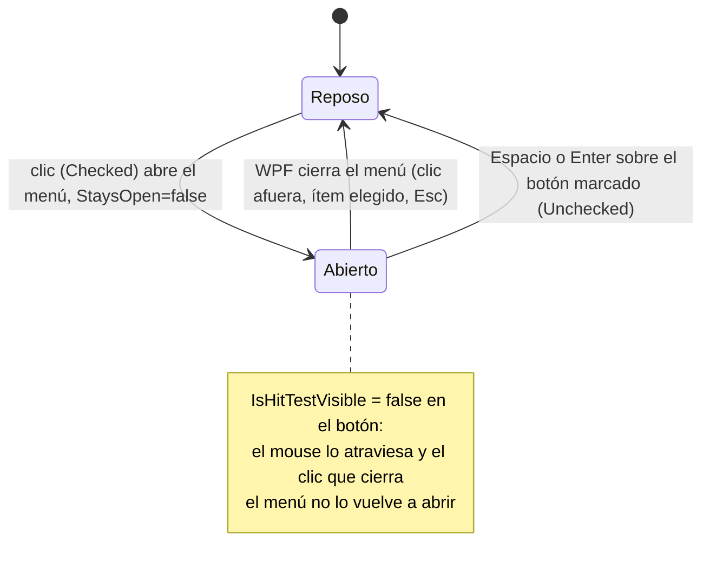
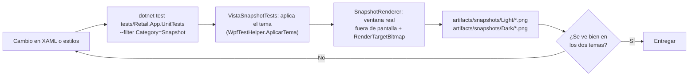

# Sistema de Diseño XAML y Guía de Estilos de UI (Retail POS)

### Proyecto: Retail (Sistema ERP & Punto de Venta para Librería)
**Plataforma:** .NET 8 LTS | WPF (Windows) | C# 12 | WPF-UI 4.0.0 (Fluent Design)  
**Estilo Base:** Windows 11 Modern Fluent Design adaptado a la velocidad y ergonomía de mostrador comercial.

---

## 🎯 Directivas Inviolables de Maquetación XAML

Todo agente o desarrollador que cree o modifique interfaces de usuario (`Views/Pages/`, `Views/Dialogs/` o `MainWindow.xaml`) debe cumplir estrictamente las siguientes cuatro reglas:

### 1. Prohibición de Colores y Pinceles Ad-Hoc
* **Queda estrictamente prohibido** hardcodear códigos hexadecimales de color (`#...`) o nombres de colores estándar de WPF (`Red`, `Blue`, `White`, etc.) directamente en las propiedades de los controles XAML (`Background`, `Foreground`, `BorderBrush`, etc.).
* Toda superficie, texto, borde, foco o estado interactivo debe consumir exclusivamente los tokens semánticos definidos en [`src/Retail.App/Styles/Colors.xaml`](file:///c:/Users/lucas/Proyectos/retail/src/Retail.App/Styles/Colors.xaml) (tema claro) y [`Colors.Dark.xaml`](file:///c:/Users/lucas/Proyectos/retail/src/Retail.App/Styles/Colors.Dark.xaml) (tema oscuro, mismas claves) utilizando `{DynamicResource NombreBrush}`.
* Esto garantiza soporte inmediato para cambios de tema, adaptación de contrastes y consistencia visual en toda la suite. Los espacios, tamaños de letra, radios y alturas tienen la misma regla: se toman de los tokens de la sección *Fundamentos Visuales*.

### 2. Contenedor Obligatorio (`ui:FluentWindow` + `ui:TitleBar`)
* Toda ventana principal o secundaria (incluyendo ventanas modales independientes) debe heredar de `ui:FluentWindow` en lugar de la clase base clásica `System.Windows.Window`.
* Debe incluir la directiva de extensión en la barra de título: `ExtendsContentIntoTitleBar="True"` y `WindowBackdropType="Mica"`.
* **No mergea diccionarios propios:** `ui:ThemesDictionary`, `ui:ControlsDictionary` y los diccionarios de `Styles/` se cargan una sola vez en [`App.xaml`](file:///c:/Users/lucas/Proyectos/retail/src/Retail.App/App.xaml) y toda ventana los hereda. `<ui:FluentWindow.Resources>` queda solo para las claves propias de la ventana (convertidores, constantes). Una copia local de `ui:ThemesDictionary` tapa el acento carmín que aplica `ApplicationAccentColorManager` en `App.xaml.cs` y repone en esa ventana el azul de Windows. `scripts/audit-xaml.ps1` lo rechaza.
* Debe incrustar en su primera fila (`Grid.Row="0"`) el control **`<ui:TitleBar>`**:
  * **Ventana Principal (Shell):** `Height="32"`, `MinHeight="32"`, `Background="{DynamicResource SurfaceBackgroundBrush}"`, título alineado a la izquierda estilizado con `FontFamily="{StaticResource FontFamilyText}"`, `FontSize="12"`, `FontWeight="SemiBold"` y `Foreground="{DynamicResource TextSecondaryBrush}"`. Provee botones de Minimizar, Maximizar (con soporte para **Snap Layouts** de Windows 11) y Cerrar.
  * **Ventanas Modales y Diálogos:** **no usan `<ui:TitleBar>`**: usan **`<components:EncabezadoDialogo Titulo="…" />`** en la fila 0, que dibuja su propia banda (título y botones de ícono, arrastre con `DragMove`; ver *Componentes*, §4). `PermitirMaximizar="True"` solo en diálogos con grillas grandes.
* **Salvaguarda de Pantalla:** Para evitar que la barra de título quede oculta fuera de los límites de monitores de 768p o pantallas con escalado DPI al 125%/150%, las dimensiones deben ser seguras ($Width \le 1180$, $Height \le 704$, $MinHeight \le 560$; 704 incluye la banda de título de 56 px y entra en el área útil de 768p, unos 728 px sin la barra de tareas) y se debe fijar en el constructor:
  ```csharp
  MaxHeight = SystemParameters.WorkArea.Height;
  MaxWidth = SystemParameters.WorkArea.Width;
  ```

### 3. Tipografía Dual de Alta Precisión
* **Interfaz General y Formularios:** **DM Sans** (`FontFamily="{StaticResource FontFamilyText}"`) mediante los estilos de [`src/Retail.App/Styles/Typography.xaml`](file:///c:/Users/lucas/Proyectos/retail/src/Retail.App/Styles/Typography.xaml) (`TextBlockHeader1`, `TextBlockHeader2`, `TextBlockBody`, etc.). Los títulos de 20 px o más usan **DM Sans Display** (`FontFamilyDisplay`), la instancia óptica de 40 px del mismo diseño.
* **Importes, Cantidades y Stock (D-23):** Es **obligatorio** utilizar `FontFamily="{StaticResource FontFamilyNumeric}"` (DM Sans), alineado a la derecha, o los estilos que ya lo traen:
  * El total gigante de venta de mostrador (`TextBlockDisplayCurrency`) y los importes destacados de modales (`TextBlockCurrencyLarge`).
  * Las celdas de precios unitarios y subtotales en `DataGrid` (`TextBlockCurrencyCell`) y las celdas numéricas (`TextBlockNumericCell`: número de fila, cantidades, stock).
  * Los campos de edición de montos, porcentajes y cantidades.
  *Justificación:* con los importes alineados a la derecha, la última cifra y los centavos cierran en la misma vertical, sin la estética de código. DM Sans no publica `tnum` y sus dígitos son proporcionales, así que el separador decimal puede correrse entre montos de distinto ancho; los estilos conservan `Typography.NumeralAlignment="Tabular"` como contrato, aunque la familia no dibuje la variante.
* **Códigos y Textos Técnicos:** **JetBrains Mono** (`FontFamily="{StaticResource FontFamilyMonospace}"`) se reserva para lo que **es** un código: códigos de barras, CUIT/DNI, códigos de proveedor, números de comprobante, teclas de atajo (`TextBlockKeycap`), códigos de color y trazas técnicas (`TextBlockMonospaceCell` en grillas).
* **Las fuentes viajan con la aplicación** (ver *Fuentes embebidas* más abajo): la interfaz se ve igual en cualquier PC. La lista de respaldo, por si el recurso fallara, es Segoe UI Variable / Segoe UI para texto y Cascadia Code / Consolas para códigos.

### 4. Componentes y Botones de Mostrador
* Las acciones de mostrador deben utilizar prioritariamente la botonera con teclas de función (`F1` a `F12`):
  * Botones estándar de función: `Style="{StaticResource KeycapButtonStyle}"` conteniendo una pastilla `<Border Style="{StaticResource KeycapBadgeStyle}">`.
  * Botones de conmutación y filtro de mostrador (`ToggleButton`): `Style="{StaticResource KeycapToggleButtonStyle}"` para filtros con estado activo/inactivo persistente (ej. `Solo con Deuda`). Los filtros **no llevan atajo de teclado** ni pastilla de tecla.
  * Botón principal de cobro / confirmación: `Style="{StaticResource PrimaryActionButtonStyle}"` conteniendo la pastilla carmín `<Border Style="{StaticResource KeycapPrimaryBadgeStyle}">`.
  * **Excepción, tarjeta de la venta del POS:** "Cobrar venta" (`PrimaryActionButtonStyle`, solo texto) y "Cancelar" (`KeycapButtonStyle` con `RegularX`) van dentro de la tarjeta del total, bajo una línea interna, con `Height="42"` y **sin pastilla**: el atajo (`[F12]`, `[F8]`) va en el `ToolTip`. Así el total sigue siendo lo más destacado de la columna.
* Las tablas deben implementar obligatoriamente `Style="{StaticResource DataGridRetailStyle}"`, sus filas `DataGridRowRetailStyle` y sus celdas `DataGridCellRetailStyle`, garantizando selección suave horizontal sin bordes verticales divisorios. El estilo desplaza **por píxeles** (`VirtualizingPanel.ScrollUnit="Pixel"`) sin perder la virtualización: `ScrollViewer.CanContentScroll` queda en `True`, porque con `False` la grilla dibuja todas las filas (RNF-03). La barra horizontal es automática y solo aparece si las columnas no entran: por eso **toda columna `Width="*"` declara su `MinWidth`** (240 para una descripción), y no se usa `MinColumnWidth` global, que ensancharía las columnas de íconos.
* **Encabezados alineados con su celda:** el título de una columna sigue la alineación de sus datos. Las columnas de importes y números (`TextBlockCurrencyCell`, `CeldaNumericaDerecha`) declaran `HeaderStyle="{StaticResource DataGridColumnHeaderRightStyle}"`, para que el título quede sobre los dígitos; las que centran controles (cantidad con `-` / `+`, acciones) usan `DataGridColumnHeaderCenterStyle`. Las grillas compactas del Tablero usan `EncabezadoMuyCompactoDerecha` / `EncabezadoCompactoDerecha`, que conservan su relleno reducido. `scripts/audit-xaml.ps1` rechaza una `DataGridTextColumn` con celda a la derecha y sin `HeaderStyle`; no alcanza a las `DataGridTemplateColumn`, donde se declara a mano.
* **Contador de cantidad del POS:** `-` y `+` son `KeycapButtonStyle` de 24×24 con `RegularMinus` / `RegularPlus`, de la misma altura que el cuadro de la cantidad. Los tres miden 24 px porque es el alto útil de la celda (fila de 42 px menos sus bordes y el relleno de 8 px): un control más alto se recorta. Tras el clic el foco vuelve al buscador (`OnAjusteCantidadClick`), igual que con Enter o Esc: el botón no queda marcado y el cajero sigue escaneando.
* **Controles editables dentro de celdas de `DataGrid`** (`ComboBox`, `TextBox`, `CheckBox` en un `CellTemplate`): su binding declara siempre `UpdateSourceTrigger=PropertyChanged`. La grilla agrupa los bindings de cada fila en un `BindingGroup` y, sin el trigger explícito, retiene el valor hasta que la fila confirma la edición, cosa que nunca pasa con `DataGridRetailStyle` (`IsReadOnly=True`): la pantalla muestra lo elegido pero el ViewModel no lo recibe. Lo verifica [`EdicionEnCeldasDeGrillaTests.cs`](file:///c:/Users/lucas/Proyectos/retail/tests/Retail.App.UnitTests/EdicionEnCeldasDeGrillaTests.cs).
* **Indicador de pasos** (diálogos con recorrido, p. ej. la incorporación con sugerencias): círculos numerados unidos por una línea, carmín sólido el paso actual, carmín suave con tilde los completados y gris los pendientes; sin borde de pastilla ni cursor de mano, porque informa y no navega. El indicador va en la **misma fila** que el título de la tarjeta y su interruptor, y los pasos no repiten título propio. La navegación va en el **pie, como en un asistente**: `Cancelar · ← Anterior · Siguiente: <destino> →` en los pasos previos y `Cancelar · ← Anterior · Confirmar` en el último (M-70); "Confirmar" no aparece antes del último paso.
* Los estados de negocio (stock bajo, éxito fiscal, errores) deben representarse con los badges semáforo: `BadgeWarningStyle`, `BadgeDangerStyle` y `BadgeSuccessStyle`.
* **Desplegables de resultados de búsqueda** (buscador del POS): contenedor flotante con borde `SurfaceBorderBrush` y sombra (`DropShadowEffect` con `ElevationShadowColor`) para despegarlo de la página; filas con `ItemContainerStyle="{StaticResource SearchResultListBoxItemStyle}"` (fila completa, cursor de mano, carmín sólido al seleccionarse) y textos con `SearchResultTitleTextStyle`, `SearchResultAmountTextStyle` y `SearchResultMetaTextStyle`, que pasan a `PrimaryForegroundBrush` / `PrimaryLightBrush` sobre el carmín. El hover selecciona la fila: mouse y teclado comparten un único estado de selección. Ver la sección 6.1 de [`StyleGalleryView.xaml`](file:///c:/Users/lucas/Proyectos/retail/src/Retail.App/Views/Dev/StyleGalleryView.xaml).
* **Botones de ícono:** para eliminar una fila de grilla o lista, `IconDangerButtonStyle` (28×28, sin borde ni fondo, ícono gris `TextMutedBrush` que pasa a `DangerForegroundBrush` sobre `DangerBackgroundBrush` en hover); para una acción secundaria de solo ícono junto a un botón primario, `IconPrimarySquareButtonStyle` (56×56, `PrimaryLightBrush` con borde e ícono carmín; en hover, el carmín sólido del botón primario; deshabilitado con opacidad 0,45 y cursor de prohibido, igual que `PrimaryActionButtonStyle`). El ícono **no** fija `Foreground`: lo hereda del botón. Siempre con `ToolTip` que nombre la acción y su atajo. Ver la sección 6.2 de la galería.
* **Enums en pantalla:** nunca se muestra el nombre de un enum del Dominio (`TarjetaDebito`). Los `ComboBox` usan `ItemTemplate="{StaticResource EnumTextoItemTemplate}"` y los `TextBlock` `Converter={StaticResource EnumATextoConverter}`, ambos en `Controls.xaml`. Los textos se definen en [`EnumATextoConverter.cs`](file:///c:/Users/lucas/Proyectos/retail/src/Retail.App/Converters/EnumATextoConverter.cs) (presentación, no Dominio).
* **Visibilidad invertida:** el `BooleanToVisibilityConverter` de WPF **ignora** `ConverterParameter`. Para ocultar con `true` se usa `InverseBooleanToVisibilityConverter` (declarado en los recursos de la vista, como `CajaView` y `PosView`), y un `string` nunca se enlaza a un conversor booleano: se expone una propiedad `bool` (`TieneError`).

### 5. Diálogos Modales y Formularios
* **Una sola superficie:** el diálogo es un único fondo gris (`Background="{DynamicResource DialogBackgroundBrush}"`): la barra de título, el cuerpo y el pie lo comparten, **sin franjas ni líneas** que los separen.
* **Barra de Título Estandarizada:** `<components:EncabezadoDialogo Titulo="…" />`: título de 20 SemiBold (DM Sans Display) y, a la derecha, minimizar y cerrar como **íconos** que en hover solo se oscurecen (no imitan los botones de Windows). Banda de 56 px; un diálogo de alto fijo la cuenta en su `Height`.
* **Secciones:** los campos se agrupan en secciones blancas **sin borde** (`DialogSectionStyle`), separadas solo por el aire, a 12 px de los bordes del diálogo. Cada sección conserva su ícono + título (`CardHeaderIconStyle` + `CardHeaderTextStyle`). El título del diálogo y el contenido de las secciones comparten la vertical de 28 px (12 de margen + 16 de relleno).
* **Pie:** `Border` con `Style="{StaticResource DialogFooterStyle}"`, sobre el mismo gris y sin línea: Cancelar a la izquierda y la acción primaria a la derecha, alineados con los bordes de las secciones.
* **Teclado:** **Esc cierra todo diálogo** (lo resuelve `EncabezadoDialogo`, igual que la ✕, si ningún control usó la tecla antes: un desplegable abierto se cierra primero). **Enter acepta todo diálogo:** el botón primario lleva `IsDefault="True"` (WPF lo ejecuta si el control enfocado no usa Enter, como una grilla o un cuadro multilínea). No se usa `IsCancel`: Esc ya está resuelto en un solo lugar.
* **Dimensiones Normalizadas de Diálogos Modales:**
  * **Modal Compacto (Auth / Cambios de Clave):** `Width="460"`, `Height="390"`.
  * **Modal Estándar (ABM Clientes / Usuarios / Cobranzas):** `Width="520-540"`, `Height="620-640"`.
  * **Modal Amplio (Fórmulas / Importar planilla):** `Width="580"`, `Height="660"`.
  * **Modal de Ficha en dos columnas (Artículo de catálogo):** `Width="960"`, `SizeToContent="Height"` y `MinHeight="0"` (como `ClasificacionFormDialog`): la ventana mide lo que su contenido, sin espacio vacío bajo las tarjetas, y el tope lo pone `MaxHeight = WorkArea.Height`. El valor de solo lectura junto a un cuadro editable (el costo fijado por la principal) es un campo gris con candado de la misma altura que el cuadro vecino (`Height="{Binding ActualHeight, ElementName=…}"`), no texto suelto. A la izquierda, qué es el artículo (Identificación y Stock); a la derecha, cuánto cuesta (Fuentes y Precio), en el orden en que se calcula. La lista de fuentes scrollea sola (`MaxHeight="168"`, unos 3 renglones), de modo que el precio de venta queda siempre a la vista. Se conserva el `ScrollViewer` externo como red de seguridad en pantallas de 768p con escalado.
* **Encabezado de tarjeta en formularios (`CardHeaderIconStyle` + `CardHeaderTextStyle`, en `Controls.xaml`):** ícono BoxIcons de 16 (en `TextSubtleBrush`, con 8 px de margen a su derecha) y título de 14 SemiBold (`FontSizeMd`, en `TextPrimaryBrush`): el ícono se lee como grabado en la tarjeta y no compite con los datos. El tamaño se calibra en esos dos estilos y lo toman todas las tarjetas. Las etiquetas de campo no llevan "(Opcional)": solo los obligatorios se marcan con `*`.
* **Elegir entre opciones excluyentes:** dos estilos de `RadioButton`, según cuántas opciones haya. No reemplazan al `ui:ToggleSwitch`, que activa o desactiva un **modo**: "Servicio encendido" no significa nada.
  * **Selector segmentado (`SelectorSegmentado` + `SegmentedRadioButtonStyle`):** dos o tres opciones fijas, como "Producto · Servicio". `SelectorSegmentado` dibuja el riel (`SurfaceSubtleBrush`, radio 8) y un único indicador (`SurfaceCardBrush`, radio 6, sin carmín) que se desliza hasta la opción marcada (`DuracionTransicion` de 180 ms, EaseOut; sin animar si Windows desactiva las animaciones); las opciones son `RadioButton` en un `UniformGrid` que solo dibujan texto, y el foco de teclado muestra el anillo neutro `FocusVisualRetailStyle`. Cada opción lleva ícono + texto y `AutomationProperties.Name`. Detalle en la sección *Componentes*.
  * **Píldoras (`PillRadioButtonStyle`):** muchas opciones que pueden pasar de línea, como las pestañas de reporte del Tablero. Selección de marca (`PrimaryLightBrush`, borde `PrimaryBrush`, D-28).
  * **Enlace:** todos los botones del grupo enlazan **una sola** propiedad con `IgualAParametroConverter` y su valor en `ConverterParameter` (un enum, o `sys:Boolean` para un sí/no). Desmarcarse no escribe nada. No se enlaza cada botón a una propiedad booleana inversa (`EsProducto` / `EsServicio`): el formulario de artículo lo hacía así y abría sin ninguna opción marcada.
* **Entrada numérica (`helpers:EntradaNumericaHelper`):** ayuda de entrada que filtra lo tipeado y lo pegado y bloquea el espacio; la validación sigue en el ViewModel.
  * `SoloDigitos="True"` para cantidades enteras: stock actual y stock mínimo.
  * `SoloDecimal="True"` para importes y porcentajes: costo de reposición y margen. Admite un único separador decimal, el de la cultura con la que el binding interpreta el número (el `Language` del cuadro), porque aceptar el otro haría que "6,5" se leyera como 65. Tipear "." o "," inserta el separador correcto.
* **Importe resultado en un formulario** (p. ej. el precio de venta): recuadro neutro (`SurfaceBackgroundBrush` con borde `SurfaceBorderBrush`) e importe en `TextBlockCurrencyLarge`. El carmín queda para la acción principal: un recuadro carmín suave con borde se confunde con un aviso.
* **Fila destacada en una lista de formulario** (la fuente principal): fondo `PrimaryLightBrush` por `DataTrigger`, con la lista recortada por `helpers:EsquinasHelper.RadioDelRecorte` para que el fondo no tape las esquinas redondeadas del borde.
* **Dato con historial (stock actual en edición):** se muestra como texto con un botón "Ajustar" de la misma altura que el cuadro vecino (`Height="{Binding ActualHeight, ElementName=…}"`) que habilita el campo y deja ver la diferencia ("Ajuste: 0 → 12 (+12)") con "Aceptar" y "Descartar". En el alta el campo se edita directo como "Stock inicial", porque cargar la existencia inicial no es un ajuste. Cuando exista el registro de ajustes con motivo, el mismo botón abrirá su diálogo.
  * **Modal de Trabajo (Incorporar artículos con sugerencias):** `Width="1040"`, `Height="680"`, redimensionable. Reservado a diálogos donde se revisa una grilla editable fila por fila (Track 6.6, P6-9); el contenido se agrupa en tarjetas por tema (p. ej. "Ganancia global" y "Clasificación").
* **Interruptor de modo (`ui:ToggleSwitch`):** para activar o desactivar un modo de trabajo dentro de un diálogo (p. ej. "Sugerir clasificación"), en el encabezado de la tarjeta que controla, y también para filtros de lista sí/no (p. ej. "Solo ambiguos"). Encendido toma el carmín exacto de marca, porque [`Colors.xaml`](file:///c:/Users/lucas/Proyectos/retail/src/Retail.App/Styles/Colors.xaml) redefine `ToggleSwitchFillOn*` / `ToggleSwitchStrokeOn*` con los colores `SystemAccentColor*`; el resto de los acentos de WPF-UI (`AccentFillColor*Brush`) los calcula `ApplicationAccentColorManager` a partir del carmín.
* **Opciones "Sin …" en selectores:** cuando "ninguno" es una elección válida, va como opción del combo (`OpcionDiccionario` con `Id` nulo), no como casilla aparte. El combo **nunca se ve vacío**: empieza en `OpcionDiccionario.SinClasificar` ("Sin clasificar", nadie decidió). Solo se ofrece una opción "Sin …" confirmada si el dato la distingue de "sin clasificar": "Sin marca" sí (M-7, D-18); "Sin categoría" no, porque se guardaría igual (M-70).
* **Acción de texto en una fila** (`GhostPrimaryButtonStyle`): ícono de 12 y texto carmín de 12, sin borde ni fondo, fondo carmín suave en hover. Para acciones secundarias que conviven con los controles de la fila (p. ej. "Restablecer" bajo el estado de una fila corregida). No reemplaza a `IconDangerButtonStyle` para eliminar.
* **Controles de formulario (`ComboBox`, `CheckBox`, `TextBox` / `PasswordBox`):** el proyecto **no define estilos implícitos globales** para estos controles: se usan los de WPF-UI, que toman el acento de la aplicación (carmín `#9D0F33` en claro, `#D63A62` en oscuro, aplicado por `ApplicationAccentColorManager`) y la fuente DM Sans (la clave `ContentControlThemeFontFamily` de WPF-UI se redefine en `Typography.xaml`). Lo propio se aplica por nombre: `ComboBoxFiltroStyle` (combos de filtro de 32 px, hereda el estilo de WPF-UI) y `CheckBoxCompactStyle` (casilla de 16 × 16 para grillas). `ui:TextBox` / `ui:PasswordBox` conservan márgenes y alturas del framework.

---

## 🧱 Fundamentos Visuales

Reglas de base del sistema. Cada token vive en [`Styles/Spacing.xaml`](../src/Retail.App/Styles/Spacing.xaml), [`Styles/Typography.xaml`](../src/Retail.App/Styles/Typography.xaml) o [`Styles/Colors.xaml`](../src/Retail.App/Styles/Colors.xaml) / [`Colors.Dark.xaml`](../src/Retail.App/Styles/Colors.Dark.xaml); una vista no escribe un valor suelto si existe el token.

### 1. Grilla de 4 px y tokens de espaciado
Todo margen, relleno y tamaño es múltiplo de 4 (se admiten 0, 1 y 2 para líneas finas y el riel del selector segmentado). Regla de proximidad: lo relacionado va más junto que lo no relacionado. Los tokens son `StaticResource` (no cambian en ejecución).

| Familia | Tokens | Cuándo usarla |
| :--- | :--- | :--- |
| **Escala** | `Space4`, `Space8`, `Space12`, `Space16`, `Space24`, `Space32` (`sys:Double`) | Anchos de columna espaciadora, `Spacing` de un panel, tamaños derivados. |
| **Apilado (`Stack*`)** | `StackXs` 4 · `StackSm` 8 · `StackMd` 12 · `StackLg` 16 · `StackXl` 24 (margen **inferior**) | Separar un elemento del que está debajo: etiqueta y campo (Xs), campos de un formulario (Sm o Md), bloques de una tarjeta (Lg), secciones (Xl). |
| **Inline (`Inline*`)** | `InlineXs` 4 · `InlineSm` 8 · `InlineMd` 12 (margen **derecho**) | Separar un elemento del que está a su derecha: ícono y texto (Xs), botones en fila (Sm), grupos de controles (Md). |
| **Relleno (`Inset*`)** | `InsetCard` 16 · `InsetCompact` 12,8 | Relleno interno de una tarjeta (`InsetCard`, lo usa `CardBorderStyle`) y de barras, chips o filas de resumen (`InsetCompact`). |
| **Página** | `PageMargin` 24,16,24,24 · `SectionSpacing` 16 inferior · `CardSpacing` 8 inferior · `ColumnSpacing` / `ColumnGap` 16 | Margen del `Grid` raíz de **toda** página (arriba es 16 porque la barra de título ya separa del borde), entre secciones apiladas, entre tarjetas relacionadas y entre dos columnas. |

* **Excepción documentada:** el Dashboard conserva su separación propia de 12 entre bloques (más denso por las tarjetas KPI), pero usa `PageMargin`.
* **Auditoría:** `scripts/audit-xaml.ps1` rechaza una página cuyo `Grid` raíz declare un margen literal y **avisa** (sin fallar) de los `Margin`, `Padding` y `CornerRadius` literales fuera de la grilla de 4 px; con `-Detalle` lista cada ocurrencia. Es una deuda a bajar de a poco, no un bloqueo.

### 2. Escala tipográfica
Definida en `Typography.xaml`. Se usa el token (`{StaticResource FontSizeBase}`) o el estilo de `TextBlock` que ya lo trae; nunca un `FontSize` suelto.

| Token | px | Uso |
| :--- | :---: | :--- |
| `FontSize2Xs` | 10 | Solo teclas de atajo compactas (`KeycapTextSmall`). |
| `FontSizeXs` | 11 | Metadatos y teclas de atajo (`TextBlockCaptionSecondary`, `TextBlockKeycap`). |
| `FontSizeSm` | 12 | Leyendas y celdas de código (`TextBlockCaption`, `TextBlockMonospaceCell`). |
| `FontSizeBase` | 13 | **Cuerpo**, etiquetas, botones y celdas de grilla. |
| `FontSizeMd` | 14 | Título de tarjeta de formulario (`CardHeaderTextStyle`). |
| `FontSizeLg` | 16 | Cabecera de sección o de modal (`TextBlockHeader2`). |
| `FontSizeXl` | 20 | Título de pantalla (`TextBlockHeader1`). |
| `FontSize2Xl` | 24 | Título de página (`TextBlockPageTitle`) e importe destacado (`TextBlockCurrencyLarge`). |
| `FontSizeDisplay` | 32 | Total del POS (`TextBlockDisplayCurrency`). |

### 3. Radios y radios concéntricos
`RadiusSm` 4 (badges, chips de tecla) · `RadiusMd` 6 (botones, campos, opciones de selector) · `RadiusLg` 8 (tarjetas, grillas, el anillo de foco, el riel del selector) · `RadiusPill` 999 (cápsulas e indicadores).

**Regla concéntrica:** cuando una forma redondeada contiene a otra, el radio interior es el exterior **menos el relleno que las separa**, para que las curvas queden paralelas. Ejemplos: riel del selector segmentado 8 − 2 de relleno = indicador 6; control de radio 6 + 2 px de anillo de foco = anillo de radio 8. Si el interior usara el mismo radio que el exterior, sus esquinas se verían "más gordas" que el marco que las rodea.

### 4. Alturas de controles y densidad por contexto
| Token | px | Uso |
| :--- | :---: | :--- |
| `ControlHeightSm` | 28 | Botones de ícono dentro de una fila (`RowMenuButtonStyle`, `IconDangerButtonStyle`) y los de la barra de paginación. |
| `ControlHeight` | 34 | **Back-office** (34: múltiplo de 2, única excepción a la grilla de 4, para dar aire vertical al texto de 14): botones, buscador, combos de filtro, opción del selector segmentado (más el relleno del riel). |
| `ControlHeightLg` | 40 | **Mostrador (POS y diálogos de caja):** botones con `MinHeight` local. |
| `RowHeightListado` | 36 | Fila de las grillas de listado (`DataGridListadoStyle`) y alto de cada ítem del Sidebar. |
| `RowHeightPos` | 42 | Fila de la grilla del mostrador (`DataGridRowRetailStyle`) y botones "Cobrar" / "Cancelar" del POS. |

* **Por qué dos densidades:** el back-office se opera con mouse y mucha información en pantalla, así que se compacta (32 / 36). El mostrador se opera de pie, con apuro y a veces con pantalla táctil: por la **ley de Fitts** (el tiempo para alcanzar un blanco crece cuanto más chico y más lejos está), sus botones no bajan de 40 px y sus filas miden 42. El POS y los diálogos de cobro y caja lo logran con un `MinHeight` local sobre los mismos estilos; no existen estilos paralelos.

### 5. Uso del acento (carmín)
El carmín es escaso a propósito: **solo** rellena la acción principal de la vista, marca el ítem activo (opción marcada de una píldora, paso actual de un asistente), el tilde de una casilla marcada y la línea seleccionada del POS. El resto de los estados interactivos no usan marca.

### 6. Estados neutros (hover, pressed, selected)
| Estado | Token (claro / oscuro) | Notas |
| :--- | :--- | :--- |
| Hover | `SurfaceHoverBrush` `#F4F4F5` / `#27272A` | Gris neutro. **El hover nunca cambia el borde** (solo el fondo): un borde que cambia con el mouse se lee como foco. |
| Selected | `SurfaceSelectedBrush` `#EEEEF0` / `#2A2A2E` | Fila elegida de un listado. |
| Pressed | `SurfacePressedBrush` `#E4E4E7` / `#3F3F46` | Botón o ítem mientras se mantiene presionado. |
| Riel o cabecera | `SurfaceSubtleBrush` `#F4F4F5` / `#1F1F23` | Riel del selector segmentado, cabeceras, banda de filtros. |
| Divisor de fila | `SurfaceBorderSubtleBrush` `#F0F0F2` / `#1F1F23` | Línea entre filas de una grilla. |

Excepciones de marca: el botón primario (`PrimaryHoverBrush` / `PrimaryPressedBrush`) y la línea seleccionada del POS (`PrimaryLightBrush` con borde `PrimaryBrush`).

### 7. Foco de teclado
`FocusVisualRetailStyle` (en `Controls.xaml`) dibuja un **anillo neutro de 2 px** (`TextSubtleBrush`), por fuera del control y de radio 8, y WPF lo muestra **solo cuando el foco llega por teclado** (Tab o flechas), nunca por un clic: es el equivalente de `:focus-visible` en la web. Reemplazó a los triggers `IsKeyboardFocused` / `IsFocused`, que también se activaban al hacer clic y dejaban un borde de color pegado al botón recién presionado. Los estilos de botón y de opción de selector lo declaran con `FocusVisualStyle`; los que dibujan su propio estado (filas de grilla, botones de ícono dentro de una fila) lo anulan con `{x:Null}`.

### 8. Movimiento
* **Solo para comunicar un cambio de estado** (una opción que se desplaza, un panel que aparece), nunca decorativo.
* Duración **150 a 200 ms**: el token `DuracionTransicion` vale 180 ms. Curva **EaseOut** (arranca rápido y frena: responde al gesto del usuario), por ejemplo `CubicEase { EasingMode = EaseOut }`.
* **Se desactiva con la preferencia de Windows:** el código que anima consulta `SystemParameters.ClientAreaAnimation` y, si está apagada, fija el valor final sin animar (lo hace `SelectorSegmentado`).

---

## 🌗 Temas Claro y Oscuro

La aplicación tiene dos paletas con **exactamente las mismas claves**: [`Colors.xaml`](../src/Retail.App/Styles/Colors.xaml) (claro) y [`Colors.Dark.xaml`](../src/Retail.App/Styles/Colors.Dark.xaml) (oscuro). Las vistas consumen solo tokens semánticos con `{DynamicResource ...}`, así que cambiar de tema es cambiar el diccionario de paleta (junto con el `ThemesDictionary` de WPF-UI y `ApplicationAccentColorManager.Apply`; en las pruebas lo hace `WpfTestHelper.AplicarTema(TemaPrueba)`).

* **Paridad garantizada por prueba:** [`PaletaTemasTests.cs`](file:///c:/Users/lucas/Proyectos/retail/tests/Retail.App.UnitTests/Styles/PaletaTemasTests.cs) falla si una clave existe en un diccionario y no en el otro. Al agregar un token se agrega en los dos archivos.
* **Contraste y el carmín oscuro:** el carmín de marca `#9D0F33` da 8,24:1 sobre blanco pero solo 2,42:1 sobre el fondo oscuro `#09090B`. Por eso en el tema oscuro el acento se aclara a **`#D63A62`** (4,40:1 sobre la página y 3,92:1 sobre una tarjeta `#18181B`; el texto blanco sobre ese relleno da 4,53:1, cumple AA). Los tonos suaves (`PrimaryLightBrush`, semáforos) pasan a fondos oscuros teñidos con texto claro. `TextSubtleBrush` en oscuro es `#8B8B94` (5,25:1 sobre una tarjeta).
* **Limitación conocida (pendiente para el PR del interruptor de tema):** los íconos declarados como `{iconPacks:BoxIconsImage Kind=..., Brush={StaticResource TextMutedBrush}}` (p. ej. la lupa de los buscadores) resuelven el pincel **una sola vez**, con `StaticResource`, al crear la imagen: **no se repintan al cambiar de tema en ejecución**. Hasta migrarlos (por ejemplo a `PackIconBoxIcons` con `Foreground="{DynamicResource ...}"`), un cambio de tema en vivo deja esos íconos con el color anterior.

---

## 🎨 Catálogo de Tokens Semánticos de Color

Definidos en [`Colors.xaml`](file:///c:/Users/lucas/Proyectos/retail/src/Retail.App/Styles/Colors.xaml) (tema claro) y [`Colors.Dark.xaml`](file:///c:/Users/lucas/Proyectos/retail/src/Retail.App/Styles/Colors.Dark.xaml) (tema oscuro). Las tablas muestran los dos valores.

### 1. Paleta de Marca (Carmín / Borravino)
| Token XAML | Claro | Oscuro | Uso Semántico |
| :--- | :---: | :---: | :--- |
| `PrimaryBrush` | `#9D0F33` | `#D63A62` | Relleno de la acción principal (Cobro, "Nuevo ..."), ítem activo, tilde de casilla, línea seleccionada del POS. |
| `PrimaryHoverBrush` | `#850C2A` | `#E04D73` | *Hover* del botón primario. |
| `PrimaryPressedBrush` | `#6B0720` | `#B82E52` | *Pressed* del botón primario y texto de una opción marcada en píldoras. |
| `PrimaryLightBrush` | `#FDF2F4` | `#3A1520` | Tinte suave de marca: opción marcada de una píldora, filas marcadas con casilla, línea seleccionada del POS. |
| `PrimaryForegroundBrush`| `#FFFFFF` | `#FFFFFF` | Texto legible sobre superficies carmín. |

### 2. Superficies y Fondos (Zinc Neutral)
| Token XAML | Claro | Oscuro | Uso Semántico |
| :--- | :---: | :---: | :--- |
| `SurfaceBackgroundBrush` | `#FAFAFA` | `#09090B` | Fondo de ventana y de páginas. |
| `SurfaceCardBrush` | `#FFFFFF` | `#18181B` | Fondo de tarjetas y filas de datos. |
| `SurfaceBorderBrush` | `#E4E4E7` | `#27272A` | Bordes de tarjetas e inputs, separadores. |
| `SurfaceBorderFocusedBrush`| `#9D0F33` | `#D63A62` | Borde de un input con foco. |
| `SurfaceHoverBrush` | `#F4F4F5` | `#27272A` | *Hover* neutro de filas y botones fantasma. |
| `SurfaceSubtleBrush` | `#F4F4F5` | `#1F1F23` | Rieles, cabeceras y banda de filtros. |
| `SurfaceSelectedBrush` | `#EEEEF0` | `#2A2A2E` | Fila seleccionada de un listado. |
| `SurfacePressedBrush` | `#E4E4E7` | `#3F3F46` | Estado presionado neutro. |
| `SurfaceBorderSubtleBrush` | `#F0F0F2` | `#1F1F23` | Divisor entre filas de una grilla. |
| `HeaderBackgroundBrush` | `#18181B` | `#27272A` | Fondos de contraste o barras institucionales. |

### 3. Textos y Jerarquía de Lectura
| Token XAML | Claro | Oscuro | Uso Semántico |
| :--- | :---: | :---: | :--- |
| `TextPrimaryBrush` | `#18181B` | `#FAFAFA` | Títulos, descripciones de artículos, importes. |
| `TextSecondaryBrush` | `#52525B` | `#A1A1AA` | Etiquetas de formulario, nombres de columnas, metadatos. |
| `TextMutedBrush` | `#A1A1AA` | `#71717A` | Deshabilitados, *placeholders*, versiones. |
| `TextSubtleBrush` | `#71717A` | `#8B8B94` | Íconos de encabezado de tarjeta y anillo de foco. En claro da 4,8:1 sobre blanco y cumple AA; `TextMutedBrush` (2,6:1) no alcanza para un título. |
| `TextOnDarkBrush` | `#FAFAFA` | `#FAFAFA` | Texto sobre fondos oscuros fijos. |

### 4. Semáforos de Negocio (Librería POS)
| Token Semáforo | Fondo (claro / oscuro) | Texto (claro / oscuro) | Borde (claro / oscuro) | Caso de Uso en Negocio |
| :--- | :--- | :--- | :--- | :--- |
| **Alerta (Warning)** | `#FEF3C7` / `#3B2A0A` | `#92400E` / `#FCD34D` | `#FCD34D` / `#78510F` | Stock $\le$ Stock Mínimo (`RF-08`), advertencias de turno de caja. |
| **Peligro (Danger)** | `#FEE2E2` / `#3B1414` | `#991B1B` / `#FCA5A5` | `#FCA5A5` / `#7F1D1D` | Error fiscal ARCA (`RF-16`), límite de crédito excedido (`RF-02`), anulación de línea. |
| **Éxito (Success)** | `#D1FAE5` / `#0B2E22` | `#065F46` / `#6EE7B7` | `#6EE7B7` / `#065F46` | Cobro confirmado, turno de caja abierto, sincronización fiscal correcta. |

Los pinceles se llaman `WarningBackgroundBrush`, `WarningForegroundBrush`, `WarningBorderBrush` (ídem `Danger*` y `Success*`); el color puro de cada semáforo (`WarningColor` `#D97706` / `#F59E0B`, `DangerColor` `#DC2626` / `#F87171`, `SuccessColor` `#059669` / `#34D399`) alimenta puntos de estado e íconos.

### 5. Pastillas de Teclado Rápido (Keycaps F1 a F12)
| Token XAML | Claro | Oscuro | Uso Semántico |
| :--- | :---: | :---: | :--- |
| `KeycapBackgroundBrush` | `#27272A` | `#27272A` | Fondo de la tecla rápida en botones estándar. |
| `KeycapBorderBrush` | `#3F3F46` | `#3F3F46` | Borde de la tecla rápida en botones estándar. |
| `KeycapForegroundBrush` | `#FAFAFA` | `#FAFAFA` | Letra de la tecla. |
| `KeycapPrimaryBackgroundBrush` | `#6B0720` | `#6B0720` | Fondo de la tecla rápida en botones primarios (`[F12]`). |
| `KeycapPrimaryBorderBrush` | `#850C2A` | `#9D0F33` | Borde de la tecla rápida en botones primarios. |

### 6. Elevación
| Token XAML | Claro | Oscuro | Uso Semántico |
| :--- | :---: | :---: | :--- |
| `ElevationShadowColor` | `#18181B` | `#000000` | `Color` (no pincel) para `DropShadowEffect` de superficies flotantes: desplegables y popups. Opacidad recomendada 0.18. |

### 7. Sidebar
Es una superficie **clara en el tema claro** (`#F4F4F5`, el mismo gris que el riel) y más oscura que la página en el tema oscuro (`#121214`); el ítem activo se marca con una píldora neutra, no carmín.

| Token XAML | Claro | Oscuro | Uso Semántico |
| :--- | :---: | :---: | :--- |
| `SidebarBackgroundBrush` | `#F4F4F5` | `#121214` | Fondo del menú lateral. |
| `SidebarBorderBrush` | `#E4E4E7` | `#27272A` | Borde derecho y separadores. |
| `SidebarHoverBrush` | `#EAEAEC` | `#27272A` | Fondo de hover. |
| `SidebarPressedBrush` | `#E4E4E7` | `#3F3F46` | Fondo al presionar y pulgar del scroll. |
| `SidebarTextBrush` | `#52525B` | `#D4D4D8` | Texto e íconos de los ítems en reposo. |
| `SidebarTextStrongBrush` | `#18181B` | `#FAFAFA` | Texto en hover y nombre del operador. |
| `SidebarTextMutedBrush` | `#71717A` | `#A1A1AA` | Títulos de sección. |
| `SidebarAccentBrush` | `#9D0F33` | `#F36F8E` | Íconos o texto de acento (en claro el carmín de marca da 7,5:1 sobre el fondo del Sidebar). |
| `SidebarActiveBackgroundBrush` / `SidebarActiveForegroundBrush` | `#E4E4E7` / `#18181B` | `#27272A` / `#FAFAFA` | Píldora del ítem activo. |

* **Hover y pressed de `SidebarItemButtonStyle` viven en `Style.Triggers`**, no en el template, para que el trigger del ítem activo declarado en la vista prevalezca.
* **Centrado del glifo en el riel colapsado:** cada ítem reserva una columna fija de 36 px para el ícono (20 px + 8 px de aire a cada lado), más ancha que el área útil del botón cuando el riel está en 58 px. Por eso, colapsado el ítem va sin relleno lateral (`Padding="0,0"`) y con `HorizontalContentAlignment="Center"`: así la columna entra completa y queda centrada en el eje del riel en vez de desplazada por el relleno. El `DataTrigger` de `IsSidebarExpanded` restaura `Padding="8,0"` y `Stretch` al expandir. Cualquier cambio de ancho del riel debe reevaluar esta cuenta (el ancho del ScrollViewer menos 12 px tiene que seguir conteniendo los 36 px).
* **Botón hamburguesa:** centrado en el eje del riel cuando está colapsado y anclado a la izquierda cuando está expandido, siempre sobre el mismo eje que los íconos de los ítems. El ícono indica la acción: `RegularMenu` (expandir) cuando está colapsado y `RegularDockLeftArrow` (contraer) cuando está expandido; el ToolTip dice "Expandir menú lateral" o "Contraer menú lateral" más `Ctrl+B`.
* **Scroll con autoocultado (`SidebarScrollViewerStyle`):** la barra vertical flota sobre el contenido (no quita ancho a los ítems) y solo aparece mientras el mouse está sobre el menú.
* **Entrada temporal "Galería (Dev)":** al final del Sidebar, tras un divisor, abre la galería de estilos (`NavegarGaleriaDevCommand`). Se quita antes del release de producción (Etapa 6).

---

## 📋 Páginas de Listado (Buscador + Filtros + Grilla)

Patrón de las páginas de catálogo y padrón (Artículos como piloto; Clientes, Proveedores, Usuarios, Importador y Pedidos adoptan el encabezado y la grilla). Los estilos viven en [`Styles/Listados.xaml`](../src/Retail.App/Styles/Listados.xaml) y los componentes en [`Views/Components/`](../src/Retail.App/Views/Components/).

```text
PageHeader (sin tarjeta)  ·················· título · acciones a la derecha
ListToolbar (sin tarjeta)                                  búsqueda · limpiar filtros · N resultados
             (con filas marcadas: búsqueda · [N seleccionados ✕] ···· acciones)
┌─ TablaListadoStyle (la única superficie) ──────────────┐
│ DataGrid (DataGridListadoStyle, sin borde propio)      │  ocupa el alto disponible
│   Artículo   Categoría ⏷   Marca ⏷   Distribuidor ⏷ … │  filtros en la cabecera (FiltroColumna)
├────────────────────────────────────────────────────────┤
│ Página [1] de 13 │ Filas por página [10▾]   « ‹ 1 2 3 … 11 12 13 › » │  PaginationBar
└────────────────────────────────────────────────────────┘
```

**Premisa: menos rectángulos.** Una tarjeta que agrupa buscador, botones y tabla agrega una superficie que no informa nada. El buscador y las acciones van sobre el fondo; la tabla es la única superficie y la paginación es su continuación (Artículos es el piloto; el resto migra en la etapa de migración visual).

| Pieza | Qué es | Regla de uso |
| :--- | :--- | :--- |
| `PageHeader` | Control con contenido (`Titulo`, `Subtitulo`; el contenido son las acciones). Sin insignias junto al título | Reemplaza a la tarjeta de encabezado. Las páginas de listado **no llevan subtítulo** (el título alcanza y la grilla gana alto); sin subtítulo, su línea se colapsa y el título se centra con las acciones. Un control con contenido, y no un `UserControl` con una propiedad `object`, para que los botones hereden el `DataContext` de la página. Debajo lleva `Margin="{StaticResource SectionSpacing}"` |
| `ListToolbar` | Buscador de 390 × 34 (`ControlHeight`), "Limpiar filtros" (fantasma, se deshabilita sola), indicador de carga y "N resultados" | Se enlaza por propiedades de dependencia (`Texto`, `ComandoLimpiar`, `TotalResultados`, `EstaCargando`). Con `HaySeleccion`, su `AccionesDeSeleccion` (la `BulkActionBar` de la página) reemplaza a "Limpiar filtros", la carga y el contador; el buscador sigue a la vista. La barra hereda el `DataContext` de la página por el árbol visual |
| `BulkActionBar` | Acciones masivas **sin recuadro**: a la izquierda, la insignia **rectangular** (radio 4, como las de la grilla) "N seleccionados ✕" (fondo `SurfaceSelectedBrush`; la "✕", con `BadgeCancelButtonStyle`, cuadrada, cancela la selección); a la derecha, las acciones como botones sueltos | Va **en la barra del buscador** (`ListToolbar.AccionesDeSeleccion`), en el lugar de "Limpiar filtros". La acción con lógica va con `KeycapButtonStyle` (el único acento carmín de la vista es "Nuevo …"); las demás, con `GhostNeutralButtonStyle`; "Más ▾" va último, porque su menú abre alineado a la derecha, con una flecha liviana dibujada (`Path` de 8 × 4, trazo 1,2) y los ítems en peso normal. No dice "de M": la selección es de la página visible (filtrar o paginar la descarta). No es un panel flotante porque taparía las últimas filas |
| `FiltroColumna` | Título de la columna + embudo que abre un panel de selección múltiple (ver *Componentes*, §5) | **Artículos** filtra así Categoría (agrupada por rubro), Marca, Distribuidor y Stock; no lleva banda de filtros. "Limpiar filtros" de la barra los vacía todos |
| `FilterBandStyle` + `FilterFieldStyle` + `ComboBoxFiltroStyle` | Banda hundida con filtros de opción única en un `Grid` de columnas `*`, etiqueta de 12 px arriba y combos de 32 px | Para las páginas que todavía no migraron a `FiltroColumna`. Una sola fila; los textos largos no se cortan porque el combo ocupa toda su columna |
| `DataGridListadoStyle` | Grilla de listado: encabezado en peso normal, fila de una línea de 36 px (`RowHeightListado`), selección en gris neutro (`SurfaceSelectedBrush`) **sin borde ni carmín**, hover gris (`SurfaceHoverBrush`) (los triggers de la fila están en `Style.Triggers` para que un estilo derivado los redefina: en una grilla **con casillas**, el tinte de marca sigue a la casilla y un clic en una fila no cambia su aspecto: el gris es solo del hover). Ocupa **todo el alto** de su fila, así el borde llega hasta la paginación aunque haya pocas filas. **Esquinas redondeadas** (vienen de la plantilla de `DataGridRetailStyle`, así que valen para todas las grillas) | Encabezados numéricos: `DataGridColumnHeaderRightListadoStyle`. La grilla compacta (POS, modales) sigue siendo `DataGridRetailStyle` |
| `RowMenuButtonStyle` + `MenuDesplegableHelper` | Botón "⋮" de 28 px (`ControlHeightSm`; ícono de 14), sin contorno, que abre un `ContextMenu` con las acciones de la fila | Es un **`ToggleButton`**: el helper `MenuDesplegableHelper.AbrirAlHacerClic` abre el menú al marcarlo (**debajo del botón con los bordes derechos alineados**, `StaysOpen=false`) y lo desmarca cuando el menú se cierra, por la causa que sea; mientras está abierto el botón no recibe el mouse, así que el clic que cierra el menú no lo reabre (ver *Componentes*). La columna no lleva título y mide **36 px**, con el botón de 28 pegado a la izquierda: 8 de aire hacia el borde, igual que el relleno derecho del stock. El doble clic en la fila abre la edición. El menú no está en el árbol visual de la página: sus comandos se enlazan por `PlacementTarget.Tag` (el ViewModel) y `PlacementTarget.DataContext` (la fila) |
| `CheckBoxCompactStyle` | Casilla de 16 × 16 para grillas (la de WPF-UI mide 20 y desproporciona la fila). Marcada o intermedia se rellena de carmín | Encabezado y celdas de selección de la grilla |
| `GhostNeutralButtonStyle` | Acción de texto gris sin borde | El carmín se reserva para la marca, la acción principal y la selección |

* **Importes y números:** celdas con `TextBlockCurrencyCell`, `TextBlockPriceCell` o `TextBlockNumericCell`, que fijan `Language="es-AR"`. Formato de moneda `{0:C2}` (da `$ 4.000,00`) y de porcentaje `{0:0.##}%`. Sin unidades en el título de columna.
* **Stock:** punto de color (verde normal) + cantidad; bajo el mínimo, el punto se reemplaza por el ícono `RegularAlertTriangle` (BoxIcons) ámbar (un emoji depende de la fuente y no toma el color), para que el estado no dependa solo del color (el mínimo no se muestra en la grilla). Un servicio muestra "—" con tooltip. Alineado a la derecha, como toda columna numérica, con 8 de relleno derecho (ver el botón "⋮"), y de 88 px: lo justo para su título y el embudo del filtro; el resto lo absorbe la descripción.
* **Distribuidor:** insignia neutra (`BadgeNeutralStyle` + `BadgeNeutralTextStyle`, la misma de categoría y presentación) con ícono de enlace y, si hay fuentes adicionales, un chip "+n" **solo informativo** (no es un botón; el doble clic en la fila abre el artículo). La columna mide 184 px para que el nombre recortado y el chip entren enteros; "Precio de venta", 132 para su título con DM Sans.
* **Nombres de artículo:** se muestran en mayúsculas con `AMayusculasConverter` (es-AR). Es solo presentación: el dato guardado no cambia.
* **Esquinas de las grillas:** `helpers:EsquinasHelper.Esquinas` (8 por defecto). Una grilla pegada a los bordes de su tarjeta (Compras) lo pone en `0`. La plantilla recorta el contenido con `RadioDelRecorte`, porque sin recorte el fondo del encabezado se sale de la esquina.
* **Anchos de columna:** las columnas de datos son fijas y se ajustan a su contenido; la principal (el nombre) es `*` y absorbe el resto.
* **Paginación (`PaginationBar`):** a la izquierda "Página [n] de N" (el cuadro es editable: un número y Enter va a esa página) y "Filas por página"; a la derecha « ‹ números › » con chevrons de trazo. Las flechas no usan el glifo de BoxIcons: `GeometryChevronLeft/Right` y `GeometryChevronsLeft/Right` (en [`Icons.xaml`](file:///c:/Users/lucas/Proyectos/retail/src/Retail.App/Styles/Icons.xaml)) se dibujan con `PaginacionChevronStyle` sobre un lienzo de 16, con trazo de 1,2 y extremos redondeados, para que la flecha conserve su altura sin pesar como un bloque. Siempre siete lugares (`CalcularElementos`): cerca de un extremo "1 2 3 … N-2 N-1 N", en el medio "1 … a-1 a a+1 … N", así la barra no cambia de ancho al navegar. La página actual lleva el gris de la selección, no carmín. Se enlaza al ViewModel de la página, que expone `IrAPaginaCommand` además de primera / anterior / siguiente / última. `MostrarResumen` (por defecto `True`) agrega "Mostrando X a Y de Z" a la izquierda; Artículos lo apaga porque el contador está en la barra del buscador.
* **Combo de filas por página:** el `ComboBox` de WPF-UI dibuja su borde visible según el texto más el relleno vertical (no `Height`) y reserva ~32 px para la flecha además del relleno derecho. Se resuelve con `Padding="10,4,0,4"` y `Width="64"`.
* **Acciones masivas sin lógica todavía:** se muestran **deshabilitadas con el tooltip** "Disponible próximamente": "Eliminar seleccionados" (`RegularTrash`) como botón a la vista, y Cambiar rubro (`RegularBookmarks`) y Cambiar categoría (`RegularTag`) en "Más ▾". No se cablean bucles sobre acciones de a una.

---

## 🎛️ Componentes: Botones, Badges, Grillas y Menús

### 1. Especificación tras la refactorización
| Componente | Estilo | Medidas y colores |
| :--- | :--- | :--- |
| Botón estándar con tecla | `KeycapButtonStyle` | `MinHeight` 34, relleno `12,6`, radio 6 (`RadiusMd`), 14 px Medium. Foco con `FocusVisualRetailStyle`. |
| Botón primario | `PrimaryActionButtonStyle` | `MinHeight` 32, relleno `14,6`, radio 6, relleno `PrimaryBrush` (hover `PrimaryHoverBrush`, pressed `PrimaryPressedBrush`). Es el único relleno carmín de la vista. |
| Botón de peligro | `DangerActionButtonStyle` | Mismas medidas que el primario, con los tonos `Danger*`. |
| Botón fantasma | `GhostPrimaryButtonStyle` / `GhostNeutralButtonStyle` | `MinHeight` 32, sin borde ni fondo; el neutro usa texto gris y hover `SurfaceHoverBrush`. |
| Botón de ícono en fila | `IconDangerButtonStyle`, `RowMenuButtonStyle` | 28 × 28 (`ControlHeightSm`), sin borde, radio 6. |
| Botón de mostrador (POS, Cobro, Caja) | Los mismos estilos | `MinHeight="{StaticResource ControlHeightLg}"` (40) local; "Cobrar" y "Cancelar" del POS miden 42. |
| Tarjeta | `CardBorderStyle` | Fondo `SurfaceCardBrush`, borde de 1 px `SurfaceBorderBrush`, radio 8, relleno `InsetCard` (16). |
| Badge de estado | `BadgeWarningStyle`, `BadgeDangerStyle`, `BadgeSuccessStyle`, `BadgePrimaryStyle`, `BadgeNeutralStyle` | Radio 4 (`RadiusSm`), relleno `6,2`, **sin borde** (`BorderThickness` 0): el color de fondo alcanza. |
| Pastilla de tecla | `KeycapBadgeStyle`, `KeycapPrimaryBadgeStyle` | Radio 4, relleno `6,2`; la compacta, radio 3 y relleno `4,1`. |
| Grilla de listado | `DataGridListadoStyle` | Fila de 36, divisor `SurfaceBorderSubtleBrush`, selección `SurfaceSelectedBrush`, hover `SurfaceHoverBrush`. |
| Grilla de mostrador / modales | `DataGridRetailStyle` | Fila de 42 (`RowHeightPos`); la selección sí lleva marca (`PrimaryLightBrush` con borde `PrimaryBrush`). |

### 2. Menú desplegable (`MenuDesplegableHelper`)
Botón "⋮" de las filas (`RowMenuButtonStyle`) y "Más ▾" de las acciones masivas (`GhostNeutralToggleButtonStyle`). Ambos estilos son **`ToggleButton`**, y el helper adjunto `AbrirAlHacerClic` los une a su `ContextMenu`:



* **Por qué un `ToggleButton`:** un `Button` no tiene estado "presionado" persistente, así que no puede verse hundido mientras su menú está abierto. `IsChecked` es ese estado.
* **Por qué `StaysOpen=false` e `IsHitTestVisible=!IsOpen`:** con `StaysOpen=false` es WPF quien cierra el menú (clic afuera, elegir un ítem, Esc devolviendo el foco al botón). Pero el mismo clic que lo cierra caería sobre el botón y lo alternaría de nuevo; mientras el menú está abierto el botón no recibe el mouse, y el clic lo consume el menú. Reemplaza al mecanismo anterior (`StaysOpen=true` más suscripciones a eventos de la ventana para cerrarlo a mano), que requería mantener esa lista de causas.
* **Ubicación:** debajo del botón con los bordes derechos alineados (`UbicarDebajoAlineadoALaDerecha`).
* **Enlaces:** el menú no está en el árbol visual de la página; sus comandos se enlazan por `PlacementTarget.Tag` (el ViewModel) y `PlacementTarget.DataContext` (la fila).

### 3. Selector segmentado (`SelectorSegmentado`)
Para dos o tres opciones excluyentes y fijas (Producto · Servicio). Código en [`Views/Components/SelectorSegmentado.cs`](file:///c:/Users/lucas/Proyectos/retail/src/Retail.App/Views/Components/SelectorSegmentado.cs); plantilla implícita en `Controls.xaml`; opciones con `SegmentedRadioButtonStyle`.

* **Anatomía:** un riel (`SurfaceSubtleBrush`, radio 8, relleno 2) y **un único indicador** (`SurfaceCardBrush` con borde `SurfaceBorderBrush`, radio 6) que se desliza hasta la opción marcada. Las opciones son `RadioButton` en un `UniformGrid` que solo dibujan texto sobre fondo transparente: así conservan su binding, `IsEnabled`, tooltip y las flechas del teclado, y la selección *se mueve* en lugar de saltar.
* **Radios concéntricos:** 8 − 2 = 6 (ver Fundamentos, §3).
* **Movimiento:** 180 ms (`DuracionTransicion`), `CubicEase` EaseOut sobre la posición y el ancho del indicador; sin animación si `SystemParameters.ClientAreaAnimation` está apagada.
* **Altura:** 5 + 5 de relleno + 2 de borde + ~18 de texto = 30, más 3 + 3 del riel = 36. El borde de 1 px, transparente en reposo, reserva sitio al anillo de foco para que nada se corra cuando aparece.
* **Pruebas:** [`SelectorSegmentadoTests.cs`](file:///c:/Users/lucas/Proyectos/retail/tests/Retail.App.UnitTests/SelectorSegmentadoTests.cs).

### 4. Encabezado de diálogo (`EncabezadoDialogo`)
Barra de título de los 25 diálogos. Código en [`Views/Components/EncabezadoDialogo.cs`](file:///c:/Users/lucas/Proyectos/retail/src/Retail.App/Views/Components/EncabezadoDialogo.cs); plantilla implícita en `Controls.xaml`.

```xml
<components:EncabezadoDialogo Titulo="{Binding TituloVentana}" />
<components:EncabezadoDialogo Titulo="Confirmar incorporación" PermitirMaximizar="True" />
```

* **Anatomía:** banda de 56 px (`DialogTitleBarHeight`) **transparente**, sobre el mismo gris del diálogo. Título de 20 SemiBold (DM Sans Display) a 28 px del borde y, a la derecha, minimizar (`RegularMinus`, 14 px), maximizar opcional (`RegularSquareRounded`, 12 px) y cerrar (`RegularX`, 16 px) en áreas de clic de 32 px con `DialogWindowButtonStyle`: solo el ícono, gris, que en hover pasa a `TextPrimaryBrush` sin fondo ni rojo.
* **Por qué no `ui:TitleBar`:** sus botones son los nativos de Windows (cerrar en rojo, fondo en hover) y no se pueden reestilizar así. La banda propia resuelve el arrastre con `Window.DragMove()` y el doble clic con maximizar si el diálogo lo permite.
* **Esc cierra el diálogo:** el encabezado se suscribe al `KeyDown` (burbujeante) de su ventana; si la tecla llega sin atender, cierra igual que la ✕. Como está en todos los diálogos, la regla vale para todos sin repetirla.
* **Los botones no toman el foco** (`Focusable=False`): no son paradas de Tab; Esc ya cierra.
* **Pruebas:** [`EncabezadoDialogoTests.cs`](file:///c:/Users/lucas/Proyectos/retail/tests/Retail.App.UnitTests/EncabezadoDialogoTests.cs): plantilla, maximizar opcional, Esc cierra, Esc ya atendida no cierra, la ✕ cierra.

### 5. Filtro de columna (`FiltroColumna`)
Filtro de selección múltiple en la cabecera de una columna de grilla. Control en [`Views/Components/FiltroColumna.xaml`](file:///c:/Users/lucas/Proyectos/retail/src/Retail.App/Views/Components/FiltroColumna.xaml); estado en [`ViewModels/Comun/FiltroColumnaViewModel.cs`](file:///c:/Users/lucas/Proyectos/retail/src/Retail.App/ViewModels/Comun/FiltroColumnaViewModel.cs); estilos `FiltroColumnaBotonStyle`, `FiltroColumnaPanelStyle` y `CheckBoxOpcionFiltroStyle` en `Listados.xaml`.

```xml
<DataGridTemplateColumn Width="150">
    <DataGridTemplateColumn.Header>
        <components:FiltroColumna Filtro="{Binding DataContext.FiltroCategoria, RelativeSource={RelativeSource AncestorType=UserControl}}" />
    </DataGridTemplateColumn.Header>
    …
```

* **Anatomía:** título de la columna + embudo de 20 px (`RegularMenuFilter`, 14 px). El panel (264 px, tarjeta con radio 8 y sombra de superficie flotante) tiene buscador, "Seleccionar todo" · "Limpiar", las casillas (`CheckBoxOpcionFiltroStyle`: fila entera clicable, casilla de 16) y el pie Cancelar · **Aplicar**.
* **Estado activo:** con un filtro aplicado, el embudo queda con fondo `SurfaceSelectedBrush` e ícono carmín: desde la grilla se ve qué columnas filtran.
* **Borrador y aplicado:** las casillas son un borrador; solo "Aplicar" (o Enter) cambia la consulta. Cancelar, Esc o un clic afuera descartan el borrador, y al reabrir se parte de lo aplicado. Ninguna o todas las casillas marcadas = sin filtro.
* **Grupos:** si las opciones traen grupo (las categorías traen su rubro), cada grupo tiene una casilla de tres estados que marca o desmarca sus opciones visibles; así se filtra por rubro sin una columna de rubro.
* **Búsqueda:** sin distinguir mayúsculas ni tildes, solo oculta casillas de una lista que ya está en memoria; los artículos se filtran en SQL Server con `IN` (Ley 8).
* **Apertura y cierre controlados (`StaysOpen=True`):** con `StaysOpen=False` el clic que cierra un Popup **sigue de largo** hasta el elemento de abajo: con el embudo bloqueado, la cabecera recibía el clic y ordenaba la columna. Ahora el control abre y cierra el panel: el clic de afuera se intercepta en la ventana (`PreviewMouseDown`), cierra el panel (como Cancelar) y **se marca como atendido**, así que no ordena ni reabre nada. También cierra al desactivarse o moverse la ventana. Los clics no atendidos dentro del panel tampoco llegan a la `DataGridColumnHeader`.
* **Animación:** entrada y salida de 180 ms (`DuracionTransicion`, `CubicEase`): opacidad y 4 px de desplazamiento vertical. Sin animación si Windows las tiene desactivadas. Controlar el cierre es lo que permite animar también la salida.
* **Enlace en la cabecera:** una columna no está en el árbol visual, así que `Filtro` se enlaza con `RelativeSource AncestorType=UserControl` (la página).
* **Pruebas:** [`FiltroColumnaViewModelTests.cs`](file:///c:/Users/lucas/Proyectos/retail/tests/Retail.App.UnitTests/ViewModels/FiltroColumnaViewModelTests.cs), los casos de cabecera en [`ArticulosViewInteraccionTests.cs`](file:///c:/Users/lucas/Proyectos/retail/tests/Retail.App.UnitTests/ArticulosViewInteraccionTests.cs) y la captura `FiltroColumnaPanel` (la tarjeta se captura fuera del Popup, que se mostraría en pantalla).

---

## 📸 Bucle de Capturas (Revisión Visual sin Levantar la Aplicación)

La aplicación exige base de datos y login, así que no sirve para revisar una vista rápido. El **bucle de capturas** renderiza vistas seleccionadas a PNG en los dos temas desde una prueba, para mirar el resultado real después de cada cambio de XAML.



* **Cómo correrlo:** `dotnet test tests/Retail.App.UnitTests --filter "Category=Snapshot"`. Los PNG se escriben en `artifacts/snapshots/Light/` y `artifacts/snapshots/Dark/` (carpeta ignorada por Git), a 144 DPI (escala 1,5) para que el texto sea legible.
* **Qué se captura hoy:** la galería de estilos (en partes, `StyleGalleryView_01.png`, `_02.png`…, de unos 1600 px lógicos cada una porque es una página larga con scroll), `ArticulosView`, `ClientesView`, `PosView`, `ArticuloFormDialog` y `MainWindow`.
* **Cómo agregar una vista:** (1) si necesita datos, crear una fábrica en [`Snapshots/DatosDeMuestra.cs`](file:///c:/Users/lucas/Proyectos/retail/tests/Retail.App.UnitTests/Snapshots/DatosDeMuestra.cs) con DTOs de ejemplo; (2) agregar en [`Snapshots/VistaSnapshotTests.cs`](file:///c:/Users/lucas/Proyectos/retail/tests/Retail.App.UnitTests/Snapshots/VistaSnapshotTests.cs) un `[Theory]` con `[InlineData(TemaPrueba.Claro)]` y `[InlineData(TemaPrueba.Oscuro)]` que arme el ViewModel con dobles (NSubstitute) y llame a `SnapshotRenderer.Guardar(vista, ancho, alto, carpeta + "/NombreDeLaVista", condicionListo)`. `condicionListo` (p. ej. `() => viewModel.Articulos.Count > 0`) espera a que termine la carga asíncrona.
* **Por qué una ventana real fuera de pantalla:** un `UserControl` solo dispara `Loaded` (y con él la carga de datos del ViewModel y la resolución de los estilos implícitos) dentro de una ventana mostrada. El renderer la ubica en `Left/Top = -10000`, sin activarla ni mostrarla en la barra de tareas, vacía el dispatcher hasta `ApplicationIdle` y compone el resultado sobre el fondo del tema (con Mica el render puede salir con alfa).
* **Por qué no hay popups en las capturas:** los menús, desplegables y tooltips son **ventanas propias** de WPF: abrirlos los mostraría sobre el escritorio real aunque la vista esté fuera de pantalla. Un menú abierto se revisa a mano en la galería.
* **La prueba restaura el tema claro** al terminar, porque la `Application` se comparte con el resto de la suite.

---

## 🔤 Jerarquía Tipográfica y Estilos de Texto

Definidos en [`src/Retail.App/Styles/Typography.xaml`](file:///c:/Users/lucas/Proyectos/retail/src/Retail.App/Styles/Typography.xaml):

| Estilo XAML | Fuente | Tamaño | Peso | Uso Principal |
| :--- | :--- | :--- | :--- | :--- |
| `TextBlockPageTitle` | DM Sans Display | 24 px | SemiBold | Título de página de trabajo (el del `PageHeader`). |
| `TextBlockHeader1` | DM Sans Display | 20 px | SemiBold | Título de pantalla o ventana principal. |
| `TextBlockHeader2` | DM Sans | 16 px | SemiBold | Cabecera de sección o de modal. |
| `TextBlockBody` / `TextBlockBodySecondary` / `TextBlockBodyMuted` | DM Sans | 13 px, interlineado 20 | Regular | Textos descriptivos y campos de formulario (primario, secundario y atenuado). |
| `TextBlockCaption` | DM Sans | 12 px, interlineado 16 | Regular | Notas al pie, instrucciones. |
| `TextBlockCaptionSecondary` | DM Sans | 11 px | Regular | Metadatos. |
| `TextBlockDisplayCurrency` | DM Sans | 32 px | SemiBold | **Total gigante de la venta actual (mostrador).** |
| `TextBlockCurrencyLarge` | DM Sans | 24 px | SemiBold | Importes destacados en modales (saldo deudor, cobranzas). |
| `TextBlockCurrencyCell` / `TextBlockPriceCell` | DM Sans | 14 px | Medium / SemiBold | Precios unitarios y subtotales en grillas (`es-AR`). |
| `TextBlockNumericCell` | DM Sans | 14 px | Medium | Números de fila, cantidades y stock en grillas. |
| `TextBlockTextCell` | DM Sans | 14 px | Regular | Texto estándar de celda, centrado vertical. |
| `TextBlockMonospaceCell` | JetBrains Mono | 12 px | Medium | Códigos de barras, documentos e identificadores en grillas. |
| `TextBlockKeycap` / `KeycapTextSmall` | JetBrains Mono | 11 px / 10 px | Bold | Letras de teclas de atajo (`F1`, `F4`, `F12`, `ESC`). |

### Fuentes embebidas
* **Qué viaja:** [`src/Retail.App/Fonts/DMSans/`](file:///c:/Users/lucas/Proyectos/retail/src/Retail.App/Fonts/DMSans/) (DM Sans Regular, Medium, SemiBold y Bold; DM Sans Display SemiBold y Bold) y [`src/Retail.App/Fonts/JetBrainsMono/`](file:///c:/Users/lucas/Proyectos/retail/src/Retail.App/Fonts/JetBrainsMono/) (Regular, Medium, SemiBold y Bold), como `<Resource Include="Fonts\**\*.ttf" />` dentro del ensamblado, con la licencia SIL OFL de cada familia (`OFL.txt`). Se referencian con URIs `pack://application:,,,/Retail.App;component/Fonts/...#Nombre` en `Typography.xaml`.
* **Por qué TTF estáticos y no una fuente variable:** WPF **ignora los ejes de las fuentes variables** (peso, tamaño óptico): cargaría solo la instancia por defecto y `FontWeight="SemiBold"` no cambiaría nada. Con un archivo por peso, cada `FontWeight` resuelve su propio archivo. DM Sans se publica únicamente como variable (`opsz` 9–40, `wght` 100–1000) y los seis TTF se generan a partir de ella.
* **DM Sans Display** es la instancia óptica de 40 px: solo títulos grandes; por debajo se usa DM Sans (instancias de 14 px).
* **Dígitos:** DM Sans no publica `tnum` y sus dígitos son proporcionales; [`scripts/fonts/build-dm-sans.py`](file:///c:/Users/lucas/Proyectos/retail/scripts/fonts/build-dm-sans.py) no altera los glifos, solo instancia la variable oficial. `FontFamilyNumeric` apunta a DM Sans (no a una fuente distinta) y los importes se alinean a la derecha. `Typography.NumeralAlignment="Tabular"` queda en los estilos como contrato, aunque hoy no tenga efecto sobre el dibujo.
* **Regenerar las fuentes:** `pip install fonttools` y luego `python scripts/fonts/build-dm-sans.py` (idempotente: sobrescribe los TTF y el `OFL.txt`).
* **Prueba:** `PaletaTemasTests.Typography_FuenteEmbebida_SeResuelveDesdeElEnsamblado` verifica que `FontFamilyText`, `FontFamilyDisplay` y `FontFamilyMonospace` resuelvan desde el ensamblado y no caigan en una fuente instalada en la PC.

---

## 📐 Iconografía Oficial (MahApps.Metro.IconPacks.BoxIcons)

La aplicación estandariza su iconografía mediante el paquete modular **`MahApps.Metro.IconPacks.BoxIcons`**, complementado con geometrías nativas `StreamGeometry` en [`src/Retail.App/Styles/Icons.xaml`](file:///c:/Users/lucas/Proyectos/retail/src/Retail.App/Styles/Icons.xaml).

### 1. Espacio de Nombres en Vistas XAML
```xml
xmlns:iconPacks="http://metro.mahapps.com/winfx/xaml/iconpacks"
```

### 2. Convención Semántica de Glifos (Regular vs Solid)
* **`Solid...` (Relleno):** Utilizado para el botón principal de cobro, cabeceras de diálogo, badges semáforo y el avatar del operador en el Sidebar.
  * Alertas de Incidencia / Stock: `Kind="SolidAlertTriangle"`
  * Avatar del operador (Sidebar, glifo oscuro sobre círculo blanco): `Kind="SolidUser"`
* **`Regular...` (Línea):** Utilizado para los ítems de navegación del Sidebar, acciones secundarias, botones de grillas de datos y búsquedas. En el Sidebar todos los módulos usan la variante de línea, para que el ítem activo se distinga por la píldora carmín y no por el grosor del glifo.
  * Punto de Venta (POS): `Kind="RegularStoreAlt2"`
  * Catálogo de Artículos: `Kind="RegularBook"`
  * Clientes y Ctas. Ctes.: `Kind="RegularUser"`
  * Caja y Cobros: `Kind="RegularDollarCircle"`
  * Pedidos a Proveedores (y toda acción "Pedir"): `Kind="RegularCart"`
  * Compras a Distribuidores (el pedido ya recibido): `Kind="RegularPackage"` (encabezado de la página: `SolidPackage`)
  * Proveedores: `Kind="RegularTruck"`
  * Operadores y Roles: `Kind="RegularUserIdCard"`
  * Consola Fiscal ARCA: `Kind="RegularBadgeCheck"`
  * Búsqueda en inputs (`ui:TextBox`): `<ui:ImageIcon Source="{iconPacks:BoxIconsImage Kind=RegularSearch, Brush={StaticResource TextMutedBrush}}" Width="16" Height="16" />` (el pincel `StaticResource` no se repinta al cambiar de tema en ejecución; ver *Temas Claro y Oscuro*)
  * Refrescar datos: `Kind="RegularRefreshCw"`
  * Modificar / Editar fila: `Kind="RegularEdit"`
  * Restablecer Clave: `Kind="RegularKey"`
  * Baja Lógica (Soft Delete): `Kind="RegularTrash"`
  * Confirmación / Guardado: `Kind="RegularCheck"`

### 3. Geometrías Nativas `StreamGeometry` (Acciones Críticas de Mostrador)
Definidos en [`src/Retail.App/Styles/Icons.xaml`](file:///c:/Users/lucas/Proyectos/retail/src/Retail.App/Styles/Icons.xaml) para consumo por hardware directo en atajos de teclado de mostrador:
* `GeometryBarcode`: Escáner de código de barras.
* `GeometrySearch`: Lupa para búsqueda predictiva en catálogo.
* `GeometryReceipt`: Facturas y comprobantes fiscales ARCA.
* `GeometryCash`: Efectivo y apertura/cierre de gaveta de caja.
* `GeometryCard`: Pagos con tarjetas de crédito/débito.
* `GeometryBox`: Control de stock e inventario de librería.
* `GeometryWarning`: Triángulo de advertencia (pantalla de login). En grillas y vistas nuevas se prefiere `RegularAlertTriangle` de BoxIcons.
* `GeometryLock` / `GeometryUser`: Seguridad de usuarios, PIN de cajero y permisos.
* `GeometryChevronLeft` / `GeometryChevronRight` / `GeometryChevronsLeft` / `GeometryChevronsRight`: flechas de la paginación trazo por trazo sobre un lienzo de 16 x 16 (se dibujan con `Stroke`, no con relleno, mediante `PaginacionChevronStyle` de [`Listados.xaml`](file:///c:/Users/lucas/Proyectos/retail/src/Retail.App/Styles/Listados.xaml)). El glifo `RegularChevron*` de BoxIcons es una banda de 2 sobre 24 que a 16 px se lee como un bloque; el trazo propio de 1,2 px aligera la flecha y mantiene su altura y su gris de reposo / hover.

---

## 🧩 Snippets y Patrones XAML Canónicos

### 1. Botón de Mostrador con Atajo de Teclado (F1 a F12)
```xml
<Button Style="{StaticResource KeycapButtonStyle}" Margin="0,0,8,0">
    <StackPanel Orientation="Horizontal">
        <Path Data="{StaticResource GeometrySearch}"
              Fill="{DynamicResource PrimaryBrush}"
              Width="16" Height="16" Stretch="Uniform" Margin="0,0,8,0" />
        <TextBlock Text="Buscar Artículo" VerticalAlignment="Center" />
        <Border Style="{StaticResource KeycapBadgeStyle}">
            <TextBlock Text="F1" Style="{StaticResource TextBlockKeycap}" />
        </Border>
    </StackPanel>
</Button>
```

### 2. Botón Primario de Cobro (`[F12]`)
```xml
<Button Style="{StaticResource PrimaryActionButtonStyle}" Margin="0,0,8,0">
    <StackPanel Orientation="Horizontal">
        <Path Data="{StaticResource GeometryCash}"
              Fill="White" Width="16" Height="16" Stretch="Uniform" Margin="0,0,8,0" />
        <TextBlock Text="Cobrar Venta" Foreground="White" FontWeight="Bold" VerticalAlignment="Center" />
        <Border Style="{StaticResource KeycapPrimaryBadgeStyle}">
            <TextBlock Text="F12" Style="{StaticResource TextBlockKeycap}" Foreground="White" />
        </Border>
    </StackPanel>
</Button>
```

### 3. Columna de Precio en `DataGrid` (Importes Alineados a la Derecha)
```xml
<DataGridTextColumn Header="Precio Unit."
                    Binding="{Binding PrecioVentaFormateado}"
                    ElementStyle="{StaticResource TextBlockCurrencyCell}"
                    Width="140" />
```

### 4. Columna de Texto Estándar en `DataGrid` (Centrado Vertical)
```xml
<DataGridTextColumn Header="Usuario"
                    Binding="{Binding NombreUsuario}"
                    ElementStyle="{StaticResource TextBlockTextCell}"
                    Width="140" />
```

### 5. Badge Semáforo de Stock Bajo
```xml
<Border Style="{StaticResource BadgeWarningStyle}"
        Visibility="{Binding StockBajo, Converter={StaticResource BoolToVisibilityConverter}}">
    <TextBlock Text="Stock Bajo"
               FontSize="11"
               FontWeight="Bold"
               Foreground="{DynamicResource WarningForegroundBrush}" />
</Border>
```

---

## 🔍 Referencia Viva (Living Styleguide)

La galería es la versión visual de este documento: muestra cada pieza con los estilos y componentes reales, y se mantiene al día con él. Sigue su propia premisa: las muestras van sobre el fondo, separadas por títulos y aire, sin una tarjeta por sección.

| Bloque | Contenido |
| :--- | :--- |
| **A. Fundamentos** | Color (superficies, texto, acento y estado, por clave semántica), tipografía, espaciado y radios, iconografía BoxIcons |
| **B. Componentes** | Botones, entradas, selección (segmentado y píldoras), insignias, menú "⋮" y filtro de columna (reales e interactivos), superficie flotante |
| **C. Patrones de pantalla** | Página de listado completa (encabezado, buscador, tabla con filtros y paginación funcionando) y modal: el botón "Abrir modal de muestra" abre [`DialogoMuestraDialog`](file:///c:/Users/lucas/Proyectos/retail/src/Retail.App/Views/Dev/DialogoMuestraDialog.xaml). No se incrusta en la página porque su encabezado cerraría con Esc la ventana que lo contiene |
| **D. Herramientas de desarrollo** | Abrir módulos fuera del shell y provocar excepciones no controladas (Etapa 0.8). No son parte del sistema de diseño |

**Regla:** un componente o estilo nuevo, o un cambio de uno existente, se refleja en la galería en el mismo cambio, y se revisa con su captura.

* **Vista XAML:** [`src/Retail.App/Views/Dev/StyleGalleryView.xaml`](file:///c:/Users/lucas/Proyectos/retail/src/Retail.App/Views/Dev/StyleGalleryView.xaml)
* **Acceso en tiempo de ejecución:** ejecutar la aplicación (`dotnet run --project src/Retail.App`), iniciar sesión y pulsar **"Galería (Dev)"** al final del Sidebar. Es una entrada **temporal** de desarrollo y se quita antes del release de producción (Etapa 6).
* **Sin ejecutar la aplicación:** el *Bucle de Capturas* genera `StyleGalleryView_01.png`, `_02.png`… en `artifacts/snapshots/Light/` y `Dark/`.
