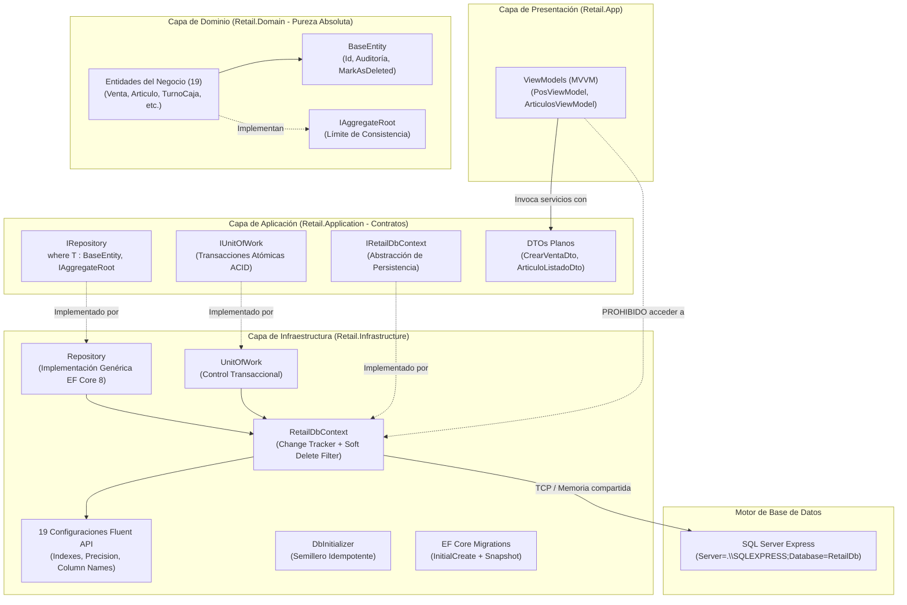

# Sistema de Persistencia e Infraestructura de Base de Datos (Retail POS)

### Proyecto: Retail (Sistema ERP & Punto de Venta para Librería)
**Plataforma:** .NET 8 LTS | C# 12 | Entity Framework Core 8.0.11 | SQL Server Express  
**Propósito:** Guía técnica normativa y protocolo de contextualización rápida para **agentes de código (IA)** y desarrolladores. Define cómo se modelan las entidades bajo DDD, cómo se configuran las migraciones relacionales, cómo se ejecutan transacciones atómicas seguras y cómo se optimizan las consultas para no degradar la operación de mostrador.

---

## 🏛️ Topología y Separación de Responsabilidades

El sistema implementa una arquitectura desacoplada de persistencia basada en **Clean Architecture**, **Domain-Driven Design (DDD)** y **segregación pragmática de lecturas/escrituras (CQRS-lite)**:



> [!IMPORTANT]
> **Regla de Oro para Agentes de Código:**  
> 1. `Retail.App` (UI) **jamás inyecta ni interactúa directamente con `RetailDbContext`**. Toda operación pasa por servicios de `Retail.Application`.
> 2. `Retail.Domain` no contiene ninguna referencia a Entity Framework Core, SQL Server ni paquetes NuGet externos.

---

## ⚖️ Las 9 Leyes Inviolables de Persistencia para Agentes

### 1. Persistencia Restringida a Raíces de Agregado (`IAggregateRoot`)
* **Queda estrictamente prohibido** crear interfaces o clases de repositorio para entidades internas o secundarias (ejemplo: `IDetalleVentaRepository`, `PagoVentaRepository`, `MovimientoCajaRepository`).
* **Regla:** Solo las entidades marcadas formalmente con [`IAggregateRoot`](file:///c:/Users/lucas/Proyectos/retail/src/Retail.Domain/Common/IAggregateRoot.cs) tienen repositorio:
  ```csharp
  public interface IRepository<T> where T : BaseEntity, IAggregateRoot
  ```
* Las entidades hijas se manipulan **exclusivamente a través de los métodos de negocio de su raíz** (`Venta.AgregarItem(...)`, `TurnoCaja.RegistrarMovimiento(...)`) y se persisten automáticamente en cascada dentro del mismo grafo.

### 2. Borrado Lógico Obligatorio (*Soft Delete*) e Invariante Fiscal
* En sistemas de facturación fiscal y trazabilidad comercial, el borrado físico (`DELETE FROM ...`) está terminantemente prohibido.
* **Mecanismo del Dominio:** Para dar de baja un registro, se invoca `entity.MarkAsDeleted()`.
* **Intercepción en Persistencia:** [`RetailDbContext`](file:///c:/Users/lucas/Proyectos/retail/src/Retail.Infrastructure/Persistence/Context/RetailDbContext.cs) sobreescribe `SaveChangesAsync` para interceptar cualquier llamada accidental a `DbSet.Remove()` y transformarla en una llamada a `MarkAsDeleted()`.
* **Filtros Globales:** Todas las entidades heredan de [`BaseEntity`](file:///c:/Users/lucas/Proyectos/retail/src/Retail.Domain/Common/BaseEntity.cs) y tienen activo el filtro global `HasQueryFilter(e => !e.IsDeleted)`. Jamás agregues filtros manuales `where !e.IsDeleted` en las consultas de aplicación; EF Core lo resuelve de forma nativa e invisible.
* **Única excepción: reportes históricos (Track 6.4, D-8).** Las ventas de un artículo dado de baja deben seguir contando en los reportes (RF-06), pero el filtro global de `Articulo` las elimina: EF Core aplica el filtro también a la navegación obligatoria `DetalleVenta.Articulo`. [`ReporteQueryService`](file:///c:/Users/lucas/Proyectos/retail/src/Retail.Infrastructure/Persistence/Services/ReporteQueryService.cs) usa `IgnoreQueryFilters()` y filtra **a mano** `DeletedAt == null` en las ventas y los ítems.
  * **Cuidado:** `IgnoreQueryFilters()` desactiva los filtros globales de **toda la consulta**, no solo los de la tabla donde se escribe. Si una consulta sobre `Articulos` incluye una subconsulta o un `join` con `IgnoreQueryFilters()`, los artículos dados de baja vuelven a aparecer, y el filtro de `Articulos` también hay que escribirlo a mano. Lo cubre un test de integración (`ReporteQueryServiceTests`, R-1).

### 3. Segregación de Lectura y Proyecciones sin Tracking (`.AsNoTracking()`)
* **Para Grillas, Combos y Reportes (Read Side):**
  * Deshabilitar siempre el Change Tracker utilizando `.AsNoTracking()`.
  * Proyectar directamente a DTOs planos (`.Select(x => new ArticuloListadoDto { ... })`).
  * **Causa:** Evita instanciar grafos pesados de dominio en memoria, garantizando el cumplimiento del requisito no funcional de memoria RAM $\le 300\text{ MB}$ (`RNF-03`).
* **Para Comandos y Mutaciones (Write Side):**
  * Cargar la raíz del agregado mediante `IRepository<T>.GetByIdAsync(id)` manteniendo el Change Tracker activo para registrar las mutaciones del grafo.

### 4. Evaluación en el Motor Relacional (*Push-Down to SQL*)
* **Queda terminantemente prohibido** materializar tablas en memoria con `.ToList()` prematuro para luego filtrar, ordenar o calcular con LINQ to Objects en C#.
* **Regla:** Las operaciones deben componerse sobre `IQueryable` para que SQL Server Express resuelva la consulta en servidor:
  * Utilizar `EF.Functions.Like` para búsquedas parciales (`%termino%`).
  * Utilizar `Skip()` y `Take()` para paginación nativa (`OFFSET ... ROWS FETCH NEXT ... ROWS ONLY`).
  * Delegar agregaciones numéricas al motor relacional (`CountAsync()`, `SumAsync()`).
* **Listas en memoria dentro de un filtro (`lista.Contains(columna)`):** EF Core 8 las envía como **un único parámetro JSON** que SQL Server desarma con `OPENJSON`, por lo que el límite de 2.100 parámetros por consulta no aplica. Está verificado contra LocalDB con 3.000 códigos en [`CatalogoProveedorQueryServiceTests.cs`](file:///c:/Users/lucas/Proyectos/retail/tests/Retail.Infrastructure.IntegrationTests/Services/CatalogoProveedorQueryServiceTests.cs), que además protege ante un cambio de versión de EF Core que modifique esa traducción.
  * **Supuesto de despliegue:** `OPENJSON` requiere que la base tenga **nivel de compatibilidad ≥ 130** (SQL Server 2016+). Una base restaurada desde una versión anterior con un nivel inferior hace fallar estas consultas, y el test contra la base recién creada no lo detecta. Verificar con `SELECT compatibility_level FROM sys.databases WHERE name = DB_NAME();`.
* **Búsqueda insensible a acentos (collation por columna):** la collation por defecto del servidor (`SQL_Latin1_General_CP1_CI_AS`) **distingue acentos**: "lapiz" no encuentra "Lápiz". Las columnas que el usuario busca por texto (`ARTICULOS.descripcion`, `CLIENTES.razon_social_o_nombre`, `CATALOGOS_PROVEEDORES.descripcion_proveedor`, `USUARIOS.nombre` y `USUARIOS.apellido`) declaran `UseCollation(Cotejamientos.BusquedaEnCastellano)` = **`Modern_Spanish_CI_AI`**: ignora mayúsculas y acentos pero **respeta la ñ** ("ano" no encuentra "año"; `Latin1_General_CI_AI` se descartó porque los iguala). Al estar en la columna, `LIKE`, `Contains` y `ORDER BY` la aplican solos, sin `EF.Functions.Collate` en cada consulta. Una columna nueva que se busque por texto debe declarar la misma collation. Cambiar la collation de una columna con índice obliga a recrear el índice en la migración.

### 5. Tipado Estricto de Moneda y Precisión Decimal Fiscal
* Todo importe monetario (`precio_venta`, `costo_reposicion`, `subtotal`, `total`, `monto`) debe representarse en C# obligatoriamente como tipo de datos `decimal` (nunca `float` ni `double` debido a errores de redondeo en aritmética de punto flotante IEEE).
* En las configuraciones de Fluent API, toda columna monetaria debe declarar explícitamente su precisión y escala:
  ```csharp
  builder.Property(a => a.PrecioVenta)
      .HasPrecision(18, 2)
      .HasColumnName("precio_venta");
  ```

### 6. Cero Lógica de Negocio en la Base de Datos
* La base de datos es un almacén relacional transaccional, no un motor de reglas de negocio.
* **Queda estrictamente prohibido** escribir *Stored Procedures*, *Triggers* o funciones escalares en SQL que calculen márgenes de ganancia (markup), validen límites de crédito o descuenten stock.
* Esas invariantes pertenecen con exclusividad a las entidades y servicios de dominio en [`Retail.Domain`](file:///c:/Users/lucas/Proyectos/retail/src/Retail.Domain) y son testeadas en la suite [`Retail.Domain.UnitTests`](file:///c:/Users/lucas/Proyectos/retail/tests/Retail.Domain.UnitTests).

### 7. Defensa en Profundidad Declarativa (CHECK Constraints)
* Para prevenir corrupción física de datos ante accesos fuera de la aplicación (scripts de soporte, mantenimientos o herramientas ETL), el motor relacional implementa restricciones declarativas `CHECK` que custodian los límites físicos del estado:
  * Precios, subtotales, totales y costos no negativos ($\ge 0$).
  * Cantidades y montos de imputación transaccional estrictamente positivos ($> 0$).
  * Existencias físicas no negativas (`[stock_actual] >= 0 OR [es_servicio] = 1`).
  * Límites y deudas de cuenta corriente no negativas ($\ge 0$).
* **Cuidado con `NULL` (lógica de tres valores):** un `CHECK` solo rechaza la fila cuando la condición da `FALSE`; si da `UNKNOWN`, la acepta. Una comparación contra una columna nula (`[unidades_por_origen] >= 1` con `NULL`) da `UNKNOWN`, así que **toda columna nullable que deba tener valor necesita un `IS NOT NULL` explícito**. Lo detectó el test `Presentacion_OrigenSinUnidades_LaRechazaElCheck` en la Fase 3: la fórmula sin `IS NOT NULL` aceptaba un derivado sin unidades.
* **Alcance de un `CHECK`:** solo ve la fila que se guarda. Las reglas entre filas se cubren con índices únicos filtrados (unicidad) o quedan en Dominio/Aplicación (por ejemplo, "un derivado no puede ser origen de otro"), porque expresarlas en la base requeriría funciones escalares, prohibidas por la Ley 6.

### 8. Un `DbContext` por Pantalla y Accesos Serializados (H-19)
* El `RetailDbContext` es una *Unit of Work* **no segura para hilos**: EF Core no admite dos operaciones simultáneas sobre la misma instancia. Verificado contra SQL Server: la segunda consulta lanza `InvalidOperationException` aunque la primera ya esté cancelada, y una consulta cancelada termina en `SqlException` ("Operation cancelled by user"), no en `OperationCanceledException`.
* **Ciclo de vida:** el contexto y los servicios de Application son `Scoped`. [`NavigationService`](file:///c:/Users/lucas/Proyectos/retail/src/Retail.App/Services/NavigationService.cs) crea **un scope de DI por pantalla** y descarta el de la anterior; los `*DialogService` son `Scoped`, así que un modal comparte el contexto de la pantalla que lo abre; el login tiene su propio scope. Es el equivalente de escritorio de "un contexto por request" en la web.
* **Red de seguridad:** el Host activa `ValidateScopes` y `ValidateOnBuild`. **Queda prohibido** resolver servicios `Scoped` desde el proveedor raíz (por ejemplo, con `App.Services`): la app falla al arrancar y `InyeccionDependenciasTests` lo detecta.
* **Dentro de una pantalla**, todo acceso a datos que pueda solaparse (búsquedas por tecla, filtros, paginación, cargas iniciales) pasa por [`CargaSerializada`](file:///c:/Users/lucas/Proyectos/retail/src/Retail.App/Helpers/CargaSerializada.cs): espera a que el acceso anterior libere el contexto, descarta respuestas obsoletas y cancela lo pendiente al salir de la pantalla (el ViewModel implementa `IDisposable` y el scope lo invoca).

### 9. Concurrencia Optimista y Contexto Limpio Tras un Fallo (D-12, Módulo 4.1)
* **`rowversion` en `ARTICULOS`:** la columna `row_version` se mapea como *shadow property* (`builder.Property<byte[]>("RowVersion").IsRowVersion()`), sin propiedad en la entidad: es un mecanismo de la base, no un concepto del Dominio. EF Core la agrega al `WHERE` de cada `UPDATE`; si otra terminal modificó la fila entre la lectura y el guardado, el `UPDATE` no afecta filas y SQL Server revierte **toda** la transacción. Evita el *lost update* (dos terminales leen stock 1 y ambas escriben 0).
* **Traducción en la frontera:** [`UnitOfWork.SaveChangesAsync`](file:///c:/Users/lucas/Proyectos/retail/src/Retail.Infrastructure/Persistence/Repositories/UnitOfWork.cs) convierte `DbUpdateConcurrencyException` (tipo de EF Core) en [`ConflictoDeConcurrenciaException`](file:///c:/Users/lucas/Proyectos/retail/src/Retail.Application/Exceptions/ConflictoDeConcurrenciaException.cs) (tipo de Application), porque Application no referencia EF Core (Ley 1 de `AGENTS.md`).
* **El ChangeTracker no se limpia solo:** si un caso de uso falla después de modificar entidades, o falla el `SaveChanges`, los cambios quedan en memoria y, como el contexto vive mientras dura la pantalla (Ley 8), **se guardarían con la próxima operación exitosa**. Defensas:
  1. **Validar todo antes de modificar cualquier agregado:** primero las verificaciones que pueden fallar (`Articulo.VerificarStockDisponible`, `Venta.ValidarCierre`, límite de crédito); recién después las mutaciones (`DescontarStock`, `ImputarVenta`). Ver [`VentaService.RegistrarVentaAsync`](file:///c:/Users/lucas/Proyectos/retail/src/Retail.Application/Services/VentaService.cs) y `Articulo.ActualizarDatos` (H-08).
  2. **La Unit of Work descarta ante un guardado fallido, para todos los servicios:** [`UnitOfWork.SaveChangesAsync`](file:///c:/Users/lucas/Proyectos/retail/src/Retail.Infrastructure/Persistence/Repositories/UnitOfWork.cs) invoca `DescartarCambios()` (`ChangeTracker.Clear()`) ante **cualquier** excepción (conflicto de concurrencia, `CHECK`, índice único, timeout o cancelación) y relanza; `CommitTransactionAsync` guarda a través de ese mismo método. Los servicios no repiten el `try/catch`. Es seguro desde H-19: limpia solo el contexto de esa pantalla. Lo verifica [`UnitOfWorkIntegrationTests`](file:///c:/Users/lucas/Proyectos/retail/tests/Retail.Infrastructure.IntegrationTests/UnitOfWorkIntegrationTests.cs) contra LocalDB.
  3. **Mutaciones que el Dominio rechaza antes de guardar:** si un caso de uso modifica un agregado y otra regla falla después, sin llegar al `SaveChanges`, el servicio invoca `DescartarCambios()` en un `catch` que envuelve solo ese tramo. Casos actuales en [`ClienteService`](file:///c:/Users/lucas/Proyectos/retail/src/Retail.Application/Services/ClienteService.cs): `ActualizarClienteAsync` (el límite nuevo es menor a la deuda después de que `ActualizarDatos` ya modificó el cliente) y `RegistrarCobranzaAsync` (la caja rechaza la imputación después de que la cobranza redujo la deuda). También [`ProveedorService.ImportarPlanillaProveedorAsync`](file:///c:/Users/lucas/Proyectos/retail/src/Retail.Application/Services/ProveedorService.cs): si el lote se corta a mitad de camino (cancelación del usuario o una excepción que no es un error de fila), descarta las filas ya procesadas.
  4. **Una unidad de trabajo por operación (D-15):** `RegistrarVentaAsync` llama a `DescartarCambios()` también después de un guardado **exitoso**, para que la próxima venta lea stock y `rowversion` frescos en lugar de reutilizar entidades en memoria que otra terminal pudo modificar.
  5. **Lecturas sin tracking en el mostrador:** las búsquedas del POS y la verificación del ticket (`IArticuloQueryService`) proyectan a DTO con `AsNoTracking()`: no dejan entidades en el contexto que después provoquen conflictos falsos.
* **Identidad de EF Core:** una consulta con tracking devuelve la instancia que ya está en memoria y **no la actualiza** con los valores de la base. Sin `DescartarCambios`, un reintento tras un conflicto reutilizaría el `rowversion` viejo y volvería a fallar. Lo verifica `RegistrarVentaIntegrationTests` con dos contextos.
* **El descarte tras un guardado exitoso no se generaliza:** D-15 es una decisión del mostrador. Llevarlo a la Unit of Work rompería los flujos que guardan más de una vez sobre las mismas entidades (por ejemplo, `RegistrarCobranzaAsync`, que guarda a través de `CajaService` y después vuelve a guardar) y las transacciones explícitas con varios `SaveChanges`.
* **Atomicidad por fila del importador:** `ImportarPlanillaProveedorAsync` captura los errores fila por fila a propósito (un dato inválido no aborta el lote). Una fila con error no queda a medias porque cada paso valida antes de asignar: `CatalogoProveedor.ActualizarPrecio` rechaza un costo `<= 0` sin modificar nada y, si lo acepta, ni `Articulo.ActualizarCostoYRecalcularPrecio` (H-08) ni `RecalcularCostoDesdeOrigen` (la consulta solo trae derivados y el `CHECK` garantiza unidades `>= 1`) pueden fallar después. Es una garantía implícita: si el Dominio agrega una regla que pueda fallar en el artículo o en sus presentaciones, hay que validar la fila completa antes de modificar el catálogo.

---

## 🛡️ Catálogo de Restricciones CHECK en Motor Relacional

| Entidad / Tabla | Nombre de Constraint | Expresión SQL Server | Propósito de Defensa en Profundidad |
| :--- | :--- | :--- | :--- |
| **`ARTICULOS`** | `CK_ARTICULOS_Precios` | `[precio_venta] >= 0 AND [costo_reposicion] >= 0 AND [porcentaje_ganancia] >= 0` | Precios, costos y márgenes de ganancia no negativos. |
| **`ARTICULOS`** | `CK_ARTICULOS_StockMinimo` | `[stock_minimo] >= 0` | Umbral de reposición de catálogo no negativo. |
| **`ARTICULOS`** | `CK_ARTICULOS_StockActual` | `([stock_actual] >= 0) OR ([es_servicio] = 1)` | Prohibición de stock negativo en mostrador (excepto servicios `RF-04`). |
| **`ARTICULOS`** | `CK_ARTICULOS_Presentacion` | `([id_articulo_origen] IS NULL AND [unidades_por_origen] IS NULL) OR ([id_articulo_origen] IS NOT NULL AND [unidades_por_origen] IS NOT NULL AND [unidades_por_origen] >= 1 AND [id_catalogo_proveedor] IS NULL AND [es_servicio] = 0 AND [id_articulo_origen] <> [id_articulo])` | Presentación derivada (`RF-21`): origen y unidades van juntos, al menos 1 unidad, sin catálogo propio, no servicio y sin autorreferencia. Complementada por la FK autorreferencial `Restrict` y el índice único filtrado `IX_ARTICULOS_id_catalogo_proveedor` (un artículo activo por ítem del proveedor, `RF-05`). |
| **`CATALOGOS_PROVEEDORES`** | `CK_CATALOGOS_PROVEEDORES_PrecioCosto` | `[precio_costo] >= 0` | Precios de lista mayorista no negativos. |
| **`CLIENTES`** | `CK_CLIENTES_LimiteCredito` | `[limite_credito] >= 0` | Límite crediticio asignado no negativo. |
| **`CLIENTES`** | `CK_CLIENTES_SaldoCuentaCorriente` | `[saldo_cuenta_corriente] >= 0` | Deuda del cliente no negativa (no admite saldo acreedor `RF-20`). |
| **`PROVEEDORES`** | `CK_PROVEEDORES_Cuit` | `LEN([cuit]) = 11 AND [cuit] NOT LIKE '%[^0-9]%'` | CUIT en forma canónica: 11 dígitos sin guiones, que es lo que permite al índice único filtrado detectar duplicados. El dígito verificador lo valida el Dominio (`ReglasDocumento`): calcularlo en SQL sería lógica de negocio en la base (Ley 6). Se creó `WITH NOCHECK` para no impedir el arranque si quedara una fila histórica sin normalizar; valida todo INSERT y UPDATE nuevo. |
| **`COBRANZAS_CLIENTES`** | `CK_COBRANZAS_CLIENTES_Monto` | `[monto] > 0` | Cancelación de deuda mayor a cero. |
| **`VENTAS`** | `CK_VENTAS_Totales` | `[subtotal] >= 0 AND [descuento] >= 0 AND [total] >= 0` | Totales consolidados de mostrador no negativos. |
| **`DETALLE_VENTAS`** | `CK_DETALLE_VENTAS_Valores` | `[cantidad] > 0 AND [precio_unitario] >= 0 AND [costo_unitario] >= 0 AND [subtotal_item] >= 0` | Cantidad vendida mayor a cero; precio y costo histórico (RF-25) no negativos. |
| **`PAGOS_VENTA`** | `CK_PAGOS_VENTA_Monto` | `[monto] > 0` | Medios de pago imputados mayores a cero. |
| **`PRESUPUESTOS`** | `CK_PRESUPUESTOS_Totales` | `[subtotal] >= 0 AND [descuento] >= 0 AND [total] >= 0` | Totales de cotización no negativos. |
| **`DETALLE_PRESUPUESTOS`**| `CK_DETALLE_PRESUPUESTOS_Valores`| `[cantidad] > 0 AND [precio_unitario_pactado] >= 0 AND [subtotal_item] >= 0` | Cantidad presupuestada mayor a cero y precios pactados válidos. |
| **`COMPRAS`** | `CK_COMPRAS_Totales` | `[subtotal] >= 0 AND [total] >= 0` | Facturas de compra con totales válidos. |
| **`DETALLE_COMPRAS`** | `CK_DETALLE_COMPRAS_Valores` | `[cantidad] > 0 AND [costo_unitario] >= 0 AND [subtotal_item] >= 0` | Cantidad de mercadería recibida mayor a cero. |
| **`TURNOS_CAJA`** | `CK_TURNOS_CAJA_Saldos` | `[saldo_inicial] >= 0 AND [total_ventas_efectivo] >= 0 AND [total_ingresos_efectivo] >= 0 AND [total_egresos_efectivo] >= 0 AND [total_ventas_electronicas] >= 0 AND [monto_retenido_en_caja] >= 0` | Totales acumulativos no negativos en gaveta de efectivo. |
| **`MOVIMIENTOS_CAJA`** | `CK_MOVIMIENTOS_CAJA_Monto` | `[monto] > 0` | Ingresos y retiros de efectivo estrictamente mayores a cero. |
| **`COMPROBANTES_FISCALES`**| `CK_COMPROBANTES_FISCALES_Numeracion`| `[punto_venta] > 0 AND [numero_comprobante] >= 0` | Punto de venta mayor a cero y número de comprobante fiscal válido. |
| **`REGISTROS_BACKUP`** | `CK_REGISTROS_BACKUP_Tamano` | `[tamano_bytes] IS NULL OR [tamano_bytes] > 0` | Una copia terminada nunca tiene tamaño cero (RF-22). |
| **`REGISTROS_BACKUP`** | `CK_REGISTROS_BACKUP_Operador` | `([tipo] IN ('Manual','PreRestauracion') AND [id_usuario] IS NOT NULL AND [nombre_usuario] IS NOT NULL) OR ([tipo] IN ('Automatico','PreMigracion') AND [id_usuario] IS NULL AND [nombre_usuario] IS NULL)` | Un registro no miente sobre su origen: las copias pedidas por una persona tienen operador y las del sistema no. Complementado por el índice único filtrado `IX_REGISTROS_BACKUP_EnCurso` (un único backup en curso, R-12). |

---

## 💻 Entorno SQL Server Express, Conexión y Semillero

### Cadena de Conexión por Defecto
Ubicada en [`src/Retail.App/appsettings.json`](file:///c:/Users/lucas/Proyectos/retail/src/Retail.App/appsettings.json) (el mismo valor es el *fallback* de `AddInfrastructureServices` en `DependencyInjection.cs`):
```json
{
  "ConnectionStrings": {
    "DefaultConnection": "Server=.\\SQLEXPRESS;Database=RetailDb;Trusted_Connection=True;TrustServerCertificate=True;MultipleActiveResultSets=true"
  }
}
```

* **Instancia:** `.\SQLEXPRESS` (SQL Server Express instalado como servicio de Windows `MSSQL$SQLEXPRESS`). Desarrollo, pruebas de integración y CI usan el mismo motor que producción, sin diferencias de comportamiento respecto de LocalDB.
* **Instalación para desarrollo:** `winget install Microsoft.SQLServer.2022.Express` (o el instalador oficial) con el nombre de instancia por defecto `SQLEXPRESS`. El usuario de Windows que ejecuta la app necesita permisos para crear bases (por ejemplo, ser `sysadmin`, que es lo habitual al instalar con ese usuario).
* **`TrustServerCertificate=True`:** `Microsoft.Data.SqlClient` cifra la conexión por defecto y el certificado de una instancia local es autofirmado; sin este parámetro la conexión falla con un error de cadena de confianza.
* **Archivos Físicos:** el servicio los guarda de forma permanente en su carpeta de datos (`...\MSSQL\DATA\RetailDb.mdf` y `RetailDb_log.ldf`). A diferencia de LocalDB, las bases no desaparecen solas: hay que borrarlas explícitamente.
* **Venir desde LocalDB:** la base `(localdb)\mssqllocaldb` anterior **no se migra automáticamente**. La app ya no crea ni migra la base al arrancar (RF-23): contra Express se crea con `Retail.Cli migrar` y el primer Gerente con `Retail.Cli inicializar` (ver "Ciclo de Arranque"). Los datos de prueba de LocalDB no se trasladan (si se necesitan, hacer un *backup* en LocalDB y restaurarlo en Express).

### Servidor de las Pruebas de Integración
Las pruebas de `Retail.Infrastructure.IntegrationTests` obtienen su cadena de conexión de un único helper, [`ServidorDePruebas.CadenaDeConexion(nombreBase)`](file:///c:/Users/lucas/Proyectos/retail/tests/Retail.Infrastructure.IntegrationTests/ServidorDePruebas.cs):

| Elemento | Detalle |
| :--- | :--- |
| Servidor por defecto | `.\SQLEXPRESS` |
| Servidor alternativo | Variable de entorno `RETAIL_TEST_SQLSERVER` (por ejemplo, `.\SQLEXPRESS` en CI o `localhost\OTRAINSTANCIA`) |
| Autenticación | Windows (`Integrated Security`), `TrustServerCertificate=True`, `MultipleActiveResultSets=true` |

* **Regla de limpieza:** todo test que cree una base (`RetailDb_Test_<Nombre>_<Guid>`) debe borrarla en `DisposeAsync` con `Database.EnsureDeletedAsync()`. Express conserva las bases en disco; una base huérfana ocupa espacio y se acumula entre corridas. Para auditar: `SELECT name FROM sys.databases WHERE name LIKE 'RetailDb_Test%'`.
* Nunca hardcodear una cadena de conexión en un test: usar siempre el helper (no se agrega dependencia entre proyectos de test; `Retail.App.UnitTests` solo valida el contenedor de DI y no abre conexiones).

### Ciclo de Arranque: Verificar, no Migrar (RF-23)
La aplicación **no modifica la base al arrancar**. [`App.xaml.cs`](file:///c:/Users/lucas/Proyectos/retail/src/Retail.App/App.xaml.cs) consulta `IEstadoSistemaService` y, si algo falla, abre [`DiagnosticoArranqueDialog`](file:///c:/Users/lucas/Proyectos/retail/src/Retail.App/Views/Dialogs/DiagnosticoArranqueDialog.xaml) con la explicación y los comandos listos para copiar (cada uno con su botón "Copiar" y un "Copiar todos"; la app nunca los ejecuta) y no abre el login. La línea la arma [`ComandoCli`](file:///c:/Users/lucas/Proyectos/retail/src/Retail.App/Helpers/ComandoCli.cs): `& "<carpeta de la app>\Retail.Cli.exe" migrar` si el ejecutable está junto a la app, o `dotnet run --project src/Retail.Cli -- migrar` en desarrollo (desde la raíz del repositorio):

| Situación | Detectada por | Acción indicada |
| :--- | :--- | :--- |
| Sin conexión o base inexistente | `Database.CanConnectAsync` | `Retail.Cli migrar` y `Retail.Cli inicializar` |
| Base más nueva que la app (migraciones aplicadas desconocidas) | `GetAppliedMigrations` vs. `GetMigrations` | Actualizar la aplicación (migrar no lo resuelve) |
| Migraciones pendientes | `GetPendingMigrationsAsync` | `Retail.Cli migrar` |
| Ningún Gerente activo | `IRepository<Usuario>` | `Retail.Cli inicializar` |
| Gerentes sin email de recuperación | `IRepository<Usuario>` | Aviso no bloqueante: cargarlo desde Usuarios |

**Por qué:** migrar al abrir la app daba a cada arranque un efecto secundario sobre el esquema, sin backup previo, y si una migración fallaba la app no abría (ver el `WITH NOCHECK` de `NormalizarCuitProveedoresYCheck`). Ahora la actualización es una decisión explícita (`Retail.Cli migrar`), a la que la Fase 4 del Track 6.3 suma un backup `PreMigracion`.

### Copias de Seguridad (RF-22)
* **Configuración:** sección `BackupSettings` de `appsettings.json` (`Directorio`, `CantidadMaximaCopias`, `EspacioLibreMinimoMb`). El directorio está fuera del repositorio y del perfil de usuario (D-15).
* **Mecanismo:** `BACKUP DATABASE ... WITH FORMAT, INIT, CHECKSUM, STATS = 10` y `RESTORE VERIFYONLY ... WITH CHECKSUM` por ADO.NET en [`SqlServerEjecutorBackup`](file:///c:/Users/lucas/Proyectos/retail/src/Retail.Infrastructure/Backups/SqlServerEjecutorBackup.cs). Es una excepción deliberada a "todo por EF Core": `BACKUP` no admite una transacción de usuario y EF no ofrece una API de copias. La ruta viaja como parámetro y el nombre de la base se delimita.
* **Historial:** tabla `REGISTROS_BACKUP` (agregado `RegistroBackup`), con un único registro `EnCurso` a la vez garantizado por índice filtrado. Cada `.bak` tiene un manifiesto `.json` al lado, para reconstruir qué contiene aunque la base se pierda.
* **Permisos (SQL Server Express, D-27):** el motor escribe y lee el `.bak` con la cuenta del servicio (`NT Service\MSSQL$SQLEXPRESS`), no con el usuario de la aplicación. El directorio de respaldos debe dar permisos de modificación a esa cuenta y al usuario de la aplicación (que escribe el manifiesto y calcula el SHA-256); lo configura el script de la Fase 7 del Track 6.3. Un `.bak` en una carpeta a la que el servicio no accede (por ejemplo, Descargas) no se puede restaurar desde ahí: por eso `IArchivosBackup.PrepararParaRestaurarAsync` copia el `.bak` y su manifiesto al directorio de respaldos **antes** de restaurar (la copia la hace el usuario, que sí lee sus carpetas; la copia hereda los permisos del directorio). Si el archivo ya está en el directorio no se copia; si hay otro con el mismo nombre y el mismo SHA-256 se reutiliza; si el contenido difiere, se agrega un sufijo numérico (`_2`) al `.bak` y al `.json`, y el campo `ArchivoBak` del manifiesto copiado se reescribe para que siga coincidiendo. La restauración (y su registro de auditoría) usa la ruta de la copia, no la original.
* **Copia automática diaria (Fase 7, D-28 y D-29):** la tarea programada «Retail POS - Copia de seguridad diaria» ejecuta `Retail.Cli.exe backup` todos los días a las 21:00 (la hora es un parámetro del script, no de `appsettings.json`). Se registra con [`scripts/registrar-tarea-backup.ps1`](file:///c:/Users/lucas/Proyectos/retail/scripts/registrar-tarea-backup.ps1) (como administrador; idempotente; `-WhatIf` para la vista previa; `-Desregistrar` para quitarla sin borrar copias ni login).
  * **Cuenta:** `NT AUTHORITY\SYSTEM` (`LogonType ServiceAccount`): corre sin sesión iniciada y sin contraseñas guardadas. En SQL Server necesita un login propio, que el script crea si falta.
  * **Recuperación de ejecuciones perdidas:** la tarea usa `StartWhenAvailable`: si la PC estaba apagada a las 21:00, la copia corre al encenderla. `MultipleInstances = IgnoreNew` evita superponer ejecuciones y el límite de ejecución es de 2 horas.
  * **Permisos de SQL Server para SYSTEM (mínimo privilegio):** `GRANT CREATE ANY DATABASE` (nivel servidor; `RESTORE VERIFYONLY` lo exige), `db_backupoperator` (`BACKUP DATABASE`), `SELECT` sobre `__EFMigrationsHistory` (estado del esquema) y `SELECT, INSERT, UPDATE` sobre `REGISTROS_BACKUP` (sin `DELETE`: el borrado es lógico). **Ningún permiso sobre `USUARIOS`:** `Retail.Cli backup` consulta solo el esquema (`IEsquemaBaseDatos`), no el estado de los usuarios (`IEstadoSistemaService` materializa a los Gerentes completos, con su `password_hash`); las pruebas demuestran que la cuenta de la tarea no puede leer esa tabla ni su hash. El bloqueo contra restauraciones (`sp_getapplock` sobre `master`) no necesita permiso propio. La lista vive en un único lugar (`$Permisos` del script) y [`PermisosTareaProgramadaIntegracionTests`](file:///c:/Users/lucas/Proyectos/retail/tests/Retail.Infrastructure.IntegrationTests/Backups/PermisosTareaProgramadaIntegracionTests.cs) la lee y comprueba, con una cuenta de prueba suplantada, que la copia funciona con esos permisos y nada más. `-Desregistrar -RevocarPermisos` ofrece (con confirmación) quitar `CREATE ANY DATABASE` solo si el propio script lo concedió (la tarea registrada lo recuerda en su descripción); es opcional porque otro software del equipo que corra como `SYSTEM` podría necesitarlo.
  * **Los permisos viven dentro de la base de datos:** el usuario `NT AUTHORITY\SYSTEM` y sus `GRANT` forman parte de la base (el login es de la instancia, el usuario y los permisos de objeto no). Una copia tomada **antes** de ejecutar el script no los tiene: al restaurarla la tarea de esa noche fallaría. La restauración lo advierte cuando la vigente tenía el usuario y la copia no (`IRestauradorBaseDatos.VigenteTieneUsuarioDeLaTareaProgramadaAsync` / `IBaseRestaurada.TieneUsuarioDeLaTareaProgramadaAsync`). **Hay que volver a ejecutar `scripts\registrar-tarea-backup.ps1` como administrador después de restaurar una copia, y después de una migración que agregue tablas que use la copia** (hoy solo `REGISTROS_BACKUP`).
  * **Carpeta de respaldos:** el script corta la herencia de `C:\RetailData\Backups` **sin copiar las reglas heredadas** (`SetAccessRuleProtection($true, $false)`; por defecto `C:\` da *Modificar* a «Usuarios autenticados» y *Lectura* a «Usuarios») y agrega de forma explícita Administradores y `SYSTEM` con *Control total* y, con *Modificar*, al servicio del motor y a la cuenta que usa la aplicación (R-6, R-17). Además purga cualquier regla explícita de «Todos», «Usuarios autenticados» y «Usuarios» que haya dejado una ejecución anterior. Las cuentas conocidas se nombran por SID, así que funciona igual en Windows en español que en inglés. La lógica está en [`scripts/RetailPermisos.psm1`](file:///c:/Users/lucas/Proyectos/retail/scripts/RetailPermisos.psm1) y [`ScriptsDePermisosIntegracionTests`](file:///c:/Users/lucas/Proyectos/retail/tests/Retail.Infrastructure.IntegrationTests/Backups/ScriptsDePermisosIntegracionTests.cs) la ejecuta en un `powershell.exe` real y lee la ACL resultante desde C#. (Defecto corregido: copiando las reglas heredadas, `RemoveAccessRule` no las quitaba porque Windows las seguía marcando como heredadas en memoria, y terminaban como reglas explícitas.)
  * **Tarea contra la aplicación instalada (escalada de privilegios):** la tarea corre como `SYSTEM` y apunta directamente al `Retail.Cli.exe` de la aplicación instalada (por defecto `C:\Program Files\Retail POS`, donde se descomprime el ZIP como administrador); **no hay copia aparte**. Así, actualizar la aplicación (reemplazar los archivos de esa carpeta como administrador y ejecutar `Retail.Cli migrar`) actualiza también lo que ejecuta la tarea; con una copia separada, el CLI viejo vería «base más nueva que la app» y la copia nocturna fallaría en silencio. Si el ejecutable estuviera en una carpeta que un usuario común puede reemplazar, cualquiera ejecutaría código como `SYSTEM`; por eso `Get-EscrituraEnInstalacion` (en [`scripts/RetailPermisos.psm1`](file:///c:/Users/lucas/Proyectos/retail/scripts/RetailPermisos.psm1)) hace que el script se niegue a continuar, incluso con `-WhatIf`, si la carpeta, su contenido **o cualquier carpeta superior hasta la raíz del disco** otorga a «Todos», «Usuarios autenticados», «Usuarios» o la cuenta de la aplicación derechos de escritura (en las superiores, los que permiten renombrar o reemplazar: eliminar, eliminar subelementos, cambiar permisos, tomar posesión; «crear carpetas» en la raíz del disco, que Windows da por defecto, no cuenta). No hay excepciones: ninguna subcarpeta de la instalación puede ser escribible sin privilegios. **Registros:** no se escriben en la instalación sino en `%LOCALAPPDATA%\Retail POS\logs` de la cuenta que ejecuta el proceso (regla única en `UbicacionDeLogs`, ver [`SISTEMA_DE_LOGGING.md`](file:///c:/Users/lucas/Proyectos/retail/docs/SISTEMA_DE_LOGGING.md)); la tarea, que corre como `SYSTEM`, escribe en `C:\Windows\System32\config\systemprofile\AppData\Local\Retail POS\logs`, carpeta que solo `SYSTEM` y los administradores pueden escribir. Así un proceso privilegiado nunca escribe donde un usuario sin privilegios podría redirigirlo (p. ej. con un punto de montaje). Migración: si existe la carpeta `%ProgramFiles%\Retail POS\Cli` que creaba la versión anterior del script, se ofrece eliminarla (`ShouldProcess`) después de re-registrar la tarea.
  * **Esperas:** la copia toma el bloqueo compartido esperando hasta 10 segundos (otra copia que arranca toma el exclusivo por milisegundos para cerrar huérfanos, B-0); y, si el Programador de tareas la lanza al encender la PC (`StartWhenAvailable`) antes de que SQL Server acepte conexiones, `Retail.Cli backup` consulta el motor cada 10 segundos hasta 2 minutos antes de rendirse. Es esperar al motor, no reintentar la copia (D-28).
  * **Configuración del script:** `-Instancia`, `-BaseDeDatos` y `-Directorio` salen por defecto del `appsettings.json` que acompaña a `Retail.Cli.exe` (`ConnectionStrings:DefaultConnection` y `BackupSettings:Directorio`, con variables de entorno expandidas); un parámetro explícito tiene prioridad. `-Instancia` se valida con un patrón estricto (sin `;`, `=`, comillas ni espacios).
  * **Copias huérfanas (B-0):** con el bloqueo exclusivo tomado, tanto `EnCurso` como `Exitoso` (el proceso murió verificando) son huérfanas: se cierran como `Fallido` y se borran su `.bak` y su manifiesto parciales. Si el motor aún los tiene abiertos y no se pueden borrar, quedan como residuo no restaurable en el directorio (el registro `Fallido` no vuelve a revisarse): se limpian a mano.
  * **Sesión del motor tras una caída:** si un proceso muere en pleno `BACKUP`, la sesión en el servidor puede persistir unos instantes; una restauración inmediata puede toparse con el reintento acotado del renombrado (`IntentosDeRenombrado`) y fallar de forma segura (la vigente no cambia). Alcanza con repetirla pasados unos segundos.
  * **Sin consola:** `Retail.Cli backup` tolera no tener consola (salida o entrada cerradas, sin Ctrl+C); el resultado queda en `%LOCALAPPDATA%\Retail POS\logs` de la cuenta que ejecuta (para la tarea, la del perfil de `SYSTEM`) y en el historial de la aplicación.

### Siembra de Datos
* **Roles** (`Cajero`, `Encargado`, `Gerente`, `Administrador`): los siembra la migración `AgregarRolAdministradorYCuentasDeUsuario`. Son datos de referencia del esquema y su `id_rol` debe ser el valor del enum (se insertan con `IDENTITY_INSERT` solo si no existen).
* **Primer Gerente:** `Retail.Cli inicializar` (interactivo, con email obligatorio). Ya no existe un usuario `admin` con contraseña fija.
* **Datos de demostración:** `Retail.Cli datos-demo` ejecuta [`SemilleroDatosDemo`](file:///c:/Users/lucas/Proyectos/retail/src/Retail.Infrastructure/Persistence/Initialization/SemilleroDatosDemo.cs): un proveedor, categorías y marcas, idempotente elemento por elemento. Sin artículos: la demostración los incorpora importando la planilla del proveedor.

### Comando Canónico para Generar Futuras Migraciones
Cuando se añadan columnas o relaciones en etapas posteriores, ejecutar siempre desde la raíz de la solución especificando proyectos exactos para evitar colisiones con compilaciones intermedias de WPF:
```powershell
dotnet ef migrations add <NombreDeLaMigracion> --project src/Retail.Infrastructure/Retail.Infrastructure.csproj --startup-project src/Retail.App/Retail.App.csproj
```

---

## 🧩 Snippets Canónicos para Agentes

### 1. Consulta Optimizada de Lectura (Read Side / Push-Down to SQL)
```csharp
using Microsoft.EntityFrameworkCore;
using Retail.Application.DTOs.Articulos;
using Retail.Infrastructure.Persistence.Context;

namespace Retail.Application.Services;

public class CatalogoQueryService(RetailDbContext context)
{
    public async Task<IReadOnlyList<ArticuloListadoDto>> BuscarArticulosAsync(
        string? termino, 
        int pagina, 
        int tamanoPagina, 
        CancellationToken ct = default)
    {
        var query = context.Articulos.AsNoTracking(); // 1. Sin tracking de cambios en RAM

        if (!string.IsNullOrWhiteSpace(termino))
        {
            // 2. Push-down to SQL con Like traducible
            query = query.Where(a => EF.Functions.Like(a.Descripcion, $"%{termino}%") 
                                  || a.CodigoBarras == termino);
        }

        // 3. Proyección directa a DTO (solo viajan las columnas requeridas)
        return await query
            .OrderBy(a => a.Descripcion)
            .Skip((pagina - 1) * tamanoPagina)
            .Take(tamanoPagina)
            .Select(a => new ArticuloListadoDto
            {
                Id = a.Id,
                CodigoBarras = a.CodigoBarras,
                Descripcion = a.Descripcion,
                PrecioVenta = a.PrecioVenta,
                StockActual = a.StockActual
            })
            .ToListAsync(ct);
    }
}
```

### 2. Mutación Transaccional con Agregado y Unit of Work (Write Side)
Versión resumida de [`VentaService.RegistrarVentaAsync`](file:///c:/Users/lucas/Proyectos/retail/src/Retail.Application/Services/VentaService.cs) (la implementación real también valida el DTO, el precio contra el catálogo y la cuenta corriente). El orden importa: **primero todo lo que puede fallar, después las mutaciones** (Ley 9).

```csharp
public async Task<VentaResponseDto> RegistrarVentaAsync(CrearVentaDto dto, CancellationToken ct = default)
{
    // 1. Cargar agregados con tracking: los artículos en UNA consulta (Contains → OPENJSON)
    var turno = await _turnoRepository.GetByIdAsync(dto.IdTurno, ct);
    var ids = dto.Items.Select(i => i.IdArticulo).Distinct().ToList();
    var articulosPorId = (await _articuloRepository.FindAsync(a => ids.Contains(a.Id), includeDeleted: false, ct))
        .ToDictionary(a => a.Id);

    // 2. Armar la raíz: el agregado calcula sus totales y valida que los pagos cubran el total
    var venta = Venta.Registrar(dto.IdTurno, dto.IdUsuario, dto.IdCliente);
    foreach (var item in dto.Items)
    {
        venta.AgregarItem(item.IdArticulo, item.Cantidad, articulosPorId[item.IdArticulo].PrecioVenta);
    }
    foreach (var pago in dto.Pagos)
    {
        venta.ImputarPago(pago.MedioPago, pago.Monto, pago.ReferenciaPago);
    }
    venta.ValidarCierre();

    // 3. Verificar el stock de TODOS antes de descontar cualquiera (sin mutar)
    foreach (var detalle in venta.Detalles)
    {
        articulosPorId[detalle.IdArticulo].VerificarStockDisponible(detalle.Cantidad);
    }

    // 4. Mutaciones: ya no pueden fallar por reglas de negocio
    foreach (var detalle in venta.Detalles)
    {
        articulosPorId[detalle.IdArticulo].DescontarStock(detalle.Cantidad);
    }
    turno!.ImputarVenta(venta.TotalEfectivo, venta.TotalElectronico);
    await _ventaRepository.AddAsync(venta, ct);

    // 5. Un único SaveChanges = una transacción; si falla, la Unit of Work limpia el contexto de la pantalla
    await _unitOfWork.SaveChangesAsync(ct);

    // 6. Una unidad de trabajo por venta (D-15): la próxima venta lee stock y rowversion frescos
    _unitOfWork.DescartarCambios();

    return MapearRespuesta(venta);
}
```

---

## 🧭 Catálogo de Archivos Clave de Persistencia

| Archivo | Capa | Rol Arquitectónico |
| :--- | :--- | :--- |
| [`BaseEntity.cs`](file:///c:/Users/lucas/Proyectos/retail/src/Retail.Domain/Common/BaseEntity.cs) | `Retail.Domain` | Entidad base con `Id`, timestamps de auditoría y método `MarkAsDeleted()`. |
| [`IAggregateRoot.cs`](file:///c:/Users/lucas/Proyectos/retail/src/Retail.Domain/Common/IAggregateRoot.cs) | `Retail.Domain` | Interfaz marcadora para delimitar consistencia transaccional DDD. |
| [`IRepository.cs`](file:///c:/Users/lucas/Proyectos/retail/src/Retail.Application/Interfaces/Persistence/IRepository.cs) | `Retail.Application` | Contrato genérico de persistencia restringido a `where T : BaseEntity, IAggregateRoot`. |
| [`IUnitOfWork.cs`](file:///c:/Users/lucas/Proyectos/retail/src/Retail.Application/Interfaces/Persistence/IUnitOfWork.cs) | `Retail.Application` | Abstracción para control transaccional atómico, confirmación de cambios y descarte de cambios tras un guardado fallido (Ley 9). |
| [`RetailDbContext.cs`](file:///c:/Users/lucas/Proyectos/retail/src/Retail.Infrastructure/Persistence/Context/RetailDbContext.cs) | `Retail.Infrastructure` | Contexto de EF Core 8 con filtros globales de Soft Delete e intercepción de borrado. |
| [`Repository.cs`](file:///c:/Users/lucas/Proyectos/retail/src/Retail.Infrastructure/Persistence/Repositories/Repository.cs) | `Retail.Infrastructure` | Implementación genérica de acceso a datos para Raíces de Agregado. |
| [`UnitOfWork.cs`](file:///c:/Users/lucas/Proyectos/retail/src/Retail.Infrastructure/Persistence/Repositories/UnitOfWork.cs) | `Retail.Infrastructure` | Coordinador transaccional sobre `RetailDbContext`; traduce `DbUpdateConcurrencyException` a `ConflictoDeConcurrenciaException`. |
| [`ArticuloConfiguration.cs`](file:///c:/Users/lucas/Proyectos/retail/src/Retail.Infrastructure/Persistence/Configurations/ArticuloConfiguration.cs) | `Retail.Infrastructure` | Configuración Fluent API de artículo con índice único filtrado (`[codigo_barras] IS NOT NULL AND [deleted_at] IS NULL`). |
| [`DbInitializer.cs`](file:///c:/Users/lucas/Proyectos/retail/src/Retail.Infrastructure/Persistence/Initialization/DbInitializer.cs) | `Retail.Infrastructure` | Semillero idempotente de roles, usuario `admin`, categorías, marcas y 20 artículos. |
| [`RetailDbContextModelSnapshot.cs`](file:///c:/Users/lucas/Proyectos/retail/src/Retail.Infrastructure/Persistence/Migrations/RetailDbContextModelSnapshot.cs) | `Retail.Infrastructure` | Foto satelital de las 19 entidades generada por la herramienta CLI de EF Core. |
