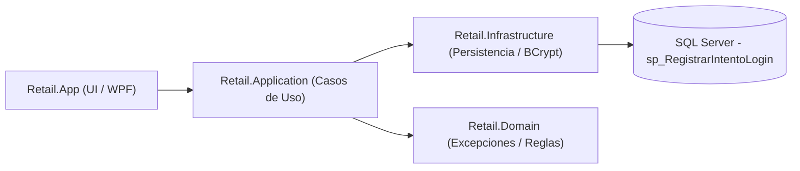
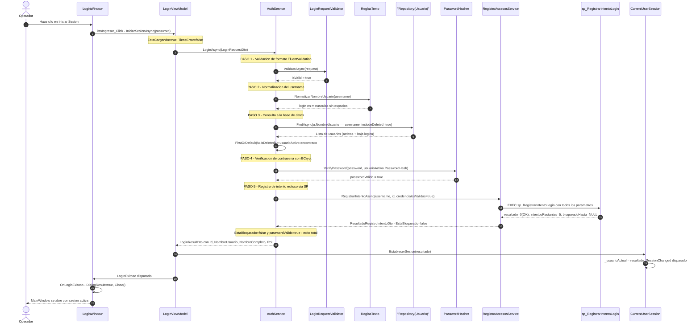
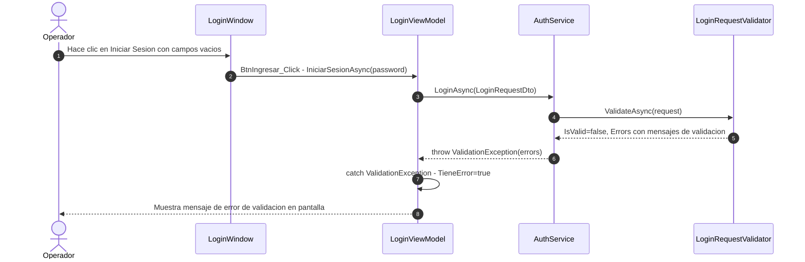
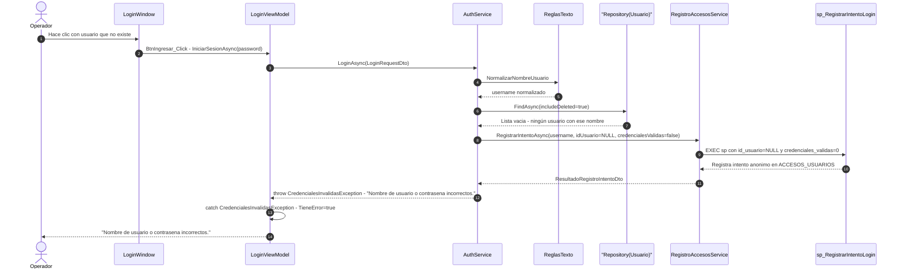
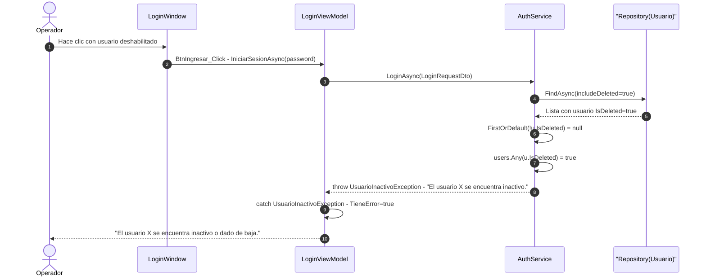
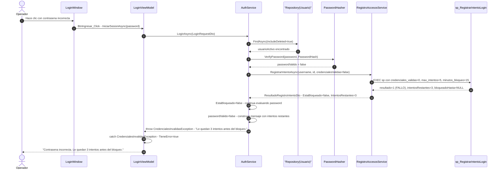
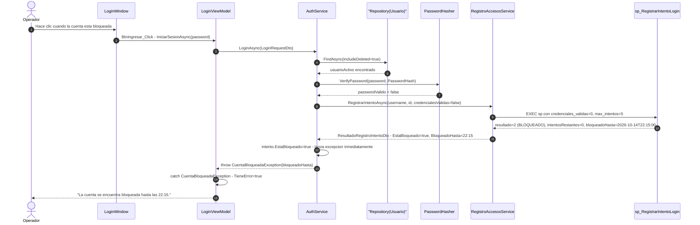
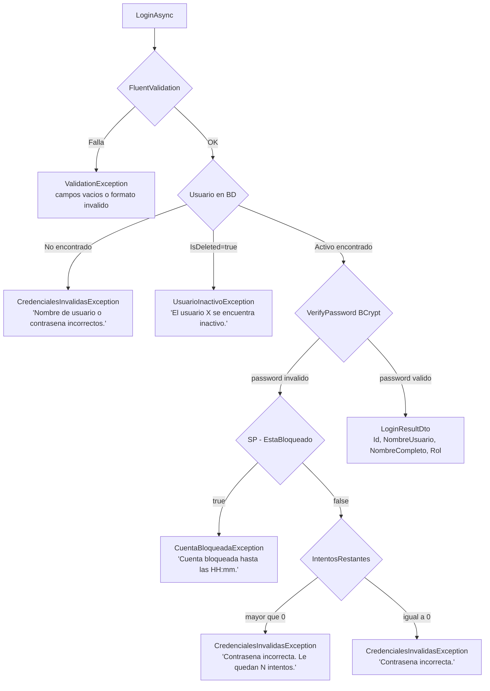

# Análisis del Flujo de Autenticación (Login) — Retail POS

## Capas involucradas



---

## Diagrama de Secuencia — Login EXITOSO



---

## Diagrama de Secuencia — Login FALLIDO (todos los escenarios)

### Escenario A — Campos vacíos o formato inválido



### Escenario B — Usuario inexistente en la base de datos



### Escenario C — Usuario dado de baja lógica (soft-delete)



### Escenario D — Contraseña incorrecta (con conteo de intentos)



### Escenario E — Cuenta bloqueada por exceso de intentos



---

## Mapa de archivos por capa

| # | Archivo | Capa | Responsabilidad en el flujo |
|---|---------|------|-----------------------------|
| 1 | [`App.xaml.cs`](file:///c:/Users/pablo/retail/src/Retail.App/App.xaml.cs) | **UI · Host** | Arranca el Generic Host, corre migraciones, abre `LoginWindow` en scope aislado y, si login exitoso, muestra `MainWindow` |
| 2 | [`LoginWindow.xaml`](file:///c:/Users/pablo/retail/src/Retail.App/Views/Auth/LoginWindow.xaml) | **UI · Vista** | FluentWindow con backdrop Mica. Contiene `TxtUsuario`, `TxtPassword` y `BtnIngresar`. Banner de error con `{Binding MensajeError}` |
| 3 | [`LoginWindow.xaml.cs`](file:///c:/Users/pablo/retail/src/Retail.App/Views/Auth/LoginWindow.xaml.cs) | **UI · Code-behind** | `BtnIngresar_Click()` extrae la contraseña del `PasswordBox` y la pasa al ViewModel. Suscribe `LoginExitoso` → `DialogResult = true` |
| 4 | [`LoginViewModel.cs`](file:///c:/Users/pablo/retail/src/Retail.App/ViewModels/Auth/LoginViewModel.cs) | **UI · ViewModel** | Orquesta la autenticación. Propiedades reactivas `NombreUsuario`, `EstaCargando`, `TieneError`, `MensajeError`. Captura todas las excepciones de dominio |
| 5 | [`IAuthService.cs`](file:///c:/Users/pablo/retail/src/Retail.Application/Interfaces/Services/IAuthService.cs) | **Application · Contrato** | Define `LoginAsync(LoginRequestDto) → LoginResultDto` |
| 6 | [`AuthService.cs`](file:///c:/Users/pablo/retail/src/Retail.Application/Services/AuthService.cs) | **Application · Caso de uso** | Orquesta: valida formato → normaliza → consulta repo → verifica BCrypt → registra intento → retorna DTO o lanza excepción |
| 7 | [`LoginRequestValidator.cs`](file:///c:/Users/pablo/retail/src/Retail.Application/Validators/Auth/LoginRequestValidator.cs) | **Application · Validador** | FluentValidation: `NombreUsuario` no vacío y ≤50 chars; `Password` no vacío |
| 8 | [`ReglasTexto.cs`](file:///c:/Users/pablo/retail/src/Retail.Domain/Common/ReglasTexto.cs) | **Domain · Regla** | `NormalizarNombreUsuario()` → minúsculas + trim (única fuente de verdad de formato) |
| 9 | [`IRegistroAccesosService.cs`](file:///c:/Users/pablo/retail/src/Retail.Application/Interfaces/Persistence/IRegistroAccesosService.cs) | **Application · Contrato Persistencia** | Define `RegistrarIntentoAsync(...)` → `ResultadoRegistroIntentoDto` |
| 10 | [`RegistroAccesosService.cs`](file:///c:/Users/pablo/retail/src/Retail.Infrastructure/Persistence/Services/RegistroAccesosService.cs) | **Infrastructure · Servicio** | Ejecuta `sp_RegistrarIntentoLogin` vía `ExecuteSqlRawAsync` con parámetros `OUTPUT` tipados |
| 11 | [`PasswordHasher.cs`](file:///c:/Users/pablo/retail/src/Retail.Infrastructure/Security/PasswordHasher.cs) | **Infrastructure · Seguridad** | `VerifyPassword(plain, hash)` usando `BCrypt.Net-Next` con salt incluido en el hash |
| 12 | [`Repository.cs`](file:///c:/Users/pablo/retail/src/Retail.Infrastructure/Persistence/Repositories/Repository.cs) | **Infrastructure · Repositorio** | `FindAsync(predicate, includeDeleted: true)` — trae activos y eliminados lógicamente |
| 13 | [`CuentaBloqueadaException.cs`](file:///c:/Users/pablo/retail/src/Retail.Domain/Exceptions/CuentaBloqueadaException.cs) | **Domain · Excepción** | Lanzada cuando el SP reporta `EstaBloqueado = true`. Incluye `BloqueadoHastaUtc` para el mensaje amigable |
| 14 | [`CredencialesInvalidasException.cs`](file:///c:/Users/pablo/retail/src/Retail.Domain/Exceptions/CredencialesInvalidasException.cs) | **Domain · Excepción** | Lanzada cuando usuario no existe o contraseña incorrecta. El mensaje incluye intentos restantes si aplica |
| 15 | [`UsuarioInactivoException.cs`](file:///c:/Users/pablo/retail/src/Retail.Domain/Exceptions/UsuarioInactivoException.cs) | **Domain · Excepción** | Lanzada cuando el usuario existe pero tiene soft-delete activo |
| 16 | [`CurrentUserSession.cs`](file:///c:/Users/pablo/retail/src/Retail.App/Services/CurrentUserSession.cs) | **UI · Singleton** | Almacena `LoginResultDto` en memoria. `EstablecerSesion()` dispara `SessionChanged` para actualizar la ficha del operador |
| 17 | `sp_RegistrarIntentoLogin` | **SQL Server** | SP transaccional: registra en `ACCESOS_USUARIOS` y `AUDITORIA_ACCESOS`, incrementa contador, comprueba bloqueo y devuelve parámetros `OUTPUT` |

---

## Resumen detallado del recorrido

### Paso 0 — Arranque de la aplicación (`App.xaml.cs`)

Antes de que el operador vea la pantalla, `OnStartup()` ejecuta tres pasos críticos:
1. **Migraciones**: `dbContext.Database.MigrateAsync()` asegura que el esquema esté actualizado (incluyendo las tablas `ACCESOS_USUARIOS`, `AUDITORIA_ACCESOS` y el SP).
2. **Semillero**: `DbInitializer.InitializeAsync()` crea el usuario `admin` con contraseña hasheada en BCrypt si la BD está vacía.
3. **Scope de login aislado**: `_host.Services.CreateScope()` crea un scope dedicado para `LoginWindow`. Esto garantiza que el `DbContext` del login sea independiente y se descarte cuando la ventana se cierra (regla H-19).

### Paso 1 — Captura de credenciales (`LoginWindow.xaml` + `LoginWindow.xaml.cs`)

El `PasswordBox` de WPF **no admite data binding** por razones de seguridad. Por eso el code-behind (`BtnIngresar_Click`) extrae la contraseña mediante `TxtPassword.Password` (en memoria, sin persistir en la View) y la pasa directamente como parámetro al ViewModel. El `NombreUsuario` sí usa `{Binding}` reactivo normal vía `UpdateSourceTrigger=PropertyChanged`.

### Paso 2 — Guardabarrera de reentrada (`LoginViewModel.IniciarSesionAsync`)

```csharp
if (EstaCargando) return; // evita doble-clic
EstaCargando = true;      // deshabilita el botón vía ButtonHelper.IsLoading
TieneError = false;
MensajeError = string.Empty;
```

El flag `EstaCargando` es observado por `ButtonHelper.IsLoading` en el XAML, que muestra "Iniciando sesión..." y deshabilita el botón mientras la tarea `async` está en curso.

### Paso 3 — Validación de formato (`LoginRequestValidator`)

`FluentValidation` actúa como **primera línea de defensa** antes de cualquier acceso a la base de datos:

| Regla | Condición | Mensaje |
|-------|-----------|---------|
| `NombreUsuario` | `NotEmpty` | "El nombre de usuario es obligatorio." |
| `NombreUsuario` | `MaximumLength(50)` | "El nombre de usuario no puede exceder 50 caracteres." |
| `Password` | `NotEmpty` | "La contraseña es obligatoria." |

Si falla, `AuthService` lanza `ValidationException` y **no se realiza ninguna consulta a la BD**, ahorrando recursos y evitando contabilizar el intento como fallido.

### Paso 4 — Normalización del login (`ReglasTexto.NormalizarNombreUsuario`)

El username se normaliza a minúsculas y sin espacios antes de consultar la BD. Esto garantiza que `"Admin"`, `"ADMIN"` y `"admin"` sean tratados como el mismo usuario. Es la **única fuente de verdad** del formato canónico, compartida entre `AuthService` y `UsuarioService` (cuando crea un usuario).

### Paso 5 — Búsqueda con `includeDeleted: true` (`Repository<Usuario>.FindAsync`)

El repositorio recibe el flag `includeDeleted: true`, lo que **omite el Global Query Filter** de EF Core (`HasQueryFilter(e => !e.IsDeleted)`). Esto permite al `AuthService` distinguir dos casos radicalmente distintos:
- `FirstOrDefault(u => !u.IsDeleted)` → usuario activo encontrado → continúa con BCrypt.
- `users.Any(u => u.IsDeleted)` → usuario existe pero fue dado de baja → `UsuarioInactivoException`.
- Lista vacía → usuario nunca existió → `CredencialesInvalidasException`.

Esta distinción es deliberada: no mezclar "usuario inexistente" con "usuario deshabilitado" es una buena práctica de UX y de auditoría.

### Paso 6 — Verificación de contraseña (`PasswordHasher.VerifyPassword`)

`BCrypt.Net-Next` implementa BCrypt con salt embebido. La función `VerifyPassword(plainText, storedHash)`:
- **No lanza excepción**: devuelve `true`/`false`.
- El salt está codificado dentro del `storedHash` (no se guarda por separado).
- Es intencionalmente lento (costo configurable) para dificultar ataques de fuerza bruta.

### Paso 7 — Stored Procedure `sp_RegistrarIntentoLogin`

Este SP es la pieza central del subsistema de control de acceso. Se ejecuta en **todos los casos** (login exitoso, fallido, usuario inexistente). Sus responsabilidades son:

| Parámetro INPUT | Tipo | Descripción |
|-----------------|------|-------------|
| `@nombre_usuario` | NVarChar(50) | Login normalizado |
| `@id_usuario` | Int (nullable) | `NULL` si el usuario no existe |
| `@credenciales_validas` | Bit | `1` éxito / `0` fallo |
| `@max_intentos` | Int | Default: `5` (configurable en `PoliticaBloqueoOptions`) |
| `@minutos_bloqueo` | Int | Default: `15` minutos (configurable) |
| `@equipo` | NVarChar(100) | `Environment.MachineName` (trazabilidad de estación) |

| Parámetro OUTPUT | Tipo | Descripción |
|------------------|------|-------------|
| `@resultado` | TinyInt | `0`=OK, `1`=Fallo, `2`=Bloqueado |
| `@intentos_restantes` | Int | Cuántos intentos quedan antes del bloqueo |
| `@bloqueado_hasta` | DateTime2 | Timestamp del desbloqueo automático |

La lógica del SP:
1. Registra el intento en `ACCESOS_USUARIOS` (log de auditoría de todos los intentos).
2. Si `@credenciales_validas = 0`: incrementa el contador de fallos, y si supera `@max_intentos`, escribe el timestamp de bloqueo.
3. Registra en `AUDITORIA_ACCESOS` con más detalle.
4. Devuelve los parámetros OUTPUT que `RegistroAccesosService` mapea a `ResultadoRegistroIntentoDto`.

### Paso 8 — Árbol de decisión en `AuthService` (post-SP)

```
EstaBloqueado = true?
  → SÍ: throw CuentaBloqueadaException(bloqueadoHasta)          [FIN - bloqueado]
  → NO:
      passwordValido = true?
        → SÍ: return LoginResultDto { ... }                      [FIN - ÉXITO]
        → NO:
            intentosRestantes > 0?
              → SÍ: msg = "Le quedan N intentos antes del bloqueo."
              → NO: msg = "Contraseña incorrecta."
            throw CredencialesInvalidasException(msg)            [FIN - error]
```

> [!IMPORTANT]
> La verificación de bloqueo ocurre **ANTES** que la evaluación del password. Si la cuenta está bloqueada, no se informa si la contraseña era correcta o no, evitando filtrar información y ataques de timing.

### Paso 9 — Establecimiento de sesión (`CurrentUserSession.EstablecerSesion`)

Si el login es exitoso, `LoginViewModel` llama a `_session.EstablecerSesion(resultado)`. `CurrentUserSession` es un **Singleton** registrado en el Host raíz, por lo que su estado persiste durante toda la vida de la aplicación. El método:
1. Almacena `LoginResultDto` en `_usuarioActual`.
2. Dispara `SessionChanged?.Invoke()` → el `MainViewModel` suscribe este evento para actualizar la ficha del operador en el Sidebar (nombre, rol, RBAC).

### Paso 10 — Cierre del scope y apertura de `MainWindow` (`App.xaml.cs`)

```csharp
using (var scopeLogin = _host.Services.CreateScope())
{
    var loginWindow = scopeLogin.ServiceProvider.GetRequiredService<LoginWindow>();
    loginExitoso = loginWindow.ShowDialog();
} // El DbContext del login se descarta aquí

if (loginExitoso != true || !session.EstaAutenticado)
{
    Shutdown(); // El operador cerró la ventana sin autenticarse
    return;
}

var mainWindow = _host.Services.GetRequiredService<MainWindow>();
ShutdownMode = ShutdownMode.OnMainWindowClose;
mainWindow.Show();
```

El scope del login se destruye (liberando el `DbContext` y conexión SQL), y el `MainWindow` (Singleton) se abre con la sesión ya establecida en memoria.

---

## Árbol de excepciones del flujo de login



---

## Política de bloqueo configurable

La política es configurable en `appsettings.json` mediante la sección `PoliticaBloqueo`:

```json
{
  "PoliticaBloqueo": {
    "MaxIntentosFallidos": 5,
    "MinutosBloqueo": 15
  }
}
```

`PoliticaBloqueoOptions` se inyecta como `IOptions<PoliticaBloqueoOptions>` en `RegistroAccesosService` y se pasa al SP como parámetros, permitiendo ajustar la política **sin recompilar**.

---

## Notas de diseño arquitectónico clave

> [!NOTE]
> **Por que el SP en vez de logica C#:** El bloqueo temporal requiere atomicidad transaccional — leer el contador, incrementarlo y escribir el timestamp de bloqueo deben ocurrir en una sola transacción para evitar race conditions entre sesiones concurrentes. SQL Server garantiza esto con `XACT_ABORT ON` dentro del SP.

> [!NOTE]
> **Por que `includeDeleted: true`:** El Global Query Filter de EF Core filtra automáticamente los registros eliminados. Para distinguir "usuario inexistente" de "usuario deshabilitado", `AuthService` necesita ver ambos grupos con el mismo query.

> [!NOTE]
> **Por que el scope aislado para LoginWindow:** Si `LoginWindow` compartiera el scope del host raíz, el `DbContext` quedaría activo para toda la vida de la app con el Change Tracker del login. El scope aislado garantiza que se libere la conexión al cerrar la ventana (H-19).

> [!TIP]
> **Cambio rapido de operador (RF-02, menor a 15 ms):** Una vez en `MainWindow`, el cambio de sesión no requiere reabrir `LoginWindow`. `CurrentUserSession.CerrarSesion()` y una nueva llamada a `EstablecerSesion()` actualiza toda la UI reactivamente via `SessionChanged` en menos de 15 ms.
