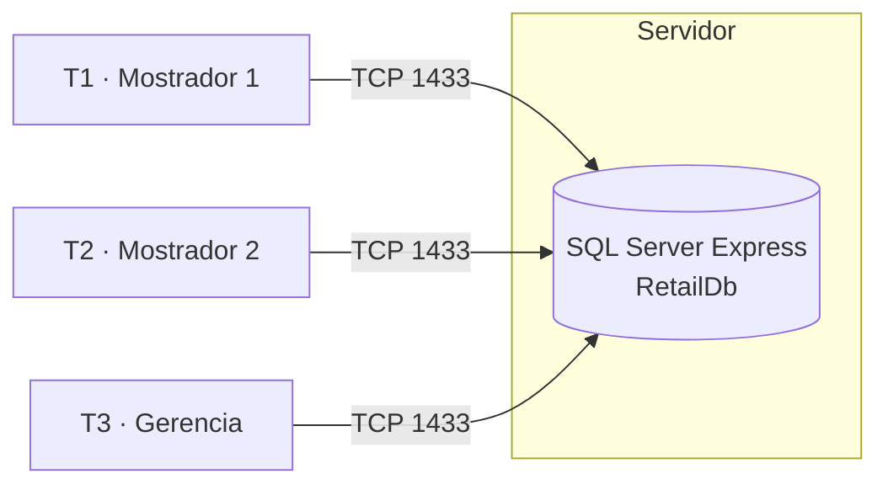

# Acta de Pruebas: Operación Multiterminal

**Proyecto:** Retail (ERP y POS para librería)
**Track:** 6.7, Paquete 7 (Fase 5 de la [auditoría de concurrencia](auditoria-concurrencia-multiterminal.md))
**Estado:** 📋 Guion listo para ejecutar. Las columnas "Resultado" y "Observaciones" se completan durante la prueba.
**Requisitos verificados:** `RNF-05`, `RNF-10`, `RNF-11`, `RNF-12`, `RF-15`, `RF-20`, `RF-22`.

Los tests automáticos prueban cada regla con dos contextos de base de datos dentro de un mismo proceso. Esta acta prueba
lo que solo se ve con **PCs reales**: la red, los relojes, las sesiones de Windows, la instalación y la experiencia del
cajero cuando algo choca.

---

## 1. Entorno de la prueba

| Dato | Valor |
| :--- | :--- |
| Fecha | |
| Versión de Retail (tag o commit) | |
| PC servidor (nombre, Windows, SQL Server Express) | |
| Terminal T1 (nombre, Windows) | |
| Terminal T2 (nombre, Windows) | |
| Terminal T3 / Gerencia (opcional) | |
| Red (cableada, Wi-Fi, VMs en la misma PC) | |
| Participantes | |

**Usuarios de prueba** (crearlos antes en *Administración › Usuarios*): dos Gerentes (`gerente1`, `gerente2`), dos cajeros
(`cajero1`, `cajero2`) y un Administrador (`admin`). Un cliente con cuenta corriente y límite de $ 50.000. Un artículo con
**stock 1**.

**Cómo leer la tabla:** "Resultado" es ✅ (se comportó como se espera), ❌ (no) o ⚠️ (se comportó bien pero algo
molesta). Todo ❌ o ⚠️ lleva una observación y, si corresponde, un issue.

---

## 2. Instalación y configuración

| # | Escenario | Pasos | Resultado esperado | Resultado | Observaciones |
| :-- | :--- | :--- | :--- | :--- | :--- |
| I-1 | Instalación del servidor | Seguir [`INSTALACION_MULTITERMINAL.md`](../INSTALACION_MULTITERMINAL.md) §4 completa | `Retail.Cli estado` informa la base al día; la tarea de copias queda registrada | | |
| I-2 | Instalación de una terminal | §5 de la guía en T1 y T2 con `-ProbarConexion` | La prueba de conexión es exitosa con `retail_app` | | |
| I-3 | Login de la app con permisos mínimos | En SSMS, con `retail_app`: `CREATE TABLE X (id int)` | Rechazado por falta de permisos (`RNF-05`) | | |
| I-4 | Contraseña cifrada | Abrir `C:\ProgramData\Retail\appsettings.local.json` en T1 | No hay contraseña legible; solo `PasswordCifrada` | | |
| I-5 | Configuración copiada a otra PC | Copiar `appsettings.local.json` de T1 a T2 y abrir Retail en T2 | Mensaje claro: la contraseña no se puede descifrar en esta PC | | |
| I-6 | Archivo de configuración protegido | Con un usuario de Windows sin privilegios, intentar editar `appsettings.local.json` | Acceso denegado; `terminal.json` sí se puede escribir | | |
| I-7 | Tarea de copias en una terminal | Ejecutar `registrar-tarea-backup.ps1` en T1 | Se detiene: "Este script se ejecuta solo en la PC servidor" (H16) | | |
| I-8 | Activación de la PC | Primer arranque de T1 con `cajero1` | Mensaje: un Gerente debe activar la PC; la app se cierra | | |
| I-9 | Activación por un Gerente | Primer arranque de T1 con `gerente1` → "Terminal nueva: Mostrador 1" | La PC queda activada; el siguiente arranque no pregunta | | |
| I-10 | Reemplazo de hardware | En T2 → "Reemplazar una existente: Mostrador 1" (simula cambio de PC) | T2 hereda el historial de turnos de Mostrador 1 | | |
| I-11 | Configuración copiada con `terminal.json` | Copiar `terminal.json` de T1 a T2 | Aviso: "esta configuración parece copiada de otra PC" | | |

## 3. Una instancia por PC y una sesión por usuario

| # | Escenario | Pasos | Resultado esperado | Resultado | Observaciones |
| :-- | :--- | :--- | :--- | :--- | :--- |
| S-1 | Doble apertura en la misma PC | Abrir Retail dos veces en T1 | La segunda no abre: trae al frente la primera (`RNF-12`) | | |
| S-2 | Otra sesión de Windows | Con Retail abierto, cambiar de usuario de Windows en T1 y abrir Retail | Mensaje: ya está abierto en otra sesión de Windows | | |
| S-3 | Mismo usuario en dos terminales | `cajero1` en T1; luego `cajero1` en T2 | T2 informa "sesión abierta en Mostrador 1 desde HH:mm" (`RNF-11`) | | |
| S-4 | PC apagada | Apagar T1 de golpe (sin cerrar Retail); `cajero1` entra en T2 antes y después de 3 minutos | Antes: rechazado. Después: entra y avisa que retomó la sesión | | |
| S-5 | Sesión tomada por otra terminal | Tras S-4, encender T1 y volver a abrir Retail con `cajero1` | Si T1 seguía abierta: al próximo latido avisa que la sesión se cerró y se cierra | | |
| S-6 | Cierre forzado por un Gerente | `cajero1` en T1; `gerente1` en T3 › Usuarios › "Cerrar sesión" | T1 avisa en el próximo latido (≤ 60 s) y se cierra | | |
| S-7 | Corte de red breve | Desconectar el cable de T1 durante 30 s | No pasa nada visible; el latido reintenta | | |
| S-8 | Corte de red largo | Desconectar T1 durante 5 minutos y reconectar | La sesión vence; al reconectar, T1 avisa y se cierra (otra terminal pudo tomarla) | | |

## 4. Caja: turno por cajero y terminal

| # | Escenario | Pasos | Resultado esperado | Resultado | Observaciones |
| :-- | :--- | :--- | :--- | :--- | :--- |
| C-1 | Dos cajas abiertas a la vez | `cajero1` abre turno en T1; `cajero2` abre en T2 | Los dos turnos conviven (antes: un solo turno en todo el sistema, H1) | | |
| C-2 | Un cajero, dos cajas | `cajero1` con turno abierto en T1 cierra Retail sin cerrar el turno y entra en T2 | No puede abrir otro turno: "Usted ya tiene un turno abierto en Mostrador 1" | | |
| C-3 | Turno ajeno (pausa) | `cajero1` deja su turno abierto en T1 y cierra Retail; `cajero2` entra en T1 | Aviso "Turno de cajero1 sin cerrar"; no puede vender ni abrir otro turno | | |
| C-4 | El dueño retoma | Tras C-3, `cajero1` vuelve a entrar en T1 | Continúa su turno normalmente | | |
| C-5 | El Gerente cierra un turno ajeno | Tras C-3, `gerente1` entra en T1 y hace el arqueo | Puede cerrarlo, no puede vender en él; después abre su propio turno | | |
| C-6 | Cierre remoto | `cajero1` con turno abierto en T1; `gerente1` en T3 › Caja › "Turnos abiertos en otras terminales" › cerrar con arqueo | El turno de T1 queda cerrado; T1 ya no puede cobrar (MT-11) | | |
| C-7 | Cierre remoto con venta en curso | Como C-6, pero `cajero1` cobra una venta en efectivo **justo antes** de que el Gerente confirme el arqueo | El arqueo del Gerente se rechaza: "El turno registró operaciones después de que se cargó el cierre" | | |
| C-8 | Venta a cuenta corriente en un turno cerrado | `gerente1` cierra el turno de T1 mientras `cajero1` tiene un ticket cargado; `cajero1` cobra 100 % a cuenta corriente | La venta se rechaza: "Su turno de caja fue cerrado desde otra terminal" (H18) | | |

## 5. Ventas, clientes y catálogo

| # | Escenario | Pasos | Resultado esperado | Resultado | Observaciones |
| :-- | :--- | :--- | :--- | :--- | :--- |
| V-1 | El último artículo | T1 y T2 cargan el artículo de stock 1; cobran casi a la vez | Una venta se registra; la otra recibe "Datos actualizados por otra terminal" y conserva el ticket | | |
| V-2 | Dos ventas a crédito al mismo cliente | T1 y T2 venden a crédito al mismo cliente casi a la vez | La segunda se rechaza y se reintenta; el saldo final es la suma de ambas (H2) | | |
| V-3 | Límite de crédito y venta simultánea | `gerente1` baja el límite del cliente en T3 mientras T1 le vende a crédito | Uno de los dos se rechaza; nunca queda un límite menor que la deuda | | |
| V-4 | Presupuesto cobrado dos veces | T1 y T2 cargan el mismo presupuesto y cobran | Solo uno se convierte en venta | | |
| V-5 | Mismo documento de cliente | T1 y T2 dan de alta un cliente con el mismo DNI a la vez | El segundo recibe "Ya existe otro cliente con el documento…" (H5) | | |
| V-6 | Dos listas con el mismo nombre | T1 y T2 crean una lista con el mismo nombre a la vez | La segunda recibe "Ya existe una lista llamada…" | | |
| V-7 | Último Gerente | Con solo `gerente1` y `gerente2`: cada uno da de baja al otro a la vez | Uno se rechaza: "Debe quedar al menos un Gerente activo" (H4) | | |
| V-8 | Reportes y mostrador | `gerente1` genera un reporte de un año en T3 mientras T1 y T2 venden | Las ventas no se demoran (RCSI, H11) | | |

## 6. Respaldo, restauración y mantenimiento

| # | Escenario | Pasos | Resultado esperado | Resultado | Observaciones |
| :-- | :--- | :--- | :--- | :--- | :--- |
| R-1 | Copia desde una terminal | `gerente1` en T1 › Respaldos | Ve el historial; "Crear copia" y "Restaurar" deshabilitados con el aviso de la PC servidor (MT-12) | | |
| R-2 | Copia manual en el servidor | `gerente1` en el servidor › "Crear copia" mientras T1 vende | La copia termina sin interrumpir la venta | | |
| R-3 | Restaurar con terminales conectadas | En el servidor › Restaurar con T1 y T2 abiertas → "2 min" | T1 y T2 muestran el aviso de mantenimiento; desde la hora indicada no pueden iniciar cobros | | |
| R-4 | Las terminales salen | Tras R-3, cerrar Retail en T1 y T2 | El servidor detecta que salieron y restaura | | |
| R-5 | Terminales que no salen | Repetir R-3 sin cerrar T2 | Pasado el plazo, el servidor pregunta "¿Restaurar igual?"; con "Sí", T2 se desconecta | | |
| R-6 | Cancelar la espera | Repetir R-3 y cancelar la espera | El aviso desaparece de las terminales y pueden volver a cobrar | | |
| R-7 | Después de restaurar | Abrir T1 y T2 tras la restauración | Ningún aviso de mantenimiento heredado; las terminales vuelven a pedir login | | |
| R-8 | Administrador con control dual | `admin` restaura en el servidor con terminales conectadas, autorizado por `gerente1` | Puede programar el mantenimiento y restaurar | | |

## 7. Relojes y versiones

| # | Escenario | Pasos | Resultado esperado | Resultado | Observaciones |
| :-- | :--- | :--- | :--- | :--- | :--- |
| H-1 | Reloj atrasado | Atrasar 5 minutos el reloj de T2 y esperar un latido | Aviso: "El reloj de esta PC está 5 minutos atrasado respecto del servidor" | | |
| H-2 | Reloj y sesiones | Con el reloj de T2 atrasado 10 minutos, repetir S-3 y S-4 | El vencimiento de la sesión no cambia: lo decide la hora del servidor | | |
| H-3 | Base más nueva con la app abierta | Con T1 abierta, migrar el servidor a una versión más nueva | En ≤ 5 minutos, T1 avisa que hay que actualizar la aplicación | | |
| H-4 | Terminal desactualizada | Abrir en T1 una versión más vieja que la base | No abre el login: indica que hay que actualizar la aplicación | | |

## 8. Fuera de esta acta

| Tema | Por qué | Cuándo |
| :--- | :--- | :--- |
| Contrato fiscal C-1 y C-2 (numeración serializada e idempotencia contra ARCA) | El Módulo 5.2 (ARCA) todavía no existe | Al implementar el Módulo 5.2, contra homologación |
| Trazabilidad de la cuenta corriente | No es un problema de concurrencia | [`plan-futuro-trazabilidad-cuenta-corriente.md`](plan-futuro-trazabilidad-cuenta-corriente.md) |

---

## 9. Conclusiones

| Bloque | ✅ | ⚠️ | ❌ |
| :--- | :--: | :--: | :--: |
| Instalación y configuración (I) | | | |
| Instancia y sesión (S) | | | |
| Caja (C) | | | |
| Ventas, clientes y catálogo (V) | | | |
| Respaldo y mantenimiento (R) | | | |
| Relojes y versiones (H) | | | |

**Observaciones generales:**

**Issues abiertos a partir de esta prueba:**

| Firma | Nombre | Fecha |
| :--- | :--- | :--- |
| Ejecutó | | |
| Revisó | | |
