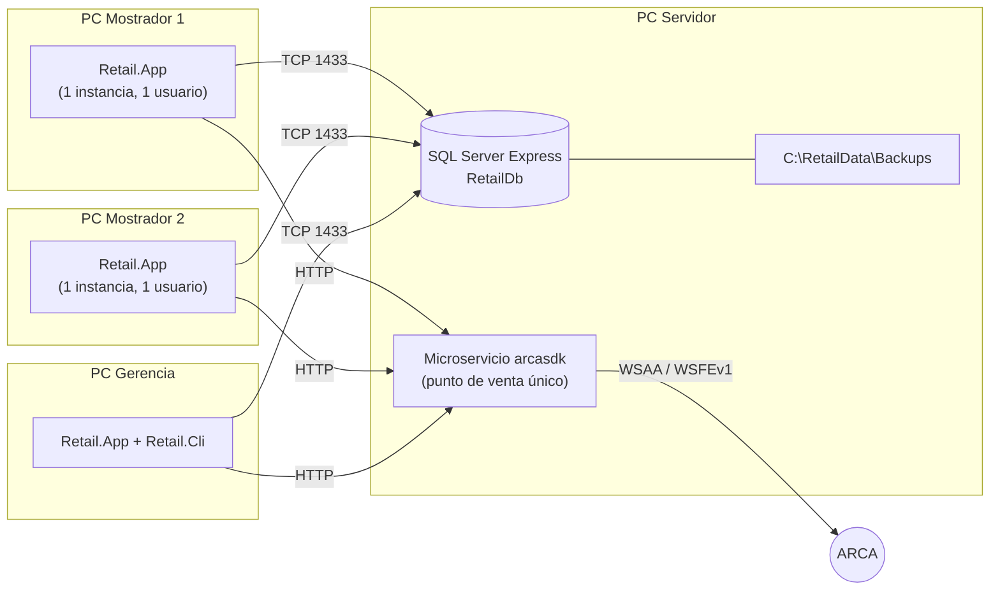
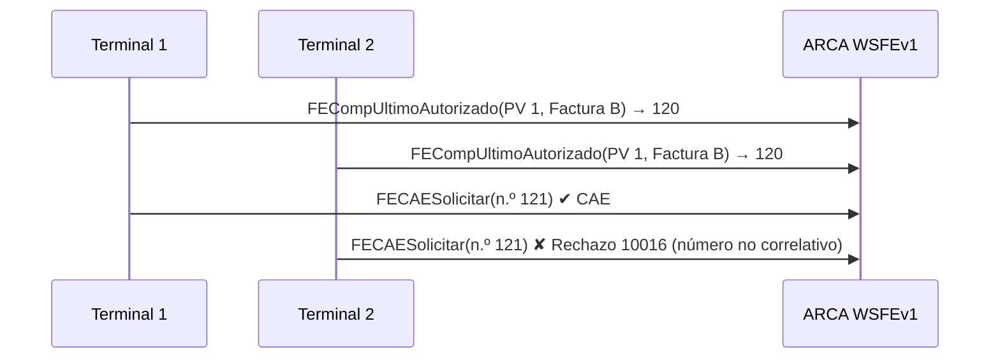
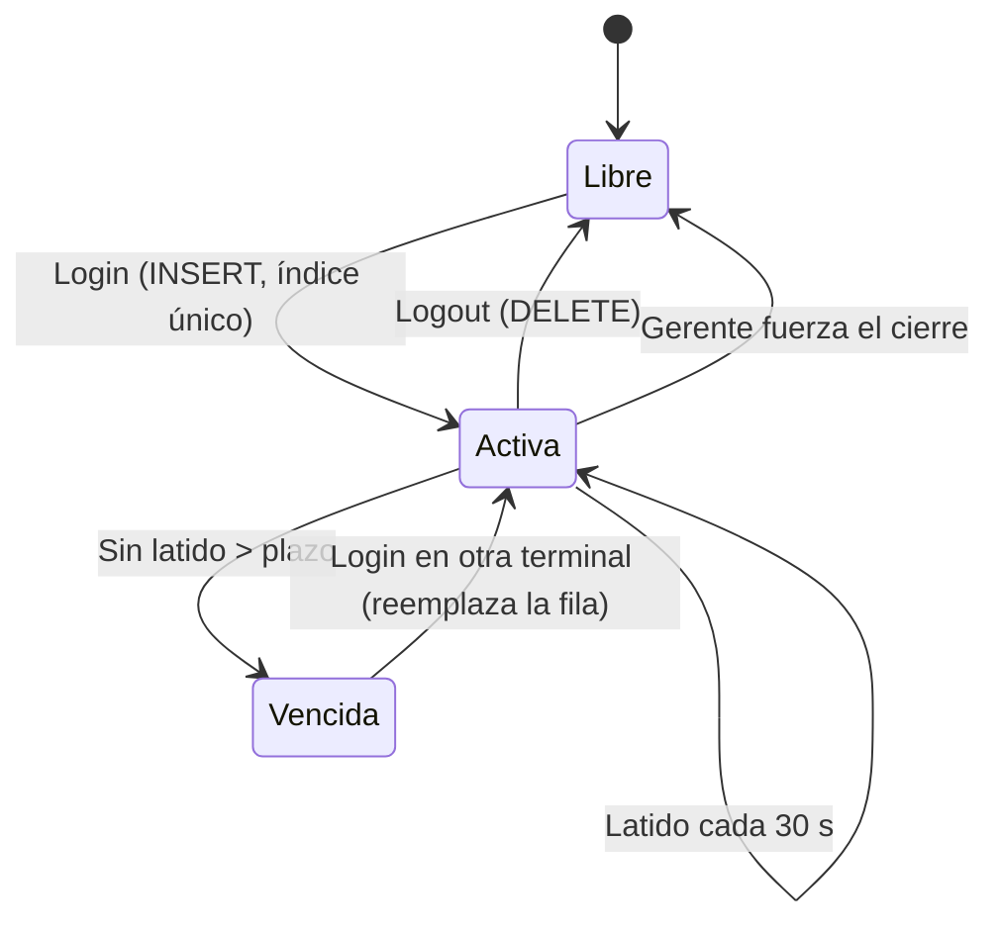
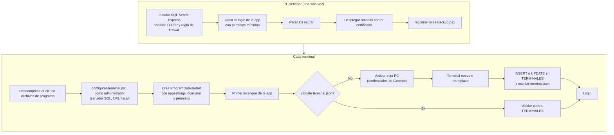
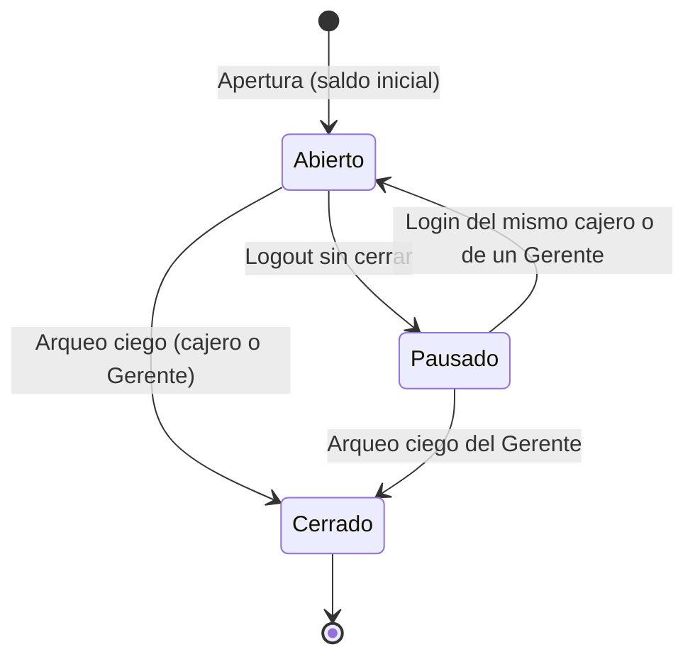
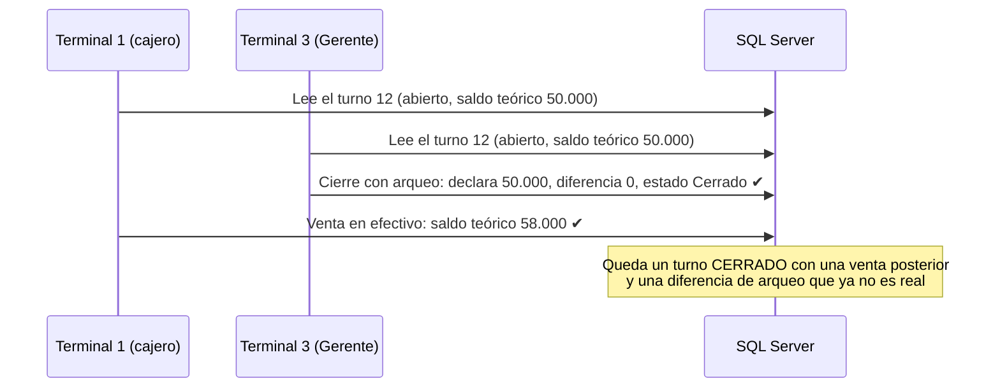
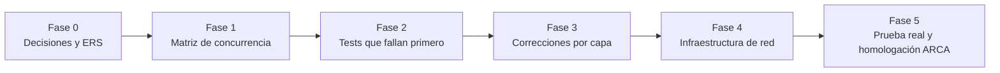

# Auditoría: Concurrencia Multiterminal

**Proyecto:** Retail (ERP y POS para librería)
**Fecha de apertura:** 2026-11-14
**Estado:** ✅ Fase 0 (decisiones) cerrada el 2026-11-19 · ⏳ Fase 1 (matriz de concurrencia) pendiente
**Objetivo:** que el sistema funcione en forma correcta y segura con **varias terminales abiertas a la vez** sobre una
única base SQL Server.

---

## 1. Topología objetivo



**Principio rector:** cada terminal es un **proceso independiente** con su propio `DbContext`. Lo único que comparten
es la base de datos (y el microservicio fiscal). La coordinación entre terminales **no puede resolverse con `lock` de
C#**, que solo coordina hilos de un mismo proceso: debe resolverse en SQL Server (transacciones, `rowversion`,
índices únicos, `sp_getapplock`) o en el servicio compartido.

---

## 2. Decisiones de la Fase 0

| ID | Decisión | Estado |
| :--- | :--- | :--- |
| **MT-1** | **Turno de caja por terminal.** Cada PC de mostrador tiene su gaveta, su turno y su arqueo (precisada por MT-9). | ✅ Decidida |
| **MT-2** | **Una sola instancia de Retail.App por PC**, y por lo tanto un solo usuario por PC a la vez. | ✅ Decidida |
| **MT-3** | **Un usuario no puede tener sesión abierta en dos terminales a la vez.** | ✅ Decidida |
| **MT-4** | **Un único punto de venta fiscal**, con el microservicio arcasdk desplegado en la PC servidor (ver §3). Condicionada al contrato C-1 a C-6. | ✅ Decidida |
| **MT-5** | Identidad de la terminal: tabla `TERMINALES` y archivo `C:\ProgramData\Retail\terminal.json`, escrito al **activar** la PC (solo un Gerente puede hacerlo). El nombre del equipo se guarda como control (ver §4.1). | 🟡 Diseño acordado, falta implementar |
| **MT-6** | Sesión única: tabla `SESIONES_ACTIVAS` con latido cada 60 s y vencimiento a los 3 min (ver §4.2). | 🟡 Diseño acordado, falta implementar |
| **MT-7** | Configuración en capas: `appsettings.json` (viene en el ZIP) más `C:\ProgramData\Retail\appsettings.local.json` (propio de cada PC; las actualizaciones no lo pisan). | 🟡 Diseño acordado, falta implementar |
| **MT-8** | `registrar-tarea-backup.ps1` corre **solo en la PC servidor**; las terminales usan un script nuevo, `configurar-terminal.ps1` (ver §4.3). | 🟡 Diseño acordado, falta implementar |
| **MT-9** | **Turno por cajero y terminal.** Un cambio de cajero obliga a cerrar el turno con arqueo ciego. Un turno abierto por terminal **y** un turno abierto por usuario. Salir sin cerrar deja el turno en **pausa**: solo ese cajero o un Gerente lo retoman, en esa misma terminal (ver §4.4). | ✅ Decidida |
| **MT-10** | **Autenticación de SQL Server** (modo mixto) con el login `retail_app` de permisos mínimos. La contraseña va en `appsettings.local.json`, cifrada con DPAPI a nivel máquina. Se reescribe `RNF-05` (ver §4.5). | ✅ Decidida |
| **MT-11** | **Un Gerente puede cerrar el turno de otra terminal** desde la suya. Requiere `rowversion` en `TurnoCaja` (ver §4.6). | ✅ Decidida |

---

## 3. Análisis de MT-4: ¿un punto de venta o uno por terminal?

> El código del microservicio no está en este repositorio. Que **"gestiona varias sesiones simultáneas del mismo
> punto de venta"** se toma como un **contrato** del servicio, y se verifica desde afuera con tests contra
> homologación (Fase 5), sin leer su código.

### 3.1 Por qué la numeración fiscal es un problema de concurrencia

ARCA (WSFEv1) exige numeración **correlativa y sin huecos** por **(punto de venta, tipo de comprobante)**. El
protocolo es: consultar `FECompUltimoAutorizado`, pedir `FECAESolicitar` con el número `n + 1`. Si dos sesiones hacen
esto sobre la misma clave sin serializarse, se da una **condición de carrera clásica**:



Hay dos formas de evitarlo: **serializar en un único punto** (el microservicio central) o **eliminar el recurso
compartido** (un punto de venta por terminal).

### 3.2 Comparación

| Criterio | A. Punto de venta único, microservicio central | B. Punto de venta por terminal, microservicio en cada PC |
| :--- | :--- | :--- |
| **Carrera por la numeración** | La resuelve el microservicio serializando por (PV, tipo). | No existe: cada PV tiene un solo emisor. |
| **Token WSAA (TA)** | Un certificado, un TA y un solo proceso que lo administra. | ⚠️ Si las N PCs usan el **mismo certificado**, compiten por el TA: WSAA rechaza un nuevo `loginCms` mientras hay un TA vigente para ese certificado y servicio. Hace falta un certificado por PC o un TA compartido, y un TA compartido vuelve a centralizar. |
| **Seguridad de la clave privada** | Vive solo en la PC servidor. | Se copia a cada PC de mostrador, que es la más expuesta. |
| **Disponibilidad** | Si cae la PC servidor, no se factura. **Pero tampoco hay base de datos**, así que tampoco se vende. No se pierde nada nuevo. | No mejora: sin la PC servidor tampoco hay base. |
| **Corte de Internet (RF-17 / RNF-07)** | Contingencia igual en ambos modelos. | Igual. |
| **Rendimiento** | Serializar una librería con pocos comprobantes por minuto y 0,5 a 2 s por CAE es despreciable. | Paralelo, pero no hace falta. |
| **Alta y operación** | Un PV registrado en ARCA, un despliegue, un certificado. | N PV dados de alta en ARCA, N despliegues, N configuraciones, actualizaciones en N PCs. |
| **Trazabilidad por terminal** | Se logra con `id_terminal` en `VENTAS` y `COMPROBANTES_FISCALES`. | El número de PV ya identifica la terminal. |
| **Agregar o quitar una terminal** | Instalar la app. | Trámite en ARCA más instalación del microservicio. |

### 3.3 Decisión: opción A, con un contrato explícito (confirmada el 2026-11-14)

La opción B no da más disponibilidad, porque la base ya es un único punto de falla. Además suma un problema real con
el token WSAA y reparte la clave privada por las PCs de mostrador. La opción A concentra la complejidad en un solo
lugar, que es justamente la responsabilidad del microservicio. Esto es el principio de **responsabilidad única**
aplicado a la arquitectura del despliegue.

La opción A **solo es correcta si se cumple este contrato**, que la auditoría debe verificar:

| # | Requisito | Quién lo cumple | Cómo se verifica |
| :--- | :--- | :--- | :--- |
| C-1 | Serializa la emisión por (PV, tipo de comprobante). | Microservicio | Test de carga: N solicitudes simultáneas en homologación sin rechazos 10016 y números sin huecos. |
| C-2 | **Idempotencia:** reenviar la misma venta (tras un *timeout*) no emite dos comprobantes. Requiere una clave de idempotencia (por ejemplo, el `id_comprobante`) y conciliar con `FECompConsultar`. | Microservicio y `FiscalService` | Test: cortar la respuesta después del CAE y reintentar. Debe devolver el mismo CAE. |
| C-3 | La app no asume el número antes de recibir el CAE: lo guarda tal como lo devuelve el servicio. | `FiscalService` | Revisión de código. |
| C-4 | Índice único `(punto_venta, tipo_comprobante, numero_comprobante)` filtrado `WHERE numero_comprobante IS NOT NULL`. | Infraestructura | Test de integración: duplicar falla con `RestriccionDeUnicidadException`. |
| C-5 | **"Reintentar lote" desde dos terminales a la vez** no reenvía el mismo comprobante dos veces: cada comprobante pendiente lo **reclama** un solo proceso (transición de estado protegida con `rowversion` o `sp_getapplock`). | `FiscalService` | Test con dos scopes. |
| C-6 | `ArcaSettings.BaseUrl` apunta a la PC servidor, no a `localhost:8080`. | Configuración por PC | Checklist de instalación. |

> ⚠️ **Límite del mock:** `MockArcaClient` usa `IdVenta` como número de comprobante. Nunca repite números, pero
> **tampoco reproduce la carrera de §3.1**. Por eso los tests con mock no pueden validar C-1 ni C-2: esos se prueban
> contra el microservicio real en homologación.

---

## 4. Diseño propuesto para MT-1, MT-2 y MT-3

### 4.1 Identidad de la terminal (MT-5)

Hoy no existe el concepto de terminal. `CajaService.AbrirTurnoAsync` lo admite en un comentario ("Asumimos terminal
por defecto") y el índice `IX_TURNOS_CAJA_TurnoAbierto` permite **un único turno abierto en todo el sistema**.

**Diseño acordado (práctica habitual en POS comerciales: dar de alta el dispositivo de forma explícita y guardar su
identidad en la PC):**
* Nueva raíz de agregado `Terminal` (tabla `TERMINALES`: `id`, nombre visible, `nombre_equipo` como dato de control,
  alta y baja lógica).
* La PC guarda su `id_terminal` en `C:\ProgramData\Retail\terminal.json`. Es una carpeta de la máquina, no del
  usuario de Windows, porque la terminal es la PC y no la persona.
* **Activación:** si una PC arranca sin `terminal.json`, la app muestra "Activar esta PC" y pide credenciales de
  Gerente (`RNF-06`). Se puede crear una terminal nueva o **reemplazar una existente** (cambio de hardware). En ese
  caso se actualiza `nombre_equipo` y el historial queda intacto.
* **Control en cada arranque:** la terminal existe, está activa, y su `nombre_equipo` coincide con
  `Environment.MachineName`. Si no coincide, avisa *"esta configuración parece copiada de otra PC"*.
* `TurnoCaja` y `Venta` guardan el **`id`** de la terminal (clave sustituta), no el nombre del equipo, para que
  renombrar la PC no rompa el historial. El índice único pasa a ser
  `(id_terminal) WHERE estado = 'Abierto' AND deleted_at IS NULL`, es decir, **un turno abierto por terminal**.

**Alternativas evaluadas:**

| Identificador | Por qué no es el principal |
| :--- | :--- |
| Solo el nombre del equipo | Si se renombra o reemplaza la PC, "aparece" una terminal nueva; con imágenes clonadas se repiten nombres. Queda como dato de control. |
| `MachineGuid` del registro | Cambia al reinstalar Windows, se duplica al clonar una imagen y nadie lo reconoce a simple vista. |
| Token secreto por dispositivo | Aporta poco: toda terminal ya tiene credenciales de la base. Queda como trabajo futuro. |

**Por qué el archivo cuesta poco:** cada PC necesita de todos modos su propia configuración (cadena de conexión al
servidor y `BaseUrl` fiscal) en un archivo que las actualizaciones no pisen (MT-7). La identidad se guarda en la
misma carpeta.

### 4.2 Una instancia por PC (MT-2) y una sesión por usuario (MT-3)

Son dos problemas distintos y cada uno tiene su herramienta:

| Regla | Alcance | Mecanismo propuesto | Por qué ese |
| :--- | :--- | :--- | :--- |
| **MT-2:** una instancia por PC | Dentro de una sola máquina | `Mutex` con nombre `Global\Retail.App` al arrancar. Si ya existe, se trae al frente la ventana abierta y se cierra el proceso nuevo. | El prefijo `Global\` alcanza a **todas las sesiones de Windows** de la PC (cambio rápido de usuario, Escritorio remoto). Así se cumple también "un usuario por PC". El sistema operativo libera el mutex si el proceso muere. |
| **MT-3:** un usuario en una sola terminal | Entre máquinas | Tabla `SESIONES_ACTIVAS` (`id_usuario` único, `id_terminal` único, `inicio`, `ultimo_latido`). El login inserta la fila; un temporizador renueva `ultimo_latido`; el logout la borra. | Un mutex no cruza máquinas: hace falta la base compartida. El índice único hace que la base garantice la regla aunque dos logins lleguen al mismo tiempo. |

**Alternativas descartadas para MT-3:**

| Alternativa | Ventaja | Por qué se descarta |
| :--- | :--- | :--- |
| `sp_getapplock` con dueño `Session` en una conexión dedicada | Se libera sola si el proceso muere. | Un corte de red de un segundo libera el bloqueo sin avisar. La restauración (`ROLLBACK IMMEDIATE`) corta todas las conexiones a la vez. No queda registro visible de quién está conectado ni desde dónde. |
| Columna `sesion_abierta` en `USUARIOS` | Simple. | Si la PC se cuelga, el usuario queda bloqueado para siempre. Además mezcla un dato técnico con el agregado `Usuario`. |

**Parámetros acordados:** latido cada **60 s**; una sesión se toma como **vencida a los 3 min** sin latido. El costo
es un `UPDATE` por clave primaria por terminal y por minuto, despreciable al lado de las consultas del POS.

**Reglas para implementarlo:**
* El latido usa **su propio scope de DI y su propio `DbContext`**. Corre en paralelo a la pantalla, y compartir el
  contexto provocaría el `InvalidOperationException` descripto en H-19 (`SISTEMA_DE_PERSISTENCIA.md` §8).
* Corre fuera del hilo de la UI (Ley 4).
* Si el `UPDATE` afecta 0 filas, otra terminal tomó la sesión vencida: se cierra la sesión local y se informa al
  usuario. Si la red falla puntualmente, se registra en el log y se reintenta en el próximo latido.

**Caso a cubrir:** si una PC se cuelga, su sesión queda "viva" hasta que vence el plazo de 3 minutos. Al intentar entrar, el login informa *"Usuario conectado en Mostrador 1 desde 10:32"*. La sesión se toma
como vencida pasado el plazo. Un Gerente puede forzar el cierre antes.



### 4.3 Instalación multiterminal (MT-7, MT-8)



| Script | Dónde se ejecuta | Qué hace |
| :--- | :--- | :--- |
| `registrar-tarea-backup.ps1` (existente) | **Solo en la PC servidor** | Tarea diaria como SYSTEM, permisos de SQL Server para SYSTEM y permisos **restrictivos** en la carpeta de respaldos (saca a los grupos amplios, `RetailPermisos.psm1:19`). |
| `configurar-terminal.ps1` (nuevo) | En cada terminal | Crea `C:\ProgramData\Retail\`, escribe `appsettings.local.json` y da permiso de escritura a *Usuarios* **solo en esa carpeta**, para que la app pueda escribir `terminal.json`. Reutiliza `RetailPermisos.psm1` y no registra ninguna tarea. |

**¿Qué pasa si la tarea de backup se registra en una terminal (H16)?** No se duplica la base en cada PC: el
`BACKUP DATABASE` lo ejecuta el motor, y el `.bak` se escribe en el disco del servidor. Las copias simultáneas no se
pisan, porque las serializan `sp_getapplock` y el índice único de `EnCurso`. Sí hay problemas reales:

| Problema | Causa | Efecto |
| :--- | :--- | :--- |
| Partes de una copia en PCs distintas | El `.bak` queda en el servidor, pero el manifiesto y la limpieza los hace `ArchivosBackup` con `File.*` en el disco local de la terminal (H9) | La verificación y la restauración fallan |
| Historial más corto | N PCs × 1 copia diaria, con un máximo de 14 copias (`CantidadMaximaCopias`) | Con 5 PCs, menos de 3 días de historial |
| La tarea falla por autenticación | SYSTEM se autentica como la cuenta de la computadora, y en una red sin dominio eso no funciona | Copias fallidas todos los días |
| Permisos en la carpeta equivocada | El script ajusta permisos en una carpeta **local** para la cuenta del servicio del motor, que no existe en esa PC | Configuración inconsistente |

**Remedio:** que el script se detenga apenas arranca si no está en la PC del motor, antes de tocar permisos o
tareas:

```powershell
$equipoDelMotor = Invoke-Sql "master" "SELECT CAST(SERVERPROPERTY('ComputerNamePhysicalNetBIOS') AS nvarchar(128));" $true
if ($equipoDelMotor -ne $env:COMPUTERNAME)
{
    throw "Este script se ejecuta solo en la PC servidor ('$equipoDelMotor'). En las terminales use configurar-terminal.ps1."
}
```

### 4.4 Turno por cajero y terminal (MT-9)

Lo habitual en retail es que cada cajero responda por su propio dinero: el turno es de una persona en una terminal, y
el arqueo ciego (`RF-15`, `TurnoCaja.CerrarConArqueoCiego`) solo tiene sentido si hay un único responsable. Por
ejemplo, Microsoft Dynamics 365 Commerce distingue turnos individuales, compartidos y suspendidos.

| Opción | Responsabilidad sobre la diferencia | Decisión |
| :--- | :--- | :--- |
| **Turno por cajero y terminal** | Clara: la diferencia es de quien cerró | ✅ Elegida |
| Turno de la terminal, con relevos de cajeros | Ambigua: con un faltante, nadie sabe de quién es | Descartada: contradice el arqueo ciego |

**Reglas:**
* `TurnoCaja` ya guarda `IdUsuario`; se agrega `IdTerminal`.
* Dos índices únicos filtrados por `estado IN ('Abierto', 'Pausado') AND deleted_at IS NULL`: uno sobre
  `id_terminal` y otro sobre `id_usuario`. El segundo evita que un cajero deje su turno abierto en la terminal 1 y
  abra otro en la terminal 2 (la sesión única de MT-3 no lo impide, porque en ese momento ya no está conectado en la 1).
* **Pausa:** cerrar la sesión sin cerrar el turno lo deja `Pausado`. Solo ese mismo cajero o un Gerente pueden
  retomarlo, en esa terminal. Mientras tanto, nadie más puede vender en esa caja.



### 4.5 Autenticación contra SQL Server (MT-10)

La cadena de conexión actual usa `Trusted_Connection=True` ("conectame con mi usuario de Windows"). Funciona porque la
app y el motor están en la misma PC. En un **grupo de trabajo** (lo normal en un comercio chico, sin dominio de
Active Directory), el usuario de Windows de una terminal no existe para la PC servidor, y el login falla.

| Tema | Decisión |
| :--- | :--- |
| Modo de autenticación | Activar el modo mixto ("SQL Server y Windows") en la instalación del servidor y reiniciar el servicio. |
| Login de la aplicación | `retail_app`: lee y escribe en `RetailDb`, ejecuta lo que la app necesita. No es `sysadmin`, no modifica el esquema, no crea bases. Migraciones (`Retail.Cli migrar`) y copias de seguridad siguen con sus propias cuentas. |
| Contraseña | En `appsettings.local.json` (MT-7), cifrada con **DPAPI a nivel máquina**: copiar el archivo a otra PC no sirve. Limitación aceptada: un usuario de Windows de esa misma PC podría descifrarla, como en cualquier aplicación de escritorio que se conecta directo a la base. |
| Identidad de las personas | Sigue en el login propio de Retail (BCrypt y roles, `RNF-04` y `RNF-06`). Las credenciales de SQL son de la **aplicación**, no de cada cajero. |
| ERS | Reescribir `RNF-05`: de "instancia local con permisos restringidos a nivel de sistema operativo" a "instancia en red con un login de aplicación de permisos mínimos". |

### 4.6 Cierre de turno desde otra terminal (MT-11)

Sin `rowversion` en `TurnoCaja`, el cierre del Gerente y una venta simultánea del cajero **se aplican los dos sin
error**. EF Core solo actualiza las columnas que cambiaron: el cierre toca `estado` y `diferencia_efectivo`, y la venta
toca `saldo_teorico_efectivo`. La regla de `ImputarVenta` que rechaza ventas en un turno cerrado se comprobó contra una
copia del turno que ya estaba vieja.



**Remedio:** `rowversion` en `TurnoCaja`. Toda venta, cobranza y movimiento pasa por la raíz
(`turno.ImputarVenta(...)` en `VentaService.cs:247`), así que modifica la fila del turno. Así, un solo token protege
todas las reglas de la caja (la raíz de agregado como límite de consistencia, DDD). La segunda escritura en llegar
falla con `ConflictoDeConcurrenciaException`:
* Si gana el cierre, la venta se rechaza y el cajero ve *"su turno fue cerrado por un Gerente"*.
* Si gana la venta, el cierre se rechaza y el Gerente vuelve a cargar el turno con el saldo actualizado.

---

## 5. Hallazgos preliminares

| # | Hallazgo | Evidencia | Anomalía | Gravedad | Relación |
| :-- | :--- | :--- | :--- | :--- | :--- |
| H1 | Un único turno abierto en todo el sistema | `TurnoCajaConfiguration.cs:95`, `CajaService.cs:35-53` | Falta el concepto de terminal | 🔴 Impide arrancar | MT-1, MT-5 |
| H2 | `Cliente` sin `rowversion`; el saldo se calcula en C# y se pisa | `Cliente.cs:188/203`, `ClienteConfiguration.cs` | Actualización perdida; se puede superar el límite de crédito | 🔴 | — |
| H3 | `TurnoCaja` sin `rowversion` | `TurnoCajaConfiguration.cs` | Actualización perdida: el cierre remoto del Gerente y una venta simultánea se aplican los dos (§4.6) | 🔴 | MT-11 |
| H4 | "Último gerente" se chequea antes de actuar, sin protección | `UsuarioService.cs:333` | *Write skew* | 🟠 | — |
| H5 | Unicidades chequeadas en C# antes de guardar | `CompraService.cs:69`, `AbrirTurnoAsync` | Chequear-y-actuar; falta verificar la traducción del error | 🟡 | — |
| H6 | Sin índice único en la numeración fiscal | `ComprobanteFiscalConfiguration.cs` | Números duplicados | 🟠 | MT-4, C-4 |
| H7 | La conexión apunta a la máquina local, usa autenticación de Windows, y `RNF-05` exige instancia local | `appsettings.json`, ERS | Despliegue en red; el login falla en un grupo de trabajo | 🔴 Impide arrancar | MT-7, MT-10 |
| H8 | La restauración echa a las demás terminales sin aviso | `BaseRestauradaSqlServer.cs:164` | Ventas en curso perdidas | 🟠 | MT-6 |
| H9 | Las copias leen archivos con rutas de la PC servidor | `ArchivosBackup.cs` | Rutas inválidas desde otra PC | 🟠 | — |
| H10 | Cada terminal usa la hora de su propio reloj | `TimeProvider.System` en cada cliente | Orden temporal inconsistente | 🟡 | — |
| H11 | `READ COMMITTED` con bloqueos | No se configura `READ_COMMITTED_SNAPSHOT` | Los reportes frenan al POS (`RNF-01`); riesgo de *deadlocks* | 🟡 | — |
| H12 | Terminales con versiones distintas de la app | Las migraciones las aplica `Retail.Cli` | Esquema incompatible | 🟡 | — |
| H13 | Se puede abrir la app varias veces en la misma PC y el mismo usuario en varias PCs | No hay mutex ni registro de sesiones | Viola MT-2 y MT-3 | 🔴 | MT-2, MT-3 |
| H14 | El microservicio fiscal está configurado como `localhost:8080` | `ArcaSettings.BaseUrl` | Las terminales no encuentran el servicio | 🟠 | C-6 |
| H15 | "Reintentar lote" fiscal sin reclamo exclusivo (Etapa 5, aún no implementado) | Roadmap, Módulo 5.2 | Doble envío a ARCA | 🟠 | C-5 |
| H16 | `registrar-tarea-backup.ps1` no verifica que corre en la PC del motor | `scripts/registrar-tarea-backup.ps1` | Copias repartidas entre PCs, historial más corto, tareas que fallan (ver §4.3) | 🟠 | MT-8, H9 |
| H17 | La configuración de cada PC vive en el `appsettings.json` del ZIP | `docs/SISTEMA_DE_CI_CD.md` §3 | Cada actualización pisa la conexión al servidor y la URL fiscal | 🟠 | MT-7 |

---

## 6. Plan por fases



| Fase | Qué se hace | Entregable |
| :--- | :--- | :--- |
| **0** | Cerrar MT-4 a MT-6. Corregir `RNF-05` (instancia en red) y agregar RNF de multiterminal, sesión única e instancia única. | Decisiones confirmadas; ERS actualizada. |
| **1** | Por cada caso de uso que escribe: agregado, qué lee antes de escribir, qué token lo protege y qué anomalía puede sufrir. | Matriz completa en §7. |
| **2** | Un test de integración por hallazgo, **determinista y sin hilos**: dos scopes de DI cargan el mismo agregado, los dos lo modifican y los dos guardan. Se espera `ConflictoDeConcurrenciaException`. | Tests en rojo. |
| **3** | Correcciones capa por capa: Dominio (`Terminal`, `IdTerminal`) → Application (sesión, traducción de errores, *write skew*) → Infraestructura (`rowversion`, índices, migración) → UI (mutex, mensajes de conflicto, login). | Tests en verde; PR por paquete. |
| **4** | Conexión configurable, autenticación SQL o de Windows, `READ_COMMITTED_SNAPSHOT`, reintentos ante *deadlock*, chequeo de versión de esquema, aviso antes de restaurar, hora del servidor, `BaseUrl` fiscal. | Guía de instalación multiterminal. |
| **5** | Dos instancias o dos VMs contra la misma base, con un guion de escenarios. Tests de contrato C-1 y C-2 contra arcasdk en homologación. | Acta de pruebas. |

### Cómo elegir el remedio

| Anomalía | Remedio | Por qué |
| :--- | :--- | :--- |
| Actualización perdida | `rowversion` en la raíz del agregado | Es el patrón vigente (`Articulo`, `Pedido`); no bloquea; protege todo el agregado. |
| Chequear-y-actuar sobre una clave | Índice único filtrado y traducción del error | La base garantiza la unicidad de forma atómica. |
| *Write skew* | `sp_getapplock` o `SERIALIZABLE` acotado | `rowversion` protege una fila, no una regla sobre un conjunto de filas. |
| Numeración correlativa | Un único emisor serializado (MT-4) e índice único | Lo exige ARCA. |
| Exclusión entre procesos de una PC | `Mutex` con nombre `Global\` | Lo resuelve el sistema operativo. |
| Exclusión entre PCs | Fila con índice único en la base | La base es lo único que comparten. |

---

## 7. Matriz de concurrencia (Fase 1, por completar)

| Caso de uso | Agregado(s) | Qué lee antes de escribir | Protección actual | Anomalía posible | Remedio |
| :--- | :--- | :--- | :--- | :--- | :--- |
| Registrar venta | Venta, Articulo, Cliente, TurnoCaja | Stock, saldo, turno | `rowversion` solo en Articulo | Actualización perdida en el saldo (H2) | `rowversion` en Cliente |
| Registrar cobranza | Cliente, TurnoCaja | Saldo | Ninguna | Actualización perdida | `rowversion` en Cliente |
| Abrir turno | TurnoCaja | ¿Hay un turno abierto en la terminal o del usuario? | Índice único global | H1 | Índices por terminal y por usuario (MT-9) |
| Cerrar turno (cajero o Gerente remoto) | TurnoCaja | Saldo teórico | Ninguna | Actualización perdida contra ventas en curso (H3) | `rowversion` en TurnoCaja (MT-11) |
| Dar de baja o cambiar el rol de un Gerente | Usuario | Cantidad de gerentes | Ninguna | *Write skew* (H4) | `applock` |
| … | | | | | |

---

## 8. Preguntas abiertas

Todas resueltas al cierre de la Fase 0:

1. ~~Cambio de cajero en la misma terminal~~ → MT-9: obliga a cerrar el turno; existe la pausa.
2. ~~Plazo de la sesión~~ → MT-6: latido cada 60 s, vencimiento a los 3 min.
3. ~~Autenticación contra SQL Server~~ → MT-10: autenticación de SQL Server con el login `retail_app`.
4. ~~Gerencia remota~~ → MT-11: sí, protegido con `rowversion` en `TurnoCaja`.
