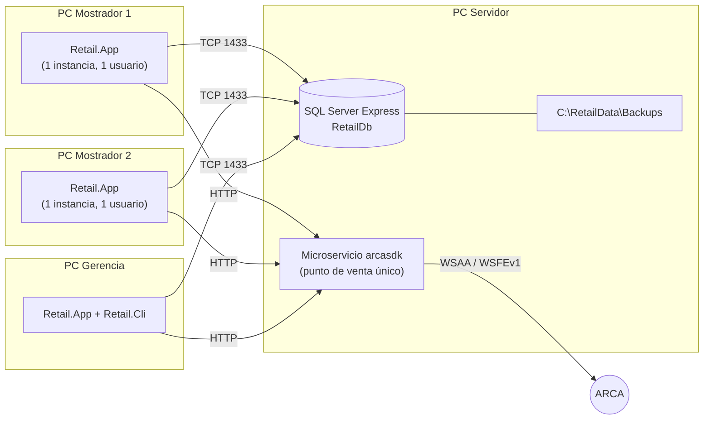
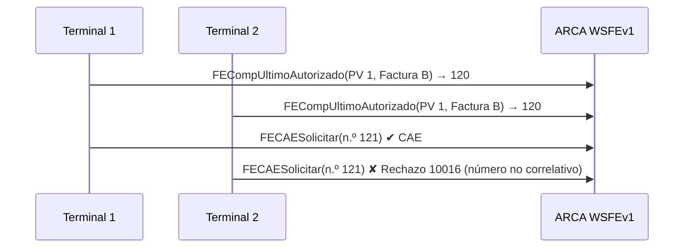
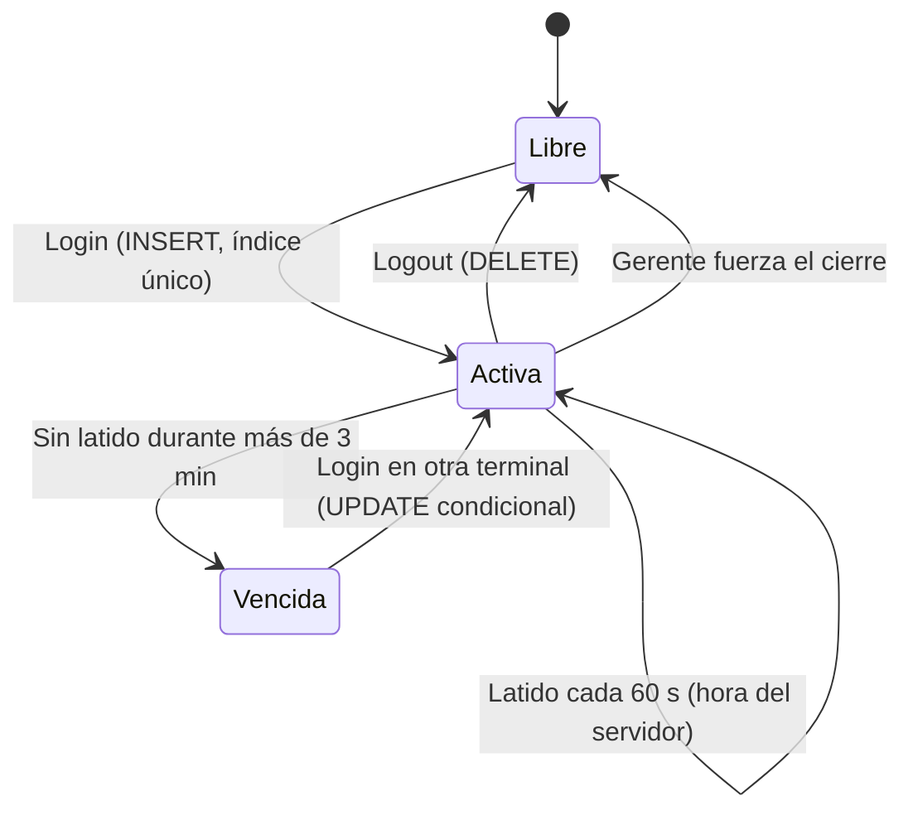
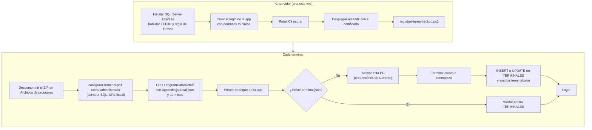
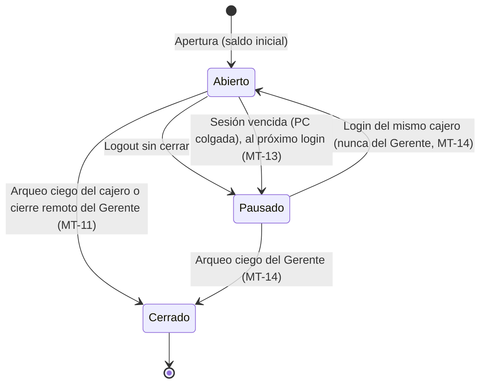
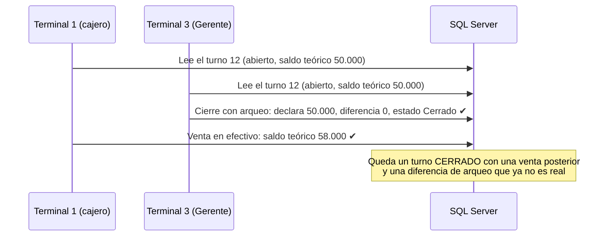
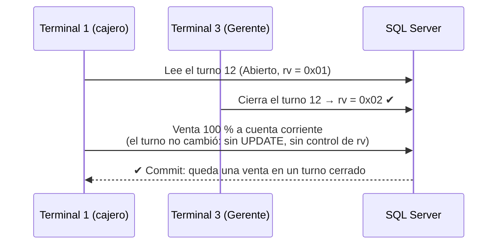
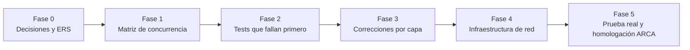

# Auditoría: Concurrencia Multiterminal

**Proyecto:** Retail (ERP y POS para librería)
**Fecha de apertura:** 2026-11-14
**Estado:** ✅ Fase 0 (decisiones) cerrada el 2026-11-19, con la ERS actualizada (`RNF-05`, `RNF-10` a `RNF-12`, `RF-15`) · ✅ Fase 1 (matriz de
concurrencia) completada el 2026-11-19 · ⏳ Fases 2 a 5: plan de implementación en
[`etapa-6-track-6.7-concurrencia-multiterminal.md`](../roadmap/etapa-6-track-6.7-concurrencia-multiterminal.md)
**Objetivo:** que el sistema funcione en forma correcta y segura con **varias terminales abiertas a la vez** sobre una
única base SQL Server.

---

## 1. Topología objetivo



**Principio rector:** cada terminal es un **proceso independiente** con su propio `DbContext`. Lo único que comparten
es la base de datos (y el microservicio fiscal). La coordinación entre terminales **no puede resolverse con `lock` de
C#**, que solo coordina hilos de un mismo proceso: debe resolverse en SQL Server (transacciones, `rowversion`,
índices únicos, `sp_getapplock`) o en el servicio compartido.

---

## 2. Decisiones de la Fase 0

| ID | Decisión | Estado |
| :--- | :--- | :--- |
| **MT-1** | **Turno de caja por terminal.** Cada PC de mostrador tiene su gaveta, su turno y su arqueo (precisada por MT-9). | ✅ Decidida |
| **MT-2** | **Una sola instancia de Retail.App por PC**, y por lo tanto un solo usuario por PC a la vez. | ✅ Decidida |
| **MT-3** | **Un usuario no puede tener sesión abierta en dos terminales a la vez.** | ✅ Decidida |
| **MT-4** | **Un único punto de venta fiscal**, con el microservicio arcasdk desplegado en la PC servidor (ver §3). Condicionada al contrato C-1 a C-6. | ✅ Decidida |
| **MT-5** | Identidad de la terminal: tabla `TERMINALES` y archivo `C:\ProgramData\Retail\terminal.json`, escrito al **activar** la PC (solo un Gerente puede hacerlo). El nombre del equipo se guarda como control (ver §4.1). | 🟡 Diseño acordado, falta implementar |
| **MT-6** | Sesión única: tabla `SESIONES_ACTIVAS` con latido cada 60 s y vencimiento a los 3 min, **medidos con el reloj del servidor** (ver §4.2). | 🟡 Diseño acordado, falta implementar |
| **MT-7** | Configuración en capas: `appsettings.json` (viene en el ZIP) más `C:\ProgramData\Retail\appsettings.local.json` (propio de cada PC; las actualizaciones no lo pisan). | 🟡 Diseño acordado, falta implementar |
| **MT-8** | `registrar-tarea-backup.ps1` corre **solo en la PC servidor**; las terminales usan un script nuevo, `configurar-terminal.ps1` (ver §4.3). | 🟡 Diseño acordado, falta implementar |
| **MT-9** | **Turno por cajero y terminal.** Un cambio de cajero obliga a cerrar el turno con arqueo ciego. Un turno abierto por terminal **y** un turno abierto por usuario. Salir sin cerrar deja el turno en **pausa**: solo ese cajero lo retoma, en esa misma terminal, y un Gerente solo puede cerrarlo (MT-14, ver §4.4). | ✅ Decidida (MT-13 y MT-14 la completan) |
| **MT-10** | **Autenticación de SQL Server** (modo mixto) con el login `retail_app` de permisos mínimos. La contraseña va en `appsettings.local.json`, cifrada con DPAPI a nivel máquina. Se reescribe `RNF-05` (ver §4.5). | ✅ Decidida. Compatible con MT-12: el respaldo y la restauración dejan de usar esta conexión y pasan a una conexión local de mantenimiento en la PC servidor (H19) |
| **MT-11** | **Un Gerente puede cerrar el turno de otra terminal** desde la suya. Requiere `rowversion` en `TurnoCaja` **y que toda operación modifique la fila del turno** (ver §4.6 y H18). | ✅ Decidida |
| **MT-12** | **Dónde se respalda y dónde se restaura** en multiterminal, y con qué identidad de SQL Server (ver §4.7). | ✅ Decidida el 2026-11-19: **todo en la PC servidor** (opción A), con modo mantenimiento antes de restaurar |
| **MT-13** | **La PC se cuelga con el turno abierto:** un turno `Abierto` sin sesión activa se trata como pausado en el próximo login de esa terminal (ver §4.4). | ✅ Decidida el 2026-11-19 |
| **MT-14** | **El Gerente solo puede cerrar el turno pausado de otro cajero**, con arqueo ciego; si quiere vender, abre su propio turno. Precisa MT-9 (ver §4.4). | ✅ Decidida el 2026-11-19 |

---

## 3. Análisis de MT-4: ¿un punto de venta o uno por terminal?

> El código del microservicio no está en este repositorio. Que **"gestiona varias sesiones simultáneas del mismo
> punto de venta"** se toma como un **contrato** del servicio, y se verifica desde afuera con tests contra
> homologación (Fase 5), sin leer su código.

### 3.1 Por qué la numeración fiscal es un problema de concurrencia

ARCA (WSFEv1) exige numeración **correlativa y sin huecos** por **(punto de venta, tipo de comprobante)**. El
protocolo es: consultar `FECompUltimoAutorizado`, pedir `FECAESolicitar` con el número `n + 1`. Si dos sesiones hacen
esto sobre la misma clave sin serializarse, se da una **condición de carrera clásica**:



Hay dos formas de evitarlo: **serializar en un único punto** (el microservicio central) o **eliminar el recurso
compartido** (un punto de venta por terminal).

### 3.2 Comparación

| Criterio | A. Punto de venta único, microservicio central | B. Punto de venta por terminal, microservicio en cada PC |
| :--- | :--- | :--- |
| **Carrera por la numeración** | La resuelve el microservicio serializando por (PV, tipo). | No existe: cada PV tiene un solo emisor. |
| **Token WSAA (TA)** | Un certificado, un TA y un solo proceso que lo administra. | ⚠️ Si las N PCs usan el **mismo certificado**, compiten por el TA: WSAA rechaza un nuevo `loginCms` mientras hay un TA vigente para ese certificado y servicio. Hace falta un certificado por PC o un TA compartido, y un TA compartido vuelve a centralizar. |
| **Seguridad de la clave privada** | Vive solo en la PC servidor. | Se copia a cada PC de mostrador, que es la más expuesta. |
| **Disponibilidad** | Si cae la PC servidor, no se factura. **Pero tampoco hay base de datos**, así que tampoco se vende. No se pierde nada nuevo. | No mejora: sin la PC servidor tampoco hay base. |
| **Corte de Internet (RF-17 / RNF-07)** | Contingencia igual en ambos modelos. | Igual. |
| **Rendimiento** | Serializar una librería con pocos comprobantes por minuto y 0,5 a 2 s por CAE es despreciable. | Paralelo, pero no hace falta. |
| **Alta y operación** | Un PV registrado en ARCA, un despliegue, un certificado. | N PV dados de alta en ARCA, N despliegues, N configuraciones, actualizaciones en N PCs. |
| **Trazabilidad por terminal** | Se logra con `id_terminal` en `VENTAS` y `COMPROBANTES_FISCALES`. | El número de PV ya identifica la terminal. |
| **Agregar o quitar una terminal** | Instalar la app. | Trámite en ARCA más instalación del microservicio. |

### 3.3 Decisión: opción A, con un contrato explícito (confirmada el 2026-11-14)

La opción B no da más disponibilidad, porque la base ya es un único punto de falla. Además suma un problema real con
el token WSAA y reparte la clave privada por las PCs de mostrador. La opción A concentra la complejidad en un solo
lugar, que es justamente la responsabilidad del microservicio. Esto es el principio de **responsabilidad única**
aplicado a la arquitectura del despliegue.

La opción A **solo es correcta si se cumple este contrato**, que la auditoría debe verificar:

| # | Requisito | Quién lo cumple | Cómo se verifica |
| :--- | :--- | :--- | :--- |
| C-1 | Serializa la emisión por (PV, tipo de comprobante). | Microservicio | Test de carga: N solicitudes simultáneas en homologación sin rechazos 10016 y números sin huecos. |
| C-2 | **Idempotencia:** reenviar la misma venta (tras un *timeout*) no emite dos comprobantes. Requiere una clave de idempotencia (por ejemplo, el `id_comprobante`) y conciliar con `FECompConsultar`. | Microservicio y `FiscalService` | Test: cortar la respuesta después del CAE y reintentar. Debe devolver el mismo CAE. |
| C-3 | La app no asume el número antes de recibir el CAE: lo guarda tal como lo devuelve el servicio. | `FiscalService` | Revisión de código. |
| C-4 | Índice único `(punto_venta, tipo_comprobante, numero_comprobante)` filtrado `WHERE numero_comprobante IS NOT NULL`. | Infraestructura | Test de integración: duplicar falla con `RestriccionDeUnicidadException`. |
| C-5 | **"Reintentar lote" desde dos terminales a la vez** no reenvía el mismo comprobante dos veces: cada comprobante pendiente lo **reclama** un solo proceso (transición de estado protegida con `rowversion` o `sp_getapplock`). | `FiscalService` | Test con dos scopes. |
| C-6 | `ArcaSettings.BaseUrl` apunta a la PC servidor, no a `localhost:8080`. | Configuración por PC | Checklist de instalación. |

> ⚠️ **Límite del mock:** `MockArcaClient` usa `IdVenta` como número de comprobante. Nunca repite números, pero
> **tampoco reproduce la carrera de §3.1**. Por eso los tests con mock no pueden validar C-1 ni C-2: esos se prueban
> contra el microservicio real en homologación.

---

## 4. Diseño propuesto

### 4.1 Identidad de la terminal (MT-5)

Hoy no existe el concepto de terminal. `CajaService.AbrirTurnoAsync` lo admite en un comentario ("Asumimos terminal
por defecto") y el índice `IX_TURNOS_CAJA_TurnoAbierto` permite **un único turno abierto en todo el sistema**.

**Diseño acordado (práctica habitual en POS comerciales: dar de alta el dispositivo de forma explícita y guardar su
identidad en la PC):**
* Nueva raíz de agregado `Terminal` (tabla `TERMINALES`: `id`, nombre visible, `nombre_equipo` como dato de control,
  alta y baja lógica).
* La PC guarda su `id_terminal` en `C:\ProgramData\Retail\terminal.json`. Es una carpeta de la máquina, no del
  usuario de Windows, porque la terminal es la PC y no la persona.
* **Activación:** si una PC arranca sin `terminal.json`, la app muestra "Activar esta PC" y pide credenciales de
  Gerente (`RNF-06`). Se puede crear una terminal nueva o **reemplazar una existente** (cambio de hardware). En ese
  caso se actualiza `nombre_equipo` y el historial queda intacto.
* **Control en cada arranque:** la terminal existe, está activa, y su `nombre_equipo` coincide con
  `Environment.MachineName`. Si no coincide, avisa *"esta configuración parece copiada de otra PC"*.
* `TurnoCaja` y `Venta` guardan el **`id`** de la terminal (clave sustituta), no el nombre del equipo, para que
  renombrar la PC no rompa el historial. El índice único pasa a ser
  `(id_terminal) WHERE estado = 'Abierto' AND deleted_at IS NULL`, es decir, **un turno abierto por terminal**.

**Alternativas evaluadas:**

| Identificador | Por qué no es el principal |
| :--- | :--- |
| Solo el nombre del equipo | Si se renombra o reemplaza la PC, "aparece" una terminal nueva; con imágenes clonadas se repiten nombres. Queda como dato de control. |
| `MachineGuid` del registro | Cambia al reinstalar Windows, se duplica al clonar una imagen y nadie lo reconoce a simple vista. |
| Token secreto por dispositivo | Aporta poco: toda terminal ya tiene credenciales de la base. Queda como trabajo futuro. |

**Por qué el archivo cuesta poco:** cada PC necesita de todos modos su propia configuración (cadena de conexión al
servidor y `BaseUrl` fiscal) en un archivo que las actualizaciones no pisen (MT-7). La identidad se guarda en la
misma carpeta.

**Casos a cubrir:**
* **Restauración de una copia anterior al alta de la terminal.** La copia trae una `TERMINALES` donde ese `id` no
  existe. En el próximo arranque, el control falla y la app vuelve a pedir "Activar esta PC" (opción "reemplazar
  una existente" o "nueva"). Hay que mostrar un mensaje que explique por qué, no un error genérico.
* **Modelo de amenazas aceptado.** `configurar-terminal.ps1` da permiso de escritura a *Usuarios* sobre
  `C:\ProgramData\Retail\` para que la app escriba `terminal.json`, así que un usuario de Windows de esa PC puede
  editar el `id_terminal` y hacerse pasar por otra caja. El control por `nombre_equipo` solo lo **detecta** (avisa),
  no lo impide. Se acepta igual que la limitación de DPAPI (§4.5): la frontera de confianza es la PC, y quien la
  administra ya tiene acceso a la base. Impedirlo de verdad requiere el token por dispositivo (trabajo futuro).

### 4.2 Una instancia por PC (MT-2) y una sesión por usuario (MT-3)

Son dos problemas distintos y cada uno tiene su herramienta:

| Regla | Alcance | Mecanismo propuesto | Por qué ese |
| :--- | :--- | :--- | :--- |
| **MT-2:** una instancia por PC | Dentro de una sola máquina | `Mutex` con nombre `Global\Retail.App` al arrancar. Si ya existe, se trae al frente la ventana abierta y se cierra el proceso nuevo. | El prefijo `Global\` alcanza a **todas las sesiones de Windows** de la PC (cambio rápido de usuario, Escritorio remoto). Así se cumple también "un usuario por PC". El sistema operativo libera el mutex si el proceso muere. |
| **MT-3:** un usuario en una sola terminal | Entre máquinas | Tabla `SESIONES_ACTIVAS` (`id_usuario` único, `id_terminal` único, `inicio`, `ultimo_latido`). El login inserta la fila; un temporizador renueva `ultimo_latido`; el logout la borra. | Un mutex no cruza máquinas: hace falta la base compartida. El índice único hace que la base garantice la regla aunque dos logins lleguen al mismo tiempo. |

**Alternativas descartadas para MT-3:**

| Alternativa | Ventaja | Por qué se descarta |
| :--- | :--- | :--- |
| `sp_getapplock` con dueño `Session` en una conexión dedicada | Se libera sola si el proceso muere. | Un corte de red de un segundo libera el bloqueo sin avisar. La restauración (`ROLLBACK IMMEDIATE`) corta todas las conexiones a la vez. No queda registro visible de quién está conectado ni desde dónde. |
| Columna `sesion_abierta` en `USUARIOS` | Simple. | Si la PC se cuelga, el usuario queda bloqueado para siempre. Además mezcla un dato técnico con el agregado `Usuario`. |

**Parámetros acordados:** latido cada **60 s**; una sesión se toma como **vencida a los 3 min** sin latido. El costo
es un `UPDATE` por clave primaria por terminal y por minuto, despreciable al lado de las consultas del POS.

**El reloj que decide el vencimiento es el del servidor.** Si cada terminal escribiera `ultimo_latido` con su propia
hora (H10), una PC con el reloj atrasado 4 minutos vería como vencida una sesión que está viva y podría quitársela a
otra terminal. Por eso:
* El latido escribe `ultimo_latido = SYSUTCDATETIME()`: la hora la pone el motor, no la app.
* Tomar una sesión vencida es **una sola sentencia condicional**, atómica en la base:
  ```sql
  UPDATE SESIONES_ACTIVAS
  SET id_terminal = @terminal, inicio = SYSUTCDATETIME(), ultimo_latido = SYSUTCDATETIME()
  WHERE id_usuario = @usuario
    AND ultimo_latido < DATEADD(minute, -3, SYSUTCDATETIME());
  ```
  Si afecta 0 filas, la sesión sigue viva y el login se rechaza. Si dos terminales lo intentan a la vez, solo una
  gana, porque el `UPDATE` toma un bloqueo de fila. Es el mismo principio que un índice único: la base decide.
* Esto adelanta a la **Fase 3** la parte de H10 que afecta a las sesiones. El resto de H10 (las fechas de negocio)
  sigue en la Fase 4.

**Excepción a la Ley 3 (borrado lógico), con justificación.** `SESIONES_ACTIVAS` borra filas físicamente en el
logout. La Ley 3 protege **registros comerciales y fiscales**, que deben conservarse; una sesión activa es **estado
técnico efímero**: la fila existe solo mientras alguien está conectado, y con borrado lógico el índice único sobre
`id_usuario` necesitaría un filtro y crecería sin límite. Para que la excepción sea coherente:
* `SesionActiva` **no** es una raíz de agregado de negocio ni hereda de `BaseEntity`. Se maneja desde un servicio de
  infraestructura con SQL explícito, igual que `RegistroAccesosService` (que ya usa `ExecuteSqlRawAsync`).
* La traza de quién entró, desde dónde y cuándo queda en el **registro de accesos**, que sí es histórico. Así la
  auditoría no pierde información.
* La excepción se documenta en `SISTEMA_DE_PERSISTENCIA.md` para que no se tome como precedente.

**Reglas para implementarlo:**
* El latido usa **su propio scope de DI y su propio `DbContext`**. Corre en paralelo a la pantalla, y compartir el
  contexto provocaría el `InvalidOperationException` descripto en H-19 (`SISTEMA_DE_PERSISTENCIA.md` §8).
* Corre fuera del hilo de la UI (Ley 4).
* Si el `UPDATE` del latido afecta 0 filas, la sesión ya no es de esta terminal (otra la tomó tras vencer, un Gerente
  la cerró, o se restauró la base): se cierra la sesión local y se informa al usuario. Si la red falla puntualmente,
  se registra en el log y se reintenta en el próximo latido.

**Casos a cubrir:**
* **Una PC se cuelga.** Su sesión queda "viva" hasta que vence el plazo de 3 minutos. Al intentar entrar desde otra
  PC, el login informa *"Usuario conectado en Mostrador 1 desde 10:32"*. Pasado el plazo, se puede entrar. Un
  Gerente puede forzar el cierre antes. Qué pasa con el **turno** de esa PC lo define MT-13 (§4.4).
* **Restauración.** La base restaurada trae las filas de `SESIONES_ACTIVAS` del momento de la copia, con latidos
  viejos: todas figuran vencidas. Los latidos de las terminales afectan 0 filas y **todos los usuarios quedan
  desconectados**. Es el comportamiento correcto (los datos cambiaron por debajo de todos), pero se avisa antes con
  el modo mantenimiento de §4.7.



### 4.3 Instalación multiterminal (MT-7, MT-8)



| Script | Dónde se ejecuta | Qué hace |
| :--- | :--- | :--- |
| `registrar-tarea-backup.ps1` (existente) | **Solo en la PC servidor** | Tarea diaria como SYSTEM, permisos de SQL Server para SYSTEM y permisos **restrictivos** en la carpeta de respaldos (saca a los grupos amplios, `RetailPermisos.psm1:19`). |
| `configurar-terminal.ps1` (nuevo) | En cada terminal | Crea `C:\ProgramData\Retail\`, escribe `appsettings.local.json` y da permiso de escritura a *Usuarios* **solo en esa carpeta**, para que la app pueda escribir `terminal.json`. Reutiliza `RetailPermisos.psm1` y no registra ninguna tarea. |

**¿Qué pasa si la tarea de backup se registra en una terminal (H16)?** No se duplica la base en cada PC: el
`BACKUP DATABASE` lo ejecuta el motor, y el `.bak` se escribe en el disco del servidor. Las copias simultáneas no se
pisan, porque las serializan `sp_getapplock` y el índice único de `EnCurso`. Sí hay problemas reales:

| Problema | Causa | Efecto |
| :--- | :--- | :--- |
| Partes de una copia en PCs distintas | El `.bak` queda en el servidor, pero el manifiesto y la limpieza los hace `ArchivosBackup` con `File.*` en el disco local de la terminal (H9) | La verificación y la restauración fallan |
| Historial más corto | N PCs × 1 copia diaria, con un máximo de 14 copias (`CantidadMaximaCopias`) | Con 5 PCs, menos de 3 días de historial |
| La tarea falla por autenticación | SYSTEM se autentica como la cuenta de la computadora, y en una red sin dominio eso no funciona | Copias fallidas todos los días |
| Permisos en la carpeta equivocada | El script ajusta permisos en una carpeta **local** para la cuenta del servicio del motor, que no existe en esa PC | Configuración inconsistente |

**Remedio:** que el script se detenga apenas arranca si no está en la PC del motor, antes de tocar permisos o
tareas:

```powershell
$equipoDelMotor = Invoke-Sql "master" "SELECT CAST(SERVERPROPERTY('ComputerNamePhysicalNetBIOS') AS nvarchar(128));" $true
if ($equipoDelMotor -ne $env:COMPUTERNAME)
{
    throw "Este script se ejecuta solo en la PC servidor ('$equipoDelMotor'). En las terminales use configurar-terminal.ps1."
}
```

La misma comprobación la usa la app para decidir si habilita el respaldo y la restauración (MT-12, §4.7).

### 4.4 Turno por cajero y terminal (MT-9, MT-13, MT-14)

Lo habitual en retail es que cada cajero responda por su propio dinero: el turno es de una persona en una terminal, y
el arqueo ciego (`RF-15`, `TurnoCaja.CerrarConArqueoCiego`) solo tiene sentido si hay un único responsable. Por
ejemplo, Microsoft Dynamics 365 Commerce distingue turnos individuales, compartidos y suspendidos.

| Opción | Responsabilidad sobre la diferencia | Decisión |
| :--- | :--- | :--- |
| **Turno por cajero y terminal** | Clara: la diferencia es de quien cerró | ✅ Elegida |
| Turno de la terminal, con relevos de cajeros | Ambigua: con un faltante, nadie sabe de quién es | Descartada: contradice el arqueo ciego |

**Reglas:**
* `TurnoCaja` ya guarda `IdUsuario`; se agrega `IdTerminal`.
* Dos índices únicos filtrados por `estado IN ('Abierto', 'Pausado') AND deleted_at IS NULL`: uno sobre
  `id_terminal` y otro sobre `id_usuario`. El segundo evita que un cajero deje su turno abierto en la terminal 1 y
  abra otro en la terminal 2 (la sesión única de MT-3 no lo impide, porque en ese momento ya no está conectado en la 1).
* **Pausa:** cerrar la sesión sin cerrar el turno lo deja `Pausado`. Solo ese mismo cajero puede retomarlo, en esa
  terminal; un Gerente solo puede cerrarlo (MT-14). Mientras tanto, nadie más puede vender en esa caja.

**MT-13 (decidida el 2026-11-19): la PC se cuelga con el turno abierto.** La pausa de MT-9 solo se produce con un
logout ordenado. Si la PC se cuelga, el turno queda `Abierto`, la sesión vence (§4.2) y no hay ninguna transición
que lo lleve a `Pausado`. Regla: **el próximo login en esa terminal** encuentra un turno `Abierto` sin sesión activa
y lo trata igual que uno pausado. Así no hace falta un proceso que "barra" turnos huérfanos: la regla se aplica en
el momento en que importa, y la terminal es la misma porque la caja física es la misma. Si la PC no vuelve a
arrancar, el Gerente cierra el turno desde otra terminal (MT-11) contando el dinero de esa gaveta, o se reemplaza la
PC conservando el mismo `id_terminal` (MT-5).

**MT-14 (decidida el 2026-11-19): el Gerente solo cierra el turno pausado de otro cajero.** Si vendiera en él, la
diferencia del arqueo dejaría de tener un único responsable, que es justamente lo que MT-9 quiere proteger. El
Gerente cierra el turno con arqueo ciego, en presencia del dinero de esa gaveta, y si quiere vender abre **su
propio** turno en esa terminal. El modelo ya lo soporta: `CerrarConArqueoCiego` recibe el `montoRetenidoEnCaja`, que
pasa a ser el saldo inicial del turno siguiente. El relevo del Gerente es el mismo mecanismo que un cambio de cajero
normal, sin un caso especial.



### 4.5 Autenticación contra SQL Server (MT-10)

La cadena de conexión actual usa `Trusted_Connection=True` ("conectame con mi usuario de Windows"). Funciona porque la
app y el motor están en la misma PC. En un **grupo de trabajo** (lo normal en un comercio chico, sin dominio de
Active Directory), el usuario de Windows de una terminal no existe para la PC servidor, y el login falla.

| Tema | Decisión |
| :--- | :--- |
| Modo de autenticación | Activar el modo mixto ("SQL Server y Windows") en la instalación del servidor y reiniciar el servicio. |
| Login de la aplicación | `retail_app`: lee y escribe en `RetailDb`, ejecuta lo que la app necesita. No es `sysadmin`, no modifica el esquema, no crea bases. Migraciones (`Retail.Cli migrar`) y copias de seguridad siguen con sus propias cuentas (ver §4.7). |
| Contraseña | En `appsettings.local.json` (MT-7), cifrada con **DPAPI a nivel máquina**: copiar el archivo a otra PC no sirve. Limitación aceptada: un usuario de Windows de esa misma PC podría descifrarla, como en cualquier aplicación de escritorio que se conecta directo a la base. |
| Identidad de las personas | Sigue en el login propio de Retail (BCrypt y roles, `RNF-04` y `RNF-06`). Las credenciales de SQL son de la **aplicación**, no de cada cajero. |
| ERS | Reescribir `RNF-05`: de "instancia local con permisos restringidos a nivel de sistema operativo" a "instancia en red con un login de aplicación de permisos mínimos". |

> ⚠️ **Conflicto detectado (H19):** "las copias de seguridad siguen con sus propias cuentas" **no es cierto hoy**.
> `SqlServerEjecutorBackup.cs:95`, `SqlServerRestauradorBaseDatos.cs:518` y `SqlServerBloqueoRestauracion.cs:72`
> toman la cadena de conexión del `DbContext`, y `BaseRestauradaSqlServer.cs:61` corre `MigrateAsync` después de
> restaurar. Con un `retail_app` sin `db_backupoperator`, `dbcreator` ni permiso para modificar el esquema, el
> respaldo bajo demanda (`RF-22`) y la restauración con control dual dejan de funcionar. La solución depende de
> MT-12 (§4.7).

### 4.6 Cierre de turno desde otra terminal (MT-11)

Sin `rowversion` en `TurnoCaja`, el cierre del Gerente y una venta simultánea del cajero **se aplican los dos sin
error**. EF Core solo actualiza las columnas que cambiaron: el cierre toca `estado` y `diferencia_efectivo`, y la venta
toca `saldo_teorico_efectivo`. La regla de `ImputarVenta` que rechaza ventas en un turno cerrado se comprobó contra una
copia del turno que ya estaba vieja.



**Remedio:** `rowversion` en `TurnoCaja`. La segunda escritura en llegar falla con `ConflictoDeConcurrenciaException`:
* Si gana el cierre, la venta se rechaza y el cajero ve *"su turno fue cerrado por un Gerente"*.
* Si gana la venta, el cierre se rechaza y el Gerente vuelve a cargar el turno con el saldo actualizado.

**El Gerente decide con un saldo que leyó antes.** El cierre remoto se abre en un diálogo: el Gerente mira el saldo
teórico, cuenta el dinero y recién después confirma. Si en ese lapso entra una venta, el servicio relee el turno al
guardar y la `rowversion` ya no ve el conflicto. Por eso el DTO del cierre lleva la **versión leída** del turno y el
servicio la compara antes de cerrar (bloqueo optimista largo, el mismo patrón de `ListaService.cs:110-113`).

**Condición para que el remedio funcione (H18): toda operación tiene que modificar la fila del turno.** La
`rowversion` solo se compara cuando EF Core emite un `UPDATE` sobre esa fila, y EF Core solo lo emite si alguna
propiedad de la entidad cambió. Hoy hay un caso en que no cambia ninguna:

* `VentaService.cs:284` llama `turno.ImputarVenta(venta.TotalEfectivo, venta.TotalElectronico)`.
* `TurnoCaja.ImputarVenta` (`TurnoCaja.cs:123-141`) solo modifica columnas si alguno de los dos montos es mayor que 0.
* En una venta **100 % a cuenta corriente** los dos son 0: el turno no cambia, no hay `UPDATE` y **la `rowversion`
  no se verifica**. La venta se confirma en un turno que el Gerente ya cerró.



| Remedio | Cómo | Evaluación |
| :--- | :--- | :--- |
| **Contador en el dominio** (✅ decidido el 2026-11-19: `CantidadVentas`) | `TurnoCaja` lleva `CantidadVentas`, que `ImputarVenta` incrementa **siempre**, aunque los montos sean 0. `ImputarCobranza` y `RegistrarMovimiento` ya modifican el turno con montos mayores que 0. Cubre también la venta de total $0, que `TotalVentasCuentaCorriente` no cubriría | ✅ El agregado cambia por una razón de negocio, el control queda en el dominio y el dato sirve además para el arqueo y los reportes |
| Forzar el estado `Modified` | `context.Entry(turno).State = EntityState.Modified` en el servicio, o `_turnoRepository.UpdateAsync(turno)`, que hace lo mismo con `_dbSet.Update` | ⚠️ Funciona, y `UpdateAsync` es la convención del proyecto (`ListaService.cs:125`, y `VentaService.cs:289` para el presupuesto). Pero `VentaService` **no la aplica al turno**: es la prueba de que depender de que cada llamador se acuerde ya falló una vez |

Toda venta, cobranza y movimiento pasa por la raíz, así que, con esa condición cumplida, un solo token protege todas
las reglas de la caja (la raíz de agregado como límite de consistencia, DDD). Test de regresión obligatorio: cierre
remoto seguido de una venta a cuenta corriente, que debe fallar con `ConflictoDeConcurrenciaException`.

### 4.7 Respaldo y restauración en multiterminal (MT-12)

**Pregunta:** con varias terminales, ¿cualquiera puede hacer una copia de seguridad o restaurar?

#### Cómo lo resuelve la industria

En los sistemas comerciales con base central, el respaldo y la restauración son **tareas de mantenimiento del
servidor**, no operaciones del punto de venta. Se repiten cuatro prácticas:

| Práctica | En qué consiste | Por qué |
| :--- | :--- | :--- |
| **Separar operación y mantenimiento** | Las terminales venden; el mantenimiento (copias, restauración, migraciones) se hace desde la consola del servidor o desde una herramienta de administración | Un mostrador no debería poder dejar fuera de servicio al resto del local |
| **Copias programadas en el servidor** | Las corre el propio motor (SQL Server Agent en las ediciones pagas; en Express, que no lo trae, el Programador de tareas con `sqlcmd`, que es lo que hace `registrar-tarea-backup.ps1`) | No dependen de que haya una terminal encendida ni de quién está conectado |
| **Mínimo privilegio** | El login de la aplicación no puede respaldar ni restaurar; esas operaciones usan una identidad privilegiada que vive solo en el servidor | Si se filtra la credencial de una terminal, no alcanza para borrar o reemplazar la base |
| **Ventana de mantenimiento para restaurar** | Se anuncia, se bloquean los logins nuevos, se espera que terminen las operaciones en curso, se desconecta a los que quedan, se restaura, se verifica y se reabre | La restauración es **exclusiva y fuera de línea**; la copia, en cambio, es **en línea** y no molesta a nadie |

La asimetría de la última fila es la clave: **hacer una copia** no interrumpe a nadie (el motor la hace mientras se
sigue vendiendo), pero **restaurar** reemplaza la base debajo de todas las terminales. Por eso muchos sistemas
permiten pedir una copia desde la administración pero restringen la restauración al servidor.

#### Qué impide hoy hacerlo desde una terminal

| Obstáculo | Evidencia | Efecto desde una terminal |
| :--- | :--- | :--- |
| Archivos en el disco local | `ArchivosBackup.cs:81-208`: el manifiesto, la huella y la importación de un `.bak` externo usan `File.*` en la PC que ejecuta la app (H9) | El `.bak` queda en el servidor y el manifiesto en la terminal: la copia no se puede verificar ni restaurar |
| Permisos de SQL Server | Respaldo y restauración usan la conexión del `DbContext` (H19) | Con `retail_app` de MT-10, fallan por falta de permisos |
| Desconexión sin aviso | `BaseRestauradaSqlServer.cs:164`: `SINGLE_USER WITH ROLLBACK IMMEDIATE` (H8) | Las otras terminales pierden la venta en curso sin enterarse de por qué |
| Identidad privilegiada repartida | Para restaurar desde una terminal, esa PC tendría que guardar una credencial con permisos de `dbcreator` o `sysadmin` | La credencial más peligrosa del sistema queda en la PC más expuesta, igual que la clave fiscal en la opción B de §3 |

#### Opciones

| Opción | Copia bajo demanda | Restauración | Credencial privilegiada | Costo |
| :--- | :--- | :--- | :--- | :--- |
| **A. Todo en la PC servidor** (propuesta) | Solo en el servidor | Solo en el servidor | No hace falta guardarla: en el servidor la app se conecta **en forma local con autenticación de Windows**, como hoy | Bajo: una comprobación al abrir la pantalla |
| B. Copia en cualquier terminal, restauración en el servidor | Cualquier PC con rol Gerente | Solo en el servidor | `retail_app` con `db_backupoperator` | Medio: el manifiesto y la limpieza tienen que pasar a la base o al servidor (H9) |
| C. Servicio de mantenimiento en el servidor | Cualquier PC, vía HTTP | Cualquier PC, vía HTTP | Solo dentro del servicio | Alto: un componente nuevo, como arcasdk, con su propia autenticación. Excede el alcance (YAGNI) |

#### Decisión: opción A, con modo mantenimiento (confirmada el 2026-11-19)

* **Dónde.** Las pantallas de respaldo y restauración funcionan solo si `SERVERPROPERTY('ComputerNamePhysicalNetBIOS')`
  coincide con `Environment.MachineName`, la misma comprobación que el script de §4.3. En las terminales, la pantalla
  muestra el **historial** (viene de la tabla de `RegistroBackup`, que se puede leer desde cualquier PC) y explica que
  las operaciones se hacen en la PC servidor.
* **Con qué identidad.** En el servidor, las operaciones de mantenimiento usan una segunda cadena de conexión local
  con autenticación de Windows, la de la persona que administra esa PC. `retail_app` queda con permisos mínimos de
  verdad, y MT-10 se cumple sin guardar una segunda contraseña.
* **Cómo se restaura sin perder ventas (resuelve H8).**
  ```mermaid
  sequenceDiagram
      participant S as PC servidor (Gerente)
      participant DB as SQL Server
      participant T as Terminales
      S->>DB: Marca "mantenimiento programado en 2 min"
      T->>DB: Latido (§4.2): lee la marca
      T-->>T: Aviso en pantalla, no permite iniciar ventas nuevas
      T->>DB: Terminan la venta en curso, logout
      S->>DB: Espera a que SESIONES_ACTIVAS quede vacía<br/>(o el Gerente fuerza pasado el plazo)
      S->>DB: Restauración con control dual (Track 6.3.1)
      T->>DB: Latido: afecta 0 filas → login nuevo
  ```
  La marca de mantenimiento se guarda en una tabla de la base vigente. Como la restauración la reemplaza, la marca
  desaparece sola junto con la base vieja: no queda una base restaurada "en mantenimiento".
* **La copia programada no cambia:** ya corre en el servidor (MT-8).

**Qué se resigna:** un Gerente en la PC de gerencia no puede pedir una copia en el momento; tiene que ir a la PC
servidor o esperar la copia diaria. Si eso resulta incómodo, la opción B se puede agregar después sin rehacer nada,
porque solo agrega un camino para la copia.

---

## 5. Hallazgos preliminares

| # | Hallazgo | Evidencia | Anomalía | Gravedad | Relación |
| :-- | :--- | :--- | :--- | :--- | :--- |
| H1 | Un único turno abierto en todo el sistema | `TurnoCajaConfiguration.cs:95`, `CajaService.cs:35-53` | Falta el concepto de terminal | 🔴 Impide arrancar | MT-1, MT-5 |
| H2 | `Cliente` sin `rowversion`; el saldo se calcula en C# y se pisa | `Cliente.cs:188/203`, `ClienteConfiguration.cs` | Actualización perdida; se puede superar el límite de crédito. También rompe reglas entre **columnas distintas de la misma fila**: `ModificarLimiteCredito` (`Cliente.cs:163`) compara el límite nuevo con un saldo leído antes, y una venta a crédito simultánea sube ese saldo. Cada escritura toca una columna distinta, las dos se aplican y queda un límite menor que la deuda | 🔴 | — |
| H3 | `TurnoCaja` sin `rowversion` | `TurnoCajaConfiguration.cs` | Actualización perdida: el cierre remoto del Gerente y una venta simultánea se aplican los dos (§4.6) | 🔴 | MT-11 |
| H4 | "Último gerente" se chequea antes de actuar, sin protección | `UsuarioService.cs:333` | *Write skew* | 🟠 | — |
| H5 | Unicidades chequeadas en C# antes de guardar | `CompraService.cs:69`, `AbrirTurnoAsync` | Chequear-y-actuar; falta verificar la traducción del error | 🟡 | — |
| H6 | Sin índice único en la numeración fiscal | `ComprobanteFiscalConfiguration.cs` | Números duplicados | 🟠 | MT-4, C-4 |
| H7 | La conexión apunta a la máquina local, usa autenticación de Windows, y `RNF-05` exige instancia local | `appsettings.json`, ERS | Despliegue en red; el login falla en un grupo de trabajo | 🔴 Impide arrancar | MT-7, MT-10 |
| H8 | La restauración echa a las demás terminales sin aviso | `BaseRestauradaSqlServer.cs:164` | Ventas en curso perdidas | 🟠 | MT-6, MT-12 |
| H9 | Las copias leen y escriben archivos en el disco de la PC que ejecuta la app | `ArchivosBackup.cs:81-208` | Rutas inválidas desde otra PC; manifiesto separado del `.bak` | 🟠 | MT-12 |
| H10 | Cada terminal usa la hora de su propio reloj | `TimeProvider.System` en cada cliente | Orden temporal inconsistente; **vencimiento de sesiones erróneo** (§4.2) Resuelto en Track 6.7, Paquete 6: en sesiones por el reloj del servidor (Fase 3); en fechas de negocio, el latido detecta un desfase mayor a 2 min y avisa (no se reescribe `DateTime.UtcNow`) | MT-6 |
| H11 | `READ COMMITTED` con bloqueos | No se configura `READ_COMMITTED_SNAPSHOT` | Los reportes frenan al POS (`RNF-01`); riesgo de *deadlocks* | Resuelto en Track 6.7, Paquete 6: migración `ActivarReadCommittedSnapshot`; el error 1205 se traduce en `UnitOfWork` a `ConflictoDeConcurrenciaException` (sin `EnableRetryOnFailure`) | — |
| H12 | Terminales con versiones distintas de la app | Las migraciones las aplica `Retail.Cli` | Esquema incompatible. **Mitigado al arrancar:** `EsquemaBaseDatos.cs:34-42` detecta migraciones pendientes y desconocidas (una base más nueva que la app) y bloquea el login (RF-23). Falta: una terminal ya abierta no se entera si se migra la base mientras corre | Resuelto en Track 6.7, Paquete 6: el latido consulta el esquema cada 5 latidos y avisa si la base es más nueva que la app | MT-12 (la migración se hace en modo mantenimiento) |
| H13 | Se puede abrir la app varias veces en la misma PC y el mismo usuario en varias PCs | No hay mutex ni registro de sesiones | Viola MT-2 y MT-3 | 🔴 | MT-2, MT-3 |
| H14 | El microservicio fiscal está configurado como `localhost:8080` | `ArcaSettings.BaseUrl` | Las terminales no encuentran el servicio | 🟠 | C-6 |
| H15 | "Reintentar lote" fiscal sin reclamo exclusivo (Etapa 5, aún no implementado) | Roadmap, Módulo 5.2 | Doble envío a ARCA | 🟠 | C-5 |
| H16 | `registrar-tarea-backup.ps1` no verifica que corre en la PC del motor | `scripts/registrar-tarea-backup.ps1` | Copias repartidas entre PCs, historial más corto, tareas que fallan (ver §4.3) | 🟠 | MT-8, H9 |
| H17 | La configuración de cada PC vive en el `appsettings.json` del ZIP | `docs/SISTEMA_DE_CI_CD.md` §3 | Cada actualización pisa la conexión al servidor y la URL fiscal | 🟠 | MT-7 |
| H18 | Una venta 100 % a cuenta corriente no modifica la fila del turno | `VentaService.cs:284`, `TurnoCaja.cs:123-141` | Con `rowversion`, igual se confirma una venta en un turno cerrado (§4.6). Remedio decidido: contador `CantidadVentas` en `TurnoCaja` | 🔴 | MT-11, H3 |
| H19 | Respaldo y restauración usan la cadena de conexión del `DbContext` | `SqlServerEjecutorBackup.cs:95`, `SqlServerRestauradorBaseDatos.cs:518`, `SqlServerBloqueoRestauracion.cs:72`, `BaseRestauradaSqlServer.cs:61` | Con `retail_app` de permisos mínimos, `RF-22` y la restauración dejan de funcionar | 🔴 | MT-10, MT-12 |

---

## 6. Plan por fases



| Fase | Qué se hace | Entregable |
| :--- | :--- | :--- |
| **0** | Cerrar MT-1 a MT-14. Corregir `RNF-05` (instancia en red) y agregar RNF de multiterminal, sesión única e instancia única. | Decisiones confirmadas; ERS actualizada. **Pendiente:** la ERS (`ERS:291` todavía dice "instancia local"). |
| **1** | Por cada caso de uso que escribe: agregado, qué lee antes de escribir, qué token lo protege, qué anomalía puede sufrir y qué ve el usuario ante el conflicto. | Matriz completa en §7. |
| **2** | Un test de integración por hallazgo, **determinista y sin hilos**: dos scopes de DI cargan el mismo agregado, los dos lo modifican y los dos guardan. La excepción esperada depende de la anomalía: `ConflictoDeConcurrenciaException` para actualizaciones perdidas (H2, H3, H18), `RestriccionDeUnicidadException` para chequear-y-actuar (H5, C-4) y la del mecanismo elegido para *write skew* (H4). | Tests en rojo. |
| **3** | Correcciones capa por capa: Dominio (`Terminal`, `IdTerminal`, contador de operaciones del turno) → Application (sesión, traducción de errores, *write skew*) → Infraestructura (`rowversion`, índices, migración, sesiones con la hora del servidor) → UI (mutex, mensajes de conflicto, login). | Tests en verde; PR por paquete. |
| **4** | Conexión configurable, autenticación SQL o de Windows, segunda conexión de mantenimiento en el servidor (MT-12), modo mantenimiento antes de restaurar, `READ_COMMITTED_SNAPSHOT`, reintentos ante *deadlock*, chequeo de versión de esquema, hora del servidor en fechas de negocio, `BaseUrl` fiscal. | Guía de instalación multiterminal. |
| **5** | Dos instancias o dos VMs contra la misma base, con un guion de escenarios (incluida una restauración con terminales conectadas). Tests de contrato C-1 y C-2 contra arcasdk en homologación. | Acta de pruebas. |

### Cómo elegir el remedio

| Anomalía | Remedio | Por qué |
| :--- | :--- | :--- |
| Actualización perdida | `rowversion` en la raíz del agregado, **y que toda operación modifique la raíz** | Es el patrón vigente (`Articulo`, `Pedido`, `Presupuesto`); no bloquea; protege todo el agregado. Si una operación no cambia la raíz, EF Core no compara el token (H18). |
| Chequear-y-actuar sobre una clave | Índice único filtrado y traducción del error | La base garantiza la unicidad de forma atómica. |
| *Write skew* | `sp_getapplock` o `SERIALIZABLE` acotado | `rowversion` protege una fila, no una regla sobre un conjunto de filas. |
| Numeración correlativa | Un único emisor serializado (MT-4) e índice único | Lo exige ARCA. |
| Exclusión entre procesos de una PC | `Mutex` con nombre `Global\` | Lo resuelve el sistema operativo. |
| Exclusión entre PCs | Fila con índice único o `UPDATE` condicional en la base | La base es lo único que comparten. |
| Decisiones que dependen del tiempo entre PCs | Hora del servidor (`SYSUTCDATETIME()`) en la misma sentencia | Los relojes de las terminales no están sincronizados. |
| Edición en un formulario que queda abierto | **Bloqueo optimista largo** (*Optimistic Offline Lock*, Fowler): la versión leída viaja en el DTO y el servicio la compara antes de aplicar los cambios | La `rowversion` solo cubre el lapso entre la relectura y el `SaveChanges`; lo que otra terminal cambió mientras el formulario estaba abierto pasaría inadvertido. Patrón vigente en `ListaService.cs:110-113`. |

**Cuándo materializar un conflicto.** Solo cuando una invariante de la operación depende de un dato que se lee y no se
escribe. La venta depende del estado del turno (*"no vender en un turno cerrado"*), así que escribe el turno (H18).
La venta desde una lista no depende de ningún estado de la lista, así que **no** la escribe (L-09/L-20): hacerlo solo
generaría conflictos falsos entre cajas.

---

## 7. Matriz de concurrencia (Fase 1)

Revisada contra `main` en `13c16c2` (2026-11-19, incluye los módulos 5.3 Listas y 5.4 Editor de presupuestos).
Tokens de concurrencia existentes: `rowversion` en `Articulo`, `Pedido`, `Presupuesto` y `ListaArticulos`. Índices
únicos que protegen reglas entre terminales: `UX_COMPRAS_Comprobante`, `UX_COMPRAS_PedidoOrigen`,
`UX_PEDIDOS_borrador_por_proveedor`, `UX_LISTAS_ARTICULOS_nombre`, `UX_PRESUPUESTOS_id_presupuesto_reemplazado`, el
índice único de `VENTAS.id_presupuesto_origen` e `IX_TURNOS_CAJA_TurnoAbierto` (global, H1).

**Leyenda de la columna "Estado":** ✅ protegido y con test · 🟡 protegido, falta test o mensaje · 🔴 sin protección.

### 7.1 Caja y ventas

| Caso de uso | Agregado(s) | Qué lee antes de escribir | Protección actual | Anomalía posible | Remedio | Qué ve el usuario | Estado |
| :--- | :--- | :--- | :--- | :--- | :--- | :--- | :--- |
| Registrar venta | Venta, Articulo, Cliente, TurnoCaja | Stock, saldo, turno | `rowversion` en Articulo | Actualización perdida en el saldo (H2) | `rowversion` en Cliente | Conflicto ya manejado en `PosViewModel.cs:534`; revisar el texto | 🔴 |
| Registrar venta a cuenta corriente o de total $0 | Venta, Cliente, TurnoCaja | Saldo, límite, turno | Ninguna sobre el turno | Venta en un turno cerrado aun con `rowversion` (H18) | `CantidadVentas` en `TurnoCaja` | *"Su turno fue cerrado por un Gerente"* | 🔴 |
| Registrar cobranza | Cliente, TurnoCaja | Saldo | `UpdateAsync` del turno (`CajaService.cs:112`), sin `rowversion` | Actualización perdida en el saldo (H2) | `rowversion` en Cliente y en TurnoCaja | Por definir | 🔴 |
| Abrir turno | TurnoCaja | ¿Hay un turno abierto en la terminal o del usuario? | Índice único global | H1 | Índices por terminal y por usuario (MT-9) | *"Ya tiene un turno abierto en Mostrador 1"* | 🔴 |
| Obtener el turno activo | TurnoCaja | Primer turno abierto **del sistema** (`CajaService.cs:33-40`) | — | Con N terminales devuelve el turno de otra caja | Filtrar por `id_terminal` (MT-5) | — | 🔴 |
| Registrar ingreso o egreso de efectivo | TurnoCaja | Saldo teórico | Ninguna | Actualización perdida (H3) | `rowversion` en TurnoCaja | Por definir | 🔴 |
| Cerrar turno (cajero o Gerente remoto) | TurnoCaja | Saldo teórico | Ninguna | Actualización perdida contra ventas en curso (H3); el Gerente decide con un saldo que lee minutos antes | `rowversion` en TurnoCaja + versión leída en el DTO (MT-11) | *"El turno cambió; se recargó con el saldo actualizado"* | 🔴 |

### 7.2 Presupuestos y listas

| Caso de uso | Agregado(s) | Qué lee antes de escribir | Protección actual | Anomalía posible | Remedio | Qué ve el usuario | Estado |
| :--- | :--- | :--- | :--- | :--- | :--- | :--- | :--- |
| Convertir un presupuesto en venta | Presupuesto, Venta | Estado | `rowversion` + índice único de `id_presupuesto_origen` | Doble cobro | — | Mensaje del POS | ✅ `PresupuestoPersistenciaTests.cs:122`, `:147`, `:172` |
| Corregir un presupuesto (PE-02, PE-07) | Presupuesto (original y nuevo) | Estado del original | `rowversion` del original + `UX_PRESUPUESTOS_id_presupuesto_reemplazado`, un solo `SaveChanges` | Doble corrección; corregir uno ya cobrado | — | *"El presupuesto cambió mientras lo corregía"* | ✅ `:251`, `:271`, `:294` |
| Anular un presupuesto | Presupuesto | Estado | `rowversion` | Anular uno que otra terminal cobra | — | Mensaje de `PresupuestosViewModel.cs:587` | ✅ `:147` |
| Cambiar el título de un presupuesto (PE-08) | Presupuesto | — | `rowversion` | **Conflicto falso:** editar la nota interna hace fallar un cobro simultáneo | Aceptado: es raro y el POS permite reintentar | Mensaje del POS | 🟡 Documentar |
| Crear una lista | ListaArticulos | ¿Existe el nombre? | `UX_LISTAS_ARTICULOS_nombre` + traducción | Chequear-y-actuar | — | *"Ya existe una lista llamada…"* | ✅ `ListaPersistenciaTests.cs:42` |
| Editar una lista | ListaArticulos | Renglones | `FechaModificacion` leída en el DTO + `rowversion` | Pisar cambios hechos mientras el formulario estaba abierto | — (bloqueo optimista largo) | Mensaje de conflicto | ✅ `:117` |
| Dar de baja una lista | ListaArticulos | — | `rowversion`, sin la versión leída | Dar de baja una lista recién editada por otra terminal | Aceptado: borrado lógico, no se pierde nada | — | 🟡 |
| Vender desde una lista | Venta | Renglones de la lista | **No escribe la lista**, a propósito (L-09/L-20) | Ninguna: no hay invariante de la lista que dependa de la venta | — | — | ✅ `:145` |

### 7.3 Catálogo, compras y abastecimiento

| Caso de uso | Agregado(s) | Qué lee antes de escribir | Protección actual | Anomalía posible | Remedio | Qué ve el usuario | Estado |
| :--- | :--- | :--- | :--- | :--- | :--- | :--- | :--- |
| Editar artículo, precio o fraccionar | Articulo | Datos del formulario | `rowversion` | Pisar cambios hechos mientras el formulario estaba abierto | Evaluar la versión leída en el DTO | Por definir | 🟡 |
| Registrar compra | Compra, Articulo, Pedido | ¿Existe el comprobante? (`CompraService.cs:69`) | `UX_COMPRAS_Comprobante`, `UX_COMPRAS_PedidoOrigen`, `rowversion` en Articulo y Pedido | Chequear-y-actuar (H5) | Verificar la traducción del error | Mensaje de `ComprasViewModel.cs:772` | 🟡 Falta test de dos terminales |
| Editar, emitir o cancelar un pedido | Pedido | Ítems y estado | `rowversion` + `UX_PEDIDOS_borrador_por_proveedor` | Dos personas editan el mismo pedido | — | Mensaje de `PedidosViewModel.cs:546` | ✅ |
| Importar catálogo y clasificar en lote | Articulo (miles) | Precios y clasificación | `rowversion` | Un conflicto en una fila contra una venta simultánea | Analizar si cancela el lote o reintenta esa fila | Por definir | 🟡 |
| Cambiar el redondeo de precios | ConfiguracionComercial | Valor actual | Ninguna | Dos Gerentes lo cambian a la vez: gana el último, sin aviso | Aceptado: es un único valor que el segundo cambio reemplaza a propósito | — | 🟡 Documentar |
| CRUD de rubros, categorías, marcas y proveedores | Cada uno | ¿Existe el nombre? | Índices únicos | Chequear-y-actuar | Verificar la traducción del error | Por definir | 🟡 |

### 7.4 Clientes, usuarios y sistema

| Caso de uso | Agregado(s) | Qué lee antes de escribir | Protección actual | Anomalía posible | Remedio | Qué ve el usuario | Estado |
| :--- | :--- | :--- | :--- | :--- | :--- | :--- | :--- |
| Editar cliente o su límite de crédito | Cliente | Datos del formulario | Ninguna | Regla entre columnas: el límite nuevo se valida contra un saldo que una venta simultánea cambia; queda un límite menor que la deuda (H2) | `rowversion` en Cliente | Por definir | 🔴 |
| Dar de baja o cambiar el rol de un Gerente | Usuario | Cantidad de gerentes (`UsuarioService.cs:333`) | Ninguna | *Write skew* (H4) | `sp_getapplock` | *"Debe quedar al menos un Gerente activo"* | 🔴 |
| Registrar intento de acceso y bloqueo de cuenta | Registro de accesos, Usuario | Intentos fallidos | SQL directo (`RegistroAccesosService.cs:95`) | Carrera entre terminales al contar intentos | Analizar en la Fase 2 | — | 🟡 |
| Iniciar sesión | SesionActiva (nueva) | ¿Sesión del usuario? | No existe (H13) | Mismo usuario en dos PCs | `SESIONES_ACTIVAS` (MT-6) | *"Usuario conectado en Mostrador 1 desde 10:32"* | 🔴 |
| Respaldo bajo demanda y restauración | RegistroBackup, la base entera | Copias en curso, sesiones activas | `sp_getapplock`, índice de `EnCurso` | Desconexión sin aviso (H8), archivos en otra PC (H9) | MT-12: solo en el servidor, con modo mantenimiento | Aviso previo en las terminales | 🔴 |
| Emitir comprobante fiscal (Etapa 5.2, no implementado) | ComprobanteFiscal | Último número | — | H6, H15 | C-1 a C-6 | — | Futuro |

---

## 8. Preguntas abiertas

Resueltas en la Fase 0:

1. ~~Cambio de cajero en la misma terminal~~ → MT-9: obliga a cerrar el turno; existe la pausa.
2. ~~Plazo de la sesión~~ → MT-6: latido cada 60 s, vencimiento a los 3 min.
3. ~~Autenticación contra SQL Server~~ → MT-10: autenticación de SQL Server con el login `retail_app`.
4. ~~Gerencia remota~~ → MT-11: sí, protegido con `rowversion` en `TurnoCaja`.
5. ~~Dónde se respalda y se restaura~~ → MT-12: solo en la PC servidor, con modo mantenimiento (2026-11-19).
6. ~~Turno abierto de una PC colgada~~ → MT-13: se trata como pausado en el próximo login de esa terminal (2026-11-19).
7. ~~Gerente y turno pausado ajeno~~ → MT-14: solo lo cierra; para vender abre su propio turno (2026-11-19).
8. ~~Remedio de H18~~ → contador `CantidadVentas` en `TurnoCaja`, en el dominio (2026-11-19).

No quedan preguntas de diseño abiertas en la Fase 0. Solo falta reflejar las decisiones en la ERS (`RNF-05` y los
RNF nuevos).

**Fuera de alcance:** la trazabilidad de la cuenta corriente (estado de cuenta, débitos sin comprobante) surgió
durante esta auditoría, pero no es un problema de concurrencia. Quedó registrada en
[`plan-futuro-trazabilidad-cuenta-corriente.md`](plan-futuro-trazabilidad-cuenta-corriente.md).
