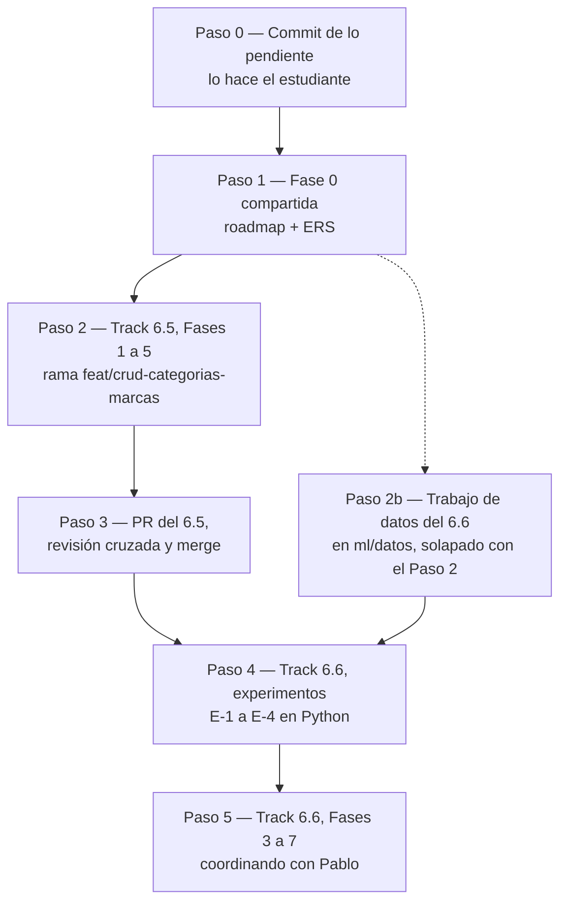

# Handoff: Clasificación de Artículos (Track 6.5) y Catalogación Inteligente (Track 6.6)

> **Para el agente que lea esto:** este archivo es el punto de entrada para retomar, en una sesión nueva y sin contexto previo, la línea de trabajo de clasificación de artículos: el CRUD de Rubros, Categorías y Marcas (Track 6.5) y el motor de sugerencia de categoría y marca (Track 6.6). Resume el estado, las reglas acordadas con el estudiante y el flujo de trabajo paso a paso. **El diseño completo vive en los documentos de cada track; este archivo no lo repite.**
>
> **Estado al 24 de octubre de 2026:** el Track 6.5 está implementado y mergeado (PR #31). Del Track 6.6 están cerradas las Fases 0 a 2 (Python), la Fase 3 (dominio y persistencia de diccionarios, origen y equivalencias) y la **Fase 4a** (motor de sugerencias, incorporación por ítem y columnas del importador), todo commiteado en la rama **`feat/catalogacion-arranque-datos`** (sin publicar). **El próximo paso es la Fase 4b** del Paso 5: empieza con un plan propio (ver "Punto de partida para la Fase 4b" en la sección 4).
>
> **Cómo usarlo:** leer la sección 1 (reglas) y la sección 4 (flujo), ubicar el primer paso sin marcar y cargar **solo** el documento del track que ese paso indica. Al cerrar cada sesión, aplicar el protocolo de la sección 6.

---

## 1. Reglas de Trabajo (obligatorias)

Además de `AGENTS.md` y `CLAUDE.md`, que se cargan solos:

1. **Implementación secuencial:** primero el Track 6.5 completo (hasta su PR mergeado) y después el código del Track 6.6. **No** se trabaja en dos worktrees en paralelo (decisión del estudiante, 2026-10-17). Lo único que se solapa es el trabajo de datos del Paso 2b, que no toca `src/`.
2. **Explicar y planificar antes de editar.** Cada fase empieza con un plan (diagrama Mermaid y tabla de archivos por capa) y espera la aprobación del estudiante (CLAUDE.md §1).
3. **Pasos chicos, capa por capa**, con cada diff explicado (CLAUDE.md §3).
4. **Sin commits, ramas, pushes ni PR** salvo pedido explícito (CLAUDE.md §4). Si el estudiante pide un commit, se conserva el trailer `Co-Authored-By` (decisión del 2026-10-05).
5. **Las decisiones cerradas no se reabren** sin un motivo nuevo. Si aparece uno, se presenta al estudiante antes de cambiar nada.
6. **La lista del distribuidor nunca entra al contexto.** Se analiza solo con scripts que imprimen resultados agregados (`ml/scripts/`). Es un dato comercial de un tercero y no se versiona (`ml/datos/` está en `.gitignore`).
7. **No guardar la lista como CSV desde Excel:** destruye los códigos de barras (notación científica). Se exporta solo con `ml/scripts/exportar_lista_xls.ps1`.
8. **Propiedad del código:** el importador, `Proveedor`, `CatalogoProveedor` y Compras son de **Pablo**. El Track 6.6 los modifica (secciones 4.1, 8.1 y 9 de su documento). **Coordinado el 2026-10-17:** Pablo está al tanto y el estudiante autorizó modificar ese código desde estos tracks. La revisión cruzada del PR sigue siendo con él.
9. **Migraciones de EF Core:** una sola rama genera migraciones a la vez. La del 6.6 se crea después de que la del 6.5 esté en `main`.
10. **Archivos nuevos en CRLF:** `dotnet format` falla con `ENDOFLINE` si un `.cs` queda en LF (verificar si ya existe `.gitattributes`).

---

## 2. Estado del Repositorio (24 de octubre de 2026)

* `origin/main` contiene los PR #31 (Track 6.5, `2112b37`) y #32 (Track 6.3.1, `aef89bb`). El `main` local puede estar desactualizado: no hace falta para este trabajo.
* Rama **`feat/catalogacion-arranque-datos`** (creada sobre `main` con #31 y #32, **sin publicar**):
  * Fases 0 a 2 del Track 6.6 (Python): `3ce08ce` … `e2de35f`.
  * `a9f0d14`: Fase 3 (dominio y persistencia) con dos migraciones: `20261022160838_AgregarDiccionariosYOrigenClasificacion` y `20261022173524_AgregarEquivalenciasYTextosProveedor`.
  * El commit siguiente a `a9f0d14`: Fase 4a (motor de sugerencias, incorporación por ítem, columnas del importador). Sin migraciones nuevas.
* **Base local:** después de actualizar la rama, ejecutar `dotnet run --project src/Retail.Cli -- migrar` (las dos migraciones de la Fase 3).
* `wiki/.obsidian/workspace.json` puede aparecer modificado: es estado local de Obsidian y no forma parte de este trabajo.
* Datos locales, no versionados: `ml/datos/lista-mayo-2025.csv` (exportado de `C:\Users\lucas\Proyectos\LISTA MAYO 2025.xls`, 14.876 artículos, un solo distribuidor, sin precios), `ml/datos/lista-piatto-1.csv` (validación externa) y los diccionarios consolidados (`taxonomia.csv`, `terminos.csv`, `marcas.csv`, `prefijos.csv`).

---

## 3. Documentos Fuente

| Documento | Cuándo leerlo |
| :--- | :--- |
| [`etapa-6-track-6.5-crud-categorias-marcas.md`](file:///c:/Users/lucas/Proyectos/retail/docs/roadmap/etapa-6-track-6.5-crud-categorias-marcas.md) | Pasos 1 a 3. Decisiones, plan por capas (sección 5) y riesgos |
| [`etapa-6-track-6.6-catalogacion-inteligente.md`](file:///c:/Users/lucas/Proyectos/retail/docs/roadmap/etapa-6-track-6.6-catalogacion-inteligente.md) | Paso 1 (texto de `RF-27`, sección 15), Paso 2b (sección 6) y Pasos 4 y 5 |
| [`ml/README.md`](file:///c:/Users/lucas/Proyectos/retail/ml/README.md) | Cualquier paso que use los scripts |
| [`docs/MAPA_DEL_PROYECTO.md`](file:///c:/Users/lucas/Proyectos/retail/docs/MAPA_DEL_PROYECTO.md) | Al planificar cada fase de código (Paso Cero de `AGENTS.md`) |

**Para cuidar el contexto:** en cada sesión se carga solo el documento del track en curso, y de él solo las secciones del paso actual.

---

## 4. Flujo de Trabajo



### Paso 0 — Commit de lo pendiente

* [x] Commit `c4ac594` en la rama `docs/clasificacion-catalogacion`, a pedido del estudiante (2026-10-17).

### Paso 1 — Fase 0 compartida (solo documentación; sin bucle de compilación)

Se hace una vez, antes de cualquier rama de código, para no editar la ERS en dos lugares.

* [x] `docs/roadmap/etapa-6-estabilizacion-release.md`: dar de alta los Tracks 6.5 y 6.6 con el formato de los tracks existentes, y quitar "CRUD propio de Categorías y Marcas" de las mejoras futuras.
* [x] ERS: ampliar `RF-04` (administración de rubros, categorías y marcas), agregar `RF-27` (texto propuesto en la sección 15 del Track 6.6) y actualizar la matriz de trazabilidad (tabla `RUBROS`).
* [x] Verificar si `MAPA_DEL_PROYECTO.md` indexa los documentos de track y, si lo hace, agregar los dos nuevos.
* [x] Mostrar cada texto al estudiante antes de editar.
* **Hecho el 2026-10-17.** Además de lo previsto: `RF-27` dice "umbral que el sistema calibra en cada entrenamiento" (M-10, M-11) en lugar de "umbral configurado"; se ajustaron `RF-05`, `RF-07`, `RF-23`, `IU-04`, `IU-05`, el Módulo I y el glosario ("Rubro"); la matriz no incluye todavía las tablas de diccionarios del 6.6 (se agregan con su migración). El mapa indexa ahora los planes de los Tracks 6.4, 6.5 y 6.6. D-5 quedó verificada (sección 3 del Track 6.5).

### Paso 2 — Track 6.5, Fases 1 a 5 ✅

Rama sugerida `feat/crud-categorias-marcas` (la crea el estudiante). Plan por capas en la sección 5 de su documento.

* [x] Fase 1 — Dominio (2026-10-17, commit `3138cae`; D-19 mueve `IdRubro` a la Fase 3)
* [x] Fase 2 — Aplicación (2026-10-17; D-20 y D-21; registro en DI pasa a la Fase 3)
* [x] Fase 3 — Infraestructura (2026-10-17; D-22 a D-25; R-1 y R-3 verificados). **Tras mergear, recrear `RetailDb`** (la migración aborta con 50001 si `CATEGORIAS` tiene datos, D-16)
* [x] Fase 4 — UI (2026-10-21; D-26 a D-28; prueba manual aprobada)
* [x] Fase 5 — Verificación Release completa (2.081 tests sobre la fusión con `main`), mapa al día; nota de `wiki/` descartada por el estudiante (2026-10-21)

### Paso 2b — Trabajo de datos del Track 6.6 (solapado con el Paso 2)

Es sobre todo trabajo del estudiante, en `ml/datos/`. No toca `src/` ni genera commits del CRUD. Detalle en la sección 6.1 del Track 6.6.

* [x] Escribir los scripts de arranque: `ml/scripts/listar_terminos.py` y `candidatos_marcas.py` (2026-10-17). Generan `terminos-candidatos.csv`, `marcas-candidatas.csv` y `prefijos-candidatos.csv` en `ml/datos/` para completar (ver `ml/README.md`).
* [x] El estudiante arma la taxonomía (rubros y categorías) y asigna los ~300 términos más frecuentes, marcando los ambiguos (2026-10-21).
* [x] El estudiante aprueba marcas, alias y prefijos (2026-10-21). Segunda pasada de prefijos con `prefijos_por_marca.py` (caso AD) y consolidación con `consolidar_diccionarios.py` en `ml/datos/taxonomia.csv`, `terminos.csv`, `marcas.csv` y `prefijos.csv`. Resultado y cobertura en la sección 6.4 del Track 6.6; decisiones nuevas M-17 (orden texto/prefijo, experimento E-5) y M-18 (marcas vulgarizadas como `CANSON`).
* [x] El estudiante etiqueta una muestra de los términos ambiguos y el conjunto de oro (400 filas, muestreo agrupado por familia). Cerrado el 2026-10-22 con M-19 a M-21 (detalle abajo y en la sección 6.4 del Track 6.6).
  * Planillas generadas el 2026-10-21 con `muestrear_etiquetado.py` (semilla 2026): `ml/datos/ambiguos-a-etiquetar.csv` (197 filas, completar `categoria`) y `ml/datos/oro-a-etiquetar.csv` (400 filas, completar `categoria` y `marca`, o `SIN MARCA`; celda vacía = pendiente). Ninguna familia aparece en las dos. El oro se etiqueta a ciegas.
  * **M-19 (2026-10-21):** el estudiante decidió no etiquetar. Claude pre-etiquetó el oro en `ml/datos/oro-validar.csv` (186 filas marcadas para revisar, 214 sin observaciones); el estudiante valida cada fila (`validado` = 1, corrigiendo `categoria`/`marca` si hace falta). Falta: validación del estudiante, script que valide la planilla y genere `oro.csv` con la tasa de corrección, y decidir quién etiqueta `ambiguos-a-etiquetar.csv`. Hallazgo: `CINTA`, `GOMA`, `LIBRO`, `BLOCK` y otros términos no marcados como ambiguos lo son (R-2).
  * **2026-10-22:** el estudiante validó el oro (8 de 400 filas corregidas, 2,0 %, contando las 2 de EXHIBIDOR) y etiquetó 91 de los 197 ambiguos; Claude etiquetó los 106 restantes (columna `origen`). Nueva categoría `Exhibidores` (Librería) en `taxonomia-borrador.csv`. `cerrar_etiquetado.py` escribió `ml/datos/oro.csv` y `ml/datos/ambiguos.csv`. **Decisión abierta:** la tabla de términos acierta el 86,4 % en el oro (< M-1). Como ese diagnóstico se hizo mirando el oro, se propuso redesignarlo como conjunto de desarrollo y muestrear un oro nuevo para la Fase 7. También queda pendiente pasar `EXHIBIDOR` a no ambiguo.
  * **2026-10-22, M-20 aprobada:** el oro actual pasa a ser conjunto de desarrollo; `GOMA`, `CINTA`, `LIBRO`, `BASE`, `TACO`, `VASO` y `TINTA` pasan a ambiguos y `EXHIBIDOR` a `Exhibidores`. Diccionarios reconsolidados (20 ambiguos). Propuesto y pendiente de aprobación: agregar marcas nuevas del desarrollo al diccionario, muestrear **primero** el oro de prueba (bloqueado hasta la Fase 7) y después ejemplos de entrenamiento para los 7 términos nuevos (Claude etiqueta y el estudiante valida).
  * **Hecho el 2026-10-22:** 37 marcas del desarrollo agregadas (170 en total); `ARTE` rechazada (M-21). Oro de prueba en `ml/datos/oro-prueba-a-etiquetar.csv` (semilla 2027, **no abrir hasta la Fase 7**). 137 ejemplos de los 7 términos nuevos, etiquetados por Claude, en `ml/datos/ambiguos-2-a-etiquetar.csv`. Los 4 conjuntos son disjuntos en familias y códigos. **Falta:** que el estudiante valide las 137 filas (`validado` = 1), decidir si `TACO` y `VASO` vuelven a no ambiguos con la categoría corregida, y correr `cerrar_etiquetado.py`.
  * **Cerrado el 2026-10-22:** 137 filas validadas sin correcciones; `TACO` → Oficina y `VASO` → Vajilla y Mate como no ambiguos; `KIMELEKA` no es marca (rechazada; la fila del desarrollo pasó a `SIN MARCA`). `cerrar_etiquetado.py` escribió `oro.csv` (400) y `ambiguos.csv` (334). Tabla de términos sobre el desarrollo: 94,0 % de precisión y 84 % de cobertura (cifra optimista, M-20). **Siguiente: Paso 4.**

Formatos definitivos: `taxonomia.csv` (`rubro;categoria`), `terminos.csv` (`termino;rubro;categoria;ambiguo`), `marcas.csv` (`marca;alias`), `prefijos.csv` (`prefijo;marca`). El oro queda como `codigo;descripcion;ean;categoria;marca`: el rubro se deriva de la categoría, que es única en todo el catálogo.

### Paso 3 — PR del Track 6.5

* [x] El estudiante abre el PR; revisión cruzada con Pablo; merge en `main` (PR #31, commit `2112b37`).
  * Rama publicada el 2026-10-21. `gh` no está instalado: el PR se abre desde https://github.com/lucaskruzolek/retail/compare/main...feat/crud-categorias-marcas?expand=1 . Avisar a Pablo que debe recrear `RetailDb` (error 50001, D-16/D-24).
  * Para la revisión cruzada (fuera de este track): en #30 el fallback de conexión pasó a `Server=.` y la política de bloqueo vive en un SP (Ley 8).

### Paso 4 — Track 6.6, experimentos E-1 a E-4 (Fase 2 de su documento)

* [x] **Pedir aprobación** para usar scikit-learn (aprobado el 2026-10-22; scikit-learn 1.9.1 en `ml/.venv/`, versiones en `ml/requirements.txt`) en un entorno virtual dentro de `ml/` (agregar `ml/.venv/` al `.gitignore`). Es una dependencia solo de exploración: no llega al producto. Si no se aprueba, los experimentos se escriben con la biblioteca estándar.
* [x] Ejecutar E-1 a E-5 con las reglas de decisión de la sección 11 del Track 6.6 y registrar los resultados en ese documento (2026-10-22, sección 11.1; M-22 a M-24). Regresión logística C = 100, n-gramas 3-4 sin numéricos, τ = 0,94 sin κ; marca: texto primero con prefijos de pureza ≥ 0,6. Pendiente: aprobar el filtro de pureza en la consolidación.
* [x] Generar los vectores de referencia de paridad con descripciones **inventadas** (sección 10): `ml/paridad/vectores-referencia.json` (2026-10-22).
* [x] Validación externa con la lista de otro proveedor (Piatto, 2026-10-22; sección 11.2 del Track 6.6): cobertura del sistema 63,0 %; errores del modelo en bloque con términos desconocidos (`ACRIL ETERNA`), que motivaron **M-26** (grupos de 5 o más filas con término desconocido se asignan en bloque antes que el modelo). Opcional y pendiente: medir la precisión real sobre una muestra de unas 200 sugerencias del modelo en Piatto (método M-19).

### Paso 5 — Track 6.6, Fases 3 a 7

* [x] **Coordinar con Pablo** (hecho el 2026-10-17, regla 8) los cambios en `Proveedor`, `CatalogoProveedor`, `MapeoColumnasDto` e `IncorporarCatalogoArticulosDto` (regla 8).
* [ ] Fases 3 a 7 según el documento del track, con la misma forma de trabajo del Paso 2.
  * **Fase 3 ✅ (2026-10-22, commit `a9f0d14`):** decisiones M-27 a M-33. Términos como agregado propio (`TerminoClasificacion`, `EsAmbiguo` derivado de `IdCategoria == null`); alias y prefijos EAN hijos de `Marca` con baja en cascada; regla GS1 completa del GTIN-14 en `ReglasCodigoBarras` (también corregida en `comun.py`: cambia 56 de 14.876 filas; los diccionarios consolidados no se regeneraron); origen de la clasificación en `Articulo` con `IdCategoria`/`IdMarca` encapsulados (`Clasificar`); Fase 3b: `EquivalenciaClasificacion` hija de `Proveedor` (asignar crea o reasigna; sin destino = ignorada) y textos del proveedor en `CatalogoProveedor`. Dos migraciones; un test detectó que `NULL IN (...)` dejaba pasar un `CHECK` (corregido y documentado en `SISTEMA_DE_PERSISTENCIA.md`).
  * **Fase 4a ✅ (2026-10-24, commit siguiente a `a9f0d14`):** decisiones M-34 a M-37. Verificación Release: 2.417 tests (Dominio 681, Aplicación 746, App 541, Integración 449) y `dotnet format` en verde.
    * 4a.1: reglas de descripción en `ReglasClasificacion` (`LimpiarDescripcion`, `PrimeraPalabra`, `TerminoDeDescripcion`, `PalabrasParaMarca`) con paridad contra Python (`ml/scripts/reglas_paridad.py` → `ml/paridad/reglas-texto-referencia.json`, enlazado en `Retail.Domain.UnitTests.csproj`).
    * 4a.2: puertos `IModeloCategoria` e `IDiccionariosClasificacionQueryService`; DTOs en `DTOs/Clasificacion/`.
    * 4a.3: `ClasificacionService.SugerirAsync` (niveles de la sección 4 en el orden de M-14), con apoyos internos `ItemAClasificar`, `DiccionariosDelLote` y `BuscadorDeMarcas` en `Services/Clasificacion/`.
    * 4a.4: contrato de incorporación por ítem (R-7 resuelto): categoría y marca confirmadas y sugeridas, `SinMarcaConfirmada`; el origen lo deriva `ReglasOrigenClasificacion` (Dominio). El modal de incorporación solo se adaptó: aplica su categoría y marca a cada ítem sin sugerencia (la pantalla nueva es de la Fase 6).
    * 4a.5: columnas opcionales de rubro, categoría y marca en el importador; si la planilla no tiene la columna se importa sin el dato (mismo criterio que el código de barras). `CatalogoProveedor.ActualizarClasificacionDelProveedor` para ítems nuevos, porque `ActualizarPrecio` rechaza costo 0 y el parser lo acepta.
    * 4a.6: `DiccionariosClasificacionQueryService`, `ModeloCategoriaNoDisponible` (Singleton, arranque en frío) y registro en DI de `ClasificacionService`.
  * **Punto de partida para la Fase 4b (siguiente sesión):** nada de la 4b está empezado. Empezar por un **plan** (CLAUDE.md §1) y esperar la aprobación. Antes de proponerlo, leer `docs/MAPA_DEL_PROYECTO.md` (filas de Aplicación y de Rubros, Categorías y Marcas), la sección 12 del track (M-27, M-35, M-16 y M-26) y los servicios existentes `CategoriaService`, `MarcaService`, `ProveedorService` y `AutorizacionClasificacion`. Contenido acordado (M-36):
    1. **Comandos de diccionarios** con autorización D-5 (`Usuario.PuedeAdministrarClasificacion`, Gerente o Encargado) y FluentValidation: registrar o reasignar un término y marcarlo ambiguo (lo usa la decisión en bloque, M-16); agregar y quitar alias y prefijos de una marca; asignar y quitar equivalencias de un proveedor.
    2. **Unicidad entre agregados** antes de guardar: un término en una sola categoría; un alias en una sola marca y distinto del nombre de **otra** marca (en forma de comparación; el nombre se guarda con su grafía y collation `Modern_Spanish_CI_AI`); un prefijo en una sola marca. Ante una carrera, el índice único lanza `RestriccionDeUnicidadException` (ya existe en Aplicación) y hay que traducirla a un mensaje claro.
    3. **Bajas en cascada (M-35):** `CategoriaService.BajaAsync` da de baja los términos y las equivalencias que apuntan a la categoría, en el mismo `SaveChanges`; `MarcaService.BajaAsync` hace lo mismo con las equivalencias de marca (alias y prefijos ya caen por el dominio). Los artículos siguen bloqueando la baja (D-1).
    4. **Consultas para las pestañas de la Fase 6** (términos, alias, prefijos y equivalencias), con push-down a SQL (Ley 8).
    * **Por decidir en el plan:** si los comandos van en los servicios existentes por agregado (`MarcaService` para alias y prefijos, `ProveedorService` para equivalencias) y en uno nuevo para términos, o en un servicio único de diccionarios (D-10 del Track 6.5 eligió "un servicio por tipo").
    * **Fuera de la 4b:** la semilla de diccionarios en `Retail.Cli` (M-15) y las pantallas son de la Fase 6; el modelo entrenado, de la Fase 5. Para la revisión cruzada con Pablo queda la observación sobre la persistencia de `CatalogoProveedor` (sección 8.1 del track).
  * **Configuración del modelo para C#:** `ml/scripts/modelo.py` (regresión logística C = 100, n-gramas de caracteres 3-4 `char_wb`, sin tokens sin letras, τ = 0,94) y `ml/scripts/vectorizador.py`. Referencia de paridad versionada en `ml/paridad/vectores-referencia.json`.
  * **Datos (no versionados, en `ml/datos/`):** diccionarios para la semilla de `Retail.Cli` (M-15): `taxonomia.csv`, `terminos.csv`, `marcas.csv`, `prefijos.csv`. `oro.csv` es el conjunto de desarrollo (M-20). **`oro-prueba-a-etiquetar.csv` está sellado hasta la Fase 7: no abrirlo ni mostrar su contenido.**
  * **Opcional, antes de la Fase 7:** medir la precisión real en Piatto con una muestra de unas 200 sugerencias del modelo (método M-19).
  * **Hábitos del estudiante a tener en cuenta:** prefiere validar etiquetas antes que etiquetar (M-19); al validar suele dejar vacía la columna `validado` (confirmar con él y completarla). Excel guarda las planillas en ANSI o con tabulaciones (`leer_planilla` lo resuelve), borra ceros iniciales de los prefijos y convierte los EAN a notación científica (por eso los EAN siempre se toman de la lista original por código).

---

## 5. Prompt para Iniciar una Sesión Nueva

```text
Leé docs/auditorias/handoff-clasificacion-y-catalogacion.md y continuá desde el primer
paso sin marcar de la sección 4. Cargá solo el documento del track que ese paso indica.
Antes de editar, explicame el plan y esperá mi aprobación.
```

---

## 6. Protocolo de Cierre de Sesión

Antes de que el contexto se agote, o al terminar una fase:

1. Marcar en la sección 4 de este archivo los pasos completados y anotar, debajo del paso en curso, en qué punto quedó y qué falta.
2. Actualizar la tabla "Estado de Avance" del documento del track correspondiente.
3. Registrar ahí cualquier decisión nueva aprobada por el estudiante, con su ID y fecha.
4. Actualizar la sección 2 de este archivo si cambió el estado del repositorio (commits, ramas, PR).
5. Si el estudiante lo pide, preparar el commit.

---

## 7. Trampas Conocidas

| Trampa | Cómo evitarla |
| :--- | :--- |
| Un worktree o una rama nueva no ve los archivos sin commitear | Paso 0 antes de crear ramas |
| `ml/datos/` no viaja con el repositorio | Regenerar con `exportar_lista_xls.ps1` desde el `.xls` original |
| Excel destruye los EAN al guardar como CSV | Regla 7 |
| Dos migraciones generadas desde el mismo snapshot | Regla 9 |
| `.cs` nuevos en LF | Regla 10 |
| Cargar los dos documentos de track completos agota el contexto | Sección 3: solo el track en curso |
| La consola de Windows muestra mal la `Ñ` en la salida de los scripts | Ejecutar con `$env:PYTHONIOENCODING = "utf-8"`; los datos están bien |
| Una propiedad o navegación nueva en una entidad mapeada deja en rojo los tests de integración hasta su migración | Esperado (M-29, como D-19): hacer dominio y persistencia en pasos consecutivos y no cerrar la fase en el medio |
| Registrar en DI un servicio cuyos puertos no tienen implementación | `ValidateOnBuild` hace fallar el arranque y `InyeccionDependenciasTests`: registrar el servicio junto con la infraestructura de sus puertos |
| `CA1861` (arreglos constantes como argumento) rompe la compilación | En tests, usar campos `static readonly` o aserciones sin arreglos; en migraciones generadas con índices compuestos, `#pragma warning disable CA1861` como las anteriores |
| Un `CHECK` con `IN (...)` sobre una columna nullable acepta `NULL` (`UNKNOWN`) | Agregar `IS NOT NULL` explícito y probar el `CHECK` con SQL directo (Ley 7 de persistencia) |
| `python -I` no encuentra `comun.py` | Los scripts propios de `ml/scripts` se corren desde esa carpeta y sin `-I` (es código del repositorio, no un archivo descargado) |
| El script de verificación marca éxito aunque `dotnet format` falle | Capturar el código de salida del comando y no el de un `tail` en la misma tubería |
