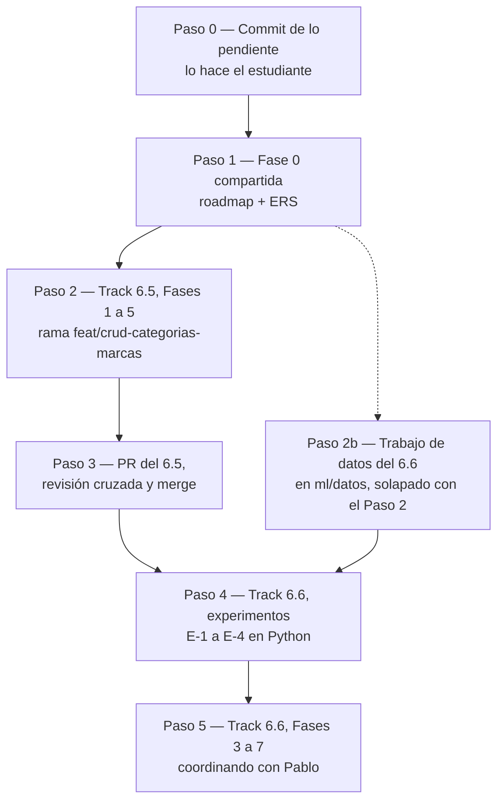

# Handoff: Clasificación de Artículos (Track 6.5) y Catalogación Inteligente (Track 6.6)

> **Para el agente que lea esto:** este archivo es el punto de entrada para retomar, en una sesión nueva y sin contexto previo, la línea de trabajo de clasificación de artículos: el CRUD de Rubros, Categorías y Marcas (Track 6.5) y el motor de sugerencia de categoría y marca (Track 6.6). Resume el estado, las reglas acordadas con el estudiante y el flujo de trabajo paso a paso. **El diseño completo vive en los documentos de cada track; este archivo no lo repite.**
>
> **Estado al 17 de octubre de 2026:** ambos tracks están **cerrados en lo conceptual y sin implementar**. Pasos 0 y 1 hechos en la rama `docs/clasificacion-catalogacion` (sección 2). El paso en curso es la **Fase 5 del Paso 2** (cierre) de la sección 4.
>
> **Cómo usarlo:** leer la sección 1 (reglas) y la sección 4 (flujo), ubicar el primer paso sin marcar y cargar **solo** el documento del track que ese paso indica. Al cerrar cada sesión, aplicar el protocolo de la sección 6.

---

## 1. Reglas de Trabajo (obligatorias)

Además de `AGENTS.md` y `CLAUDE.md`, que se cargan solos:

1. **Implementación secuencial:** primero el Track 6.5 completo (hasta su PR mergeado) y después el código del Track 6.6. **No** se trabaja en dos worktrees en paralelo (decisión del estudiante, 2026-10-17). Lo único que se solapa es el trabajo de datos del Paso 2b, que no toca `src/`.
2. **Explicar y planificar antes de editar.** Cada fase empieza con un plan (diagrama Mermaid y tabla de archivos por capa) y espera la aprobación del estudiante (CLAUDE.md §1).
3. **Pasos chicos, capa por capa**, con cada diff explicado (CLAUDE.md §3).
4. **Sin commits, ramas, pushes ni PR** salvo pedido explícito (CLAUDE.md §4). Si el estudiante pide un commit, se conserva el trailer `Co-Authored-By` (decisión del 2026-10-05).
5. **Las decisiones cerradas no se reabren** sin un motivo nuevo. Si aparece uno, se presenta al estudiante antes de cambiar nada.
6. **La lista del distribuidor nunca entra al contexto.** Se analiza solo con scripts que imprimen resultados agregados (`ml/scripts/`). Es un dato comercial de un tercero y no se versiona (`ml/datos/` está en `.gitignore`).
7. **No guardar la lista como CSV desde Excel:** destruye los códigos de barras (notación científica). Se exporta solo con `ml/scripts/exportar_lista_xls.ps1`.
8. **Propiedad del código:** el importador, `Proveedor`, `CatalogoProveedor` y Compras son de **Pablo**. El Track 6.6 los modifica (secciones 4.1, 8.1 y 9 de su documento). **Coordinado el 2026-10-17:** Pablo está al tanto y el estudiante autorizó modificar ese código desde estos tracks. La revisión cruzada del PR sigue siendo con él.
9. **Migraciones de EF Core:** una sola rama genera migraciones a la vez. La del 6.6 se crea después de que la del 6.5 esté en `main`.
10. **Archivos nuevos en CRLF:** `dotnet format` falla con `ENDOFLINE` si un `.cs` queda en LF (verificar si ya existe `.gitattributes`).

---

## 2. Estado del Repositorio (17 de octubre de 2026)

* `main` en `f0f488d` (merge del PR #29).
* Rama **`docs/clasificacion-catalogacion`** (creada desde `main`, sin push):
  * `c4ac594`: diseño de los Tracks 6.5 y 6.6, este handoff, scripts de `ml/` y `.gitignore` (Paso 0).
  * `5403a2e`: Paso 1 (ERS, roadmap de la Etapa 6, mapa semántico, estado de los dos tracks y este archivo).
* Rama **`feat/crud-categorias-marcas`** (apilada sobre la anterior, sin push): `e686bfe` scripts del Paso 2b, `3138cae` Fase 1, `d37e8dc` Fase 2 y `99770fa` Fase 3 y la Fase 4 del 6.5 (commit siguiente).
* `wiki/.obsidian/workspace.json` aparece modificado, pero es estado local de Obsidian y no forma parte de este trabajo.
* Datos locales, no versionados: `ml/datos/lista-mayo-2025.csv`, exportado de `C:\Users\lucas\Proyectos\LISTA MAYO 2025.xls` (14.876 artículos, un solo distribuidor, sin precios).

--- | :--- |
| `docs/roadmap/etapa-6-track-6.5-crud-categorias-marcas.md` | Plan del Track 6.5 (decisiones D-1 a D-18) |
| `docs/roadmap/etapa-6-track-6.6-catalogacion-inteligente.md` | Diseño del Track 6.6 (decisiones M-1 a M-16, experimentos E-1 a E-4) |
| `docs/auditorias/handoff-clasificacion-y-catalogacion.md` | Este archivo |
| `ml/README.md`, `ml/scripts/*.py`, `ml/scripts/exportar_lista_xls.ps1` | Scripts de exploración (Python 3, solo biblioteca estándar) |
| `.gitignore` | Excluye `ml/datos/` y `__pycache__/` |

* `wiki/.obsidian/workspace.json` aparece modificado, pero es estado local de Obsidian y no forma parte de este trabajo.
* Datos locales, no versionados: `ml/datos/lista-mayo-2025.csv`, exportado de `C:\Users\lucas\Proyectos\LISTA MAYO 2025.xls` (14.876 artículos, un solo distribuidor, sin precios).

---

## 3. Documentos Fuente

| Documento | Cuándo leerlo |
| :--- | :--- |
| [`etapa-6-track-6.5-crud-categorias-marcas.md`](file:///c:/Users/lucas/Proyectos/retail/docs/roadmap/etapa-6-track-6.5-crud-categorias-marcas.md) | Pasos 1 a 3. Decisiones, plan por capas (sección 5) y riesgos |
| [`etapa-6-track-6.6-catalogacion-inteligente.md`](file:///c:/Users/lucas/Proyectos/retail/docs/roadmap/etapa-6-track-6.6-catalogacion-inteligente.md) | Paso 1 (texto de `RF-27`, sección 15), Paso 2b (sección 6) y Pasos 4 y 5 |
| [`ml/README.md`](file:///c:/Users/lucas/Proyectos/retail/ml/README.md) | Cualquier paso que use los scripts |
| [`docs/MAPA_DEL_PROYECTO.md`](file:///c:/Users/lucas/Proyectos/retail/docs/MAPA_DEL_PROYECTO.md) | Al planificar cada fase de código (Paso Cero de `AGENTS.md`) |

**Para cuidar el contexto:** en cada sesión se carga solo el documento del track en curso, y de él solo las secciones del paso actual.

---

## 4. Flujo de Trabajo



### Paso 0 — Commit de lo pendiente

* [x] Commit `c4ac594` en la rama `docs/clasificacion-catalogacion`, a pedido del estudiante (2026-10-17).

### Paso 1 — Fase 0 compartida (solo documentación; sin bucle de compilación)

Se hace una vez, antes de cualquier rama de código, para no editar la ERS en dos lugares.

* [x] `docs/roadmap/etapa-6-estabilizacion-release.md`: dar de alta los Tracks 6.5 y 6.6 con el formato de los tracks existentes, y quitar "CRUD propio de Categorías y Marcas" de las mejoras futuras.
* [x] ERS: ampliar `RF-04` (administración de rubros, categorías y marcas), agregar `RF-27` (texto propuesto en la sección 15 del Track 6.6) y actualizar la matriz de trazabilidad (tabla `RUBROS`).
* [x] Verificar si `MAPA_DEL_PROYECTO.md` indexa los documentos de track y, si lo hace, agregar los dos nuevos.
* [x] Mostrar cada texto al estudiante antes de editar.
* **Hecho el 2026-10-17.** Además de lo previsto: `RF-27` dice "umbral que el sistema calibra en cada entrenamiento" (M-10, M-11) en lugar de "umbral configurado"; se ajustaron `RF-05`, `RF-07`, `RF-23`, `IU-04`, `IU-05`, el Módulo I y el glosario ("Rubro"); la matriz no incluye todavía las tablas de diccionarios del 6.6 (se agregan con su migración). El mapa indexa ahora los planes de los Tracks 6.4, 6.5 y 6.6. D-5 quedó verificada (sección 3 del Track 6.5).

### Paso 2 — Track 6.5, Fases 1 a 5

Rama sugerida `feat/crud-categorias-marcas` (la crea el estudiante). Plan por capas en la sección 5 de su documento.

* [x] Fase 1 — Dominio (2026-10-17, commit `3138cae`; D-19 mueve `IdRubro` a la Fase 3)
* [x] Fase 2 — Aplicación (2026-10-17; D-20 y D-21; registro en DI pasa a la Fase 3)
* [x] Fase 3 — Infraestructura (2026-10-17; D-22 a D-25; R-1 y R-3 verificados). **Tras mergear, recrear `RetailDb`** (la migración aborta con 50001 si `CATEGORIAS` tiene datos, D-16)
* [x] Fase 4 — UI (2026-10-21; D-26 a D-28; prueba manual aprobada)
* [ ] Fase 5 — Verificación Release completa de `AGENTS.md`, mapa semántico y propuesta de nota para `wiki/`

### Paso 2b — Trabajo de datos del Track 6.6 (solapado con el Paso 2)

Es sobre todo trabajo del estudiante, en `ml/datos/`. No toca `src/` ni genera commits del CRUD. Detalle en la sección 6.1 del Track 6.6.

* [x] Escribir los scripts de arranque: `ml/scripts/listar_terminos.py` y `candidatos_marcas.py` (2026-10-17). Generan `terminos-candidatos.csv`, `marcas-candidatas.csv` y `prefijos-candidatos.csv` en `ml/datos/` para completar (ver `ml/README.md`).
* [ ] El estudiante arma la taxonomía (rubros y categorías) y asigna los ~300 términos más frecuentes, marcando los ambiguos.
* [ ] El estudiante aprueba marcas, alias y prefijos.
* [ ] El estudiante etiqueta una muestra de los términos ambiguos y el conjunto de oro (400 filas, muestreo agrupado por familia).

Formatos tentativos de los archivos que completa el estudiante (se confirman al escribir los scripts): `taxonomia.csv` (`rubro;categoria`), `terminos.csv` (`termino;rubro;categoria;ambiguo`), `marcas.csv` (`marca;alias`), `prefijos.csv` (`prefijo;marca`), `oro.csv` (`codigo;descripcion;rubro;categoria;marca`).

### Paso 3 — PR del Track 6.5

* [ ] El estudiante abre el PR; revisión cruzada con Pablo; merge en `main`.

### Paso 4 — Track 6.6, experimentos E-1 a E-4 (Fase 2 de su documento)

* [ ] **Pedir aprobación** para usar scikit-learn en un entorno virtual dentro de `ml/` (agregar `ml/.venv/` al `.gitignore`). Es una dependencia solo de exploración: no llega al producto. Si no se aprueba, los experimentos se escriben con la biblioteca estándar.
* [ ] Ejecutar E-1 a E-4 con las reglas de decisión de la sección 11 del Track 6.6 y registrar los resultados en ese documento.
* [ ] Generar los vectores de referencia de paridad con descripciones **inventadas** (sección 10).

### Paso 5 — Track 6.6, Fases 3 a 7

* [x] **Coordinar con Pablo** (hecho el 2026-10-17, regla 8) los cambios en `Proveedor`, `CatalogoProveedor`, `MapeoColumnasDto` e `IncorporarCatalogoArticulosDto` (regla 8).
* [ ] Fases 3 a 7 según el documento del track, con la misma forma de trabajo del Paso 2.

---

## 5. Prompt para Iniciar una Sesión Nueva

```text
Leé docs/auditorias/handoff-clasificacion-y-catalogacion.md y continuá desde el primer
paso sin marcar de la sección 4. Cargá solo el documento del track que ese paso indica.
Antes de editar, explicame el plan y esperá mi aprobación.
```

---

## 6. Protocolo de Cierre de Sesión

Antes de que el contexto se agote, o al terminar una fase:

1. Marcar en la sección 4 de este archivo los pasos completados y anotar, debajo del paso en curso, en qué punto quedó y qué falta.
2. Actualizar la tabla "Estado de Avance" del documento del track correspondiente.
3. Registrar ahí cualquier decisión nueva aprobada por el estudiante, con su ID y fecha.
4. Actualizar la sección 2 de este archivo si cambió el estado del repositorio (commits, ramas, PR).
5. Si el estudiante lo pide, preparar el commit.

---

## 7. Trampas Conocidas

| Trampa | Cómo evitarla |
| :--- | :--- |
| Un worktree o una rama nueva no ve los archivos sin commitear | Paso 0 antes de crear ramas |
| `ml/datos/` no viaja con el repositorio | Regenerar con `exportar_lista_xls.ps1` desde el `.xls` original |
| Excel destruye los EAN al guardar como CSV | Regla 7 |
| Dos migraciones generadas desde el mismo snapshot | Regla 9 |
| `.cs` nuevos en LF | Regla 10 |
| Cargar los dos documentos de track completos agota el contexto | Sección 3: solo el track en curso |
| La consola de Windows muestra mal la `Ñ` en la salida de los scripts | Ejecutar con `$env:PYTHONIOENCODING = "utf-8"`; los datos están bien |
