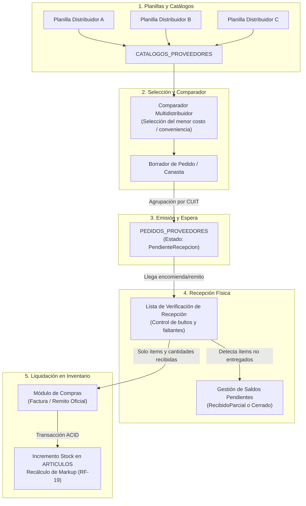
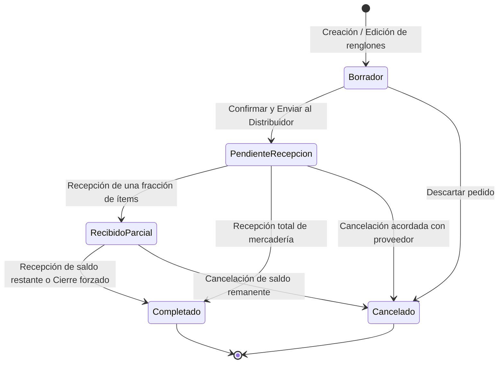

# Propuesta Técnica: Módulo de Pedidos a Distribuidores y Recepción de Mercadería

### Proyecto: Retail (Sistema ERP & Punto de Venta para Librería)
**Plataforma:** .NET 8 LTS | C# 12 | WPF | EF Core 8 | SQL Server Express  
**Documento Maestro:** [`docs/Roadmap de Implementacion.md`](file:///c:/Users/pablo/retail/docs/Roadmap%20de%20Implementacion.md) | **Mapa Semántico:** [`docs/MAPA_DEL_PROYECTO.md`](file:///c:/Users/pablo/retail/docs/MAPA_DEL_PROYECTO.md)  
**Requisitos Vinculados:** `RF-05` (Catálogos Mayoristas), `RF-07` (Importador Streaming), `RF-19` (Compras y Markup), `RF-21` (Fraccionamiento), `RNF-02`, `RNF-03`.

---

## 1. Motivación y Diagnóstico Operativo

A partir de la retroalimentación docente, se identificó una desconexión funcional entre el catálogo mayorista y el ingreso de compras:
* **Estado previo:** El sistema contemplaba la importación masiva de planillas de distribuidores en [`CATALOGOS_PROVEEDORES`](file:///c:/Users/pablo/retail/src/Retail.Domain/Entities/CatalogoProveedor.cs) para consulta de costos e incorporación de artículos, y por otro lado el registro directo de facturas en [`COMPRAS`](file:///c:/Users/pablo/retail/src/Retail.Domain/Entities/Compra.cs) con impacto inmediato en inventario físico.
* **Problema en el mundo real:** En una librería comercial, el encargado no ingresa una compra directamente al consultar precios; primero **compara proveedores**, elabora una **orden de reposición (pedido)**, la envía al distribuidor y, tras días o semanas, recibe el paquete con la mercadería. Al momento de la entrega, ocurren con frecuencia **faltantes de stock**, **entregas parciales** o **discrepancias de costos** respecto a la lista preliminar.
* **Objetivo de la propuesta:** Introducir una etapa intermedia formal:
  $$\text{Catálogos Mayoristas (Multi-proveedor)} \longrightarrow \text{Pedido a Proveedor} \longrightarrow \text{Verificación de Recepción (Check-in)} \longrightarrow \text{Ingreso en Compras / Stock}$$

---

## 2. Diagrama del Flujo de Trabajo

---

## 3. Modelo de Dominio y Persistencia (DDD & ERD)

Conforme a la **Ley 2 de Arquitectura** (solo las Raíces de Agregado tienen repositorio propio) y la **Ley 3** (borrado lógico con `BaseEntity`):

### 3.1. Máquina de Estados del Pedido

### 3.2. Raíz de Agregado: `PedidoProveedor` (`Retail.Domain.Entities`)
* Hereda de [`BaseEntity`](file:///c:/Users/pablo/retail/src/Retail.Domain/Common/BaseEntity.cs), implementa [`IAggregateRoot`](file:///c:/Users/pablo/retail/src/Retail.Domain/Common/IAggregateRoot.cs).
* **Propiedades:**
  * `int IdProveedor`: Clave foránea al proveedor destinatario.
  * `Proveedor? Proveedor`: Navegación.
  * `int IdUsuario`: Operador que abrió el pedido.
  * `string NumeroPedido`: Identificador humano consecutivo (ej. `PED-2026-0001`).
  * `DateTime FechaEmision`: Fecha UTC de registro.
  * `DateTime? FechaEstimadaEntrega`: Plazo acordado con el distribuidor.
  * `EstadoPedidoEnum Estado`: `Borrador`, `PendienteRecepcion`, `RecibidoParcial`, `Completado`, `Cancelado`.
  * `string? Observaciones`: Notas adicionales (horario de entrega, flete, etc.).
  * `decimal TotalEstimado`: Sumatoria calculada de los renglones según costos pactados.
* **Colección Encapsulada:**
  * `private readonly List<DetallePedidoProveedor> _detalles = new();`
  * `public IReadOnlyCollection<DetallePedidoProveedor> Detalles => _detalles.AsReadOnly();`
* **Métodos de Dominio:**
  * `static PedidoProveedor Crear(int idProveedor, int idUsuario, string numeroPedido, ...)`
  * `void AgregarRenglon(int idCatalogoProveedor, int? idArticulo, int cantidad, decimal costoPactado)`
  * `void ModificarCantidadRenglon(int idDetalle, int nuevaCantidad)`
  * `void QuitarRenglon(int idDetalle)`
  * `void Emitir()` (transiciona `Borrador` $\rightarrow$ `PendienteRecepcion`)
  * `void RegistrarRecepcionParcial(IEnumerable<(int IdDetalle, int CantidadRecibida)> itemsRecibidos)`
  * `void CerrarPorRecepcionCompleta()`
  * `void Cancelar(string motivo)`

### 3.3. Entidad Interna: `DetallePedidoProveedor` (`Retail.Domain.Entities`)
* Hereda de `BaseEntity`. No es raíz de agregado (solo se instancia y manipula a través de `PedidoProveedor`).
* **Propiedades:**
  * `int IdPedidoProveedor`: FK a la cabecera.
  * `int IdCatalogoProveedor`: FK al ítem de la lista del distribuidor ([`CatalogoProveedor`](file:///c:/Users/pablo/retail/src/Retail.Domain/Entities/CatalogoProveedor.cs)).
  * `int? IdArticulo`: FK nullable al artículo propio en [`Articulo`](file:///c:/Users/pablo/retail/src/Retail.Domain/Entities/Articulo.cs) (permite pedir productos aún no incorporados al inventario local).
  * `int CantidadPedida`: Unidades solicitadas ($\ge 1$).
  * `int CantidadRecibida`: Unidades acumuladas que ingresaron físicamente ($\ge 0$).
  * `decimal CostoPactado`: Costo de reposición al momento de armar la orden.
* **Propiedades Calculadas:**
  * `int CantidadPendiente => Math.Max(0, CantidadPedida - CantidadRecibida);`
  * `bool EstaCompleto => CantidadRecibida >= CantidadPedida;`
  * `decimal SubtotalEstimado => ReglasMonetarias.Redondear(CantidadPedida * CostoPactado);`

### 3.4. Relación con la Entidad `Compra` Existente
* La entidad [`Compra`](file:///c:/Users/pablo/retail/src/Retail.Domain/Entities/Compra.cs) se enriquece con una propiedad opcional:
  * `public int? IdPedidoProveedor { get; private set; }`
* Esto preserva la trazabilidad completa: permite saber qué compra fiscal liquidó qué pedido (o entrega parcial de pedido).

---

## 4. Diseño del Flujo de Interfaz y Experiencia de Usuario (WPF / MVVM)

El flujo de mostrador y administración se divide en tres interfaces optimizadas:

### 4.1. Curaduría y Comparador Multidistribuidor (`ImportadorCatalogosView.xaml`)
* **Problema:** Al tener cargadas planillas de Distribuidor A, B y C, el usuario necesita ver quién tiene el mejor precio para reponer útiles escolares.
* **Comportamiento:**
  * En la grilla de catálogo de proveedores, se habilita una barra de acciones: `[Agregar al Pedido]` o `[Comparar Ofertas]`.
  * La consulta permite filtrar artículos por código de barras o descripción a través de múltiples distribuidores (`Push-down to SQL`).
  * Al seleccionar ítems y cantidades, el usuario puede presionar `[Generar Pedidos a Distribuidores]`.
  * El sistema agrupa automáticamente los ítems por `IdProveedor` y genera los borradores de pedido respectivos, respetando la relación fiscal monó-proveedor.

### 4.2. Bandeja de Pedidos a Proveedores (`PedidosView.xaml`)
* Nueva pantalla de gestión operativa para compras pendientes:
  * Selector / filtros rápidos por estado: `[Todos]`, `[Borradores]`, `[Pendientes de Recepción]`, `[Parciales]`, `[Completados]`.
  * Grilla principal con número de pedido, proveedor, fecha, fecha estimada, total estimado y badge de estado con colores semánticos de Windows 11 Fluent.
  * Panel de detalles lateral/inferior mostrando los renglones y la barra de progreso de recepción de cada ítem ($x / y$ recibidos).
  * Acciones: `[Nuevo Pedido]`, `[Editar]`, `[Enviar/Emitir]`, `[Recibir Mercadería (F5)]`, `[Cancelar]`.

### 4.3. Diálogo de Verificación de Recepción (`RecepcionPedidoModalDialog.xaml`)
* Se invoca cuando el transportista o correo entrega el bulto en la tienda:
  * Muestra la lista de ítems pendientes del pedido seleccionado.
  * Columnas:
    1. Código y Descripción del ítem.
    2. **Cantidad Pedida** y **Cantidad Ya Recibida** (si hubo entregas previas).
    3. **Cantidad Que Ingresa Ahora** (TextBox numérico editable con valor por defecto igual al saldo pendiente).
    4. Botón rápido por fila: `[Recibir Todo]`.
    5. Botón general: `[Marcar Todos como Recibidos]`.
    6. **Costo Real Facturado:** Permite ajustar el costo si el distribuidor modificó el precio en la factura adjunta.
  * **Control de Faltantes:** Si un producto no llegó, el operador lo deja en `0` o desmarca la fila.
  * **Pase Directo a Compras:** Al confirmar la recepción:
    * Se valida que al menos un ítem tenga cantidad $> 0$.
    * Si algún producto no estaba incorporado a la tienda propia (`IdArticulo == null`), se despliega una ventana de incorporación rápida para asignarle categoría y margen de ganancia.
    * Los ítems efectivamente recibidos se transfieren directamente a [`ComprasView.xaml`](file:///c:/Users/pablo/retail/src/Retail.App/Views/Pages/ComprasView.xaml) con los datos del proveedor ya seleccionados para ingresar el número de factura/remito.

---

## 5. Diseño Arquitectónico por Capas (Clean Architecture)

| Capa | Componente | Responsabilidad |
| :--- | :--- | :--- |
| **`Retail.Domain`** | [`Entities/PedidoProveedor.cs`](file:///c:/Users/pablo/retail/src/Retail.Domain/Entities/) | Agregado raíz con métodos mutacionales y validaciones de negocio. |
| | [`Entities/DetallePedidoProveedor.cs`](file:///c:/Users/pablo/retail/src/Retail.Domain/Entities/) | Entidad de detalle con control de saldo pendiente y cantidades. |
| | [`Enums/EstadoPedidoEnum.cs`](file:///c:/Users/pablo/retail/src/Retail.Domain/Enums/) | Estados `Borrador`, `PendienteRecepcion`, `RecibidoParcial`, `Completado`, `Cancelado`. |
| | [`Exceptions/PedidoException.cs`](file:///c:/Users/pablo/retail/src/Retail.Domain/Exceptions/) | Excepciones tipadas de dominio (`PedidoYaCompletadoException`, `RecepcionInvalidaException`). |
| **`Retail.Application`** | [`Interfaces/Services/IPedidoService.cs`](file:///c:/Users/pablo/retail/src/Retail.Application/Interfaces/Services/) | Contrato del caso de uso de gestión de pedidos y recepciones. |
| | [`Interfaces/Persistence/IPedidoQueryService.cs`](file:///c:/Users/pablo/retail/src/Retail.Application/Interfaces/Persistence/) | Consultas paginadas con `Push-down to SQL` (`AsNoTracking`). |
| | [`DTOs/Pedidos/`](file:///c:/Users/pablo/retail/src/Retail.Application/DTOs/) | `PedidoDto`, `DetallePedidoDto`, `CrearPedidoDto`, `RegistrarRecepcionDto`, `ItemRecepcionDto`. |
| | [`Validators/Pedidos/`](file:///c:/Users/pablo/retail/src/Retail.Application/Validators/) | Validaciones declarativas con `FluentValidation`. |
| **`Retail.Infrastructure`**| [`Persistence/Configurations/PedidoProveedorConfiguration.cs`](file:///c:/Users/pablo/retail/src/Retail.Infrastructure/Persistence/Configurations/) | Mapeo Fluent API, relaciones foráneas, cascadas restringidas y soft delete filter. |
| | [`Persistence/Context/RetailDbContext.cs`](file:///c:/Users/pablo/retail/src/Retail.Infrastructure/Persistence/Context/RetailDbContext.cs) | Registro de `DbSet<PedidoProveedor>` y migración EF Core. |
| | [`Persistence/Services/PedidoQueryService.cs`](file:///c:/Users/pablo/retail/src/Retail.Infrastructure/Persistence/Services/) | Implementación de consultas eficientes en SQL Server. |
| **`Retail.App`** | [`Views/Pages/PedidosView.xaml`](file:///c:/Users/pablo/retail/src/Retail.App/Views/Pages/) | Pantalla principal de pedidos integrada al menú de navegación. |
| | [`Views/Dialogs/RecepcionPedidoModalDialog.xaml`](file:///c:/Users/pablo/retail/src/Retail.App/Views/Dialogs/) | Modal de verificación de recepción de mercadería física. |
| | [`ViewModels/Pedidos/`](file:///c:/Users/pablo/retail/src/Retail.App/ViewModels/) | `PedidosViewModel.cs`, `DetallePedidoItemViewModel.cs`, `RecepcionPedidoModalViewModel.cs`. |

---

## 6. Manejo Transaccional y Reglas de Negocio Críticas

1. **Invariante de Inventario Físico:**
   * El `PedidoProveedor` **no altera** el stock físico de `ARTICULOS`.
   * El stock solo se incrementa cuando los productos recibidos se procesan a través de [`ICompraService.RegistrarCompraAsync`](file:///c:/Users/pablo/retail/src/Retail.Application/Services/CompraService.cs). Esto garantiza que el inventario contable y físico coincida estrictamente con comprobantes reales (remitos/facturas).
2. **Protección de Costos y Precios de Venta (RF-19):**
   * Al registrar la compra final resultante de la recepción, se dispara la fórmula de markup oficial:
     $$\text{PrecioVenta} = \text{CostoReposicionReal} \times \left(1 + \frac{\text{PorcentajeGanancia}}{100}\right)$$
   * Se propaga el nuevo costo a las presentaciones derivadas (fraccionamiento, `RF-21`).
3. **Cierre de Faltantes Definitivos:**
   * Si el proveedor comunica que un faltante no se enviará (producto agotado o discontinuado), el sistema ofrece la acción **`[Dar por concluido]`**, lo que transiciona el pedido de `RecibidoParcial` a `Completado`, registrando el motivo en las observaciones sin esperar más entregas.

---

## 7. Plan de Implementación Faseado

* **Fase 1: Capa de Dominio y Persistencia**
  * Creación de `PedidoProveedor`, `DetallePedidoProveedor` y `EstadoPedidoEnum`.
  * Configuración Fluent API en EF Core y migración en base de datos.
  * Pruebas unitarias de invariantes en `Retail.Domain.UnitTests`.
* **Fase 2: Capa de Aplicación y Casos de Uso**
  * DTOs y validadores `FluentValidation`.
  * Implementación de `IPedidoService` y `IPedidoQueryService`.
  * Pruebas de orquestación en `Retail.Application.UnitTests` y persistencia en `Retail.Infrastructure.IntegrationTests`.
* **Fase 3: Capa de Presentación (WPF / MVVM)**
  * Creación de `PedidosView.xaml` y `RecepcionPedidoModalDialog.xaml` respetando el Living Styleguide (`docs/SISTEMA_DE_DISENO.md`).
  * Implementación de `PedidosViewModel` con `CargaSerializada` y `Task.Run` (Ley 4).
  * Auditoría de recursos XAML (`scripts/audit-xaml.ps1`) y pruebas de humo STA (`AppSmokeTests.cs`).
* **Fase 4: Integración de Extremo a Extremo**
  * Conexión del comparador de catálogos mayoristas con la generación de pedidos.
  * Conexión de la recepción con el módulo de compras existente.
  * Actualización de [`docs/MAPA_DEL_PROYECTO.md`](file:///c:/Users/pablo/retail/docs/MAPA_DEL_PROYECTO.md) y de la ERS.
