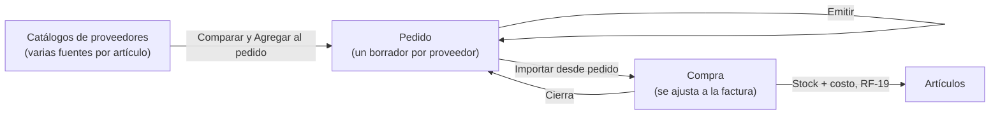
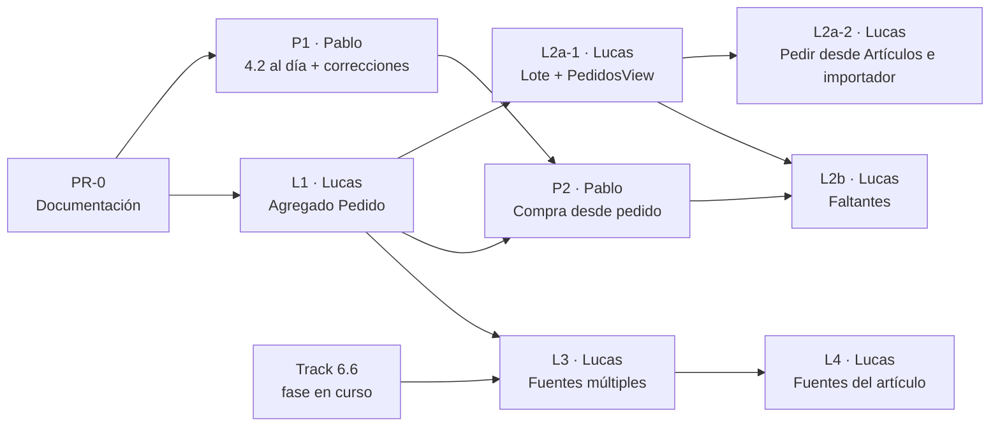
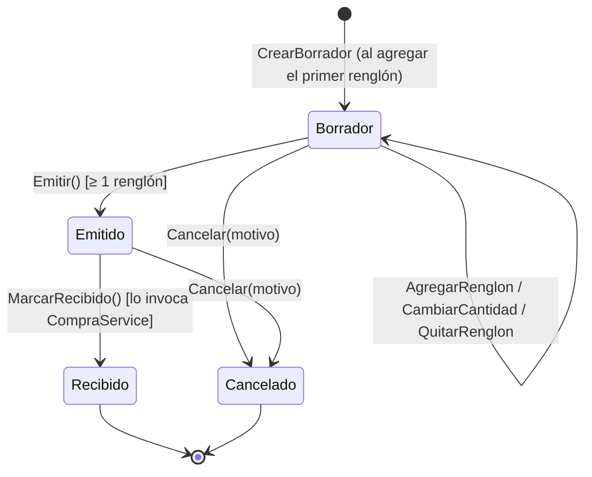
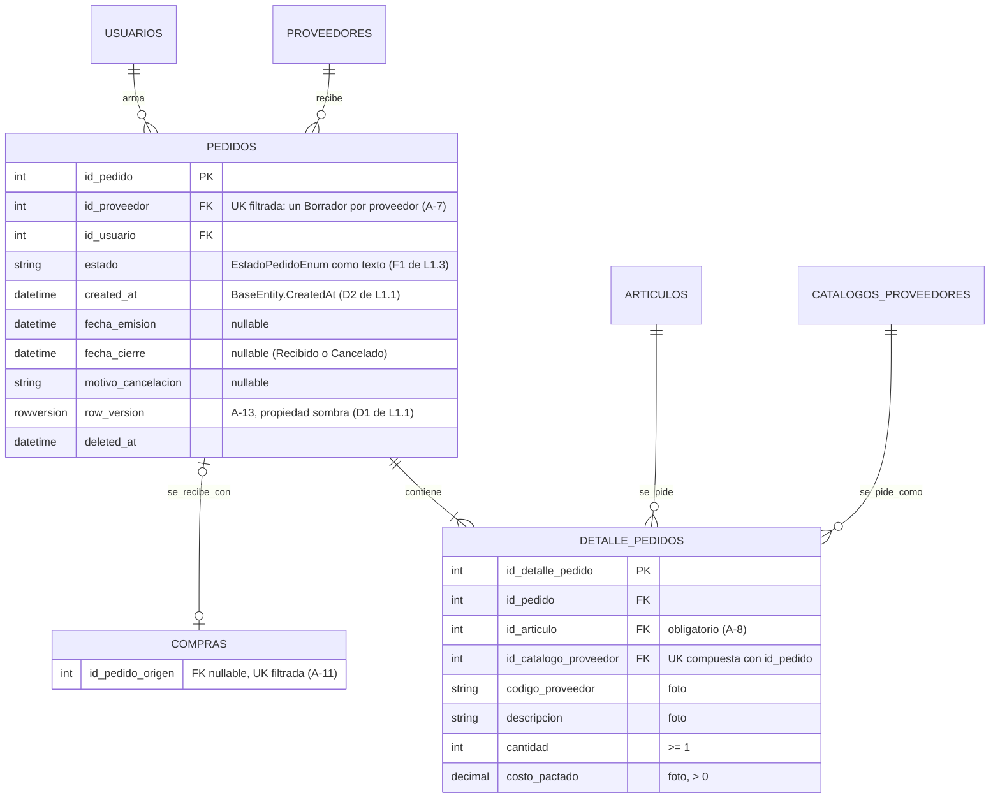
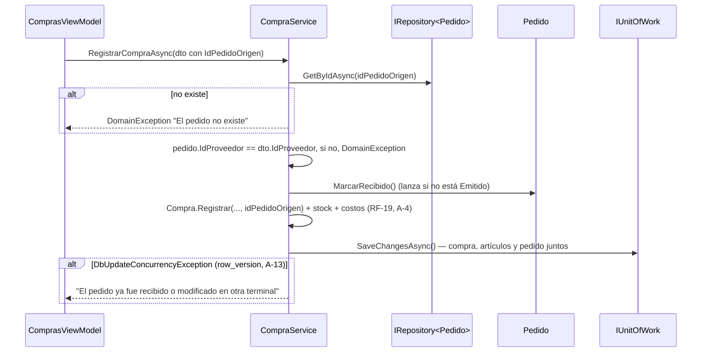

# Track 4.3: Documento Rector — Abastecimiento (Fuentes Múltiples, Pedidos y Compras)

### Proyecto: Retail (Sistema ERP & Punto de Venta para Librería)
**Etapa:** [`etapa-4-pos-compras.md`](file:///c:/Users/lucas/Proyectos/retail/docs/roadmap/etapa-4-pos-compras.md) | **Responsables:** Lucas Kruzolek (catálogo y pedidos) y Pablo Fernandez (compras)  
**Paquetes de trabajo:** [`etapa-4-track-4.3-paquete-lucas.md`](file:///c:/Users/lucas/Proyectos/retail/docs/roadmap/etapa-4-track-4.3-paquete-lucas.md) · [`etapa-4-track-4.3-paquete-pablo.md`](file:///c:/Users/lucas/Proyectos/retail/docs/roadmap/etapa-4-track-4.3-paquete-pablo.md)  
**Requisitos:** `RF-05`, `RF-07`, `RF-19`, `RF-28`, `RF-29` en [`ERS - Libreria POS.md`](file:///c:/Users/lucas/Proyectos/retail/docs/ERS%20-%20Libreria%20POS.md)

> **Propósito de este documento:** ser la **única fuente de verdad** del track. Contiene las decisiones cerradas, el modelo, los **contratos de frontera** entre el trabajo de Lucas y el de Pablo, la propiedad de cada archivo y el orden de integración. Los paquetes de trabajo **citan** este documento y **no redefinen** nada de lo que está aquí.
>
> **Regla para agentes:** si una tarea requiere cambiar un contrato de la sección 5, una decisión de la sección 3 o un archivo cuyo dueño es otro paquete (sección 6), el agente **se detiene y lo reporta** al estudiante. No lo modifica, ni siquiera "para que compile".

---

## 1. Motivación

Durante una revisión, el docente sugirió acercar el sistema al circuito real de reposición de una librería:

1. **Comparar precios** del mismo producto entre distribuidores.
2. **Armar pedidos** desde el catálogo de proveedores.
3. **Registrar la compra a partir del pedido**, ajustándola a lo que efectivamente trae la factura.

Hoy el sistema tiene dos islas: el catálogo mayorista (RF-05, RF-07) y la compra (RF-19). Entre ellas no hay un paso intermedio, y el vínculo artículo ↔ ítem de proveedor es **1:1**, lo que impide comparar entre proveedores.



---

## 2. Estado de Avance

| PR | Contenido | Dueño | Depende de | Migración | Estado |
| :--- | :--- | :--- | :--- | :---: | :---: |
| **PR-0** | Este documento, paquetes, ERS (RF-05, RF-07, RF-19, RF-28, RF-29, IU-12), DER de Pedidos, Etapa 4, mapa | Ambos (revisión cruzada) | — | No | ✅ Publicado en `main` (`6a29a4b`) |
| **P1** | Integrar `main` en la rama del Módulo 4.2 y aplicar las correcciones de revisión | Pablo | PR-0 | Sí (UK de comprobante) | ⏳ |
| **L1** | Agregado `Pedido`: dominio, persistencia, servicio y contratos de frontera | Lucas | PR-0 | Sí (`PEDIDOS`) | ✅ Mergeado en `main` (PR #34, migración `20261028211913_AgregarPedidos`) |
| **L2a-1** | Agregado en lote (`AgregarVariosAlPedidoAsync`), `PedidosView`, modal de pedido y entrada del Sidebar | Lucas | L1 | No | 🟡 Implementado en `feat/pedidos-ui`; falta el PR |
| **L2a-2** | Entradas "Pedir" y "Pedir seleccionados" en Artículos y en el importador, con la incorporación previa (A-17) | Lucas | L2a-1 | No | ⏳ |
| **P2** | Compras: importar desde un pedido, ajustar a la factura y cerrar el pedido | Pablo | P1 y L1 | Sí (`COMPRAS.id_pedido_origen`) | ⏳ |
| **L2b** | "Volver a pedir faltantes" (compara el pedido con la compra que lo cerró) | Lucas | L2a-1 y P2 | No | ⏳ |
| **L3** | Fuentes múltiples por artículo y fuente principal | Lucas | L1 y cierre de la fase en curso del Track 6.6 | Sí | ⏳ |
| **L4** | Modal "Fuentes del artículo" (comparador de costos, RF-28) abierto desde Artículos y desde el importador (A-18) | Lucas | L3 | No | ⏳ |



**Por qué este orden:** el pedido **no necesita** las fuentes múltiples, porque funciona con el vínculo 1:1 actual. Hacer L1 primero desbloquea a Pablo lo antes posible. Las fuentes múltiples modifican `CatalogoProveedor`, que el Track 6.6 está modificando ahora; esperar evita cruzar migraciones sobre las mismas tablas.

**Puntos de sincronización:** PR-0 (ambos aprueban los contratos) y L1 (Pablo revisa que la implementación respete la sección 5 antes de empezar P2).

---

## 3. Decisiones Cerradas

Las decisiones marcadas como cerradas ya fueron discutidas y aprobadas. No se vuelven a abrir sin un motivo nuevo, y ese motivo se documenta aquí.

| Id | Decisión | Fundamento |
| :--- | :--- | :--- |
| **A-1** | Un artículo puede vincularse a **varios ítems de catálogo** (de distintos proveedores). Cada ítem de catálogo se vincula, como máximo, a **un** artículo. Es una relación **1:N**; no hay tabla intermedia. | Una tabla intermedia permitiría N:M, que el negocio no necesita (RF-05 ya limita cada ítem a un artículo) y que habría que volver a prohibir con otra restricción. |
| **A-2** | Entre las fuentes de un artículo, **una sola es la principal**. Solo la planilla de la fuente principal actualiza el costo y el precio del artículo (RF-07). Las demás son de consulta y de pedido. | Con varias fuentes, "la última planilla importada gana" haría oscilar el precio de venta según el orden de importación. Se descartaron el mínimo entre fuentes (una lista vieja y barata distorsiona el margen) y "solo la compra" (rompe RF-07). |
| **A-3** | **No se valida la unidad de venta** de las fuentes. Vincular "Caja x12" y "Unidad" al mismo artículo es responsabilidad del usuario; el comparador muestra código, descripción y fecha de cada fuente para que decida. | El sistema no conoce la unidad de venta del proveedor: las planillas no la traen como columna. Validarla exigiría deducirla de la descripción, y una heurística frágil está prohibida por `AGENTS.md`. Se mantiene la regla de RF-21: un ítem de catálogo nunca se vincula a una presentación derivada. |
| **A-4** | **RF-19 no cambia:** toda compra actualiza el costo de reposición del artículo, sea o no de la fuente principal. La próxima planilla de la fuente principal lo vuelve a fijar. | El costo de reposición es lo que cuesta **reponer**, no lo que costó. La factura es la evidencia más reciente; la planilla principal, la referencia acordada. |
| **A-5** | `Pedido` es una **raíz de agregado propia** (no una parte de `Compra` ni del catálogo), con pantalla propia (`IU-12`). | Tiene su propio ciclo de vida y dos módulos lo usan: el catálogo escribe pedidos y Compras los cierra. Si viviera dentro de uno, el dueño del otro tendría que tocar código ajeno (Ley 10). |
| **A-6** | Ciclo de vida: `Borrador → Emitido → Recibido`, y `Borrador \| Emitido → Cancelado`. **No hay recepción parcial.** | YAGNI. El caso real (llegó menos de lo pedido) se resuelve con A-9 y A-10, con la mitad de los estados. Si el docente pide entregas parciales, se agregan después sin romper contratos. |
| **A-7** | **Un solo borrador por proveedor** (índice único filtrado). "Agregar al pedido" agrega el renglón al borrador del proveedor del ítem, y lo crea si no existe. | Reemplaza la "canasta" en memoria: nada se pierde si se cierra la aplicación, y el destino de cada renglón no es ambiguo. El pedido es de un solo proveedor, igual que la factura. |
| **A-8** | Cada renglón del pedido tiene **`IdArticulo` obligatorio** y guarda una **foto** de `CodigoProveedor`, `Descripcion` y `CostoPactado`. Un ítem de catálogo sin vincular se **incorpora antes** de agregarlo, con el flujo de incorporación existente (RF-05). | `DETALLE_COMPRAS.id_articulo` es obligatorio: un renglón sin artículo no podría pasar a la compra. La foto conserva lo que se pidió aunque la planilla cambie después; es el mismo criterio que el costo histórico de la venta (RF-25). |
| **A-9** | **La compra es la recepción.** No existe un diálogo de recepción separado. Compras importa el pedido y el usuario ajusta los renglones a la factura (quita, agrega, corrige cantidades y costos). La factura manda: **no se valida** que la compra coincida con el pedido. | Registrar la recepción en dos pantallas duplica el dato y permite que se contradigan. El comprobante fiscal es el respaldo del stock (RF-19). |
| **A-10** | Al registrar la compra, el pedido pasa a `Recibido` en el **mismo `SaveChanges`**. Lo que no llegó se vuelve a pedir desde `PedidosView` con **"Volver a pedir faltantes"**, que carga la diferencia en el borrador del proveedor. | Atomicidad: no puede quedar una compra registrada con su pedido abierto (ACID, mismo criterio que `RegistrarVentaAsync`). La acción de faltantes queda del lado de Pedidos, así Compras no depende de ella. |
| **A-11** | Una compra cierra **como máximo un** pedido, y un pedido es cerrado por **como máximo una** compra (`COMPRAS.id_pedido_origen`, FK nullable con índice único filtrado). | Es el mismo patrón que `VENTAS.id_presupuesto_origen`. Una factura que cubre dos pedidos es un caso raro: el segundo se cancela o se cierra con otra compra. |
| **A-12** | El **único punto de entrada** para comprar desde un pedido es la pantalla de Compras (botón "Importar pedido"). `PedidosView` no navega a Compras. | Evita el acoplamiento entre pantallas de dos dueños distintos (Ley 10) y pasar parámetros por navegación. |
| **A-13** | `PEDIDOS` tiene **`row_version`** (concurrencia optimista). | Si dos terminales importan el mismo pedido, la segunda compra falla con un conflicto en lugar de cerrar dos veces el mismo pedido (mismo criterio que D-12 en `ARTICULOS`). Igual que allí, se modela como **propiedad sombra** de EF Core: el dominio no la conoce (D1 de L1.1). |
| **A-14** | Pedidos y Compras los operan el **Encargado** y el **Gerente**; el Cajero no tiene acceso. | Mismo perfil que Compras y el importador (ERS §2.3). La verificación por rol en los servicios queda para la auditoría del Track 6.1, igual que en los demás módulos operativos. |
| **A-15** | La propuesta preliminar `docs/propuesta_modulo_pedidos_y_recepcion.md` **se descarta** y no se versiona. Este documento la reemplaza. | Proponía un diálogo de recepción, recepciones parciales y `IdArticulo` opcional (contradicen A-6, A-8 y A-9), y se apoyaba en un `CompraService` que todavía no existía en `main`. |
| **A-17** | **Dos entradas para pedir, un único caso de uso.** Se pide desde el Catálogo de Artículos (reposición: con stock, stock mínimo y filtros por distribuidor y stock crítico) y desde el importador (novedades), en ambas **por fila o por selección**, con un **único modal de pedido**. El destino de cada renglón **se informa, no se elige**: es el borrador del proveedor de su fuente (A-7). Si la selección del importador incluye ítems no incorporados, el modal ofrece incorporarlos primero con el modal de incorporación existente (recorrido en dos pasos) o pedir solo los vinculados; en Artículos, los artículos sin proveedor se excluyen con su motivo. El lote se guarda con `IPedidoService.AgregarVariosAlPedidoAsync`, que agrupa por proveedor y usa **un solo `SaveChanges`**; pedir una fila es un lote de uno, así que el método unitario de L1 (`AgregarAlPedidoAsync`) se eliminó (H1 de L2a-1). El importador **no** muestra stock | La reposición parte de "qué me falta" (RF-08), que se responde en Artículos; las novedades solo se ven en el catálogo del proveedor. Un caso de uso con dos adaptadores de UI no duplica reglas. Elegir el pedido de destino reabriría A-7. N llamadas sueltas dejarían lotes a medias; un `SaveChanges` es atómico (mismo criterio que A-10). Incorporar y pedir quedan en dos transacciones: incorporar tiene sentido por sí solo y el pedido se reintenta. Fusionar ambos modales mezclaría dos responsabilidades |
| **A-18** | **Una fila por artículo; la comparación en un modal propio.** La grilla de Artículos muestra una fila por artículo con la fuente principal y un badge "N fuentes" (sin indicador de "fuente más barata"). La comparación de RF-28 vive en el modal **"Fuentes del artículo"**, abierto desde el badge y desde un aviso del importador: tabla completa ordenada por costo con descripción del proveedor y fecha de la lista, y las acciones **Marcar principal** (con confirmación) y **Pedir** (cierra este modal y abre el de pedido con esa fuente). El modal de pedido solo **elige** la fuente de cada renglón con un combo compacto (proveedor · costo · fecha, principal por defecto) | Repetir el artículo por fuente rompería el agregado en la grilla, duplicaría el stock, desarmaría la paginación (Ley 8) y volvería ambigua la selección. Consultar no debe exigir empezar un pedido, y marcar la principal modifica `Articulo`: no corresponde dentro de un flujo que modifica `Pedido`. `ArticulosView` es una grilla a todo el ancho: un panel fijo le quitaría espacio para un dato que solo usan los artículos con varias fuentes |

### Decisión abierta (interna de L3, no afecta contratos de frontera)

**A-16 — Cómo se representa la fuente principal.** Se cierra al iniciar L3, con el estudiante.

| Opción | Esquema | Ventaja | Costo |
| :--- | :--- | :--- | :--- |
| **A** | Se conserva `ARTICULOS.id_catalogo_proveedor` con el significado de "fuente principal" y se agrega `CATALOGOS_PROVEEDORES.id_articulo` para todas las fuentes | Diff mínimo: el importador y la propagación de costos no cambian | Hay dos caminos al mismo dato. La regla "la principal es una de las fuentes del artículo" cruza tablas: EF Core no puede expresarla como FK compuesta (la clave principal no admite columnas nulas), así que queda en la aplicación |
| **B** | Se agrega `CATALOGOS_PROVEEDORES.id_articulo` y `es_fuente_principal`, con un índice único filtrado `(id_articulo) WHERE es_fuente_principal = 1 AND deleted_at IS NULL`. Se elimina `ARTICULOS.id_catalogo_proveedor` migrando sus datos | Una sola representación. La unicidad de la principal es declarativa en la base | Más cambios: el importador, la consulta del catálogo, la CHECK de derivados de `ARTICULOS` y el Track 6.6 leen la columna actual |

Recomendación preliminar: **B**, por integridad declarativa. Se confirma midiendo el impacto real cuando el Track 6.6 esté integrado.

---

## 4. Modelo

### 4.1. Máquina de estados del pedido



Toda transición fuera de este diagrama lanza `TransicionPedidoInvalidaException`. Los renglones solo se modifican en `Borrador`.

### 4.2. Esquema (cambios de PR-0; las fuentes múltiples se agregan en L3)



* Índice único filtrado de `PEDIDOS`: `(id_proveedor) WHERE estado = N'Borrador' AND deleted_at IS NULL`.
* `DETALLE_PEDIDOS` no repite un ítem de catálogo dentro del mismo pedido: si se agrega dos veces, se **suma la cantidad**.
* El total estimado se **calcula**; no se guarda (Σ cantidad × costo pactado, con `ReglasMonetarias`).
* FKs con `DeleteBehavior.Restrict` y filtro global de baja lógica (Ley 3).

---

## 5. Contratos de Frontera

Esta es la parte que se aprueba en PR-0. **L1 la implementa al pie de la letra y P2 la consume al pie de la letra.** Los nombres de archivo siguen [`MAPA_DEL_PROYECTO.md`](file:///c:/Users/lucas/Proyectos/retail/docs/MAPA_DEL_PROYECTO.md).

### 5.1. Dominio (dueño: Lucas, L1)

```csharp
// Retail.Domain/Enums/EstadoPedidoEnum.cs
public enum EstadoPedidoEnum
{
    Borrador = 1,
    Emitido = 2,
    Recibido = 3,
    Cancelado = 4
}

// Retail.Domain/Entities/Pedido.cs  (raíz de agregado)
public class Pedido : BaseEntity, IAggregateRoot
{
    public int IdProveedor { get; }
    public EstadoPedidoEnum Estado { get; }

    // Contrato con Compras: Emitido → Recibido. Lanza TransicionPedidoInvalidaException en cualquier otro estado.
    public void MarcarRecibido();
}

// Retail.Domain/Exceptions/TransicionPedidoInvalidaException.cs
public class TransicionPedidoInvalidaException : DomainException { }
```

El resto de la API pública de `Pedido` (`CrearBorrador`, `AgregarRenglon`, `Emitir`, `Cancelar`, etc.) es **interna del paquete de Lucas**: Compras no la usa.

### 5.2. Aplicación (dueño: Lucas, L1; consumidor: Pablo, P2)

```csharp
// Retail.Application/Interfaces/Services/IPedidoService.cs  (solo los métodos de frontera)
Task<IReadOnlyList<PedidoEmitidoDto>> ListarEmitidosPorProveedorAsync(int idProveedor, CancellationToken cancellationToken = default);
Task<PedidoParaCompraDto?> ObtenerParaCompraAsync(int idPedido, CancellationToken cancellationToken = default);

// Retail.Application/DTOs/Pedidos/PedidoEmitidoDto.cs
public record class PedidoEmitidoDto
{
    public required int IdPedido { get; init; }
    public required DateTime FechaEmision { get; init; }
    public required int CantidadRenglones { get; init; }
    public required decimal TotalEstimado { get; init; }
}

// Retail.Application/DTOs/Pedidos/PedidoParaCompraDto.cs
public record class PedidoParaCompraDto
{
    public required int IdPedido { get; init; }
    public required int IdProveedor { get; init; }
    public required IReadOnlyList<RenglonPedidoParaCompraDto> Renglones { get; init; }
}

// Retail.Application/DTOs/Pedidos/RenglonPedidoParaCompraDto.cs
public record class RenglonPedidoParaCompraDto
{
    public required int IdArticulo { get; init; }
    public string? CodigoBarras { get; init; }
    public required string DescripcionArticulo { get; init; }
    public required string CodigoProveedor { get; init; }
    public required int Cantidad { get; init; }
    public required decimal CostoPactado { get; init; }
}
```

Semántica:
* `ListarEmitidosPorProveedorAsync` devuelve solo pedidos `Emitido` del proveedor, ordenados por fecha de emisión descendente. Es una proyección `AsNoTracking` (Ley 8).
* `ObtenerParaCompraAsync` devuelve `null` si el pedido no existe o **no está `Emitido`**. Los renglones cuyo artículo fue dado de baja **se omiten** (no se puede comprar un artículo dado de baja).
* La firma interna de `IPedidoService` puede tener más métodos (los usa `PedidosView`); Pablo consume **solo** estos dos.

### 5.3. Compras (dueño: Pablo, P2)

```csharp
// Retail.Application/DTOs/Compras/CrearCompraDto.cs  (se agrega)
public int? IdPedidoOrigen { get; init; }

// Retail.Domain/Entities/Compra.cs  (se agrega)
public int? IdPedidoOrigen { get; private set; }
public static Compra Registrar(..., int? idPedidoOrigen = null);
```

Comportamiento obligatorio de `CompraService.RegistrarCompraAsync` cuando `IdPedidoOrigen` tiene valor:



* Todo se valida **antes** de modificar cualquier agregado, y un único `SaveChanges` guarda todo (patrón de `RegistrarVentaAsync`).
* **No** se compara la compra con los renglones del pedido (A-9).

---

## 6. Propiedad de Archivos y Zonas Compartidas (Ley 10)

| Archivo o zona | Dueño | Regla |
| :--- | :--- | :--- |
| `Pedido.cs`, `DetallePedido.cs`, `EstadoPedidoEnum.cs`, `TransicionPedidoInvalidaException.cs` | Lucas | Pablo no los modifica |
| `IPedidoService.cs`, `PedidoService.cs`, `DTOs/Pedidos/`, `Validators/Pedidos/`, `PedidoConfiguration.cs`, `DetallePedidoConfiguration.cs`, query service de pedidos | Lucas | Pablo consume la sección 5.2 |
| `PedidosView.xaml`, `ViewModels/Pedidos/`, diálogos de pedidos (modal de pedido, modal "Fuentes del artículo") | Lucas | — |
| `ArticulosView.xaml`, `ArticulosViewModel.cs` | Lucas | L2a-2 agrega la selección y las acciones de pedir; L4, el badge de fuentes. Pablo no los modifica |
| `CatalogoProveedor.cs`, importador, `ImportadorCatalogosView.xaml` y sus ViewModels | Lucas | Pablo no los modifica |
| `Compra.cs`, `DetalleCompra.cs`, `CompraService.cs`, `ICompraService.cs`, `DTOs/Compras/`, `Validators/Compras/`, `CompraConfiguration.cs` | Pablo | Lucas no los modifica |
| `ComprasView.xaml`, `ViewModels/Compras/`, diálogo de selección de pedido | Pablo | — |
| `Articulo.cs` | Compartido | Pablo solo invoca `IncrementarStock`, `ActualizarCostoYRecalcularPrecio` y `RecalcularCostoDesdeOrigen` (regla de la Etapa 4). Lucas modifica el vínculo con el catálogo en L3 |
| `RetailDbContext.cs` | Compartido | L1 agrega `DbSet<Pedido>`. Ningún otro cambio sin acordarlo |
| `Retail.Application/DependencyInjection.cs`, `App.xaml.cs` | Compartido | Cada uno **solo agrega** sus registros, en un bloque comentado con el módulo |
| `MainViewModel.cs` y la navegación del Sidebar | Lucas (L2) | Agrega la entrada "Pedidos". Pablo no modifica la navegación |
| `Migrations/` y `RetailDbContextModelSnapshot.cs` | Compartido | Ver la sección 7 |
| ERS, DER y mapa | Cada PR | Cada PR actualiza **solo** las secciones de lo que implementa |

---

## 7. Integración y Migraciones

1. **Ramas desde `main` actualizado.** Ninguna rama del track parte de otra rama sin mergear.
2. **Una migración abierta por vez.** Solo puede haber un PR **con migración** listo para mergear. Quien mergea segundo integra `main` en su rama, **borra su migración y la regenera** sobre el snapshot nuevo. Nunca se edita a mano el snapshot ni se resuelve su conflicto "eligiendo los dos lados".
3. **Orden de migraciones previsto:** P1 (UK de comprobante) y L1 (`PEDIDOS`) pueden ir en cualquier orden, con la regla anterior. P2 va después de las dos. L3 va después de la migración en curso del Track 6.6.
4. **Historia publicada:** no se hace rebase ni force push de ramas publicadas. Para ponerse al día se hace merge de `origin/main` (`CLAUDE.md` §4).
5. **Revisión cruzada:** cada PR lo revisa el compañero. En P2, Pablo verifica contra la sección 5. En L1, Lucas pide a Pablo que valide los contratos antes de mergear.
6. **Commits, ramas y PR los decide el estudiante**, también cuando trabaja un agente.
7. **Verificación de cierre de cada PR:** bucle completo de `AGENTS.md` (auditoría XAML si hay vistas, build Release sin advertencias, tests y `dotnet format --verify-no-changes`).

---

## 8. Riesgos

| Id | Riesgo | Mitigación |
| :--- | :--- | :--- |
| R-1 | Conflicto de migraciones entre L1, P1 y el Track 6.6 | Sección 7, regla 2 |
| R-2 | `ImportadorCatalogosView` lo tocan L2a-2, L4 y la Fase 6 (UI) del Track 6.6 | La UI del Track 6.6 ya está en `main`. L2a-2 agrega solo los comandos y botones de pedir; L4, solo el aviso que abre el modal de fuentes |
| R-3 | Fuente principal con otra unidad de venta (A-3) | Riesgo aceptado: ya existe con el vínculo 1:1 actual. El comparador muestra los datos para que el usuario lo detecte |
| R-4 | Un pedido emitido nunca se recibe y queda abierto | `PedidosView` muestra la antigüedad y permite cancelarlo con motivo |
| R-5 | Una factura cubre dos pedidos | Riesgo aceptado (A-11): se cierra uno con la compra y el otro se cancela con un motivo que lo indique |

---

## 9. Preguntas de Defensa

1. **¿Por qué no hay tabla intermedia entre `ARTICULOS` y `CATALOGOS_PROVEEDORES`?** Porque la relación es 1:N (A-1). Una tabla intermedia modela N:M, y habría que prohibirlo con otra restricción.
2. **Si dos proveedores informan costos distintos, ¿cuál fija el precio de venta?** La planilla de la fuente principal y, además, cada compra (A-2, A-4). Las otras fuentes son de consulta.
3. **¿Por qué el pedido no modifica el stock?** Porque el stock representa mercadería física respaldada por un comprobante. El pedido es una intención de compra.
4. **¿Por qué no hay una pantalla de recepción?** Porque la factura es la recepción (A-9). Dos pantallas registrarían el mismo hecho y podrían contradecirse.
5. **¿Cómo garantizan que no quede una compra con su pedido abierto?** Con un único `SaveChanges` que incluye la compra, los artículos y el pedido: es una sola transacción de SQL Server (ACID).
6. **¿Qué pasa si dos terminales importan el mismo pedido?** La segunda falla por `row_version` (A-13) y además por el índice único de `id_pedido_origen` (A-11). Es defensa en profundidad.
7. **¿Por qué `Pedido` es un agregado y no parte de `Compra`?** Tiene invariantes y ciclo de vida propios, y existe antes y sin la compra (un pedido cancelado nunca tiene compra).
8. **¿Por qué un borrador por proveedor y no una canasta?** El pedido es de un solo proveedor, igual que su factura. El índice único filtrado hace cumplir esa regla en la base, y el borrador sobrevive al cierre de la aplicación.
