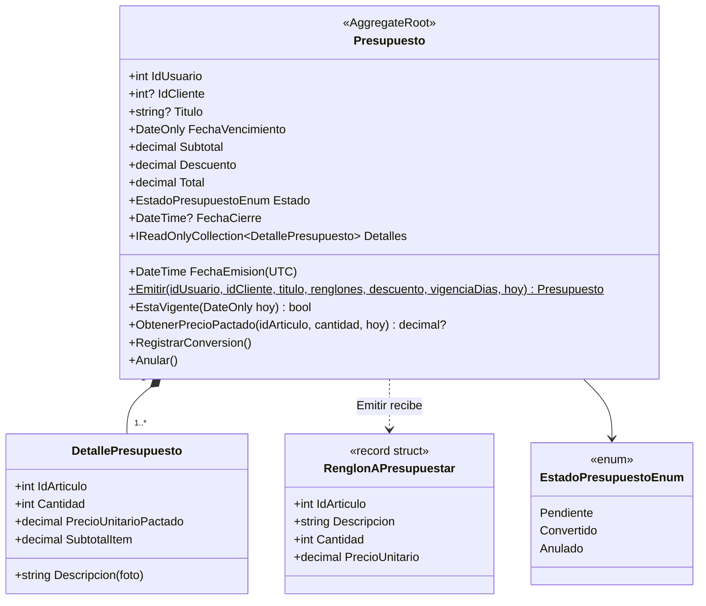
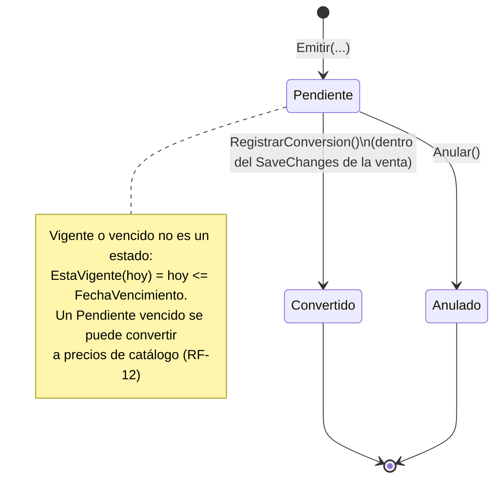
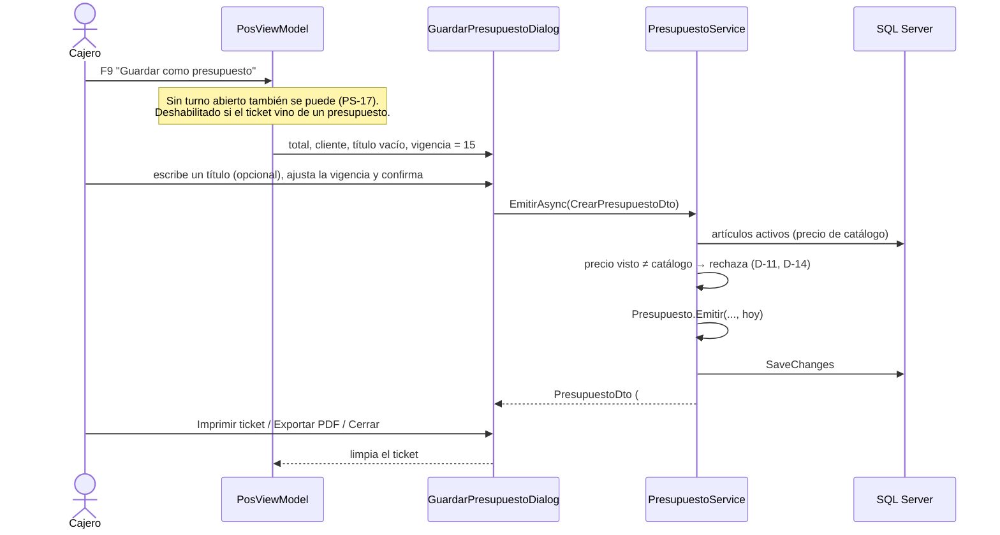
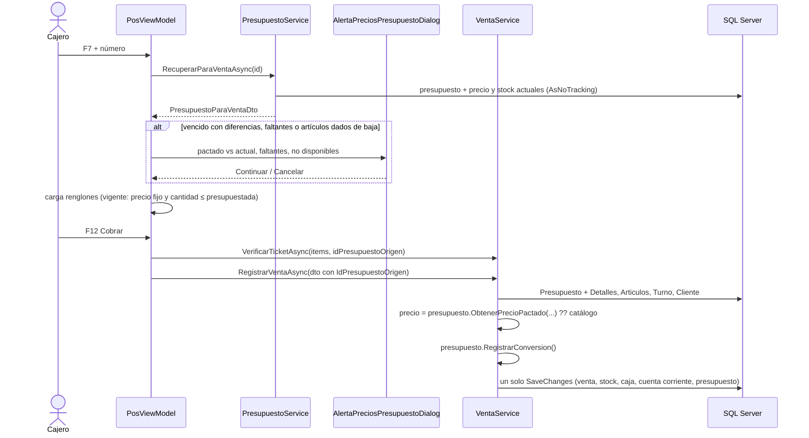

# Módulo 5.1: Plan de Diseño — Presupuestador y Conversión a Venta

### Proyecto: Retail (Sistema ERP & Punto de Venta para Librería)
**Etapa:** [`etapa-5-presupuestos-arca.md`](file:///c:/Users/lucas/Proyectos/retail/docs/roadmap/etapa-5-presupuestos-arca.md) (Módulo 5.1) | **Responsable:** Lucas Kruzolek (reasignado desde Pablo Fernandez el 2026-11-17) | **Rama:** `presupuestos` (un commit por fase; implementación delegada en subagentes Sonnet y validada por la sesión principal, CLAUDE.md §5)  
**Requisitos:** `RF-11`, `RF-12`, `IU-02` en [`ERS - Libreria POS.md`](file:///c:/Users/lucas/Proyectos/retail/docs/ERS%20-%20Libreria%20POS.md); se apoya en `RF-10` (stock atómico), `RF-21` (fraccionamiento), D-11 (precios del servidor), D-14 (verificación del ticket) y D-38 (precios sin centavos).

> **Propósito de este documento:** conservar las decisiones de diseño del módulo, sus fundamentos y el estado de avance, para retomar el trabajo en una sesión nueva sin rehacer el análisis. Las decisiones marcadas como **Cerrada** fueron discutidas y aprobadas; no se vuelven a abrir sin un motivo nuevo. PS-01 a PS-07 se decidieron en la conversación de planificación; PS-08 a PS-20 se aprobaron junto con el plan al iniciar P0 (2026-11-17) y quedaron reflejadas en la ERS 3.4.

---

## 1. Estado de Avance

| Fase | Contenido | Estado |
| :--- | :--- | :---: |
| P0 | Documentación: ERS 3.4 (Módulo III, rol Cajero, IU-02, IU-13 nueva, IS-05, RF-11, RF-12, trazabilidad), roadmap 5.1, mapa | ✅ Hecha |
| P1 | Dominio: agregado `Presupuesto` rico, estados, excepción de transición | ⏳ Pendiente |
| P2 | Aplicación: `PresupuestoService`, validador, DTOs, integración en `VentaService` | ⏳ Pendiente |
| P3 | Infraestructura: configuración, migración, `PresupuestoQueryService`, `ExportadorPresupuestoPdf` | ⏳ Pendiente |
| P4 | UI: `PresupuestosView` (consulta) | ⏳ Pendiente |
| P5 | UI del POS: guardar como presupuesto, recuperar y alerta de conciliación | ⏳ Pendiente |
| P6 | Cierre: verificación Release, mapa, nota para la wiki | ⏳ Pendiente |

**Forma de trabajo:** una fase por vez, capa por capa, con cada diff revisado por el estudiante antes de pasar a la siguiente (CLAUDE.md §3). Commits, ramas y PR los pide el estudiante (§4). Tests: los de la capa al cerrar cada fase; la verificación completa, en P6.

---

## 2. Diagnóstico del Andamiaje Existente (Etapa 0)

El módulo no arranca de cero: la Etapa 0 dejó entidades, contrato, DTOs y configuración EF. Al revisarlo aparecieron cinco problemas que el plan corrige antes de construir encima.

| # | Problema | Dónde | Corrección |
| :--- | :--- | :--- | :--- |
| A | Modelo anémico: todo `{ get; set; }` público, sin comportamiento ni invariantes | [`Presupuesto.cs`](file:///c:/Users/lucas/Proyectos/retail/src/Retail.Domain/Entities/Presupuesto.cs), [`DetallePresupuesto.cs`](file:///c:/Users/lucas/Proyectos/retail/src/Retail.Domain/Entities/DetallePresupuesto.cs) | Agregado rico con el mismo patrón que [`Pedido`](file:///c:/Users/lucas/Proyectos/retail/src/Retail.Domain/Entities/Pedido.cs) (P1) |
| B | `RegistrarVentaAsync` rechaza todo precio distinto del catálogo (D-11), y `MarcarComoConvertidoAsync` en una llamada aparte rompe la atomicidad: una venta cobrada podía dejar el presupuesto `Pendiente` y reutilizable | [`VentaService.cs`](file:///c:/Users/lucas/Proyectos/retail/src/Retail.Application/Services/VentaService.cs), [`IPresupuestoService.cs`](file:///c:/Users/lucas/Proyectos/retail/src/Retail.Application/Interfaces/Services/IPresupuestoService.cs) | La conversión ocurre dentro del `SaveChanges` de la venta; el precio pactado lo decide el agregado (PS-06, PS-07) |
| C | `Vencido` se guarda como estado, pero depende del reloj; `PresupuestoVencidoException` bloquea la conversión, contra lo que pide RF-12 | [`EstadoPresupuestoEnum.cs`](file:///c:/Users/lucas/Proyectos/retail/src/Retail.Domain/Enums/EstadoPresupuestoEnum.cs), [`PresupuestoVencidoException.cs`](file:///c:/Users/lucas/Proyectos/retail/src/Retail.Domain/Exceptions/PresupuestoVencidoException.cs) | Vigencia derivada de la fecha (PS-05); se elimina la excepción |
| D | `id_cliente` es NOT NULL, aunque el DTO admite Consumidor Final | [`PresupuestoConfiguration.cs`](file:///c:/Users/lucas/Proyectos/retail/src/Retail.Infrastructure/Persistence/Configurations/PresupuestoConfiguration.cs) | Columna nullable, como en `VENTAS` (P3) |
| E | `ListarPresupuestosAsync()` devuelve todas las filas, sin paginar (Ley 8) | `IPresupuestoService` | `ListarAsync(ConsultaPresupuestosDto)` paginado en SQL (P2/P3) |

Problemas adicionales encontrados al planificar:

* **F.** [`VentaService.VerificarTicketAsync`](file:///c:/Users/lucas/Proyectos/retail/src/Retail.Application/Services/VentaService.cs) (D-14) compara cada renglón con el catálogo. Con un presupuesto vigente, marcaría el precio pactado como "precio actualizado" y el POS lo pisaría con el del catálogo. Necesita conocer el presupuesto de origen (PS-08).
* **G.** `CrearVentaValidator` bloquea toda venta con `IdPresupuestoOrigen` ("todavía no está disponible"). Se reemplaza en P2.
* **H.** `FileDebugTicketPrinterService.ImprimirPresupuestoAsync` imprime "(15 días)" fijo: con vigencia editable, eso es falso. Se corrige en P3.
* **I.** `Presupuesto.VentasOriginadas` navega desde un agregado a otro. En DDD, los agregados se referencian por identificador (PS-10).

---

## 3. Decisiones

| ID | Decisión | Estado | Fundamento |
| :--- | :--- | :---: | :--- |
| PS-01 | Lucas implementa todo el módulo | Cerrada | Pedido del estudiante (2026-11-17). Elimina el punto de coordinación entre el POS (Lucas) y el presupuestador (Pablo). |
| PS-02 | **Presupuesto vigente → se cobra el precio pactado**, aunque el catálogo haya bajado | Cerrada (2a) | Literal de RF-11 ("congela el precio pactado"). Más simple y defendible que "el menor de los dos". |
| PS-03 | **Presupuesto vencido → todos los renglones pasan a precio de catálogo.** El diálogo informa las diferencias y pide confirmación; no permite elegir renglón por renglón | Cerrada (3a) | Si un vencido pudiera conservar el precio pactado, el vencimiento no significaría nada. RF-12: "no bloquea destructivamente". |
| PS-04 | **El ticket recuperado se puede editar:** quitar renglones, bajar cantidades y agregar artículos nuevos a precio de catálogo | Cerrada (4a) | Así funciona el mostrador ("al final llevo 3, no 5"). |
| PS-05 | **Lo emitido es inmutable:** no se edita; se anula y se emite otro | Cerrada (5a) | El presupuesto es un documento entregado al cliente. |
| PS-06 | **El presupuesto se crea desde el POS** ("Guardar como presupuesto"). `PresupuestosView` queda solo de consulta | Cerrada | Reutiliza búsqueda, escaneo, F4 cliente y grilla del ticket sin duplicar UI (escalera de decisión, peldaño 2). Requiere actualizar IU-02 y RF-11 (P0). |
| PS-07 | **Exportación a PDF A4 con un exportador propio** (`IExportadorPresupuestoPdf` + QuestPDF), no reutilizando `DocumentoReporte` | Cerrada | QuestPDF ya está instalado (IS-05): no suma dependencias. Un presupuesto es un documento comercial (membrete, totales, leyendas), no un reporte (SRP). |
| PS-08 | La vigencia es **derivada**: estados persistidos `Pendiente`, `Convertido`, `Anulado`. `EstaVigente(hoy)` se calcula | Cerrada | Un estado que depende del reloj se desactualiza solo y exigiría un proceso programado para mantenerlo. |
| PS-09 | `FechaVencimiento` es una **fecha calendario local** (`DateOnly`, columna `date`), inclusiva: "válido hasta el 02/12/2026" incluye todo ese día | Cerrada | Con un instante UTC, un presupuesto "vencería" a las 21:00 hora argentina (UTC−3). El servicio obtiene `hoy` de `TimeProvider.GetLocalNow()` y se lo pasa al dominio, que no lee el reloj (testeable). |
| PS-10 | Vigencia de **1 a 90 días**, 15 por defecto, editable al guardar | Cerrada | RF-11 pide "configurable, 15 por defecto". El tope evita errores de tipeo (150 en lugar de 15). |
| PS-11 | El renglón guarda una **foto de la descripción** del artículo (como `DetallePedido`) | Cerrada | Un documento reimpreso debe decir lo mismo que el entregado, aunque el artículo se renombre después. |
| PS-12 | **Conversión atómica:** `RegistrarVentaAsync` carga el presupuesto, toma de él los precios y llama a `RegistrarConversion()` en el mismo `SaveChanges` que venta, stock, caja y cuenta corriente. `MarcarComoConvertidoAsync` desaparece del contrato | Cerrada | ACID: venta cobrada ⇔ presupuesto convertido. Mismo patrón que `Pedido.MarcarRecibido()` dentro de `CompraService`. |
| PS-13 | **Defensa en profundidad contra la doble conversión:** (1) el agregado rechaza convertir lo que no está `Pendiente`; (2) `rowversion` en `PRESUPUESTOS` (concurrencia optimista, como `ARTICULOS` y `PEDIDOS`); (3) índice único filtrado en `VENTAS.id_presupuesto_origen` | Cerrada | (1) cubre el caso secuencial; (2) cubre "anular en una terminal mientras se convierte en otra"; (3) garantiza en la base que un presupuesto genere a lo sumo una venta. |
| PS-14 | Regla de precio en la conversión, **en el dominio**: si está vigente y el artículo figura, precio = pactado y cantidad ≤ presupuestada; si no, precio de catálogo | Cerrada | La regla vive en el agregado (Ley 8, frontera con el dominio), no en la UI ni en el servicio. |
| PS-15 | El **descuento** del presupuesto se lleva al ticket como valor inicial, editable como cualquier descuento del POS | Cerrada | El cajero ya puede aplicar descuentos libremente; no hace falta una regla nueva en el servidor (YAGNI). |
| PS-16 | **Anular no pide motivo**; solo pide confirmación | Cerrada | La ERS no exige auditar anulaciones de presupuestos (no son fiscales ni mueven stock). Se diferencia de `Pedido.Cancelar`. |
| PS-17 | **Emitir no requiere turno de caja abierto** | Cerrada | RF-11: "no afecta stock ni caja". Hoy el POS exige turno solo para cobrar. |
| PS-18 | Atajos del POS: **F7 Recuperar presupuesto**, **F9 Guardar como presupuesto** | Cerrada | Hoy el POS usa F4, F8 y F12. Se confirman contra `SISTEMA_DE_DISENO.md` en P5. |
| PS-19 | El presupuesto no navega hacia `Venta` (se elimina `VentasOriginadas`); `Venta` conserva `IdPresupuestoOrigen` | Cerrada | Los agregados se referencian por identificador (DDD). |
| PS-20 | **Título opcional** de hasta 100 caracteres (por ejemplo, "Lista escolar 3.º grado — Escuela N.º 12"), con espacios normalizados (`ReglasTexto.NormalizarEspacios`); vacío o solo espacios equivale a sin título. No se modifica después de emitir (PS-05). **Es de uso interno:** se muestra y se busca solo dentro del sistema (listado, detalle, diálogo de guardado y etiqueta del POS). **Nunca** aparece en el PDF, en el ticket ni en ningún documento entregado al cliente; los dos generadores lo ignoran, y un test por cada uno verifica que el título no aparece en la salida | Cerrada | Pedido del estudiante (2026-11-17). Identifica presupuestos de un mismo cliente o de Consumidor Final, que de otro modo solo se distinguen por número. Es una nota del comercio para sí mismo (por ejemplo, "cliente pidió precio de la competencia"), por eso no se entrega. Opcional para no frenar el mostrador. |

---

## 4. Modelo de Dominio





### Invariantes

| # | Regla | Método | Excepción |
| :--- | :--- | :--- | :--- |
| I1 | Al menos un renglón; cantidad ≥ 1; precio ≥ 0; descripción no vacía (≤ 200) | `Emitir` | `DomainException` |
| I2 | Vigencia entre `VigenciaMinimaDias` (1) y `VigenciaMaximaDias` (90) | `Emitir` | `DomainException` |
| I3 | Un artículo repetido se agrupa en un renglón (suma cantidades); si llega con dos precios distintos, se rechaza | `Emitir` | `DomainException` |
| I4 | `0 ≤ Descuento ≤ Subtotal`; `Total = Subtotal − Descuento` | `Emitir` | `DomainException` |
| I5 | Precio pactado, cantidades, cliente y fechas no cambian después de emitir (setters privados, sin métodos que los modifiquen) | — | — |
| I6 | Solo un `Pendiente` se convierte o se anula | `RegistrarConversion`, `Anular` | `TransicionPresupuestoInvalidaException` |
| I7 | Si está vigente, un artículo del presupuesto no se puede cobrar en mayor cantidad que la presupuestada | `ObtenerPrecioPactado` | `DomainException` |
| I8 | No afecta stock ni caja | Por diseño: el agregado no conoce a `Articulo` ni a `TurnoCaja` | — |
| I9 | Título opcional: se normalizan los espacios, vacío pasa a `null` y no supera 100 caracteres | `Emitir` | `DomainException` |

---

## 5. Flujos

### 5.1 Guardar como presupuesto (RF-11)



### 5.2 Recuperar y cobrar (RF-12)



**Caso límite documentado:** si el presupuesto se recupera vigente a las 23:59 y se cobra a las 00:01 del día siguiente, el servidor lo ve vencido y rechaza el precio pactado con el mensaje de "precio cambiado". El POS vuelve a verificar y muestra la alerta. El servidor decide con su reloj; la UI es una ayuda (mismo criterio que D-14).

---

## 6. Plan por Fase

### P0 — Documentación

| Archivo | Cambio |
| :--- | :--- |
| `docs/ERS - Libreria POS.md` | Versión 3.4. **IU-02:** el POS crea ("Guardar como presupuesto") y recupera presupuestos. **IU-13 (nueva):** pantalla de consulta. **RF-11:** se emite desde el ticket del POS, sin turno abierto, con título opcional y vigencia de 1 a 90 días (15 por defecto); inmutable, anulable mientras esté pendiente; ticket y PDF A4 con la leyenda "Documento no válido como factura". **RF-12:** precio pactado si está vigente, catálogo si venció; edición del ticket según PS-04; conversión atómica; a lo sumo una venta por presupuesto. Módulo III, rol Cajero, IS-05 y fila de trazabilidad en el mismo sentido. |
| `docs/roadmap/etapa-5-presupuestos-arca.md` | Módulo 5.1: responsable Lucas; `PresupuestosView` de consulta; creación en POS; `GuardarPresupuestoDialog`, `RecuperarPresupuestoDialog`; PDF; enlace a este documento. Ajustar "Prevención de Sobreescritura". |
| `docs/MAPA_DEL_PROYECTO.md` | Enlace a este plan en la fila de la Etapa 5. |

**Criterio de aceptación:** la ERS, el roadmap y este plan no se contradicen.

---

### P1 — Dominio (`Retail.Domain`)

| Archivo | Acción |
| :--- | :--- |
| `Entities/Presupuesto.cs` | Reescribir: `_detalles` privada, setters privados, constructor protegido, constantes `VigenciaPorDefectoDias = 15`, `VigenciaMinimaDias = 1`, `VigenciaMaximaDias = 90`. Métodos de la sección 4. Propiedad `Titulo` (`string?`) y constante `LongitudMaximaTitulo = 100` (PS-20). `IdCliente` pasa a `int?`. `FechaVencimiento` pasa a `DateOnly`. Se agrega `FechaCierre`. Se elimina `VentasOriginadas` (PS-19). |
| `Entities/DetallePresupuesto.cs` | Setters privados, constructor `internal`, `Descripcion` (foto, PS-11), constante `LongitudMaximaDescripcion = 200`. |
| `Entities/RenglonAPresupuestar.cs` (nuevo) | `public readonly record struct RenglonAPresupuestar(int IdArticulo, string Descripcion, int Cantidad, decimal PrecioUnitario)`: el dato de entrada de `Emitir`, sin conocer a `Articulo` (I8). |
| `Enums/EstadoPresupuestoEnum.cs` | `Pendiente = 1, Convertido = 2, Anulado = 4`. Se elimina `Vencido = 3` y se renombra `Cancelado` a `Anulado`. Se conservan los valores numéricos por claridad, aunque la columna guarda texto. |
| `Exceptions/TransicionPresupuestoInvalidaException.cs` (nuevo) | Igual que `TransicionPedidoInvalidaException`: estado actual y operación intentada. |
| `Exceptions/PresupuestoVencidoException.cs`, `PresupuestoYaConvertidoException.cs` | **Eliminar.** La primera contradice RF-12; la segunda queda cubierta por la de transición. |
| `Entities/Venta.cs` | Sin cambios de comportamiento. `Registrar` recibe `int? idPresupuestoOrigen` para asignar la FK, que hoy nadie puede escribir. |

Firma de referencia:

```csharp
public static Presupuesto Emitir(
    int idUsuario,
    int? idCliente,
    string? titulo,
    IReadOnlyList<RenglonAPresupuestar> renglones,
    decimal descuento,
    int vigenciaDias,
    DateOnly hoy)

public bool EstaVigente(DateOnly hoy)

/// <returns>El precio pactado si el presupuesto está vigente y el artículo figura en él; null si corresponde
/// cobrar el precio de catálogo.</returns>
public decimal? ObtenerPrecioPactado(int idArticulo, int cantidad, DateOnly hoy)
```

**Tests** (`tests/Retail.Domain.UnitTests/Entities/PresupuestoTests.cs`, nuevo):

* `Emitir_ConRenglonesValidos_CalculaSubtotalDescuentoYTotal`
* `Emitir_SinRenglones_LanzaDomainException`
* `Emitir_ConArticuloRepetido_AgrupaCantidades` / `..._ConDistintoPrecio_LanzaDomainException`
* `Emitir_ConVigenciaFueraDeRango_LanzaDomainException` (`[Theory]` 0, 91)
* `Emitir_ConDescuentoMayorAlSubtotal_LanzaDomainException`
* `Emitir_ConTituloConEspaciosDeMas_LoNormaliza` / `Emitir_ConTituloEnBlanco_LoGuardaComoNulo` / `Emitir_ConTituloDeMasDe100Caracteres_LanzaDomainException`
* `EstaVigente_ElUltimoDia_DevuelveTrue` / `EstaVigente_ElDiaSiguiente_DevuelveFalse` (límite inclusivo, PS-09)
* `ObtenerPrecioPactado_Vigente_DevuelvePactado` / `_Vencido_DevuelveNull` / `_ArticuloQueNoFigura_DevuelveNull` / `_CantidadMayorALaPresupuestada_LanzaDomainException`
* `RegistrarConversion_Pendiente_PasaAConvertidoYFijaFechaCierre`
* `RegistrarConversion_Convertido_LanzaTransicionPresupuestoInvalidaException` (y `Anulado`)
* `Anular_Pendiente_PasaAAnulado` / `Anular_Convertido_LanzaTransicion...`

Ajustes en tests existentes: `DomainExceptionsTests` (quitar las dos excepciones eliminadas, agregar la nueva), `EnumsTests` si verifica los valores del enum.

**Criterio de aceptación:** `dotnet test tests/Retail.Domain.UnitTests` en verde y **la solución compila**. Para lograrlo, P1 incluye solo los ajustes mínimos de compilación fuera del dominio (por ejemplo, `VentaConfiguration` deja de referenciar `VentasOriginadas`); la configuración completa y la migración siguen en P3. Cada commit de la rama compila (R-2).

---

### P2 — Aplicación (`Retail.Application`)

**Contrato** `Interfaces/Services/IPresupuestoService.cs` (reemplaza al actual):

```csharp
Task<PresupuestoDto> EmitirAsync(CrearPresupuestoDto dto, CancellationToken ct = default);
Task<PresupuestosPaginadosDto> ListarAsync(ConsultaPresupuestosDto consulta, CancellationToken ct = default);
Task<PresupuestoDto?> ObtenerAsync(int idPresupuesto, CancellationToken ct = default);
Task<PresupuestoParaVentaDto> RecuperarParaVentaAsync(int idPresupuesto, CancellationToken ct = default);
Task AnularAsync(int idPresupuesto, CancellationToken ct = default);
Task ImprimirAsync(int idPresupuesto, CancellationToken ct = default);
Task ExportarPdfAsync(int idPresupuesto, Stream destino, CancellationToken ct = default);
```

`MarcarComoConvertidoAsync` se elimina (PS-12).

**Consultas** `Interfaces/Persistence/IPresupuestoQueryService.cs` (nuevo, como `IPedidoQueryService`): `ListarAsync(consulta, hoy)`, `ObtenerAsync(id, hoy)`, `ObtenerParaVentaAsync(id)`. Proyecciones `AsNoTracking` evaluadas en SQL (Ley 8). La vigencia se filtra en SQL con `FechaVencimiento >= hoy`.

**Exportación** `Interfaces/Infrastructure/IExportadorPresupuestoPdf.cs` (nuevo): `Task ExportarAsync(PresupuestoDto presupuesto, Stream destino, CancellationToken ct)`. Escribe en el `Stream` y no lo cierra, igual que `IExportadorReportes` (la ruta la elige la UI; un fallo de escritura se reintenta).

**DTOs** (`DTOs/Presupuestos/`):

| DTO | Acción |
| :--- | :--- |
| `CrearPresupuestoDto` | + `Titulo` (`string?`) y `VigenciaDias` (default 15). `Items` usa `DetallePresupuestoDto` con el precio **visto** en el ticket, que el servidor compara con el catálogo (no lo usa como precio, D-11). |
| `DetallePresupuestoDto` | Sin cambios de forma. |
| `PresupuestoDto` | + `Titulo`; `IdCliente` nullable; `FechaVencimiento` `DateOnly`; se reemplaza el calculado `EstaVencido` (que leía `DateTime.UtcNow`) por `EstaVigente`, que llena el servidor. |
| `PresupuestoParaVentaDto` | Reescribir: `IdPresupuesto`, `Titulo` (para el badge del POS), cliente, `EstaVigente`, `FechaVencimiento`, `Descuento`, `Renglones` (con `PrecioPactado`, `PrecioActual` y `PrecioACobrar`), `Discrepancias`, `Faltantes` (reutiliza `FaltanteStockDto`, que incluye RF-21), `ArticulosNoDisponibles`, `RequiereConfirmacion`. Se elimina `StockDisponible`. |
| `DiscrepanciaPrecioPresupuestoDto` | Se conserva. |
| `ConsultaPresupuestosDto`, `PresupuestosPaginadosDto`, `PresupuestoResumenDto` (nuevos) | Como en Pedidos y Clientes. El resumen incluye `Titulo`; el texto de búsqueda abarca número, título y cliente. Filtro por `FiltroEstadoPresupuestoEnum` (nuevo, en `DTOs/Presupuestos/`): `Todos`, `Vigentes`, `Vencidos`, `Convertidos`, `Anulados`. Vigente y Vencido son estados de **consulta**, no del dominio. |

**Validadores** (`Validators/Presupuestos/`, nuevo):

* `CrearPresupuestoValidator`: usuario > 0; cliente > 0 si viene; título de hasta 100 caracteres si viene; al menos un ítem; cantidad ≥ 1; descuento ≥ 0; vigencia entre 1 y 90, usando las constantes del dominio (una sola fuente de verdad).
* `ConsultaPresupuestosValidator`: página y tamaño.
* `CrearVentaValidator`: la regla `IdPresupuestoOrigen.Null()` pasa a `GreaterThan(0)` cuando tiene valor.

**`PresupuestoService`** (nuevo): `IRepository<Presupuesto>`, `IRepository<Articulo>`, `IRepository<Cliente>`, `IPresupuestoQueryService`, `IUnitOfWork`, `ITicketPrinterService`, `IExportadorPresupuestoPdf`, `TimeProvider`, validadores. `EmitirAsync` toma precio y descripción del **artículo** (no del DTO) y rechaza si el precio visto difiere (mismo mensaje que la venta). `RecuperarParaVentaAsync` rechaza con `TransicionPresupuestoInvalidaException` lo que no esté `Pendiente`. Calcula los faltantes con el mismo cálculo que `VentaService.CrearFaltante`: ese método privado se mueve a un lugar compartido en lugar de duplicarse (por ejemplo, a un método estático de `ServicioFraccionamiento` o a un helper `internal` de Application; se decide al implementarlo).

**`VentaService`** (cambios acotados):

1. `RegistrarVentaAsync`: si `dto.IdPresupuestoOrigen` tiene valor, carga el presupuesto con `GetByIdWithIncludesAsync(id, ct, p => p.Detalles)` y hace que `Venta.Registrar` reciba el `idPresupuestoOrigen`. En cada ítem, el precio esperado es `presupuesto.ObtenerPrecioPactado(id, cantidad, hoy) ?? articulo.PrecioVenta`. Antes de guardar llama a `presupuesto.RegistrarConversion()`. Un solo `SaveChanges`. El cliente de la venta es el que manda el POS: se precarga con el del presupuesto y el cajero lo puede cambiar con F4, igual que el descuento (PS-15).
2. `VerificarTicketAsync(items, int? idPresupuestoOrigen = null, ct)`: con presupuesto vigente, el precio esperado de sus renglones es el pactado (problema F). Se cambia también la firma en `IVentaService`.
3. `VentaService` recibe `TimeProvider` (ya registrado en `DependencyInjection` de Application).

**Tests** (`tests/Retail.Application.UnitTests/`):

* `Services/PresupuestoServiceTests.cs`: emitir con precio de catálogo; emitir con precio visto desactualizado → rechazo; emitir sin turno abierto (no consulta la caja); recuperar vigente, vencido, con faltantes y con artículo dado de baja; recuperar convertido o anulado → rechazo; anular; exportar delega en el exportador.
* `Services/VentaServiceTests.cs`: vigente cobra el pactado; vencido cobra catálogo; vigente con cantidad mayor → rechazo; presupuesto ya convertido → rechazo y no se guarda nada; el presupuesto queda `Convertido` en el mismo guardado; `VerificarTicketAsync` con presupuesto vigente no informa como desactualizado el precio pactado.
* `Validators/CrearPresupuestoValidatorTests.cs` (nuevo); `CrearVentaValidatorTests` (reemplazar `Validate_ConPresupuestoDeOrigen_FallaPorqueRf12NoEstaImplementado`).
* `DTOs/DtoCalculatedPropertiesTests.cs`: ajustar a los DTOs nuevos.
* `DependencyInjectionTests`: `IPresupuestoService` se resuelve.

**Criterio de aceptación:** Domain y Application en verde.

---

### P3 — Infraestructura (`Retail.Infrastructure`)

| Archivo | Acción |
| :--- | :--- |
| `Persistence/Configurations/PresupuestoConfiguration.cs` | Campo de respaldo `_detalles` (`UsePropertyAccessMode(Field)`, como `PedidoConfiguration`); `titulo` `nvarchar(100)` NULL (PS-20); `id_cliente` nullable; `fecha_vencimiento` tipo `date`; `fecha_cierre`; `RowVersion` sombra con `IsRowVersion()` (PS-13); índice `IX_PRESUPUESTOS_Estado_FechaVencimiento` para el listado. Se quita la relación con `VentasOriginadas`. |
| `Persistence/Configurations/DetallePresupuestoConfiguration.cs` | `descripcion` `nvarchar(200)` NOT NULL. Se revisa el `OnDelete(Cascade)` contra la Ley 3 (en `Pedido`, los renglones quitados se convierten en baja lógica; acá no se quitan renglones, así que la cascada no se ejercita). |
| `Persistence/Configurations/VentaConfiguration.cs` | `HasOne(v => v.PresupuestoOrigen).WithMany()`; índice **único filtrado** `IX_VENTAS_IdPresupuestoOrigen` (`[id_presupuesto_origen] IS NOT NULL`) (PS-13). |
| `Persistence/Migrations/<fecha>_PresupuestosConversionYVigencia.cs` (nueva) | Todos los cambios anteriores. La tabla está vacía en todas las bases (el módulo nunca escribió), así que los cambios de tipo no migran datos. La migración lo verifica igual: si existieran filas, falla con un mensaje claro en lugar de perderlas. |
| `Persistence/Services/PresupuestoQueryService.cs` (nuevo) | Proyecciones `AsNoTracking` + `Select` a DTOs, paginación y filtros en SQL. Búsqueda por número, título o cliente con `EF.Functions.Like` y la intercalación insensible a acentos ya configurada. |
| `Presupuestos/ExportadorPresupuestoPdf.cs` (nuevo) | QuestPDF, A4: membrete con `TicketPrinterSettings` (`NombreComercio`, `Direccion`, `Cuit`, `CondicionIva`); "PRESUPUESTO N.º 00000123" (**sin el título**, PS-20); emisión y "Válido hasta"; cliente o Consumidor Final; tabla Cant. / Descripción / P. unitario / Subtotal (`C0`, es-AR, números tabulares); subtotal, descuento y total; pie con "Documento no válido como factura" y "Los precios se mantienen hasta la fecha de validez". La licencia Community y la fuente hoy se fijan en el constructor estático de [`ExportadorPdf.cs`](file:///c:/Users/lucas/Proyectos/retail/src/Retail.Infrastructure/Reportes/ExportadorPdf.cs), que no se ejecuta si solo se usa el exportador nuevo. Se extraen a una clase `internal static` compartida (por ejemplo `Pdf/ConfiguracionQuestPdf.cs`) que usan los dos exportadores, en lugar de duplicarlas. |
| `Hardware/FileDebugTicketPrinterService.cs` | "(15 días)" pasa a la fecha real de vencimiento; el título **no** se imprime (PS-20); misma leyenda de "no válido como factura" (problema H). |
| `DependencyInjection.cs` | Registrar `IPresupuestoQueryService` e `IExportadorPresupuestoPdf`. |
| `docs/DER.mmd` | Columnas de `PRESUPUESTOS` (`titulo`, `id_cliente` nullable, `fecha_vencimiento` como `date`, `fecha_cierre`, `row_version`) y `DETALLE_PRESUPUESTOS` (`descripcion`); la relación `PRESUPUESTOS ||--o| VENTAS` ya expresa "a lo sumo una venta". |

**Tests** (`tests/Retail.Infrastructure.IntegrationTests/`):

* `PresupuestoPersistenciaTests.cs`: emitir y releer (renglones, foto de descripción, `date`); Consumidor Final; **venta + conversión en un solo guardado**; **dos conversiones concurrentes del mismo presupuesto → la segunda falla y no queda venta duplicada** (rowversion e índice único); anular concurrente con convertir → `DbUpdateConcurrencyException`.
* `PresupuestoQueryServiceTests.cs`: paginación, filtros Vigentes/Vencidos en el límite del día, búsqueda por número y cliente.
* `ExportadorPresupuestoPdfTests.cs`: genera un PDF no vacío que empieza con `%PDF` (con el mismo enfoque de los tests del exportador de reportes) y **no contiene el título** (PS-20).
* `FileDebugTicketPrinterServiceTests`: ajustar la expectativa de "15 días" y verificar que el ticket **no contiene el título** (PS-20).

**Criterio de aceptación:** compila la solución completa; suite de integración filtrada en verde (tabla del bucle de verificación, fila `src/Retail.Infrastructure/`).

---

### P4 — UI de consulta (`PresupuestosView`)

Lectura obligatoria antes de empezar: [`SISTEMA_DE_DISENO.md`](file:///c:/Users/lucas/Proyectos/retail/docs/SISTEMA_DE_DISENO.md) y [`StyleGalleryView.xaml`](file:///c:/Users/lucas/Proyectos/retail/src/Retail.App/Views/Dev/StyleGalleryView.xaml).

| Archivo | Acción |
| :--- | :--- |
| `Views/Pages/PresupuestosView.xaml(.cs)` (nuevo) | Patrón de listado como `ClientesView`: encabezado unificado, toolbar con búsqueda y `SelectorSegmentado` de estado (Todos · Vigentes · Vencidos · Convertidos · Anulados), `DataGridRetailStyle` (N.º en Cascadia Code, título con recorte y tooltip, emisión, vence, cliente, total tabular, badge de estado) y barra de paginación. Acciones por fila: Ver detalle, Imprimir, Exportar PDF, Anular (solo si está pendiente). |
| `ViewModels/Presupuestos/PresupuestosViewModel.cs` (nuevo) | Carga con `Task.Run` (Ley 4); comandos de la fila; para el PDF pide la ruta al servicio de diálogos y reintenta si el archivo está bloqueado (como RF-26). |
| `Views/Dialogs/DetallePresupuestoDialog.xaml` + VM (nuevo) | Solo lectura: cabecera, renglones y totales, con los botones Imprimir y PDF. |
| `Services/IPresupuestoDialogService.cs` + implementación (nuevo) | Detalle, confirmación de anulación y diálogo de guardado del PDF (nombre sugerido `Presupuesto-00000123.pdf`). Lo usan P4 y P5. |
| `Navegacion/RegistroNavegacion.cs` | La entrada F6 pasa de `ModuloEnConstruccionView` a `PresupuestosView` y se elimina `ConfigurarPresupuestos`. |
| `App.xaml.cs` (DI) | Registrar la vista, el VM y el servicio de diálogos con el tiempo de vida de las demás páginas (Ley 10). |

**Tests:** smoke STA de `PresupuestosView` y `DetallePresupuestoDialog` en `AppSmokeTests`; capturas en `VistaSnapshotTests` con datos en `DatosDeMuestra`; `PresupuestosViewModelTests` (filtros, paginación, anular solo si está pendiente, PDF con reintento); `audit-xaml.ps1`; revisar los PNG Light/Dark.

---

### P5 — Integración en el POS

| Archivo | Acción |
| :--- | :--- |
| `Views/Dialogs/GuardarPresupuestoDialog.xaml` + VM (nuevo) | Modal compacto en dos estados: (1) total, cliente, título opcional (`TextBox` con `MaxLength="100"` y foco inicial) y vigencia (`NumberBox` 1–90, 15 por defecto) con Guardar; (2) "Presupuesto N.º 00000123 guardado, válido hasta…" con Imprimir ticket, Exportar PDF y Cerrar. |
| `Views/Dialogs/RecuperarPresupuestoDialog.xaml` + VM (nuevo) | Campo de número con validación y estados de carga y error. |
| `Views/Dialogs/AlertaPreciosPresupuestoDialog.xaml` + VM (nuevo) | Grilla Pactado / Actual / Diferencia (aumentos resaltados); lista de faltantes con la sugerencia de fraccionar (RF-21); artículos dados de baja; Continuar / Cancelar. Previsto en el roadmap original. |
| `ViewModels/Ventas/PosViewModel.cs` | `GuardarComoPresupuestoCommand` (F9: habilitado con ítems y sin presupuesto cargado; no exige turno, PS-17); `RecuperarPresupuestoCommand` (F7); estado `PresupuestoCargado` (badge "Presupuesto N.º … · título · vigente hasta …", como el badge "Pedido #N" de Compras); `LimpiarVenta` (F8) también desvincula el presupuesto; el cobro manda `IdPresupuestoOrigen` y la verificación pasa el id (problema F); el descuento se precarga (PS-15). |
| `ViewModels/Ventas/ItemVentaPosViewModel.cs` | `CantidadMaxima` (`int?`) y `EsDePresupuesto`: con presupuesto vigente, la cantidad solo baja (PS-04, I7) y se muestra un ícono de candado (BoxIcons). |
| `Views/Pages/PosView.xaml` | `KeyBinding` F7 y F9; botones en la toolbar con tooltip del atajo; badge del presupuesto. |
| `Services/IVentaDialogService.cs` + implementación | Abrir los tres diálogos nuevos. |

**Tests:** smoke STA y capturas de los tres diálogos; `PosViewModelTests` (guardar sin turno; F9 deshabilitado con presupuesto cargado; recuperar vigente fija precios y topes; recuperar vencido muestra la alerta; F8 desvincula; el cobro envía `IdPresupuestoOrigen`); `audit-xaml.ps1`; revisar los PNG.

---

### P6 — Cierre

1. Verificación Release completa (AGENTS.md: auditoría XAML, build Release, suite completa, `dotnet format --verify-no-changes`).
2. Prueba manual con la app real: guardar sin turno; reimprimir; PDF; recuperar vigente y vencido; cobrar; intentar recuperar de nuevo el mismo presupuesto.
3. `MAPA_DEL_PROYECTO.md`: entidades, enum, excepción, contratos, DTOs, vistas, diálogos y fila RF-11/RF-12.
4. Proponer notas para `wiki/05-casos-de-uso-y-flujos/` (flujo de conversión) y `wiki/06-vademecum-defensa-tecnica/` (vigencia derivada, atomicidad, defensa en profundidad).

---

## 7. Riesgos

| ID | Riesgo | Mitigación |
| :--- | :--- | :--- |
| R-1 | Cambios en `VentaService` rompen el cobro común | Toda la lógica nueva está detrás de `IdPresupuestoOrigen.HasValue`; los tests existentes de `VentaService` siguen en verde sin modificarse. |
| R-2 | P1 deja la solución sin compilar hasta P3 | P1 y P3 en el mismo PR, o P1 + P2 + P3 en una sola rama con un commit por fase. |
| R-3 | Diferencia de reloj entre terminales cerca de medianoche | Solo decide el reloj del servidor de aplicación en cada terminal, y la venta se revalida al confirmar (caso límite de la sección 5.2). Con un único puesto no ocurre. |
| R-4 | Las bases de desarrollo tienen filas de presupuesto de pruebas manuales | La migración falla con un mensaje claro en lugar de perder datos; se limpian a mano. |
| R-5 | El membrete del PDF sale de `TicketPrinterSettings`, que se configura por terminal | Aceptado (YAGNI). Si hiciera falta un membrete único, se mueve a `ConfiguracionComercial` (D-38) en otra tarea. |

---

## 8. Preguntas de Defensa Anticipadas

* **¿Por qué la conversión no es un método aparte del servicio de presupuestos?** Venta y conversión son un único hecho de negocio. Separarlos permitía cobrar sin convertir (corte entre llamadas) y reutilizar el presupuesto. Un solo `SaveChanges` es una transacción ACID.
* **¿Por qué "Vencido" no es un estado?** Es una función del tiempo. Guardarlo duplica información que se desactualiza sola y exige un proceso programado. Se calcula en el dominio (`EstaVigente(hoy)`) y se filtra en SQL para el listado.
* **¿Por qué el dominio recibe `hoy` en lugar de leer el reloj?** Para que la regla sea determinista y testeable (inversión de dependencias). El reloj (`TimeProvider`) es un detalle de la capa de aplicación.
* **¿Por qué `DateOnly` y no `DateTime` UTC?** "Válido hasta el 2 de diciembre" es una fecha de calendario local. En UTC, el presupuesto vencería a las 21:00 hora argentina.
* **¿Quién decide el precio de una venta?** Siempre el servidor (D-11). El presupuesto es el único origen de un precio distinto al del catálogo, y la regla vive en el agregado (`ObtenerPrecioPactado`).
* **¿Para qué tres defensas contra la doble conversión?** Cada una cubre un caso distinto: la transición de estado cubre el caso secuencial, el `rowversion` cubre la carrera entre anular y convertir, y el índice único es la garantía final de la base.
* **¿Por qué crear el presupuesto desde el POS y no desde una pantalla propia?** Para no duplicar la carga del ticket (DRY, escalera de decisión) y porque refleja el flujo real del mostrador: se decide al final si se cobra o se presupuesta.
* **¿Por qué un exportador PDF propio y no el de reportes?** Un presupuesto y un reporte cambian por razones distintas (SRP). Forzar uno dentro del modelo del otro sería un acoplamiento falso.
