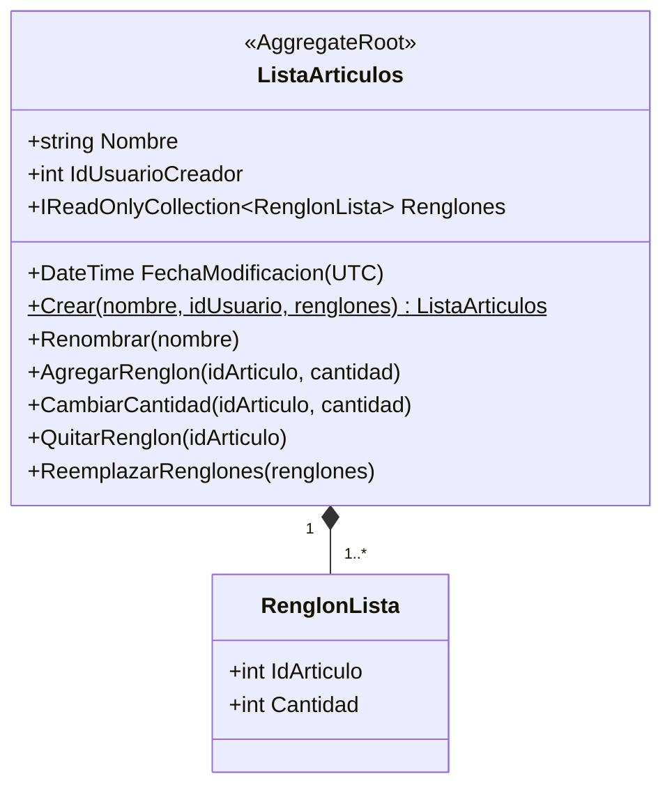
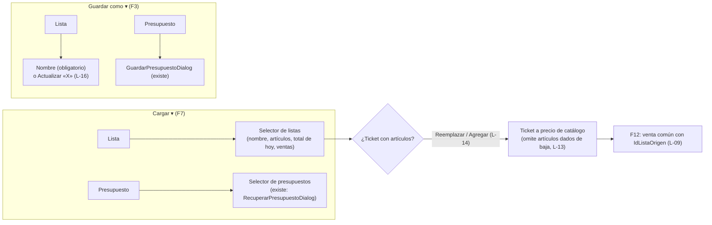

# Módulo 5.3: Plan de Diseño — Listas de Artículos

### Proyecto: Retail (Sistema ERP & Punto de Venta para Librería)
**Etapa:** [`etapa-5-presupuestos-arca.md`](file:///c:/Users/lucas/Proyectos/retail/docs/roadmap/etapa-5-presupuestos-arca.md) (módulo nuevo, posterior al 5.1) | **Responsable:** Lucas Kruzolek | **Rama:** `listas`, que sale de `main` (el Módulo 5.1, PR #71, ya está fusionado) con un commit por fase  
**Requisitos:** RF-30 e IU-14 (nuevos, se escriben en L0); IU-02 se modifica. Se apoya en el [plan de Presupuestos](file:///c:/Users/lucas/Proyectos/retail/docs/roadmap/etapa-5-modulo-5.1-presupuestos.md) (PS-01 a PS-21), del que reutiliza patrones y componentes.

> **Propósito de este documento:** permitir que una sesión nueva implemente el módulo sin el contexto de la conversación donde se diseñó (2026-11-19). Las decisiones marcadas como **Cerrada** las tomó el estudiante; las marcadas como **Propuesta** se confirman con él al empezar la fase que las implementa. Desde el 2026-11-19 todas están cerradas.

---

## 1. Estado de Avance

| Fase | Contenido | Estado |
| :--- | :--- | :---: |
| L0 | Documentación: ERS (RF-30, IU-14, IU-02, trazabilidad), roadmap de la etapa, mapa | ✅ Hecha |
| L1 | Dominio: agregado `ListaArticulos` | ✅ Hecha |
| L2 | Aplicación: `IListaService`, DTOs, validadores; venta con lista de origen | ✅ Hecha |
| L3 | Infraestructura: configuración EF, migración, `ListaQueryService`, PDF de la lista | ✅ Hecha |
| L4 | UI: pestaña **Listas** en Ventas (listado y editor) | ✅ Hecha |
| L5 | UI del POS: desplegables **Cargar ▾** y **Guardar como ▾** y selector de listas | ✅ Hecha |
| L6 | Cierre: verificación Release, mapa, prueba manual | ⏳ Pendiente |

---

## 2. Problema y Decisión de Fondo

**Caso de negocio.** La librería recibe la lista de útiles de un colegio ("3.º grado, Colegio N") y muchos padres vienen a comprarla. Con el Módulo 5.1 eso se intentó resolver con un presupuesto, y aparecieron dos problemas:

1. **Un presupuesto se consume al cobrarse** (PS-12, PS-13): sirve para un solo comprador.
2. **El proveedor actualiza los precios** (planilla, RF-07, o compra, RF-19) y el usuario quiere que la lista "tenga los precios nuevos". Un presupuesto congela el precio a propósito (PS-05).

**Diagnóstico.** Un presupuesto sin vencimiento y con precios que se actualizan deja de ser un presupuesto, porque ya no compromete ningún precio. Lo que el negocio necesita es otra cosa: **una lista de qué llevar, con el precio del día**.

| Alternativa | Por qué se descartó |
| :--- | :--- |
| Presupuesto sin vencimiento + botón "Actualizar precios" | Contradice el concepto (PS-05). Obliga a acordarse de repreciar cada lista después de cada planilla, y mientras tanto cobra precios viejos sin límite de tiempo, el peor caso con inflación |
| Todo presupuesto de uso múltiple | Resuelve el problema 1, no el 2. Además el estudiante confirmó que no se negocian condiciones especiales, así que el uso único del presupuesto no molesta: ya funciona |
| Duplicar un presupuesto por cliente | El duplicado toma los precios de hoy y pierde el congelado, y es tedioso con muchos padres |
| **Concepto nuevo: Lista** | ✅ Guarda solo artículos y cantidades. El precio se lee del catálogo cada vez que se imprime o se vende, así que **"actualizar precios" deja de ser una tarea**: no hay precio guardado que se desactualice. Es el mismo principio de PS-08 (no guardar lo que se puede calcular) |

**El presupuesto no cambia.** Sigue siendo una cotización de uso único con precio congelado y vencimiento. El caso "muchos compradores" pasa a ser de la Lista.

| Aspecto | Presupuesto (5.1) | Lista (5.3) |
| :--- | :--- | :--- |
| Precio | Congelado (el pactado) | Siempre el de catálogo, al momento de imprimir o vender |
| Vencimiento | De 1 a 90 días | No tiene |
| Edición | No (es un documento entregado, PS-05) | Sí (es una plantilla del comercio) |
| Usos | Uno: se convierte en venta | Ilimitados: cada carga es una venta común |
| Nombre o título | Título **interno**, nunca se imprime (PS-20) | Nombre **para el cliente** ("3.º grado — Colegio N"), se imprime |
| Documento | "Válido hasta dd/mm" | "Precios al dd/mm/aaaa, sujetos a modificación" |

---

## 3. Decisiones

| ID | Decisión | Estado | Fundamento |
| :--- | :--- | :---: | :--- |
| L-01 | La Lista es un **agregado propio** (`ListaArticulos`), no una variante del presupuesto | Cerrada | Sección 2: tiene otras reglas de precio, vigencia, edición y uso |
| L-02 | El presupuesto **no se modifica**: sigue siendo de uso único | Cerrada | No se negocian condiciones especiales; el caso de muchos compradores lo cubre la Lista |
| L-03 | Gestión en una **pestaña "Listas" de la sección Ventas** (junto a Clientes, Caja y Presupuestos) | Cerrada | Pedido del estudiante |
| L-04 | **Sin atajo global** para la pestaña Listas | Cerrada | Las teclas globales libres son F3, F7, F8 y F12, y el POS ya usa F3, F7 y F8 localmente. Un atajo global tiene prioridad sobre los de la página (`MainWindow.PreviewKeyDown`, ver PS-18) y rompería el POS |
| L-05 | En el POS, el botón "Cargar presupuesto" pasa a ser un **desplegable "Cargar ▾"** con *Lista* y *Presupuesto*. Los dos abren su propio selector | Cerrada | Pedido del estudiante ("mismo selector", "botón desplegable cargar → lista, presupuesto") |
| L-06 | En el POS, "Guardar presupuesto" pasa a ser un **desplegable "Guardar como ▾"** con *Lista* y *Presupuesto* | Cerrada | Pedido del estudiante (creación desde el POS) |
| L-07 | Teclado: **F7 abre el menú "Cargar"** y **F3 el menú "Guardar como"**, con letras de acceso (*L* lista, *P* presupuesto). F7 + P equivale al F7 de antes | Cerrada | El POS se usa con teclado (IU-02). Alternativa: F7 y F3 siguen yendo directo al presupuesto y la lista solo se elige con el mouse |
| L-08 | **Precio: siempre el de catálogo.** Una venta cargada desde una lista es una venta común (sin `IdPresupuestoOrigen`, sin tope de cantidad, sin candado), así que no hace falta tocar `VentaService.RegistrarVentaAsync` | Cerrada | Sección 2 |
| L-09 | La venta guarda `IdListaOrigen` (FK opcional, **sin** índice único) para mostrar "N ventas" en el listado | Cerrada | Es trazabilidad, no una regla de negocio: la lista se puede vender infinitas veces. El número se **cuenta** en SQL, no se guarda en la lista (PS-08), así dos cajas que venden la misma lista no chocan por `rowversion`. Alternativa YAGNI: no guardar nada |
| L-10 | **Nombre obligatorio**, de hasta 100 caracteres, con los espacios normalizados (`ReglasTexto.NormalizarEspacios`) y **único** entre las listas activas (índice único filtrado por `deleted_at IS NULL`, con la intercalación insensible a acentos y mayúsculas) | Cerrada | Las listas se buscan por nombre; dos "3.º grado Colegio N" confunden al cajero |
| L-11 | **El nombre se imprime** en el ticket y en el PDF | Cerrada | A diferencia del título del presupuesto (PS-20), es lo que el padre necesita ver |
| L-12 | Renglones: artículo y cantidad, **sin foto de descripción ni de precio** (se leen del catálogo). Un artículo repetido se agrupa sumando cantidades | Cerrada | La lista refleja el catálogo vigente. La foto de la descripción era necesaria en el presupuesto porque es un documento entregado; acá no |
| L-13 | **Artículo dado de baja** dentro de una lista: se muestra marcado en el editor; al cargar en el POS se omite con un aviso; no se imprime | Cerrada | Mismo criterio que `ArticulosNoDisponibles` en PS-03 |
| L-14 | **Cargar una lista con el ticket no vacío:** confirmación con **Reemplazar** / **Agregar** / Cancelar. "Agregar" suma cantidades (por ejemplo, un padre que compra para dos hijos de grados distintos) | Cerrada | Alternativa más simple: solo reemplazar, como el presupuesto |
| L-15 | **Exclusión con el presupuesto:** con un presupuesto cargado, *Cargar → Lista* pide reemplazar el ticket (desvincula el presupuesto) y no ofrece "Agregar" | Cerrada | Mezclar renglones con tope (presupuesto vigente) y renglones de lista sobre el mismo artículo violaría I7 del 5.1 |
| L-16 | **Guardar como → Lista** con un ticket que vino de una lista ofrece "Actualizar «nombre»" (reemplaza los renglones) o "Guardar como lista nueva" | Cerrada | Es la forma natural de corregir una lista desde el mostrador. Alternativa: solo lista nueva, y la edición se hace en la pestaña |
| L-17 | **Baja lógica** de una lista (`MarkAsDeleted`, Ley 3) desde la pestaña, con confirmación. Si se guarda `IdListaOrigen` (L-09), las ventas pasadas conservan la referencia | Cerrada | Ley 3: nada se borra físicamente |
| L-18 | **Editar en la pestaña:** renombrar, agregar artículos (buscador de artículos vendibles, como el del POS), cambiar cantidades y quitar renglones. Sin estados: una lista activa siempre se puede editar | Cerrada | Es una plantilla del comercio, no un documento entregado |
| L-19 | Acceso: **operadores** (Cajero y Gerente), como Presupuestos | Cerrada | El cajero las crea desde el POS |
| L-20 | **Lista de origen con "Agregar":** la venta conserva la **primera** lista cargada en el ticket. Agregar otra lista no la cambia, y agregar una lista a un ticket armado a mano la establece | Cerrada | La venta tiene una sola FK (L-09). "N ventas" cuenta las ventas que **partieron** de esa lista; nunca afirma algo falso. Una tabla intermedia venta↔lista para un contador exacto es YAGNI |
| L-21 | **Cargar → Presupuesto con una lista cargada:** el reemplazo del ticket (comportamiento del 5.1) también **desvincula la lista** (desaparece la ficha y `IdListaOrigen` vuelve a `null`). Lo mismo pasa al vaciar el ticket o al quitar la ficha con ✕ | Cerrada | Simétrico a L-15: un ticket nunca queda vinculado a la vez a un presupuesto y a una lista |

---

## 4. Modelo de Dominio

| # | Invariante | Método |
| :--- | :--- | :--- |
| I1 | Nombre obligatorio, normalizado, de hasta 100 caracteres | `Crear`, `Renombrar` |
| I2 | Al menos un renglón; cantidad ≥ 1; id de artículo > 0 | `Crear`, `ReemplazarRenglones`, `CambiarCantidad`, `QuitarRenglon` (no puede dejar la lista vacía) |
| I3 | Un artículo repetido se agrupa sumando cantidades | `Crear`, `AgregarRenglon`, `ReemplazarRenglones` |
| I4 | Toda modificación actualiza `FechaModificacion` | Todos los métodos de edición |
| I5 | La lista no conoce precios ni stock | Por diseño |

Modelo de estilo: `Pedido.cs` (lista privada, setters privados, renglones internos, `QuitarRenglon` con baja lógica del renglón huérfano en la persistencia, D4 del Track 4.3). Unicidad del nombre: la garantiza la base (L-10) y el servicio la traduce a un mensaje, igual que las demás unicidades del repositorio (buscá `RestriccionDeUnicidadException`).

---

## 5. Flujos del POS

---

## 6. Plan por Fase

### L0 — Documentación
- **ERS:**
  - **RF-30 "Listas de Artículos":** concepto, precio de catálogo, sin vencimiento, editable, usos ilimitados, nombre impreso, PDF y ticket con "Precios al…", baja lógica.
  - **IU-14 "Listas":** la pestaña.
  - **IU-02:** pasa a "Cargar ▾" y "Guardar como ▾".
  - Módulo III del alcance (o un módulo nuevo) y la fila de trazabilidad.
  - La versión sube a 3.5.
- **Roadmap:** agregar el Módulo 5.3 en `etapa-5-presupuestos-arca.md` con el enlace a este plan.
- **Mapa:** fila de la Etapa 5.

### L1 — Dominio (`Retail.Domain`)
- Archivos nuevos: `Entities/ListaArticulos.cs`, `Entities/RenglonLista.cs`, y una excepción solo si hace falta (preferí `DomainException`, igual que `Pedido`).
- `Entities/Venta.cs`: `Registrar(..., int? idListaOrigen = null)` (L-09). El parámetro es opcional para no tocar a los llamadores.
- Tests: `tests/Retail.Domain.UnitTests/Entities/ListaArticulosTests.cs` (I1–I4, con `[Theory]` para los límites), más 2 tests en `VentaTests`.

### L2 — Aplicación (`Retail.Application`)
- `Interfaces/Services/IListaService.cs`:
  - `CrearAsync`, `ActualizarAsync` (nombre + renglones), `EliminarAsync`. **Cambio respecto del diseño original:** en lugar de un método por cada edición, hay un único `ActualizarAsync`, porque el editor de L4 es un diálogo con *Guardar*/*Cancelar* y el "Actualizar «X»" del POS (L-16) también reemplaza todo. Lleva `FechaModificacionLeida`: si otra terminal guardó en el medio, se rechaza en lugar de pisar los cambios;
  - `ListarAsync` (paginado), `ObtenerAsync`, `ObtenerParaVentaAsync` (renglones con el precio y el stock de hoy, más los artículos no disponibles);
  - `ImprimirAsync`, `ExportarPdfAsync`.
- `Interfaces/Persistence/IListaQueryService.cs` e `Interfaces/Infrastructure/IExportadorListaPdf.cs`.
- `DTOs/Listas/`:
  - `CrearListaDto`, `ListaDto`, `ListaResumenDto` (nombre, artículos, total estimado con el precio de hoy, ventas, fecha de modificación);
  - `ConsultaListasDto`, `ListasPaginadosDto`, `ListaParaVentaDto`, `RenglonListaParaVentaDto`.
- `Validators/Listas/`.
- `Services/ListaService.cs`: modelo, `PresupuestoService`.
- `CrearVentaDto.IdListaOrigen` (L-09) y su validación; `VentaService` solo lo pasa a `Venta.Registrar`, **sin reglas de precio nuevas** (L-08).
- `DependencyInjection.cs`.
- Tests: `ListaServiceTests`, validadores, y un test de `VentaService` que guarda `IdListaOrigen` y cobra a precio de catálogo.

### L3 — Infraestructura (`Retail.Infrastructure`)
- Configuración:
  - `ListaArticulosConfiguration.cs` y `RenglonListaConfiguration.cs`: tablas `LISTAS_ARTICULOS` y `RENGLONES_LISTA`, campo de respaldo, `RowVersion` sombra (dos usuarios editando la misma lista), índice único filtrado del nombre (L-10), baja lógica.
  - `VentaConfiguration`: FK `id_lista_origen` con un índice común.
- Migración `ListasDeArticulos`. Además, actualizar `docs/DER.mmd`.
- `Persistence/Services/ListaQueryService.cs`:
  - el total estimado se calcula en SQL: `SUM(cantidad * precio_venta)` de los artículos activos;
  - las ventas se cuentan en SQL;
  - búsqueda por nombre con `EF.Functions.Like`;
  - artículos dados de baja con `IgnoreQueryFilters`, como en `PresupuestoQueryService.PresupuestosConSusReferencias`.
- PDF: `Listas/ContenidoListaPdf.cs` (modelo intermedio testeable) + `Listas/ExportadorListaPdf.cs`, reutilizando `Pdf/ConfiguracionQuestPdf.cs` y el membrete de `TicketPrinterSettings`. Contenido: nombre, "Precios al dd/mm/aaaa — sujetos a modificación", renglones, total y "Documento no válido como factura".
- Ticket: `ITicketPrinterService.ImprimirListaAsync` y su implementación en `FileDebugTicketPrinterService`.
- Tests de integración: persistencia, unicidad del nombre, concurrencia de edición, consulta (total con el precio de hoy después de cambiar un precio, ventas contadas, búsqueda sin tildes), y PDF (`%PDF` + modelo).

### L4 — UI: pestaña Listas
- `Navegacion/RegistroNavegacion.cs`: entrada `listas` en la sección `ventas`, sin atajo (L-04).
- `Views/Pages/ListasView.xaml` + `ViewModels/Listas/ListasViewModel.cs`: el mismo patrón que `PresupuestosView` (encabezado con `NavegadorSeccion`, `ListToolbar`, `DataGridListadoStyle`, paginación, filtros de columna si corresponden). Acciones por fila: editar, imprimir, PDF, eliminar. Además, **"Nueva lista"** en la barra (agregado al implementar: el editor y `CrearAsync` ya existían, y permite cargar una lista de útiles antes de que llegue el primer comprador).
- `Views/Dialogs/ListaFormDialog.xaml` + VM: editor con nombre, buscador de artículos (`IVentaService.BuscarPorTextoAsync`) y grilla editable de cantidades con `SelectorCantidad`. Total de hoy en vivo.
- `Services/IListaDialogService.cs` + implementación.
- Tests: ViewModels, prueba de humo STA, capturas Light/Dark con `DatosDeMuestra`, y `audit-xaml.ps1`.

### L5 — UI del POS
- `PosView.xaml`: en `PageHeader.Navegacion`, los botones actuales pasan a dos `ToggleButton` desplegables con el patrón **"Más ▾"** del sistema de diseño (`GhostNeutralToggleButtonStyle` o el estilo de botón que corresponda + `ContextMenu` + `MenuDesplegableHelper.AbrirAlHacerClic`; ver `docs/SISTEMA_DE_DISENO.md`, secciones del botón "⋮" / "Más ▾"). La ficha del presupuesto cargado y su ✕ siguen igual, y se suma una ficha equivalente "Lista «nombre»" con ✕ cuando el ticket viene de una lista.
- `PosViewModel.cs`: comandos `CargarListaCommand` y `GuardarComoListaCommand`; estado `ListaCargada`; el cobro envía `IdListaOrigen`; F7/F3 según L-07.
- Diálogos nuevos:
  - `SeleccionarListaDialog`: el mismo patrón que `RecuperarPresupuestoDialog`, con buscador, primera fila seleccionada, Enter o doble clic y carga en `Loaded`;
  - `GuardarListaDialog`: nombre, más "Actualizar «X»" (L-16).
- Tests: `PosViewModelTests` (cargar, reemplazar/agregar, omitir dados de baja, exclusión con el presupuesto, guardar y actualizar), los ViewModels de los diálogos, prueba de humo y capturas.
- **Decisiones tomadas al implementar:**
  - La ✕ de la ficha "Lista «X»" **solo desvincula** y los artículos quedan en el ticket. Con "Agregar", la cantidad de un renglón puede mezclar unidades de la lista y cargadas a mano, así que "quitar los de la lista" sería ambiguo. F8 vacía el ticket.
  - Guardar como lista nueva **vincula** el ticket a la lista creada, salvo que venga de un presupuesto (L-21).
  - `ListaParaVentaDto` lleva `FechaModificacion`: "Actualizar «X»" envía la fecha de cuando se cargó la lista, así se detecta una edición concurrente.
  - Para la pregunta de tres botones se creó `PreguntaCargaListaDialog`.
- **R-1:** F3/F7 se manejan en `PosView.OnPreviewKeyDown`. Abierto con el teclado, el menú enfoca su primer ítem habilitado (↑/↓/Enter), y los ítems tienen letras de acceso (`_Lista`, `_Presupuesto`). Que las letras funcionen con el foco real se confirma en la prueba manual (paso 8).

### L6 — Cierre
Verificación Release completa (AGENTS.md), mapa, prueba manual (sección 8) y PR.

---

## 7. Riesgos

| ID | Riesgo | Mitigación |
| :--- | :--- | :--- |
| R-1 | El desplegable con letras de acceso dentro de un `ContextMenu` no responde a F7/F3 como se espera (foco en el buscador) | Prototipar el teclado en L5 antes de las capturas; si no funciona, usar la alternativa de L-07 |
| R-2 | El total estimado del listado, calculado en SQL sobre muchas listas, se vuelve lento | Está paginado; el cálculo es por página (`Skip/Take` antes de la subconsulta) |
| R-3 | El nombre único choca con listas dadas de baja | El índice es filtrado por `deleted_at IS NULL` |
| R-4 | La app abierta bloquea `bin/Debug` y la compilación falla con `MSB3021`/`MSB3027` | Compilar y probar con `-p:BaseOutputPath=<repo>\artifacts\altbin\` y borrar la carpeta al terminar (fuera del repo, el renderizador de capturas no encuentra `Retail.sln`) |

---

## 8. Prueba Manual (L6)

1. `dotnet run --project src/Retail.Cli -- migrar`.
2. En el POS, cargar un ticket y usar *Guardar como → Lista* ("3.º grado Colegio N").
3. Cambiar el precio de un artículo de la lista (o importar una planilla). Verificar que en la pestaña Listas el total refleja el precio nuevo **sin hacer nada**, y que el PDF muestra el nombre y "Precios al…".
4. *Cargar → Lista* en el POS y cobrar; repetir con otro cliente. La lista sigue disponible y muestra "2 ventas".
5. Cargar la lista con el ticket no vacío y probar Reemplazar y Agregar.
6. Con un presupuesto cargado, *Cargar → Lista* pide reemplazar.
7. Dar de baja un artículo de la lista: al cargarla, se omite con un aviso.
8. Solo con el teclado: F7 → L abre el selector de listas, F7 → P el de presupuestos, F3 → L guarda como lista, y Esc cierra el menú y devuelve el foco al buscador.

---

## 9. Arranque de la Sesión Nueva

1. Leer `AGENTS.md`, `CLAUDE.md` (Modo Pedagógico: explicar y esperar la aprobación por fase) y este documento.
2. Todas las decisiones (L-01 a L-21) quedaron **cerradas** el 2026-11-19.
3. La implementación se delega en subagentes y el orquestador revisa cada diff. **Los tests los corre solo el orquestador**: los mínimos e indispensables de cada fase, y la suite completa al cerrar (L6).
4. Crear la rama `listas` desde `main`, con un commit por fase (Co-Authored-By de Claude) y el PR al final con `gh`.
5. Recordatorios del entorno:
   - **CRLF en los archivos nuevos:** la herramienta Write crea LF. Hay que convertirlos (en el 5.1 se usó un `crlf.py` en el scratchpad de esa sesión, que ya no existe; recrearlo) y cerrar con `dotnet format Retail.sln --verify-no-changes`.
   - **No usar `sed -i`** ni scripts de PowerShell que reescriban archivos: rompen el CRLF y las tildes.
   - **Mensajes de commit desde PowerShell:** usar `git commit -F <archivo>`, porque `-F -` con here-string no funciona en PowerShell 5.1.
   - **Atajos globales:** tienen prioridad sobre los de la página (hallazgo H-1 del 5.1).

---

## 10. Preguntas de Defensa Anticipadas

* **¿Por qué una entidad nueva y no un flag en el presupuesto?** Porque cambian las reglas de precio, vigencia, edición y uso. Un flag haría que cada método del presupuesto preguntara de qué tipo es (un olor de diseño: condicionales por tipo en lugar de polimorfismo o separación de agregados).
* **¿Cómo se "actualizan los precios" de una lista?** No se actualizan: la lista no guarda precios. El precio se lee del catálogo al imprimir o vender. Es el mismo principio por el que la vigencia del presupuesto se calcula y no se guarda.
* **¿Por qué las ventas de una lista se cuentan y no se guardan en un contador?** Porque un contador en la fila de la lista haría chocar por `rowversion` a dos cajas que venden la misma lista al mismo tiempo. Contar en SQL no modifica la lista.
* **¿Por qué la venta desde una lista no toca las reglas de precio de `VentaService`?** Porque es una venta común a precio de catálogo (D-11). Toda la regla de precio especial sigue concentrada en el presupuesto (PS-14).
