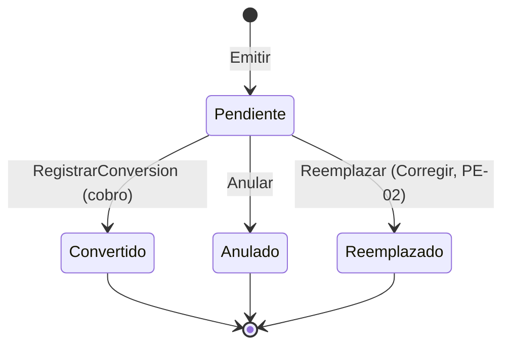
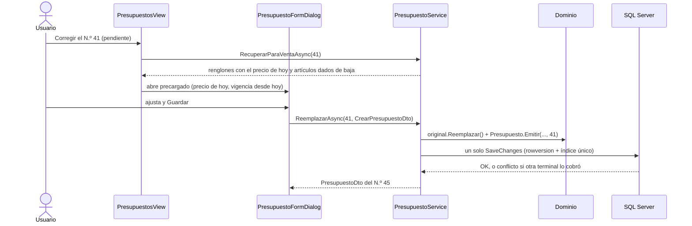

# Módulo 5.4: Plan de Diseño — Nuevo Presupuesto y Corrección

### Proyecto: Retail (Sistema ERP & Punto de Venta para Librería)
**Etapa:** [`etapa-5-presupuestos-arca.md`](file:///c:/Users/lucas/Proyectos/retail/docs/roadmap/etapa-5-presupuestos-arca.md) (módulo nuevo, posterior al 5.3) | **Responsable:** Lucas Kruzolek | **Rama:** `presupuestos-editor`, que sale de `main` (el 5.3, PR #72, ya está fusionado), con un commit por fase
**Requisitos:** RF-11, RF-12 e IU-13 (se modifican en P0). Revisa dos decisiones del [Módulo 5.1](file:///c:/Users/lucas/Proyectos/retail/docs/roadmap/etapa-5-modulo-5.1-presupuestos.md): **PS-05** (inmutabilidad) y **PS-06** (creación solo desde el POS). Toma como referencia el editor de listas del [Módulo 5.3](file:///c:/Users/lucas/Proyectos/retail/docs/roadmap/etapa-5-modulo-5.3-listas.md).

> **Propósito de este documento:** permitir que una sesión nueva implemente el módulo sin el contexto de la conversación donde se diseñó (2026-11-19). Todas las decisiones están **cerradas**.

---

## 1. Estado de Avance

| Fase | Contenido | Estado |
| :--- | :--- | :---: |
| P0 | Documentación: este plan, ERS (RF-11, RF-12, IU-13), revisión de PS-05/PS-06, roadmap, mapa | ✅ Hecha |
| P1 | UI: extraer `EditorRenglones` de `ListaFormDialog` sin cambiar su comportamiento | ✅ Hecha |
| P2 | UI: `PresupuestoFormDialog` y "Nuevo presupuesto" en la pestaña | ✅ Hecha |
| P3 | Dominio, Aplicación e Infraestructura: título editable y corrección (reemplazo atómico) | ✅ Hecha |
| P4 | UI: acción *Corregir*, estado *Reemplazado* y título editable en el detalle | ✅ Hecha |
| P5 | Cierre: verificación Release, mapa y PR | 🟡 Release en verde (4579 tests, 2026-11-19); faltan el PR y la prueba manual |
| P6 | UI: precio y total anteriores tachados (PE-13, PE-14) | ✅ Hecha |
| P7 | UI del POS: guardar como presupuesto nuevo con un presupuesto cargado (PE-15 a PE-17) | ✅ Hecha |
| P8 | UI del POS: confirmar el cobro de un presupuesto vigente a otro cliente (PE-18) | ✅ Hecha |

---

## 2. Problema y Decisión de Fondo

1. **Crear sin pasar por el mostrador.** Hoy un presupuesto solo nace en el POS (PS-06). Para preparar una cotización pedida por teléfono o por correo, el usuario tiene que ocupar el mostrador. El editor de listas (5.3) demostró que un modal con buscador y grilla resuelve bien "armar un conjunto de artículos fuera del POS".
2. **Corregir un presupuesto ya emitido** ("eran 3 cuadernos, no 5"). PS-05 lo prohíbe por una buena razón: el presupuesto es un **documento entregado al cliente**, y si el N.º 41 cambiara, el papel que tiene el cliente diría otra cosa que el sistema.

| Camino para "editar" | Respeta PS-05 | Por qué se eligió o descartó |
| :--- | :---: | :--- |
| A. Edición real del pendiente | ❌ | Descartada: el papel entregado deja de coincidir con el sistema, y para ser defendible habría que versionar cada cambio |
| **B. Corregir = reemplazar** | ✅ | ✅ Elegida: es la regla de PS-05 ("se anula y se emite otro") hecha en **un solo paso atómico** y sin retipear. Cada papel entregado sigue existiendo tal cual |
| **C. Título interno editable** | ✅ | ✅ Elegida junto con B: el título nunca se imprime (PS-20), así que cambiarlo no altera ningún documento entregado |

---

## 3. Decisiones

| ID | Decisión | Estado | Fundamento |
| :--- | :--- | :---: | :--- |
| PE-01 | **PS-06 se relaja:** el presupuesto se crea desde el POS (*Guardar como → Presupuesto*) **o** desde la pestaña (**Nuevo presupuesto**). Las dos vías llaman a `IPresupuestoService.EmitirAsync` | Cerrada | Pedido del estudiante. No hay lógica nueva: solo otra pantalla sobre el mismo caso de uso |
| PE-02 | **PS-05 se mantiene para el contenido.** "Editar" es **Corregir**: se anula el original y se emite uno nuevo precargado, en un único `SaveChanges` | Cerrada (B) | Sección 2 |
| PE-03 | El original pasa a un **estado nuevo, `Reemplazado`** (no `Anulado`), y el nuevo guarda `IdPresupuestoReemplazado` | Cerrada | El listado puede decir "Reemplazado por N.º 45" y el detalle del nuevo "Reemplaza al N.º 41". Con `Anulado` se perdería por qué se cerró |
| PE-04 | Solo se corrige un presupuesto **pendiente** (vigente o vencido) | Cerrada | Uno convertido ya es una venta; uno anulado o reemplazado ya no está vigente para nadie |
| PE-05 | **Vigencia del corregido: desde hoy** (1 a 90 días, 15 por defecto, editable) | Cerrada | Pedido del estudiante |
| PE-06 | **Precios del corregido: los del catálogo de hoy** para todos los renglones, como cualquier emisión (D-11). El modal muestra qué precios cambiaron respecto del original | Cerrada | Consecuencia de PE-05: si conservara los precios pactados con vigencia nueva, cada corrección extendería el congelamiento y, encadenando correcciones, un precio viejo no vencería nunca. El corregido es una cotización nueva |
| PE-07 | **Defensa en profundidad contra el doble reemplazo y la carrera con el cobro:** (1) el agregado exige `Pendiente`; (2) `rowversion` de `PRESUPUESTOS` (PS-13); (3) índice único filtrado en `id_presupuesto_reemplazado` | Cerrada | Mismo esquema que PS-13. Si otra terminal cobra el N.º 41 mientras se corrige, el reemplazo se rechaza |
| PE-08 | **Título interno editable** en cualquier estado (`Presupuesto.CambiarTitulo`), desde el detalle del presupuesto | Cerrada (C) | Revisa la última frase de PS-20 ("no se modifica después de emitir"): el título es una nota interna que nunca se imprime ni se exporta |
| PE-09 | Se **extrae `EditorRenglones`** (ViewModel + `UserControl`: buscador, grilla de la galería y subtotal) de `ListaFormDialog`, y lo usan los dos modales | Cerrada | El buscador y la grilla son idénticos. Con dos consumidores, duplicar haría que un arreglo llegue solo a uno (*root cause, not symptom*) |
| PE-10 | El modal **no pierde lo cargado si un precio cambió** mientras estaba abierto: `EmitirAsync` lo rechaza (D-11) y el modal ofrece **Actualizar precios** | Cerrada | Un modal puede quedar abierto mucho más que un ticket del POS |
| PE-11 | Al **corregir**, los artículos dados de baja del original **no se precargan** y se avisa cuáles se omitieron | Cerrada | Mismo criterio que la recuperación en el POS (PS-03) y que las listas (L-13) |
| PE-12 | Acceso: **operadores**, como el resto de Presupuestos | Cerrada | Sin cambios respecto del 5.1 |
| PE-13 | **Precio que cambió, señalado en la grilla:** el precio anterior aparece tachado sobre el nuevo, solo en las filas donde difieren (al corregir y después de "Actualizar precios") | Cerrada | Pedido del estudiante (2026-11-19). Completa el mensaje "N precios cambiaron": muestra **cuáles** y cuánto |
| PE-14 | **Total anterior tachado = Σ cantidad actual × precio anterior** (un artículo nuevo suma su precio de hoy a los dos lados), rotulado "por cambios de precio" | Cerrada | Si se tachara el total del original, la diferencia mezclaría el cambio de precios con el de cantidades o artículos. Así se aísla el efecto del precio |
| PE-15 | **Guardar como → Presupuesto con un presupuesto cargado en el POS = emitir uno nuevo e independiente.** El presupuesto base **no se modifica**: sigue pendiente. Sirve para dar el mismo presupuesto a otro cliente o para usar uno como base de otro | Cerrada | Pedido del estudiante. No es una corrección (PE-02): el base sigue siendo válido para su cliente. Revisa el "un presupuesto no se vuelve a presupuestar" del 5.1/5.3 |
| PE-16 | El presupuesto nuevo sale con los **precios del catálogo de hoy**, aunque el base esté vigente. El diálogo avisa cuántos precios cambian y muestra el total nuevo | Cerrada | Lo exige RF-11 ("precios vigentes del catálogo al emitir") y `EmitirAsync` lo controla (D-11). Copiar los pactados a otro cliente extendería un compromiso de precio más allá de su vigencia (mismo argumento que PE-06) |
| PE-17 | Después de guardar, el ticket **se vacía**, como cualquier "Guardar como presupuesto". El título interno se precarga con el del base (editable) | Cerrada | Mismo comportamiento que hoy. Precargar el título ahorra tipeo, que es el objetivo de "usarlo como base" |
| PE-18 | **Cobrar un presupuesto vigente a otro cliente pide confirmación** en el POS, al cobrar (F12), no al cambiar el cliente. Pregunta solo si el presupuesto se emitió para un cliente concreto y el del ticket es otro, incluido Consumidor Final. No pregunta si el presupuesto fue a Consumidor Final ni si venció. El servidor lo sigue permitiendo | Cerrada (opción B) | Hasta ahora se permitía sin aviso (5.1: "el cliente de la venta es el que manda el POS"), con dos efectos: el otro cliente recibe los precios pactados y el presupuesto del primero se consume. Hay casos legítimos (paga otra persona, o el cliente se identifica al pagar), así que es una **decisión del cajero**, como el descuento (PS-15), y no una regla de dominio. Por eso es una confirmación en la UI y no una validación en el servidor. Un presupuesto vencido ya está a precios de catálogo (PS-03) y uno a Consumidor Final no tenía dueño del precio. Para dar el mismo presupuesto a otro cliente sin consumirlo existe P7 |

---

## 4. Modelo de Dominio (cambios)

| Elemento | Cambio |
| :--- | :--- |
| `EstadoPresupuestoEnum` | `Reemplazado = 8` |
| `Presupuesto.Emitir(...)` | Parámetro opcional `int? idPresupuestoReemplazado = null` (> 0) |
| `Presupuesto.IdPresupuestoReemplazado` | Nuevo, `int?`. Referencia por identidad (PS-19) |
| `Presupuesto.Reemplazar()` | `Pendiente → Reemplazado` y `FechaCierre`; desde otro estado lanza `TransicionPresupuestoInvalidaException` |
| `Presupuesto.CambiarTitulo(string?)` | Normaliza igual que `Emitir` (PS-20); en cualquier estado |

---

## 5. Flujo de la Corrección

---

## 6. Plan por Fase

### P1 — Extraer `EditorRenglones` (UI)
- `Components/EditorRenglones.xaml(.cs)` y `ViewModels/Comun/EditorRenglonesViewModel.cs`, con el buscador (texto o código de barras), los resultados, los renglones y el subtotal. Necesita un "renglón" común que incluya `EstaDisponible`.
- `ListaFormDialog` y `ListaFormViewModel` pasan a componerlo **sin cambiar su comportamiento**. Sus tests, la prueba de humo y la captura siguen verdes; los tests del buscador se mueven a `EditorRenglonesViewModelTests`.

### P2 — Nuevo presupuesto (UI)
- `Views/Dialogs/PresupuestoFormDialog.xaml` y `ViewModels/Presupuestos/PresupuestoFormViewModel.cs`, que componen `EditorRenglones` y suman:
  - título interno, cliente (selector del POS, F4), vigencia en días con "Válido hasta dd/mm/aaaa" y descuento;
  - subtotal, descuento y total, todos en C0.
- Guardar llama a `EmitirAsync`. Después ofrece **Imprimir** y **PDF**, como `GuardarPresupuestoDialog`.
- Ante un precio desactualizado, el botón **Actualizar precios** (PE-10).
- Botón primario **Nuevo presupuesto** en `PresupuestosView`, que abre el modal y recarga el listado.
- Tests de ViewModel, prueba de humo y capturas.

### P3 — Título editable y corrección (Dominio → Aplicación → Infraestructura)
- **Dominio:** sección 4, con sus tests.
- **Aplicación:**
  - `IPresupuestoService.ReemplazarAsync(int idPresupuestoOriginal, CrearPresupuestoDto dto)`. Reutiliza la construcción de renglones de `EmitirAsync` (un método privado común). Traduce `ConflictoDeConcurrenciaException` y `RestriccionDeUnicidadException` al mensaje "El presupuesto N.º X cambió mientras lo corregía (por ejemplo, se cobró). Vuelva a abrirlo.".
  - `IPresupuestoService.CambiarTituloAsync(int id, string? titulo)`.
  - DTOs: `PresupuestoDto` y `PresupuestoResumenDto` suman `IdPresupuestoReemplazado` e `IdPresupuestoReemplazante`. `FiltroEstadoPresupuestoEnum` suma `Reemplazados`.
- **Infraestructura:**
  - columna `id_presupuesto_reemplazado` con FK a `PRESUPUESTOS` (`Restrict`) e índice único filtrado `[id_presupuesto_reemplazado] IS NOT NULL`;
  - `PresupuestoQueryService`: el reemplazante se resuelve con una subconsulta en SQL, y el filtro nuevo;
  - migración `PresupuestosCorreccion` y `DER.mmd`.
- **Tests:** dominio; servicio (reemplazo feliz, original no pendiente, conflicto); integración (atomicidad, doble reemplazo bloqueado por el índice, carrera con el cobro).

### P4 — Corregir y título (UI)
- Acción **Corregir** (ícono de lápiz) en las filas pendientes de `PresupuestosView`. Abre `PresupuestoFormDialog` en modo corrección: título "Corregir presupuesto N.º 41", precargado con el precio de hoy, avisa los precios que cambiaron y los artículos omitidos (PE-06, PE-11), y guarda con `ReemplazarAsync`.
- Badge y filtro del estado **Reemplazado**, con el texto "Reemplazado por N.º 45" en la fila y "Reemplaza al N.º 41" en el detalle.
- Título editable en `DetallePresupuestoDialog` (PE-08).
- Tests, prueba de humo y capturas.

### P5 — Cierre
Verificación Release completa (AGENTS.md), mapa y PR.

---

### P6 — Precio y total anteriores tachados (UI)
- `RenglonEditableFila` suma `PrecioAnterior` (`decimal?`) y `PrecioCambio`. `EditorRenglonesViewModel` suma `SubtotalAPreciosAnteriores` (Σ cantidad × precio anterior, o el actual si no hay anterior) y `HayPreciosCambiados`. `ActualizarPrecios` conserva el precio anterior la primera vez que un precio cambia.
- `EditorRenglones.xaml`: en la columna Precio, el anterior tachado y apagado sobre el nuevo cuando `PrecioCambio`.
- `PresupuestoFormDialog`: el subtotal anterior tachado y rotulado "por cambios de precio" cuando `HayPreciosCambiados`. En modo corrección, el precio anterior es el pactado del original.
- El editor de listas no cambia (`PrecioAnterior` queda en `null`).
- Tests del ViewModel y capturas.

### P7 — Guardar como presupuesto nuevo desde el POS (UI)
- `PosViewModel.PuedeGuardarComoPresupuesto` deja de exigir que no haya un presupuesto cargado.
- Con un presupuesto base cargado, antes de abrir `GuardarPresupuestoDialog`:
  - el POS obtiene los precios de hoy con `IVentaService.VerificarTicketAsync`;
  - arma los renglones a esos precios (PE-16);
  - pasa el título del base (PE-17) y la cantidad de precios que cambian.
- El diálogo avisa "Se emite un presupuesto nuevo; el N.º X no cambia. N precios pasan al catálogo de hoy" y muestra el total nuevo.
- Guarda con `EmitirAsync`, nunca con `ReemplazarAsync` (PE-15). Al guardar, el ticket se vacía.
- ERS: IU-02.
- Tests en `PosViewModelTests` y en el ViewModel del diálogo, más capturas.

## 7. Riesgos

| ID | Riesgo | Mitigación |
| :--- | :--- | :--- |
| R-1 | La extracción de P1 rompe el editor de listas | P1 no cambia comportamiento: los tests y la captura de `ListaFormDialog` deben quedar iguales |
| R-2 | El cliente del original fue dado de baja | El modal de corrección lo deja vacío y avisa, como `CargarPresupuestoAsync` del POS (`clienteNoEncontrado`) |
| R-3 | La subconsulta del reemplazante encarece el listado | Está paginado: se calcula solo para la página, igual que las ventas de una lista (R-2 del 5.3) |

---

## 8. Preguntas de Defensa Anticipadas

* **¿Por qué "Corregir" no edita el presupuesto?** Porque es un documento entregado al cliente. Reemplazarlo conserva cada papel tal como se entregó y deja la cadena 41 → 45 trazable.
* **¿Por qué el corregido toma los precios de hoy?** Porque tiene vigencia nueva. Si conservara los pactados, encadenando correcciones se podría congelar un precio indefinidamente.
* **¿Qué garantiza que el N.º 41 no se cobre y se reemplace a la vez?** El agregado exige `Pendiente`, el `rowversion` detecta la modificación concurrente y el índice único impide dos reemplazos del mismo original.
* **¿Por qué el título sí se puede editar?** Porque nunca se imprime ni se exporta (PS-20): cambiarlo no altera ningún documento entregado.
