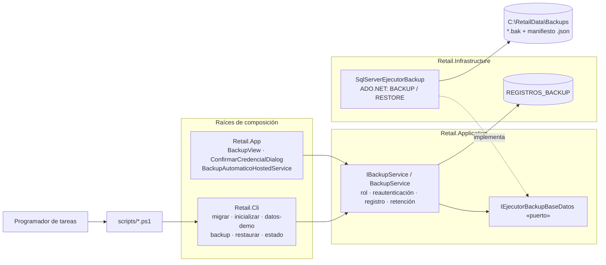
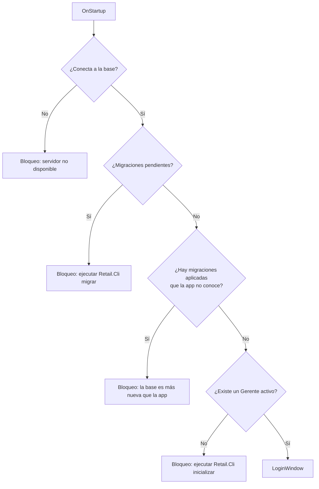
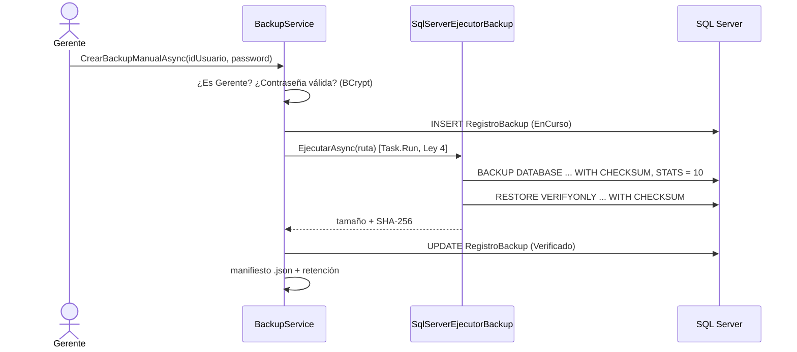

# Track 6.3: Plan de Diseño — Backup, Restore y Administración de Base

### Proyecto: Retail (Sistema ERP & Punto de Venta para Librería)
**Etapa:** [`etapa-6-estabilizacion-release.md`](file:///c:/Users/lucas/Proyectos/retail/docs/roadmap/etapa-6-estabilizacion-release.md) (Track 6.3, implementación adelantada) | **Responsable:** Lucas Kruzolek | **Rama:** `feat/backup-restore`  
**Requisitos:** `RF-03`, `RF-22`, `RF-23`, `RNF-08` en [`ERS - Libreria POS.md`](file:///c:/Users/lucas/Proyectos/retail/docs/ERS%20-%20Libreria%20POS.md)

> **Propósito de este documento:** conservar las decisiones de diseño, sus fundamentos y el estado de avance del track, para retomar el trabajo en una sesión nueva sin rehacer el análisis. Las decisiones marcadas como **Cerrada** ya fueron discutidas y aprobadas; no se vuelven a abrir sin un motivo nuevo.

---

## 1. Estado de Avance

| Fase | Contenido | Estado |
| :--- | :--- | :---: |
| 0 | Documentación: ERS (RF-22, RF-23, RNF-08, roles, IU-10, IS-04), roadmap, mapa | ✅ Hecha (commit por fase) |
| 1 | Roles y cuentas | ✅ Hecha (commit por fase) — 1108 tests, Release 0 advertencias |
| 2 | Herramienta `Retail.Cli` y arranque sin migración automática | ✅ Hecha (commit por fase) |
| 3 | Dominio `RegistroBackup` | ✅ Hecha (commit por fase) |
| 4 | Backup | ✅ Hecha (commit por fase) |
| 5 | Restore (opción C: base temporal + intercambio) | ✅ Hecha — commit `0bcbe88` más las correcciones de la revisión final (sección 1.3) |
| 6 | UI (`BackupView`, `ConfirmarCredencialDialog`) | ✅ Hecha — 1395 tests, Release 0 advertencias. Pendiente: prueba manual en la app real (incluido el reinicio tras restaurar) |
| 7 | Backup automático | 🚧 B-0 a B-6 implementados y revisión independiente aplicada (sección 1.4): Release 0 advertencias, 1479 tests. Primera prueba manual como `SYSTEM` exitosa (2026-10-14). Pendiente: repetir la prueba manual con el script corregido (copia a Program Files y ACL) |

**Forma de trabajo:** fase por fase y capa por capa (Dominio → Aplicación → Infraestructura → UI → Tests), con cada diff revisado por el estudiante. Desde el 2026-10-13, [`CLAUDE.md`](file:///c:/Users/lucas/Proyectos/retail/CLAUDE.md) §5 permite delegar código en subagentes cuando el estudiante lo pide: la sesión principal define los paquetes, revisa cada diff, corre la verificación y explica. Revisiones independientes de solo lectura en las Fases 1 (permisos) y 5 (restore). Commits y PR los pide el estudiante.

### Notas de implementación de la Fase 1

* **Los roles ya se siembran por migración** (`AgregarRolAdministradorYCuentasDeUsuario`, adelanto de D-12): un `InsertData` aislado del rol 4 rompía la instalación sobre una base vacía, porque el seeder salía al ver un rol. El seeder ahora verifica los roles contra el enum y decide si ya se ejecutó según haya usuarios.
* **La matriz de autoridad vive en el Dominio** (`Usuario.PuedeGestionarCuentasDeRol`). La UI la consulta con `IUsuarioService.ObtenerRolesAsignablesAsync` para no ofrecer roles que el servicio rechazaría, en lugar de duplicarla.
* **`CambiarPasswordAsync` unifica los dos casos**: si el actor es el titular, es un cambio propio; si no, es un blanqueo que exige autoridad sobre el rol.
* **Navegación:** solo se agregó lo que pide RF-03 (el Administrador ve Usuarios y no los módulos operativos). Los permisos completos por rol de los demás módulos (por ejemplo, Compras para el Cajero) quedan para la auditoría del Track 6.1. Los servicios operativos (POS, caja) todavía no verifican el rol: hoy la restricción del Administrador sobre ellos es solo de navegación.
* **Revisión independiente (subagente de solo lectura):** sin caminos de escalada de privilegios. Se corrigieron: el cambio propio exige la contraseña actual y una nueva distinta (cierra la reutilización de la temporal y la toma de cuenta desde una sesión abierta; el login forzado reenvía la contraseña recién escrita); el Administrador no ve el email de recuperación de las cuentas que no gestiona; el blanqueo verifica el rol antes de buscar al objetivo. Desde Usuarios, la fila propia abre "Cambiar mi contraseña".
* **Riesgos aceptados y documentados:** (R-14) la verificación de "último Gerente" no está protegida contra dos degradaciones simultáneas desde terminales distintas; con un solo puesto y LocalDB no ocurre, revisarlo si se pasa a multipuesto. (R-15) los Gerentes de bases existentes no tienen email de recuperación; la Fase 2 debe exigirlo (`inicializar` y verificación al arrancar).
* **Pendiente de verificación visual:** el diálogo de cambio obligatorio agrega un aviso al modal compacto (460×390); revisar en la app si necesita desplazamiento.

### Notas de implementación de la Fase 2

* **Revisión de D-13 (después del cierre):** se eliminó `blanquear-gerente`. Con una sesión de Windows compartida, cualquier empleado podía ejecutarlo y tomar la cuenta del Gerente. Riesgos asociados:
  * **R-16:** hasta que exista el envío de correos, un Gerente que olvida su contraseña solo puede ser blanqueado por **otro Gerente** desde la aplicación. Con un único Gerente, no hay recuperación sin intervención técnica sobre la base. Recomendación operativa: dar de alta al menos dos Gerentes.
  * **R-17 (riesgo aceptado):** un empleado con conocimientos técnicos y la cuenta de Windows que es dueña de la base puede modificarla con SSMS o `sqlcmd`. No se resuelve en la aplicación: requiere cuentas de Windows separadas y permisos restringidos en SQL Server (RNF-05, futura migración a SQL Server Express).
  * **Pendiente para la Fase 5:** `restaurar` por consola tiene el mismo problema de confianza. Se debate al diseñar esa fase; los códigos de recuperación quedan descartados.

* **Separación de privilegios en la inyección de dependencias:** `IEstadoSistemaService` (solo lectura) se registra en `AddApplicationServices`; `IAdministracionSistemaService` (migrar, primer Gerente, blanqueo de Gerente, sin actor) solo en `AddAdministracionSistema`, que invoca exclusivamente `Retail.Cli`. Un test lo verifica.
* **`inicializar` solo funciona sin Gerentes activos:** después, toda cuenta pasa por la autorización de la aplicación. El primer Gerente no queda obligado a cambiar la contraseña (la eligió él frente al equipo).
* **`appsettings.json` compartido como archivo enlazado:** la cadena de conexión existe en un solo lugar; la release publica ambos ejecutables en la misma carpeta.
* **La consola es del operador:** Serilog escribe solo a `logs/retail-cli-.log`; los errores esperados (validación, negocio, entrada inválida) se muestran sin stack trace y con código de salida 1 (2 para uso incorrecto).
* **Se descartó la verificación de roles contra el enum al arrancar** (estaba en `DbInitializer`): la migración siembra los roles con identificadores fijos y su test de integración lo garantiza.
* **Pendiente para la Fase 4:** `migrar` debe hacer un backup `PreMigracion` antes de aplicar.
* **Impacto en el equipo:** después de un `git pull` con migraciones, ejecutar `dotnet run --project src/Retail.Cli -- migrar`. Las bases de desarrollo existentes conservan su usuario `admin`; las nuevas se inicializan con `inicializar`.

### Notas de implementación de la Fase 3

* **Operador como foto, sin clave foránea a USUARIOS:** permite reinsertar el historial en una base restaurada donde el usuario no existe (R-1) y conserva quién fue aunque la cuenta cambie.
* **Defensa en profundidad del ciclo de vida:** el agregado rechaza las transiciones inválidas (`TransicionBackupInvalidaException`); la base asegura un único backup en curso (`IX_REGISTROS_BACKUP_EnCurso`, mismo patrón que el turno de caja abierto) y la coherencia entre tipo y operador (`CK_REGISTROS_BACKUP_Operador`).
* **Solo una copia `Verificado` es restaurable** (`EsRestaurable`): una copia escrita pero no verificada no se ofrece para restaurar.
* La rehidratación del historial y el registro de restauraciones se modelan en la Fase 5, cuando se diseñe el restore.

### Notas de implementación de la Fase 4

* **Copias sin actor permitidas** (`Retail.Cli backup`, automática, previa a migrar): no otorgan acceso a cuentas ni modifican datos. El contenido del `.bak` lo protegen los permisos de Windows del directorio (mismo riesgo aceptado que R-17).
* **El registro se guarda `EnCurso` antes de copiar:** el índice filtrado impide una segunda copia simultánea entre procesos y un corte deja evidencia del intento.
* **Una copia es restaurable solo si:** el motor la escribió, `RESTORE VERIFYONLY ... WITH CHECKSUM` la leyó entera y su manifiesto se escribió. Ante cualquier falla: registro `Fallido`, archivo parcial borrado y `BackupFallidoException`.
* **`migrar` nunca migra sin copia previa** cuando la base tiene datos. Si la base es de una versión anterior al historial, la copia se hace igual y queda documentada solo en su manifiesto (`RegistradaEnHistorial = false`).
* **Retención:** se conservan las `CantidadMaximaCopias` copias con archivo más recientes (de cualquier tipo); las demás se borran del disco y su registro pasa a `ArchivoPurgado`. Un archivo que no se puede borrar no invalida la copia nueva: se informa en el resultado y se reintenta la próxima vez.
* **R-18 (para la Fase 5):** el `.bak` incluye la tabla del historial con su propio registro todavía `EnCurso`. Al restaurarlo, la rehidratación del historial debe reemplazar ese estado; si no, el índice bloquearía las copias siguientes.
* **Avance de la copia:** el motor agrupa varios mensajes `STATS` en un evento; en consola se usa un reportero sincrónico porque `Progress<T>` sin contexto de UI los publica desordenados.

---

## 1.1. Cómo Retomar en una Sesión Nueva (Fase 5)

* **Estado del código:** Fases 0 a 4 completas en `feat/backup-restore`, **sin commit** (el estudiante pidió un único commit al final). Fase 5: Dominio, Aplicación, Infraestructura (implementada con subagentes orquestados, según el nuevo §5 de CLAUDE.md) y `Retail.Cli restaurar` hechos. Verificación del 2026-10-14: Release con 0 advertencias, 1350 tests en verde, `dotnet format` sin cambios. El intercambio de bases ejecuta cada `ALTER DATABASE` por separado para conocer el estado exacto ante una falla parcial y revertir o restablecer `MULTI_USER`. El paquete de release incluye `restore-retail.ps1` junto a los ejecutables.
* **Incidente del 2026-10-14 (rewind):** un *rewind* con restauración de código devolvió a una versión anterior los archivos editados con Edit/Write, pero no los escritos por subagentes o scripts, y la rama quedó sin compilar. El estudiante decidió **descartar lo que había sobrevivido de la versión perdida**: la autorreparación de copias `EnCurso` huérfanas en `BackupService` (con `IBloqueoRestauracion.IntentarAdquirirExclusivoAsync`), el mensaje genérico de falla de copia y las advertencias devueltas por `PromoverAVigenteAsync`; se adaptaron los tests de integración que dependían de eso. Se conservó `Retail.Cli restaurar`, coherente con el código actual. Lección: hacer commits intermedios de checkpoint antes de operaciones que reescriben archivos.
* **Próxima tarea:** la revisión independiente final de solo lectura sobre el flujo completo (app, consola e intercambio).
* **Preguntas de diseño:** cerradas como D-20 a D-26.
* **Riesgo menor documentado:** la copia `PreRestauracion` aplica la retención por cantidad a las demás copias; si se restaura una copia vieja, su propio `.bak` puede purgarse en ese momento. No afecta a la restauración (ya está en la base temporal); el registro queda `ArchivoPurgado`.
* **Riesgos a cubrir en esta fase:** R-1 (historial dentro de la base restaurada), R-3 (aviso de conciliación con ARCA), R-7 (esquema incompatible: leer el `__EFMigrationsHistory` de la base temporal), R-11 (bloquear con turno de caja abierto), R-18 (registro `EnCurso` dentro del `.bak`).
* **Revisión independiente obligatoria** al cerrar la fase: subagente de solo lectura sobre el flujo de restore.

---

## 1.2. Revisión Independiente de la Fase 5 (Dominio + Aplicación) — Correcciones Aplicadas

> **Estado (2026-10-13):** C-1 a C-8 y Doc-1 a Doc-3 aplicadas y aprobadas por el estudiante. Dominio 446/446 y
> Aplicación 387/387 en verde. Notas de implementación:
> * **C-1:** "existe" se distingue de "responde" con `IRestauradorBaseDatos.ExisteBaseVigenteAsync` (consulta a
>   `sys.databases` desde `master`), porque `EstadoEsquemaDto.PuedeConectar` no separa los dos casos. El control de
>   copia en curso se omite si la vigente no tiene la tabla del historial (versión anterior a la Fase 3).
> * **C-2:** bloqueo de lectores y escritor en un puerto propio, `IBloqueoRestauracion` (`sp_getapplock`): el restore lo
>   toma exclusivo y las copias compartido, sin espera. La copia `PreRestauracion` no lo toma porque corre bajo el
>   exclusivo de su restore. `AdquirirExclusividadAsync` salió de `IRestauradorBaseDatos`.
> * **C-8:** los separadores de `RestauracionServiceTests.cs` eran `─` (U+2500) en UTF-8 válido, igual que en los
>   demás tests; la diferencia real eran finales de línea LF. Se normalizaron a CRLF todos los archivos de la fase
>   (`.editorconfig`). `MigracionesAplicadas` ya tenía cobertura.

> **Para la sesión que continúa la Fase 5:** antes de implementar la Infraestructura del restore, aplicar estas
> correcciones en el orden indicado. Surgen de una revisión de solo lectura con cuatro revisores (Dominio, flujo,
> seguridad, arquitectura) hecha el 2026-10-13; los hallazgos marcados como verificados se comprobaron sobre el código.
> Las decisiones D-24 a D-26 ya están cerradas por el estudiante: no se vuelven a discutir.

**Estado al momento de la revisión:** Dominio 439/439 y Aplicación 363/363 en verde. **La solución no compila**
(verificado): `ArchivosBackup` no implementa `IArchivosBackup.LeerManifiestoAsync` ni `CalcularHuellaAsync`. Es
esperable a mitad de fase, pero debe quedar dicho aquí y en el Estado de Avance.

**Lo que está bien y no hay que tocar:** autorización en ambas vías (rol leído de la base correcta, BCrypt en el
servicio, error uniforme, base temporal descartada si falla), punto de no retorno explícito, un único mecanismo
(D-21), puertos sin tipos de SQL Server ni EF, reutilización de `IBackupService`, agregado `RegistroRestauracion`
y cierre de copias `EnCurso` (R-18).

### Correcciones en Aplicación (en este orden)

| # | Prioridad | Hallazgo | Corrección | Tests a agregar |
| :-: | :-: | :--- | :--- | :--- |
| C-1 | Alta | `RestauracionService` decide la red de seguridad con `EstaAlDia`: una base vigente **que responde pero con esquema viejo** queda sin copia previa, sin controles de turno/backup y sin historial (contradice D-20). No distingue "no existe" de "no responde". | Aplicar **D-26**: `PuedeConectar` decide la copia previa y los controles; `EstaAlDia` decide solo la importación del historial; "no responde" aborta. | Vigente desactualizada → hay copia previa y controles; vigente que no responde → se aborta sin restaurar. |
| C-2 | Media | Controles de turno abierto y copia en curso solo al principio; el restore dura minutos (TOCTOU). Los backups no respetan la exclusividad de los restores. | Repetir ambos controles justo antes de la copia previa. Hacer que `BackupService` respete la misma exclusividad (o falle mientras un restore la tenga). | Turno que se abre durante el restore → se aborta antes del intercambio; backup durante un restore → rechazado. |
| C-3 | Media | `ResultadoRestauracionDto.AvisoConciliacionArca` nunca se agrega al resultado (R-3, verificado). | Incluirlo **siempre** en `Advertencias`. | El resultado de todo restore exitoso contiene el aviso ARCA. |
| C-4 | Media | `EliminarBasesAnterioresAsync` corre después del punto de no retorno sin `try/catch` (verificado): una falla informaría como fallido un restore ya completado. | Envolverlo; cualquier excepción se convierte en advertencia. | La limpieza lanza → el restore termina OK con advertencia. |
| C-5 | Media | Excepciones del motor (`RESTORE`, espacio, renombrado, exclusividad) llegan crudas. | Aplicar **D-25**: el servicio envuelve en `RestauracionFallidaException` todo salvo `OperationCanceledException`, `DomainException` (incluye `OperacionNoAutorizadaException`) y `CredencialesInvalidasException`. | Una falla de cada paso (restore temporal, importación, guardado, promoción) → `RestauracionFallidaException`, sin intercambio y con la base temporal descartada. |
| C-6 | Media | Las copias `PreRestauracion` entran en la retención común de 14 copias y la base `_Anterior_` se reemplaza en cada restore: un error detectado tarde (o dos restores seguidos) deja sin copia de los datos reales. | Aplicar **D-24** en `BackupService.AplicarRetencionAsync` y en `BackupOptions`. | Las `PreRestauracion` no cuentan en las 14; se purgan recién a los N días. |
| C-7 | Baja | La consola acepta como autorizante a un Gerente con `DebeCambiarPassword = true` en la copia (por ejemplo, el `admin/Admin123!` sembrado en bases viejas). | Rechazarlo con la misma `CredencialesInvalidasException` genérica. | Gerente con cambio obligatorio en la copia → rechazado. |
| C-8 | Baja | Huecos de tests: liberación de la exclusividad (también ante fallas), R-18 por la vía de la app, `MigracionesAplicadas` cargado, `PromoverAVigenteAsync` con `CancellationToken.None`. Dominio: límites de longitud de los tres textos, ambos valores de `Origen`, `Fecha.Kind == Utc`, asserts que identifiquen el campo rechazado. Separadores con caracteres corruptos en `RestauracionServiceTests.cs`. | Completar. | — |

### Documentación (junto con las correcciones)
* **Doc-1:** indexar en `docs/MAPA_DEL_PROYECTO.md` los 8 archivos nuevos de la Fase 5 (`RegistroRestauracion`, `OrigenRestauracionEnum`, `IRestauracionService`, `RestauracionService`, `IRestauradorBaseDatos`, `IBaseRestaurada`, `ResultadoRestauracionDto`, `RestauracionFallidaException`) y actualizar la fila de RF-22.
* **Doc-2:** actualizar el Estado de Avance (Fase 5: Dominio y Aplicación hechos, Infraestructura pendiente, build roto hasta completarla) y la sección 1.1.
* **Doc-3:** documentar en la defensa que el hash del manifiesto prueba **integridad, no autenticidad** (quien trae el `.bak` puede traer un `.json` acorde), que en el registro de restauración el dato confiable del operador es `NombreUsuario` (el `IdUsuario` de la vía app es el de la base vigente) y que `IBaseRestaurada` es amplia a propósito (opera sobre otra base y expone el guardado).

### Criterios de aceptación de la Infraestructura del restore (todavía no implementada)
1. Implementar `ArchivosBackup.LeerManifiestoAsync` y `CalcularHuellaAsync` (la solución vuelve a compilar).
2. **Ruta del archivo:** `Path.GetFullPath`, extensión `.bak`, rechazar rutas UNC (`\\servidor\...`) y `\\?\` (evita que la cuenta de SQL Server se conecte a otra máquina); los mensajes de error no repiten el texto crudo del motor.
3. **Intercambio:** cortar conexiones (`ALTER DATABASE ... SET SINGLE_USER WITH ROLLBACK IMMEDIATE`) antes de renombrar; si el segundo renombrado falla, revertir el primero; `SqlConnection.ClearAllPools()` después; la app exige reinicio.
4. Espacio (D-23): tamaño de `RESTORE FILELISTONLY` más margen contra el espacio libre de la carpeta de datos; considerar también el espacio de la copia previa.
5. Tests de integración contra LocalDB: restore real a base temporal, credenciales verificadas en la copia, intercambio, base `_Anterior_` conservada, base temporal eliminada ante cada falla, archivo corrupto rechazado.
6. Verificación completa al cerrar: `audit-xaml` si hubo XAML, Release con 0 advertencias, todos los tests, `dotnet format --verify-no-changes`, y revisión independiente de solo lectura.

### Riesgos aceptados y documentados (sin corrección)
* **R-19:** la consola no limita intentos y un usuario inexistente responde más rápido que una contraseña incorrecta; en una herramienta local, con un `RESTORE` completo por intento y los hashes ya presentes en el `.bak` (R-17), no justifica más código.
* **R-20:** un atacante con una copia vieja y la contraseña de un ex-Gerente puede restaurar (D-18). Mitigación: D-24 (copias previas por 30 días), base `_Anterior_`, registro en `REGISTROS_RESTAURACION` que sobrevive a nuevos restores, y aviso visible en la app (Fase 6) del último restore realizado.


---

## 1.3. Revisión Final de la Fase 5 y Notas de la Fase 6

**Commits:** las Fases 0 a 5 se commitearon una por fase (`813dce3` … `0bcbe88`). Cada archivo quedó en el commit de la
última fase que lo modificó: los commits intermedios son agrupaciones lógicas y pueden no compilar solos; el estado
verificado es el del último commit. La Fase 6 y las correcciones de esta sección van en un único commit.

**Revisión final de la Fase 5 (subagente de solo lectura):** C-1 a C-7 confirmados en el código; sin caminos que dañen la
vigente en un flujo normal. Correcciones aplicadas:

| # | Hallazgo | Corrección |
| :-: | :--- | :--- |
| B-2 | El control de turno abierto usaba el modelo de EF contra la vigente: con un esquema viejo (el caso de D-26) la consulta fallaba y el restore se abortaba. El método con SQL mínimo existía pero nadie lo llamaba | `IRestauradorBaseDatos.HayTurnoDeCajaAbiertoEnBaseVigenteAsync` reemplaza al repositorio de EF; se eliminó `ObtenerConexionesAjenasABaseVigenteAsync`, sin uso |
| M-1 | Otra conexión podía ocupar la base entre `SINGLE_USER` y `MODIFY NAME` | Reintento acotado (3 intentos) de cada renombrado |
| M-2 | La reversión del intercambio no tenía test | Test de integración que pone la temporal `OFFLINE` antes del intercambio: la vigente queda intacta |
| B-4 | El segundo Ctrl+C mataba el proceso, aun entre los dos renombrados | Ctrl+C nunca termina el proceso; las pulsaciones siguientes solo avisan |
| B-6 | El pool se limpiaba solo si el intercambio salía bien | `ClearAllPools` en un `finally` |
| B-1 | Mensajes al operador con texto crudo del motor | `DescripcionDeFalla`: los errores de disco y los propios se muestran; los del motor se reemplazan y el detalle va al log |
| B-3 | Una ruta larga o relativa fallaba después de un restore completo | Se normaliza y se valida el largo al principio |
| PS | Con `ErrorActionPreference = "Stop"`, PowerShell 5.1 podía convertir los avisos de stderr en errores | `"Continue"` antes de llamar a la herramienta |

**Fase 6 (implementada por un subagente, revisada y verificada por la sesión principal):**
* Un único diálogo de credencial para copia y restauración; en modo restauración exige escribir "RESTAURAR", muestra el aviso ARCA y usa el botón de peligro. El diálogo ejecuta la operación porque solo el servicio puede decir si la contraseña es correcta (D-8): ante una contraseña incorrecta queda abierto para reintentar.
* El Administrador ve el historial en solo lectura; la autoridad sigue siendo el servicio (D-9).
* Tras restaurar se muestran las advertencias y la aplicación se reinicia (`IReinicioAplicacion`): primero arranca la instancia nueva y después se cierra la actual.
* `MainViewModel` (Singleton, Ley 10) abre un scope propio para consultar la última restauración y muestra el aviso de R-20 si ocurrió en los últimos 7 días. `IServiceScopeFactory` es obligatorio en su constructor.
* `ObtenerUltimaRestauracionAsync` ordena en memoria: la tabla tiene pocas filas (las restauraciones son excepcionales). Excepción consciente a la Ley 8.
* **Pendiente:** prueba manual en la aplicación real (login con cambio forzado, usuarios, copia, restauración y el reinicio, que nunca se ejecutó de verdad).

---

## 1.4. Plan de la Fase 7 (Rediseñada) y Prerrequisito SQL Server Express

> Decidido por el estudiante el 2026-10-14: D-27 a D-29. Las decisiones intermedias sobre una regla de "24 h", qué copias
> cuentan y reintentos quedan sin efecto: no hay lógica de "¿corresponde copiar?", la tarea copia siempre a su hora.

### Paso A — Migración a SQL Server Express (rama `chore/sql-server-express` desde `main`, PR propio)

| # | Tarea | Detalle |
| :-: | :--- | :--- |
| A-1 | Instalar SQL Server Express en cada equipo de desarrollo | Manual y documentado (por ejemplo `winget install Microsoft.SQLServer.2022.Express`), instancia `SQLEXPRESS`. Quien instala queda como `sysadmin` (necesario para restaurar: `RESTORE`, `ALTER DATABASE`, `DROP DATABASE`) |
| A-2 | Cadena de conexión | `appsettings.json` y el valor por defecto de `Infrastructure/DependencyInjection.cs`: `Server=.\SQLEXPRESS;Database=RetailDb;Trusted_Connection=True;TrustServerCertificate=True;MultipleActiveResultSets=true` (SqlClient cifra por defecto; el certificado local es autofirmado) |
| A-3 | Tests de integración | Un helper único (por ejemplo `ServidorDePruebas.CadenaDeConexion(nombreBase)`) que lee el servidor de la variable `RETAIL_TEST_SQLSERVER`, por defecto `.\SQLEXPRESS`. Reemplaza las cadenas fijas de LocalDB de los tests (15 archivos en `main`; los de backup y restore, que solo existen en `feat/backup-restore`, se actualizan en el Paso B al integrar `main`, donde puede haber conflictos en los archivos que ambas ramas tocaron) |
| A-4 | CI | `ci.yml` y `release.yml`: paso que instala SQL Server Express en `windows-latest` antes de los tests. Medir el tiempo agregado |
| A-5 | Documentación | `SISTEMA_DE_PERSISTENCIA.md`, `SISTEMA_DE_CI_CD.md`, README (instalación del motor), ERS si menciona LocalDB como motor de desarrollo |
| A-6 | Equipo | Avisar a Pablo: instalar Express antes de hacer `pull`; su base de LocalDB no se migra sola (puede respaldarla y restaurarla en Express o recrearla) |

### Paso B — Fase 7 (en `feat/backup-restore`, después de integrar `main` con Express)

| # | Tarea | Detalle |
| :-: | :--- | :--- |
| B-0 | **Hallazgo #1 de la revisión (Alta), todavía abierto** | Un registro `EnCurso` huérfano (corte de luz o PC apagada a mitad de la copia de las 21:00) bloquea para siempre copias y restores. Bajo el bloqueo exclusivo cualquier `EnCurso` de la vigente es huérfano: el restore lo cierra como "interrumpida" en lugar de rechazar, y cada copia se autorrepara con un nuevo `IBloqueoRestauracion.IntentarAdquirirExclusivoAsync` (si obtiene el exclusivo, nadie más está copiando ni restaurando). Transiciones con el agregado (Ley 8). Tests unitarios + integración con un huérfano real |
| B-1 | Tests de backup y restore | Pasar las cadenas fijas al helper del Paso A (`ServidorDePruebas`). **Permisos de la carpeta de pruebas:** hoy los tests escriben los `.bak` en `%TEMP%` del usuario; con LocalDB funcionaba porque el motor corría como el usuario, pero en Express el `BACKUP`/`RESTORE` lo ejecuta `NT SERVICE\MSSQL$SQLEXPRESS`, que no tiene permiso sobre esa carpeta. Usar un directorio de pruebas con permisos para la cuenta del servicio (por ejemplo, una subcarpeta del directorio de respaldos por defecto del motor, `SERVERPROPERTY('InstanceDefaultBackupPath')`, o una carpeta a la que el test le otorgue permisos) tanto en la máquina local como en el CI |
| B-2 | Permisos de la cuenta del servicio | `C:\RetailData\Backups` con permiso de modificación para `NT SERVICE\MSSQL$SQLEXPRESS` (escribe y lee los `.bak`) y para `SYSTEM` (manifiestos y retención) |
| B-3 | Restore desde una ruta cualquiera | El `RESTORE` lo ejecuta la cuenta del servicio, que no puede leer, por ejemplo, la carpeta de Descargas del Gerente: si el `.bak` está fuera del directorio de respaldos, se copia (con su manifiesto) al directorio antes de restaurar |
| B-4 | `scripts/registrar-tarea-backup.ps1` | Requiere administrador; idempotente. Crea el directorio y aplica B-2, crea el login `NT AUTHORITY\SYSTEM` con permisos mínimos (a verificar en la implementación: `db_backupoperator`, lectura y escritura sobre `RetailDb` para el historial, y el permiso que exija `RESTORE VERIFYONLY`), y registra la tarea diaria a las 21:00 como `SYSTEM` con "iniciar si se perdió". Parámetros `-Hora` y `-Desregistrar` |
| B-5 | `Retail.Cli backup` | Sin cambios de lógica (ya registra la copia como `Automatico` y maneja Ctrl+C); revisar la ayuda y el log cuando corre sin consola interactiva |
| B-6 | Documentación y defensa | MAPA, README (instalación de la tarea), riesgos (R-4 desaparece; una PC apagada recupera la copia al encender), preguntas de defensa (por qué una tarea del sistema y no un servicio en la app; por qué `SYSTEM` y no el usuario) |
| B-7 | Verificación | Release con 0 advertencias, todos los tests, `dotnet format`, prueba manual de la tarea (ejecutarla a mano desde el Programador de tareas) y revisión independiente de solo lectura |

**Estado (2026-10-14):** Paso A integrado (PR #22). B-0 a B-6 implementados. Notas de la implementación:
* **Permisos de `SYSTEM`, verificados con `EXECUTE AS LOGIN` en tests de integración** que leen la lista `$Permisos` del propio script: `CREATE ANY DATABASE` (lo exige `RESTORE VERIFYONLY`), `db_backupoperator`, `SELECT` sobre `__EFMigrationsHistory` y `USUARIOS`, y `SELECT/INSERT/UPDATE` sobre `REGISTROS_BACKUP`. `sp_getapplock` no necesita permiso propio. Se probó además que la cuenta no puede leer `VENTAS`, modificar `USUARIOS` ni borrar del historial.
* **El script corta la herencia de permisos** de la carpeta de respaldos y quita "Todos", "Usuarios autenticados" y "Usuarios" (los `.bak` tienen datos personales, R-6). Se niega a operar sobre la raíz de un disco.
* **Restore desde cualquier ruta (B-3):** el `.bak` y su manifiesto se copian al directorio de respaldos antes de restaurar. Riesgo menor: esas copias no tienen registro en el historial y no entran en la retención.
* **Prueba manual (2026-10-14):** el script registró la tarea y `Start-ScheduledTask` produjo una copia `Automatico · Verificado · Sistema` en `C:\RetailData\Backups`. Esa misma prueba mostró los hallazgos #1 y #2 de abajo sobre la máquina real.
* **Falla intermitente** de `PermisosTareaProgramadaIntegracionTests` (dos tests fallaron juntos 1 vez en 5 corridas): no se pudo reproducir en 11 corridas más. Endurecimiento **por descarte**, no causa probada: la clase corre en una colección de xUnit sin paralelismo (`PermisosTareaProgramadaColeccion`). Si reaparece, capturar el error con `--logger trx`.
* **Revisión independiente de la Fase 7 (16 hallazgos, todos aplicados):**

| # | Sev. | Hallazgo | Corrección |
| :-: | :-: | :--- | :--- |
| 1 | Alta | Tras `SetAccessRuleProtection($true,$true)` las reglas heredadas siguen marcadas como heredadas y `RemoveAccessRule` las ignora: en la **primera** ejecución "Usuarios autentificados (M)" y "Usuarios (RX)" quedaban en la carpeta de respaldos (confirmado con `icacls` en la máquina real) | `scripts/RetailPermisos.psm1`: se corta la herencia **sin copiar** reglas y se agregan explícitamente Administradores, `SYSTEM` (por SID), el motor y la app; test que aplica el módulo sobre una carpeta que hereda permisos amplios |
| 2 | Alta | La tarea ejecutaba como `SYSTEM` un `.exe` que el usuario podía reemplazar (escalada de privilegios) | El script copia la CLI a `%ProgramFiles%\Retail POS\Cli`, registra esa ruta y se niega si un no administrador puede escribir ahí |
| 3, 7 | Media | `backup` fallaba sin dejar motivo en el log; al encender la PC la tarea podía correr antes de que SQL Server aceptara conexiones | Log con el estado completo y mensajes distintos; espera a la conexión hasta 2 min (no es un reintento de la copia: D-28 se mantiene) |
| 4 | Media | El usuario de base `SYSTEM` vive dentro de la base: al restaurar una copia anterior al script, la tarea fallaba | Advertencia en el restore si la vigente lo tenía y la copia no; documentar volver a correr el script |
| 5, 6 | Media | B-0 no cerraba copias muertas durante la verificación (`Exitoso`) ni borraba el `.bak` parcial | B-0 cierra `EnCurso` y `Exitoso` y borra sus archivos (tolerando errores de disco) |
| 8–14 | Baja | Mensaje engañoso con dos copias simultáneas; sin control de espacio al copiar un `.bak` externo; limpieza frágil; largo de ruta; `SELECT` sobre `USUARIOS` (hashes); defaults del script | Compartido con espera de 10 s; control de espacio; limpieza con marca; `ComandoBackup` ya no lee `USUARIOS` y el permiso se eliminó; defaults desde `appsettings.json` y validación de `-Instancia`; `-RevocarPermisos` |
| 15 | Baja | Faltaban pruebas de las garantías centrales | Test con `KILL` de la sesión que tiene el compartido (prueba real de B-0), copia viva intocable, limpieza, ACL. El **control negativo** de B-3 destapó un test que pasaba en falso: `File.Move` conservaba la ACL del archivo y el motor sí podía leer la "carpeta externa"; ahora se copia y el motor da "error 5" |
| 16, — | Baja | Documentación falsa tras #1; "Se cerraron 1 copias"; 19 consultas de EF en el log por copia | Docs corregidas; singular/plural; EF Core a `Warning` en la CLI |

**Corrección posterior al merge (rama `fix/tarea-backup-cli-instalada`, después del PR #23):**
* **La tarea ejecutaba una copia de la CLI que no se actualizaba con la app.** Tras una actualización con migraciones, esa CLI vieja veía "la base es más nueva que la app" y la copia diaria fallaba todas las noches, solo con un registro en el log. Ahora la app se instala descomprimiendo el ZIP en `C:\Program Files\Retail POS` como administrador, y la tarea apunta al `Retail.Cli.exe` **de la instalación**: actualizar la app actualiza lo que ejecuta la tarea. El script verifica que ni la instalación ni ninguna carpeta superior pueda ser modificada por un usuario sin privilegios (para las superiores cuentan borrar y cambiar permisos, no crear: `C:\` deja crear carpetas a todos) y ofrece borrar la copia `Cli` de la versión anterior.
* **Los logs salen de `Program Files`.** Para que el cajero pudiera escribir su log habría hecho falta una carpeta `logs` escribible por usuarios dentro de la instalación, donde también escribe `SYSTEM`: es un patrón conocido de escalada de privilegios (el usuario convierte la carpeta en un punto de montaje y desvía lo que escribe `SYSTEM`). Una sola regla para todos: `%LOCALAPPDATA%\Retail POS\logs` (`UbicacionDeLogs`). Para el cajero o el desarrollador es su carpeta personal; para `SYSTEM` es `C:\Windows\System32\config\systemprofile\AppData\Local\...`, donde solo escriben `SYSTEM` y los administradores. Se descartó `%ProgramData%`: cualquier usuario puede crear carpetas ahí y apropiarse de antemano de `Retail POS`. La instalación queda sin carpetas escribibles por usuarios, sin excepciones.
* **Desarrollo:** `dotnet run --project src/Retail.Cli -- …` funciona igual; solo cambia dónde quedan los logs. Registrar la tarea contra la CLI del proyecto se rechaza a propósito (esa carpeta la puede modificar el desarrollador).
* **Pendiente:** el instalador real (Inno Setup o similar) para el usuario final queda para el Track 6.2 (Empaquetado Release).

**Zonas compartidas (Ley 10):** el Paso A cambia `appsettings.json`, la configuración de DI y los workflows de CI: coordinarlo con Pablo antes del merge. El Paso B ya no toca `App.xaml.cs` (no hay servicio en segundo plano).

---

## 2. Decisiones Cerradas

| # | Decisión | Fundamento |
| :--- | :--- | :--- |
| D-1 | Se **agrega** `RolUsuarioEnum.Administrador = 4`; no se renombra Gerente | Cambio aditivo (Open/Closed): `IdRol = 3` conserva su significado y no se tocan los `EsGerente` existentes |
| D-2 | El **Gerente tiene todos los permisos**, incluido el ABM de usuarios de cualquier rol | En un negocio chico el Gerente es el dueño; no puede depender de otro para dar de alta a un cajero |
| D-3 | El **Administrador** es un rol **opcional** de soporte técnico con un **subconjunto** de permisos: ABM y blanqueo de Cajeros y Encargados; lectura del historial de backups | Mínimo privilegio. El backup es la base completa (datos personales, Ley 25.326): solo el responsable de los datos (Gerente) puede generarlo o restaurarlo |
| D-4 | Solo un Gerente crea Gerentes o Administradores | Evita la escalada de privilegios |
| D-5 | **No** se siembra un Administrador ni existe la invariante "último Administrador". Se mantiene `UltimoGerenteException` | El Gerente es la raíz de autoridad: sin Gerentes el sistema queda sin gobierno; sin Administradores sigue operando |
| D-6 | `DebeCambiarPassword`: toda cuenta creada o blanqueada por otro usuario cambia la contraseña en el primer login | Evita la suplantación (quien crea la cuenta conoce la contraseña inicial) |
| D-7 | `EmailRecuperacion` en `Usuario`: **obligatorio para Gerente**, opcional para el resto, **no único** | El dato se carga ahora; el envío de correos es futuro. El flujo futuro pide nombre de usuario, por eso no hace falta unicidad |
| D-8 | Backup manual y restore: **reautenticación** del Gerente logueado (vuelve a escribir su contraseña) | *Step-up authentication*: protege ante una sesión que quedó abierta en el mostrador |
| D-9 | La autorización por rol se valida **en Application**, no solo en la UI | Defensa en profundidad. Hoy los permisos se controlan solo en `MainViewModel` |
| D-10 | Migraciones y seed salen de `OnStartup` y pasan a la herramienta **`Retail.Cli`** (proyecto consola) | Arrancar la app no debe modificar el esquema. Permite el backup previo a migrar, la recuperación ante desastres sin login y reutiliza los servicios de Application (los scripts `.ps1` son envoltorios finos) |
| D-11 | Al arrancar, la app **verifica** y bloquea con un mensaje accionable: base sin conexión, migraciones pendientes, base más nueva que la app, sin Gerente activo | Falla temprana en lugar de efectos secundarios |
| D-12 | Roles por **migración** (`InsertData`). Primer Gerente con `Retail.Cli inicializar` (interactivo, con email). `datos-demo` = **un proveedor + categorías + marcas**. Se eliminan `Admin123!` y los 20 artículos | Roles = datos de referencia del esquema. Usuarios = datos operativos con secretos. La demo ante la cátedra se hace importando un Excel |
| D-13 | **Revisada.** La recuperación de contraseña es **exclusivamente por correo electrónico** (funcionalidad futura). Se eliminó `Retail.Cli blanquear-gerente` y **no se usan códigos de recuperación** | En un comercio el personal comparte la sesión de Windows: "acceso al equipo" no es un límite de confianza, y un cajero podía ejecutar el comando y tomar la cuenta del Gerente. Ningún comando de `Retail.Cli` otorga acceso a una cuenta existente |
| D-14 | **Revisada por D-28.** ~~Backup periódico híbrido: `BackupAutomaticoHostedService` dentro de la app + Programador de tareas → `Retail.Cli backup --automatico`~~ | Se buscaba cubrir LocalDB, que solo existe con la sesión del usuario iniciada; con SQL Server Express (D-27) ya no hace falta |
| D-15 | **Revisada por D-27** en cuanto al motor. Backups en un directorio dedicado configurable, por defecto `C:\RetailData\Backups` (se mantiene) | Fuera del repo y del perfil de usuario: con SQL Server Express hay que darle permisos (ACL) a la cuenta del servicio |
| D-27 | **SQL Server Express en desarrollo y en producción** (instancia `.\SQLEXPRESS`), en lugar de LocalDB. La migración va en una **rama y un PR propios desde `main`** (`chore/sql-server-express`), que se integran antes de la Fase 7. El CI instala SQL Server Express y los tests de integración corren contra él | Producción usa Express: desarrollar sobre el mismo motor hace aparecer en desarrollo los problemas de permisos de la cuenta del servicio (copias, restores) y elimina configuraciones que solo tenían sentido para LocalDB (R-4). Afecta a todo el equipo, por eso va en un PR separado |
| D-28 | **Backup automático solo por el Programador de tareas, todos los días a las 21:00** (`Retail.Cli backup`), con la opción "iniciar si se perdió": si la PC estaba apagada, la copia corre al encenderla. No hay servicio en segundo plano dentro de la app ni regla de "24 h" ni reintentos | La alternativa más simple: con Express el motor está siempre disponible y la tarea no depende de que la app o la sesión estén abiertas. La hora vive en la tarea (parámetro del script), no en `appsettings.json` |
| D-29 | **La tarea corre como `SYSTEM`** con un login de SQL Server `NT AUTHORITY\SYSTEM` creado por el script de registro, con los permisos mínimos para copiar y registrar el historial | Corre sin sesión iniciada y sin guardar contraseñas de Windows (una contraseña guardada se rompe en silencio si cambia) |
| D-17 | **Mecanismo de restore: base temporal + intercambio.** La copia se restaura con `WITH MOVE` a `RetailDb_Restaurando`; ahí se validan las credenciales, el esquema y se rehidrata el historial; recién entonces la base vigente se renombra a `RetailDb_Anterior_<fecha>` y la temporal pasa a ser `RetailDb` | Las validaciones ocurren antes de tocar la base en uso y la base anterior queda intacta como red de seguridad (reemplaza a la copia `PreRestauracion` como mecanismo principal). Costo aceptado: el doble de espacio en disco durante el restore |
| D-18 | **`Retail.Cli restaurar` existe y exige credenciales de un Gerente verificadas *en la copia a restaurar*** (BCrypt contra la tabla `USUARIOS` de la base temporal) | Cubre el desastre más probable (PC nueva, base corrupta) sin códigos de recuperación (descartados) y cumple el pedido de la cátedra ("solo un Gerente con contraseña"). Quien restaura demuestra que era Gerente en esa copia; un cajero necesitaría la contraseña de un Gerente, igual que en la app |
| D-19 | Se descartan: restore por consola sin autenticación (D-13), verificación contra la base vigente (falla en una PC nueva o con la base corrupta) y la recuperación solo por procedimiento manual con SSMS | Ver el análisis de opciones A a D de la sesión del 2026-10-13 |
| D-20 | **Red de seguridad del restore:** copia `PreRestauracion` de la base vigente (si es accesible) **y** se conserva solo la base `RetailDb_Anterior_<fecha>` más reciente; cada restore borra las anteriores viejas | Cumple RF-22 tal como está escrito, reutiliza la retención y el historial de copias, y acota el disco (R-9). Sin base vigente accesible (PC nueva, base corrupta) no hay copia previa y se informa |
| D-21 | **Un único mecanismo** (base temporal + intercambio) para la app y para `Retail.Cli`, en `RestauracionService`. Solo cambia la autorización: la app reautentica contra la base vigente (D-8) y la CLI verifica la credencial en la copia (D-18). En ambos casos la copia debe tener al menos un Gerente activo | Un solo camino de código probado; la app también valida antes de tocar la base en uso |
| D-22 | **Registro de restauraciones en la tabla `REGISTROS_RESTAURACION`** (agregado `RegistroRestauracion`), escrita en la base nueva y rehidratada igual que el historial de copias | Auditoría consultable desde la app (Fase 6): quién restauró qué copia, cuándo, desde dónde y qué base quedó como anterior |
| D-24 | **Retención propia para las copias `PreRestauracion`:** no cuentan dentro de `CantidadMaximaCopias` y se conservan `DiasRetencionPreRestauracion` días (por defecto 30, configurable en `BackupSettings`) antes de purgarse | Un restore equivocado o malicioso puede detectarse tarde; con la retención común la copia de los datos reales desaparecía en unas dos semanas (o antes, con dos restores seguidos). Los restores son raros: el costo en disco es bajo |
| D-25 | **`RestauracionService` envuelve los errores:** toda excepción de un paso del restore se convierte en `RestauracionFallidaException`, salvo `OperationCanceledException`, `DomainException` (incluida `OperacionNoAutorizadaException`) y `CredencialesInvalidasException`, que se propagan sin cambios | La regla queda en un solo lugar y testeada, en vez de depender de que cada implementación de Infraestructura la respete; la UI y la consola reciben siempre un error legible |
| D-26 | **Estados de la base vigente:** "se puede conectar" decide la copia previa y los controles (turno abierto, copia en curso); "está al día" decide solo la importación del historial; "existe pero no responde" **aborta** el restore; "no existe" (PC nueva) continúa sin copia previa | Corrige la contradicción con D-20 detectada en la revisión: una base con esquema viejo tiene todos los datos reales y `BACKUP` puede copiarla igual |
| D-23 | **Espacio insuficiente para la base temporal: se bloquea antes de restaurar** (tamaño de `RESTORE FILELISTONLY` + margen contra el espacio libre de la carpeta de datos) | Falla temprana con un mensaje accionable, sin restore a medias |
| D-16 | **Futuro:** correo de recuperación, copia cifrada a una carpeta sincronizada con OneDrive, SQL Server Express en producción, CRUD de Categorías y Marcas | Fuera de alcance de este track |

---

## 3. Matriz de Permisos

| Función | Cajero | Encargado | Gerente | Administrador |
| :--- | :-: | :-: | :-: | :-: |
| POS y caja | ✅ | ✅ | ✅ | ❌ |
| Consola fiscal ARCA, reportes, límites de crédito | ❌ | ❌ | ✅ | ❌ |
| ABM y blanqueo de Cajeros y Encargados | ❌ | ❌ | ✅ | ✅ |
| ABM de Gerentes y Administradores | ❌ | ❌ | ✅ | ❌ |
| Backup manual y restore (con reautenticación) | ❌ | ❌ | ✅ | ❌ |
| Historial y estado de backups (lectura) | ❌ | ❌ | ✅ | ✅ |

---

## 4. Arquitectura



### Componentes por capa

| Capa | Componentes |
| :--- | :--- |
| Dominio | `Entities/RegistroBackup.cs` (raíz de agregado), `Enums/TipoBackupEnum.cs` (`Manual`, `Automatico`, `PreRestauracion`, `PreMigracion`), `Enums/EstadoBackupEnum.cs` (`EnCurso`, `Exitoso`, `Verificado`, `Fallido`, `ArchivoPurgado`), excepciones (`BackupIncompatibleException`, …). En `Usuario`: `EmailRecuperacion`, `DebeCambiarPassword`. `RolUsuarioEnum.Administrador = 4` |
| Aplicación | `IBackupService` + `BackupService`, puerto `IEjecutorBackupBaseDatos`, DTOs `Backups/`, validadores, `IAuthService.VerificarCredencialAsync`, matriz de permisos en `UsuarioService` |
| Infraestructura | `SqlServerEjecutorBackup` (con `SqlConnection` directo: `BACKUP` no admite una transacción de usuario), `RegistroBackupConfiguration`, migraciones, `BackupSettings` |
| `Retail.Cli` (nuevo) | Consola que reutiliza `AddApplicationServices()` y `AddInfrastructureServices()`. Argumentos con `switch`, sin NuGet nuevos |
| UI | `Views/Pages/BackupView.xaml`, `Views/Dialogs/ConfirmarCredencialDialog.xaml`, navegación por rol, cambio de contraseña forzado en el login |
| Scripts | `scripts/registrar-tarea-backup.ps1`, `scripts/restore-retail.ps1` (recuperación ante desastres) |

### Tabla `REGISTROS_BACKUP`

| Campo | Propósito |
| :--- | :--- |
| `Referencia` (GUID único) | Identidad estable que sobrevive al restore (permite deduplicar al rehidratar) |
| `Tipo`, `Estado` | Origen y resultado |
| `IdUsuario` (nulable) | Null cuando el backup es automático; la UI muestra "Sistema" |
| `FechaInicio`, `FechaFin` | Duración |
| `RutaArchivo`, `TamanoBytes`, `HashSha256` | Ubicación e integridad |
| `UltimaMigracionEf`, `VersionApp` | Rechazar restores de un esquema incompatible |
| `MensajeError` | Diagnóstico |

### Configuración

```json
"BackupSettings": {
  "Directorio": "C:\\RetailData\\Backups",
  "HoraDiaria": "21:00",
  "RetencionDiarios": 7
}
```

---

## 5. Flujos

### Arranque de la aplicación (D-11)


### Backup manual


### Restore
```mermaid
sequenceDiagram
    actor G as Gerente (app) / Operador (CLI)
    participant S as RestauracionService
    participant B as IBloqueoRestauracion
    participant R as IRestauradorBaseDatos (master)
    participant T as IBaseRestaurada (temporal)
    participant V as Base vigente
    G->>S: Restaurar(copia, credenciales)
    S->>S: App: rol Gerente + reautenticación contra la vigente (D-8)
    S->>B: bloqueo exclusivo (las copias toman el compartido)
    S->>S: SHA-256 y tamaño == registro/manifiesto
    S->>R: ¿existe la vigente? → si existe y no responde, se aborta (D-26)
    S->>V: ¿turno abierto? (R-11) ¿copia en curso? (R-12)
    S->>R: RestaurarEnBaseTemporal (WITH MOVE, espacio D-23)
    S->>T: ¿migraciones desconocidas? → rechazo (R-7); migrar la temporal
    S->>T: CLI: BCrypt de un Gerente activo sin cambio pendiente (D-18, C-7) / App: ¿hay un Gerente activo?
    S->>V: repetir controles (C-2) + copia PreRestauracion (D-20, D-24)
    S->>T: importar historial si la vigente está al día (R-1) + cerrar EnCurso (R-18) + RegistroRestauracion (D-22)
    S->>T: PromoverAVigente — punto de no retorno
    S->>R: eliminar bases anteriores viejas (una falla es advertencia, C-4)
    S-->>G: aviso ARCA siempre (R-3) + reinicio obligatorio
    Note over S,T: Cualquier falla antes del intercambio: RestauracionFallidaException (D-25), la temporal se elimina y la vigente queda intacta
```

---

## 6. Riesgos y Mitigaciones

| # | Riesgo | Mitigación |
| :-: | :--- | :--- |
| R-1 | La tabla de historial está dentro de la base que se restaura | Leer el historial antes y reinsertarlo después, deduplicando por `Referencia`; manifiesto `.json` junto a cada `.bak` |
| R-2 | Base corrupta: sin login no se puede entrar al módulo | `Retail.Cli restaurar` + `scripts/restore-retail.ps1` (procedimiento documentado de recuperación ante desastres) |
| R-3 | Huecos de numeración fiscal con ARCA después de un restore | Aviso obligatorio de conciliación con el último comprobante autorizado; el restore no sirve para anular ventas |
| R-4 | LocalDB es una instancia por usuario de Windows | La tarea programada corre con el mismo usuario que usa la app |
| R-5 | SQL Express no admite compresión ni cifrado de backup | Si hace falta, `ZipArchive` y `Aes` de .NET (sin NuGet); obligatorio antes de cualquier copia remota futura |
| R-6 | Datos personales en el `.bak` (Ley 25.326) | Solo el Gerente genera o restaura; cifrado obligatorio para copias remotas |
| R-7 | Restaurar un esquema más nuevo que la app | Comparar `UltimaMigracionEf` con las migraciones conocidas; verificación al arrancar (caso E3) |
| R-8 | Un backup que nunca se probó | `WITH CHECKSUM` + `VERIFYONLY`; test de integración que restaura de verdad con `WITH MOVE` |
| R-9 | Disco lleno y retención | Política configurable; se borra el archivo y la fila queda como `ArchivoPurgado` (Ley 3); verificar espacio libre |
| R-10 | Migraciones e importaciones son las operaciones más riesgosas | Backup `PreMigracion` dentro de `migrar`; sugerir un backup antes de importar |
| R-11 | Restore con un turno de caja abierto | Bloquear |
| R-12 | Dos backups simultáneos | Rechazar si ya hay un registro `EnCurso` |
| R-13 | El seeder actual sale si ya existe algún rol | El rol Administrador se agrega con una migración, no con el seeder |

---

## 7. Coordinación y Zonas Compartidas (Ley 10)

* La Fase 1 (punto UI) toca [`MainViewModel.cs`](file:///c:/Users/lucas/Proyectos/retail/src/Retail.App/ViewModels/MainViewModel.cs) y el flujo de login; la Fase 2 toca [`App.xaml.cs`](file:///c:/Users/lucas/Proyectos/retail/src/Retail.App/App.xaml.cs). **Avisar a Pablo** antes de modificarlos.
* Después de la Fase 2, cada desarrollador debe ejecutar `dotnet run --project src/Retail.Cli -- migrar` tras un `git pull` que traiga migraciones.

---

## 8. Preguntas de Defensa

* ¿Por qué el historial de backups no se pierde al restaurar? → R-1.
* Si la base se corrompe, ¿cómo restauran si el login depende de ella? → R-2 y `Retail.Cli`.
* ¿Qué pasa con la facturación electrónica después de un restore? → R-3.
* ¿Por qué no alcanza con ocultar el botón para quien no es Gerente? → D-9.
* ¿Para qué sirve un Administrador si el Gerente puede todo? → D-3 (mínimo privilegio y responsabilidad sobre los datos).
* ¿Por qué protegen al último Gerente y no al último Administrador? → D-5.
* ¿Por qué la aplicación ya no migra la base al arrancar? → D-10 y D-11.
* ¿Por qué los roles van en una migración y los usuarios en un comando? → D-12.
* ¿Por qué no usaron el SQL Agent? → SQL Express no lo incluye (D-14).
* ¿Cómo garantizan que la base vigente no se toque si el restore falla? → D-17: todo lo que puede fallar ocurre en la base temporal antes de `PromoverAVigenteAsync`; liberar la temporal sin promoverla la elimina (D-25 asegura un error legible).
* ¿El hash SHA-256 del manifiesto prueba que la copia es auténtica? → **No: prueba integridad, no autenticidad.** Detecta un archivo dañado o reemplazado sin actualizar su manifiesto, pero quien trae un `.bak` puede traer un `.json` acorde. La autenticidad la aporta la credencial de un Gerente verificada dentro de la copia (D-18); el riesgo residual es R-20.
* En `REGISTROS_RESTAURACION`, ¿quién restauró? → El dato confiable es `NombreUsuario`. En la vía app, `IdUsuario` es el Id del Gerente en la base **reemplazada**, que en la base restaurada puede corresponder a otra cuenta o no existir; por eso el operador se guarda como foto y sin clave foránea.
* ¿Por qué `IBaseRestaurada` expone tantas operaciones (incluido el guardado)? → Es amplia a propósito: opera sobre **otra base**, que no es la del `IUnitOfWork` de la aplicación, así que necesita su propio ciclo de lectura, cambios y guardado. Concentrarlo en un puerto evita abrir un segundo contexto desde Application.
* ¿Por qué una base vigente con esquema viejo igual recibe copia previa? → D-26: tiene todos los datos reales y `BACKUP` la copia sin depender del modelo; solo la importación del historial necesita el mismo esquema.
* ¿Qué cambia en el código al pasar de LocalDB a SQL Server Express? → Nada en las capas, solo la configuración (D-15, D-16).
