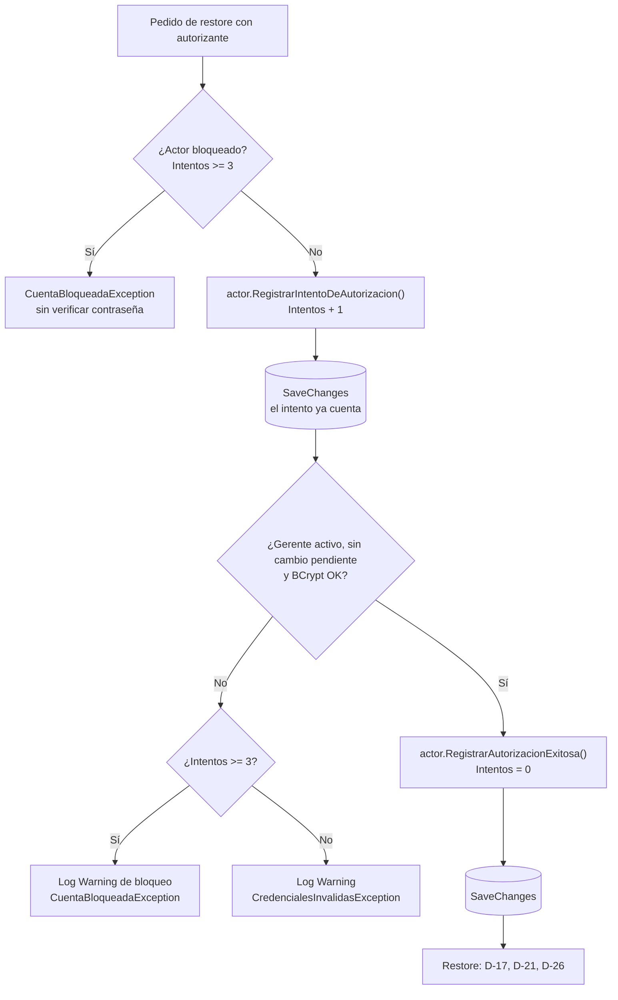
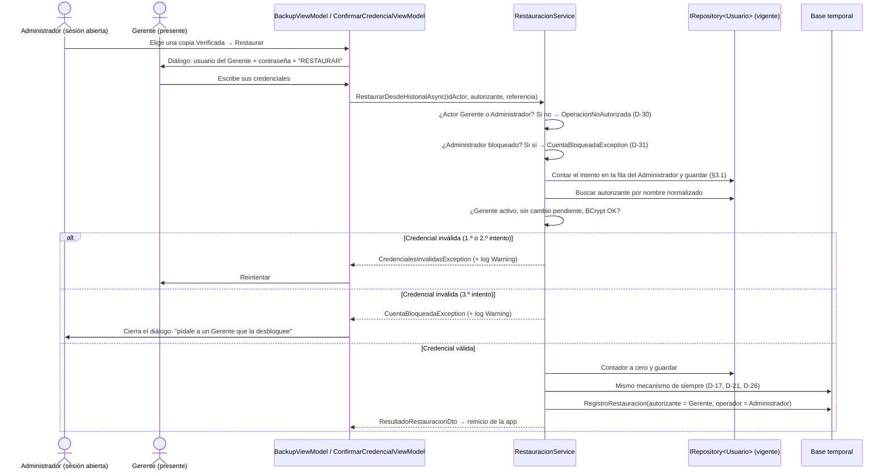

# Track 6.3.1: Plan de Diseño — Backup y Restore por el Administrador con Autorización de un Gerente

### Proyecto: Retail (Sistema ERP & Punto de Venta para Librería)
**Requisitos vinculados:** [`RF-03`](file:///c:/Users/lucas/Proyectos/retail/docs/ERS%20-%20Libreria%20POS.md#32-requisitos-funcionales-rf), [`RF-22`](file:///c:/Users/lucas/Proyectos/retail/docs/ERS%20-%20Libreria%20POS.md#32-requisitos-funcionales-rf), [`RNF-08`](file:///c:/Users/lucas/Proyectos/retail/docs/ERS%20-%20Libreria%20POS.md)
**Track base:** [`etapa-6-track-6.3-backup-restore.md`](file:///c:/Users/lucas/Proyectos/retail/docs/roadmap/etapa-6-track-6.3-backup-restore.md) (las decisiones D-1 a D-29 siguen vigentes salvo las que este documento revisa)
**Estado:** ✅ **Diseño aprobado por el estudiante** (D-30 a D-32 y opción C de §3.1, 2026-10-17). Único pendiente: la consulta a la cátedra (Fase 0).

---

## 1. Estado de Avance

| Fase | Contenido | Estado |
| :--- | :--- | :---: |
| 0 | Aprobación de D-30 a D-32, rama propia, ERS y documentos del Track 6.3 | ✅ (salvo la consulta a la cátedra, pendiente) |
| 1 | Dominio: operador y autorizante en `RegistroRestauracion`, contador y bloqueo en `Usuario` | ✅ (473 tests de dominio) |
| 2 | Infraestructura: configuración, migración, importación del historial | ✅ (migración `AgregarControlDualDeRestauracion`; 377 tests de integración) |
| 3 | Aplicación: autorización dual en `RestauracionService`, backup del Administrador | ✅ (método nuevo `RestaurarConAutorizacionDeGerenteAsync`; 544 tests de aplicación + 2 de integración) |
| 4 | UI: diálogo con usuario del Gerente, bloqueo con reinicio (opción C), desbloqueo en Usuarios, texto de la última restauración | ✅ (497 tests de App; audit XAML 100 %) |
| 5 | Verificación completa, mapa del proyecto, nota para la wiki | ✅ verificación Release (1.893 tests) y mapa; nota de wiki propuesta |

---

### Notas de implementación de la Fase 3 (desviaciones del plan)

* **Método nuevo en lugar de cambiar la firma:** `RestaurarConAutorizacionDeGerenteAsync` (solo Administrador) convive con `RestaurarDesdeHistorialAsync` (solo Gerente, D-8 intacto). Cada método tiene una única regla de autorización y no se tocaron los ~45 llamadores existentes. Un Gerente que llama al método nuevo recibe `OperacionNoAutorizadaException`.
* **Sin validador de `CredencialAutorizanteDto`:** una credencial vacía responde `CredencialesInvalidasException`, igual que la consola, y el diálogo exige los campos. Un validador agregaba una dependencia al constructor sin agregar ninguna regla.
* **El log de los fallos va en la UI:** Application no referencia `Microsoft.Extensions.Logging` y no se agregan paquetes sin aprobación. El control de seguridad (contador y bloqueo) sí está en Aplicación y en la base.
* **Regla única de credencial:** `ExigirGerenteConCredencial` la comparten la vía de consola (en la copia) y la de control dual (en la vigente).
* **Test ajustado:** `CrearBackupManualAsync_ActorQueNoEsGerente_...` esperaba el rechazo del Administrador. Pasó a `CrearBackupManualAsync_Encargado_LanzaOperacionNoAutorizada`, que refleja D-32.

## 2. Motivación

El Administrador es el rol de **soporte técnico** (D-3). En la práctica es quien repara el equipo y quien sabe cuándo
hace falta una restauración, pero hoy no puede ejecutarla: tiene que pedirle al Gerente que inicie sesión y opere la
pantalla. La propuesta aplica el **control dual** (*maker-checker*, "principio de los cuatro ojos"):

* el **Administrador ejecuta** (elige la copia, confirma la frase `RESTAURAR`);
* un **Gerente autoriza** escribiendo **su** usuario y contraseña en ese momento.

### Por qué es coherente con la seguridad del sistema (tríada CIA)

| Operación | Riesgo principal | Control propuesto |
| :--- | :--- | :--- |
| **Backup manual** | **Confidencialidad**: el `.bak` tiene datos personales (Ley 25.326) y los hashes de contraseñas | Reautenticación del propio Administrador. El archivo siempre se escribe en `BackupSettings:Directorio`, protegido por ACL (Fase 7), y la app no ofrece guardarlo en otro lugar. El sistema ya acepta copias sin actor (automáticas, `Retail.Cli backup`) con el mismo argumento |
| **Restore** | **Integridad y disponibilidad**: reemplaza la base completa, puede perder ventas y desfasar la numeración fiscal con ARCA | **Control dual**: el Administrador ejecuta y un Gerente autoriza |

La consola **ya funciona con este modelo**: `Retail.Cli restaurar` no tiene un actor logueado y exige la credencial
de un Gerente (D-18). La propuesta lleva a la aplicación la misma idea, con la credencial verificada contra la base
**vigente**.

---

## 3. Decisiones Propuestas

| # | Decisión | Fundamento |
| :--- | :--- | :--- |
| **D-30** | **Revisa D-3 y D-8.** El Administrador puede **restaurar desde el historial** si un **Gerente activo, sin cambio de contraseña pendiente**, se autentica con usuario y contraseña en el mismo diálogo (verificado contra la base vigente). El Gerente logueado sigue reautenticándose con su propia contraseña (D-8 sin cambios); en ese caso el autorizante es él mismo. Cajeros y Encargados se rechazan **antes** de verificar cualquier credencial | Control dual para la operación de mayor riesgo de integridad. Rechazar primero por rol evita que cualquier sesión sirva para probar contraseñas de Gerentes |
| **D-31** | **Bloqueo de la cuenta del Administrador** tras **3 autorizaciones fallidas consecutivas**. El contador es una columna de `USUARIOS` (fila del Administrador) en la base vigente y el estado bloqueado **se deriva** de él (`Intentos >= 3`). El intento se **cuenta y se guarda antes** de verificar la contraseña, y una autorización exitosa lo vuelve a cero. El bloqueo es **permanente hasta que un Gerente desbloquea** la cuenta (acción explícita, sin blanqueo de contraseña). El login y toda autorización rechazan una cuenta bloqueada. Cada fallo y el bloqueo quedan en el log como `Warning` (nunca la contraseña). **No** hay demora artificial. La cuenta del Gerente **nunca** se bloquea | Sin límite, el diálogo sería un oráculo de contraseñas. Se bloquea a **quien intenta**, no a la víctima: bloquear al Gerente le daría al Administrador una forma de dejar al negocio sin gobierno (D-5). Contar antes de verificar cierra la ventana de "matar el proceso después del fallo" (§3.1). Que el estado se derive del contador evita estados inconsistentes |
| **D-32** | **Backup manual del Administrador con reautenticación propia** (D-8 aplicado a él). La copia registra al Administrador como operador | Ver la tabla CIA: el riesgo de confidencialidad no crece, porque el archivo queda en el directorio protegido |
| **D-33** | **Step-up del Administrador además del control dual.** Al restaurar con autorización, el Administrador **reingresa su propia contraseña** y luego el usuario y la contraseña del Gerente. Un envío del diálogo es **un intento** (mismo contador de D-31, conteo pesimista, falle la credencial que falle). Se verifica **primero** la del Administrador y, si falla, **no se busca ni se evalúa** la del Gerente. Los mensajes son **específicos por credencial**: "Su contraseña es incorrecta." y "Usuario o contraseña del Gerente incorrectos."; el tercer fallo informa el bloqueo (`CuentaBloqueadaException.PorAutorizacionesFallidas()`). La contraseña del Administrador se verifica con `IPasswordHasher` y **no** con `IAuthService.VerificarCredencialAsync` | Una sesión desatendida no basta para restaurar: quien ejecuta demuestra quién es, y no solo el Gerente que autoriza. El mensaje específico se aparta de la recomendación de OWASP de un mensaje genérico para el login, y es un trade-off aceptado: quien ve el diálogo ya está autenticado como Administrador, el usuario del Gerente no es un secreto del sistema, y el atacante no gana nada que el contador no limite (3 envíos). A cambio, el operador legítimo sabe cuál de las dos personas se equivocó. Se evita `VerificarCredencialAsync` porque lanza `CuentaBloqueada` si la cuenta `EstaBloqueada` y, en el 3.er intento, el contador ya vale 3 antes de verificar: bloquearía aunque ambas contraseñas fueran correctas |
| **I-3** | **Las autorizaciones de restore se auditan en `AUDITORIA_ACCESOS`** (tabla de #30). Columnas nuevas `tipo_evento` (0 = inicio de sesión, 1 = autorización de restore; `DEFAULT 0`, así el SP no cambia) y `detalle` (el Gerente intentado o autorizante; nunca contraseñas). `IRegistroAccesosService.RegistrarEventoAsync` es un `INSERT` sin lógica. Se registra cada desenlace (aceptada, rechazada, bloqueada) y el login rechazado por bloqueo de autorización. La fila aceptada se escribe **antes** del restore, para que la importación la lleve a la base restaurada. La importación del historial copia también `AUDITORIA_ACCESOS`: solo las filas posteriores a la última de la copia, con `id_usuario = NULL` | Reemplaza el log de la UI (desviación de la Fase 3) por auditoría consultable en la base. La regla (contar, bloquear) sigue en el dominio (Ley 8): la base solo guarda el hecho. Una fila "aceptada" registra la **autorización**, no el restore: si el restore falla después, el hecho de que se autorizó sigue siendo cierto, y `REGISTROS_RESTAURACION` registra solo los restores consumados |
| **D-34** | **Historial de restauraciones en IU-10** para Gerente y Administrador, de solo lectura y sin paginación (los restores son raros): pestaña "Restauraciones" junto a "Copias", con fecha, origen, quién la ejecutó, quién la autorizó, copia restaurada, copia previa y base anterior. Se mantiene el aviso de la última restauración (R-20). El panel de `AUDITORIA_ACCESOS` queda fuera: es una pantalla de seguridad a coordinar con Pablo | El registro ya conserva a ejecutor y autorizante (D-30); mostrarlos permite detectar un restore indebido sin ir a la base |
| — | **Fuera de alcance:** restore desde archivo en la app, cambios en `Retail.Cli`, ABM de Gerentes por el Administrador | La consola ya resuelve la recuperación ante desastres (D-18) |

### 3.1. Persistencia del contador y por qué no se puede reiniciar

**Dónde vive:** en la columna `IntentosAutorizacionFallidos` de la fila del **Administrador** en `USUARIOS`, dentro de
la base vigente de SQL Server, manipulada solo a través de la raíz de agregado `Usuario`. No vive en el diálogo, ni en
el ViewModel, ni en la sesión, ni en memoria del proceso.

**Secuencia en `RestauracionService` (actor Administrador):**

| Lo que intenta el Administrador | Qué pasa | Por qué |
| :--- | :--- | :--- |
| Cerrar el diálogo y volver a abrirlo | El contador sigue igual | El diálogo no guarda estado: lo lee el servicio desde la base en cada intento |
| Cerrar la aplicación o la sesión de Windows | El contador sigue igual | Está en SQL Server, no en el proceso |
| Matar el proceso justo después de escribir una contraseña incorrecta | El intento **ya** quedó guardado | Se cuenta y se guarda **antes** de verificar (conteo pesimista) |
| Volver a iniciar sesión estando bloqueado | `LoginAsync` lo rechaza | La verificación del bloqueo está en Aplicación, no en la UI (D-9) |
| Usar otra sesión abierta de la misma cuenta | El servicio la rechaza | El bloqueo se consulta en cada autorización, no se guarda en la sesión |
| Restaurar una copia vieja en la que no está bloqueado | Imposible sin la contraseña de un Gerente | Para eso hace falta justamente lo que está tratando de adivinar |
| Esperar | El bloqueo no vence | Permanente hasta que un Gerente desbloquea (D-31) |

**Lo único que vuelve el contador a cero:** una autorización exitosa (que exige la contraseña real de un Gerente) o el
desbloqueo hecho por un Gerente.

**Lo que este mecanismo no cubre** está en §6 (R-26, R-27): cambiar la columna con SSMS y probar contraseñas por la consola.

**Cierre de la sesión al bloquearse la cuenta (decidido: opción C).** Cuando la cuenta se bloquea, lo ideal es cerrar la sesión
abierta. El único mecanismo que existe es el evento `SolicitarCambioUsuario` de `MainViewModel`, que es zona
compartida del Shell (Ley 10). Opciones:

| Opción | Qué hace | Costo |
| :--- | :--- | :--- |
| A | Sin cierre forzado en este track. El diálogo se cierra con el mensaje "Cuenta bloqueada: pídale a un Gerente que la desbloquee". La sesión abierta queda, pero **cualquier** nuevo intento de autorización y el próximo login se rechazan en el servicio | Sin tocar el Shell. La seguridad no depende del cierre, porque se aplica en el servicio |
| B | Contrato para que una página pida cerrar la sesión (por ejemplo, un evento en `ICurrentUserSession` que el Shell escucha) | Hay que coordinarlo con Pablo y toca `MainViewModel` |
| **C (decidida, propuesta del estudiante)** | Al bloquearse la cuenta, mensaje informativo y **reinicio de la aplicación** con [`IReinicioAplicacion`](file:///c:/Users/lucas/Proyectos/retail/src/Retail.App/Services/IReinicioAplicacion.cs), que `BackupViewModel` ya usa después de restaurar: arranca una instancia nueva, que pasa por el diagnóstico y el login como en un inicio desde cero, y apaga la actual | Sin tocar el Shell y sin código nuevo de infraestructura. La sesión queda cerrada de verdad: el proceso que la tenía deja de existir |

**Por qué no sirve el "Cambiar operador" actual:** `MainWindow.RealizarCambioUsuarioAsync` abre el login como un
diálogo modal **encima** de la ventana principal, sin cerrar la sesión antes. Si se cierra el login con la X, la
sesión anterior sigue activa. Para un bloqueo, esto equivale a no hacer nada.

**Por qué no se cierra `MainWindow` y se vuelve al login dentro del mismo proceso:** el Shell es `Singleton` (Ley 10)
y una ventana de WPF cerrada no se puede volver a mostrar. Habría que recrearla y cambiar su ciclo de vida, que es
justamente lo que la Ley 10 prohíbe.

### Nuevo texto propuesto para RF-22 (ERS)

> El sistema debe generar copias completas de la base (`.bak`) de forma manual, por decisión del Gerente o del
> Administrador previa reautenticación, y de forma automática y periódica. [...] La restauración la ejecuta un Gerente
> con su contraseña, o un Administrador con la autorización de un Gerente que ingresa su usuario y contraseña en ese
> momento (control dual); el registro conserva a ambos. Genera antes una copia de seguridad del estado actual,
> conserva el historial de respaldos y advierte sobre la conciliación de numeración fiscal con ARCA.

### Cambio propuesto en la Matriz de Permisos (§3 del Track 6.3)

| Función | Cajero | Encargado | Gerente | Administrador |
| :--- | :-: | :-: | :-: | :-: |
| Backup manual (con reautenticación propia) | ❌ | ❌ | ✅ | ✅ (D-32) |
| Restore desde el historial | ❌ | ❌ | ✅ (su contraseña) | ✅ con usuario y contraseña de un Gerente (D-30) |

---

## 4. Flujo de Restore con Control Dual

---

## 5. Plan por Capas

### Fase 0 — Aprobación y documentos (sin código)

* Rama propia desde `main` (por ejemplo `feat/control-dual-restore`), **creada por el estudiante**.
* Aplicar el texto nuevo de RF-22 en la ERS. En el Track 6.3, marcar D-3 y D-8 como "Revisada por D-30" y
  actualizar la matriz de permisos. Agregar este track al índice de [`etapa-6-estabilizacion-release.md`](file:///c:/Users/lucas/Proyectos/retail/docs/roadmap/etapa-6-estabilizacion-release.md).
* Consultar con la cátedra: el pedido original fue "solo un Gerente con contraseña". Con D-30 se sigue cumpliendo,
  porque ninguna restauración ocurre sin la contraseña de un Gerente.

### Fase 1 — Dominio

| Archivo | Cambio |
| :--- | :--- |
| [`RegistroRestauracion.cs`](file:///c:/Users/lucas/Proyectos/retail/src/Retail.Domain/Entities/RegistroRestauracion.cs) | Se **mantienen** `IdUsuario`/`NombreUsuario` con su significado actual (el Gerente que autorizó) y se **agregan** `IdOperador` y `NombreOperador`, anulables: el usuario que ejecutó cuando es distinto del autorizante. `null` = el mismo Gerente o la consola |
| Mismo archivo, `Registrar(...)` | Parámetros opcionales `int? idOperador, string? nombreOperador`. Invariantes: los dos presentes o los dos ausentes; `idOperador > 0`; operador distinto del autorizante; nombre con `ReglasTexto.LongitudMaximaNombreUsuario` |
| [`Usuario.cs`](file:///c:/Users/lucas/Proyectos/retail/src/Retail.Domain/Entities/Usuario.cs) | `IntentosAutorizacionFallidos` (privado al escribir), constante `MaximoIntentosAutorizacion = 3`, `EstaBloqueada => Intentos >= Maximo` (derivada, sin columna). Métodos `RegistrarIntentoDeAutorizacion()` (lanza `DomainException` si la cuenta no es de Administrador o ya está bloqueada), `RegistrarAutorizacionExitosa()` (vuelve a cero) y `Desbloquear()` (vuelve a cero) |
| `Exceptions/CuentaBloqueadaException.cs` (nuevo) | Hereda de `DomainException`, así que D-25 la propaga sin envolver |

**Por qué el bloqueo no reutiliza la baja lógica:** la baja (`IsDeleted`) es definitiva y forma parte de la auditoría
("esta persona ya no trabaja acá"). El bloqueo es temporal y reversible. Mezclarlos haría que el historial de usuarios mienta.

**Por qué agregar en lugar de renombrar:** es el mismo criterio de D-1 (Open/Closed). Los registros existentes y la
consola conservan su significado sin migrar datos, y `RegistroRestauracionDto.NombreUsuario` sigue siendo el autorizante.

**Tests** ([`RegistroRestauracionTests.cs`](file:///c:/Users/lucas/Proyectos/retail/tests/Retail.Domain.UnitTests/Entities/RegistroRestauracionTests.cs)):
* `Registrar_ConOperadorDistintoDelAutorizante_GuardaAmbos`
* `Registrar_SinOperador_DejaOperadorNulo`
* `Registrar_OperadorSinNombre_LanzaDomainException` (y el caso inverso)
* `Registrar_OperadorIgualAlAutorizante_LanzaDomainException`
* `Registrar_NombreOperadorDemasiadoLargo_LanzaDomainException`

**Tests** (`UsuarioDomainTests`):
* `RegistrarIntentoDeAutorizacion_TercerIntento_DejaLaCuentaBloqueada`
* `RegistrarIntentoDeAutorizacion_CuentaDeGerente_LanzaDomainException` (el Gerente nunca se bloquea)
* `RegistrarIntentoDeAutorizacion_CuentaBloqueada_LanzaDomainException`
* `RegistrarAutorizacionExitosa_ConIntentosPrevios_VuelveACero` (intentos consecutivos, no acumulados)
* `Desbloquear_CuentaBloqueada_QuedaActivaConContadorEnCero`

### Fase 2 — Infraestructura

| Archivo | Cambio |
| :--- | :--- |
| `RegistroRestauracionConfiguration.cs` | Dos columnas anulables con la longitud máxima del nombre de usuario |
| `UsuarioConfiguration.cs` | `IntentosAutorizacionFallidos`: `int` no anulable, valor por defecto `0`. `EstaBloqueada` se ignora (`Ignore`), porque es derivada |
| Migración `AgregarControlDualDeRestauracion` | Agrega las columnas de `REGISTROS_RESTAURACION` y la de `USUARIOS` (con `defaultValue: 0`, así que las cuentas existentes quedan desbloqueadas), sin datos |
| [`BaseRestauradaSqlServer.cs`](file:///c:/Users/lucas/Proyectos/retail/src/Retail.Infrastructure/Backups/BaseRestauradaSqlServer.cs) | **Sin cambios esperados.** `ImportarTablaAsync<RegistroRestauracion>` arma la lista de columnas a partir del modelo de EF y solo se ejecuta cuando la vigente está al día (D-26), es decir, con el mismo esquema que la temporal ya migrada. Una copia vieja recibe las columnas como `NULL` al migrarse |

**Tests de integración** (SQL Server Express):
* La restauración por control dual persiste el operador y el autorizante.
* Una segunda restauración rehidrata el registro anterior **con** su operador (R-1).
* ~~Restaurar una copia tomada antes de esta migración deja el operador en `NULL` en sus registros previos.~~ No se testea: lo garantiza la propia migración (`AddColumn` anulable) y armar una copia con el esquema viejo cuesta más de lo que prueba.
* Un intento fallido queda persistido aunque se descarte el `DbContext` (se simula el cierre de la app abriendo un contexto nuevo y leyendo el contador).

### Fase 3 — Aplicación

| Archivo | Cambio |
| :--- | :--- |
| `DTOs/Backups/CredencialAutorizanteDto.cs` (nuevo) | `record` con `NombreUsuario` y `Password` |
| `Validators/Backups/CredencialAutorizanteValidator.cs` (nuevo) | Mismas reglas de formato que [`LoginRequestValidator`](file:///c:/Users/lucas/Proyectos/retail/src/Retail.Application/Validators/Auth/LoginRequestValidator.cs) (validación en la frontera) |
| [`IRestauracionService.cs`](file:///c:/Users/lucas/Proyectos/retail/src/Retail.Application/Interfaces/Services/IRestauracionService.cs) | `RestaurarDesdeHistorialAsync(int idActor, CredencialAutorizanteDto autorizante, Guid referenciaCopia, ...)` reemplaza al `string password` |
| [`RestauracionService.cs`](file:///c:/Users/lucas/Proyectos/retail/src/Retail.Application/Services/RestauracionService.cs) | 1) Rechazar por rol al actor que no es Gerente ni Administrador. 2) Si el actor es Gerente, el autorizante debe ser él mismo (D-8) y no se cuentan intentos. 3) Actor Administrador: rechazar si está bloqueado, contar el intento y **guardar antes de verificar** (§3.1). 4) Buscar al autorizante en la vigente y verificarlo con **la misma regla** que ya usa la consola (`VerificarCredencialEnLaCopiaAsync`: Gerente, activo, sin `DebeCambiarPassword`, BCrypt), extraída a un método común que reciben las dos vías. 5) Fallo: log `Warning`; al tercero, `CuentaBloqueadaException`. Éxito: contador a cero y guardar. 6) Pasar operador y autorizante a `RegistroRestauracion.Registrar`. La copia `PreRestauracion` sigue registrando al Gerente autorizante |
| [`AuthService.cs`](file:///c:/Users/lucas/Proyectos/retail/src/Retail.Application/Services/AuthService.cs) | `LoginAsync` y `VerificarCredencialAsync` rechazan una cuenta bloqueada con `CuentaBloqueadaException`, **después** de verificar la contraseña: así un tercero que no la conoce no se entera de que la cuenta existe y está bloqueada |
| [`IUsuarioService.cs`](file:///c:/Users/lucas/Proyectos/retail/src/Retail.Application/Interfaces/Services/IUsuarioService.cs) / `UsuarioService.cs` | `DesbloquearUsuarioAsync(int idActor, int idUsuario)`: solo un Gerente (misma regla que el ABM de Administradores, D-4). `UsuarioDto` expone `EstaBloqueada` |
| [`BackupService.cs`](file:///c:/Users/lucas/Proyectos/retail/src/Retail.Application/Services/BackupService.cs) | `CrearBackupManualAsync` acepta Gerente **o** Administrador, ambos con reautenticación propia (D-32) |
| `RegistroRestauracionDto.cs` | Agregar `NombreOperador` (anulable) |

**Por qué no se modifica `IAuthService`:** `RestauracionService` ya tiene el repositorio de usuarios y el
`IPasswordHasher`, y la consola ya resuelve "verificar a un Gerente por nombre y contraseña". Reutilizar esa regla
(escalón 2 de la escalera de decisión) evita un segundo camino de verificación con criterios distintos. El contador, el
bloqueo y el log viven en el dominio y en el servicio, no en la UI, porque la autorización se valida en Aplicación (D-9):
si el límite estuviera en el diálogo, alcanzaría con cerrarlo para reiniciarlo.

**Tests** (`RestauracionServiceTests`, `BackupServiceTests`):
* `RestaurarDesdeHistorialAsync_AdministradorConCredencialDeGerente_RestauraYRegistraAmbos`
* `RestaurarDesdeHistorialAsync_AdministradorConCredencialDeEncargado_LanzaCredencialesInvalidas`
* `RestaurarDesdeHistorialAsync_AdministradorConGerenteConCambioPendiente_LanzaCredencialesInvalidas`
* `RestaurarDesdeHistorialAsync_AdministradorConGerenteDadoDeBaja_LanzaCredencialesInvalidas`
* `RestaurarDesdeHistorialAsync_CajeroConCredencialDeGerente_LanzaOperacionNoAutorizadaSinVerificarPassword`
* `RestaurarDesdeHistorialAsync_GerenteConCredencialDeOtroGerente_LanzaCredencialesInvalidas`
* `RestaurarDesdeHistorialAsync_GerenteConSuPropiaCredencial_RegistraSinOperador` (regresión de D-8)
* `RestaurarDesdeHistorialAsync_CredencialInvalida_RegistraWarningSinPassword`
* `RestaurarDesdeHistorialAsync_CredencialInvalida_GuardaElIntentoAntesDeLanzar` (el `SaveChanges` ocurre aunque la operación falle)
* `RestaurarDesdeHistorialAsync_TercerFallo_LanzaCuentaBloqueada`
* `RestaurarDesdeHistorialAsync_AdministradorBloqueado_RechazaSinVerificarPassword`
* `RestaurarDesdeHistorialAsync_ExitoTrasDosFallos_VuelveElContadorACero`
* `RestaurarDesdeHistorialAsync_GerenteSeEquivocaConSuPropiaPassword_NoCuentaIntentos` (el Gerente no se bloquea)
* `LoginAsync_CuentaBloqueadaConPasswordCorrecta_LanzaCuentaBloqueada`
* `LoginAsync_CuentaBloqueadaConPasswordIncorrecta_LanzaCredencialesInvalidas`
* `DesbloquearUsuarioAsync_Gerente_DesbloqueaAlAdministrador`
* `DesbloquearUsuarioAsync_Administrador_LanzaOperacionNoAutorizada` (no puede desbloquearse a sí mismo ni a otro)
* `CrearBackupManualAsync_AdministradorConSuPassword_RegistraAlAdministradorComoOperador`
* `CrearBackupManualAsync_Encargado_LanzaOperacionNoAutorizada`

### Fase 4 — UI (WPF / MVVM)

| Archivo | Cambio |
| :--- | :--- |
| [`BackupViewModel.cs`](file:///c:/Users/lucas/Proyectos/retail/src/Retail.App/ViewModels/Backups/BackupViewModel.cs) | `PuedeOperar => EsGerente \|\| EsAdministrador`. Un Gerente usa `ParaRestauracion` como hoy (con su propio nombre de usuario) y el Administrador usa la variante con autorizante. `DescribirRestauracion` muestra "ejecutada por X, autorizada por Y" cuando hay operador |
| [`ConfirmarCredencialViewModel.cs`](file:///c:/Users/lucas/Proyectos/retail/src/Retail.App/ViewModels/Backups/ConfirmarCredencialViewModel.cs) | La operación recibe `CredencialAutorizanteDto`. Nueva fábrica `ParaRestauracionAutorizada` con `PideUsuarioAutorizante = true`. **No cuenta intentos**: ante `CredencialesInvalidasException` queda abierto para reintentar, y ante `CuentaBloqueadaException` se cierra con el mensaje de D-31 |
| [`UsuariosViewModel.cs`](file:///c:/Users/lucas/Proyectos/retail/src/Retail.App/ViewModels/Usuarios/UsuariosViewModel.cs) / [`UsuariosView.xaml`](file:///c:/Users/lucas/Proyectos/retail/src/Retail.App/Views/Pages/UsuariosView.xaml) | Insignia "Bloqueada" en la grilla y comando `DesbloquearAsync`, visible solo para el Gerente |
| `BackupViewModel.cs` (bloqueo) | Ante `CuentaBloqueadaException` muestra el mensaje de D-31 e invoca `IReinicioAplicacion.Reiniciar()` (opción C de §3.1): la sesión abierta deja de existir con el proceso |
| Login | Mensaje propio para `CuentaBloqueadaException` |
| [`ConfirmarCredencialDialog.xaml`](file:///c:/Users/lucas/Proyectos/retail/src/Retail.App/Views/Dialogs/ConfirmarCredencialDialog.xaml) | Campo "Usuario del Gerente que autoriza", visible solo en ese modo, con los estilos de [`SISTEMA_DE_DISENO.md`](file:///c:/Users/lucas/Proyectos/retail/docs/SISTEMA_DE_DISENO.md). `scripts/audit-xaml.ps1` |
| [`AppSmokeTests.cs`](file:///c:/Users/lucas/Proyectos/retail/tests/Retail.App.UnitTests/AppSmokeTests.cs) | Agregar el modo "restauración autorizada" a la prueba STA existente del diálogo |

**Tests de ViewModel:** `PuedeOperar` por rol, el diálogo pide el usuario solo al Administrador, se cierra ante
`CuentaBloqueadaException`, reinicia la app al bloquearse la cuenta (con un doble de `IReinicioAplicacion`), el texto de la última restauración con y sin operador, y el comando de desbloqueo solo para el Gerente.

**Ley 10:** no hace falta tocar `MainViewModel` ni `MainWindow`, porque el Administrador ya navega a la pantalla de
backups en modo solo lectura.

### Fase 5 — Cierre

* Verificación completa (auditoría XAML, `build` en Release, `test`, `format --verify-no-changes`).
* [`MAPA_DEL_PROYECTO.md`](file:///c:/Users/lucas/Proyectos/retail/docs/MAPA_DEL_PROYECTO.md): fila RF-22 (DTO y validador nuevos) y enlace a este track.
* Propuesta de nota para `wiki/06-vademecum-defensa-tecnica/` sobre control dual frente a *step-up*.

---

## 6. Riesgos

| # | Riesgo | Tratamiento |
| :--- | :--- | :--- |
| **R-21** | **Contraseña compartida:** si el Gerente le dicta su contraseña al técnico, el control dual desaparece y el técnico queda con acceso total como Gerente | **Riesgo aceptado** (es de proceso, no técnico). El registro con operador y autorizante deja rastro, y el aviso de la última restauración (R-20) lo hace visible. Recomendación operativa: el Gerente escribe la contraseña él mismo y la cambia si la compartió |
| **R-22** | **Prueba de contraseñas desde la sesión del Administrador** | **Mitigado** por D-31: tres intentos en total y la cuenta se bloquea hasta que un Gerente intervenga (§3.1) |
| **R-23** | **Respuesta distinta según exista o no el usuario autorizante** (tiempo de BCrypt) | **Riesgo aceptado** con el criterio de R-19: con tres intentos, enumerar nombres de usuario no sirve para nada |
| **R-24** | **El Gerente autorizante no existe en la copia** | Sin cambios respecto de hoy: la copia solo necesita *algún* Gerente activo (`ExigirGerenteEnLaCopiaAsync`). Es el comportamiento actual de la vía app |
| **R-25** | **Negocio con un solo Gerente que no está:** el Administrador bloqueado espera a que vuelva | **Riesgo aceptado**: en ese escenario el restore igual necesitaba al Gerente. Se mantiene la recomendación de R-16 (al menos dos Gerentes) |
| **R-26** | **Bypass por la base de datos:** con SSMS y la identidad de Windows dueña de la base se puede poner el contador en cero | **Riesgo aceptado**, es el mismo R-17: los controles de la app protegen lo que pasa por la app. Se mitiga con cuentas de Windows separadas y logins de SQL con permisos mínimos |
| **R-27** | **Bypass por la consola:** `Retail.Cli restaurar` no tiene sesión ni contador, así que permite probar la contraseña de un Gerente sin bloqueo | **Riesgo aceptado** (R-19): cada intento cuesta un `RESTORE` completo (minutos), queda en el log y exige permisos sobre SQL Server. No se agrega un contador, porque la consola existe justamente para cuando la base vigente no está disponible |
| **R-28** | **Dos intentos simultáneos desde dos terminales** pueden perder un incremento del contador (*lost update*) | **Riesgo aceptado**, igual que R-14: con un solo puesto no ocurre. Revisar con un token de concurrencia si se pasa a multipuesto |
| **R-29** | **La auditoría de accesos se perdía en cada restore** (presente en `main` desde #30): las filas de `AUDITORIA_ACCESOS` posteriores a la fecha de la copia quedaban solo en `RetailDb_Anterior_` | **Corregido por I-3**: la importación del historial las copia. Límite aceptado: si la vigente tiene un esquema viejo (D-26), no se importan, igual que el historial de copias |

---

## 7. Preguntas de Defensa

* ¿En qué se diferencia el control dual del *step-up* de D-8? → El *step-up* confirma que quien opera es el dueño de la sesión; el control dual exige **dos personas** con roles distintos.
* ¿Por qué el Administrador puede hacer backup con su propia contraseña y no restore? → Tabla CIA (§2): el backup no aumenta el riesgo de confidencialidad porque queda en un directorio protegido; el restore compromete la integridad.
* ¿Por qué bloquean al Administrador y no al Gerente cuya contraseña se probó? → D-31: se bloquea a quien intenta, no a la víctima. Bloquear al Gerente le permitiría al Administrador dejar al negocio sin gobierno (D-5).
* ¿Qué impide reiniciar el contador cerrando la app? → Vive en `USUARIOS`, no en memoria, y se guarda **antes** de verificar la contraseña (§3.1).
* ¿Por qué el bloqueo se deriva del contador y no es una columna aparte? → Con un solo dato no puede haber estados contradictorios ("bloqueada con cero intentos").
* ¿Por qué el login revela el bloqueo solo con la contraseña correcta? → Para no confirmarle a un tercero que la cuenta existe.
* ¿Por qué no usaron la baja lógica para bloquear? → La baja es definitiva y es parte de la auditoría; el bloqueo es reversible.
* ¿El bloqueo es infranqueable? → No: R-26 (SSMS) y R-27 (consola) son caminos por fuera de la app, aceptados y documentados.
* ¿Por qué rechazan al Cajero antes de verificar la contraseña? → Para que una sesión de mostrador no sirva para probar contraseñas de Gerentes.
* ¿Por qué agregaron columnas en lugar de cambiar el significado de `NombreUsuario`? → Open/Closed (como D-1): los registros viejos y la consola no cambian de significado.
* ¿Se cumple el pedido de la cátedra de que solo un Gerente con contraseña restaure? → Sí: ninguna restauración ocurre sin la contraseña de un Gerente; lo que cambia es quién maneja la pantalla.
