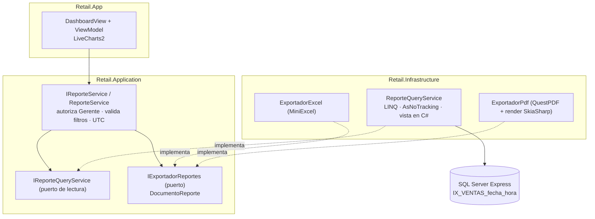
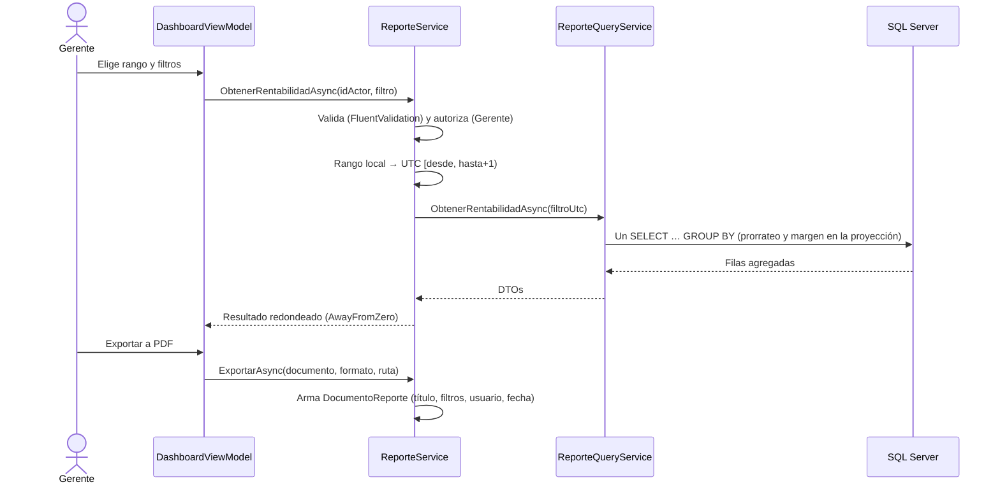

# Track 6.4: Plan de Diseño — Tablero Gerencial y Reportes Exportables

### Proyecto: Retail (Sistema ERP & Punto de Venta para Librería)
**Etapa:** [`etapa-6-estabilizacion-release.md`](file:///c:/Users/lucas/Proyectos/retail/docs/roadmap/etapa-6-estabilizacion-release.md) (Track 6.4) | **Responsable:** Lucas Kruzolek | **Rama:** `feat/dashboard-reportes` (desde `main`, después del PR #24)  
**Requisitos:** `RF-24`, `RF-25`, `RF-26`, `RNF-09` en [`ERS - Libreria POS.md`](file:///c:/Users/lucas/Proyectos/retail/docs/ERS%20-%20Libreria%20POS.md)

> **Propósito de este documento:** conservar las decisiones de diseño, sus fundamentos y el estado de avance del track, para retomar el trabajo en una sesión nueva sin rehacer el análisis. Las decisiones marcadas como **Cerrada** ya fueron discutidas y aprobadas; todas fueron aprobadas el 2026-10-15.

---

## 1. Estado de Avance

| Fase | Contenido | Estado |
| :--- | :--- | :---: |
| 0 | ERS v3.3 (RF-24 a RF-26, IU-11, IS-05, RNF-09) y este plan | ✅ ERS (commit `f5f87e8`) y plan aprobado |
| 1 | Dominio: costo histórico en `DetalleVenta`, con su columna, `CHECK` y migración (adelantadas de la Fase 3) | ✅ Commit `93b187c` |
| 2 | Aplicación: contratos, DTOs, validadores, `ReporteService` y `ExportacionReportesService` (D-14 a D-18) | ✅ Commit `bc8c80c` |
| 3 | Infraestructura: índice `IX_VENTAS_fecha_hora` y `ReporteQueryService` (D-19, D-20) | ✅ Implementada por subagente y revisada; pendiente de commit. RNF-09 medido una vez (sección 7.1); el test de rendimiento se eliminó (R-10) |
| 4 | Exportación: Excel (MiniExcel) y PDF (QuestPDF + gráficos LiveCharts2) (D-21 a D-23) | ✅ Implementada por subagente; PDF revisado visualmente; pendiente de commit |
| 5 | UI: `DashboardView` con LiveCharts2 y ajustes del estudiante (D-24 a D-35) | ✅ Implementada por subagentes y revisada visualmente con datos de estrés (sección 7.2). Pendiente: prueba manual en la app real |
| 6 | Prueba de publicación (R-5), fuente del PDF (R-12, D-36), verificación integral, mapa y notas de wiki | ✅ Pendiente de commit. Queda la prueba manual de la UI en la app real |

**Forma de trabajo:** fase por fase y capa por capa, con cada diff revisado por el estudiante (CLAUDE.md §3). Commits y PR los pide el estudiante (§4).

---

## 2. Decisiones

| ID | Decisión | Estado | Fundamento |
| :--- | :--- | :---: | :--- |
| D-1 | Alcance: R1 ventas por período, R2 ranking, R3 rentabilidad, R7 stock crítico y valorización, R8 sin movimiento. Solo filtros, sin presets. | Cerrada | Elección del estudiante (2026-10-14). |
| D-2 | Exportación a Excel (MiniExcel, ya instalado) y PDF (QuestPDF). | Cerrada | Excel para analizar; PDF para imprimir o archivar. |
| D-3 | Gráficos con LiveCharts2, en pantalla y en el PDF (render fuera de pantalla con SkiaSharp). | Cerrada | Binding MVVM nativo. Versión estable 2.0.5 verificada (sección 6). |
| D-4 | El descuento global de la venta se prorratea entre los ítems según su subtotal. | Cerrada | La suma de márgenes por categoría coincide con el margen total (ERS §1.4). |
| D-5 | `DetalleVenta.CostoUnitario` es obligatorio (`NOT NULL`), sin valor por defecto ni relleno de históricos. | Cerrada | No hay ventas cargadas (proyecto en desarrollo). |
| D-6 | **Consultas en LINQ sobre EF Core, sin vistas, procedimientos ni funciones almacenadas.** La base aporta índices. | Cerrada | Evaluación de la sección 3. |
| D-7 | Una única "vista en C#": `ItemsVendidos(filtro)` devuelve un `IQueryable` con el ingreso neto, el costo y el margen de cada ítem, ya prorrateado. R1, R2, R3 y el tablero se componen sobre ella. | Cerrada | Da lo bueno de una vista (una sola definición reutilizada) sin sus costos (sección 3). |
| D-8 | Los reportes de ventas incluyen los artículos dados de baja: se ignora el filtro global de `Articulo` y se filtran a mano las ventas y los ítems con baja lógica. | Cerrada | RF-06 conserva el historial. Sin esto, el filtro global elimina las ventas de un artículo dado de baja (sección 7, R-1). |
| D-9 | Fechas: el rango local del Gerente se convierte a UTC en Aplicación como `[desde 00:00, hasta + 1 día 00:00)`. Para agrupar por día, semana o mes en hora local, SQL desplaza `fecha_hora` según la diferencia horaria de la zona local. | Cerrada | RF-24. Argentina no aplica horario de verano desde 2009: la diferencia es fija (−3 h). El supuesto queda documentado y testeado (R-2). |
| D-10 | La semana empieza el lunes. Se agrupa con `DATEDIFF(day, lunesAncla, fecha) / 7`, que no depende de `SET DATEFIRST`. | Cerrada | `DATEPART(week)` cambia según la configuración regional del servidor. |
| D-11 | Autorización en el servicio de Aplicación (actor Gerente), además del menú. | Cerrada | Mismo patrón que `BackupService` (`OperacionNoAutorizadaException`). Ocultar el botón no es control de acceso (RNF-06). |
| D-12 | La exportación recibe un modelo neutro (`DocumentoReporte`: título, filtros, tablas tipadas y series), no los DTOs de pantalla. | Cerrada | Un exportador por formato y no uno por reporte (5 reportes × 2 formatos). Application no conoce MiniExcel ni QuestPDF (IS-05). |
| D-14 | Dos servicios: `IReporteService` (consultas) e `IExportacionReportesService` (exportación). | Cerrada (Fase 2) | Responsabilidad única. Cada uno se registra en la inyección de dependencias cuando existe su puerto (Fases 3 y 4); el Host tiene `ValidateOnBuild` y fallaría con un puerto sin implementar. |
| D-15 | Un filtro por reporte (`FiltroPeriodoDto` y sus derivados, `FiltroInventarioDto`, `FiltroSinMovimientoDto`) en lugar de un único `FiltroReporteDto`. | Cerrada (Fase 2) | Cada reporte expone solo los filtros que usa, y cada uno tiene su validador. La base genérica `FiltroPeriodoValidatorBase<T>` evita repetir las reglas de fechas. |
| D-16 | Reloj inyectado: `TimeProvider` de .NET 8 (biblioteca estándar, sin NuGet). En los tests, `RelojDePrueba` fija el instante y la zona (UTC−3). | Cerrada (Fase 2) | "Hoy" y la zona horaria se pueden probar sin depender de la máquina. |
| D-17 | `ReglasMonetarias.Redondear` en `Retail.Domain/Common` es el único punto de redondeo monetario; `Articulo` delega en él. | Cerrada (Fase 2) | D-06 exigía un criterio único; antes estaba privado en `Articulo` y los reportes lo habrían duplicado. |
| D-18 | Los importes se redondean de a uno y el margen es la resta de valores ya redondeados. Los totales suman filas crudas y redondean al final. La variación de un porcentaje se informa en **puntos porcentuales**, no como variación relativa. | Cerrada (Fase 2) | Así lo que se muestra cierra visualmente, sin error de redondeo acumulado. Ir de 20 % a 25 % es +5 puntos, no +25 %. |
| D-19 | `IgnoreQueryFilters()` afecta a **toda** la consulta: toda consulta de reportes que lo use, aunque sea en un `join` o una subconsulta, filtra a mano `DeletedAt == null` en cada tabla que sí deba excluir las bajas (por ejemplo, `Articulos` en "menos vendidos" y en inventario). | Cerrada (Fase 3) | Detectado por el test de R-1: el artículo dado de baja reaparecía en "menos vendidos". Documentado en la Ley 2 de `SISTEMA_DE_PERSISTENCIA.md`. |
| D-20 | "Menos vendidos" y "sin movimiento" usan `LEFT JOIN` + un único `GROUP BY` (con `HAVING` para el corte), no subconsultas correlacionadas por artículo. | Cerrada (Fase 3) | Medido con 50.000 ventas: 5,5 s a 588 ms y 2,1 s a 197 ms. La subconsulta correlacionada recorre los ítems una vez por artículo. |
| D-21 | Excel sin formato de celda: los números se guardan como números (RF-26) y los porcentajes en unidades de porcentaje (25,5), con "%" en el encabezado. | Cerrada (Fase 4) | MiniExcel 1.34.2 solo aplica un formato convirtiendo el valor a texto, y la vía `DataTable` + formato genera un `<col min="0">` inválido. Entre "número sin formato" y "texto con formato", RF-26 exige número. Guardar 0,255 sin el formato de porcentaje confundiría al gerente. |
| D-22 | Gráficos: las barras arrancan en 0 (si hay negativos, el 0 queda dentro del rango) y las líneas no se suavizan (`LineSmoothness = 0`). | Cerrada (Fase 4) | En una barra, la longitud es el dato: un eje que empieza en 70 hacía que 100 pareciera la cuarta parte de 250. La curva suavizada inventaba valores entre puntos. Ambos defectos se detectaron mirando el PDF, no con los tests. |
| D-24 | R-9: `ExportacionReportesService` resuelve los nombres de categoría, marca y cajero por id con `IRepository<Categoria>`, `IRepository<Marca>` e `IRepository<Usuario>` (las tres son raíces de agregado). Un id sin registro muestra "#id". | Cerrada (Fase 5) | El documento no depende de lo que mande la pantalla y sirve para cualquier cliente (por ejemplo, `Retail.Cli`). |
| D-25 | R-11: exportar se deshabilita si el reporte visible no tiene filas, con el tooltip "No hay datos para exportar". El tablero siempre se puede exportar. | Cerrada (Fase 5) | Un archivo vacío no aporta nada y confunde al gerente. |
| D-26 | Los gráficos del PDF usan el carmín de la marca (`#9D0F33`, constante documentada en Infrastructure porque no puede leer los tokens XAML) y barras horizontales para categorías y artículos (`TipoGraficoEnum.BarrasHorizontales`). | Cerrada (Fase 5) | Pantalla y PDF quedan iguales. Los nombres largos no entran debajo de una barra vertical. El carmín pasó el validador de paleta de la guía de visualización (contraste ≥ 3:1 sobre blanco). |
| D-27 | Pantalla `DashboardView` (IU-11): entrada "Tablero" en el menú, solo para el Gerente. Seis reportes seleccionados con `RadioButton` + `KeycapToggleButtonStyle`, una fila de filtros arriba, cuatro tarjetas de indicadores en el tablero, grilla + gráfico (70/30, ajustado en la revisión visual) en los demás, una sola serie carmín sin leyenda y siempre con una grilla. Sin atajos de teclado y sin la línea "% de lo vendido" en la tarjeta de margen (decisiones del estudiante, 2026-10-15: el margen porcentual por grupo está en Rentabilidad y en el PDF). Los gráficos del tablero ocupan todo el alto disponible y crecen con la ventana. | Cerrada (Fase 5) | Guía de visualización: un indicador actual es una tarjeta y no un gráfico; la variación lleva flecha, signo y texto (nunca solo color); filtros fuera de los gráficos; el tooltip no es la única forma de leer un valor. |
| D-28 | La pestaña activa usa la selección de marca (`PrimaryLightBrush`, borde `PrimaryBrush`), no el ámbar de `KeycapToggleButtonStyle`. | Cerrada (Fase 5) | El ámbar es el color de **estado** "advertencia" (stock bajo); usarlo para indicar selección confunde los significados. |
| D-29 | Gráficos de pantalla adaptados al espacio: como máximo 5 barras en el tablero y 8 en los reportes (con "(primeras N)" en el título), etiquetas truncadas en el medio (24 y 16 caracteres), ejes con formato compacto es-AR ("25 M", "15 mil") y un paso redondo de 2 a 4 separadores, y como máximo 4 a 6 fechas visibles en las líneas. La grilla siempre tiene todas las filas, con el texto completo en un *tooltip*. | Cerrada (Fase 5) | Con datos realistas (15 categorías, importes de 9 cifras) los nombres y los números se encimaban. El PDF, más ancho, conserva 15 barras y números completos. |
| D-30 | `SelectorFechaCorta`: subclase de `DatePicker` que muestra siempre `dd/MM/yyyy`, con una plantilla propia que usa los tokens del sistema. | Cerrada (Fase 5) | El formato corto de WPF depende de la configuración regional del equipo, y WPF-UI 4.0.0 no trae estilo para el `DatePicker` de WPF (solo `CalendarDatePicker`, que no permite fijar el formato). |
| D-31 | Período de comparación **calendario** (reemplaza la regla "igual duración" de D-9 para el tablero): un rango dentro de un mes que empieza el día 1 se compara con el mismo tramo del mes anterior (el mes completo si termina el último día); uno que empieza el 01/01 y abarca más de un mes, con el mismo tramo del año anterior; cualquier otro, con el período anterior de igual duración. La pantalla muestra contra qué fechas compara. | Cerrada (Fase 5) | Con "igual duración", "Mes anterior" (setiembre, 30 días) se comparaba con 02/08–31/08 y perdía el 1/8, y "Este año" no era interanual. Es la comparación natural de un comercio. RF-24 actualizado. |
| D-32 | Límites del período: `Desde` no puede ser anterior a la primera venta registrada (sin ventas, el día 1 del mes en curso), consultada con `MIN(fecha_hora)` sobre el índice existente, y el calendario no ofrece fechas anteriores. Largo máximo: 366 días por día, 5 años por semana y 10 años por mes y en los demás reportes. **Sin paginación.** | Cerrada (Fase 5) | Sin límite inferior, un rango desde 1800 generaba unas 83.000 filas rellenadas con ceros, un gráfico inmanejable y una excepción latente al calcular el período anterior antes del año 1. Los datos ya están agregados: acotarlos es más simple que paginarlos, y el gráfico y la exportación necesitan todos los puntos. RF-25 actualizado. |
| D-33 | Ranking: "Más vendidos" y "Menos vendidos" en dos columnas a todo el alto, sin gráfico en pantalla (el PDF lo conserva). | Cerrada (Fase 5) | Con pocas columnas por tabla, apilarlas junto a un gráfico dejaba unas 3 filas visibles por tabla. |
| D-34 | Ventas por período: desglose del total por medio de pago como **columnas** de la grilla (Efectivo, Débito, Crédito, Transf./QR, Cta. cte.) y en los totales al pie, también en Excel y PDF. Se quita el gráfico de esa pestaña. Los importes salen de `PAGOS_VENTA` agrupados por el mismo período en SQL (`SUM` condicional por medio). | Cerrada (Fase 5) | Es un **desglose de montos**, no el filtro por medio excluido al redactar RF-25: cada peso de cada pago cae en una sola columna y la suma de los medios coincide con el total (`Venta.ValidarCierre`). Sirve para conciliar con la caja y con el cierre de lote (RF-15). El gráfico duplicaba el del tablero. Descartados: un combo (un medio por vez y la ambigüedad del filtro) y el detalle al hacer clic (oculta el dato y no se exporta, RF-26). |
| D-35 | `ObtenerVentasPorPeriodoAsync(…, incluirMediosDePago)`: el tablero pide `false` y no ejecuta la consulta de pagos; Ventas por período pide `true`. Los totales de Ventas por período y de Rentabilidad son una **fila alineada** bajo las columnas de la grilla (anchos enlazados a `ActualWidth` de cada columna), fuera del desplazamiento vertical. El PDF de un documento con tablas de 8 o más columnas sale en A4 horizontal. | Cerrada (Fase 5) | El tablero ejecutaba una consulta cuyo resultado no usaba. Con `ActualWidth` la fila sigue alineada aunque aparezca la barra vertical de la grilla, cosa que no lograría una segunda grilla con anchos repetidos. |
| D-36 | PDF en **Segoe UI** del sistema (`Settings.UseSystemFonts = true`) y `ThrowOnMissingFontFamilies = false`; `ThrowOnMissingTextGlyphs` sigue habilitado. | Cerrada (Fase 6) | R-12: QuestPDF agrega Lato como respaldo y, desde 2026.9.0, falla si falta cualquier familia de la lista aunque la primera exista; el `.exe` sin `QuestPDF.Fonts.Lato.br` no generaba ningún PDF. Además, el PDF queda con la misma tipografía que la interfaz. |
| D-23 | PDF: el título de cada tabla no se separa de su comienzo (`EnsureSpace`); el de cada gráfico, tampoco de su imagen (`ShowEntire`). La cultura es-AR está fija en el exportador. | Cerrada (Fase 4) | Un título huérfano al pie de la página es un error de maquetación. Con la cultura fija, el formato no depende de la configuración regional del equipo. |

---

## 3. Evaluación: Vistas, Procedimientos y Funciones Almacenadas

### 3.1. Opciones evaluadas

| Criterio | **A. LINQ (EF Core)** | **B. Vista SQL** (`CREATE VIEW` + entidad sin clave) | **C. Procedimiento almacenado** (`FromSql`) | **D. Función con valor de tabla** (TVF en línea, `HasDbFunction`) | **E. Vista indexada** (materializada) |
| :--- | :--- | :--- | :--- | :--- | :--- |
| Rendimiento con 50.000 ventas | ✅ Un `GROUP BY` con índice resuelve en milisegundos | 🟰 Igual que A: una vista común se expande dentro de la consulta, no guarda resultados | 🟰 Igual: EF también reutiliza planes de consultas parametrizadas | 🟰 Igual que A (una TVF en línea se expande) | ✅✅ Lee totales precalculados |
| Componer filtros con LINQ | ✅ | ✅ El `WHERE` se agrega encima | ❌ EF no compone sobre un SP: cada filtro es un parámetro más | ✅ | ✅ |
| Filtro global de baja lógica (Ley 2) | ✅ Automático | ❌ La vista repite `deleted_at IS NULL` a mano | ❌ A mano | ❌ A mano | ❌ A mano |
| Tipado y refactorización | ✅ El compilador detecta un nombre de columna equivocado | ❌ SQL en un texto dentro de la migración | ❌ Ídem | ❌ Ídem | ❌ Ídem |
| Versionado con migraciones | ✅ Nada que migrar | ⚠️ `migrationBuilder.Sql(...)`. El *snapshot* de EF no registra la definición, así que cada cambio exige escribir el `ALTER VIEW` a mano | ⚠️ Ídem | ⚠️ Ídem | ⚠️ Ídem, con más restricciones |
| Ley 6 de persistencia y Ley 8 de AGENTS ("prohibido calcular márgenes en SP o funciones") | ✅ La fórmula vive en C# | ⚠️ El margen y el prorrateo quedan en SQL. No es una mutación, pero sí una regla de negocio definida en la ERS | ❌ Prohibido de forma explícita | ⚠️ Igual que B | ⚠️ Igual que B |
| Costo sobre el mostrador (RNF-01) | ✅ Ninguno | ✅ Ninguno | ✅ Ninguno | ✅ Ninguno | ❌ Cada venta actualiza el índice de la vista dentro de la transacción del POS |
| Particularidades de SQL Server Express | — | — | — | — | ⚠️ Solo Enterprise usa la vista automáticamente; en Express hay que pedirla con `WITH (NOEXPAND)`, que EF no genera |
| Pruebas | Integración contra SQL Server Express (ya existe) | Ídem | Ídem | Ídem | Ídem |
| Backup y restore (RF-22) | — | ✅ Viajan en el `.bak` | ✅ Ídem | ✅ Ídem | ✅ Ídem |

### 3.2. Conclusión

1. **Procedimientos almacenados (C): no viables.** La Ley 6 los prohíbe para calcular márgenes, no aportan rendimiento y EF no puede componer filtros sobre ellos.
2. **Funciones escalares: no viables.** Están prohibidas por la Ley 6. Además, en una consulta de reporte se ejecutan fila por fila salvo que el motor las convierta en expresiones en línea (*scalar UDF inlining*), y eso depende de cómo esté escrita cada función.
3. **Vistas (B) y funciones con valor de tabla (D): técnicamente viables, pero no se justifican.** En este volumen no mejoran el rendimiento, porque se expanden dentro de la consulta igual que un LINQ. A cambio, sacan del compilador la fórmula del margen, obligan a repetir a mano el filtro de baja lógica y cambian SQL versionado por EF por SQL escrito a mano dentro de las migraciones.
4. **Vista indexada (E): descartada.** Es la única que mejora el rendimiento, pero ese costo lo paga cada venta del mostrador, y en Express necesita `NOEXPAND`, que EF no genera.
5. **Recomendación (D-6, D-7):** consultas LINQ con *push-down* y **una "vista en C#"**, un método privado que devuelve `IQueryable<ItemVendidoFila>`. Es reutilizable, tipada, respeta los filtros globales y se compone en un único SQL. **Lo que sí aporta la base son índices:** se agrega `IX_VENTAS_fecha_hora`.

> **Cuándo se revisaría D-6:** si una prueba de carga con el volumen de RNF-09 superara los 2 s con el índice ya creado, la siguiente opción sería una tabla de resumen diario (`RESUMEN_VENTAS_DIARIO`) calculada desde Aplicación. Las vistas indexadas no, por su costo sobre el POS.

---

## 4. Arquitectura

---

## 5. Plan por Capas

### Fase 1 — Dominio (`Retail.Domain`)

> **Ajuste de alcance (2026-10-15):** la columna, el `CHECK` y la migración `AgregarCostoUnitarioDetalleVenta` se adelantaron a esta fase. `RegistrarVentaIntegrationTests` crea la base con `MigrateAsync`: una propiedad del Dominio sin columna hace fallar el `INSERT`, y la rama habría quedado con tests en rojo entre fases. También se adelantó la línea de `VentaService` que pasa el costo, porque sin ella no compila.

| Archivo | Cambio |
| :--- | :--- |
| [`DetalleVenta.cs`](file:///c:/Users/lucas/Proyectos/retail/src/Retail.Domain/Entities/DetalleVenta.cs) | Propiedad `CostoUnitario` (`private set`), recibida en el constructor `internal` y validada `>= 0`. |
| [`Venta.cs`](file:///c:/Users/lucas/Proyectos/retail/src/Retail.Domain/Entities/Venta.cs) | `AgregarItem(idArticulo, cantidad, precioUnitario, costoUnitario)`. Si el artículo ya está en el ticket con otro costo, se rechaza igual que hoy con el precio: una línea no mezcla dos costos. |

**No va en el Dominio:** el margen ni el prorrateo. Son cálculos de lectura sobre muchas ventas y deben ejecutarse en SQL (Ley 8). Ponerlos en la entidad obligaría a materializar las ventas.

**Tests (`Retail.Domain.UnitTests`):** `AgregarItem_ConCosto_LoConserva`, `AgregarItem_CostoNegativo_Lanza`, `AgregarItem_MismoArticuloOtroCosto_Lanza`, `AgregarItem_MismoArticuloMismoCosto_SumaCantidad`. Hay que ajustar los tests existentes que llaman a `AgregarItem` con tres argumentos.

### Fase 2 — Aplicación (`Retail.Application`)
| Componente | Contenido |
| :--- | :--- |
| [`VentaService.cs`](file:///c:/Users/lucas/Proyectos/retail/src/Retail.Application/Services/VentaService.cs) | Pasa `articulo.CostoReposicion` a `AgregarItem` (la foto se toma en el mismo momento que el precio, D-11 del Módulo 4.1). |
| `DTOs/Reportes/` | Filtros: `FiltroReporteDto` (desde, hasta, categoría, marca, cajero, `AgrupacionTemporalEnum`, top N, `CriterioRankingEnum`, días sin movimiento). Resultados: `TableroDto`, `IndicadorDto` (valor, valor anterior, variación nula si no hay base), `VentasPorPeriodoDto`, `RankingArticuloDto`, `RentabilidadDto`, `StockCriticoDto`, `ArticuloSinMovimientoDto`. Exportación: `DocumentoReporte`, `TablaReporte`, `ColumnaReporte` (tipo: texto, entero, moneda, porcentaje, fecha), `SerieGrafico`. |
| `Validators/Reportes/FiltroReporteValidator.cs` | Desde ≤ hasta; hasta ≤ hoy; top N y días > 0, con un máximo razonable. |
| `Interfaces/Persistence/IReporteQueryService.cs` | Puerto de lectura que recibe el rango ya convertido a UTC. |
| `Interfaces/Infrastructure/IExportadorReportes.cs` | `ExportarAsync(DocumentoReporte, FormatoExportacionEnum, Stream, CancellationToken)`. Recibe un `Stream` para que la decisión sobre la ruta y el archivo quede en la UI (permite reintentar, RF-26). |
| `Interfaces/Services/IReporteService.cs` + `Services/ReporteService.cs` | Autoriza al Gerente (D-11), valida, convierte el rango (D-9), redondea con el criterio único (D-06 del catálogo), calcula las variaciones del tablero y arma el `DocumentoReporte`. |

**Tests (`Retail.Application.UnitTests`, NSubstitute):** el servicio rechaza a un Cajero o a un Administrador; un filtro inválido no llega al query service; conversión de rango en los bordes (23:59 local = 02:59 UTC del día siguiente); variación con período anterior en cero → `null`; el documento incluye los filtros, el usuario y la fecha.

### Fase 3 — Infraestructura: persistencia
| Componente | Contenido |
| :--- | :--- |
| ~~`DetalleVentaConfiguration.cs`~~ | **Hecho en la Fase 1:** columna `costo_unitario decimal(18,2) NOT NULL` y `CHECK` ampliado. |
| [`VentaConfiguration.cs`](file:///c:/Users/lucas/Proyectos/retail/src/Retail.Infrastructure/Persistence/Configurations/VentaConfiguration.cs) | `IX_VENTAS_fecha_hora` con `INCLUDE (subtotal, descuento, total, id_usuario)`, filtrado por `deleted_at IS NULL`. |
| Migración `AgregarIndiceReportesVentas` | Solo el índice. La columna ya la agregó `AgregarCostoUnitarioDetalleVenta` (Fase 1). |
| `Persistence/Services/ReporteQueryService.cs` | Vista en C# `ItemsVendidos(filtro)` (D-7, D-8) + R1, R2, R3, R7, R8 y los indicadores del tablero, todo con `AsNoTracking` y proyección a DTO. |
| `DependencyInjection.cs` (Infrastructure) | Registro `Scoped` del query service. |

**Tests de integración (SQL Server Express, `ServidorDePruebas`):** prorrateo exacto con dos ítems y descuento; un artículo dado de baja sigue sumando en R2 y R3 (R-1); una venta dada de baja no suma; venta a las 23:30 hora local agrupada en el día local correcto (R-2); semana que cruza un cambio de mes; R2 "menos vendidos" incluye artículos con cero ventas; R7 y R8 excluyen servicios; **`ToQueryString()` no contiene materialización en el cliente** (una única sentencia `SELECT`); prueba de volumen opcional (marcada como `Trait`) con 50.000 ventas, para validar RNF-09.

### Fase 4 — Infraestructura: exportación
| Componente | Contenido |
| :--- | :--- |
| `Reportes/ExportadorExcel.cs` | MiniExcel: una hoja con el encabezado (reporte, filtros, usuario, fecha) y la tabla, con celdas numéricas (RF-26). |
| `Reportes/ExportadorPdf.cs` | QuestPDF A4: encabezado, gráfico (PNG renderizado con LiveCharts2 + SkiaSharp sin ventana) y tabla. |
| `Reportes/ExportadorReportes.cs` | Implementa `IExportadorReportes` y delega según el formato. |

**Tests:** Excel releído con MiniExcel (tipos numéricos y encabezado); PDF no vacío, que empieza con `%PDF`; el render del gráfico corre en un hilo que no es de UI.

### Fase 5 — UI (`Retail.App`)
| Componente | Contenido |
| :--- | :--- |
| `Views/Pages/DashboardView.xaml` + `ViewModels/Reportes/DashboardViewModel.cs` | Tarjetas de indicadores, gráficos (`CartesianChart`), selector de reporte, filtros, grilla y botones de exportación. Cargas por `CargaSerializada` (Ley 8 de persistencia). |
| Diálogo de guardado | Detrás de un servicio de la App (patrón de los `*DialogService`) para poder testear el ViewModel. |
| [`MainViewModel.cs`](file:///c:/Users/lucas/Proyectos/retail/src/Retail.App/ViewModels/MainViewModel.cs) + menú | `NavegarDashboard`, visible solo para el Gerente. **Archivo compartido (Ley 10):** cambio mínimo, coordinado con Pablo. |

**Tests:** ViewModel (filtros → llamada al servicio, error de escritura → reintento); humo STA en [`AppSmokeTests.cs`](file:///c:/Users/lucas/Proyectos/retail/tests/Retail.App.UnitTests/AppSmokeTests.cs) (Ley 9 de AGENTS); `scripts/audit-xaml.ps1`; contenedor de DI.

### Fase 6 — Cierre
Verificación Release completa (AGENTS.md), actualización de [`MAPA_DEL_PROYECTO.md`](file:///c:/Users/lucas/Proyectos/retail/docs/MAPA_DEL_PROYECTO.md), [`DER.mmd`](file:///c:/Users/lucas/Proyectos/retail/docs/DER.mmd) (`costo_unitario`) y del catálogo de `CHECK` en `SISTEMA_DE_PERSISTENCIA.md`, más la propuesta de una nota en `wiki/`.

---

## 6. Dependencias Nuevas (aprobadas el 2026-10-15)

Versiones verificadas en el índice oficial de NuGet (`api.nuget.org`) el 2026-10-15:

| Paquete | Versión | Proyecto | Licencia | Notas |
| :--- | :--- | :--- | :--- | :--- |
| `LiveChartsCore.SkiaSharpView.WPF` | **2.0.5** (estable) | `Retail.App` | MIT | Tiene destino `net8.0-windows7.0`. Arrastra `SkiaSharp.Views.WPF` y `SkiaSharp.HarfBuzz` 3.119.0. |
| `LiveChartsCore.SkiaSharpView` | **2.0.5** | `Retail.Infrastructure` (render del PDF) | MIT | Sin dependencia de WPF (destino `net8.0`), así que puede vivir en Infrastructure. Por sí sola pide SkiaSharp **2.88.9** (ver D-13). |
| `SkiaSharp` + `SkiaSharp.HarfBuzz` | **3.119.0** (referencia explícita) | `Retail.Infrastructure` | MIT | Fija la misma versión que usa la App (D-13). |
| `QuestPDF` | **2026.9.1** | `Retail.Infrastructure` | Community MIT | Gratuita para proyectos educativos y para empresas con facturación anual bruta menor a USD 1.000.000. Trae su propio motor Skia nativo (`QuestPdfSkia.dll`, `qpdf.dll`): **no comparte SkiaSharp con LiveCharts**, así que no hay conflicto de versiones. Exige declarar `QuestPDF.Settings.License = LicenseType.Community` antes del primer documento; sin esa línea lanza una excepción. |

* **D-13 (Cerrada, 2026-10-15):** una sola versión de SkiaSharp en toda la solución. Sin la referencia explícita, NuGet resolvería **3.119.0 en la App y 2.88.9 en `Retail.Cli` y en los tests de Infrastructure** (en cada proyecto gana la versión más alta de su propio grafo). El mismo código de render correría con dos motores distintos según desde dónde se invoque.
* **Licencia de QuestPDF:** al publicar, se agrega al `README` una sección de licencias de terceros. Si la librería superara el umbral de facturación, la licencia Professional cuesta USD 999 (pago único). La alternativa sin umbral es **PDFsharp/MigraDoc 6.5** (MIT, código administrado sin bibliotecas nativas), con una API más verbosa: queda como plan B documentado.
* **Empaquetado:** [`release.yml`](file:///c:/Users/lucas/Proyectos/retail/.github/workflows/release.yml) ya publica con `IncludeNativeLibrariesForSelfExtract=true`, que embebe `libSkiaSharp.dll`, `QuestPdfSkia.dll` y `qpdf.dll` en el ejecutable único. El binario crece unos 20 MB.

---

## 7. Riesgos y Mitigaciones

| ID | Riesgo | Mitigación |
| :--- | :--- | :--- |
| R-1 | El filtro global de baja lógica de `Articulo` elimina de los reportes las ventas de artículos dados de baja (EF filtra la navegación obligatoria `DetalleVenta.Articulo`). | D-8 + test de integración específico. |
| R-2 | Fechas en UTC agrupadas por día UTC: una venta de las 22:00 cae en el día siguiente. | D-9 + test en el borde. Si Argentina vuelve a aplicar horario de verano, pasar a `AT TIME ZONE` (`EF.Functions.AtTimeZone`). |
| R-3 | Sin índice sobre `VENTAS.fecha_hora`, cada reporte recorre la tabla completa. | Índice de la Fase 3. |
| R-4 | ~~LiveCharts2 para WPF solo en versión preliminar.~~ **Resuelto:** la 2.0.5 es estable (sección 6). | — |
| R-11 | Una tabla de Excel sin filas conserva sus encabezados, pero el gerente podría esperar un mensaje "sin datos". | Fase 5: la UI deshabilita exportar si el reporte está vacío, o se acepta la hoja vacía con encabezados. |
| R-5 | SkiaSharp y QuestPDF traen bibliotecas nativas. | **Verificado (Fase 6, 2026-10-16).** `Retail.App` y `Retail.Cli` se publican con los parámetros de `release.yml` sin errores. Un programa de consola temporal que referencia Infrastructure, publicado igual (ejecutable único autocontenido, `IncludeNativeLibrariesForSelfExtract`) y ejecutado desde una carpeta limpia sin `dotnet` en el `PATH`, generó un PDF con gráficos (revisado a ojo) y un Excel, y cargó SkiaSharp 3.119.0. Falta verificar a mano el lado WPF (LiveCharts en pantalla) con el `Retail.App.exe` publicado. |
| R-12 | QuestPDF deja `QuestPDF.Fonts.Lato.br` **fuera** del ejecutable único, y desde 2026.9.0 no reemplaza una fuente faltante: sin ese archivo, exportar a PDF lanza `DocumentDrawingException` ("font families that are not available: 'Lato'"). Excel no se ve afectado. | **Resuelto (D-36).** El PDF usa Segoe UI del sistema y no se detiene por la familia de respaldo faltante. Verificado con el ejecutable único publicado y copiado **sin** el `.br`: genera el PDF correctamente (revisado a ojo). Test de regresión de la configuración en `ExportadorPdfTests`. |
| R-9 | Los filtros del documento exportado muestran categoría, marca y cajero como `#<id>`, no por nombre (RF-26 pide los filtros aplicados de forma legible). | Fase 5: la UI conoce los nombres de los combos. Se agregan al filtro como etiquetas de presentación, o el servicio los resuelve. A decidir al diseñar la UI. |
| R-8 | Dos versiones de SkiaSharp según el proyecto (2.88.9 y 3.119.0). | D-13: referencia explícita a 3.119.0 en Infrastructure. Un test de integración renderiza un gráfico a PNG y verifica la versión cargada. |
| R-6 | `MainViewModel` es una zona compartida (Ley 10). | Cambio mínimo y avisar a Pablo en el PR. |

---

### 7.1. Medición de RNF-09 (2026-10-15)

Medición única: un test temporal sembró con SQL de conjunto **50.000 ventas, 200.000 ítems y 200 artículos en un año**, y midió la segunda ejecución de cada método (la primera incluye compilar el modelo). Todos quedaron por debajo de 2 s.

| Método | Tiempo | Método | Tiempo |
| :--- | ---: | :--- | ---: |
| Resumen de ventas | 230 ms | Rentabilidad por categoría | 381 ms |
| Ventas por día | 48 ms | Rentabilidad por marca | 377 ms |
| Ventas por semana | 54 ms | Rentabilidad por artículo | 390 ms |
| Ventas por mes | 63 ms | Resumen de inventario | 1 ms |
| Más vendidos (100, por importe) | 318 ms | Stock crítico | 1 ms |
| Menos vendidos | 588 ms | Sin movimiento | 197 ms |

El tablero hace cinco consultas en secuencia (dos resúmenes, evolución, rentabilidad e inventario), con un costo estimado de alrededor de 1 s.

**Por qué el test se eliminó (decisión del estudiante, 2026-10-15):** en una segunda corrida, el `INSERT` del sembrado se colgó 5 minutos. El diagnóstico con `sys.dm_exec_requests` mostró la espera `RESOURCE_SEMAPHORE`: el equipo tenía 474 MB libres de 8 GB, SQL Server había reducido su memoria objetivo a 263 MB y solo le quedaban **6 MB** para memoria de consultas, contra los 7 MB que pedía el `INSERT`. El resultado dependía del estado de la máquina y no del código, así que no podía quedar en la suite por defecto.

**Riesgo asociado (R-10):** las consultas de reportes también necesitan memoria de trabajo (`GROUP BY`, ordenamientos). En un equipo de mostrador con poca RAM libre, un reporte podría esperar memoria del mismo modo. Mitigación de despliegue: equipo con RAM suficiente y, si hace falta, fijar `min server memory` en la instancia. Revisarlo en el Track 6.2 (rendimiento y empaquetado).

### 7.2. Revisión visual de la UI (2026-10-15)

La vista se renderizó fuera de pantalla a 960 × 600 (`RenderTargetBitmap`, con un test temporal que no se commiteó), primero con los datos de la prueba de humo y después con **datos de estrés**: 15 categorías, 20 artículos de nombre largo, 15 días e importes de 9 cifras. Defectos que ningún test detectaba y que se corrigieron:

| Defecto | Corrección |
| :--- | :--- |
| **Rentabilidad y Ranking mostraban el gráfico de Ventas por período** (al cambiar de pestaña, el control de LiveCharts conservaba la serie anterior) | El gráfico, su título y los totales se calculan juntos desde el resultado guardado del reporte visible y se asignan una sola vez. Test de regresión que recorre las pestañas. |
| Fecha "jueves, 1 d", columnas cortadas ("Margen %" invisible), ejes encimados, decimales en unidades enteras | D-29, D-30, columnas de ancho fijo y la regla "N2 solo con datos no enteros menores a 10" (también en el PDF) |
| Barra de desplazamiento sobre las tarjetas, tarjeta "Margen bruto" más alta | El tablero entra a 960 × 600 sin desplazamiento; las cuatro tarjetas tienen la misma estructura |
| Pestaña activa en ámbar | D-28 |
| Un fallo al generar el archivo dejaba un archivo vacío | Se borra el archivo parcial antes de reintentar, salvo que el fallo haya sido al abrirlo |

**Pendiente de prueba manual en la app real (con login y base):** el *tooltip* de las celdas, el calendario desplegable (conserva el estilo de WPF), la entrada del menú (solo Gerente) y el diálogo "Guardar como".

---

## 8. Preguntas de Defensa

1. ¿Por qué no usaron vistas ni procedimientos almacenados si el motor "es más rápido"? (Sección 3: una vista común no guarda resultados; el rendimiento lo da el índice.)
2. ¿Por qué el margen no es un método de la entidad `Venta`? (Se calcula sobre miles de filas: debe ejecutarse en SQL, Ley 8.)
3. ¿Qué pasa con las ventas de un artículo dado de baja? (R-1 y D-8.)
4. ¿Cómo garantizan que un Cajero no vea la rentabilidad aunque alguien habilite el botón? (D-11.)
5. ¿Por qué la semana se calcula con `DATEDIFF` y no con `DATEPART(week)`? (D-10.)
6. ¿Por qué el exportador recibe un `Stream` y un modelo neutro? (D-12 y RF-26: reintentar sin volver a generar el reporte, un exportador por formato.)
