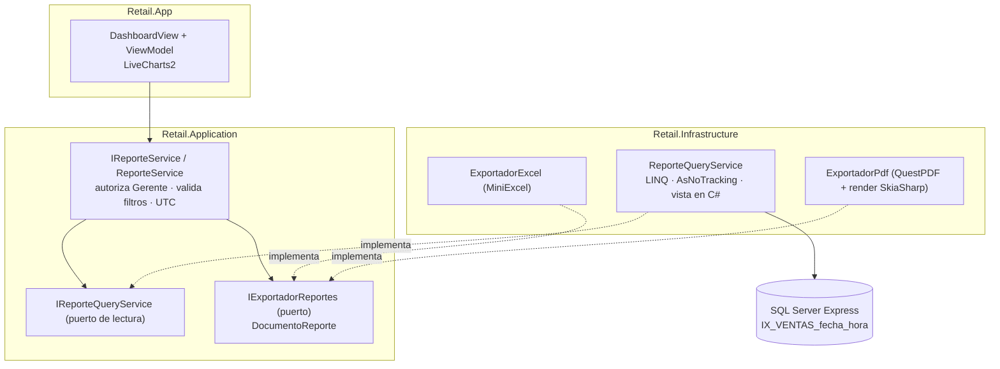
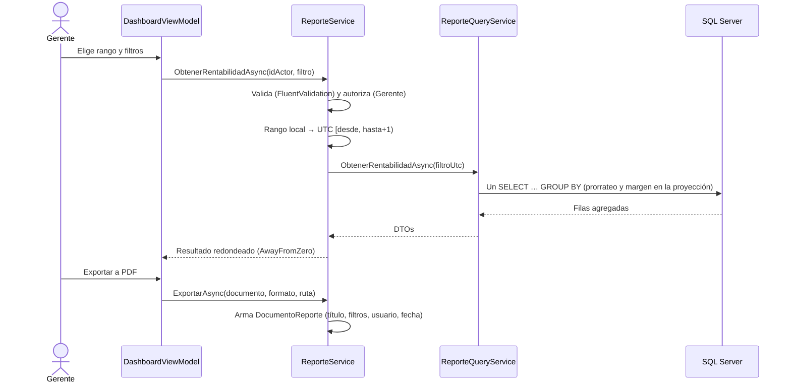

# Track 6.4: Plan de Diseño — Tablero Gerencial y Reportes Exportables

### Proyecto: Retail (Sistema ERP & Punto de Venta para Librería)
**Etapa:** [`etapa-6-estabilizacion-release.md`](file:///c:/Users/lucas/Proyectos/retail/docs/roadmap/etapa-6-estabilizacion-release.md) (Track 6.4) | **Responsable:** Lucas Kruzolek | **Rama:** `feat/dashboard-reportes` (desde `main`, después del PR #24)  
**Requisitos:** `RF-24`, `RF-25`, `RF-26`, `RNF-09` en [`ERS - Libreria POS.md`](file:///c:/Users/lucas/Proyectos/retail/docs/ERS%20-%20Libreria%20POS.md)

> **Propósito de este documento:** conservar las decisiones de diseño, sus fundamentos y el estado de avance del track, para retomar el trabajo en una sesión nueva sin rehacer el análisis. Las decisiones marcadas como **Cerrada** ya fueron discutidas y aprobadas; todas fueron aprobadas el 2026-10-15.

---

## 1. Estado de Avance

| Fase | Contenido | Estado |
| :--- | :--- | :---: |
| 0 | ERS v3.3 (RF-24 a RF-26, IU-11, IS-05, RNF-09) y este plan | ✅ ERS (commit `f5f87e8`) y plan aprobado |
| 1 | Dominio: costo histórico en `DetalleVenta` | ⏳ |
| 2 | Aplicación: contratos, DTOs, validadores y `ReporteService` | ⏳ |
| 3 | Infraestructura: migración, índice y `ReporteQueryService` | ⏳ |
| 4 | Exportación: Excel (MiniExcel) y PDF (QuestPDF + gráficos) | ⏳ |
| 5 | UI: `DashboardView` con LiveCharts2 | ⏳ |
| 6 | Verificación integral, mapa, DER y nota de wiki | ⏳ |

**Forma de trabajo:** fase por fase y capa por capa, con cada diff revisado por el estudiante (CLAUDE.md §3). Commits y PR los pide el estudiante (§4).

---

## 2. Decisiones

| ID | Decisión | Estado | Fundamento |
| :--- | :--- | :---: | :--- |
| D-1 | Alcance: R1 ventas por período, R2 ranking, R3 rentabilidad, R7 stock crítico y valorización, R8 sin movimiento. Solo filtros, sin presets. | Cerrada | Elección del estudiante (2026-10-14). |
| D-2 | Exportación a Excel (MiniExcel, ya instalado) y PDF (QuestPDF). | Cerrada | Excel para analizar; PDF para imprimir o archivar. |
| D-3 | Gráficos con LiveCharts2, en pantalla y en el PDF (render fuera de pantalla con SkiaSharp). | Cerrada | Binding MVVM nativo. Versión estable 2.0.5 verificada (sección 6). |
| D-4 | El descuento global de la venta se prorratea entre los ítems según su subtotal. | Cerrada | La suma de márgenes por categoría coincide con el margen total (ERS §1.4). |
| D-5 | `DetalleVenta.CostoUnitario` es obligatorio (`NOT NULL`), sin valor por defecto ni relleno de históricos. | Cerrada | No hay ventas cargadas (proyecto en desarrollo). |
| D-6 | **Consultas en LINQ sobre EF Core, sin vistas, procedimientos ni funciones almacenadas.** La base aporta índices. | Cerrada | Evaluación de la sección 3. |
| D-7 | Una única "vista en C#": `ItemsVendidos(filtro)` devuelve un `IQueryable` con el ingreso neto, el costo y el margen de cada ítem, ya prorrateado. R1, R2, R3 y el tablero se componen sobre ella. | Cerrada | Da lo bueno de una vista (una sola definición reutilizada) sin sus costos (sección 3). |
| D-8 | Los reportes de ventas incluyen los artículos dados de baja: se ignora el filtro global de `Articulo` y se filtran a mano las ventas y los ítems con baja lógica. | Cerrada | RF-06 conserva el historial. Sin esto, el filtro global elimina las ventas de un artículo dado de baja (sección 7, R-1). |
| D-9 | Fechas: el rango local del Gerente se convierte a UTC en Aplicación como `[desde 00:00, hasta + 1 día 00:00)`. Para agrupar por día, semana o mes en hora local, SQL desplaza `fecha_hora` según la diferencia horaria de la zona local. | Cerrada | RF-24. Argentina no aplica horario de verano desde 2009: la diferencia es fija (−3 h). El supuesto queda documentado y testeado (R-2). |
| D-10 | La semana empieza el lunes. Se agrupa con `DATEDIFF(day, lunesAncla, fecha) / 7`, que no depende de `SET DATEFIRST`. | Cerrada | `DATEPART(week)` cambia según la configuración regional del servidor. |
| D-11 | Autorización en el servicio de Aplicación (actor Gerente), además del menú. | Cerrada | Mismo patrón que `BackupService` (`OperacionNoAutorizadaException`). Ocultar el botón no es control de acceso (RNF-06). |
| D-12 | La exportación recibe un modelo neutro (`DocumentoReporte`: título, filtros, tablas tipadas y series), no los DTOs de pantalla. | Cerrada | Un exportador por formato y no uno por reporte (5 reportes × 2 formatos). Application no conoce MiniExcel ni QuestPDF (IS-05). |

---

## 3. Evaluación: Vistas, Procedimientos y Funciones Almacenadas

### 3.1. Opciones evaluadas

| Criterio | **A. LINQ (EF Core)** | **B. Vista SQL** (`CREATE VIEW` + entidad sin clave) | **C. Procedimiento almacenado** (`FromSql`) | **D. Función con valor de tabla** (TVF en línea, `HasDbFunction`) | **E. Vista indexada** (materializada) |
| :--- | :--- | :--- | :--- | :--- | :--- |
| Rendimiento con 50.000 ventas | ✅ Un `GROUP BY` con índice resuelve en milisegundos | 🟰 Igual que A: una vista común se expande dentro de la consulta, no guarda resultados | 🟰 Igual: EF también reutiliza planes de consultas parametrizadas | 🟰 Igual que A (una TVF en línea se expande) | ✅✅ Lee totales precalculados |
| Componer filtros con LINQ | ✅ | ✅ El `WHERE` se agrega encima | ❌ EF no compone sobre un SP: cada filtro es un parámetro más | ✅ | ✅ |
| Filtro global de baja lógica (Ley 2) | ✅ Automático | ❌ La vista repite `deleted_at IS NULL` a mano | ❌ A mano | ❌ A mano | ❌ A mano |
| Tipado y refactorización | ✅ El compilador detecta un nombre de columna equivocado | ❌ SQL en un texto dentro de la migración | ❌ Ídem | ❌ Ídem | ❌ Ídem |
| Versionado con migraciones | ✅ Nada que migrar | ⚠️ `migrationBuilder.Sql(...)`. El *snapshot* de EF no registra la definición, así que cada cambio exige escribir el `ALTER VIEW` a mano | ⚠️ Ídem | ⚠️ Ídem | ⚠️ Ídem, con más restricciones |
| Ley 6 de persistencia y Ley 8 de AGENTS ("prohibido calcular márgenes en SP o funciones") | ✅ La fórmula vive en C# | ⚠️ El margen y el prorrateo quedan en SQL. No es una mutación, pero sí una regla de negocio definida en la ERS | ❌ Prohibido de forma explícita | ⚠️ Igual que B | ⚠️ Igual que B |
| Costo sobre el mostrador (RNF-01) | ✅ Ninguno | ✅ Ninguno | ✅ Ninguno | ✅ Ninguno | ❌ Cada venta actualiza el índice de la vista dentro de la transacción del POS |
| Particularidades de SQL Server Express | — | — | — | — | ⚠️ Solo Enterprise usa la vista automáticamente; en Express hay que pedirla con `WITH (NOEXPAND)`, que EF no genera |
| Pruebas | Integración contra SQL Server Express (ya existe) | Ídem | Ídem | Ídem | Ídem |
| Backup y restore (RF-22) | — | ✅ Viajan en el `.bak` | ✅ Ídem | ✅ Ídem | ✅ Ídem |

### 3.2. Conclusión

1. **Procedimientos almacenados (C): no viables.** La Ley 6 los prohíbe para calcular márgenes, no aportan rendimiento y EF no puede componer filtros sobre ellos.
2. **Funciones escalares: no viables.** Están prohibidas por la Ley 6. Además, en una consulta de reporte se ejecutan fila por fila salvo que el motor las convierta en expresiones en línea (*scalar UDF inlining*), y eso depende de cómo esté escrita cada función.
3. **Vistas (B) y funciones con valor de tabla (D): técnicamente viables, pero no se justifican.** En este volumen no mejoran el rendimiento, porque se expanden dentro de la consulta igual que un LINQ. A cambio, sacan del compilador la fórmula del margen, obligan a repetir a mano el filtro de baja lógica y cambian SQL versionado por EF por SQL escrito a mano dentro de las migraciones.
4. **Vista indexada (E): descartada.** Es la única que mejora el rendimiento, pero ese costo lo paga cada venta del mostrador, y en Express necesita `NOEXPAND`, que EF no genera.
5. **Recomendación (D-6, D-7):** consultas LINQ con *push-down* y **una "vista en C#"**, un método privado que devuelve `IQueryable<ItemVendidoFila>`. Es reutilizable, tipada, respeta los filtros globales y se compone en un único SQL. **Lo que sí aporta la base son índices:** se agrega `IX_VENTAS_fecha_hora`.

> **Cuándo se revisaría D-6:** si una prueba de carga con el volumen de RNF-09 superara los 2 s con el índice ya creado, la siguiente opción sería una tabla de resumen diario (`RESUMEN_VENTAS_DIARIO`) calculada desde Aplicación. Las vistas indexadas no, por su costo sobre el POS.

---

## 4. Arquitectura

---

## 5. Plan por Capas

### Fase 1 — Dominio (`Retail.Domain`)
| Archivo | Cambio |
| :--- | :--- |
| [`DetalleVenta.cs`](file:///c:/Users/lucas/Proyectos/retail/src/Retail.Domain/Entities/DetalleVenta.cs) | Propiedad `CostoUnitario` (`private set`), recibida en el constructor `internal` y validada `>= 0`. |
| [`Venta.cs`](file:///c:/Users/lucas/Proyectos/retail/src/Retail.Domain/Entities/Venta.cs) | `AgregarItem(idArticulo, cantidad, precioUnitario, costoUnitario)`. Si el artículo ya está en el ticket con otro costo, se rechaza igual que hoy con el precio: una línea no mezcla dos costos. |

**No va en el Dominio:** el margen ni el prorrateo. Son cálculos de lectura sobre muchas ventas y deben ejecutarse en SQL (Ley 8). Ponerlos en la entidad obligaría a materializar las ventas.

**Tests (`Retail.Domain.UnitTests`):** `AgregarItem_ConCosto_LoConserva`, `AgregarItem_CostoNegativo_Lanza`, `AgregarItem_MismoArticuloOtroCosto_Lanza`, `AgregarItem_MismoArticuloMismoCosto_SumaCantidad`. Hay que ajustar los tests existentes que llaman a `AgregarItem` con tres argumentos.

### Fase 2 — Aplicación (`Retail.Application`)
| Componente | Contenido |
| :--- | :--- |
| [`VentaService.cs`](file:///c:/Users/lucas/Proyectos/retail/src/Retail.Application/Services/VentaService.cs) | Pasa `articulo.CostoReposicion` a `AgregarItem` (la foto se toma en el mismo momento que el precio, D-11 del Módulo 4.1). |
| `DTOs/Reportes/` | Filtros: `FiltroReporteDto` (desde, hasta, categoría, marca, cajero, `AgrupacionTemporalEnum`, top N, `CriterioRankingEnum`, días sin movimiento). Resultados: `TableroDto`, `IndicadorDto` (valor, valor anterior, variación nula si no hay base), `VentasPorPeriodoDto`, `RankingArticuloDto`, `RentabilidadDto`, `StockCriticoDto`, `ArticuloSinMovimientoDto`. Exportación: `DocumentoReporte`, `TablaReporte`, `ColumnaReporte` (tipo: texto, entero, moneda, porcentaje, fecha), `SerieGrafico`. |
| `Validators/Reportes/FiltroReporteValidator.cs` | Desde ≤ hasta; hasta ≤ hoy; top N y días > 0, con un máximo razonable. |
| `Interfaces/Persistence/IReporteQueryService.cs` | Puerto de lectura que recibe el rango ya convertido a UTC. |
| `Interfaces/Infrastructure/IExportadorReportes.cs` | `ExportarAsync(DocumentoReporte, FormatoExportacionEnum, Stream, CancellationToken)`. Recibe un `Stream` para que la decisión sobre la ruta y el archivo quede en la UI (permite reintentar, RF-26). |
| `Interfaces/Services/IReporteService.cs` + `Services/ReporteService.cs` | Autoriza al Gerente (D-11), valida, convierte el rango (D-9), redondea con el criterio único (D-06 del catálogo), calcula las variaciones del tablero y arma el `DocumentoReporte`. |

**Tests (`Retail.Application.UnitTests`, NSubstitute):** el servicio rechaza a un Cajero o a un Administrador; un filtro inválido no llega al query service; conversión de rango en los bordes (23:59 local = 02:59 UTC del día siguiente); variación con período anterior en cero → `null`; el documento incluye los filtros, el usuario y la fecha.

### Fase 3 — Infraestructura: persistencia
| Componente | Contenido |
| :--- | :--- |
| [`DetalleVentaConfiguration.cs`](file:///c:/Users/lucas/Proyectos/retail/src/Retail.Infrastructure/Persistence/Configurations/DetalleVentaConfiguration.cs) | Columna `costo_unitario decimal(18,2) NOT NULL`. `CK_DETALLE_VENTAS_Valores` suma `[costo_unitario] >= 0`. |
| [`VentaConfiguration.cs`](file:///c:/Users/lucas/Proyectos/retail/src/Retail.Infrastructure/Persistence/Configurations/VentaConfiguration.cs) | `IX_VENTAS_fecha_hora` con `INCLUDE (subtotal, descuento, total, id_usuario)`, filtrado por `deleted_at IS NULL`. |
| Migración `AgregarCostoUnitarioEIndiceDeReportes` | Generada con el comando canónico. Hay que revisar que el `CHECK` se recree bien. |
| `Persistence/Services/ReporteQueryService.cs` | Vista en C# `ItemsVendidos(filtro)` (D-7, D-8) + R1, R2, R3, R7, R8 y los indicadores del tablero, todo con `AsNoTracking` y proyección a DTO. |
| `DependencyInjection.cs` (Infrastructure) | Registro `Scoped` del query service. |

**Tests de integración (SQL Server Express, `ServidorDePruebas`):** prorrateo exacto con dos ítems y descuento; un artículo dado de baja sigue sumando en R2 y R3 (R-1); una venta dada de baja no suma; venta a las 23:30 hora local agrupada en el día local correcto (R-2); semana que cruza un cambio de mes; R2 "menos vendidos" incluye artículos con cero ventas; R7 y R8 excluyen servicios; **`ToQueryString()` no contiene materialización en el cliente** (una única sentencia `SELECT`); prueba de volumen opcional (marcada como `Trait`) con 50.000 ventas, para validar RNF-09.

### Fase 4 — Infraestructura: exportación
| Componente | Contenido |
| :--- | :--- |
| `Reportes/ExportadorExcel.cs` | MiniExcel: una hoja con el encabezado (reporte, filtros, usuario, fecha) y la tabla, con celdas numéricas (RF-26). |
| `Reportes/ExportadorPdf.cs` | QuestPDF A4: encabezado, gráfico (PNG renderizado con LiveCharts2 + SkiaSharp sin ventana) y tabla. |
| `Reportes/ExportadorReportes.cs` | Implementa `IExportadorReportes` y delega según el formato. |

**Tests:** Excel releído con MiniExcel (tipos numéricos y encabezado); PDF no vacío, que empieza con `%PDF`; el render del gráfico corre en un hilo que no es de UI.

### Fase 5 — UI (`Retail.App`)
| Componente | Contenido |
| :--- | :--- |
| `Views/Pages/DashboardView.xaml` + `ViewModels/Reportes/DashboardViewModel.cs` | Tarjetas de indicadores, gráficos (`CartesianChart`), selector de reporte, filtros, grilla y botones de exportación. Cargas por `CargaSerializada` (Ley 8 de persistencia). |
| Diálogo de guardado | Detrás de un servicio de la App (patrón de los `*DialogService`) para poder testear el ViewModel. |
| [`MainViewModel.cs`](file:///c:/Users/lucas/Proyectos/retail/src/Retail.App/ViewModels/MainViewModel.cs) + menú | `NavegarDashboard`, visible solo para el Gerente. **Archivo compartido (Ley 10):** cambio mínimo, coordinado con Pablo. |

**Tests:** ViewModel (filtros → llamada al servicio, error de escritura → reintento); humo STA en [`AppSmokeTests.cs`](file:///c:/Users/lucas/Proyectos/retail/tests/Retail.App.UnitTests/AppSmokeTests.cs) (Ley 9 de AGENTS); `scripts/audit-xaml.ps1`; contenedor de DI.

### Fase 6 — Cierre
Verificación Release completa (AGENTS.md), actualización de [`MAPA_DEL_PROYECTO.md`](file:///c:/Users/lucas/Proyectos/retail/docs/MAPA_DEL_PROYECTO.md), [`DER.mmd`](file:///c:/Users/lucas/Proyectos/retail/docs/DER.mmd) (`costo_unitario`) y del catálogo de `CHECK` en `SISTEMA_DE_PERSISTENCIA.md`, más la propuesta de una nota en `wiki/`.

---

## 6. Dependencias Nuevas (aprobadas el 2026-10-15)

Versiones verificadas en el índice oficial de NuGet (`api.nuget.org`) el 2026-10-15:

| Paquete | Versión | Proyecto | Licencia | Notas |
| :--- | :--- | :--- | :--- | :--- |
| `LiveChartsCore.SkiaSharpView.WPF` | **2.0.5** (estable) | `Retail.App` | MIT | Tiene destino `net8.0-windows7.0`. Arrastra `SkiaSharp.Views.WPF` y `SkiaSharp.HarfBuzz` 3.119.0. |
| `LiveChartsCore.SkiaSharpView` | **2.0.5** | `Retail.Infrastructure` (render del PDF) | MIT | Sin dependencia de WPF (destino `net8.0`), así que puede vivir en Infrastructure. Por sí sola pide SkiaSharp **2.88.9** (ver D-13). |
| `SkiaSharp` + `SkiaSharp.HarfBuzz` | **3.119.0** (referencia explícita) | `Retail.Infrastructure` | MIT | Fija la misma versión que usa la App (D-13). |
| `QuestPDF` | **2026.9.1** | `Retail.Infrastructure` | Community MIT | Gratuita para proyectos educativos y para empresas con facturación anual bruta menor a USD 1.000.000. Trae su propio motor Skia nativo (`QuestPdfSkia.dll`, `qpdf.dll`): **no comparte SkiaSharp con LiveCharts**, así que no hay conflicto de versiones. Exige declarar `QuestPDF.Settings.License = LicenseType.Community` antes del primer documento; sin esa línea lanza una excepción. |

* **D-13 (Propuesta, surgida de la investigación de dependencias):** una sola versión de SkiaSharp en toda la solución. Sin la referencia explícita, NuGet resolvería **3.119.0 en la App y 2.88.9 en `Retail.Cli` y en los tests de Infrastructure** (en cada proyecto gana la versión más alta de su propio grafo). El mismo código de render correría con dos motores distintos según desde dónde se invoque.
* **Licencia de QuestPDF:** al publicar, se agrega al `README` una sección de licencias de terceros. Si la librería superara el umbral de facturación, la licencia Professional cuesta USD 999 (pago único). La alternativa sin umbral es **PDFsharp/MigraDoc 6.5** (MIT, código administrado sin bibliotecas nativas), con una API más verbosa: queda como plan B documentado.
* **Empaquetado:** [`release.yml`](file:///c:/Users/lucas/Proyectos/retail/.github/workflows/release.yml) ya publica con `IncludeNativeLibrariesForSelfExtract=true`, que embebe `libSkiaSharp.dll`, `QuestPdfSkia.dll` y `qpdf.dll` en el ejecutable único. El binario crece unos 20 MB.

---

## 7. Riesgos y Mitigaciones

| ID | Riesgo | Mitigación |
| :--- | :--- | :--- |
| R-1 | El filtro global de baja lógica de `Articulo` elimina de los reportes las ventas de artículos dados de baja (EF filtra la navegación obligatoria `DetalleVenta.Articulo`). | D-8 + test de integración específico. |
| R-2 | Fechas en UTC agrupadas por día UTC: una venta de las 22:00 cae en el día siguiente. | D-9 + test en el borde. Si Argentina vuelve a aplicar horario de verano, pasar a `AT TIME ZONE` (`EF.Functions.AtTimeZone`). |
| R-3 | Sin índice sobre `VENTAS.fecha_hora`, cada reporte recorre la tabla completa. | Índice de la Fase 3. |
| R-4 | ~~LiveCharts2 para WPF solo en versión preliminar.~~ **Resuelto:** la 2.0.5 es estable (sección 6). | — |
| R-5 | SkiaSharp y QuestPDF traen bibliotecas nativas. | `release.yml` ya las embebe. Igual hay que confirmarlo en la Fase 4: publicar en Release y generar un PDF desde el ejecutable único, en una carpeta sin SDK. |
| R-8 | Dos versiones de SkiaSharp según el proyecto (2.88.9 y 3.119.0). | D-13: referencia explícita a 3.119.0 en Infrastructure. Un test de integración renderiza un gráfico a PNG y verifica la versión cargada. |
| R-6 | `MainViewModel` es una zona compartida (Ley 10). | Cambio mínimo y avisar a Pablo en el PR. |

---

## 8. Preguntas de Defensa

1. ¿Por qué no usaron vistas ni procedimientos almacenados si el motor "es más rápido"? (Sección 3: una vista común no guarda resultados; el rendimiento lo da el índice.)
2. ¿Por qué el margen no es un método de la entidad `Venta`? (Se calcula sobre miles de filas: debe ejecutarse en SQL, Ley 8.)
3. ¿Qué pasa con las ventas de un artículo dado de baja? (R-1 y D-8.)
4. ¿Cómo garantizan que un Cajero no vea la rentabilidad aunque alguien habilite el botón? (D-11.)
5. ¿Por qué la semana se calcula con `DATEDIFF` y no con `DATEPART(week)`? (D-10.)
6. ¿Por qué el exportador recibe un `Stream` y un modelo neutro? (D-12 y RF-26: reintentar sin volver a generar el reporte, un exportador por formato.)
