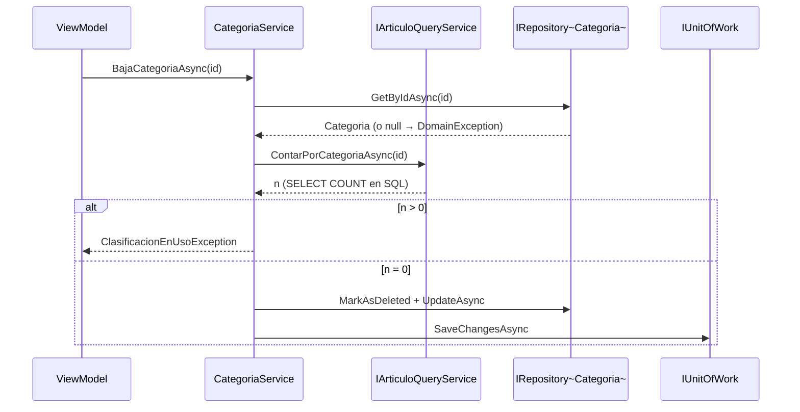

# Track 6.5: Plan de Diseño — CRUD de Rubros, Categorías y Marcas

### Proyecto: Retail (Sistema ERP & Punto de Venta para Librería)
**Etapa:** [`etapa-6-estabilizacion-release.md`](file:///c:/Users/lucas/Proyectos/retail/docs/roadmap/etapa-6-estabilizacion-release.md) (Track 6.5) | **Responsable:** Lucas Kruzolek | **Rama sugerida:** `feat/crud-categorias-marcas` (la crea el estudiante)  
**Requisitos:** `RF-04` (ampliado el 2026-10-17 con la administración de la clasificación) en [`ERS - Libreria POS.md`](file:///c:/Users/lucas/Proyectos/retail/docs/ERS%20-%20Libreria%20POS.md)

> **Propósito de este documento:** conservar las decisiones de diseño, sus fundamentos y el estado de avance del track, para retomar el trabajo en una sesión nueva sin rehacer el análisis. Todas las decisiones fueron aprobadas por el estudiante el 2026-10-17.
>
> **Estado: CERRADO EN LO CONCEPTUAL, SIN IMPLEMENTAR (2026-10-17).** El diseño del motor de catalogación, [Track 6.6](file:///c:/Users/lucas/Proyectos/retail/docs/roadmap/etapa-6-track-6.6-catalogacion-inteligente.md), también quedó cerrado y no exige cambios en este plan (Track 6.6, sección 16). Este track se implementa primero.
>
> **Flujo de trabajo entre sesiones:** [`handoff-clasificacion-y-catalogacion.md`](file:///c:/Users/lucas/Proyectos/retail/docs/auditorias/handoff-clasificacion-y-catalogacion.md). Implementación secuencial: 6.5 completo y después 6.6.

---

## 1. Estado de Avance

| Fase | Contenido | Estado |
| :--- | :--- | :---: |
| 0 | Alta en el roadmap, ampliación de `RF-04` en la ERS y cierre de decisiones | ✅ Diseño cerrado; track dado de alta en el roadmap y `RF-04` ampliado en la ERS (2026-10-17) |
| 1 | Dominio: `Crear`/`Renombrar`, regla de texto y excepción | ✅ 2026-10-17: `Rubro`, `Categoria` y `Marca` encapsuladas, regla de nombre en `ReglasTexto`, `ClasificacionEnUsoException` y 49 usos migrados a `Crear`; Release, 1.875 tests y `dotnet format` en verde. `IdRubro` pasa a la Fase 3 (D-19) |
| 2 | Aplicación: contratos, DTOs, validadores y servicios | ✅ 2026-10-17: `IRubroService`, `ICategoriaService`, `IMarcaService` y sus servicios, puerto `IClasificacionQueryService` (D-20), autorización en `Usuario.PuedeAdministrarClasificacion` (D-21), 6 validadores y 84 tests de servicios. Registro en DI e `IdRubro` en Fase 3 |
| 3 | Infraestructura: índices únicos filtrados, migración y conteos | ✅ 2026-10-17: `RUBROS` y FK obligatoria, colación `Modern_Spanish_CI_AI` e índices únicos (D-22), migración `AgregarRubrosYUnicidadClasificacion` con prechequeos (D-24), `ClasificacionQueryService`, semillero con 7 rubros (D-25), servicios registrados en DI; R-1 y R-3 verificados en integración; 2.041 tests en verde |
| 4 | UI: diálogos de administración desde el catálogo de artículos | ✅ 2026-10-21: `AdministrarClasificacionDialog` (maestro-detalle, D-26), `ClasificacionFormDialog`, `IClasificacionDialogService`, botón "Clasificación" en `ArticulosView` (Gerente y Encargado) y recarga de combos al cerrar; comandos bloqueados durante las cargas (DbContext compartido). Tests y verificación en verde; prueba manual del estudiante aprobada (D-28 corrigió el alto del formulario) |
| 5 | Cierre: verificación Release, mapa semántico y propuesta de nota para `wiki/` | ✅ 2026-10-21: verificación Release completa sobre la rama ya fusionada con `main` (PR #30, compatible), 2.081 tests; mapa al día; nota de `wiki/` descartada por el estudiante; rama publicada, PR a `main` pendiente de abrir |

**Forma de trabajo:** fase por fase y capa por capa, con cada diff revisado por el estudiante (CLAUDE.md §3). Commits y PR los pide el estudiante (§4).

---

## 2. Hallazgos del Estado Actual

| Hallazgo | Consecuencia |
| :--- | :--- |
| El roadmap de la Etapa 6 lista el "CRUD propio de Categorías y Marcas" como mejora futura fuera de alcance. Hoy solo se cargan con `datos-demo`. | Hay que dar de alta este track en el roadmap. |
| [`Categoria`](file:///c:/Users/lucas/Proyectos/retail/src/Retail.Domain/Entities/Categoria.cs) y [`Marca`](file:///c:/Users/lucas/Proyectos/retail/src/Retail.Domain/Entities/Marca.cs) tienen setters públicos y ninguna validación. | A diferencia de `Proveedor`, `Cliente` y `Usuario`, no están encapsuladas. |
| Ni `CATEGORIAS` ni `MARCAS` tienen índice único por nombre. | Se pueden crear duplicados. |
| `IInventarioService` solo expone `ListarCategoriasAsync` y `ListarMarcasAsync`. | No hay alta, edición ni baja. |
| `Articulo.IdCategoria` e `IdMarca` son `int?`. | Un artículo sin categoría o sin marca es válido. |
| El patrón a imitar es [`ProveedorService`](file:///c:/Users/lucas/Proyectos/retail/src/Retail.Application/Services/ProveedorService.cs): fábrica `Crear`, `ActualizarDatos`, validadores, chequeo de duplicados y `MarkAsDeleted`. | Se reutiliza la forma, no se inventa una nueva. |
| Las categorías se asignan hoy al **incorporar** artículos del catálogo de un proveedor a la tienda (`IncorporarArticulosATiendaAsync`). | Es el punto natural donde, más adelante, se integrarán las sugerencias del ML. |

---

## 3. Decisiones

| ID | Decisión | Estado | Fundamento |
| :--- | :--- | :---: | :--- |
| D-1 | La baja de una categoría con artículos asignados se **bloquea**. Se aplica igual a las marcas. El conteo incluye los artículos dados de baja, sujeto a la verificación R-1. | Cerrada | Elección del estudiante para categorías; coherencia para marcas. Los reportes históricos agrupan por categoría y marca. |
| D-2 | El acceso es un **diálogo** lanzado desde el catálogo de artículos, no una página nueva del menú lateral. | Cerrada | Una página nueva obliga a tocar `MainWindow.xaml` y `MainViewModel`, zona compartida (Ley 10). |
| D-3 | `Categoria` y `Marca` se encapsulan con `Crear(nombre)` y `Renombrar(nombre)` y setters privados. | Cerrada | Consistencia con `Proveedor`, `Cliente` y `Usuario`. Obliga a corregir el semillero y algunos tests que usan inicializadores de objeto. |
| D-4 | El nombre es **único entre registros activos**, sin distinguir mayúsculas ni acentos, mediante índice filtrado por `deleted_at IS NULL`. | Cerrada | Mismo patrón que `Proveedores.Cuit`. Evita duplicados desde el origen. |
| D-5 | Pueden administrar categorías y marcas el **Gerente y el Encargado**; el Cajero no. La autorización se valida en el servicio, no solo en la UI. | Cerrada (rol verificado 2026-10-17) | Patrón D-11 del Track 6.4 (`OperacionNoAutorizadaException`). Verificación: hoy el catálogo de artículos solo se oculta al Administrador (`PuedeOperarNegocio` en `MainWindow.xaml`) y ni `ArticulosViewModel` ni el servicio controlan el rol, así que el Cajero puede editar artículos. D-5 es más estricta y no lo contradice: el diálogo se abre desde `ArticulosView`, pero el servicio rechaza al Cajero y la UI oculta el acceso. La falta de control de rol sobre los artículos queda fuera de este track. |
| D-6 | Alias de marca y tabla de prefijos EAN → marca **se difieren** a la etapa de ML. | Cerrada | Son migraciones aditivas y baratas; no se construyen sin el consumidor (YAGNI). |
| D-7 | La fusión de categorías duplicadas **se difiere**. | Cerrada (revisar) | Operación delicada que reasigna artículos. Probablemente se vuelva necesaria tras el primer arranque del ML (sección 8). |
| D-8 | Renombrar es libre, porque todo se referencia por `Id`. | Cerrada | Renombrar no rompe artículos, reportes ni un futuro modelo. |
| D-9 | `Listar` acepta un filtro de texto opcional que se ejecuta en SQL (`EF.Functions.Like`) y devuelve la cantidad de artículos de cada ítem. | Cerrada | Tras el arranque del ML podría haber cientos de marcas; la grilla debe ser filtrable. La cantidad indica cuáles se pueden eliminar (D-1). |
| D-10 | Servicios paralelos por entidad (`IRubroService`, `ICategoriaService`, `IMarcaService`), sin abstracción genérica. | Cerrada | No se justifica una base genérica (Principio de Simplicidad Pragmática). |
| D-11 | **Clasificación en dos niveles: Rubro → Categoría.** | Cerrada (2026-10-17) | El análisis de la lista real (14.876 artículos) mostró un catálogo multirrubro: librería, marroquinería, juguetería, arte, cotillón, bazar y electrónica. |
| D-12 | Las licencias de personajes (Spiderman, Mickey, clubes) **no se registran**; quedan como texto de la descripción. | Cerrada (2026-10-17) | Decisión del estudiante (YAGNI). |
| D-13 | El nivel superior es una **entidad propia `Rubro`** (raíz de agregado), y `Categoria` pasa a tener `IdRubro` obligatorio. No se usa una categoría autorreferenciada (`IdCategoriaPadre`). | Cerrada | Con profundidad fija de dos niveles, dos entidades hacen explícitas las invariantes ("el artículo se asigna a una categoría, nunca a un rubro"; "no hay tercer nivel"). Un árbol genérico obliga a validarlas a mano y anticipa una profundidad que nadie pidió. |
| D-14 | El artículo referencia **solo la categoría**; el rubro se deriva a través de ella. `ARTICULOS` no tiene `id_rubro`. | Cerrada | Tercera forma normal: guardar el rubro en el artículo crearía una dependencia transitiva que podría contradecirse con el de su categoría. |
| D-15 | La baja de un rubro se bloquea si tiene categorías activas (misma regla que D-1, un nivel más arriba). | Cerrada | Coherencia con D-1. |
| D-16 | **Sin migración de datos:** `CATEGORIAS.id_rubro` nace obligatorio. `SemilleroDatosDemo` crea rubros y les cuelga sus categorías. Las bases de desarrollo que ya tengan categorías de `datos-demo` se recrean. | Cerrada | El proyecto está en desarrollo y no tiene categorías cargadas en ninguna instalación real (estudiante, 2026-10-17). |
| D-17 | Los reportes del Track 6.4 **no** incorporan filtros ni agrupación por rubro en este track. | Cerrada | Fuera de alcance; se evalúa como mejora posterior. |
| D-18 | **"Sin marca" es `IdMarca = null`**, no una fila "Sin marca" en `MARCAS`. Los reportes y la UI lo muestran con ese texto. Para distinguir "sin marca confirmada" de "todavía no clasificado" se usa el origen de la clasificación del Track 6.6. | Cerrada | Una marca ficticia aparecería como marca real en combos, filtros y rankings, y habría que impedir que se renombre o elimine. El valor nulo ya existe y es válido. |
| D-19 | **`Categoria.IdRubro` y `MoverARubro` se incorporan en la Fase 3**, junto con su mapeo, la migración de `RUBROS` y el semillero, no en la Fase 1. `Rubro` nace en la Fase 1 sin `DbSet` ni relación. | Cerrada (2026-10-17) | EF Core mapearía `IdRubro` por convención como columna obligatoria, y las bases de los tests de integración no la tienen hasta la migración: la suite quedaría en rojo entre fases. Agregar la invariante junto con su persistencia la hace verificable de punta a punta. Solo cambia el orden; D-13 y D-16 siguen igual. |
| D-20 | **Puerto `IClasificacionQueryService`** (Aplicación) para los listados con filtro y conteo de rubros, categorías y marcas (D-9) y los conteos que bloquean la baja (D-1, D-15). Reemplaza la ampliación de `IArticuloQueryService` prevista en la Fase 2. | Cerrada (2026-10-17) | Listar la clasificación no es una consulta de artículos; un puerto cohesivo concentra las seis consultas y su implementación de la Fase 3. |
| D-21 | Solo **crear, renombrar y dar de baja** exigen Gerente o Encargado (`Usuario.PuedeAdministrarClasificacion()`); el listado no exige rol, como los combos actuales. D-19 se extiende a la Aplicación: `IdRubro` en los DTOs de categoría y la validación de rubro existente llegan en la Fase 3. | Cerrada (2026-10-17) | La lectura no modifica nada y ya es pública en los combos; la regla de rol vive en el Dominio y se aplica en el servicio (D-5). |
| D-22 | Las columnas `nombre_rubro`, `nombre_categoria` y `nombre_marca` usan la colación `Modern_Spanish_CI_AI` (`Cotejamientos.BusquedaEnCastellano`). | Cerrada (2026-10-17) | Resuelve R-3: la colación del servidor (`SQL_Latin1_General_CP1_CI_AS`) distingue acentos y "Lapices" no chocaría con "Lápices". `Modern_Spanish` además distingue la ñ. |
| D-23 | `RenombrarCategoriaDto`/`RenombrarAsync` pasan a `ActualizarCategoriaDto`/`ActualizarAsync` (nombre y rubro). `CategoriaDto` suma `IdRubro` y `NombreRubro`. El servicio valida que el rubro exista y esté activo. | Cerrada (2026-10-17) | Editar una categoría es un solo formulario con nombre y rubro. |
| D-24 | La migración verifica antes del DDL: si `CATEGORIAS` tiene filas, o si `MARCAS` tiene nombres activos duplicados bajo `CI_AI`, aborta con `THROW` y un mensaje claro. | Cerrada (2026-10-17) | Sin el prechequeo el error sería un fallo críptico de FK o de índice (R-2, D-16). |
| D-25 | El semillero de demo crea los 7 rubros del borrador de taxonomía (Track 6.6, sección 6.1) con 1 a 3 categorías cada uno; las marcas no cambian. | Cerrada (2026-10-17) | Las cinco "categorías" de demo eran en realidad rubros. La taxonomía completa la carga el comando del Track 6.6 (M-15). |
| D-26 | El diálogo de administración es **maestro-detalle**: rubros a la izquierda y categorías del rubro seleccionado a la derecha, con el filtro `idRubro` resuelto en SQL (`ListarCategoriasAsync(filtro, idRubro)` en el puerto y el servicio). Las secciones "Rubros y categorías" y "Marcas" se alternan con dos `KeycapToggleButtonStyle`. | Cerrada (2026-10-21) | El sistema de diseño no tiene estilos de pestañas ni de grupos en el DataGrid; filtrar en memoria violaría la Ley 8. |
| D-27 | **Sin atajos de función** (F2, F8, …) para la administración de la clasificación; los diálogos conservan solo el comportamiento estándar de Enter (botón por defecto) y Esc (cancelar), como el resto de los formularios. | Cerrada (2026-10-21) | Decisión del estudiante. |
| D-28 | `ClasificacionFormDialog` usa **ancho fijo (460) y alto ajustado al contenido** (`SizeToContent="Height"`) en lugar del alto fijo del preset Compacto, con `MinHeight="0"` explícito. | Cerrada (2026-10-21) | Prueba manual del estudiante: con un solo campo (rubro, marca) la ventana de 390 de alto quedaba casi vacía. Diagnóstico: el estilo por defecto de `FluentWindow` (WPF-UI 4.0) aporta `Height=600` y `MinHeight=320`; al quitar los valores locales regían los del estilo, por eso hace falta el `MinHeight` local. El alto sigue acotado por `MaxHeight = WorkArea` y crece solo si aparece el banner de error. |

---

## 4. Diseño de la Baja Bloqueada

La invariante "no se elimina lo que está en uso" involucra a dos agregados (`Categoria` y `Articulo`). La entidad no conoce a sus artículos, así que el chequeo vive en el servicio de aplicación, con un conteo ejecutado en SQL (Ley 8).

**Teoría:** invariante entre agregados resuelta en un servicio de aplicación (DDD); consulta de solo lectura con push-down a SQL (Ley 8).

---

## 5. Plan por Capas

### Fase 1 — Dominio (`Retail.Domain`)

| Archivo | Cambio |
| :--- | :--- |
| `Entities/Rubro.cs` (nueva) | Raíz de agregado con `Crear(nombre)` y `Renombrar(nombre)` (D-13). |
| `Entities/Categoria.cs`, `Entities/Marca.cs` | Setters privados, fábrica `Crear(nombre)` y `Renombrar(nombre)`. `IdRubro` y `MoverARubro` se agregan en la Fase 3 (D-19). |
| `Common/ReglasTexto.cs` | Regla única para nombres de clasificación: normaliza espacios, obligatorio, máximo 100 caracteres. Expone `Normalizar*`, `Es*Valido` y `Exigir*`. |
| `Exceptions/ClasificacionEnUsoException.cs` (nueva) | Baja rechazada por tener artículos asignados. |
| Usos existentes (semillero, `InventarioService`, ViewModels de artículos y tests) | Pasan de inicializadores de objeto a `Crear(...)`, para que la solución siga compilando (D-3). |

**Tests:** `RubroDomainTests`, `CategoriaDomainTests`, `MarcaDomainTests` (modelo: `ProveedorDomainTests`).

### Fase 2 — Aplicación (`Retail.Application`)

| Archivo | Cambio |
| :--- | :--- |
| `Interfaces/Services/ICategoriaService.cs`, `IMarcaService.cs` | `Listar`, `ObtenerPorId`, `Crear`, `Actualizar`, `Baja`. |
| `Services/CategoriaService.cs`, `MarcaService.cs` | Casos de uso; chequeo de duplicados excluyendo el propio Id; autorización por rol. |
| `DTOs/Articulos/` | `CrearCategoriaDto`, `ActualizarCategoriaDto` y equivalentes de marca; `CantidadArticulos` en `CategoriaDto` y `MarcaDto` (D-9). |
| `Validators/Articulos/` | Cuatro validadores FluentValidation que reutilizan el predicado de `ReglasTexto`. |
| `Interfaces/Persistence/IArticuloQueryService.cs` | Conteos por categoría y por marca. |
| `DependencyInjection.cs` | Registro de los servicios cuando existe su puerto (el Host valida el contenedor al arrancar). |

**Tests:** `CategoriaServiceTests`, `MarcaServiceTests` (duplicado, renombrar al mismo nombre, no encontrado, baja bloqueada, baja permitida, rol no autorizado) y tests de validadores.

### Fase 3 — Infraestructura (`Retail.Infrastructure`)

| Archivo | Cambio |
| :--- | :--- |
| `Persistence/Configurations/CategoriaConfiguration.cs`, `MarcaConfiguration.cs` | Índice único sobre el nombre, filtrado por `deleted_at IS NULL`. |
| `Entities/Categoria.cs` (Dominio) | `IdRubro` obligatorio en `Crear(nombre, idRubro)` y `MoverARubro(idRubro)` (D-19). |
| `Persistence/Configurations/RubroConfiguration.cs` (nueva) | Tabla `RUBROS`, índice único filtrado por nombre; FK `CATEGORIAS.id_rubro` obligatoria. |
| Migración nueva | Crea `RUBROS` y la FK obligatoria (D-16, sin migración de datos). Crea los índices. **Antes** detecta duplicados existentes y falla con un mensaje claro (precedente: `NormalizarCuitProveedoresYCheck`). Actualiza el snapshot. |
| `Persistence/Services/ArticuloQueryService.cs` | Conteos con `CountAsync` en SQL, sin tracking; filtro de texto para el listado. |
| `Persistence/Initialization/SemilleroDatosDemo.cs` | Crea rubros y les cuelga sus categorías (D-16). |

**Tests de integración:** índice único filtrado, conteos, y que la colación de las columnas sea insensible a acentos y mayúsculas (R-3).

### Fase 4 — UI (`Retail.App`)

Antes de empezar: leer [`SISTEMA_DE_DISENO.md`](file:///c:/Users/lucas/Proyectos/retail/docs/SISTEMA_DE_DISENO.md) y [`StyleGalleryView.xaml`](file:///c:/Users/lucas/Proyectos/retail/src/Retail.App/Views/Dev/StyleGalleryView.xaml).

| Archivo | Cambio |
| :--- | :--- |
| `Views/Dialogs/AdministrarClasificacionDialog.xaml` | Diálogo maestro-detalle (D-26): rubros y categorías del rubro seleccionado, y marcas, alternados con toggles; grilla, filtro y acciones. |
| `Views/Dialogs/ClasificacionFormDialog.xaml` | Alta y edición de un nombre. |
| ViewModels e `IClasificacionDialogService` | Siguen el patrón de `ProveedorDialogService`. |
| `Views/Pages/ArticulosView.xaml` | Botón de acceso; al cerrar el diálogo se recargan los combos. |

**Tests:** ViewModels y pruebas de humo STA en `AppSmokeTests.cs`. Ejecutar `scripts/audit-xaml.ps1`.

### Fase 5 — Cierre

Verificación Release completa de `AGENTS.md` (auditoría XAML, build, tests, `dotnet format`), actualización de [`MAPA_DEL_PROYECTO.md`](file:///c:/Users/lucas/Proyectos/retail/docs/MAPA_DEL_PROYECTO.md) y propuesta de nota para `wiki/`.

---

## 6. Riesgos

| ID | Riesgo | Tratamiento |
| :--- | :--- | :--- |
| R-1 | Los artículos dados de baja quedan ocultos por el filtro global y los reportes históricos agrupan por categoría y marca. Una categoría con solo artículos dados de baja podría eliminarse y degradar reportes. | Contar con `IgnoreQueryFilters`. Test que reproduzca el reporte antes de fijar el criterio. |
| R-2 | La migración falla si ya existen nombres duplicados. | Detección previa con mensaje claro. |
| R-3 | La colación de las columnas puede distinguir acentos o mayúsculas, y entonces "Husares" y "HUSARES" no colisionarían. | Verificar en integración; si hace falta, fijar la colación en la configuración. |
| R-4 | Encapsular las entidades rompe inicializadores de objeto en semillero y tests. | Se detectan por error de compilación y se corrigen en la misma fase. |
| R-5 | Carrera entre la verificación y la baja si otro operador asigna la categoría en ese instante. | Aceptado: monolito local de un solo puesto; el conteo y la baja ocurren en la misma unidad de trabajo. |

---

## 7. Alternativas Descartadas

| Alternativa | Motivo |
| :--- | :--- |
| `enum` para categorías | No admite categorías definidas por el comercio; cada alta exigiría recompilar. |
| Reasignar artículos al eliminar | Descartada por decisión del estudiante: la baja se bloquea. |
| Servicio genérico `IClasificacionService<T>` | Abstracción no solicitada con solo dos usos. |
| Página nueva en el menú lateral | Toca zona compartida del Shell (Ley 10). |

---

## 8. Relación con el Diseño del ML (Track 6.6)

El Track 6.6 quedó cerrado sin exigir cambios en este plan. Sus piezas se agregan encima de este CRUD:

| Tema | Posible impacto en este plan |
| :--- | :--- |
| Alta masiva de categorías y marcas al arrancar el sistema (propuesta de categorías agrupadas por patrón) | Podría requerir una operación de alta en lote en una sola transacción. Hoy se difiere. |
| Fusión de categorías (D-7) | Es probable que sea necesaria apenas se creen categorías en bloque. |
| Alias de marca y prefijos EAN (D-6) | Tablas hijas de `Marca`; migración aditiva, no condiciona este plan. |
| Origen de la clasificación del artículo (manual, sugerida, confirmada) | Campo en `Articulo`; pertenece al track de ML. |
| Planillas con o sin columnas de marca y categoría | Afecta a `MapeoColumnasDto` y al importador, no al CRUD. |
| Prefijo EAN → marca | El análisis mostró que el prefijo identifica al **titular** del código (fabricante o importador), no siempre a la marca: un mismo prefijo puede abarcar varias marcas y una marca puede tener varios prefijos. La tabla de prefijos (D-6) debe ser muchos a muchos con `Marca`. Sigue siendo aditiva y no condiciona este plan. |

---

## 9. Preguntas de Defensa

* ¿Por qué la invariante "no eliminar con artículos" vive en el servicio y no en la entidad?
* ¿Qué pasa con las ventas históricas si se elimina una categoría, y cómo lo evita D-1?
* ¿Por qué el índice único es filtrado por `deleted_at`?
* ¿Por qué las categorías son una tabla y no un `enum`?
* ¿Por qué todo se referencia por `Id` y no por nombre?
