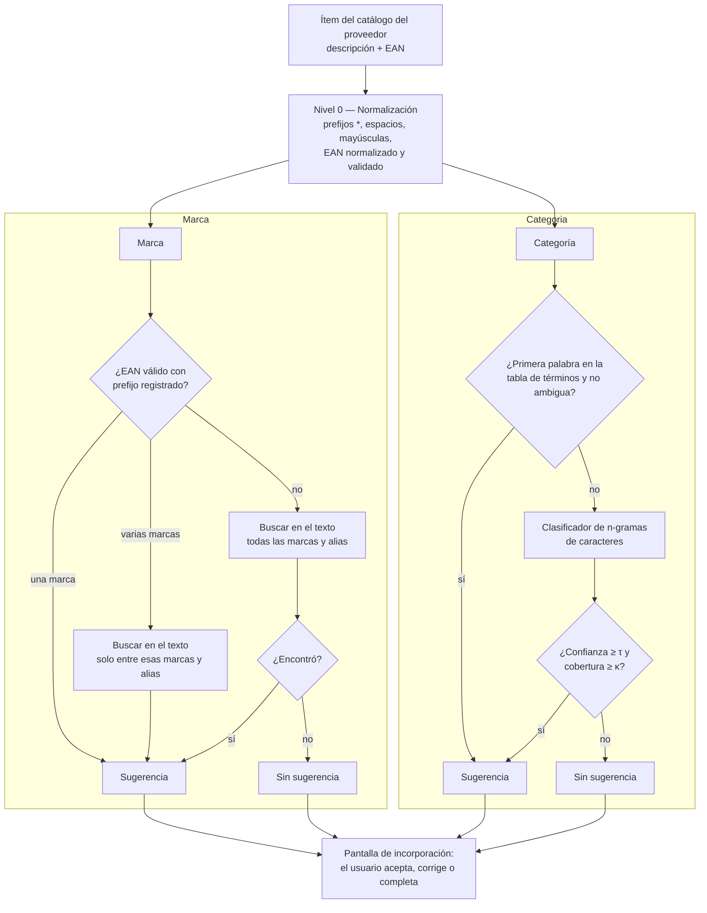
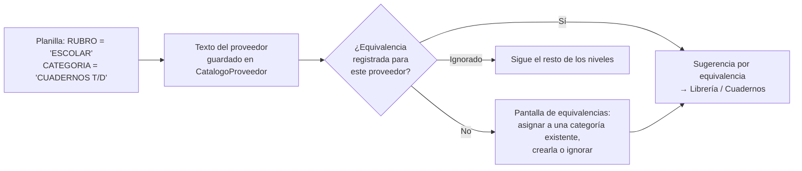
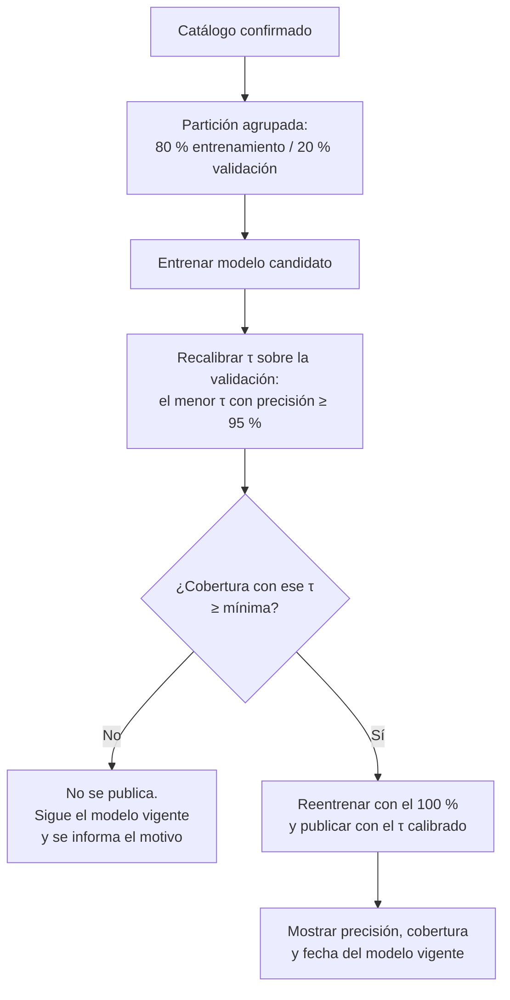

# Track 6.6: Plan de Diseño — Catalogación Inteligente (Sugerencia de Categoría y Marca)

### Proyecto: Retail (Sistema ERP & Punto de Venta para Librería)
**Etapa:** [`etapa-6-estabilizacion-release.md`](file:///c:/Users/lucas/Proyectos/retail/docs/roadmap/etapa-6-estabilizacion-release.md) (Track 6.6) | **Responsable:** Lucas Kruzolek | **Depende de:** [Track 6.5](file:///c:/Users/lucas/Proyectos/retail/docs/roadmap/etapa-6-track-6.5-crud-categorias-marcas.md) (CRUD de Rubros, Categorías y Marcas)  
**Requisitos:** `RF-27` (incorporado a la ERS el 2026-10-17; sección 15) en [`ERS - Libreria POS.md`](file:///c:/Users/lucas/Proyectos/retail/docs/ERS%20-%20Libreria%20POS.md); respeta `RNF-02`, `RNF-03` y `RNF-07`.  
**Scripts de exploración:** [`ml/`](file:///c:/Users/lucas/Proyectos/retail/ml/README.md), fuera de `Retail.sln`.

> **Propósito de este documento:** conservar las decisiones de diseño del motor de catalogación, la evidencia que las sustenta y los experimentos pendientes, para retomar el trabajo sin rehacer el análisis.
>
> **Estado: CERRADO EN LO CONCEPTUAL, SIN IMPLEMENTAR (2026-10-17).** Todas las decisiones (M-1 a M-16) fueron aprobadas por el estudiante. Quedan abiertos solo los experimentos E-1 a E-4, cuyas reglas de decisión ya están fijadas (sección 11). El Track 6.5 se implementa primero.
>
> **Flujo de trabajo entre sesiones:** [`handoff-clasificacion-y-catalogacion.md`](file:///c:/Users/lucas/Proyectos/retail/docs/auditorias/handoff-clasificacion-y-catalogacion.md). Implementación secuencial; el arranque de datos (Fase 1) puede solaparse con el Track 6.5 porque no toca `src/`.

---

## 1. Estado de Avance

| Fase | Contenido | Estado |
| :--- | :--- | :---: |
| 0 | Exploración de datos (`ml/scripts/`) y este documento | ✅ Diseño cerrado; track dado de alta en el roadmap y `RF-27` incorporado a la ERS (2026-10-17) |
| 1 | Arranque: diccionarios revisados por el estudiante y conjunto de oro | ⏳ |
| 2 | Experimentos E-1 a E-4 en Python (selección del clasificador y umbrales) | ⏳ |
| 3 | Dominio: entidades hijas de `Categoria` y `Marca`, origen de la clasificación, regla de EAN | ⏳ |
| 4 | Aplicación: puertos, servicio de clasificación por niveles, cambio del contrato de incorporación | ⏳ |
| 5 | Infraestructura: vectorizador de n-gramas, clasificador, almacenamiento del modelo, migraciones | ⏳ |
| 6 | UI y `Retail.Cli`: sugerencias por artículo, cola de revisión, carga de diccionarios, "Actualizar modelo" | ⏳ |
| 7 | Evaluación final sobre el conjunto de oro, verificación Release, mapa y wiki | ⏳ |

**Forma de trabajo:** igual que el resto del proyecto (CLAUDE.md §3 y §4). El Track 6.5 se implementa antes.

---

## 2. Problema y Objetivo

Las listas de distribuidores traen una descripción telegráfica (`"ABROCHADORA PINZA  MIT 24/6  PINTADA"`) y, como mucho, un código de barras. No traen rubro, categoría ni marca. Clasificar a mano miles de artículos al incorporarlos es lento y produce datos inconsistentes.

**Objetivo:** al incorporar artículos del catálogo de un proveedor a la tienda, el sistema **sugiere** categoría y marca para cada uno, con un nivel de confianza. Lo que no supera el umbral queda para decisión humana. Nada se asigna sin que una persona lo vea.

**No es objetivo:** crear categorías por sí solo, funcionar sin catálogo propio previo, ni depender de servicios externos.

---

## 3. Evidencia: Lista "LISTA MAYO 2025" (un distribuidor, 14.876 artículos)

Obtenida con `ml/scripts/explorar_descripciones.py` y `ml/scripts/analizar_ean.py` el 2026-10-17.

### 3.1 Descripciones

| Métrica | Valor | Consecuencia |
| :--- | :--- | :--- |
| Largo máximo | 45 caracteres; ~2.070 filas en el tope | Truncado frecuente (`MANCHESTER CI TY`, `CABLE TRANSPAR`) |
| Primeras palabras distintas | 743 (257 aparecen una sola vez) | Cola larga de términos raros |
| Cobertura de las 100 / 200 / 300 más frecuentes | 81,7 % / 91,7 % / 95,2 % | Una tabla revisada de ~300 términos cubre la gran mayoría |
| Términos ambiguos | `SET` (269), `REPUESTO` (216), `JUEGO`, `CAJA`, `LIBRO`/`LIBROS` | La primera palabra no alcanza; hace falta mirar el resto del texto |
| Variantes de un mismo término | `CUADER`, `CUADER.C/E`; `CARTUL.ENTRETENIDA`, `CARTULINA` | Una tabla exacta no las une |
| Catálogo multirrubro | Librería, marroquinería (`MOCHILA` es la más frecuente: 1.139), juguetería, arte, cotillón, bazar, electrónica | Motivó los dos niveles Rubro → Categoría (Track 6.5, D-11) |

### 3.2 Códigos de barras

| Estado | % |
| :--- | :---: |
| EAN válido (dígito verificador GS1 correcto) | 79,0 |
| Uso interno (prefijo `2`) | 12,0 |
| Dígito verificador inválido | 5,9 |
| Igual al código interno u otros | 3,1 |

* El prefijo identifica al **titular** del código (fabricante o importador), no siempre a la marca.
* Alrededor del **57 % de los EAN válidos** cae en grupos de prefijo con una palabra dominante (≥ 80 %), por ejemplo `MOOVING`, `WABRO`, `DURAVIT`, `BIC`.
* Una marca tiene varios prefijos (`MOOVING`: tres) y un prefijo puede tener varias marcas (`7798100`: `FILGO`, `DECORAT`, `AD`).
* Hay titulares cuya marca **no figura en la descripción** (`7450077`, importador de juguetes). Ningún modelo de texto puede extraerla: se asigna "Sin marca" (decisión del estudiante).

---

## 4. Arquitectura por Niveles

Cada nivel resuelve lo que puede y deja pasar el resto. El orden va de lo más confiable y barato a lo más incierto.

| Nivel | Técnica | Naturaleza | Se actualiza |
| :--- | :--- | :--- | :--- |
| 0 | Normalización y validación GS1 | Regla determinista | Con el código |
| Marca | Prefijo EAN + diccionario de marcas y alias | Regla determinista sobre datos | Al instante, cuando el usuario carga una marca, un alias o un prefijo |
| Categoría (términos) | Tabla término → categoría | Regla determinista sobre datos | Al instante |
| Categoría (modelo) | TF-IDF de n-gramas de caracteres + clasificador lineal | **Aprendizaje automático** | Al reentrenar (sección 7) |
| Revisión | Persona | Decisión humana | Siempre |

El aprendizaje automático se usa **solo donde las reglas no alcanzan**: términos ambiguos, variantes, abreviaturas, truncados y la cola larga.

### 4.1 Planillas con columnas de clasificación (M-12 a M-14)

Si la planilla del proveedor trae rubro, categoría o marca, esos datos se usan **antes** que cualquier inferencia, pero traducidos a la taxonomía del comercio:

* Las equivalencias se resuelven **por valor distinto**, no por fila: 40 rubros del proveedor se traducen una sola vez.
* Para la marca, el texto del proveedor se busca primero entre los nombres y alias de `Marca`; solo lo que no coincide pasa a la pantalla de equivalencias.
* La pantalla de equivalencias puede crear categorías y marcas con los servicios del Track 6.5.

---

## 5. El Modelo de Categoría

### 5.1 Representación: TF-IDF de n-gramas de caracteres

| Parámetro | Valor | Motivo |
| :--- | :--- | :--- |
| Unidad | n-gramas de caracteres **dentro de cada palabra**, con espacios de borde (`" CUA"`, `"ADER "`) | Tolera abreviaturas, errores de tipeo y truncados sin reglas manuales |
| Largo | 3 a 5 caracteres (ajustable en E-2) | Equilibrio entre generalización (cortos) y especificidad (largos) |
| Entrada | Descripción normalizada, sin los tokens formados solo por dígitos y símbolos (códigos de modelo) | Los códigos de modelo agregan ruido y no generalizan |
| Ponderación | TF por conteo, IDF suavizado `ln((1+N)/(1+df)) + 1`, norma L2 | Mismas fórmulas que `TfidfVectorizer` de scikit-learn, para comparar resultados con Python |
| Vocabulario | Solo n-gramas que aparecen en al menos 2 artículos | Reduce tamaño y ruido |

### 5.2 Clasificador

**Regresión logística multinomial con regularización L2**, entrenada dentro del ERP en C# por descenso de gradiente sobre la entropía cruzada. Alternativa: **centroide más cercano** (promedio de los vectores de cada categoría, comparado por similitud coseno).

La elección entre ambos la decide el experimento E-1 con una regla fijada de antemano: **se usa el centroide salvo que la regresión logística lo supere por al menos 2 puntos de F1-macro** en validación cruzada. Ante un empate práctico gana el más simple.

| | Regresión logística | Centroide más cercano |
| :--- | :--- | :--- |
| Entrenamiento | Iterativo (épocas de descenso de gradiente) | Un promedio por categoría |
| Categoría nueva con pocos ejemplos | Necesita reentrenar | Funciona en cuanto tiene ejemplos |
| Exactitud esperada | Mayor, en general | Algo menor |
| Código propio en C# | Mayor | Mínimo |

### 5.3 Confianza y abstención

Se sugiere una categoría solo si se cumplen las dos condiciones:

* **Confianza** (probabilidad máxima, o similitud máxima en el centroide) ≥ `τ`.
* **Cobertura** (fracción de los n-gramas del texto presentes en el vocabulario) ≥ `κ`.

`τ` y `κ` se calibran en E-3 para alcanzar el criterio de éxito (M-1).

### 5.4 Costo estimado

Con ~15.000 artículos, ~60 n-gramas por descripción y ~60 categorías, la matriz de pesos ocupa unos 12 MB (`float32`) y una época de entrenamiento requiere del orden de 10⁸ operaciones: **segundos en una CPU de oficina**. Clasificar un ítem lleva microsegundos. Compatible con `RNF-03` (≤ 300 MB) y `RNF-02` (se ejecuta en segundo plano).

---

## 6. Datos, Etiquetado y Evaluación

### 6.1 Arranque (una vez, con la lista del distribuidor)

| Paso | Herramienta | Resultado | Lo revisa |
| :--- | :--- | :--- | :--- |
| 1 | Script: términos ordenados por frecuencia, con ejemplos | Lista de ~300 términos | — |
| 2 | Propuesta de rubros, categorías y asignación de términos (puede asistir un modelo de lenguaje, enviando solo términos, sin precios) | Borrador de taxonomía | **Estudiante** |
| 3 | Script: prefijos EAN con su palabra dominante, y palabras frecuentes que no son términos | Candidatos de marcas, alias y prefijos | **Estudiante** |
| 4 | Etiquetado manual de una muestra de los términos ambiguos (`SET`, `REPUESTO`, …) | Ejemplos para el clasificador | **Estudiante** |
| 5 | Carga en la base con un comando de `Retail.Cli` | Diccionarios y taxonomía iniciales | — |

**Se etiquetan tipos, no filas:** asignar el término `ABROCHADORA` a una categoría etiqueta de una vez todas sus filas.

### 6.2 Conjuntos

| Conjunto | Contenido | Uso |
| :--- | :--- | :--- |
| Entrenamiento | Etiquetas débiles de la tabla de términos + etiquetas manuales de términos ambiguos | Entrenar |
| **Conjunto de oro** | 400 filas verificadas a mano, muestreadas por familia y estratificadas por término | **Solo** para la evaluación final; nunca para elegir hiperparámetros |

* Las particiones son **agrupadas por familia** (por ejemplo, las tres primeras palabras), para que las variantes de color de un mismo producto no queden a ambos lados.
* Hiperparámetros y umbrales se eligen con **validación cruzada agrupada de 5 particiones** sobre el entrenamiento. El vectorizador se ajusta dentro de cada partición.
* Todos los datos viven en `ml/datos/` (no versionado).

### 6.3 Métricas

| Métrica | Por qué |
| :--- | :--- |
| **Precisión de las sugerencias** | Lo que importa al usuario: cuando el sistema sugiere, ¿acierta? |
| **Cobertura** (fracción de ítems con sugerencia) | El otro lado del compromiso: un sistema que nunca sugiere es preciso e inútil |
| F1-macro | Promedia todas las categorías por igual; no deja que `MOCHILA` (1.139) oculte a las chicas |
| Aporte de cada nivel | Cuánto resuelve la tabla de términos y cuánto el modelo |
| Matriz de confusión | Qué categorías se confunden entre sí |

---

## 7. Entrenamiento en Producción

* **Dónde:** en el ERP, en C#. Python no viaja al cliente.
* **Con qué:** artículos de la tienda cuya categoría fue **confirmada por una persona** (sección 8.2). Solo entran las categorías con un mínimo de ejemplos (inicialmente 5); las demás se resuelven solo con la tabla de términos hasta acumularlos.
* **Cuándo:** por acción explícita ("Actualizar modelo") o automáticamente al iniciar una incorporación si el catálogo confirmado cambió desde el último entrenamiento.
* **Cómo:** en segundo plano (`Task.Run`, Ley 4), con progreso y cancelación.
* **Salvaguarda:** ver sección 7.2.
* **Almacenamiento:** archivo versionado en la carpeta de datos de la aplicación, reemplazado de forma atómica y conservando el anterior. Es un **dato derivado**: no se incluye en los respaldos (Track 6.3) porque se regenera desde la base. Si falta o no corresponde a la base actual (por ejemplo, tras una restauración), se reentrena.
* **Identidad de las clases:** el modelo predice `Id` de categoría. Renombrar no lo afecta; una categoría dada de baja se ignora al predecir y desaparece en el siguiente entrenamiento.
* **Arranque en frío:** una instalación nueva sin catálogo confirmado no tiene modelo. Funciona solo con los diccionarios hasta acumular datos.

### 7.1 Primer uso de una instalación nueva (M-15, M-16)

Sin datos maestros, ningún nivel puede sugerir: un clasificador cerrado solo elige entre categorías existentes y los diccionarios parten vacíos. Para que el comercio reciba sugerencias desde la primera importación:

| Situación | Equivalencias | Marcas | Términos | Modelo |
| :--- | :---: | :---: | :---: | :---: |
| Base vacía | — | — | — | — |
| Con la taxonomía semilla (M-15) | ✅ | ✅ | ✅ (~90 % de cobertura medida) | — |
| Tras la primera incorporación confirmada | ✅ | ✅ | ✅ | ✅ |

* **Taxonomía semilla (M-15):** el resultado del arranque de la sección 6.1 (rubros, categorías, términos, marcas, alias y prefijos) se distribuye como datos iniciales y se carga al instalar con `Retail.Cli`, como `inicializar` y `datos-demo` (Track 6.3, D-12). Es editable. Se distribuyen solo los diccionarios, nunca las descripciones de la lista del distribuidor, y por lo tanto tampoco un modelo entrenado.
* **Descubrimiento en la incorporación (M-16):** lo que queda sin sugerencia se agrupa por término (`PELOTERO ×12`) y el usuario lo asigna en bloque a una categoría existente, crea una nueva o lo deja sin clasificar. Cada asignación en bloque registra además el término, de modo que la próxima lista ya recibe sugerencia.

### 7.2 Salvaguardas del reentrenamiento (M-10)

* **Por qué recalibrar:** `τ` se fija inicialmente con el conjunto de oro, pero cuando el comercio cambia su taxonomía, las probabilidades cambian de escala. Recalibrar en cada entrenamiento mantiene el compromiso M-1 sobre la taxonomía actual.
* **Qué protege:** si el usuario carga etiquetas inconsistentes (dos categorías que se solapan, asignaciones contradictorias), el modelo se vuelve menos seguro. Con el `τ` recalibrado, el sistema **sugiere menos en lugar de sugerir mal**: falla hacia la abstención.
* **Cobertura mínima:** valor inicial 30 %, ajustable tras la Fase 2. Por debajo de eso, el modelo no aporta lo suficiente para justificar reemplazar al vigente.
* **Transparencia:** el diálogo de clasificación muestra la precisión y la cobertura del modelo vigente, para que el Gerente vea el efecto de sus cambios.

---

## 8. Persistencia y Dominio

### 8.1 Datos maestros nuevos (entidades hijas, Ley 2)

| Entidad | Agregado | Contenido | Nota |
| :--- | :--- | :--- | :--- |
| `TerminoCategoria` | `Categoria` | Término normalizado → categoría; marca de "ambiguo" | Un término ambiguo no sugiere por sí solo: deriva al modelo |
| `AliasMarca` | `Marca` | Variante textual (`HUSAR` → `HUSARES`, `SCHEAFFER` → `SHEAFFER`) | |
| `PrefijoEanMarca` | `Marca` | Prefijo del titular asociado a la marca | El mismo prefijo puede figurar en varias marcas |
| `EquivalenciaClasificacion` | `Proveedor` | Texto del proveedor (rubro y categoría, o marca) → `Categoria` o `Marca`, o "ignorar" | M-13. Es específica de cada proveedor |

`CatalogoProveedor` suma los textos opcionales `RubroProveedor`, `CategoriaProveedor` y `MarcaProveedor` (M-12).

Se manipulan solo a través de su raíz (`Categoria.AgregarTermino(...)`, `Marca.AgregarAlias(...)`), sin repositorios propios.

### 8.2 Origen de la clasificación en `Articulo`

`OrigenCategoria` y `OrigenMarca`, de tipo `OrigenClasificacionEnum`: `Manual`, `SugerenciaAceptada`, `SugerenciaCorregida`.

| `IdMarca` | `OrigenMarca` | Significado |
| :--- | :--- | :--- |
| valor | cualquiera | Marca asignada |
| `null` | valor | **"Sin marca" confirmada** por una persona (Track 6.5, D-18) |
| `null` | `null` | Todavía no clasificado |

El origen permite entrenar solo con datos vistos por una persona y medir cuántas sugerencias se aceptan o se corrigen en el uso real.

### 8.3 Validación de EAN

El dígito verificador GS1 y la normalización (UPC-A, GTIN-14) son reglas puras de dominio, en una clase de reglas en `Retail.Domain/Common` al estilo de `ReglasDocumento`. Antes de implementar se verifica si el proyecto ya valida códigos de barras.

---

## 9. Capas y Contratos

| Capa | Pieza | Responsabilidad |
| :--- | :--- | :--- |
| Domain | Entidades de 8.1, `OrigenClasificacionEnum`, regla de EAN | Datos maestros e invariantes |
| Application | `IClasificacionService` / `ClasificacionService` | Orquesta los niveles de la sección 4 y arma la sugerencia con su motivo ("por prefijo", "por término", "por modelo") |
| Application | Puerto `IModeloCategoria` (`Predecir`, `EntrenarAsync`) | El servicio no conoce la técnica; el modelo se reemplaza sin tocar Application |
| Application | Puerto de consulta de diccionarios | Lectura de términos, alias y prefijos con push-down a SQL (Ley 8) |
| Application | `IncorporarCatalogoArticulosDto` | **Cambia:** hoy asigna una categoría y una marca a todo el lote; pasa a llevarlas por ítem, con su origen |
| Infrastructure | Vectorizador de n-gramas, clasificador, almacenamiento del modelo | Implementación del puerto |
| App (UI) | Modal de incorporación | Sugerencia por artículo con su confianza y motivo; aceptar todas, aceptar seleccionadas, corregir |
| App (UI) | Diálogo de clasificación (Track 6.5) | Pestañas de términos, alias y prefijos; acción "Actualizar modelo" |
| Retail.Cli | Comando de carga de diccionarios | Carga inicial de la taxonomía y los diccionarios revisados (sección 6.1) |

---

## 10. Paridad entre Python y C#

Python se usa para explorar y elegir; C# es la implementación de producción. Para comprobar que hacen lo mismo:

* Un script de `ml/` genera **vectores de referencia** a partir de descripciones **inventadas** (no de la lista del distribuidor, que no se versiona): n-gramas extraídos, IDF y vector TF-IDF normalizado.
* Un test xUnit en `Retail.Infrastructure.IntegrationTests` (o unitario de Infrastructure) compara el vectorizador en C# con esos valores, con tolerancia de 1e-6.
* Para el clasificador no se exige igualdad de pesos (los optimizadores difieren), sino métricas equivalentes sobre un conjunto de prueba fijo.

---

## 11. Experimentos Pendientes (Fase 2)

| ID | Pregunta | Criterio de decisión |
| :--- | :--- | :--- |
| E-1 | ¿Regresión logística o centroide? | Centroide salvo que la regresión gane por ≥ 2 puntos de F1-macro (sección 5.2) |
| E-2 | Largo de los n-gramas (3–4, 3–5, 2–5) y quitar o no los tokens numéricos | Mejor F1-macro en validación cruzada agrupada |
| E-3 | Umbrales `τ` y `κ` | Máxima cobertura que cumpla el criterio M-1 |
| E-4 | Aporte de cada nivel | Informe; si el modelo aporta poco sobre la tabla de términos, se documenta como resultado |

---

## 12. Decisiones

| ID | Decisión | Estado | Fundamento |
| :--- | :--- | :---: | :--- |
| M-1 | Criterio de éxito: **precisión ≥ 95 % en las sugerencias** sobre el conjunto de oro, informando la cobertura alcanzada. | Cerrada (2026-10-17) | Una sugerencia equivocada cuesta más que una ausente: el usuario termina confiando en ella. |
| M-2 | Niveles deterministas (EAN, diccionarios, términos) + **TF-IDF de n-gramas de caracteres** con clasificador lineal. Sin transformers. | Cerrada (2026-10-17) | Evidencia de la sección 3. Reentrenable en el cliente, liviano y explicable. |
| M-3 | El entrenamiento de producción ocurre en el ERP, en C#, sin dependencias nuevas. Python solo para exploración. | Cerrada (2026-10-17) | El comercio define sus categorías (Track 6.5, D-11); el modelo debe poder adaptarse sin un desarrollador. |
| M-4 | Las sugerencias aparecen en el **modal de incorporación**, calculadas al momento y no persistidas. | Cerrada (2026-10-17) | Es donde hoy se asignan categoría y marca. Calcularlas al vuelo evita guardar datos que envejecen. |
| M-5 | Origen de la clasificación en `Articulo` (sección 8.2). Solo lo visto por una persona entrena. | Cerrada (2026-10-17) | Distingue "sin marca" de "sin clasificar" y evita que el modelo aprenda de sus propios errores. |
| M-6 | La taxonomía inicial la define el estudiante a partir de la lista de términos (sección 6.1). | Cerrada (2026-10-17) | La granularidad es una decisión de negocio. |
| M-7 | Las marcas ausentes de la descripción se cargan como **"Sin marca"** (`IdMarca = null` con origen). | Cerrada (2026-10-17) | Decisión del estudiante; representación según Track 6.5, D-18. |
| M-8 | El modelo es un dato derivado: archivo versionado, fuera de los respaldos, regenerable. | Cerrada (2026-10-17) | Evita restaurar un modelo que no corresponde a la base. |
| M-9 | Se entrena solo con categorías con al menos 5 ejemplos confirmados. | Cerrada (2026-10-17) | Un clasificador no aprende de 1 o 2 ejemplos; esas categorías se apoyan en la tabla de términos. |
| M-10 | **El reentrenamiento se permite, con salvaguardas automáticas** (sección 7.2): en cada entrenamiento el umbral `τ` se recalibra sobre una porción reservada del catálogo confirmado para cumplir M-1; si no se alcanza una cobertura mínima, el modelo nuevo no se publica y sigue el anterior. "Actualizar modelo" lo ejecutan los mismos roles que administran la clasificación (Track 6.5, D-5). | Cerrada (2026-10-17) | El modelo no tiene una "calibración" propia que el usuario pueda romper: es función de su catálogo. Lo que puede degradarse son las etiquetas, y eso se detecta midiendo antes de publicar. |
| M-11 | El modo manual es un **interruptor "Sugerir clasificación"** en el modal de incorporación, activado por defecto. No se crea una preferencia global persistida ni un modo que aplique sugerencias sin confirmación. | Cerrada (2026-10-17) | El proyecto no tiene infraestructura de configuración de negocio en la base, y crearla para un booleano es desproporcionado (YAGNI). Sin modelo entrenado, el sistema ya se comporta en modo manual. Aplicar sin confirmar contradice `RF-27`. |
| M-12 | El mapeo de columnas del importador admite columnas **opcionales** de rubro, categoría y marca. Sus valores se guardan **como texto del proveedor** en `CatalogoProveedor`, no como claves foráneas. | Cerrada (2026-10-17) | El vocabulario del proveedor no es la taxonomía del comercio: "ESCOLAR" de un proveedor puede ser "Útiles" en la tienda. |
| M-13 | **Equivalencias por proveedor:** entidad hija de `Proveedor` que traduce un texto del proveedor (rubro y categoría, o marca) a una `Categoria` o `Marca` de la tienda. Se resuelve una vez, en una pantalla que lista los valores distintos; las importaciones siguientes las reutilizan. | Cerrada (2026-10-17) | Sin equivalencias, cada proveedor crearía su propia versión de las categorías y la taxonomía se fragmentaría. |
| M-14 | **Precedencia:** equivalencia del proveedor > EAN, diccionarios y términos > modelo > sin sugerencia. | Cerrada (2026-10-17) | Un dato explícito, ya revisado por una persona, es más confiable que cualquier inferencia. |
| M-15 | **Taxonomía semilla editable**, cargada al instalar con `Retail.Cli` (sección 7.1). Solo diccionarios; ni descripciones del distribuidor ni modelo entrenado. | Cerrada (2026-10-17) | Sin semilla, una instalación nueva no recibe ninguna sugerencia. Nombres de categorías, marcas y prefijos son hechos públicos; las descripciones son datos comerciales de un tercero. |
| M-16 | **Descubrimiento por agrupación de términos** en la incorporación, con asignación o creación en bloque que también registra el término (sección 7.1). | Cerrada (2026-10-17) | El sistema aprende de cada importación aunque todavía no exista modelo, y el usuario no necesita crear la taxonomía completa antes de importar. |

---

## 13. Riesgos

| ID | Riesgo | Tratamiento |
| :--- | :--- | :--- |
| R-1 | Una sola lista de un solo distribuidor: las métricas serán optimistas para otros proveedores, con otras abreviaturas. | Abstención, revisión humana y reentrenamiento con lo confirmado. Probar con una segunda lista si se consigue. |
| R-2 | Etiquetas débiles con errores (la tabla de términos se equivoca en casos borde). | El conjunto de oro es humano y separado. |
| R-3 | **Sesgo de automatización:** el usuario acepta todo sin mirar y el modelo se reentrena con sus propios errores. | El origen distingue aceptadas de corregidas; se monitorea la tasa de corrección. La UI no acepta el lote completo por defecto. |
| R-4 | Categorías desbalanceadas (1.139 mochilas frente a unas pocas decenas en otras). | F1-macro como métrica y mínimo de ejemplos por categoría (M-9). |
| R-5 | Divergencia entre Python y C# en el vectorizador. | Tests de paridad (sección 10). |
| R-6 | Truncado a 45 caracteres: palabras cortadas. | Los n-gramas de caracteres son robustos a esto; se mide en E-2. |
| R-7 | Cambio del contrato de incorporación (lote → por ítem) afecta pantallas y tests existentes. | Se planifica como paso propio en la Fase 4, con sus tests. |
| R-8 | El importador, `Proveedor` y `CatalogoProveedor` son código de **Pablo** (propiedad acordada en el roadmap), y este track los modifica (M-12, M-13, contrato de incorporación). | ✅ Coordinado (2026-10-17): Pablo está al tanto y el estudiante autorizó modificar ese código desde este track. La revisión cruzada del PR sigue siendo con él. |

---

## 14. Alternativas Descartadas

| Alternativa | Motivo |
| :--- | :--- |
| GLiNER + SetFit en ONNX (plan original) | Cientos de MB, viola `RNF-03`, no se reentrena en el cliente, y no puede extraer marcas que no están escritas. |
| Proceso auxiliar en Python empaquetado | Segundo runtime en producción, falsos positivos de antivirus, más complejidad de despliegue. |
| Modelo de lenguaje externo en producción | Requiere internet (`RNF-07`) y envía datos del comercio a un tercero. Se admite solo como asistente de etiquetado en el arranque. |
| ML.NET | Dependencia nueva y pesada para un clasificador lineal que se implementa en poco código. Queda como alternativa si E-1 mostrara que hace falta un algoritmo más complejo. |
| Datasets públicos de productos | No hay ninguno en español del rubro con marca y categoría; sus taxonomías no son las del comercio. |
| Clasificador jerárquico (rubro y luego categoría) | Se predice la categoría y el rubro se deriva (Track 6.5, D-14). |

---

## 15. Requisito Incorporado a la ERS

> **RF-27 (Sugerencia de Clasificación):** Al incorporar artículos del catálogo de un proveedor, el sistema sugiere para cada uno una categoría y una marca a partir de la descripción y del código de barras, indicando el motivo y la confianza de la sugerencia. El sistema se abstiene cuando la confianza no alcanza el umbral que el sistema calibra en cada entrenamiento. Ninguna sugerencia se aplica sin confirmación del usuario. El modelo de categorías se reentrena localmente con los artículos confirmados, sin conexión a Internet.

Al incorporarlo (2026-10-17) se cambió "el umbral configurado" por "el umbral que el sistema calibra en cada entrenamiento", para alinearlo con M-10 (recalibración automática de `τ`) y M-11 (sin configuración de negocio). También se ajustaron `RF-05`, `RF-07`, `RF-23`, `IU-04` e `IU-05` y la matriz de trazabilidad. Las tablas de los diccionarios se agregan a la matriz cuando exista su migración (Fase 5).

---

## 16. Impacto sobre el Track 6.5

No se identificaron cambios necesarios en el plan del CRUD. Las piezas de este track se agregan sobre él:

* Las entidades hijas (sección 8.1) se apoyan en la encapsulación de `Categoria` y `Marca` (Track 6.5, D-3).
* La baja de una categoría (permitida solo sin artículos) da de baja también sus términos.
* El diálogo de clasificación del Track 6.5 suma pestañas en este track.
* La fusión de categorías (Track 6.5, D-7) se reevalúa después del arranque.

---

## 17. Preguntas de Defensa

* ¿Por qué se usa aprendizaje automático solo en un nivel y no para todo?
* ¿Qué ventaja tienen los n-gramas de caracteres frente a palabras enteras en estas descripciones?
* ¿Por qué el conjunto de oro no puede salir de la tabla de términos?
* ¿Por qué las particiones se agrupan por familia?
* ¿Por qué precisión y cobertura, y no exactitud a secas?
* ¿Qué pasa con el modelo si el comercio crea, renombra o elimina una categoría?
* ¿Cómo se evita que el modelo aprenda de sus propios errores?
* ¿Por qué ningún modelo puede sugerir la marca de los artículos del importador `7450077`?
