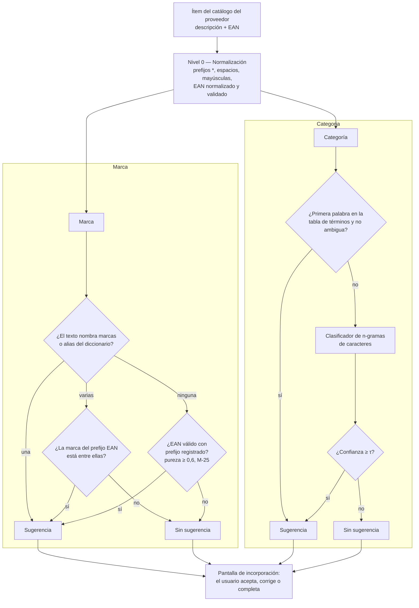
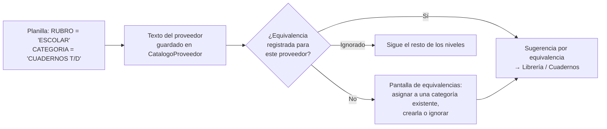
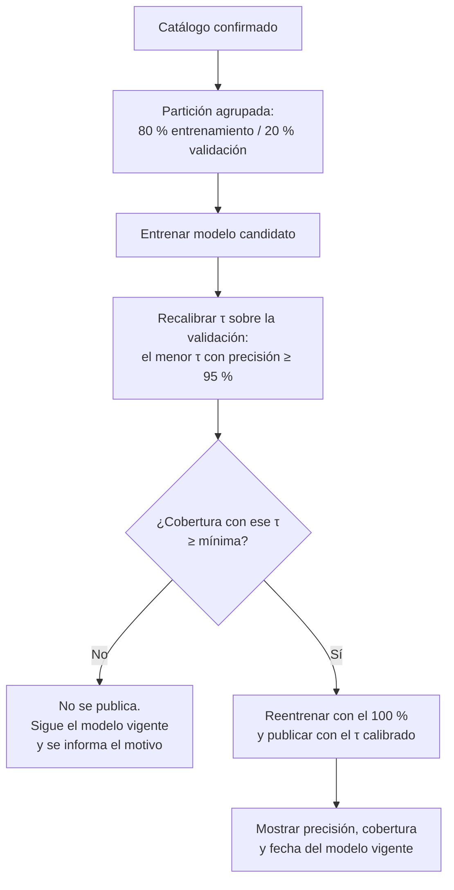

# Track 6.6: Plan de Diseño — Catalogación Inteligente (Sugerencia de Categoría y Marca)

### Proyecto: Retail (Sistema ERP & Punto de Venta para Librería)
**Etapa:** [`etapa-6-estabilizacion-release.md`](file:///c:/Users/lucas/Proyectos/retail/docs/roadmap/etapa-6-estabilizacion-release.md) (Track 6.6) | **Responsable:** Lucas Kruzolek | **Depende de:** [Track 6.5](file:///c:/Users/lucas/Proyectos/retail/docs/roadmap/etapa-6-track-6.5-crud-categorias-marcas.md) (CRUD de Rubros, Categorías y Marcas)  
**Requisitos:** `RF-27` (incorporado a la ERS el 2026-10-17; sección 15) en [`ERS - Libreria POS.md`](file:///c:/Users/lucas/Proyectos/retail/docs/ERS%20-%20Libreria%20POS.md); respeta `RNF-02`, `RNF-03` y `RNF-07`.  
**Scripts de exploración:** [`ml/`](file:///c:/Users/lucas/Proyectos/retail/ml/README.md), fuera de `Retail.sln`.

> **Propósito de este documento:** conservar las decisiones de diseño del motor de catalogación, la evidencia que las sustenta y los experimentos pendientes, para retomar el trabajo sin rehacer el análisis.
>
> **Estado: CERRADO EN LO CONCEPTUAL, SIN IMPLEMENTAR (2026-10-17).** Todas las decisiones (M-1 a M-16) fueron aprobadas por el estudiante. Quedan abiertos solo los experimentos E-1 a E-4, cuyas reglas de decisión ya están fijadas (sección 11). El Track 6.5 se implementa primero.
>
> **Flujo de trabajo entre sesiones:** [`handoff-clasificacion-y-catalogacion.md`](file:///c:/Users/lucas/Proyectos/retail/docs/auditorias/handoff-clasificacion-y-catalogacion.md). Implementación secuencial; el arranque de datos (Fase 1) puede solaparse con el Track 6.5 porque no toca `src/`.

---

## 1. Estado de Avance

| Fase | Contenido | Estado |
| :--- | :--- | :---: |
| 0 | Exploración de datos (`ml/scripts/`) y este documento | ✅ Diseño cerrado; track dado de alta en el roadmap y `RF-27` incorporado a la ERS (2026-10-17) |
| 1 | Arranque: diccionarios revisados por el estudiante y conjunto de oro | ✅ 2026-10-22: 7 rubros, 46 categorías, 299 términos (18 ambiguos), 169 marcas, 182 prefijos; desarrollo, ejemplos de ambiguos y oro de prueba (sección 6.4; M-17 a M-21) |
| 2 | Experimentos E-1 a E-5 en Python (selección del clasificador, umbrales y orden de los niveles de marca) | ✅ 2026-10-22: regresión logística C = 100, n-gramas 3-4 sin numéricos, τ = 0,94 (sin κ, M-23); marca por texto primero y prefijos de pureza ≥ 0,6; vectores de paridad (sección 11.1) |
| 3 | Dominio y su persistencia (M-29): `TerminoClasificacion` (M-27), alias y prefijos de `Marca`, origen de la clasificación (M-30), regla de EAN (M-28). 3b: equivalencias de `Proveedor` | ✅ 2026-10-22 (3b cerrada: migración `AgregarEquivalenciasYTextosProveedor`; verificación Release con 2.321 tests y `dotnet format` en verde). Detalle: 3.1 (reglas y enum), 3.2 (entidades) y 3.3 (mapeo, migración `AgregarDiccionariosYOrigenClasificacion`, `CHECK` e índices, baja de `Marca` con sus diccionarios) ✅; verificación Release: 2.293 tests y `dotnet format` en verde. **3b** (M-31 a M-33): 3b.1 dominio ✅ (`EquivalenciaClasificacion`, `TipoEquivalenciaEnum`, métodos de `Proveedor`, textos del proveedor en `CatalogoProveedor`); 3b.2 persistencia ✅ |
| 4 | Aplicación: puertos, servicio de clasificación por niveles, cambio del contrato de incorporación | ⏳ |
| 5 | Infraestructura: vectorizador de n-gramas, clasificador, almacenamiento del modelo, migraciones | ⏳ |
| 6 | UI y `Retail.Cli`: sugerencias por artículo, cola de revisión, carga de diccionarios, "Actualizar modelo" | ⏳ |
| 7 | Evaluación final sobre el conjunto de oro, verificación Release, mapa y wiki | ⏳ |

**Forma de trabajo:** igual que el resto del proyecto (CLAUDE.md §3 y §4). El Track 6.5 se implementa antes.

---

## 2. Problema y Objetivo

Las listas de distribuidores traen una descripción telegráfica (`"ABROCHADORA PINZA  MIT 24/6  PINTADA"`) y, como mucho, un código de barras. No traen rubro, categoría ni marca. Clasificar a mano miles de artículos al incorporarlos es lento y produce datos inconsistentes.

**Objetivo:** al incorporar artículos del catálogo de un proveedor a la tienda, el sistema **sugiere** categoría y marca para cada uno, con un nivel de confianza. Lo que no supera el umbral queda para decisión humana. Nada se asigna sin que una persona lo vea.

**No es objetivo:** crear categorías por sí solo, funcionar sin catálogo propio previo, ni depender de servicios externos.

---

## 3. Evidencia: Lista "LISTA MAYO 2025" (un distribuidor, 14.876 artículos)

Obtenida con `ml/scripts/explorar_descripciones.py` y `ml/scripts/analizar_ean.py` el 2026-10-17.

### 3.1 Descripciones

| Métrica | Valor | Consecuencia |
| :--- | :--- | :--- |
| Largo máximo | 45 caracteres; ~2.070 filas en el tope | Truncado frecuente (`MANCHESTER CI TY`, `CABLE TRANSPAR`) |
| Primeras palabras distintas | 743 (257 aparecen una sola vez) | Cola larga de términos raros |
| Cobertura de las 100 / 200 / 300 más frecuentes | 81,7 % / 91,7 % / 95,2 % | Una tabla revisada de ~300 términos cubre la gran mayoría |
| Términos ambiguos | `SET` (269), `REPUESTO` (216), `JUEGO`, `CAJA`, `LIBRO`/`LIBROS` | La primera palabra no alcanza; hace falta mirar el resto del texto |
| Variantes de un mismo término | `CUADER`, `CUADER.C/E`; `CARTUL.ENTRETENIDA`, `CARTULINA` | Una tabla exacta no las une |
| Catálogo multirrubro | Librería, marroquinería (`MOCHILA` es la más frecuente: 1.139), juguetería, arte, cotillón, bazar, electrónica | Motivó los dos niveles Rubro → Categoría (Track 6.5, D-11) |

### 3.2 Códigos de barras

| Estado | % |
| :--- | :---: |
| EAN válido (dígito verificador GS1 correcto) | 79,0 |
| Uso interno (prefijo `2`) | 12,0 |
| Dígito verificador inválido | 5,9 |
| Igual al código interno u otros | 3,1 |

* El prefijo identifica al **titular** del código (fabricante o importador), no siempre a la marca.
* Alrededor del **57 % de los EAN válidos** cae en grupos de prefijo con una palabra dominante (≥ 80 %), por ejemplo `MOOVING`, `WABRO`, `DURAVIT`, `BIC`.
* Una marca tiene varios prefijos (`MOOVING`: tres) y un prefijo puede tener varias marcas (`7798100`: `FILGO`, `DECORAT`, `AD`).
* Hay titulares cuya marca **no figura en la descripción** (`7450077`, importador de juguetes). Ningún modelo de texto puede extraerla: se asigna "Sin marca" (decisión del estudiante).

---

## 4. Arquitectura por Niveles

Cada nivel resuelve lo que puede y deja pasar el resto. El orden va de lo más confiable y barato a lo más incierto.

| Nivel | Técnica | Naturaleza | Se actualiza |
| :--- | :--- | :--- | :--- |
| 0 | Normalización y validación GS1 | Regla determinista | Con el código |
| Marca | Prefijo EAN + diccionario de marcas y alias | Regla determinista sobre datos | Al instante, cuando el usuario carga una marca, un alias o un prefijo |
| Categoría (términos) | Tabla término → categoría | Regla determinista sobre datos | Al instante |
| Categoría (modelo) | TF-IDF de n-gramas de caracteres + clasificador lineal | **Aprendizaje automático** | Al reentrenar (sección 7) |
| Revisión | Persona | Decisión humana | Siempre |

El aprendizaje automático se usa **solo donde las reglas no alcanzan**: términos ambiguos, variantes, abreviaturas, truncados y la cola larga.

> **Orden de los niveles de marca (M-17, E-5, M-25).** El diseño original consultaba el prefijo antes que el texto. Con los diccionarios del arranque, en 355 filas (2,4 %) el prefijo contradecía la marca escrita (por ejemplo `7798100` → Artística Dibu, texto → FILGO): el prefijo identifica al titular, no a la marca (sección 3.2). E-5 confirmó **texto primero**, con prefijos de pureza ≥ 0,6, y el diagrama refleja ese orden.

### 4.1 Planillas con columnas de clasificación (M-12 a M-14)

Si la planilla del proveedor trae rubro, categoría o marca, esos datos se usan **antes** que cualquier inferencia, pero traducidos a la taxonomía del comercio:

* Las equivalencias se resuelven **por valor distinto**, no por fila: 40 rubros del proveedor se traducen una sola vez.
* Para la marca, el texto del proveedor se busca primero entre los nombres y alias de `Marca`; solo lo que no coincide pasa a la pantalla de equivalencias.
* La pantalla de equivalencias puede crear categorías y marcas con los servicios del Track 6.5.

---

## 5. El Modelo de Categoría

### 5.1 Representación: TF-IDF de n-gramas de caracteres

| Parámetro | Valor | Motivo |
| :--- | :--- | :--- |
| Unidad | n-gramas de caracteres **dentro de cada palabra**, con espacios de borde (`" CUA"`, `"ADER "`) | Tolera abreviaturas, errores de tipeo y truncados sin reglas manuales |
| Largo | 3 a 5 caracteres (ajustable en E-2) | Equilibrio entre generalización (cortos) y especificidad (largos) |
| Entrada | Descripción normalizada, sin los tokens formados solo por dígitos y símbolos (códigos de modelo) | Los códigos de modelo agregan ruido y no generalizan |
| Ponderación | TF por conteo, IDF suavizado `ln((1+N)/(1+df)) + 1`, norma L2 | Mismas fórmulas que `TfidfVectorizer` de scikit-learn, para comparar resultados con Python |
| Vocabulario | Solo n-gramas que aparecen en al menos 2 artículos | Reduce tamaño y ruido |

### 5.2 Clasificador

**Regresión logística multinomial con regularización L2**, entrenada dentro del ERP en C# por descenso de gradiente sobre la entropía cruzada. Alternativa: **centroide más cercano** (promedio de los vectores de cada categoría, comparado por similitud coseno).

La elección entre ambos la decide el experimento E-1 con una regla fijada de antemano: **se usa el centroide salvo que la regresión logística lo supere por al menos 2 puntos de F1-macro** en validación cruzada. Ante un empate práctico gana el más simple.

| | Regresión logística | Centroide más cercano |
| :--- | :--- | :--- |
| Entrenamiento | Iterativo (épocas de descenso de gradiente) | Un promedio por categoría |
| Categoría nueva con pocos ejemplos | Necesita reentrenar | Funciona en cuanto tiene ejemplos |
| Exactitud esperada | Mayor, en general | Algo menor |
| Código propio en C# | Mayor | Mínimo |

### 5.3 Confianza y abstención

Se sugiere una categoría solo si la **confianza** (probabilidad máxima de la regresión logística, E-1) es ≥ `τ`.
`τ` se calibró en E-3 (0,94) y se recalibra en cada entrenamiento (M-10).

El diseño original agregaba una segunda condición, **cobertura** (fracción de los n-gramas del texto presentes en el
vocabulario) ≥ `κ`. E-3 mostró que no mejora la precisión de ninguna combinación y se eliminó (M-23).

### 5.4 Costo estimado

Con ~15.000 artículos, ~60 n-gramas por descripción y ~60 categorías, la matriz de pesos ocupa unos 12 MB (`float32`) y una época de entrenamiento requiere del orden de 10⁸ operaciones: **segundos en una CPU de oficina**. Clasificar un ítem lleva microsegundos. Compatible con `RNF-03` (≤ 300 MB) y `RNF-02` (se ejecuta en segundo plano).

---

## 6. Datos, Etiquetado y Evaluación

### 6.1 Arranque (una vez, con la lista del distribuidor)

| Paso | Herramienta | Resultado | Lo revisa |
| :--- | :--- | :--- | :--- |
| 1 | Script: términos ordenados por frecuencia, con ejemplos | Lista de ~300 términos | — |
| 2 | Propuesta de rubros, categorías y asignación de términos (puede asistir un modelo de lenguaje, enviando solo términos, sin precios) | Borrador de taxonomía | **Estudiante** |
| 3 | Script: prefijos EAN con su palabra dominante, y palabras frecuentes que no son términos | Candidatos de marcas, alias y prefijos | **Estudiante** |
| 4 | Etiquetado manual de una muestra de los términos ambiguos (`SET`, `REPUESTO`, …) | Ejemplos para el clasificador | **Estudiante** |
| 5 | Carga en la base con un comando de `Retail.Cli` | Diccionarios y taxonomía iniciales | — |

**Se etiquetan tipos, no filas:** asignar el término `ABROCHADORA` a una categoría etiqueta de una vez todas sus filas.

### 6.2 Conjuntos

| Conjunto | Contenido | Uso |
| :--- | :--- | :--- |
| Entrenamiento | Etiquetas débiles de la tabla de términos + etiquetas manuales de términos ambiguos | Entrenar |
| Desarrollo (M-20) | El primer oro: 400 filas validadas (`ml/datos/oro.csv`) | Diagnóstico y decisiones de diseño: tabla de términos, umbrales (E-3), orden de marca (E-5) |
| **Conjunto de oro** | 400 filas verificadas a mano, muestreadas por familia y estratificadas por término, de familias ausentes en los demás conjuntos (M-20) | **Solo** para la evaluación final; nunca para elegir hiperparámetros |

* Las particiones son **agrupadas por familia** (por ejemplo, las tres primeras palabras), para que las variantes de color de un mismo producto no queden a ambos lados.
* Hiperparámetros y umbrales se eligen con **validación cruzada agrupada de 5 particiones** sobre el entrenamiento. El vectorizador se ajusta dentro de cada partición.
* Todos los datos viven en `ml/datos/` (no versionado).

### 6.3 Métricas

| Métrica | Por qué |
| :--- | :--- |
| **Precisión de las sugerencias** | Lo que importa al usuario: cuando el sistema sugiere, ¿acierta? |
| **Cobertura** (fracción de ítems con sugerencia) | El otro lado del compromiso: un sistema que nunca sugiere es preciso e inútil |
| F1-macro | Promedia todas las categorías por igual; no deja que `MOCHILA` (1.139) oculte a las chicas |
| Aporte de cada nivel | Cuánto resuelve la tabla de términos y cuánto el modelo |
| Matriz de confusión | Qué categorías se confunden entre sí |

### 6.4 Resultado del arranque (2026-10-21)

Diccionarios revisados por el estudiante y consolidados con `ml/scripts/consolidar_diccionarios.py`, que valida las reglas de la base (Track 6.5, D-4) y no escribe nada si encuentra un error. Prefijos recalculados con `ml/scripts/prefijos_por_marca.py`, que cuenta solo marcas aprobadas: en la primera pasada una palabra genérica tapaba a la marca (caso `AD`, que pasó a llamarse Artística Dibu con alias `AD`).

| Cobertura sobre 14.876 filas | Filas | % |
| :--- | ---: | ---: |
| Categoría por término (no ambiguo) | 12.445 | 83,7 (89,9 antes de M-20) |
| Término ambiguo (18 términos desde M-20) | 1.714 | 11,5 (5,3 antes de M-20) |
| Término fuera del diccionario | 717 | 4,8 |
| Marca por texto | 10.098 | 67,9 |
| Marca por prefijo EAN | 7.502 | 50,4 |
| Marca por texto o prefijo | 10.735 | 72,2 |
| Texto y prefijo no coinciden | 355 | 2,4 |

El clasificador de categoría se ocupa del 16,3 % que la tabla de términos no resuelve. Sobre el conjunto de desarrollo, la tabla acertaba el 86,4 %. Con M-20 se marcaron como ambiguos `GOMA`, `CINTA`, `LIBRO`, `BASE` y `TINTA`, y se corrigieron `TACO` (→ Oficina) y `VASO` (→ Vajilla y Mate), que estaban **mal asignados** pero no eran ambiguos (25 de 25 y 17 de 18 ejemplos en una sola categoría). Ahora acierta el **94,0 %** con 84 % de cobertura del desarrollo; la cifra es optimista porque la tabla se corrigió mirando ese conjunto, y la medición válida es la de la Fase 7.

| Conjunto (`ml/datos/`) | Filas | Etiquetado | Uso |
| :--- | ---: | :--- | :--- |
| `oro.csv` (desarrollo, M-20) | 400 | Claude, validado por el estudiante (9 filas corregidas, 2,2 %) | Diagnóstico, E-3, E-5 |
| `ambiguos.csv` | 334 | Estudiante (91) y Claude validado (243) | Entrenamiento |
| `oro-prueba-a-etiquetar.csv` | 400 | Sin abrir (semilla 2027) | Evaluación final, Fase 7 | Las 355 filas en desacuerdo motivaron M-17 y E-5.

---

## 7. Entrenamiento en Producción

* **Dónde:** en el ERP, en C#. Python no viaja al cliente.
* **Con qué:** artículos de la tienda cuya categoría fue **confirmada por una persona** (sección 8.2). Solo entran las categorías con un mínimo de ejemplos (inicialmente 5); las demás se resuelven solo con la tabla de términos hasta acumularlos.
* **Cuándo:** por acción explícita ("Actualizar modelo") o automáticamente al iniciar una incorporación si el catálogo confirmado cambió desde el último entrenamiento.
* **Cómo:** en segundo plano (`Task.Run`, Ley 4), con progreso y cancelación.
* **Salvaguarda:** ver sección 7.2.
* **Almacenamiento:** archivo versionado en la carpeta de datos de la aplicación, reemplazado de forma atómica y conservando el anterior. Es un **dato derivado**: no se incluye en los respaldos (Track 6.3) porque se regenera desde la base. Si falta o no corresponde a la base actual (por ejemplo, tras una restauración), se reentrena.
* **Identidad de las clases:** el modelo predice `Id` de categoría. Renombrar no lo afecta; una categoría dada de baja se ignora al predecir y desaparece en el siguiente entrenamiento.
* **Arranque en frío:** una instalación nueva sin catálogo confirmado no tiene modelo. Funciona solo con los diccionarios hasta acumular datos.

### 7.1 Primer uso de una instalación nueva (M-15, M-16)

Sin datos maestros, ningún nivel puede sugerir: un clasificador cerrado solo elige entre categorías existentes y los diccionarios parten vacíos. Para que el comercio reciba sugerencias desde la primera importación:

| Situación | Equivalencias | Marcas | Términos | Modelo |
| :--- | :---: | :---: | :---: | :---: |
| Base vacía | — | — | — | — |
| Con la taxonomía semilla (M-15) | ✅ | ✅ | ✅ (~90 % de cobertura medida) | — |
| Tras la primera incorporación confirmada | ✅ | ✅ | ✅ | ✅ |

* **Taxonomía semilla (M-15):** el resultado del arranque de la sección 6.1 (rubros, categorías, términos, marcas, alias y prefijos) se distribuye como datos iniciales y se carga al instalar con `Retail.Cli`, como `inicializar` y `datos-demo` (Track 6.3, D-12). Es editable. Se distribuyen solo los diccionarios, nunca las descripciones de la lista del distribuidor, y por lo tanto tampoco un modelo entrenado.
* **Descubrimiento en la incorporación (M-16):** lo que queda sin sugerencia se agrupa por término (`PELOTERO ×12`) y el usuario lo asigna en bloque a una categoría existente, crea una nueva o lo deja sin clasificar. Cada asignación en bloque registra además el término, de modo que la próxima lista ya recibe sugerencia. Desde M-26, los grupos de 5 o más productos con término desconocido pasan por este paso **antes** que el modelo, y el bloque llega precargado con la categoría que el modelo asigna a la mayoría del grupo, su consistencia y ejemplos.

### 7.2 Salvaguardas del reentrenamiento (M-10)

* **Por qué recalibrar:** `τ` se fija inicialmente con el conjunto de oro, pero cuando el comercio cambia su taxonomía, las probabilidades cambian de escala. Recalibrar en cada entrenamiento mantiene el compromiso M-1 sobre la taxonomía actual.
* **Qué protege:** si el usuario carga etiquetas inconsistentes (dos categorías que se solapan, asignaciones contradictorias), el modelo se vuelve menos seguro. Con el `τ` recalibrado, el sistema **sugiere menos en lugar de sugerir mal**: falla hacia la abstención.
* **Cobertura mínima:** valor inicial 30 %, ajustable tras la Fase 2. Por debajo de eso, el modelo no aporta lo suficiente para justificar reemplazar al vigente.
* **Transparencia:** el diálogo de clasificación muestra la precisión y la cobertura del modelo vigente, para que el Gerente vea el efecto de sus cambios.

---

## 8. Persistencia y Dominio

### 8.1 Datos maestros nuevos (entidades hijas, Ley 2)

| Entidad | Agregado | Contenido | Nota |
| :--- | :--- | :--- | :--- |
| `TerminoClasificacion` | **Raíz propia** (M-27) | Término normalizado → categoría, **o** marca de "ambiguo" sin categoría | Un término ambiguo no sugiere por sí solo: deriva al modelo. Un término apunta a una sola categoría en todo el catálogo |
| `AliasMarca` | `Marca` | Variante textual (`HUSAR` → `HUSARES`, `SCHEAFFER` → `SHEAFFER`) | Un alias pertenece a una sola marca |
| `PrefijoEanMarca` | `Marca` | Prefijo del titular (7 dígitos) asociado a la marca | Un prefijo pertenece a una sola marca: los prefijos repartidos entre varias se descartan al consolidar (M-25) |
| `EquivalenciaClasificacion` | `Proveedor` | Texto del proveedor en forma de comparación (`Texto`, más `TextoRubro` como contexto en las de categoría, M-31) → `Categoria` o `Marca`; sin destino = "ignorar" | M-13. Es específica de cada proveedor y única por (proveedor, tipo, rubro, texto). Asignar crea o reemplaza el destino (M-32). Fase 3b |

`CatalogoProveedor` suma los textos opcionales `RubroProveedor`, `CategoriaProveedor` y `MarcaProveedor` (M-12, Fase 3b), guardados tal como vienen (espacios normalizados) para mostrarlos; la forma de comparación vive solo en la equivalencia. La equivalencia guarda la **regla de traducción** de un valor, no la clasificación de cada ítem: se decide una vez por valor distinto, se reutiliza en cada importación del proveedor y se corrige en un solo lugar, sin pisar el texto original.

> **Observación para la revisión cruzada (2026-10-22):** el importador agrega y actualiza `CatalogoProveedor` con `ICatalogoProveedorQueryService.AgregarAsync`/`ActualizarAsync`, no a través de la raíz `Proveedor` (Ley 2). Es anterior a este track y queda fuera de su alcance; las equivalencias sí se manipulan solo a través de `Proveedor`.

Los alias y los prefijos se manipulan solo a través de su raíz (`Marca.AgregarAlias(...)`, `Marca.AgregarPrefijo(...)`), sin repositorios propios. La unicidad entre agregados (un término, un alias o un prefijo en un solo lugar) la verifica la capa de Aplicación y la garantiza un índice único filtrado.

> **Cambio respecto del diseño original (M-27, 2026-10-22):** los términos eran hijos de `Categoria` (`TerminoCategoria`). Al consolidar, 11 de los 18 términos ambiguos quedaron sin categoría: no tienen raíz a la que pertenecer, y hace falta guardarlos para distinguir el término ambiguo conocido (va al modelo) del desconocido (decisión en bloque, M-26).

### 8.2 Origen de la clasificación en `Articulo`

`OrigenCategoria` y `OrigenMarca`, de tipo `OrigenClasificacionEnum`: `Manual`, `SugerenciaAceptada`, `SugerenciaCorregida`.

| `IdMarca` | `OrigenMarca` | Significado |
| :--- | :--- | :--- |
| valor | cualquiera | Marca asignada |
| `null` | valor | **"Sin marca" confirmada** por una persona (Track 6.5, D-18) |
| `null` | `null` | Todavía no clasificado |

El origen permite entrenar solo con datos vistos por una persona y medir cuántas sugerencias se aceptan o se corrigen en el uso real.

### 8.3 Validación de EAN

El dígito verificador GS1 y la normalización (UPC-A, GTIN-14) son reglas puras de dominio, en una clase de reglas en `Retail.Domain/Common` al estilo de `ReglasDocumento`. Antes de implementar se verifica si el proyecto ya valida códigos de barras.

**Verificado (2026-10-22):** el proyecto no validaba códigos de barras. La regla vive en `ReglasCodigoBarras` (M-28).

---

## 9. Capas y Contratos

| Capa | Pieza | Responsabilidad |
| :--- | :--- | :--- |
| Domain | Entidades de 8.1, `OrigenClasificacionEnum`, regla de EAN | Datos maestros e invariantes |
| Application | `IClasificacionService` / `ClasificacionService` | Orquesta los niveles de la sección 4 y arma la sugerencia con su motivo ("por prefijo", "por término", "por modelo") |
| Application | Puerto `IModeloCategoria` (`Predecir`, `EntrenarAsync`) | El servicio no conoce la técnica; el modelo se reemplaza sin tocar Application |
| Application | Puerto de consulta de diccionarios | Lectura de términos, alias y prefijos con push-down a SQL (Ley 8) |
| Application | `IncorporarCatalogoArticulosDto` | **Cambia:** hoy asigna una categoría y una marca a todo el lote; pasa a llevarlas por ítem, con su origen |
| Infrastructure | Vectorizador de n-gramas, clasificador, almacenamiento del modelo | Implementación del puerto |
| App (UI) | Modal de incorporación | Sugerencia por artículo con su confianza y motivo; aceptar todas, aceptar seleccionadas, corregir |
| App (UI) | Diálogo de clasificación (Track 6.5) | Pestañas de términos, alias y prefijos; acción "Actualizar modelo" |
| Retail.Cli | Comando de carga de diccionarios | Carga inicial de la taxonomía y los diccionarios revisados (sección 6.1) |

---

## 10. Paridad entre Python y C#

Python se usa para explorar y elegir; C# es la implementación de producción. Para comprobar que hacen lo mismo:

* Un script de `ml/` genera **vectores de referencia** a partir de descripciones **inventadas** (no de la lista del distribuidor, que no se versiona): n-gramas extraídos, IDF y vector TF-IDF normalizado.
* Un test xUnit en `Retail.Infrastructure.IntegrationTests` (o unitario de Infrastructure) compara el vectorizador en C# con esos valores, con tolerancia de 1e-6.
* Para el clasificador no se exige igualdad de pesos (los optimizadores difieren), sino métricas equivalentes sobre un conjunto de prueba fijo.

---

## 11. Experimentos Pendientes (Fase 2)

| ID | Pregunta | Criterio de decisión |
| :--- | :--- | :--- |
| E-1 | ¿Regresión logística o centroide? | Centroide salvo que la regresión gane por ≥ 2 puntos de F1-macro (sección 5.2) |
| E-2 | Largo de los n-gramas (3–4, 3–5, 2–5) y quitar o no los tokens numéricos | Mejor F1-macro en validación cruzada agrupada |
| E-3 | Umbrales `τ` y `κ` | Máxima cobertura que cumpla el criterio M-1 |
| E-4 | Aporte de cada nivel | Informe; si el modelo aporta poco sobre la tabla de términos, se documenta como resultado |
| E-5 | Marca: ¿texto antes que prefijo o prefijo antes que texto? ¿Pureza mínima para usar un prefijo? (M-17) | La combinación de mayor cobertura de marca que cumpla M-1 sobre el conjunto de desarrollo (M-20). Ante un empate práctico (< 1 punto de precisión), texto primero: es evidencia explícita |

### 11.1 Resultados

Entrenamiento: 8.734 filas (334 manuales), 45 categorías (Cámaras excluida por M-9), 4.000 familias, 287 términos.
Validación cruzada de M-22 con 5 particiones por escenario; scikit-learn 1.9.1 (`ml/requirements.txt`).

**E-2 (2026-10-22), F1-macro:**

| Clasificador | n-gramas | Tokens numéricos | A (ambiguo) | B (desconocido) | Promedio |
| :--- | :---: | :---: | ---: | ---: | ---: |
| Centroide | 3-5 | con | 0,469 | 0,250 | **0,359** (ganador) |
| Centroide | 2-5 | con | 0,466 | 0,252 | 0,359 |
| Centroide | 3-4 | sin | 0,430 | 0,245 | 0,337 (peor) |
| Regresión logística (C = 10) | 3-4 | sin | 0,695 | 0,242 | **0,468** (ganador) |
| Regresión logística (C = 10) | 2-5 | sin | 0,698 | 0,236 | 0,467 |
| Regresión logística (C = 10) | 2-5 | con | 0,648 | 0,240 | 0,444 (peor) |

* El vectorizador pesa poco: entre la mejor y la peor configuración de cada clasificador hay 2,2 puntos.
* El escenario B queda en ~0,25 con cualquier configuración: el modelo apenas generaliza a términos que nunca vio.
* El escenario A se mide sobre 334 ejemplos manuales: diferencias de menos de 1 punto no son significativas.

**E-1 (2026-10-22), cada clasificador con su vectorizador ganador de E-2:**

| Clasificador | A (ambiguo) | B (desconocido) | Promedio |
| :--- | ---: | ---: | ---: |
| Centroide (3-5, con numéricos) | 0,469 | 0,250 | 0,359 |
| Regresión logística C = 1 (3-4, sin numéricos) | 0,519 | 0,164 | 0,342 |
| Regresión logística C = 10 | 0,695 | 0,242 | 0,468 |
| Regresión logística C = 100 | 0,725 | 0,257 | **0,491** |

**Decisión por la regla de la sección 5.2: regresión logística**, que supera al centroide por 13,2 puntos (el umbral era 2). Vectorizador: n-gramas de 3 a 4 caracteres sin tokens numéricos. El mejor `C` quedó en el borde de la grilla (100), así que se extendió: C = 300 da 0,481 y C = 1.000 da 0,469. **El óptimo es C = 100**, interior a la grilla; por encima, el modelo se sobreajusta a n-gramas demasiado específicos.

**E-3 (2026-10-22), umbrales sobre las predicciones fuera de partición**, ponderadas por la mezcla de producción
(70,5 % término ambiguo, 29,5 % término desconocido):

| Umbrales | Precisión | Cobertura | Precisión A | Cobertura A | Precisión B | Cobertura B |
| :--- | ---: | ---: | ---: | ---: | ---: | ---: |
| Sin umbral | 68,2 % | 100 % | 81,1 % | 100 % | 37,4 % | 100 % |
| **τ = 0,94, κ = 0** | **95,2 %** | **33,1 %** | 95,9 % | 43,4 % | 86,8 % | 8,6 % |

* `κ` no aporta: con `τ` calibrado, exigir cobertura de vocabulario no mejora la precisión de ninguna combinación. Se eliminó (M-23).
* La cobertura (33,1 %) supera apenas la mínima de la sección 7.2 (30 %).

**E-4 (2026-10-22), sistema completo sobre el conjunto de desarrollo** (modelo entrenado con todo el entrenamiento):

| Nivel | Filas | Sugeridas | Cobertura | Precisión | IC 95 % |
| :--- | ---: | ---: | ---: | ---: | :--- |
| Tabla de términos | 336 | 336 | 100 % | 94,0 % | 91,0 % a 96,1 % |
| Modelo, término ambiguo | 45 | 20 | 44,4 % | 95,0 % | 76,4 % a 99,1 % |
| Modelo, término desconocido | 19 | 1 | 5,3 % | 100 % | 20,7 % a 100 % |
| **Sistema** | 400 | 357 | **89,2 %** | **94,1 %** | 91,2 % a 96,1 % |

* El modelo resuelve casi la mitad de los términos ambiguos con la precisión exigida y se abstiene en el resto.
* La precisión del sistema la limita la tabla de términos, no el modelo; y es optimista (M-20).

**E-5 (2026-10-22), marca sobre el conjunto de desarrollo** (285 filas con marca en el oro, 115 `SIN MARCA`):

| Estrategia | Pureza mínima del prefijo | Cobertura | Precisión | IC 95 % | Sugerencias por prefijo no verificables |
| :--- | :---: | ---: | ---: | :--- | ---: |
| Solo texto (sin prefijos) | — | 89,1 % | 99,2 % | 97,2 % a 99,8 % | 0 |
| Prefijo primero | 0,5 | 94,4 % | 95,6 % | 92,4 % a 97,4 % | 14 |
| Prefijo primero | 0,6 | 94,4 % | 98,5 % | 96,3 % a 99,4 % | 12 |
| Texto primero | 0,5 | 94,4 % | 98,9 % | 96,8 % a 99,6 % | 13 |
| **Texto primero** | **0,6** | **94,4 %** | **98,9 %** | 96,8 % a 99,6 % | 11 |
| Texto primero | 0,9 | 91,9 % | 99,2 % | 97,3 % a 99,8 % | 0 |

**Decisión por la regla: texto primero, con prefijos de pureza ≥ 0,6** (confirma la hipótesis de M-17). Los prefijos
suman 5,3 puntos de cobertura sobre el texto solo. Con el prefijo primero y pureza 0,5, la precisión cae 3,3 puntos:
el prefijo de un titular con varias marcas (por ejemplo `7798100`, Artística Dibu y FILGO) contradice a la marca escrita.
Las sugerencias por prefijo en filas `SIN MARCA` no se pueden verificar con un oro etiquetado solo por el texto (M-19).

> **Incidente de datos (2026-10-22):** Excel guardó `oro-validar.csv` con los EAN en notación científica
> (`7,7981E+12`), y E-5 corrió primero sin ningún prefijo aplicable (resultados idénticos en todas las variantes).
> `cerrar_etiquetado.py` ahora toma el EAN de la lista original por código; códigos, descripciones y etiquetas no se
> habían dañado, y el oro de prueba nunca pasó por Excel.

### 11.2 Validación externa: lista de otro proveedor (2026-10-22)

Lista de Piatto (`ml/datos/lista-piatto-1.csv`, no versionada): 17.194 filas con código y descripción, sin EAN ni
precios; solo 5 descripciones coinciden con la primera lista. 365 filas son de kiosco (93 términos validados por el
estudiante en `ml/datos/piatto-kiosco.csv`), fuera del negocio. Modelo entrenado con todo el primer proveedor
(`ml/scripts/diagnosticar_lista_externa.py`, sin etiquetado).

| Camino (negocio: 16.829 filas) | Filas | % | n-gramas conocidos | Sugiere el modelo (τ = 0,94) |
| :--- | ---: | ---: | ---: | ---: |
| Tabla de términos | 9.678 | 57,5 % | 92,4 % | — |
| Modelo, término ambiguo | 2.303 | 13,7 % | 87,4 % | 17,0 % |
| Modelo, término desconocido | 4.848 | 28,8 % | 88,4 % | 11,1 % |
| **Sistema** | | **63,0 %** de cobertura (89,2 % en el desarrollo del primer proveedor) | | |

* **Marca por texto:** 44,7 % de las filas (sin EAN no hay prefijos).
* **Abstención fuera del dominio:** el modelo sugiere una categoría en 17 de 365 productos de kiosco (4,7 %).
* **Precisión aproximada con abreviaturas** (la categoría esperada es la del término completo): `MARC` 72 de 72,
  `LAP` 19 de 19, `CUAD` 5 de 5, `CARP` 25 de 28, `PINT` 0 sugerencias. **`ACRIL` 0 de 121:** en Piatto es siempre
  "ACRIL ETERNA" (Pinturas) y el modelo sugiere Barnices, Medios y Solventes con confianza ≥ 0,94, porque sin la
  palabra `ACRILICO` se apoya en la marca Eterna, que en el primer proveedor también vende barnices. Total: 121 de 245
  (49,4 %); sin `ACRIL`, 121 de 124 (97,6 %).
* **Conclusión:** con un proveedor nuevo los errores del modelo no son aleatorios sino **correlacionados**: un término
  desconocido y frecuente produce de una vez muchas sugerencias equivocadas y seguras. Es el riesgo que M-23 dejó
  abierto; el umbral de cobertura `κ` no lo habría evitado (los n-gramas de "ACRIL ETERNA" son conocidos).

**Grupos de término desconocido (M-26):** 747 términos desconocidos en 4.848 filas del negocio.

| Tamaño mínimo del grupo | Decisiones del usuario | Filas resueltas en bloque | Filas para el modelo | El modelo sugiere en |
| ---: | ---: | ---: | ---: | ---: |
| 2 | 367 | 4.468 (92,2 %) | 380 | 26 |
| 3 | 236 | 4.206 (86,8 %) | 642 | 50 |
| **5** | **156** | **3.937 (81,2 %)** | 911 | 70 |
| 10 | 81 | 3.442 (71,0 %) | 1.406 | 127 |
| 20 | 45 | 2.936 (60,6 %) | 1.912 | 154 |

---

## 12. Decisiones

| ID | Decisión | Estado | Fundamento |
| :--- | :--- | :---: | :--- |
| M-1 | Criterio de éxito: **precisión ≥ 95 % en las sugerencias** sobre el conjunto de oro, informando la cobertura alcanzada. | Cerrada (2026-10-17) | Una sugerencia equivocada cuesta más que una ausente: el usuario termina confiando en ella. |
| M-2 | Niveles deterministas (EAN, diccionarios, términos) + **TF-IDF de n-gramas de caracteres** con clasificador lineal. Sin transformers. | Cerrada (2026-10-17) | Evidencia de la sección 3. Reentrenable en el cliente, liviano y explicable. |
| M-3 | El entrenamiento de producción ocurre en el ERP, en C#, sin dependencias nuevas. Python solo para exploración. | Cerrada (2026-10-17) | El comercio define sus categorías (Track 6.5, D-11); el modelo debe poder adaptarse sin un desarrollador. |
| M-4 | Las sugerencias aparecen en el **modal de incorporación**, calculadas al momento y no persistidas. | Cerrada (2026-10-17) | Es donde hoy se asignan categoría y marca. Calcularlas al vuelo evita guardar datos que envejecen. |
| M-5 | Origen de la clasificación en `Articulo` (sección 8.2). Solo lo visto por una persona entrena. | Cerrada (2026-10-17) | Distingue "sin marca" de "sin clasificar" y evita que el modelo aprenda de sus propios errores. |
| M-6 | La taxonomía inicial la define el estudiante a partir de la lista de términos (sección 6.1). | Cerrada (2026-10-17) | La granularidad es una decisión de negocio. |
| M-7 | Las marcas ausentes de la descripción se cargan como **"Sin marca"** (`IdMarca = null` con origen). | Cerrada (2026-10-17) | Decisión del estudiante; representación según Track 6.5, D-18. |
| M-8 | El modelo es un dato derivado: archivo versionado, fuera de los respaldos, regenerable. | Cerrada (2026-10-17) | Evita restaurar un modelo que no corresponde a la base. |
| M-9 | Se entrena solo con categorías con al menos 5 ejemplos confirmados. | Cerrada (2026-10-17) | Un clasificador no aprende de 1 o 2 ejemplos; esas categorías se apoyan en la tabla de términos. |
| M-10 | **El reentrenamiento se permite, con salvaguardas automáticas** (sección 7.2): en cada entrenamiento el umbral `τ` se recalibra sobre una porción reservada del catálogo confirmado para cumplir M-1; si no se alcanza una cobertura mínima, el modelo nuevo no se publica y sigue el anterior. "Actualizar modelo" lo ejecutan los mismos roles que administran la clasificación (Track 6.5, D-5). | Cerrada (2026-10-17) | El modelo no tiene una "calibración" propia que el usuario pueda romper: es función de su catálogo. Lo que puede degradarse son las etiquetas, y eso se detecta midiendo antes de publicar. |
| M-11 | El modo manual es un **interruptor "Sugerir clasificación"** en el modal de incorporación, activado por defecto. No se crea una preferencia global persistida ni un modo que aplique sugerencias sin confirmación. | Cerrada (2026-10-17) | El proyecto no tiene infraestructura de configuración de negocio en la base, y crearla para un booleano es desproporcionado (YAGNI). Sin modelo entrenado, el sistema ya se comporta en modo manual. Aplicar sin confirmar contradice `RF-27`. |
| M-12 | El mapeo de columnas del importador admite columnas **opcionales** de rubro, categoría y marca. Sus valores se guardan **como texto del proveedor** en `CatalogoProveedor`, no como claves foráneas. | Cerrada (2026-10-17) | El vocabulario del proveedor no es la taxonomía del comercio: "ESCOLAR" de un proveedor puede ser "Útiles" en la tienda. |
| M-13 | **Equivalencias por proveedor:** entidad hija de `Proveedor` que traduce un texto del proveedor (rubro y categoría, o marca) a una `Categoria` o `Marca` de la tienda. Se resuelve una vez, en una pantalla que lista los valores distintos; las importaciones siguientes las reutilizan. | Cerrada (2026-10-17) | Sin equivalencias, cada proveedor crearía su propia versión de las categorías y la taxonomía se fragmentaría. |
| M-14 | **Precedencia:** equivalencia del proveedor > EAN, diccionarios y términos > modelo > sin sugerencia. | Cerrada (2026-10-17) | Un dato explícito, ya revisado por una persona, es más confiable que cualquier inferencia. |
| M-15 | **Taxonomía semilla editable**, cargada al instalar con `Retail.Cli` (sección 7.1). Solo diccionarios; ni descripciones del distribuidor ni modelo entrenado. | Cerrada (2026-10-17) | Sin semilla, una instalación nueva no recibe ninguna sugerencia. Nombres de categorías, marcas y prefijos son hechos públicos; las descripciones son datos comerciales de un tercero. |
| M-16 | **Descubrimiento por agrupación de términos** en la incorporación, con asignación o creación en bloque que también registra el término (sección 7.1). | Cerrada (2026-10-17) | El sistema aprende de cada importación aunque todavía no exista modelo, y el usuario no necesita crear la taxonomía completa antes de importar. |
| M-17 | **El orden entre prefijo y texto para la marca se decide con datos** (E-5, sobre el conjunto de desarrollo; corregido por M-20) y no por diseño previo. Hipótesis: texto primero, prefijo cuando el texto no encuentra ninguna marca. | Cerrada (2026-10-21) | En 355 filas del arranque el prefijo contradice la marca escrita; el prefijo identifica al titular del código (sección 3.2), que puede tener varias líneas. Decidir con el conjunto de oro es más riguroso que asumir. |
| M-18 | **Marcas vulgarizadas** (una marca que por metonimia nombra un tipo de producto, como `CANSON` en "repuesto tipo canson"): no se cargan en el diccionario de marcas. Quedan como señal de **categoría** para el clasificador. Si una lista futura trae productos de esa marca, se identifican por el prefijo EAN de su titular; la forma de cargar una marca "solo por prefijo" se define cuando ocurra (YAGNI). | Cerrada (2026-10-21) | En la lista, las 30 filas con `CANSON` son `REPUESTO CANSON …` y todas tienen otra marca (LUMA, MURESCO, 1028, NENE, EXITO): detectarla por texto fallaría en el 100 % de los casos. |
| M-19 | **El conjunto de oro lo pre-etiqueta Claude y el estudiante valida cada fila** (`ml/datos/oro-validar.csv`). Se aparta de la sección 6.1 (al modelo de lenguaje se le enviaban solo términos): Claude lee las 400 descripciones y EAN, sin precios, con autorización del estudiante. La categoría se etiqueta **sin consultar la tabla de términos** y la marca **solo por el texto, sin el prefijo EAN**, para que el oro no le dé la razón al sistema por construcción (E-4, E-5). Los desacuerdos con los diccionarios y las dudas de Claude se marcan para revisión. | Cerrada (2026-10-21) | Decisión del estudiante por costo de etiquetado. **Limitación:** el anclaje del validador no se mide; se conservan las etiquetas originales (`categoria_claude`, `marca_claude`) e informa la tasa de corrección como cota inferior del error. Las filas sin marca en el texto quedan `SIN MARCA`: E-5 no puede medir la precisión del prefijo en ellas. |
| M-20 | **El oro etiquetado en la Fase 1 pasa a ser el conjunto de desarrollo** (`ml/datos/oro.csv`): se usa para diagnosticar y decidir (tabla de términos, E-3, E-5). Para la evaluación final (Fase 7) se muestrea **un oro nuevo** de familias que no estén en ningún otro conjunto, se guarda sin mirar y se etiqueta con el método de M-19. | Cerrada (2026-10-22) | Al validar el oro se midió que la tabla de términos acierta el 86,4 % (< M-1) y se corrigió con esos errores (`GOMA`, `CINTA`, `LIBRO`, `BASE`, `TACO`, `VASO` y `TINTA` pasan a ambiguos). Desde ese momento el oro ya no es independiente: evaluar sobre él daría un resultado optimista (fuga de datos). Corrige también M-17/E-5, que decidían sobre el oro en contra de la sección 6.2. |
| M-21 | **Una marca real cuyo nombre es una palabra común no se carga en el diccionario** cuando el riesgo de detectarla por error supera el beneficio (`ARTE`, 68 filas en la lista). Las 37 marcas nuevas del conjunto de desarrollo sí se cargan, incluidas `CADENA`, `NORTE` y `PAPERLAND`, antes rechazadas. | Cerrada (2026-10-22) | Decisión del estudiante. El diccionario busca palabras completas en toda la descripción: una palabra común produce sugerencias falsas en productos de otras marcas, y una sugerencia equivocada cuesta más que una ausente (M-1). |
| M-22 | **La validación cruzada de E-1 y E-2 simula los dos caminos por los que un ítem llega al modelo**: (A) término ambiguo, con particiones agrupadas por familia y evaluación solo sobre los ejemplos manuales; (B) término desconocido, con particiones agrupadas **por término** (todas las filas de un término quedan fuera del entrenamiento) y evaluación sobre todo lo excluido. La métrica de decisión es el promedio del F1-macro de A y B. Las reglas de la sección 11 no cambian. | Cerrada (2026-10-22), antes de ejecutar ningún experimento | El 96 % del entrenamiento son etiquetas débiles derivadas de la primera palabra: una validación cruzada común premiaría memorizar esa palabra, un caso que en producción resuelve la tabla de términos y nunca llega al modelo. |
| M-23 | **Se elimina el umbral de cobertura `κ`**: el modelo sugiere solo por confianza (`τ`). | Cerrada (2026-10-22) | E-3: con `τ` calibrado, `κ` no mejora la precisión de ninguna combinación (el óptimo fue κ = 0). Cuando el modelo no conoce el texto ya está poco seguro. Una regla menos en C#, en los tests y en la explicación al usuario. Reversible si un catálogo nuevo muestra sugerencias seguras y equivocadas sobre textos desconocidos; M-10 ya protege recalibrando `τ`. |
| M-24 | **La tabla de términos se reevalúa en la Fase 7** con el oro de prueba, sin más correcciones ahora. Si su precisión queda por debajo de M-1, se decide entre nuevos términos ambiguos, ajustes de fronteras entre categorías o que el modelo controle a la tabla. | Cerrada (2026-10-22) | E-4: la tabla acierta el 94,0 % (IC 91,0 % a 96,1 %) sobre el desarrollo, cifra optimista (M-20). Sus errores son casos sueltos de frontera; corregirlos uno por uno sería ajustarse al conjunto de desarrollo. El control por el modelo es en parte circular (el modelo aprende de las etiquetas de la tabla) y resta cobertura. Toda sugerencia la confirma una persona (RF-27), así que un error cuesta una corrección y no un dato sucio. |
| M-25 | **Marca: texto primero; el prefijo EAN decide solo si el texto no nombra ninguna marca, o desempata si nombra varias.** Los prefijos aprobados con pureza < 0,6 no entran al diccionario: el filtro se aplica al consolidar (`consolidar_diccionarios.py --pureza-minima`), así que la base no guarda la pureza. | Cerrada (2026-10-22) | E-5: texto primero con pureza ≥ 0,6 da 94,4 % de cobertura y 98,9 % de precisión; con el prefijo primero la precisión baja hasta 95,6 %. Se descartan 15 de 182 prefijos (por ejemplo `7798100`, que reparte Artística Dibu y FILGO); los desacuerdos entre texto y prefijo en la lista bajan de 371 a 136. Reemplaza el orden del diagrama de la sección 4. |
| M-26 | **Al importar, los productos con término desconocido que forman un grupo de 5 o más filas se resuelven primero en bloque (M-16), antes que el modelo.** El usuario asigna una vez la categoría del grupo y el término entra a la tabla, así que se pregunta **una sola vez por término nuevo**. **Ampliación (2026-10-22):** la decisión en bloque se precarga con la categoría que el modelo asigna a la mayoría del grupo, con su consistencia ("56 de 56", "121 de 123") y ejemplos del grupo, para que la confirmación sea informada; el modelo además sugiere por producto en los grupos chicos y en los términos ambiguos. | Cerrada (2026-10-22) | Validación externa (sección 11.2): con un proveedor nuevo, los errores del modelo vienen en bloque y con confianza alta (`ACRIL ETERNA`: 121 sugerencias equivocadas con τ ≥ 0,94), y ni `τ` ni `κ` los evitan. En Piatto, con mínimo 5: 156 decisiones resuelven 3.937 de 4.848 productos con término desconocido (81,2 %), unos 25 por decisión; con mínimo 2 serían 367 decisiones y con 10, 81 decisiones para el 71,0 %. Cada decisión en bloque reemplaza al menos 5 revisiones individuales. Reordena dos componentes existentes, sin agregar ninguno. |
| M-27 | **Los términos son un agregado propio (`TerminoClasificacion`)**, no hijos de `Categoria`: cada término tiene una categoría **o** es ambiguo, nunca las dos cosas ni ninguna. La baja de una categoría da de baja sus términos desde la capa de Aplicación. Reemplaza `TerminoCategoria` de la sección 8.1. | Cerrada (2026-10-22) | Al consolidar, 11 de los 18 términos ambiguos no tienen categoría y no tendrían raíz a la que pertenecer, pero hace falta guardarlos (M-26 distingue el término ambiguo conocido del desconocido). Además, "un término apunta a una sola categoría" cruza categorías: como raíz propia es la unicidad de una sola tabla. |
| M-28 | **Regla GS1 completa para el GTIN-14**: se valida su dígito verificador sobre los 14 dígitos y se deriva el GTIN-13 recalculando el verificador. El prefijo del titular es de **7 dígitos fijos** y pertenece a **una sola marca**. Se corrige también `normalizar_ean` en `ml/scripts/comun.py` para mantener la paridad. | Cerrada (2026-10-22) | Python descartaba el indicador pero conservaba el verificador del GTIN-14: con un indicador distinto de 0, un código válido quedaba inválido. Los 7 dígitos y la unicidad del prefijo son los del diccionario consolidado (M-25 descarta los prefijos repartidos entre marcas). |
| M-29 | **La Fase 3 incluye la persistencia de sus propios datos** (mapeo, migración, `CHECK` e índices únicos de términos, alias, prefijos y origen), en un paso propio (3.3). La Fase 5 queda para el vectorizador, el clasificador y el almacenamiento del modelo. | Cerrada (2026-10-22) | Mismo motivo que D-19 del Track 6.5: EF Core mapearía por convención las propiedades nuevas de `Articulo` y `Marca`, y los tests de integración quedarían en rojo hasta la Fase 5. La migración ya es posible: la rama contiene la del Track 6.5 (regla 9 del handoff). |
| M-30 | **`Articulo.IdCategoria` e `IdMarca` se encapsulan** (setters privados): se asignan solo con `Clasificar` y `ActualizarDatos`, que registran el origen. En la edición manual, si la categoría o la marca cambian el origen pasa a `Manual`; si no cambian, se conserva. La migración completa con `Manual` el origen de los artículos que ya tienen categoría o marca. | Cerrada (2026-10-22) | Con setters públicos, la invariante "clasificado ⇒ origen registrado" (sección 8.2) queda solo en los papeles y el `CHECK` de la base rompería el código que asigna sin origen. |
| M-31 | **Clave de la equivalencia de categoría:** `Texto` (la categoría del proveedor, o su rubro si es lo único que trae la planilla) y `TextoRubro` opcional como contexto, ambos en forma de comparación. La de marca solo tiene `Texto`. | Cerrada (2026-10-22) | "ESCOLAR / CUADERNOS" y "OFICINA / CUADERNOS" pueden traducirse a categorías distintas del comercio; una sola columna las mezclaría. |
| M-32 | **`Proveedor.AsignarEquivalencia…` crea la equivalencia o reemplaza su destino**; "ignorar" es una equivalencia sin destino (`EsIgnorada` derivada). | Cerrada (2026-10-22) | Es lo que hace la pantalla de equivalencias: elegir o corregir a dónde va cada valor. Derivar "ignorada" del destino evita un estado contradictorio, como `EsAmbiguo` (M-27). |
| M-33 | **La Fase 3b es solo dominio y persistencia.** Leer las columnas opcionales de la planilla (`MapeoColumnasDto`, parser, `ItemCatalogoImportadoDto`) y pasarlas al catálogo es de la Fase 4, junto con el cambio del contrato de incorporación (R-7). Filtrar el explorador del catálogo por la clasificación del proveedor queda como mejora futura, sin decisión. | Cerrada (2026-10-22) | Mantiene la forma de la Fase 3 (M-29): cada fase cambia una capa de contratos por vez. Los textos quedan guardados desde la 3b, así que habilitar el filtro después no cuesta más. |

---

## 13. Riesgos

| ID | Riesgo | Tratamiento |
| :--- | :--- | :--- |
| R-1 | Una sola lista de un solo distribuidor: las métricas serán optimistas para otros proveedores, con otras abreviaturas. | Abstención, revisión humana y reentrenamiento con lo confirmado. Probar con una segunda lista si se consigue. |
| R-2 | Etiquetas débiles con errores (la tabla de términos se equivoca en casos borde). | El conjunto de oro es humano y separado. |
| R-3 | **Sesgo de automatización:** el usuario acepta todo sin mirar y el modelo se reentrena con sus propios errores. | El origen distingue aceptadas de corregidas; se monitorea la tasa de corrección. La UI no acepta el lote completo por defecto. |
| R-4 | Categorías desbalanceadas (1.139 mochilas frente a unas pocas decenas en otras). | F1-macro como métrica y mínimo de ejemplos por categoría (M-9). |
| R-5 | Divergencia entre Python y C# en el vectorizador. | Tests de paridad (sección 10). |
| R-6 | Truncado a 45 caracteres: palabras cortadas. | Los n-gramas de caracteres son robustos a esto; se mide en E-2. |
| R-7 | Cambio del contrato de incorporación (lote → por ítem) afecta pantallas y tests existentes. | Se planifica como paso propio en la Fase 4, con sus tests. |
| R-8 | El importador, `Proveedor` y `CatalogoProveedor` son código de **Pablo** (propiedad acordada en el roadmap), y este track los modifica (M-12, M-13, contrato de incorporación). | ✅ Coordinado (2026-10-17): Pablo está al tanto y el estudiante autorizó modificar ese código desde este track. La revisión cruzada del PR sigue siendo con él. |

---

## 14. Alternativas Descartadas

| Alternativa | Motivo |
| :--- | :--- |
| GLiNER + SetFit en ONNX (plan original) | Cientos de MB, viola `RNF-03`, no se reentrena en el cliente, y no puede extraer marcas que no están escritas. |
| Proceso auxiliar en Python empaquetado | Segundo runtime en producción, falsos positivos de antivirus, más complejidad de despliegue. |
| Modelo de lenguaje externo en producción | Requiere internet (`RNF-07`) y envía datos del comercio a un tercero. Se admite solo como asistente de etiquetado en el arranque. |
| ML.NET | Dependencia nueva y pesada para un clasificador lineal que se implementa en poco código. Queda como alternativa si E-1 mostrara que hace falta un algoritmo más complejo. |
| Datasets públicos de productos | No hay ninguno en español del rubro con marca y categoría; sus taxonomías no son las del comercio. |
| Clasificador jerárquico (rubro y luego categoría) | Se predice la categoría y el rubro se deriva (Track 6.5, D-14). |

---

## 15. Requisito Incorporado a la ERS

> **RF-27 (Sugerencia de Clasificación):** Al incorporar artículos del catálogo de un proveedor, el sistema sugiere para cada uno una categoría y una marca a partir de la descripción y del código de barras, indicando el motivo y la confianza de la sugerencia. El sistema se abstiene cuando la confianza no alcanza el umbral que el sistema calibra en cada entrenamiento. Ninguna sugerencia se aplica sin confirmación del usuario. El modelo de categorías se reentrena localmente con los artículos confirmados, sin conexión a Internet.

Al incorporarlo (2026-10-17) se cambió "el umbral configurado" por "el umbral que el sistema calibra en cada entrenamiento", para alinearlo con M-10 (recalibración automática de `τ`) y M-11 (sin configuración de negocio). También se ajustaron `RF-05`, `RF-07`, `RF-23`, `IU-04` e `IU-05` y la matriz de trazabilidad. Las tablas de los diccionarios se agregan a la matriz cuando exista su migración (Fase 5).

---

## 16. Impacto sobre el Track 6.5

No se identificaron cambios necesarios en el plan del CRUD. Las piezas de este track se agregan sobre él:

* Las entidades hijas (sección 8.1) se apoyan en la encapsulación de `Categoria` y `Marca` (Track 6.5, D-3).
* La baja de una categoría (permitida solo sin artículos) da de baja también sus términos.
* El diálogo de clasificación del Track 6.5 suma pestañas en este track.
* La fusión de categorías (Track 6.5, D-7) se reevalúa después del arranque.

---

## 17. Preguntas de Defensa

* ¿Por qué se usa aprendizaje automático solo en un nivel y no para todo?
* ¿Qué ventaja tienen los n-gramas de caracteres frente a palabras enteras en estas descripciones?
* ¿Por qué el conjunto de oro no puede salir de la tabla de términos?
* ¿Por qué las particiones se agrupan por familia?
* ¿Por qué precisión y cobertura, y no exactitud a secas?
* ¿Qué pasa con el modelo si el comercio crea, renombra o elimina una categoría?
* ¿Cómo se evita que el modelo aprenda de sus propios errores?
* ¿Por qué ningún modelo puede sugerir la marca de los artículos del importador `7450077`?
* Si el prefijo EAN es determinista, ¿por qué puede contradecir a la marca escrita en la descripción? (M-17)
* ¿Por qué `CANSON` no está en el diccionario de marcas aunque sea una marca real? (M-18)
