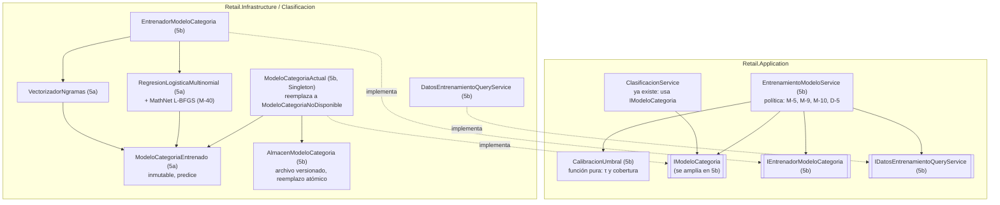

# Track 6.6, Fase 5: Plan de Implementación — Modelo de Categorías en C#

### Proyecto: Retail (Sistema ERP & Punto de Venta para Librería)

> [!WARNING]
> **Plan archivado (2026-10-26): reemplazado por M-45.** El experimento E-6 mostró que una tabla "término ambiguo + segunda palabra" cubre más que la regresión logística con la misma precisión, y el estudiante decidió no implementar ningún modelo estadístico. Este documento se conserva como registro del diseño evaluado y de las decisiones M-40 a M-42; **no se implementa**.

> **Para el agente que lea esto:** plan detallado de la Fase 5 del Track 6.6, escrito el 2026-10-24 para implementarse en sesiones nuevas. El diseño de fondo (qué modelo, por qué, con qué umbral) vive en [`etapa-6-track-6.6-catalogacion-inteligente.md`](file:///c:/Users/lucas/Proyectos/retail/docs/roadmap/etapa-6-track-6.6-catalogacion-inteligente.md), secciones 5, 7 y 10, y en sus decisiones M-1 a M-42; este documento no lo repite. Se trabaja paso a paso (CLAUDE.md §3): cada paso se explica, se muestra el diff y se espera la aprobación del estudiante antes del siguiente.
>
> **Decisiones de partida (aprobadas el 2026-10-24):** M-40 (MathNet.Numerics para el optimizador), M-41 (Fase 5 dividida en 5a y 5b) y M-42 (paridad del clasificador por probabilidades). Las decisiones de la 5b marcadas como **Propuesta** se confirman con el estudiante al empezar la 5b.

---

## 1. Estado de Avance

| Fase | Contenido | Estado |
| :--- | :--- | :---: |
| 5a | Modelo puro en memoria: vectorizador TF-IDF, regresión logística con L-BFGS, modelo entrenado que predice. Sin base, sin archivos, sin DI | ⏳ Plan escrito (2026-10-24) |
| 5b | Entrenamiento en producción: datos confirmados, partición, calibración de τ y salvaguardas (M-10), almacenamiento (M-8), puerto ampliado y reemplazo en DI | ⏳ Plan escrito; decisiones P-1 a P-8 a confirmar |

---

## 2. Arquitectura de la Fase 5

**Regla de reparto (Ley 1 y M-37):** la *técnica* (n-gramas, TF-IDF, regresión logística, formato del archivo) vive en Infraestructura y puede cambiar sin tocar Aplicación; la *política* (qué datos entrenan, umbral de precisión del 95 %, cobertura mínima, quién puede entrenar) vive en Aplicación, porque son reglas de negocio (M-1, M-5, M-9, M-10, D-5).

---

## 3. Fase 5a — Modelo puro en memoria

### 3.1 Alcance

Reproducir en C# `ml/scripts/vectorizador.py` y `ml/scripts/modelo.py` (regresión logística C = 100, n-gramas `char_wb` 3-4, sin tokens sin letras), con paridad verificada contra Python. **Fuera de la 5a:** la base de datos, el archivo del modelo, la calibración de τ (se recibe como parámetro), DI y cualquier cambio en Aplicación.

### 3.2 Pasos

#### 5a.1 — Referencia de paridad del clasificador (Python, sin compilar)

* **Script nuevo `ml/scripts/modelo_paridad.py`** (patrón de `vectores_paridad.py`): descripciones **inventadas** (nunca de la lista del distribuidor, regla 6 del handoff), unas 48 de entrenamiento en 4 categorías con Id numérico (por ejemplo 11 Cuadernos, 12 Lápices, 13 Mochilas, 14 Adhesivos), con palabras compartidas entre categorías ("ESCOLAR", "COLOR", "X 12") para que las probabilidades no sean todas cercanas a 1; y unas 8 descripciones de prueba, incluida una sin ningún n-grama conocido.
* Entrena `LogisticRegression(C=c, tol=1e-10, max_iter=100000)` con el vectorizador de `crear_vectorizador((3, 4), True)` para **dos valores de C**: 100 (producción) y 1 (probabilidades más repartidas, para que la comparación sea exigente).
* **Salida `ml/paridad/modelo-referencia.json`:** la configuración, los textos y etiquetas de entrenamiento, y para cada C: las clases (Ids), las probabilidades de cada descripción de entrenamiento y de prueba, y el **valor de la función objetivo en el óptimo** calculado con la fórmula de la sección 3.3 a partir de `coef_` e `intercept_`.
* Verificar que `vectores_paridad.py` ya ejercita la palabra más corta que el n-grama (lo documenta su encabezado); si no, agregar un caso.
* **Comprobación del script:** imprimir la cantidad de iteraciones de scikit-learn y fallar si no convergió.

#### 5a.2 — Paquete y vectorizador

* **Instalar** `MathNet.Numerics` **5.0.0** solo en `src/Retail.Infrastructure/Retail.Infrastructure.csproj` (M-40). No hay `Directory.Packages.props`: la versión va fija en el `PackageReference`. Compilar en Release para confirmar que no aparecen advertencias nuevas (`TreatWarningsAsErrors`).
* **`src/Retail.Infrastructure/Clasificacion/VectorDisperso.cs`:** `readonly record struct VectorDisperso(int[] Indices, double[] Valores)`, índices ordenados.
* **`src/Retail.Infrastructure/Clasificacion/VectorizadorNgramas.cs`** (`sealed`, inmutable después de ajustar):

| Miembro | Contrato | Equivalente Python |
| :--- | :--- | :--- |
| `static string Preparar(string descripcion)` | `ReglasClasificacion.LimpiarDescripcion` + `NormalizarTexto`, separa por espacio y descarta las palabras sin ninguna letra (`char.IsLetter`) | `vectorizador.preparar` |
| `static IReadOnlyList<string> Ngramas(string preparado)` | Por cada palabra: `" " + palabra + " "`; para n = 3 y luego n = 4, todas las ventanas de largo n; si la palabra rodeada es más corta que n, se emite una vez completa. **Mismo orden** que scikit-learn | `_char_wb_ngrams` |
| `static VectorizadorNgramas Ajustar(IReadOnlyList<string> descripciones)` | Vocabulario con los n-gramas presentes en al menos 2 documentos (`min_df = 2`), ordenado por `string.CompareOrdinal`; IDF `ln((1 + N) / (1 + df)) + 1` | `fit` |
| `VectorDisperso Transformar(string descripcion)` | TF por conteo × IDF, norma L2; un texto sin n-gramas del vocabulario da el vector vacío (no divide por cero) | `transform` |
| `int Dimension`, `IReadOnlyList<string> Vocabulario`, `IReadOnlyList<double> Idf` | Para el modelo y para el almacenamiento de la 5b | `vocabulary_`, `idf_` |

* **Tests** (`tests/Retail.Infrastructure.IntegrationTests/Clasificacion/VectorizadorNgramasTests.cs`, enlazando `ml/paridad/vectores-referencia.json` al proyecto como hace `Retail.Domain.UnitTests.csproj` con `reglas-texto-referencia.json`):
  * `Preparar_CasosDeReferencia_CoincidenConPython` (texto preparado exacto).
  * `Ngramas_CasosDeReferencia_CoincidenEnContenidoYOrden`.
  * `Ajustar_CorpusDeReferencia_VocabularioEIdfCoincidenConPython` (tolerancia 1e-6, `"tolerancia"` del JSON).
  * `Transformar_CasosDeReferencia_VectorCoincideConPython` (por n-grama, tolerancia 1e-6; norma 1).
  * `Transformar_TextoSinNgramasConocidos_DevuelveVectorVacio`.
  * `Ajustar_NgramaEnUnSoloDocumento_QuedaFueraDelVocabulario` (min_df).

#### 5a.3 — Regresión logística multinomial

* **`src/Retail.Infrastructure/Clasificacion/RegresionLogisticaMultinomial.cs`**. Ver la matemática en la sección 3.3.
  * `static RegresionLogisticaMultinomial Entrenar(IReadOnlyList<VectorDisperso> x, IReadOnlyList<int> clases, int dimension, double c, CancellationToken ct)`: las clases son índices 0..K-1 (el mapeo a Id de categoría es del modelo, 5a.4). Exige al menos 2 clases y C > 0.
  * `double[] Probabilidades(VectorDisperso x)` (softmax estable, restando el máximo).
  * `static (double Valor, double[] Gradiente) Objetivo(...)`: `internal`, expuesta a los tests con `InternalsVisibleTo` si el proyecto ya lo usa; si no, pública con comentario. Es la pieza que se defiende y se prueba aislada.
  * Optimización: `LimitedMemoryBfgsMinimizer` de MathNet con `ObjectiveFunction.Gradient`, memoria 10, tolerancia de gradiente pequeña (fijarla con el test de paridad) y tope de iteraciones; punto inicial en cero. **Antes de escribirlo, leer la firma real del minimizador en la documentación XML del paquete instalado.** La cancelación se comprueba dentro de la función objetivo (`ct.ThrowIfCancellationRequested()`), que el optimizador llama en cada iteración.
  * Si MathNet lanza por no converger dentro del tope, se traduce a una excepción propia con mensaje claro (no se expone el tipo de MathNet fuera del archivo).
* **Tests** (`.../Clasificacion/RegresionLogisticaMultinomialTests.cs`, enlazando `modelo-referencia.json`):
  * `Objetivo_GradienteAnalitico_CoincideConDiferenciasFinitas`: verificación numérica del gradiente en un punto aleatorio con semilla fija (diferencia central, tolerancia relativa 1e-5). Prueba que la derivada está bien **sin depender de Python**.
  * `Entrenar_ConCDeProduccionYDeReferencia_ProbabilidadesCoincidenConScikitLearn` (C = 100 y C = 1, tolerancia 1e-4, M-42).
  * `Entrenar_ValorDelObjetivoEnElOptimo_CoincideConScikitLearn` (tolerancia relativa 1e-6).
  * `Entrenar_MismosDatos_EsDeterminista`.
  * `Probabilidades_SiempreSumanUno` y `Probabilidades_VectorVacio_DependenSoloDeLosInterceptos`.
  * `Entrenar_UnaSolaClase_LanzaArgumentException`; `Entrenar_TokenCancelado_LanzaOperationCanceledException`.

#### 5a.4 — Modelo entrenado

* **`src/Retail.Infrastructure/Clasificacion/ModeloCategoriaEntrenado.cs`** (`sealed`, inmutable, seguro para predecir desde varios hilos): une el `VectorizadorNgramas`, la `RegresionLogisticaMultinomial`, el arreglo `IdsCategoria` (índice de clase → Id) y `Tau`.
  * `static ModeloCategoriaEntrenado Entrenar(IReadOnlyList<string> descripciones, IReadOnlyList<int> idsCategoria, double tau, CancellationToken ct)`: ajusta el vectorizador, mapea los Ids a clases en orden ascendente y entrena con C = 100 (constante documentada que remite a E-1).
  * `IReadOnlyList<PrediccionCategoriaDto> Predecir(IReadOnlyList<string> descripciones)`: categoría de probabilidad máxima, `Confianza` y `SuperaUmbral = Confianza >= Tau` (mismo contrato que el puerto `IModeloCategoria`).
  * **P-0 (se propone en la 5a.4, antes de codificar):** un texto **sin ningún n-grama conocido** devuelve `SuperaUmbral = false`, aunque los interceptos den una probabilidad alta (una categoría muy frecuente). El modelo no sabe nada del texto: sugerir sería sugerir el prior. Es una salvaguarda de M-1 que Python no aplica explícitamente; se registra como decisión si el estudiante la aprueba.
* **Tests** (`.../Clasificacion/ModeloCategoriaEntrenadoTests.cs`): de punta a punta con el corpus inventado de `modelo-referencia.json` (predice la categoría esperada en los casos claros); borde exacto de τ (`>=`); Ids no consecutivos se mapean bien; P-0; mismo orden de salida que de entrada; lista vacía devuelve lista vacía.

#### 5a.5 — Cierre de la 5a

* Verificación: `dotnet build Retail.sln --configuration Release`, `dotnet test` (al menos `Retail.Infrastructure.IntegrationTests`; completa si se va a commitear) y `dotnet format --verify-no-changes`. Archivos nuevos en CRLF.
* `docs/MAPA_DEL_PROYECTO.md`: fila del modelo de categorías en Infraestructura y la dependencia nueva en el stack.
* `AGENTS.md`, tabla "Stack Tecnológico de Referencia": **proponer** (no editar sin aprobación, es un archivo normativo) agregar la fila de MathNet.Numerics 5.0.0 con referencia a M-40.
* Track: Estado de Avance (Fase 5, 5a ✅) y decisiones nuevas (P-0 si se aprobó). Este documento: tabla de la sección 1. Handoff: punto de partida de la 5b.
* Commit solo si el estudiante lo pide.

### 3.3 La matemática que se implementa (y se defiende)

Para n documentos con vector TF-IDF `xᵢ ∈ ℝᴰ`, clase `yᵢ ∈ {0..K-1}`, pesos `W ∈ ℝᴷˣᴰ` e interceptos `b ∈ ℝᴷ`:

* Puntajes: `zᵢₖ = Wₖ · xᵢ + bₖ`; probabilidades: `pᵢₖ = exp(zᵢₖ − mᵢ) / Σⱼ exp(zᵢⱼ − mᵢ)`, con `mᵢ = maxₖ zᵢₖ` (estabilidad numérica).
* **Función objetivo** (la misma que minimiza scikit-learn con `lbfgs`, salvo un factor de escala que no mueve el óptimo):

  `f(W, b) = Σᵢ [ log Σₖ exp(zᵢₖ) − zᵢ,yᵢ ] + (1 / (2C)) · Σₖ ‖Wₖ‖²`  — los interceptos no se penalizan.

* **Gradiente:** `∂f/∂Wₖ = Σᵢ (pᵢₖ − [yᵢ = k]) · xᵢ + Wₖ / C`;  `∂f/∂bₖ = Σᵢ (pᵢₖ − [yᵢ = k])`.
* **Por qué la paridad puede exigir probabilidades (M-42):** con la penalización L2, `f` es estrictamente convexa en `W`; las probabilidades del óptimo son únicas aunque los interceptos admitan un corrimiento común. Dos optimizadores correctos llegan al mismo modelo; si las probabilidades difieren, hay un error.
* **Costo:** con vectores dispersos (unos 60 n-gramas por descripción), una evaluación de `f` y su gradiente cuesta `O(nnz · K)`: para 15.000 artículos y 46 categorías, unos 4·10⁷ productos; L-BFGS necesita del orden de cientos de evaluaciones (sección 5.4 del track: segundos).

### 3.4 Archivos de la 5a

| Acción | Archivo |
| :--- | :--- |
| Nuevo | `ml/scripts/modelo_paridad.py`, `ml/paridad/modelo-referencia.json` |
| Modificar | `src/Retail.Infrastructure/Retail.Infrastructure.csproj` (paquete) |
| Nuevo | `src/Retail.Infrastructure/Clasificacion/VectorDisperso.cs`, `VectorizadorNgramas.cs`, `RegresionLogisticaMultinomial.cs`, `ModeloCategoriaEntrenado.cs` |
| Modificar | `tests/Retail.Infrastructure.IntegrationTests/Retail.Infrastructure.IntegrationTests.csproj` (enlaces a los dos JSON) |
| Nuevo | `tests/Retail.Infrastructure.IntegrationTests/Clasificacion/VectorizadorNgramasTests.cs`, `RegresionLogisticaMultinomialTests.cs`, `ModeloCategoriaEntrenadoTests.cs` |
| Modificar | `docs/MAPA_DEL_PROYECTO.md`, track 6.6, este documento, handoff, `ml/README.md` (script nuevo) |

---

## 4. Fase 5b — Entrenamiento en producción

### 4.1 Alcance

Entrenar con el catálogo confirmado de la tienda, decidir si el modelo nuevo se publica (M-10), guardarlo como dato derivado (M-8) y que `ClasificacionService` lo use sin cambios. **Fuera de la 5b (Fase 6):** el botón "Actualizar modelo", la pantalla de estado del modelo, el disparo automático al iniciar una incorporación y la semilla de `Retail.Cli`.

### 4.2 Decisiones a confirmar al empezar la 5b

| ID | Propuesta | Recomendación y motivo |
| :--- | :--- | :--- |
| **P-1** | **Política en Aplicación, técnica en Infraestructura** (sección 2): `EntrenamientoModeloService` decide con qué datos se entrena, calibra τ y decide si se publica; Infraestructura solo entrena, predice y guarda. | Recomendada. Los números del 95 % (M-1), el mínimo de 5 ejemplos (M-9) y la cobertura del 30 % (M-10) son reglas de negocio; dejarlos dentro de Infraestructura los escondería detrás del puerto. |
| **P-2** | **Datos de entrenamiento:** artículos activos con `IdCategoria` y `OrigenCategoria` no nulos (M-5: vistos por una persona) cuya categoría esté activa; texto = `Articulo.Descripcion`. Se excluyen las categorías con menos de 5 ejemplos (M-9) y se informa cuáles quedaron afuera. Hacen falta al menos 2 categorías elegibles. | Recomendada. Es la definición de las secciones 7 y 8.2 del track. |
| **P-3** | **Partición agrupada por familia** (primeras tres palabras de la descripción limpia, como `datos_modelo.familia`): 80 % entrenamiento y 20 % validación, asignando cada familia completa a un lado según un hash estable de la familia (determinista, sin `Random`). | Recomendada. Separar por familia evita medir sobre casi-duplicados del entrenamiento (sección 6.2 del track, M-22). El hash estable hace reproducible cada entrenamiento. |
| **P-4** | **Calibración de τ** (`CalibracionUmbral`, función pura en Aplicación): sobre las predicciones de validación ordenadas por confianza, τ es la **menor** confianza tal que la precisión de las predicciones con confianza ≥ τ sea ≥ 95 %; la cobertura es la fracción de la validación con confianza ≥ τ. Si ningún τ alcanza el 95 % o la cobertura queda por debajo del 30 %, **no se publica** y sigue el modelo vigente, informando el motivo. Si se publica, se reentrena con el 100 % de los datos y se guarda con ese τ, su precisión y su cobertura. | Recomendada. Es el diagrama de la sección 7.2 del track. "Menor τ" maximiza la cobertura sin violar M-1. |
| **P-5** | **Dónde se guarda:** `%LOCALAPPDATA%\Retail POS\modelo\modelo-categorias.bin` (misma regla que `UbicacionDeLogs`), fuera de los respaldos (M-8). Reemplazo atómico con `File.Replace(temporal, vigente, anterior)`: queda `modelo-categorias.anterior.bin`. | Recomendada. Sin problemas de permisos ni de cuenta de servicio (la tarea de respaldo corre como SYSTEM y no usa el modelo). Consecuencia aceptada: cada usuario de Windows tiene su copia; es un dato derivado y se regenera. Alternativas descartadas: `ProgramData` (permisos y riesgo de redirección, como explica `UbicacionDeLogs`) y la base de datos (entraría en los respaldos, contra M-8). |
| **P-6** | **Formato propio binario y versionado** (`BinaryWriter`): marca `RTLM`, versión de formato, fecha, τ, precisión, cobertura, huella del catálogo (P-7), vocabulario, IDF, Ids de categoría, pesos en `float` (32 bits) e interceptos. Un archivo ilegible, de otra versión o truncado deja el modelo **no disponible** (se registra en el log) en vez de romper la aplicación. | Recomendada. Unos 6 MB para 15.000 artículos; JSON pesaría unos 30 MB. Los pesos en 32 bits cambian las probabilidades en el orden de 1e-7, muy por debajo de cualquier decisión. |
| **P-7** | **Correspondencia con la base:** el archivo guarda el `family_guid` de la base (`sys.database_recovery_status`), que se conserva al restaurar una copia de la **misma** base y es distinto en otra base. Al cargar, si no coincide, el modelo queda no disponible (los Id de categoría podrían significar otra cosa). Además guarda una **huella del catálogo confirmado** (cantidad y suma de verificación de los pares Id de artículo e Id de categoría): si cambió, el modelo sigue disponible pero se informa `Desactualizado` (la Fase 6 decide cuándo reentrenar). | Recomendada, **verificando primero** con un test de integración que usa la infraestructura de respaldos existente que `family_guid` se conserva al restaurar y difiere entre bases. Si no se cumple, alternativa: una tabla de identidad de instalación con un GUID creado por la migración (requiere migración, regla 9). |
| **P-8** | **Concurrencia y ciclo de vida:** `ModeloCategoriaActual` (Singleton) guarda el modelo vigente en un campo `volatile` que se reemplaza de una vez al publicar (los lectores nunca ven un modelo a medio armar). Un solo entrenamiento a la vez por proceso, con `SemaphoreSlim(1)` y espera cero: un segundo pedido recibe "Ya hay un entrenamiento en curso". La carga del archivo es perezosa y en segundo plano (`Task.Run`, Ley 4), disparada por el primer uso; **no se toca `App.xaml.cs`** (Ley 10). `ModeloCategoriaNoDisponible` se elimina: sin archivo, `ModeloCategoriaActual` ya es el arranque en frío (M-37). | Recomendada. Un semáforo por proceso no es un bloqueo global de la base (lo prohíbe AGENTS.md); protege un recurso en memoria. |

### 4.3 Contratos de la 5b

| Pieza | Capa | Contenido |
| :--- | :--- | :--- |
| `IModeloCategoria` (se amplía) | Aplicación (`Interfaces/Infrastructure`) | Se mantienen `EstaDisponible` y `Predecir`. Se agregan `Task AsegurarCargadoAsync(CancellationToken)`, `EstadoModeloDto ObtenerEstado()` y `void Publicar(ModeloEntrenadoDto modelo)` (o equivalente; definir en 5b.2). `ClasificacionService.SugerirAsync` llama a `AsegurarCargadoAsync` antes de predecir |
| `IEntrenadorModeloCategoria` (nuevo) | Aplicación | `ModeloCandidato Entrenar(IReadOnlyList<EjemploEntrenamientoDto> ejemplos, IProgress<int>? progreso, CancellationToken ct)`; el candidato predice (para calibrar) sin estar publicado. El tipo concreto del candidato no cruza a Aplicación más que como contrato |
| `IDatosEntrenamientoQueryService` (nuevo) | Aplicación (`Interfaces/Persistence`) | `ObtenerEjemplosAsync` (proyección `AsNoTracking` de Id, descripción e Id de categoría, filtros de P-2 en SQL, Ley 8), `ObtenerHuellaAsync` (P-7) e `ObtenerIdentidadBaseAsync` (`family_guid`) |
| `IEntrenamientoModeloService` / `EntrenamientoModeloService` (nuevo) | Aplicación | `Task<ResultadoEntrenamientoDto> EntrenarAsync(int idActor, IProgress<int>? progreso, CancellationToken ct)`: autorización D-5 (M-10: los mismos roles que administran la clasificación), P-2, P-3, entrenamiento del candidato, P-4, reentrenamiento con el 100 % y publicación. Corre en `Task.Run` (Ley 4) |
| `CalibracionUmbral` (nuevo) | Aplicación (`Services/Clasificacion/`) | Función pura de P-4: recibe pares (confianza, acierto) y devuelve τ, precisión y cobertura, o el motivo por el que no se publica |
| DTOs nuevos | Aplicación (`DTOs/Clasificacion/`) | `EjemploEntrenamientoDto`, `ResultadoEntrenamientoDto` (publicado o no, motivo, τ, precisión, cobertura, ejemplos usados, categorías excluidas por M-9, duración), `EstadoModeloDto` (disponible, fecha, τ, precisión, cobertura, desactualizado) |
| `EntrenadorModeloCategoria`, `AlmacenModeloCategoria`, `ModeloCategoriaActual`, `DatosEntrenamientoQueryService` | Infraestructura | Implementaciones; `AlmacenModeloCategoria` recibe la carpeta por constructor para poder probarlo en una carpeta temporal |

### 4.4 Pasos

| Paso | Contenido | Tests |
| :--- | :--- | :--- |
| **5b.0** | Confirmar P-1 a P-8 con el estudiante. Test exploratorio de P-7 (`family_guid` antes y después de restaurar; dos bases distintas) | El propio test exploratorio, que queda como test de integración si confirma la regla |
| **5b.1** | `CalibracionUmbral` y la partición por familia (funciones puras de Aplicación) | Unitarios exhaustivos: τ mínimo que cumple 95 %; empates de confianza; ningún τ alcanza; cobertura bajo el 30 %; validación vacía; la partición nunca separa una familia y es determinista |
| **5b.2** | Contratos: DTOs, puertos nuevos y ampliación de `IModeloCategoria`, **junto con** sus implementaciones mínimas para que cada paso compile (lección de la 4b). `ClasificacionService` llama a `AsegurarCargadoAsync` | Los existentes de `ClasificacionService` siguen en verde |
| **5b.3** | `DatosEntrenamientoQueryService` (push-down de P-2, huella, `family_guid`) | Integración: solo entran artículos confirmados, activos y con categoría activa; la huella cambia al confirmar un artículo nuevo |
| **5b.4** | `AlmacenModeloCategoria` (P-5, P-6) | Integración en carpeta temporal: ida y vuelta conserva las predicciones (tolerancia por los 32 bits); reemplazo atómico conserva el anterior; archivo truncado, de otra versión o con otra marca → no disponible sin excepción |
| **5b.5** | `EntrenadorModeloCategoria` y `ModeloCategoriaActual` (P-8); reemplazo en DI de `ModeloCategoriaNoDisponible` (Singleton) y eliminación de esa clase | Carga perezosa; publicación visible para los lectores; segundo entrenamiento simultáneo rechazado; `InyeccionDependenciasTests` y `DependencyInjectionTests` en verde |
| **5b.6** | `EntrenamientoModeloService` (P-1 a P-4) y su registro en DI | Unitarios con NSubstitute: autorización primero; M-9 y menos de 2 categorías; no publica si P-4 falla y el vigente sigue; publica reentrenando con el 100 %; progreso y cancelación |
| **5b.7** | Prueba de punta a punta contra SQL Server: artículos inventados confirmados, entrenar, publicar y que `ClasificacionService.SugerirAsync` devuelva sugerencias con motivo `Modelo` | Integración |
| **5b.8** | Cierre: verificación Release completa, mapa (incluida la baja de `ModeloCategoriaNoDisponible`), track (P-x aprobadas como M-4x, Estado de Avance), `SISTEMA_DE_PERSISTENCIA.md` si P-7 agrega una consulta a vistas del sistema, handoff. Nota de `wiki/` propuesta | — |

**Medición con datos reales (opcional, regla 6 del handoff):** el tiempo y la memoria de entrenamiento con los 14.876 artículos se miden en la Fase 7 o con un script que no imprime descripciones; nunca se copian datos de la lista al repositorio ni a los tests.

### 4.5 Riesgos

| Riesgo | Mitigación |
| :--- | :--- |
| `family_guid` no se comporta como se espera | P-7 empieza con un test exploratorio (5b.0); alternativa con migración ya identificada |
| Entrenamiento lento o con mucha memoria (≈ 1,4 millones de parámetros) | Vectores dispersos; un solo arreglo de parámetros reutilizado; si hace falta, el gradiente se paraleliza por documentos. RNF-03 (≤ 300 MB): unos 11 MB de parámetros en `double` más los vectores de MathNet |
| Una categoría dada de baja después del entrenamiento | Ya cubierto: `ClasificacionService` solo sugiere categorías activas (`DiccionariosDelLote.EsCategoriaActiva`); desaparece en el siguiente entrenamiento (sección 7 del track) |
| Archivo del modelo dañado o manipulado | P-6: se valida al cargar y, si falla, el sistema vuelve al arranque en frío. Es un dato derivado: nunca impide trabajar |
| Escribir en `App.xaml.cs` para cargar el modelo al inicio | Prohibido por la Ley 10: carga perezosa (P-8) |

---

## 5. Preguntas de Defensa Previstas

1. ¿Por qué la paridad del clasificador puede exigir probabilidades iguales y no solo métricas parecidas? (Convexidad estricta y óptimo único, sección 3.3.)
2. ¿Qué prueba el test de diferencias finitas que no prueba la paridad con Python?
3. ¿Por qué MathNet y no ML.NET, si ML.NET "hace todo"? (M-40: su vectorizador no es `char_wb`, la escala de regularización difiere y τ dejaría de valer.)
4. ¿Por qué la política de entrenamiento está en Aplicación si el modelo está en Infraestructura?
5. ¿Qué pasa si se restaura una copia de seguridad de otra sucursal? (P-7.)
6. ¿Por qué el modelo no entra en los respaldos? (M-8.)
7. ¿Cómo se evita que un modelo con etiquetas inconsistentes empeore las sugerencias? (P-4: falla hacia la abstención.)
