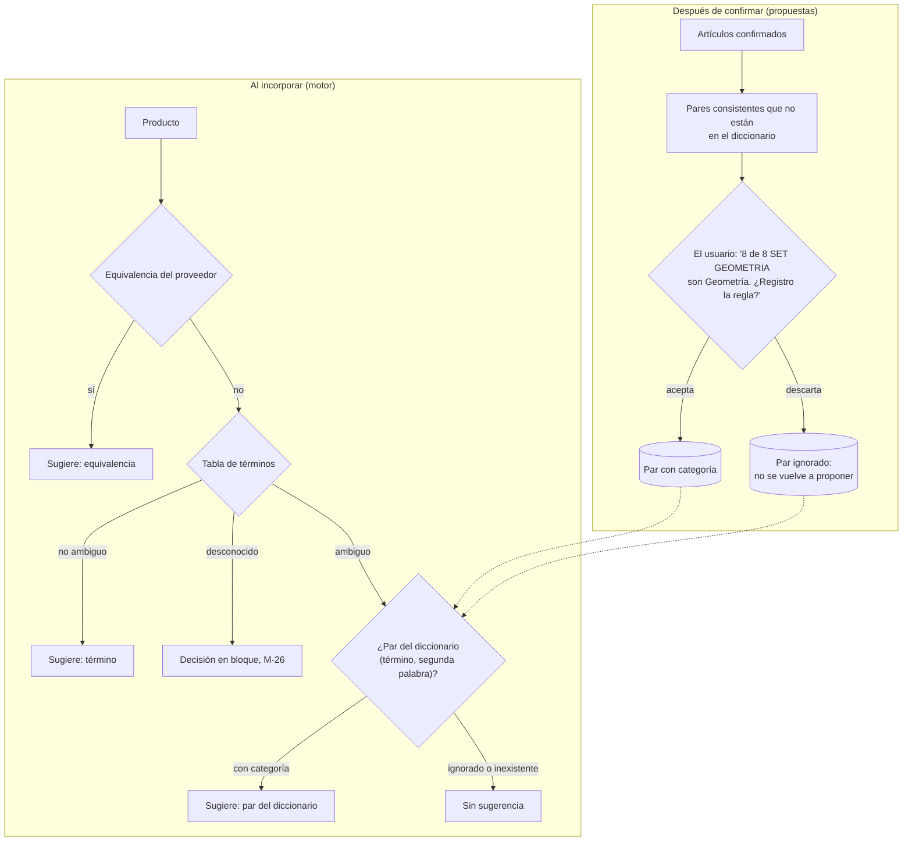

# Track 6.6, Fase 5: Plan de Implementación — Reglas de Pares "Término Ambiguo + Segunda Palabra"

### Proyecto: Retail (Sistema ERP & Punto de Venta para Librería)

> **Para el agente que lea esto:** plan de la Fase 5 del Track 6.6 tal como quedó después del experimento E-6 (sección 11.3 del track) y de las decisiones M-45, M-48 y M-49 (2026-10-26). **Reemplaza** al plan de la regresión logística ([`etapa-6-track-6.6-fase-5-modelo.md`](file:///c:/Users/lucas/Proyectos/retail/docs/roadmap/etapa-6-track-6.6-fase-5-modelo.md), archivado). El diseño de fondo del motor vive en [`etapa-6-track-6.6-catalogacion-inteligente.md`](file:///c:/Users/lucas/Proyectos/retail/docs/roadmap/etapa-6-track-6.6-catalogacion-inteligente.md) (secciones 4, 7 y 8; decisiones M-14, M-26, M-27, M-32, M-35). Se trabaja paso a paso (CLAUDE.md §3): cada paso se explica, se muestra el diff y se espera la aprobación del estudiante.
>
> **Lectura obligatoria antes de los pasos 5.2 y 5.3 (Nivel 3 de AGENTS.md):** [`SISTEMA_DE_PERSISTENCIA.md`](file:///c:/Users/lucas/Proyectos/retail/docs/SISTEMA_DE_PERSISTENCIA.md) y, por la tabla nueva, [`DER.mmd`](file:///c:/Users/lucas/Proyectos/retail/docs/DER.mmd).

---

## 1. Estado de Avance

| Paso | Contenido | Estado |
| :--- | :--- | :---: |
| 5.0 | Confirmar las propuestas P-1 a P-6 y el texto de la ERS | ✅ 2026-10-26: P-1 a P-6 y el texto de la sección 5 aprobados (M-50 a M-55) |
| 5.1 | Regla de la segunda palabra (Dominio) con paridad contra Python | ✅ 2026-10-26: M-56 (sin el punto final, en C# y en `e6_comun.py`; E-6 pasa de 58,4 % a 58,7 % con la misma precisión) |
| 5.2 | `ParClasificacion`, hija de `TerminoClasificacion` (Dominio) | ✅ 2026-10-26 |
| 5.3 | Persistencia: mapeo, migración e índices | ✅ 2026-10-26: M-57 (`AutoInclude` de los pares), `CK_PARES_CLASIFICACION_SegundaPalabra`; sin test de migración sobre datos (crea una tabla vacía) |
| 5.4 | Comandos y consultas de pares (Aplicación e Infraestructura) | ✅ 2026-10-27: cascada de la categoría con `FindAsync(t => t.Pares.Any(...))`, sin método nuevo en el puerto; carrera de P-3 entre dos usuarios aceptada (el par queda inerte, como R-5) |
| 5.5 | Nivel nuevo del motor: par del diccionario | ✅ 2026-10-27: el motor no carga los pares ignorados; la consulta exige el término ambiguo en SQL (neutraliza la carrera de P-3); `ParDelDiccionario = 6`, `Modelo = 7` hasta el 5.8 |
| 5.6 | Pares propuestos a partir de los artículos confirmados (consulta) | ✅ 2026-10-27: pre-filtro amplio con `COLLATE Latin1_General_CI_AI` y decisión exacta en C#; "confirmado" = artículo activo con categoría activa (cualquier origen); 3.000 artículos en ~150 ms |
| 5.7 | Semilla de pares (`ml/`) | ✅ 2026-10-27: `consolidar_pares.py` con unanimidad y conflictos a revisión (M-58, en lugar de la pureza ≥ 0,6 de P-6); 150 candidatos validados por el estudiante (vacío = descartar; KIT BIC → Útiles Escolares, REPUESTO CUTTER → Oficina): **102 pares** en `ml/datos/pares.csv`, 48 descartados. La copia versionada y su carga son del paso 6.1 |
| 5.8 | Retiro del puerto del modelo | ✅ 2026-10-27: borrados `IModeloCategoria`, `ModeloCategoriaNoDisponible` y `PrediccionCategoriaDto`; sin `Confianza`, `Propuesta`, `CoincidenConLaPropuesta`, `ModeloDisponible` ni el motivo `Modelo`. Ningún uso en `Retail.App` |
| 5.9 | Cierre: ERS, DER, mapa, track, plan de la Fase 6, handoff, verificación Release | ✅ 2026-10-27: `RF-27`, `IU-04`, `IU-05` y la matriz; M-50 a M-58 en el track; verificación Release: build sin advertencias, **2.620 tests** (Dominio 733, Aplicación 857, App 541, Integración 489) y `dotnet format` en verde. **Fase 5 cerrada** |

---

## 2. El diseño (M-48, M-49)

El motor sugiere **solo a partir de reglas aprobadas por una persona**. La estadística sobre los artículos confirmados no sugiere: **propone reglas nuevas**, que el usuario acepta o descarta. Es la práctica de la gestión de datos maestros (MDM/PIM): reglas de derivación administradas, propuestas a partir del uso, aprobación humana y auditoría.

| Pieza | Qué es | Cómo nace | Quién lo corrige |
| :--- | :--- | :--- | :--- |
| **Par con categoría** | Regla: `SET` + `GEOMETRIA` → Geometría. Sugiere sin umbrales, como la tabla de términos | Semilla (M-15), alta manual o propuesta aceptada | El usuario, en la pestaña Términos (Fase 6) |
| **Par ignorado** | El par existe sin categoría: "ya lo vi y no es una regla". No sugiere y no se vuelve a proponer | Propuesta descartada | El usuario, asignándole una categoría |
| **Propuesta** | Par consistente en los artículos confirmados que todavía no está en el diccionario | Una consulta, al pedirla | No se guarda: se acepta o se descarta |

---

## 3. Propuestas a confirmar en el paso 5.0

| ID | Propuesta | Recomendación y motivo |
| :--- | :--- | :--- |
| **P-1** | **Orden:** esta Fase 5 se implementa **antes** de la Fase 6 (modifica el orden de M-43). | Recomendada. La Fase 6 muestra el motivo nuevo, la pestaña de pares y las propuestas sin retrabajo |
| **P-2** | **Retirar el puerto del modelo** (`IModeloCategoria`, `ModeloCategoriaNoDisponible`, `PrediccionCategoriaDto`, el motivo `Modelo`, la propuesta y la consistencia de `BloqueTerminoNuevoDto`, `ModeloDisponible` y la `Confianza` de las sugerencias si nadie más la usa). | Recomendada como paso 5.8. Sin modelo es código muerto (AGENTS.md, cero abstracciones no usadas). Los bloques de M-26 llegan sin propuesta, como hoy |
| **P-3** | **Un par solo existe mientras su término es ambiguo.** Agregar un par a un término con categoría es un error de dominio; asignarle una categoría a un término ambiguo **da de baja sus pares**, y la baja del término también. | Recomendada. Un par de un término no ambiguo nunca se consultaría: guardarlo sería un estado oculto. Misma regla que M-35. La UI de la Fase 6 avisa cuántos pares se pierden antes de confirmar |
| **P-4** | **Par ignorado = par sin categoría** (`IdCategoria` nulo, `EsIgnorado` derivado), el mismo patrón que la equivalencia ignorada (M-32) y el término ambiguo (M-27). Descartar una propuesta la guarda así. | Recomendada. Sin memoria de lo descartado, la misma propuesta volvería en cada consulta. No hace falta otra tabla ni un estado aparte |
| **P-5** | **Criterio de propuesta:** soporte ≥ 2 y pureza ≥ 0,8 entre los artículos confirmados (M-5), activos y de categoría activa, excluidos los pares que ya están en el diccionario (con categoría o ignorados). Se calcula con un filtro en SQL por los términos ambiguos y el conteo en C# con la regla del Dominio (paso 5.6). | Recomendada. Más exigente que los umbrales de E-6 (soporte 1, pureza 0,6) porque cada propuesta pide la atención del usuario: con un solo artículo, la propuesta sería ruido. La segunda palabra sale de la regla con paridad, no de una función de SQL (Ley 8); el conteo en memoria queda fuera del camino de la sugerencia y se documenta como excepción acotada |
| **P-6** | **Semilla de pares:** un script genera `ml/datos/pares.csv` (`termino;segunda_palabra;categoria`) desde los ejemplos manuales validados (`ambiguos.csv`) con el criterio de E-6 (soporte ≥ 1 y pureza ≥ 0,6); el estudiante revisa la planilla antes de que entre a la semilla, que carga `cargar-diccionarios` (paso 6.1 de la Fase 6). | Recomendada. Es lo que hace que el 58 % de E-6 valga desde el primer día. Son palabras genéricas y marcas, como los términos: coherente con M-15 |

---

## 4. Pasos

### 5.1 — Regla de la segunda palabra (Dominio)

* **`ReglasClasificacion`:** `SegundaPalabra(string descripcion)` (primera palabra después del término, en forma de comparación, con al menos 2 letras y fuera de la lista de relleno `DE`, `DEL`, `LA`, `EL`, `LOS`, `LAS`, `Y`, `CON`, `PARA`, `X`, `P/`, `C/`; vacía si no hay), y el par `EsSegundaPalabraValida` / `ExigirSegundaPalabra` para guardar pares (una sola palabra, al menos 2 letras, no de relleno, hasta `LongitudMaximaTermino`).
* **Paridad:** `ml/scripts/reglas_paridad.py` agrega casos de `e6_comun.segunda_palabra` (relleno, palabras de una letra, tokens numéricos, prefijo `*`, tildes y ñ, descripción de una sola palabra) y regenera `ml/paridad/reglas-texto-referencia.json`; `ParidadReglasTextoTests` los compara.
* **Tests:** paridad y los bordes de `ExigirSegundaPalabra`.

### 5.2 — `ParClasificacion` (Dominio)

* **`Entities/ParClasificacion.cs`:** entidad hija (no raíz, Ley 2) con `IdTermino`, `SegundaPalabra` (forma de comparación), `IdCategoria` opcional (referencia por Id, como D-13) y `EsIgnorado` derivado (P-4).
* **`TerminoClasificacion`:** colección privada `_pares` y métodos de la raíz:
  * `AsignarPar(string segundaPalabra, int? idCategoria)`: crea el par o reemplaza su destino (como M-32); sin categoría queda ignorado; exige `EsAmbiguo` (P-3).
  * `QuitarPar(string segundaPalabra)`: baja lógica (Ley 3).
  * `QuitarParesHacia(int idCategoria)`: para la cascada de M-35, como `Proveedor.QuitarEquivalenciasHacia`.
  * `AsignarCategoria` y `MarkAsDeleted` dan de baja los pares vigentes (P-3).
* **Tests** (`Retail.Domain.UnitTests`): unicidad dentro del término, reasignación, ignorado, P-3, cascada, forma de comparación.

### 5.3 — Persistencia

* `ParClasificacionConfiguration` (tabla `PARES_CLASIFICACION`), navegación desde `TerminoClasificacionConfiguration` con acceso por campo (como `Marca.Alias`), FK a `CATEGORIAS` con `Restrict`, índice único filtrado (`id_termino`, `segunda_palabra`) con `[deleted_at] IS NULL`.
* **Migración** `AgregarParesClasificacion` (regla 9 del handoff; `CA1861` con `#pragma` si el índice compuesto lo pide, como las anteriores).
* `DER.mmd` y la matriz de trazabilidad de la ERS (`RF-27`) con la tabla nueva.
* **Tests de integración:** índice único (uno dado de baja libera el par), FK, par ignorado, cascada de P-3 leída con un contexto nuevo, y la migración sobre una base con términos existentes.

### 5.4 — Comandos y consultas (Aplicación e Infraestructura)

* **`ITerminoClasificacionService`:** `AsignarParAsync(int idActor, AsignarParDto dto)` (con categoría, o sin ella para ignorar) y `QuitarParAsync(int idActor, QuitarParDto dto)`, con autorización D-5, validadores y traducción de carreras (`PersistenciaDiccionarios.GuardarAsync`); la categoría de destino debe estar activa (D-23). `AsignarParesAsync` para aceptar o descartar varias propuestas en una sola operación.
* **Cascada de M-35:** `CategoriaService.BajaAsync` da de baja también los pares hacia la categoría, cargando por la raíz los términos que los tienen, en el mismo `SaveChanges`.
* **`IClasificacionQueryService.ListarParesAsync(int? idTermino, string? filtro, bool incluirIgnorados)`** para la pestaña de la Fase 6 (`AsNoTracking`, proyección, filtros en SQL).
* **Tests:** unitarios (NSubstitute) y de integración, con la forma de los de la Fase 4b.

### 5.5 — Nivel nuevo del motor: par del diccionario

* **Contratos:** `ParDiccionarioDto` (término, segunda palabra, Id de categoría) en `DiccionariosClasificacionDto`; motivo `ParDelDiccionario`.
* **`DiccionariosClasificacionQueryService.ObtenerParaLoteAsync`:** suma los pares con categoría de los términos ambiguos del lote (filtro en SQL).
* **`DiccionariosDelLote`:** búsqueda por (término, segunda palabra).
* **`ClasificacionService`:** en `SugerirCategoriaSinModelo`, cuando el término es ambiguo busca el par con la segunda palabra del ítem; un par ignorado o hacia una categoría inactiva no sugiere.
* **Tests unitarios:** el par sugiere solo con término ambiguo; ignorado; categoría inactiva; sin segunda palabra; el ítem resuelto por un par no queda como ambiguo pendiente. **Integración:** recorrido completo contra SQL Server.

### 5.6 — Pares propuestos (consulta)

* **`ITerminoClasificacionService.ListarParesPropuestosAsync(int? idTermino)`** → `ParPropuestoDto` (término, segunda palabra, categoría mayoritaria, coincidencias, total y hasta tres descripciones de ejemplo de los artículos del propio comercio).
* **Implementación** (puerto de consulta e Infraestructura): SQL filtra los artículos confirmados (con `OrigenCategoria`), activos y de categoría activa cuya descripción contiene alguno de los términos ambiguos, y proyecta descripción e Id de categoría; C# obtiene término y segunda palabra con las reglas del Dominio, cuenta, descarta los pares que ya están en el diccionario y aplica P-5. No interviene al sugerir: la Fase 6 la invoca a pedido.
* **Tests:** unitarios del criterio (soporte y pureza en el borde, exclusión de pares existentes e ignorados, empate de categorías: gana la de más casos y, a igualdad, el menor Id) e integración con volumen.

### 5.7 — Semilla de pares (`ml/`, sin compilar)

* `ml/scripts/consolidar_pares.py`: lee `ambiguos.csv`, calcula los pares con `e6_comun` y el criterio de P-6, y escribe `ml/datos/pares.csv` marcando para revisión los de soporte 1 o pureza menor que 1.
* El estudiante revisa la planilla (`validado`, como en M-19). La copia versionada para la semilla y su carga son del paso 6.1 de la Fase 6.

### 5.8 — Retiro del puerto del modelo (P-2)

* Quitar lo enumerado en P-2 y su registro Singleton en DI; simplificar `ClasificacionService` (sin `Predecir` ni `SugerirPorModelo`).
* Ajustar los tests que los usaban; `InyeccionDependenciasTests` y `DependencyInjectionTests` en verde.

### 5.9 — Cierre

* **ERS** (texto aprobado en el paso 5.0, sección 5 de este plan): `RF-27`, `IU-04`, `IU-05` y la matriz de trazabilidad.
* `DER.mmd`, `MAPA_DEL_PROYECTO.md` (entidad, migración, comandos, propuestas; baja del puerto del modelo), track (Estado de Avance; P-x aprobadas como M-5x), plan de la Fase 6 (ya ajustado a M-49), handoff.
* Verificación Release completa (`audit-xaml.ps1` no aplica si no se tocó XAML).

---

## 5. Texto propuesto para la ERS

| | Texto |
| :--- | :--- |
| **RF-27 actual** | "Al incorporar artículos del catálogo de un proveedor, el sistema sugiere para cada uno una categoría y una marca a partir de la descripción y del código de barras, indicando el motivo y la confianza de la sugerencia. El sistema se abstiene cuando la confianza no alcanza el umbral que el sistema calibra en cada entrenamiento. Ninguna sugerencia se aplica sin confirmación del usuario. El modelo de categorías se reentrena localmente con los artículos confirmados, sin conexión a Internet." |
| **RF-27 propuesto** | "Al incorporar artículos del catálogo de un proveedor, el sistema sugiere para cada uno una categoría y una marca a partir de la descripción y del código de barras, aplicando diccionarios de clasificación administrables (términos, pares de palabras, marcas, alias, prefijos y equivalencias por proveedor), e indica el motivo de cada sugerencia. Cuando ninguna regla aplica, el sistema no sugiere. Ninguna sugerencia se aplica sin confirmación del usuario. A partir de los artículos confirmados, el sistema propone reglas nuevas, que se aplican solo después de que el usuario las aprueba. Funciona sin conexión a Internet." |
| **IU-05** | "…con su motivo y confianza…" → "…con su motivo…" |
| **IU-04** | Agregar "pares de palabras y reglas propuestas" a la administración de la clasificación |

---

## 6. Riesgos

| Riesgo | Mitigación |
| :--- | :--- |
| Las propuestas se acumulan y nadie las mira | La Fase 6 las muestra donde el usuario ya decide (pestaña Términos y aviso al terminar una incorporación); P-4 evita que vuelvan las descartadas |
| Un término ambiguo muy frecuente trae muchos artículos al calcular propuestas | Filtro por término en SQL, proyección de dos columnas, consulta a pedido (no en cada sugerencia); prueba de integración con volumen |
| Perder pares al asignarle categoría a un término (P-3) | La Fase 6 muestra cuántos pares se dan de baja antes de confirmar |
| Divergencia entre la regla de C# y la de Python | Paridad del paso 5.1 |
| Carrera de P-3: un usuario agrega un par mientras otro le asigna categoría al término (sin `rowversion` en `TERMINOS_CLASIFICACION`) | **Aceptado** (2026-10-27, como R-5): el par queda vigente pero inerte, porque el motor (5.5) solo consulta pares de términos ambiguos y las propuestas (5.6) no lo cuentan |

---

## 7. Preguntas de Defensa Previstas

1. ¿Por qué la estadística propone reglas en lugar de sugerir directamente? (Aprobación humana y auditoría de MDM; M-49.)
2. ¿Por qué los pares son hijos de `TerminoClasificacion` y no una raíz propia, si los términos sí lo son?
3. ¿Para qué guardar un par "ignorado"? (P-4, el patrón de M-27 y M-32.)
4. ¿Qué pasa con los pares cuando un término deja de ser ambiguo? (P-3.)
5. ¿Cómo aprende el sistema sin un modelo estadístico? (Términos registrados en bloque, equivalencias y pares propuestos y aprobados.)
6. ¿Por qué el criterio de propuesta es más exigente que los umbrales que midió E-6? (P-5.)
