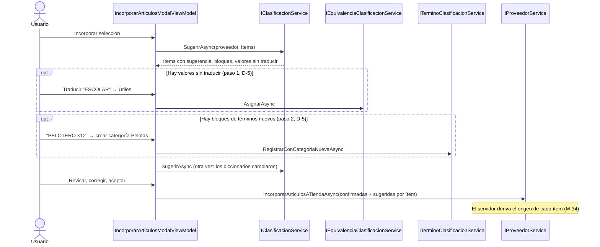

# Track 6.6, Fase 6: Plan de Implementación — Interfaz de Catalogación y Semilla

### Proyecto: Retail (Sistema ERP & Punto de Venta para Librería)

> **Para el agente que lea esto:** plan detallado de la Fase 6 del Track 6.6, escrito el 2026-10-24 para implementarse en una sesión nueva. **Actualizado el 2026-10-26 (M-45, M-48, M-49):** no hay modelo estadístico; la Fase 5 agrega los pares "término ambiguo + segunda palabra" (diccionario y propuestas) y, si se aprueba su P-1, se implementa **antes** que esta fase. El paso 6.8 pasó a ser la revisión de pares propuestos. El diseño de fondo vive en [`etapa-6-track-6.6-catalogacion-inteligente.md`](file:///c:/Users/lucas/Proyectos/retail/docs/roadmap/etapa-6-track-6.6-catalogacion-inteligente.md) (secciones 4, 7.1 y 9; decisiones M-11, M-13, M-15, M-16, M-26, M-34). Se trabaja paso a paso (CLAUDE.md §3).
>
> **Lectura obligatoria antes de tocar XAML (Ley 9):** [`SISTEMA_DE_DISENO.md`](file:///c:/Users/lucas/Proyectos/retail/docs/SISTEMA_DE_DISENO.md) y [`StyleGalleryView.xaml`](file:///c:/Users/lucas/Proyectos/retail/src/Retail.App/Views/Dev/StyleGalleryView.xaml). Cada `.xaml` nuevo o modificado pasa por `scripts/audit-xaml.ps1` y tiene su prueba de humo STA en `AppSmokeTests.cs`.

---

## 1. Estado de Avance

| Paso | Contenido | Estado |
| :--- | :--- | :---: |
| 6.0 | Confirmar las propuestas P6-1 a P6-9 | ⏳ |
| 6.1 | Semilla de diccionarios en `Retail.Cli` (M-15, RF-23) | ⏳ |
| 6.2 | Comando atómico "crear categoría y registrar término" (Aplicación) | ⏳ |
| 6.3 | Diálogo de clasificación: secciones Términos, Alias y Prefijos | ⏳ |
| 6.4 | Equivalencias por proveedor | ⏳ |
| 6.5 | Modal de incorporación: sugerencias por ítem | ⏳ |
| 6.6 | Modal de incorporación: traducción de valores y decisiones en bloque | ⏳ |
| 6.7 | Prueba manual guiada | ⏳ |
| 6.8 | Pares: sección de pares por término ambiguo y revisión de pares propuestos (M-49) | ⏳ Requiere la Fase 5 |
| 6.9 | Cierre: verificación Release, mapa, track, handoff | ⏳ |

---

## 2. Lo que ya existe y se reutiliza

| Pieza | Dónde | Uso en la Fase 6 |
| :--- | :--- | :--- |
| `IClasificacionService.SugerirAsync` | Aplicación (Fase 4a) | Devuelve, para un lote, las sugerencias por ítem (`SugerenciaItemDto`: categoría y marca con motivo y confianza), los bloques de términos nuevos (`BloqueTerminoNuevoDto`, M-26) y los valores del proveedor sin traducir (`ValorSinTraducirDto`, M-13) |
| Contrato de incorporación por ítem | `ItemIncorporacionArticuloDto` (Fase 4a, R-7) | Lleva la categoría y la marca confirmadas y las sugeridas, y `SinMarcaConfirmada`; el servidor deriva el origen (M-34). Hoy el modal manda la misma categoría y marca para todos los ítems, sin sugerencia |
| Comandos de diccionarios | `ITerminoClasificacionService`, `IEquivalenciaClasificacionService`, `IMarcaService` (alias y prefijos) (Fase 4b) | Las pestañas nuevas y las decisiones del modal los invocan; todos exigen D-5 y traducen las carreras a mensajes |
| Diálogo de clasificación | `AdministrarClasificacionDialog` (960×640) + `AdministrarClasificacionViewModel` (≈500 líneas, secciones con `MostrandoRubros`/`MostrandoCategorias`/`MostrandoMarcas`) | Se le suman tres secciones |
| Modal de incorporación | `IncorporarArticulosModalDialog` (880×640) + `IncorporarArticulosModalViewModel` + `ItemIncorporarArticuloViewModel`; lo abre `ImportadorCatalogosViewModel` | Se rediseña |
| Semillero de demostración | `SemilleroDatosDemo` (Infraestructura) + `ComandoDatosDemo` (`Retail.Cli`) | Patrón para la semilla de diccionarios |

---

## 3. Propuestas a confirmar en el paso 6.0

| ID | Propuesta | Recomendación y motivo |
| :--- | :--- | :--- |
| **P6-1** | **Archivos de la semilla versionados** en `src/Retail.Cli/Semilla/` (`taxonomia.csv`, `terminos.csv`, `marcas.csv`, `prefijos.csv` y `pares.csv`, este último de la Fase 5), copiados de los diccionarios consolidados de `ml/datos/` con sus formatos definitivos (sección 4 del handoff) y publicados junto al ejecutable. | Recomendada. M-15 ya decidió que nombres de categorías, marcas y prefijos son hechos públicos y que los términos (primeras palabras genéricas: `CUADERNO`, `MOCHILA`) se distribuyen; las descripciones de la lista **no**. Hay que confirmarlo porque `ml/datos/` está fuera del control de versiones a propósito: se versionan solo esos cuatro archivos, revisados antes de copiarlos |
| **P6-2** | **Comando `cargar-diccionarios`**, aditivo e idempotente: crea lo que falta (rubros, categorías y marcas por nombre en forma de comparación; términos, alias y prefijos que no existan), **nunca pisa** lo que el comercio editó y no falla por un conflicto: lo informa (por ejemplo, un alias que ya es de otra marca). Todo en una transacción. Escribe con las fábricas y métodos del Dominio desde un `SemilleroDiccionarios` en Infraestructura, como `SemilleroDatosDemo`, aplicando las mismas reglas de unicidad de la Fase 4b (M-38, M-39). | Recomendada. La herramienta de línea de comandos no tiene sesión de usuario para la autorización D-5 de los servicios; el patrón del semillero ya está aceptado (Track 6.3, D-12). Idempotente permite volver a correrlo tras una actualización de la semilla |
| **P6-3** | **Flujo del modal de incorporación en tres pasos dentro del mismo diálogo:** (1) *Traducir valores del proveedor* (solo si hay `ValoresSinTraducir`), (2) *Términos nuevos* (solo si hay `Bloques`), (3) *Revisar artículos* (la grilla con sugerencias por ítem). Después de los pasos 1 y 2 se vuelve a llamar a `SugerirAsync`: lo decidido ya cambió los diccionarios y las sugerencias mejoran solas. | Recomendada. Es el orden de M-14 y M-26 (lo explícito y lo que se decide en bloque, antes que lo individual). Volver a sugerir evita mantener en la UI una copia de la lógica del motor |
| **P6-4** | **Acciones de un bloque de término nuevo:** asignar a una categoría existente (registra el término, M-16), **crear una categoría nueva y asignarla** (comando atómico nuevo, paso 6.2), marcar el término como ambiguo, o dejarlo sin decidir. El bloque llega sin propuesta precargada: no hay modelo (M-45). | Recomendada. Crear la categoría y registrar el término en dos llamadas dejaría una categoría huérfana si la segunda falla; el comando atómico es una línea de Aplicación más y se prueba como el resto |
| **P6-5** | **Interruptor "Sugerir clasificación"** (M-11), activado por defecto. Apagado, el modal se comporta como hoy: una categoría y una marca para todo el lote, origen `Manual`. | Recomendada. Es M-11 tal como está |
| **P6-6** | **Permisos:** incorporar sigue con los roles actuales; los pasos 1 y 2 escriben diccionarios y exigen D-5. Si el usuario no la tiene, esos pasos se muestran en solo lectura con una nota ("Un Gerente o un Encargado puede traducir estos valores") y la grilla funciona igual. | Recomendada. La autorización la hace igual el servidor; la UI solo evita ofrecer lo que va a fallar |
| **P6-7** | **Dónde se administra cada diccionario:** Términos, Alias y Prefijos como secciones nuevas de `AdministrarClasificacionDialog`; las **Equivalencias**, por proveedor, en un diálogo propio (`EquivalenciasProveedorDialog`) que se abre desde la vista de Proveedores. Cada sección nueva con su propio ViewModel hijo, para no seguir agrandando `AdministrarClasificacionViewModel`. | Recomendada. Las equivalencias son de un proveedor (M-13), no del catálogo; los ViewModels hijos mantienen cada archivo con una responsabilidad (AGENTS.md, integridad de capas y archivos) |
| **P6-8** | **Presentación de la sugerencia en la grilla:** la categoría y la marca en `ComboBox` precargados con la sugerencia; a su lado un badge con el motivo (`EnumATextoConverter` sobre `MotivoSugerenciaEnum`) y la confianza en porcentaje cuando la hay; una columna de estado (Sugerida, Corregida, Sin sugerencia, Sin marca); acciones "Aceptar todas las sugerencias" y "Aceptar seleccionadas". Nada se aplica sin la confirmación final (RF-27). | Recomendada. Cumple IU-05 de la ERS ("con su motivo y confianza, para aceptarlas o corregirlas") con los componentes existentes del sistema de diseño |
| **P6-9** | **Tamaño del modal:** mantener 880×640 (con `MinWidth` 720) y ganar espacio con los pasos, no con más ancho. Si la grilla no entra, ampliar a 1040×680 y **documentarlo** en `SISTEMA_DE_DISENO.md` como "modal de trabajo". | Recomendada mantener; ampliar solo con la prueba manual en la mano, porque cambia una regla del sistema de diseño |

---

## 4. Pasos

### 6.1 — Semilla de diccionarios (`Retail.Cli`)

* **Archivos:** `src/Retail.Cli/Semilla/*.csv` (P6-1) con `CopyToOutputDirectory` en `Retail.Cli.csproj`; `src/Retail.Infrastructure/Persistence/Initialization/SemilleroDiccionarios.cs`; `src/Retail.Cli/Comandos/ComandoCargarDiccionarios.cs`; `Program.cs` (nuevo comando) y `Ayuda.cs` (texto y orden de instalación: `migrar`, `inicializar`, `cargar-diccionarios` y, opcionalmente, `datos-demo`).
* **Lectura de los CSV:** `;` como separador, UTF-8; rechazar con mensaje claro una fila mal formada (número de línea), sin cargar nada (transacción).
* **Resultado en consola:** cuántos rubros, categorías, marcas, términos, alias y prefijos se crearon, cuántos ya existían y la lista de conflictos omitidos.
* **Tests** (`Retail.Infrastructure.IntegrationTests`, base real): carga sobre base vacía; segunda corrida no crea nada (idempotencia); una categoría renombrada por el comercio no se duplica ni se pisa; un alias en conflicto se informa y el resto se carga; una fila inválida no deja nada a medias. Los tests usan CSV **inventados** en una carpeta temporal, no la semilla real.
* **ERS:** `RF-23` ya menciona "la carga de la taxonomía semilla y de los diccionarios"; no requiere cambios.

### 6.2 — Comando atómico de bloque (Aplicación)

* `ITerminoClasificacionService.RegistrarConCategoriaNuevaAsync(int idActor, RegistrarTerminoConCategoriaNuevaDto dto)`: crea la categoría (mismas validaciones que `CategoriaService.CrearAsync`, D-8 y unicidad) y registra el término apuntando a ella **en un solo `SaveChanges`**. Validador propio. Para no duplicar la lógica de alta de categoría, extraer la verificación compartida a un apoyo interno (como `PersistenciaDiccionarios`) en lugar de copiarla.
* **Tests:** unitarios (autorización, nombre duplicado, término existente reasignado) e integración (si el término choca, la categoría tampoco queda creada).

### 6.3 — Diálogo de clasificación: Términos, Alias y Prefijos

* **XAML:** tres botones de sección más en la fila de `AdministrarClasificacionDialog` (mismo patrón de conmutación que Rubros/Categorías/Marcas) y tres grillas con `DataGridRetailStyle`; filtro de texto; en Términos, filtro por categoría y casilla "Solo ambiguos"; códigos y prefijos en `Cascadia Code` (Ley 9, tipografía dual).
* **ViewModels hijos** (P6-7): `TerminosClasificacionViewModel`, `AliasMarcasViewModel`, `PrefijosMarcasViewModel`, en `ViewModels/Articulos/`, con carga asíncrona serializada (`CargaSerializada`, como el ViewModel actual) y sus comandos.
* **Formularios de alta:** reutilizar `ClasificacionFormDialog` si su contrato lo permite; si no, un `DiccionarioFormDialog` (modal compacto o estándar según el sistema de diseño) con: término + categoría (o "Ambiguo"); marca + alias; marca + prefijo.
* **Quitar:** `IconDangerButtonStyle` con confirmación.
* **Tests:** ViewModels (carga, filtro, alta y baja llaman al servicio correcto; un `DomainException` se muestra como error sin cerrar el diálogo); prueba de humo STA del diálogo modificado y de cada diálogo nuevo; `audit-xaml.ps1`.

### 6.4 — Equivalencias por proveedor

* `EquivalenciasProveedorDialog` + `EquivalenciasProveedorViewModel`: lista de `ListarAsync` del proveedor (tipo, rubro, texto, destino o "Ignorada"); asignar destino (combo de categorías o marcas según el tipo, más "Ignorar"); quitar. Se abre desde `ProveedoresView` (acción por fila) y, en modo de solo valores pendientes, desde el paso 1 del modal (6.6).
* **Tests:** ViewModel y prueba de humo STA.

### 6.5 — Modal de incorporación: sugerencias por ítem

* **`IncorporarArticulosModalViewModel`:** recibe `IClasificacionService` (por constructor o por el método de inicialización que hoy usa `ImportadorCatalogosViewModel`; respetar la Ley 10: no tocar `MainWindow` ni el shell). Al abrir, con el interruptor activo, llama a `SugerirAsync` en segundo plano (Ley 4) con indicador de carga.
* **`ItemIncorporarArticuloViewModel`:** suma `CategoriaSeleccionada`, `MarcaSeleccionada`, `SinMarca`, la sugerencia recibida (Id, motivo, confianza) y un `Estado` derivado (Sugerida, Corregida, Sin sugerencia).
* **`ObtenerDto`:** por cada ítem, confirmadas = lo seleccionado; sugeridas = lo que llegó del motor; `SinMarcaConfirmada` cuando el usuario elige "Sin marca". El servidor deriva el origen (M-34): la UI nunca lo declara.
* **Acciones:** "Aceptar todas las sugerencias", "Aceptar seleccionadas" (P6-8). Validación antes de confirmar: los ítems sin categoría se pueden incorporar sin categoría (como hoy), pero se cuentan y se avisa.
* **Interruptor M-11** (P6-5).
* **Tests:** ViewModel (precarga desde las sugerencias; corregir cambia el estado; el DTO lleva confirmadas y sugeridas; interruptor apagado reproduce el comportamiento actual); prueba de humo STA; `audit-xaml.ps1`.

### 6.6 — Modal de incorporación: traducción y bloques

* **Paso 1, "Traducir valores del proveedor":** lista de `ValoresSinTraducir` con su cantidad de ítems; por cada valor, destino o "Ignorar" (`IEquivalenciaClasificacionService.AsignarAsync`).
* **Paso 2, "Términos nuevos":** una tarjeta por bloque con el término, la cantidad de productos, los ejemplos, y las acciones de P6-4 (sin propuesta precargada: no hay modelo, M-45).
* **Navegación:** encabezado con los tres pasos; los pasos sin contenido se saltean; "Volver a sugerir" tras cada paso (P6-3). Permisos según P6-6.
* **Tests:** ViewModel (se saltean los pasos vacíos; asignar un bloque llama al servicio y vuelve a sugerir; sin D-5, solo lectura); prueba de humo STA.

### 6.7 — Prueba manual guiada

Guion para el estudiante, con una base cargada con `cargar-diccionarios` y una planilla de prueba **inventada** (nunca la lista del distribuidor): importar, ver las sugerencias por término y por marca, traducir un valor del proveedor, resolver un bloque creando una categoría, corregir una sugerencia, incorporar y comprobar en la base el origen de cada artículo (`Manual`, `SugerenciaAceptada`, `SugerenciaCorregida`).

### 6.8 — Pares del diccionario y pares propuestos (M-49)

* **Pares por término ambiguo:** en la sección Términos (6.3), al elegir un término ambiguo, la lista de sus pares (segunda palabra → categoría, o "Ignorado") con alta, cambio y baja (`AsignarParAsync`, `QuitarParAsync`). Al asignarle una categoría a un término ambiguo, el diálogo avisa cuántos pares se dan de baja (P-3 de la Fase 5) antes de confirmar.
* **Revisión de pares propuestos:** una lista de `ListarParesPropuestosAsync` con la evidencia ("8 de 8"), la categoría propuesta (editable) y ejemplos; acciones "Aceptar", "Descartar" (par ignorado) y en bloque (`AsignarParesAsync`), con D-5.
* **Aviso al terminar una incorporación:** si hay pares propuestos nuevos, un mensaje con enlace a la revisión ("Hay 3 reglas nuevas para revisar"). No interrumpe el flujo.
* **Tests:** ViewModels (aceptar y descartar llaman al servicio y refrescan; sin D-5 solo lectura) y prueba de humo STA de lo que se agregue al diálogo.

### 6.9 — Cierre

`audit-xaml.ps1`, `dotnet build --configuration Release`, `dotnet test` completo (incluidas las pruebas de humo STA) y `dotnet format --verify-no-changes`; `MAPA_DEL_PROYECTO.md` (vistas, ViewModels, comando de `Retail.Cli`, semilla); Estado de Avance del track y de este documento; handoff; nota de `wiki/` propuesta (flujo de incorporación con sugerencias en `wiki/05-casos-de-uso-y-flujos/`).

---

## 5. Flujo de la incorporación con sugerencias

---

## 6. Riesgos

| Riesgo | Mitigación |
| :--- | :--- |
| `AdministrarClasificacionViewModel` crece sin control | ViewModels hijos por sección (P6-7) |
| La semilla pisa ediciones del comercio | P6-2: aditiva, nunca actualiza lo existente; tests de idempotencia y de categoría renombrada |
| La UI se bloquea con lotes grandes al sugerir | `SugerirAsync` en `Task.Run` con indicador de carga (Ley 4); el motor ya hace dos lecturas por lote |
| El modal no entra en 880×640 | P6-9: decidir con la prueba manual y documentar si se amplía |
| Un usuario sin D-5 queda bloqueado en los pasos 1 y 2 | P6-6: solo lectura con nota; la grilla sigue funcionando |
| Archivos troncales del shell | Ley 10: no se tocan `MainWindow` ni `App.xaml.cs`; los diálogos se abren desde los ViewModels que ya los abren |

---

## 7. Preguntas de Defensa Previstas

1. ¿Por qué el modal vuelve a llamar al motor después de traducir valores o resolver bloques, en lugar de actualizar la grilla en la UI?
2. ¿Por qué la UI manda la sugerencia original junto con lo confirmado, y no el origen? (M-34.)
3. ¿Por qué la semilla se carga con un semillero de Infraestructura y no con los servicios de Aplicación?
4. ¿Qué garantiza que la semilla no pisa las categorías que el comercio renombró?
5. ¿Cómo cumple la pantalla con RF-27 ("ninguna sugerencia se aplica sin confirmación")?
