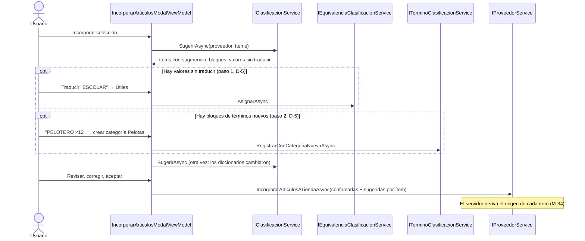

# Track 6.6, Fase 6: Plan de Implementación — Interfaz de Catalogación y Semilla

### Proyecto: Retail (Sistema ERP & Punto de Venta para Librería)

> **Para el agente que lea esto:** plan detallado de la Fase 6 del Track 6.6, escrito el 2026-10-24 para implementarse en una sesión nueva. **Actualizado el 2026-10-26 (M-45, M-48, M-49):** no hay modelo estadístico; la Fase 5 agrega los pares "término ambiguo + segunda palabra" (diccionario y propuestas) y se implementó **antes** que esta fase (M-50; commit `56da10f`, 2026-10-27). El paso 6.8 pasó a ser la revisión de pares propuestos. El diseño de fondo vive en [`etapa-6-track-6.6-catalogacion-inteligente.md`](file:///c:/Users/lucas/Proyectos/retail/docs/roadmap/etapa-6-track-6.6-catalogacion-inteligente.md) (secciones 4, 7.1 y 9; decisiones M-11, M-13, M-15, M-16, M-26, M-34). Se trabaja paso a paso (CLAUDE.md §3).
>
> **Lectura obligatoria antes de tocar XAML (Ley 9):** [`SISTEMA_DE_DISENO.md`](file:///c:/Users/lucas/Proyectos/retail/docs/SISTEMA_DE_DISENO.md) y [`StyleGalleryView.xaml`](file:///c:/Users/lucas/Proyectos/retail/src/Retail.App/Views/Dev/StyleGalleryView.xaml). Cada `.xaml` nuevo o modificado pasa por `scripts/audit-xaml.ps1` y tiene su prueba de humo STA en `AppSmokeTests.cs`.

---

## 1. Estado de Avance

| Paso | Contenido | Estado |
| :--- | :--- | :---: |
| 6.0 | Confirmar las propuestas P6-1 a P6-9 | ✅ 2026-10-27, todas aprobadas (M-59 a M-67) |
| 6.1 | Semilla de diccionarios en `Retail.Cli` (M-15, RF-23) | ✅ 2026-10-27 (S-1 a S-5; 30 tests) |
| 6.2 | Comando atómico "crear categoría y registrar término" (Aplicación) | ✅ 2026-10-27 (T-1 a T-4) |
| 6.3 | Diálogo de clasificación: secciones Términos, Alias y Prefijos | ✅ 2026-10-27 |
| 6.4 | Equivalencias por proveedor | ✅ 2026-10-27 |
| 6.5 | Modal de incorporación: sugerencias por ítem | ✅ 2026-10-27 |
| 6.6 | Modal de incorporación: traducción de valores y decisiones en bloque | ✅ 2026-10-27 |
| 6.7 | Prueba manual guiada | ⏳ Guion listo (sección 4); la ejecuta el estudiante |
| 6.8 | Pares: sección de pares por término ambiguo y revisión de pares propuestos (M-49) | ✅ 2026-10-27 |
| 6.9 | Cierre: verificación Release, mapa, track, handoff | ✅ 2026-10-27 (salvo la nota de `wiki/`, propuesta) |

---

## 2. Lo que ya existe y se reutiliza

| Pieza | Dónde | Uso en la Fase 6 |
| :--- | :--- | :--- |
| `IClasificacionService.SugerirAsync` | Aplicación (Fase 4a) | Devuelve, para un lote, las sugerencias por ítem (`SugerenciaItemDto`: categoría y marca con su motivo; sin confianza desde M-51), los bloques de términos nuevos (`BloqueTerminoNuevoDto`, M-26) y los valores del proveedor sin traducir (`ValorSinTraducirDto`, M-13) |
| Contrato de incorporación por ítem | `ItemIncorporacionArticuloDto` (Fase 4a, R-7) | Lleva la categoría y la marca confirmadas y las sugeridas, y `SinMarcaConfirmada`; el servidor deriva el origen (M-34). Hoy el modal manda la misma categoría y marca para todos los ítems, sin sugerencia |
| Comandos de diccionarios | `ITerminoClasificacionService`, `IEquivalenciaClasificacionService`, `IMarcaService` (alias y prefijos) (Fase 4b) | Las pestañas nuevas y las decisiones del modal los invocan; todos exigen D-5 y traducen las carreras a mensajes |
| Diálogo de clasificación | `AdministrarClasificacionDialog` (960×640) + `AdministrarClasificacionViewModel` (≈500 líneas, secciones con `MostrandoRubros`/`MostrandoCategorias`/`MostrandoMarcas`) | Se le suman tres secciones |
| Modal de incorporación | `IncorporarArticulosModalDialog` (1040×680 desde la prueba manual, P6-9) + `IncorporarArticulosModalViewModel` + `ItemIncorporarArticuloViewModel`; lo abre `ImportadorCatalogosViewModel` | Se rediseña |
| Semillero de demostración | `SemilleroDatosDemo` (Infraestructura) + `ComandoDatosDemo` (`Retail.Cli`) | Patrón para la semilla de diccionarios |

---

## 3. Propuestas a confirmar en el paso 6.0

| ID | Propuesta | Recomendación y motivo |
| :--- | :--- | :--- |
| **P6-1** | **Archivos de la semilla versionados** en `src/Retail.Cli/Semilla/` (`taxonomia.csv`, `terminos.csv`, `marcas.csv`, `prefijos.csv` y `pares.csv`, este último de la Fase 5), copiados de los diccionarios consolidados de `ml/datos/` con sus formatos definitivos (sección 4 del handoff) y publicados junto al ejecutable. | Recomendada. M-15 ya decidió que nombres de categorías, marcas y prefijos son hechos públicos y que los términos (primeras palabras genéricas: `CUADERNO`, `MOCHILA`) se distribuyen; las descripciones de la lista **no**. Hay que confirmarlo porque `ml/datos/` está fuera del control de versiones a propósito: se versionan solo esos cinco archivos, revisados antes de copiarlos |
| **P6-2** | **Comando `cargar-diccionarios`**, aditivo e idempotente: crea lo que falta (rubros, categorías y marcas por nombre en forma de comparación; términos, alias y prefijos que no existan), **nunca pisa** lo que el comercio editó y no falla por un conflicto: lo informa (por ejemplo, un alias que ya es de otra marca). Todo en una transacción. Escribe con las fábricas y métodos del Dominio desde un `SemilleroDiccionarios` en Infraestructura, como `SemilleroDatosDemo`, aplicando las mismas reglas de unicidad de la Fase 4b (M-38, M-39). | Recomendada. La herramienta de línea de comandos no tiene sesión de usuario para la autorización D-5 de los servicios; el patrón del semillero ya está aceptado (Track 6.3, D-12). Idempotente permite volver a correrlo tras una actualización de la semilla |
| **P6-3** | **Flujo del modal de incorporación en tres pasos dentro del mismo diálogo:** (1) *Traducir valores del proveedor* (solo si hay `ValoresSinTraducir`), (2) *Términos nuevos* (solo si hay `Bloques`), (3) *Revisar artículos* (la grilla con sugerencias por ítem). Después de los pasos 1 y 2 se vuelve a llamar a `SugerirAsync`: lo decidido ya cambió los diccionarios y las sugerencias mejoran solas. | Recomendada. Es el orden de M-14 y M-26 (lo explícito y lo que se decide en bloque, antes que lo individual). Volver a sugerir evita mantener en la UI una copia de la lógica del motor |
| **P6-4** | **Acciones de un bloque de término nuevo:** asignar a una categoría existente (registra el término, M-16), **crear una categoría nueva y asignarla** (comando atómico nuevo, paso 6.2), marcar el término como ambiguo, o dejarlo sin decidir. El bloque llega sin propuesta precargada: no hay modelo (M-45). | Recomendada. Crear la categoría y registrar el término en dos llamadas dejaría una categoría huérfana si la segunda falla; el comando atómico es una línea de Aplicación más y se prueba como el resto |
| **P6-5** | **Interruptor "Sugerir clasificación"** (M-11), activado por defecto. Apagado, el modal se comporta como hoy: una categoría y una marca para todo el lote, origen `Manual`. | Recomendada. Es M-11 tal como está |
| **P6-6** | **Permisos:** incorporar sigue con los roles actuales; los pasos 1 y 2 escriben diccionarios y exigen D-5. Si el usuario no la tiene, esos pasos se muestran en solo lectura con una nota ("Un Gerente o un Encargado puede traducir estos valores") y la grilla funciona igual. | Recomendada. La autorización la hace igual el servidor; la UI solo evita ofrecer lo que va a fallar |
| **P6-7** | **Dónde se administra cada diccionario:** Términos, Alias y Prefijos como secciones nuevas de `AdministrarClasificacionDialog`; las **Equivalencias**, por proveedor, en un diálogo propio (`EquivalenciasProveedorDialog`) que se abre desde la vista de Proveedores. Cada sección nueva con su propio ViewModel hijo, para no seguir agrandando `AdministrarClasificacionViewModel`. | Recomendada. Las equivalencias son de un proveedor (M-13), no del catálogo; los ViewModels hijos mantienen cada archivo con una responsabilidad (AGENTS.md, integridad de capas y archivos) |
| **P6-8** | **Presentación de la sugerencia en la grilla:** la categoría y la marca en `ComboBox` precargados con la sugerencia; a su lado un badge con el motivo (`EnumATextoConverter` sobre `MotivoSugerenciaEnum`, que incluye `ParDelDiccionario`); una columna de estado (Sugerida, Corregida, Sin sugerencia, Sin marca); acciones "Aceptar todas las sugerencias" y "Aceptar seleccionadas". Nada se aplica sin la confirmación final (RF-27). | Recomendada. Cumple IU-05 de la ERS ("con su motivo, para aceptarlas o corregirlas"; la confianza se retiró con M-51) con los componentes existentes del sistema de diseño |
| **P6-9** | **Tamaño del modal:** mantener 880×640 (con `MinWidth` 720) y ganar espacio con los pasos, no con más ancho. Si la grilla no entra, ampliar a 1040×680 y **documentarlo** en `SISTEMA_DE_DISENO.md` como "modal de trabajo". | ✅ Decidida en la prueba manual (2026-10-28): **1040×680**, documentado en `SISTEMA_DE_DISENO.md` como "Modal de Trabajo" |

---

## 4. Pasos

### 6.1 — Semilla de diccionarios (`Retail.Cli`)

* **Archivos:** `src/Retail.Cli/Semilla/*.csv` (P6-1) con `CopyToOutputDirectory` en `Retail.Cli.csproj`; `src/Retail.Infrastructure/Persistence/Initialization/SemilleroDiccionarios.cs`; `src/Retail.Cli/Comandos/ComandoCargarDiccionarios.cs`; `Program.cs` (nuevo comando) y `Ayuda.cs` (texto y orden de instalación: `migrar`, `inicializar`, `cargar-diccionarios` y, opcionalmente, `datos-demo`).
* **Lectura de los CSV:** `;` como separador, UTF-8 **con o sin BOM** (`ml/datos/pares.csv` lo trae, guardado desde Excel; sin contemplarlo, el encabezado se lee como `termino` precedido por el carácter U+FEFF), con un test que lo cubra; rechazar con mensaje claro una fila mal formada (número de línea), sin cargar nada (transacción).
* **Pares (Fase 5, M-55, M-58):** `pares.csv` (`termino;segunda_palabra;categoria`, 102 pares validados, copia de `ml/datos/pares.csv`) se carga **después** de los términos y a través de `TerminoClasificacion.AsignarPar`: por M-52 (P-3) el término tiene que existir y ser ambiguo, así que un par cuyo término no lo es se informa como conflicto y no se carga.
* **Resultado en consola:** cuántos rubros, categorías, marcas, términos, pares, alias y prefijos se crearon, cuántos ya existían y la lista de conflictos omitidos.
* **Tests** (`Retail.Infrastructure.IntegrationTests`, base real): carga sobre base vacía; segunda corrida no crea nada (idempotencia); una categoría renombrada por el comercio no se pisa y sus términos la siguen apuntando (la de la semilla vuelve a crearse vacía: S-5); un alias en conflicto se informa y el resto se carga; una fila inválida no deja nada a medias. Los tests usan CSV **inventados** en una carpeta temporal, no la semilla real.
* **ERS:** `RF-23` ya menciona "la carga de la taxonomía semilla y de los diccionarios"; no requiere cambios.
* **Decisiones del paso (2026-10-27):**
  * **S-1:** un defecto del archivo (formato, texto que el Dominio rechaza, duplicado, referencia interna rota) es un **error de la semilla**: `InvalidDataException` con archivo y línea, y no se carga nada. Lo que choca con lo que el comercio cargó es un **conflicto**: la fila se omite y se informa.
  * **S-2:** lo dado de baja cuenta como existente y no se vuelve a crear (se lee con `IgnoreQueryFilters`; los índices únicos filtrados permitirían el duplicado).
  * **S-3:** una categoría que ya existe en otro rubro se usa tal cual y se avisa (D-8: única en el catálogo).
  * **S-4:** un test carga la semilla versionada sobre una base vacía y exige cero conflictos. Al escribirlo detectó que el lector rechazaba los ambiguos con categoría: `consolidar_diccionarios.py` la conserva como orientación (7 términos). El lector la descarta (M-27).
  * **S-5:** la semilla identifica las categorías por su nombre: si el comercio renombra una, una nueva corrida vuelve a crear la de la semilla, vacía. Se acepta (opción A): darla de baja impide que vuelva (S-2). Descartados un identificador de origen (YAGNI) y no crear en rubros con categorías.
* **Implementado:** lector, semillero, resultado y comando (ver `MAPA_DEL_PROYECTO.md`); semilla en `src/Retail.Cli/Semilla/`, enlazada también en `Retail.Infrastructure.IntegrationTests` para S-4.

### 6.2 — Comando atómico de bloque (Aplicación)

* `ITerminoClasificacionService.RegistrarConCategoriaNuevaAsync(int idActor, RegistrarTerminoConCategoriaNuevaDto dto)`: crea la categoría (mismas validaciones que `CategoriaService.CrearAsync`, D-8 y unicidad) y registra el término apuntando a ella **en un solo `SaveChanges`**. Validador propio. Para no duplicar la lógica de alta de categoría, extraer la verificación compartida a un apoyo interno (como `PersistenciaDiccionarios`) en lugar de copiarla.
* **Tests:** unitarios (autorización, nombre duplicado, término existente reasignado) e integración (si el término choca, la categoría tampoco queda creada).
* **Decisiones del paso (2026-10-27):**
  * **T-1:** "en un solo `SaveChanges`" no es posible: `TerminoClasificacion.CrearConCategoria` recibe el Id de la categoría, que una categoría nueva recién tiene después de guardarse. Se hacen **dos guardados en la transacción de `IUnitOfWork`** (primer servicio que la usa); si algo falla, `RollbackTransactionAsync` y `DescartarCambios` (el contexto vive lo que dura la pantalla, D-15). Descartado: una navegación `Categoria` en el término (un agregado referencia a otro por Id).
  * **T-2:** el alta de categoría vive en el apoyo interno `AltaCategoria` (rubro activo, D-8), que usan `CategoriaService.CrearAsync` y el comando nuevo.
  * **T-3:** si el término ya existe, se reasigna a la categoría nueva, como `RegistrarAsync`; si era ambiguo, sus pares se dan de baja (P-3). El aviso previo es de la UI (6.6 y 6.8).
  * **T-4:** devuelve el `CategoriaDto` creado, para sumarlo a los combos del modal.
* **Implementado:** `RegistrarTerminoConCategoriaNuevaDto`, su validador (la regla del término pasó a `ReglasComunesExtensions.TerminoDeClasificacion`, compartida con `RegistrarTerminoValidator`), `ITerminoClasificacionService.RegistrarConCategoriaNuevaAsync`; 7 tests unitarios y 2 de integración (`DiccionariosClasificacionIntegrationTests`, con el interceptor compartido `FallaEnElGuardado`).

### 6.3 — Diálogo de clasificación: Términos, Alias y Prefijos

* **XAML:** tres botones de sección más en la fila de `AdministrarClasificacionDialog` (mismo patrón de conmutación que Rubros/Categorías/Marcas) y tres grillas con `DataGridRetailStyle`; filtro de texto; en Términos, filtro por categoría y casilla "Solo ambiguos"; códigos y prefijos en `Cascadia Code` (Ley 9, tipografía dual).
* **ViewModels hijos** (P6-7): `TerminosClasificacionViewModel`, `AliasMarcasViewModel`, `PrefijosMarcasViewModel` (fusionados en `DetalleMarcaViewModel` por M-68), en `ViewModels/Articulos/`, con carga asíncrona serializada (`CargaSerializada`, como el ViewModel actual) y sus comandos.
* **Formularios de alta:** reutilizar `ClasificacionFormDialog` si su contrato lo permite; si no, un `DiccionarioFormDialog` (modal compacto o estándar según el sistema de diseño) con: término + categoría (o "Ambiguo"); marca + alias; marca + prefijo.
* **Quitar:** `IconDangerButtonStyle` con confirmación.
* **Tests:** ViewModels (carga, filtro, alta y baja llaman al servicio correcto; un `DomainException` se muestra como error sin cerrar el diálogo); prueba de humo STA del diálogo modificado y de cada diálogo nuevo; `audit-xaml.ps1`.

### 6.4 — Equivalencias por proveedor

* `EquivalenciasProveedorDialog` + `EquivalenciasProveedorViewModel`: lista de `ListarAsync` del proveedor (tipo, rubro, texto, destino o "Ignorada"); asignar destino (combo de categorías o marcas según el tipo, más "Ignorar"); quitar. Se abre desde `ProveedoresView` (acción por fila) y, en modo de solo valores pendientes, desde el paso 1 del modal (6.6).
* **Tests:** ViewModel y prueba de humo STA.

### 6.5 — Modal de incorporación: sugerencias por ítem

* **`IncorporarArticulosModalViewModel`:** recibe `IClasificacionService` (por constructor o por el método de inicialización que hoy usa `ImportadorCatalogosViewModel`; respetar la Ley 10: no tocar `MainWindow` ni el shell). Al abrir, con el interruptor activo, llama a `SugerirAsync` en segundo plano (Ley 4) con indicador de carga.
* **`ItemIncorporarArticuloViewModel`:** suma `CategoriaSeleccionada`, `MarcaSeleccionada`, `SinMarca`, la sugerencia recibida (Id y motivo) y un `Estado` derivado (Sugerida, Corregida, Sin sugerencia).
* **`ObtenerDto`:** por cada ítem, confirmadas = lo seleccionado; sugeridas = lo que llegó del motor; `SinMarcaConfirmada` cuando el usuario elige "Sin marca". El servidor deriva el origen (M-34): la UI nunca lo declara.
* **Acciones:** "Restablecer todas las sugerencias" y, por fila, "Volver a la sugerencia" en las corregidas (P6-8; la selección múltiple se descartó en la prueba manual). Validación antes de confirmar: los ítems sin categoría se pueden incorporar sin categoría (como hoy), pero se cuentan y se avisa.
* **Interruptor M-11** (P6-5).
* **Tests:** ViewModel (precarga desde las sugerencias; corregir cambia el estado; el DTO lleva confirmadas y sugeridas; interruptor apagado reproduce el comportamiento actual); prueba de humo STA; `audit-xaml.ps1`.

### 6.6 — Modal de incorporación: traducción y bloques

* **Paso 1, "Traducir valores del proveedor":** lista de `ValoresSinTraducir` con su cantidad de ítems; por cada valor, destino o "Ignorar" (`IEquivalenciaClasificacionService.AsignarAsync`).
* **Paso 2, "Términos nuevos":** una tarjeta por bloque con el término, la cantidad de productos, los ejemplos, y las acciones de P6-4 (sin propuesta precargada: no hay modelo, M-45).
* **Navegación:** encabezado con los tres pasos; los pasos sin contenido se saltean; "Volver a sugerir" tras cada paso (P6-3). Permisos según P6-6.
* **Tests:** ViewModel (se saltean los pasos vacíos; asignar un bloque llama al servicio y vuelve a sugerir; sin D-5, solo lectura); prueba de humo STA.

### 6.3 a 6.6 y 6.8 — Implementación (2026-10-27)

Implementados por tres subagentes en paralelo, cada uno con su propio conjunto de archivos, e integrados y revisados por la conversación principal (CLAUDE.md §5). Detalle por archivo en `MAPA_DEL_PROYECTO.md` (fila "Catalogación"). Lo que difiere del texto de los pasos:

* **6.3:** el formulario es `DiccionarioFormDialog` (compacto, 460 px): `ClasificacionFormDialog` solo captura un nombre. Sin D-5 los botones de escritura quedan deshabilitados, sin nota de texto (P6-6 la pide en el modal). El indicador "Cargando…" del encabezado refleja solo la carga del padre.
* **6.4:** el diálogo (580×660, modal amplio) se abre con `IProveedorDialogService`, el mismo mecanismo de los demás diálogos de Proveedores.
* **6.5:** con el interruptor activo, la grilla no muestra las columnas de código de barras y costo de reposición (el código va en una segunda línea de la descripción) para entrar en 880×640 (P6-9). Decidir en la prueba manual si se amplía a 1040×680. El combo de categoría no tiene opción "vacío": para descartar una sugerencia se elige otra categoría. **Ambos puntos se resolvieron en las correcciones de la prueba manual** (1040×680 con la columna de costo; opción "Sin categoría").
* **6.6:** "Volver a sugerir" se hace al pulsar *Continuar* al final de cada paso (P6-3), no después de cada decisión individual.
* **6.8:** la revisión de propuestas fue primero una sección propia, "Reglas propuestas"; desde M-71 es la pestaña "Pares propuestos" del término ambiguo. El aviso al terminar una incorporación va en el mensaje de estado del importador, sin enlace, y nombra los términos.
* **Hallazgo de la integración:** dos íconos (`RegularTransfer`, `RegularListCheck`) no existen en el paquete BoxIcons: rompen la vista al dibujar la primera fila y ni `audit-xaml.ps1` ni las pruebas de humo lo detectan. Se reemplazaron y se verificaron los 123 íconos contra el enum del paquete. Propuesto: sumar esa verificación a `audit-xaml.ps1`.

### Correcciones de la prueba manual (2026-10-28)

La primera pasada del guion 6.7 encontró un error y varios problemas de uso. Todo es de la capa de presentación: Aplicación y Dominio no cambian.

| Hallazgo | Causa | Corrección |
| :--- | :--- | :--- |
| Una equivalencia del rubro (`ESCOLAR`) no se aplicaba al incorporar | El diálogo *Importar planilla* nunca pedía las columnas opcionales de rubro, categoría y marca (M-12): `MapeoColumnasDto` las admitía desde la Fase 1, pero llegaban nulas y el parser las ignoraba. Los tests armaban el DTO a mano | El diálogo agrupa los campos: fila de encabezado, columnas obligatorias y columnas opcionales (código de barras, rubro, categoría, marca; por defecto `RUBRO`, `CATEGORIA`, `MARCA`). Pasa al tamaño "Modal Amplio" (580×660). Tests del mapeo enviado |
| "Aceptar seleccionadas" sin forma visible de seleccionar | La selección y el hover tienen el mismo color, y un clic en un combo no selecciona la fila | Se quita; botón ↺ por fila (solo en las corregidas) y "Restablecer todas las sugerencias". La grilla pasa a selección simple |
| Combos que recortan el texto | Alto fijo de 30 px, menor que el de la plantilla de WPF-UI | `MinHeight` 34; la fila crece |
| El motivo de la sugerencia no se lee | Pastilla de 10 px con ancho máximo de 80 | Línea con ícono y texto completo, que se ajusta en varias líneas |
| Casilla "Sin marca" aparte, sin equivalente para la categoría | — | "Sin marca" (confirmación, M-7) y "Sin categoría" (pendiente) como primera opción de cada combo (`OpcionDiccionario` con `Id` nulo). Cierra el desvío de 6.5 "el combo no tiene opción vacía" |
| Casilla "Sugerir clasificación" desalineada y en azul | Alineada abajo; los diccionarios de WPF-UI que mergea la ventana reponen el acento de Windows | `ui:ToggleSwitch` en el encabezado de la tarjeta; la ventana redefine los recursos de acento con `SystemAccentColor*`. Los otros 24 diálogos tienen el mismo merge: hoy no usan controles que dependan del acento |
| **Segunda pasada:** "Restablecer todas las sugerencias" no hacía nada | **Error de datos, no solo visual:** el combo de una celda de `DataGrid` sin `UpdateSourceTrigger` explícito queda retenido en el `BindingGroup` de la fila, que nunca confirma en una grilla de solo lectura. La corrección del usuario no llegaba al ViewModel: se habría incorporado la sugerencia y no lo elegido. Mismo error en el combo de "Reglas propuestas" | `UpdateSourceTrigger=PropertyChanged` en los tres combos; regla en `SISTEMA_DE_DISENO.md`; `EdicionEnCeldasDeGrillaTests` elige la opción en el combo de la celda (falla sin la corrección) |
| **Segunda pasada:** con un valor sin traducir la grilla "no aparecía", y las pastillas de pasos parecían botones | El paso 1 se muestra primero (P6-3), pero nada indicaba que había un paso siguiente | Indicador de pasos numerado que no parece botón, "Paso N de M" sobre cada título, botón "Continuar: …" con su destino, aviso de que se puede continuar sin traducir; el paso 1 como tabla con encabezado de columnas y filas separadas |
| **Tercera pasada:** Alias y Prefijos como secciones propias del diálogo de clasificación | Son entidades internas del agregado `Marca`, pero la pantalla las mostraba como conceptos independientes | **M-68:** Marcas pasa a maestro-detalle (lista a la izquierda; alias y prefijos de la seleccionada a la derecha). `AliasMarcasViewModel` y `PrefijosMarcasViewModel`, idénticos salvo los nombres, se fusionan en `DetalleMarcaViewModel`, que trae los dos en **una sola carga**: dos cargas reemplazables sobre la `CargaSerializada` compartida se cancelarían entre sí. El detalle se carga solo con la sección visible y se recarga al mostrarla. El formulario recibe la marca ya elegida (opción única, no editable) |
| **Cuarta pasada:** combos vacíos sin sugerencia; "Confirmar" disponible desde el paso 1; sin forma de volver a un paso; la grilla mostraba unas 3 filas | El combo vacío no distinguía "no lo miré" de "no tiene"; el título de cada paso y los botones dentro de los pasos ocupaban la altura de la grilla | **M-70:** "Sin clasificar" inicial (más "Sin marca" en marca, sin "Sin categoría"); pie de asistente con Anterior / Siguiente y "Confirmar" solo en la revisión (con el interruptor encendido); encabezado en una fila. ↺ pasa a "Restablecer" (`GhostPrimaryButtonStyle`) bajo el estado y desaparece su columna |
| **Cuarta pasada:** con el interruptor apagado, elegir una categoría o marca del lote no tenía vuelta atrás; "Traducir valores del proveedor" no se entendía | Los combos del lote listaban el catálogo sin opción vacía; el paso hablaba de "valores" cuando son categorías y marcas del proveedor | Ajuste de **M-70:** combos del lote con "Sin clasificar" y "Sin marca" (confirmada para el lote); el paso 1 se llama "Asociar categorías y marcas", con textos de equivalencia |
| **Cuarta pasada:** "Reglas propuestas" vacía tras incorporar sin clasificar | No era un error: las propuestas piden artículos **con categoría** y términos **ambiguos** (M-49), y no proponen términos nuevos | **M-71:** la revisión pasa a la pestaña "Pares propuestos" del término; se descarta "Términos propuestos" |
| **Tercera pasada:** "Solo ambiguos" como casilla; columnas maestro-detalle de distinto ancho | — | `ui:ToggleSwitch`; Rubros/Categorías, Términos/Pares y Marcas/detalle en `*,*`. El carmín del interruptor pasa de una copia local del modal a `Colors.xaml`, que todas las ventanas mergean después de WPF-UI: llega a los 25 diálogos |
| **Segunda pasada:** "789 ·" en la línea de códigos | Separador fijo aunque no haya código de barras | `CodigosTexto` lo omite |
| Ganancia y clasificación mezcladas | Una sola tarjeta para todo | Dos tarjetas: "Ganancia global" y "Clasificación" (interruptor, pasos, acciones y grilla). Con 1040×680 vuelve la columna de costo de reposición |

### 6.7 — Prueba manual guiada

Guion para el estudiante, con una base cargada con `cargar-diccionarios` y una planilla de prueba **inventada** (nunca la lista del distribuidor): importar, ver las sugerencias por término y por marca, traducir un valor del proveedor, resolver un bloque creando una categoría, corregir una sugerencia, incorporar y comprobar en la base el origen de cada artículo (`Manual`, `SugerenciaAceptada`, `SugerenciaCorregida`).

1. `dotnet run --project src/Retail.Cli -- cargar-diccionarios` y revisar el resumen (sobre la base local: no debería informar conflictos).
2. Artículos → Clasificación: recorrer Términos (interruptor "Solo ambiguos", elegir `BASE` y ver sus pares), Marcas (elegir una marca y agregarle y quitarle un alias y un prefijo) y, en `GOMA`, la pestaña "Pares propuestos" (con dos artículos "goma arabiga …" en Adhesivos debe proponer `GOMA + ARABIGA`, M-71). Dar de alta y de baja un término de prueba.
3. Proveedores → botón de equivalencias en una fila: asignar `ESCOLAR` → una categoría y otra como "Ignorar"; quitarlas.
4. Armar una planilla inventada de unas 10 filas con: una columna `RUBRO` con un valor nuevo (p. ej. `ESCOLAR`), descripciones con términos conocidos (`CUADERNO …`), una con término ambiguo + par (`BASE ACRILICA …`), una marca en la descripción, y 3 o más filas que empiecen con un término inexistente (`PELOTERO …`) para formar un bloque (M-26, revisado por M-69). Un artículo sin marca en el texto pero con prefijo registrado debe llegar sin marca sugerida (M-69).
5. Importarla (en *Importar planilla*, la columna opcional *Rubro* debe coincidir con el encabezado de la planilla) y abrir *Incorporar*: paso 1 asociar el valor del proveedor a una categoría; paso 2 resolver `PELOTERO` creando la categoría "Pelotas"; paso 3 verificar que las sugerencias mejoraron, corregir una, elegir "Sin marca" en otra, usar "Restablecer" en una corregida, volver con "Anterior" al paso 1 y avanzar de nuevo, y confirmar ("Confirmar" solo aparece en este paso, M-70).
6. Comprobar en la base el origen de cada artículo: `SELECT descripcion, origen_categoria, origen_marca FROM ARTICULOS ORDER BY id_articulo DESC`.
7. Repetir el paso 5 con el interruptor apagado: una categoría y una marca para todo el lote; elegir una y volver a "Sin clasificar", y probar "Sin marca" para el lote (M-70).
8. Con un usuario Cajero: los pasos 1 y 2 en solo lectura con su nota; la grilla funciona.
9. P6-9 quedó decidida (1040×680). Decidir si "Cargando…" y la nota de permisos del diálogo de clasificación hacen falta.

### 6.8 — Pares del diccionario y pares propuestos (M-49)

* **Pares por término ambiguo:** en la sección Términos (6.3), al elegir un término ambiguo, la lista de sus pares (segunda palabra → categoría, o "Ignorado") con alta, cambio y baja (`AsignarParAsync`, `QuitarParAsync`). Al asignarle una categoría a un término ambiguo, el diálogo avisa cuántos pares se dan de baja (P-3 de la Fase 5) antes de confirmar.
* **Revisión de pares propuestos** (pestaña del término ambiguo desde M-71): una lista de `ListarParesPropuestosAsync` con la evidencia ("8 de 8"), la categoría propuesta (editable) y ejemplos; acciones "Aceptar", "Descartar" (par ignorado) y en bloque (`AsignarParesAsync`), con D-5.
* **Aviso al terminar una incorporación:** si hay pares propuestos nuevos, un mensaje con enlace a la revisión ("Hay 3 reglas nuevas para revisar"). No interrumpe el flujo.
* **Tests:** ViewModels (aceptar y descartar llaman al servicio y refrescan; sin D-5 solo lectura) y prueba de humo STA de lo que se agregue al diálogo.

### 6.9 — Cierre

`audit-xaml.ps1`, `dotnet build --configuration Release`, `dotnet test` completo (incluidas las pruebas de humo STA) y `dotnet format --verify-no-changes`; `MAPA_DEL_PROYECTO.md` (vistas, ViewModels, comando de `Retail.Cli`, semilla); Estado de Avance del track y de este documento; handoff; nota de `wiki/` propuesta (flujo de incorporación con sugerencias en `wiki/05-casos-de-uso-y-flujos/`).

---

## 5. Flujo de la incorporación con sugerencias

---

## 6. Riesgos

| Riesgo | Mitigación |
| :--- | :--- |
| `AdministrarClasificacionViewModel` crece sin control | ViewModels hijos por sección (P6-7) |
| La semilla pisa ediciones del comercio | P6-2: aditiva, nunca actualiza lo existente; tests de idempotencia y de categoría renombrada |
| La UI se bloquea con lotes grandes al sugerir | `SugerirAsync` en `Task.Run` con indicador de carga (Ley 4); el motor ya hace dos lecturas por lote |
| El modal no entra en 880×640 | ✅ P6-9 decidida en la prueba manual: 1040×680, "Modal de Trabajo" en `SISTEMA_DE_DISENO.md` |
| Un usuario sin D-5 queda bloqueado en los pasos 1 y 2 | P6-6: solo lectura con nota; la grilla sigue funcionando |
| Archivos troncales del shell | Ley 10: no se tocan `MainWindow` ni `App.xaml.cs`; los diálogos se abren desde los ViewModels que ya los abren |

---

## 7. Preguntas de Defensa Previstas

1. ¿Por qué el modal vuelve a llamar al motor después de traducir valores o resolver bloques, en lugar de actualizar la grilla en la UI?
2. ¿Por qué la UI manda la sugerencia original junto con lo confirmado, y no el origen? (M-34.)
3. ¿Por qué la semilla se carga con un semillero de Infraestructura y no con los servicios de Aplicación?
4. ¿Qué garantiza que la semilla no pisa las categorías que el comercio renombró?
5. ¿Cómo cumple la pantalla con RF-27 ("ninguna sugerencia se aplica sin confirmación")?
