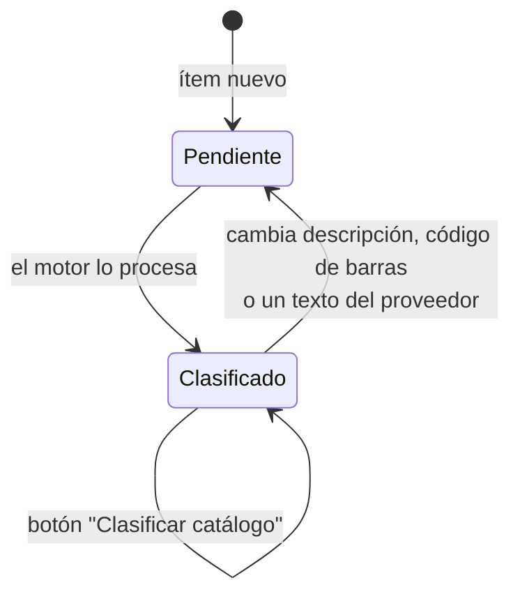
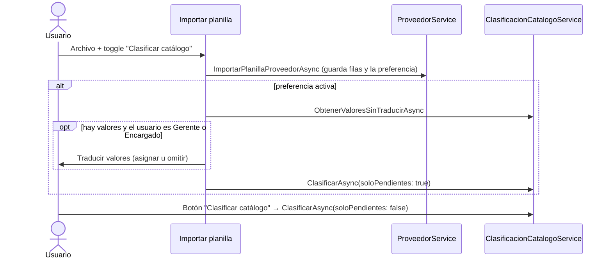

# Track 6.6, Fase 8: Plan de Implementación — Catálogo del Proveedor Clasificado

### Proyecto: Retail (Sistema ERP & Punto de Venta para Librería)

> **Para el agente que lea esto:** plan de la Fase 8 del Track 6.6, acordado con el estudiante el 2026-10-31. Las decisiones de fondo son **M-72 a M-77** (sección 12 de [`etapa-6-track-6.6-catalogacion-inteligente.md`](file:///c:/Users/lucas/Proyectos/retail/docs/roadmap/etapa-6-track-6.6-catalogacion-inteligente.md)). El motor de clasificación vive en [`ClasificacionService.cs`](file:///c:/Users/lucas/Proyectos/retail/src/Retail.Application/Services/ClasificacionService.cs). Rama: `feat/catalogo-clasificado`.
>
> **Lectura obligatoria antes del paso 8.2 (Nivel 3 de AGENTS.md):** [`SISTEMA_DE_PERSISTENCIA.md`](file:///c:/Users/lucas/Proyectos/retail/docs/SISTEMA_DE_PERSISTENCIA.md) y, por las claves foráneas nuevas, [`DER.mmd`](file:///c:/Users/lucas/Proyectos/retail/docs/DER.mmd). **Antes del paso 8.4:** [`SISTEMA_DE_DISENO.md`](file:///c:/Users/lucas/Proyectos/retail/docs/SISTEMA_DE_DISENO.md) y [`StyleGalleryView.xaml`](file:///c:/Users/lucas/Proyectos/retail/src/Retail.App/Views/Dev/StyleGalleryView.xaml).

---

## 1. Estado de Avance

| Paso | Contenido | Estado |
| :--- | :--- | :---: |
| 8.0 | Decisiones M-72 a M-77 y este plan | ✅ 2026-10-31 |
| 8.1 | Dominio: sugerencia y estado en `CatalogoProveedor`, preferencia en `Proveedor` | ✅ 2026-10-31: volver a pendiente borra también los ids sugeridos; un texto vacío o igual no cuenta como cambio |
| 8.2 | Persistencia: mapeo, migración, índices y consultas del explorador | ✅ 2026-10-31: migración `AgregarClasificacionSugeridaAlCatalogo` (aplicada a la base local en 8.4) |
| 8.3 | Aplicación: `MotorDeClasificacion`, `ClasificacionCatalogoService`, contratos del importador y del explorador | ✅ 2026-10-31: tests de Dominio (813), Aplicación (963) e integración del catálogo (39) en verde; `ConsultaCatalogoProveedorValidator` nuevo (ids positivos; "sin categoría" excluye una categoría), la paginación la sigue normalizando la consulta |
| 8.4 | Interfaz: toggle al importar, diálogo de valores sin traducir, botón, filtros y columnas del explorador | ✅ 2026-10-31 (M-78 a M-80): merge de `main` (`76f8fe1`); suites de Dominio (813), Aplicación (1.005), App (1.098) e integración (general 432, backups 159, rendimiento 1) en verde; `audit-xaml` y `dotnet format` en verde; migración aplicada a la base local (con copia previa). Desvíos: el diálogo de asociación mide 700 × 660 (documentado en `SISTEMA_DE_DISENO.md`) y el interruptor del importador va en la sección "Proveedor", para que se vea sin desplazar y el diálogo conserve su alto. Falta la prueba manual |
| 8.5 | Cierre: ERS, DER, mapa, track, verificación Release | ✅ 2026-10-31: RF-27 e IU-05 en la ERS, FK sugeridas y `clasifica_catalogo` en el DER, verificación Release completa en verde (3.508 tests: Dominio 813, Aplicación 1.005, App 1.098, Integración 592; `audit-xaml` y `dotnet format`) |

---

## 2. El diseño

El objetivo es **descubrir**: el usuario filtra el catálogo del proveedor por las categorías y marcas **del comercio** sin haber incorporado los artículos (M-72). La taxonomía del comercio es el dato maestro y la única que ve el usuario. Los textos del proveedor se conservan como dato de origen (M-12) y no se ofrecen como filtro.

Se sigue la práctica de ETL de separar el dato crudo del derivado:

| Capa | Dónde | Naturaleza |
| :--- | :--- | :--- |
| Crudo | `DescripcionProveedor`, `CodigoBarras`, `RubroProveedor`, `CategoriaProveedor`, `MarcaProveedor` | Tal como lo escribe el proveedor |
| Normalizado | Término, segunda palabra, palabras de marca, prefijo del titular (`ItemAClasificar`) | Se calcula en cada pasada del motor |
| Conformado | `IdCategoriaSugerida`, `IdMarcaSugerida`, `FechaClasificacion` | Derivado y descartable: se recalcula con el botón |

**Pendiente** (`FechaClasificacion` nula) no es lo mismo que **sin categoría** (con fecha y `IdCategoriaSugerida` nula): el segundo indica que falta una regla (M-74).

La clasificación del catálogo es **pasiva** (M-73): no arma bloques de términos nuevos ni pide revisión por ítem. La sugerencia guardada nunca llega sola al artículo: el modal de incorporación vuelve a correr el motor y el usuario confirma (M-34).

### Cuándo se clasifica (M-75, M-76)

---

## 3. Pasos

### 8.1 Dominio

| Archivo | Cambio |
| :--- | :--- |
| `Entities/CatalogoProveedor.cs` | `IdCategoriaSugerida`, `IdMarcaSugerida` (`int?`) y `FechaClasificacion` (`DateTime?`), con setter privado. `RegistrarClasificacionSugerida(int? idCategoria, int? idMarca)` asigna los tres (fecha en UTC). `ActualizarPrecio` y `ActualizarClasificacionDelProveedor` dejan la clasificación pendiente **solo si cambia efectivamente** la descripción, el código de barras o alguno de los textos del proveedor. |
| `Entities/Proveedor.cs` | `ClasificaCatalogo` (`bool`, setter privado) y `ConfigurarClasificacionDelCatalogo(bool clasifica)`. |

Sin navegaciones a `Categoria` ni `Marca` desde `CatalogoProveedor`: los ids bastan para el dominio y la consulta del explorador hace el cruce.

### 8.2 Persistencia

| Archivo | Cambio |
| :--- | :--- |
| `CatalogoProveedorConfiguration.cs` | `id_categoria_sugerida` e `id_marca_sugerida` (FK opcionales a `CATEGORIAS` y `MARCAS`, `Restrict`), `fecha_clasificacion`. Índices `(id_proveedor, id_categoria_sugerida)` e `(id_proveedor, id_marca_sugerida)` filtrados por `[deleted_at] IS NULL`. |
| `ProveedorConfiguration.cs` | `clasifica_catalogo`, `bit`, valor por defecto `0`. |
| Migración `AgregarClasificacionSugeridaAlCatalogo` | Los ítems existentes quedan pendientes. |
| `CatalogoProveedorQueryService.cs` | Filtros de `ObtenerCatalogoPaginadoAsync` por categoría, marca y "sin categoría"; proyección de los nombres sugeridos (solo de categorías y marcas activas: una dada de baja se ve como sin categoría, M-74). Lectura de los ítems de un proveedor para clasificar (todos o pendientes) y de sus valores distintos de rubro, categoría y marca, resueltos en SQL. |

### 8.3 Aplicación

| Archivo | Cambio |
| :--- | :--- |
| `Services/Clasificacion/MotorDeClasificacion.cs` (nuevo, `internal`) | Las reglas de `ClasificacionService` se mueven sin cambios de comportamiento (M-77). |
| `Services/ClasificacionService.cs` | Delega en el motor; sus tests actuales no cambian. |
| `Interfaces/Services/IClasificacionCatalogoService.cs`, `Services/ClasificacionCatalogoService.cs` (nuevos) | `ObtenerValoresSinTraducirAsync(idProveedor)` y `ClasificarAsync(idProveedor, soloPendientes)`, que guarda con una sola unidad de trabajo, como el importador. |
| `MapeoColumnasDto`, `ProveedorService` | El importador recibe la preferencia y la guarda en el proveedor. |
| `ConsultaCatalogoProveedorDto`, `CatalogoProveedorDto` y su validador | Filtros y columnas sugeridas. |

### 8.4 Interfaz

Se planificó después del refactor de UI minimalista. Rige `SISTEMA_DE_DISENO.md`, sobre todo las reglas de pantalla R1 (ícono Regular en todo botón salvo Cancelar), R6 (sin contadores), R7 (Enter acepta, Esc cancela) y R8 (filtros en la cabecera, `FiltroColumna`).

**Decisiones del plan:**
* **M-78:** por R8 los filtros son de selección múltiple. `ConsultaCatalogoProveedorDto` pasa a `IdsCategoria` / `IdsMarca`, con los centinelas `IdSinCategoria = -1` / `IdSinMarca = -1` (el patrón de `ConsultaArticulosDto.IdProveedorManual`), y reemplaza a `IdCategoria`, `IdMarca` y `SoloSinCategoria`. La regla "sin categoría excluye una categoría" se retira, porque con listas es una unión válida.
* **M-79:** la clasificación la orquesta la página del explorador. El diálogo de importación solo agrega el toggle y devuelve `ResultadoImportacionDto.ClasificaCatalogo`. Un único `ClasificarCatalogoAsync(soloPendientes)` atiende la reimportación y el botón.
* **M-80:** el diálogo "Asociar categorías y marcas del catálogo" guarda cada asignación al elegirla. **Cancelar aborta la clasificación** (los ítems siguen pendientes) y "Clasificar catálogo" continúa. El filtro de Categoría no ofrece "Pendiente": la celda lo muestra.

| Paso | Contenido |
| :--- | :--- |
| 8.4.0 | Merge de `main` en la rama ✅ |
| 8.4.1 | Contrato por R8: listas y centinelas en la consulta, el validador y `CatalogoProveedorQueryService`. `ClasificaCatalogo` en `ResultadoImportacionDto` y en `ProveedorDto` |
| 8.4.2 | `AsociarValoresPanel` (UserControl) extraído del paso 1 del modal de incorporación. Lo usan el modal y el diálogo nuevo |
| 8.4.3 | Diálogo `AsociarValoresCatalogoDialog` (700 × 660): sección con ícono y título, el panel y el pie `Cancelar · Clasificar catálogo` |
| 8.4.4 | Diálogo de importación: fila "Clasificar catálogo" con `ui:ToggleSwitch` en la sección "Proveedor", que arranca con la preferencia del proveedor |
| 8.4.5 | Explorador: botón "Clasificar catálogo" (`KeycapButtonStyle`, `RegularCategories`). Columnas Categoría (por rubro, más "Sin categoría") y Marca (más "Sin marca") con `FiltroColumna`. Celdas: nombre sugerido en texto secundario, "Sin categoría" o "Pendiente" atenuados |
| 8.4.6 | Tests de ViewModel, humo STA, capturas en claro y oscuro, `audit-xaml.ps1` |
| 8.4.7 | Migración aplicada a la base local y prueba manual |

---

## 4. Riesgos

| Riesgo | Mitigación |
| :--- | :--- |
| Conflicto con el refactor de UI en curso | La interfaz (8.4) se hace después de integrarlo. |
| Un ítem no aparece en su categoría porque se clasificó con reglas viejas | Filtro "sin categoría" y botón "Clasificar catálogo" (M-75). |
| Memoria al clasificar un catálogo grande (RNF-03) | Misma escala que la importación, que ya carga el catálogo en una unidad de trabajo; se mide con el catálogo real en 8.5. |
