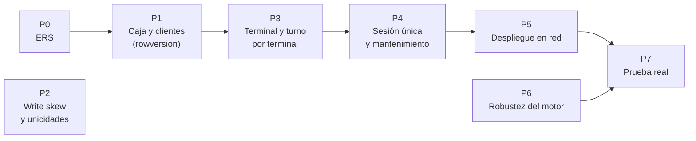
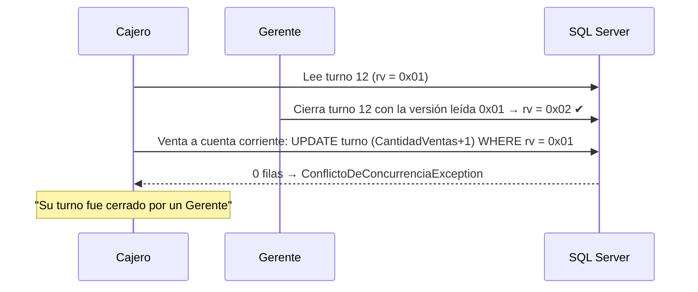

# Track 6.7: Plan de Implementación — Concurrencia Multiterminal

### Proyecto: Retail (Sistema ERP & Punto de Venta para Librería)
**Requisitos vinculados:** `RF-15` (arqueo ciego), `RF-20` (cuenta corriente), `RF-22` (respaldo), `RF-23` (verificación
de la base), `RNF-01`, `RNF-05` (a reescribir), `RNF-06`, `RNF-08` y los RNF nuevos de multiterminal, sesión única e
instancia única (a agregar en el Paquete 0).
**Auditoría base:** [`auditoria-concurrencia-multiterminal.md`](file:///c:/Users/lucas/Proyectos/retail/docs/auditorias/auditoria-concurrencia-multiterminal.md)
(decisiones MT-1 a MT-14, hallazgos H1 a H19, contrato fiscal C-1 a C-6 y matriz de la Fase 1). Este documento no
repite el análisis: lo convierte en paquetes de trabajo.
**Responsable:** Lucas Kruzolek. Los paquetes que tocan `App.xaml.cs`, el login o la configuración de DI son zonas
compartidas (Ley 10): se coordinan con Pablo antes de empezar.
**Estado:** 📋 Plan propuesto el 2026-11-19, pendiente de aprobación del estudiante.

---

## 1. Estado de Avance

| Paquete | Contenido | Hallazgos | Estado |
| :--- | :--- | :--- | :---: |
| 0 | ERS: reescribir `RNF-05` y agregar los RNF nuevos | Fase 0 | ✅ `RNF-05` reescrito, `RNF-10` a `RNF-12` y `RF-15` ampliado |
| 1 | Concurrencia optimista de caja y clientes | H2, H3, H18, MT-11 | ✅ Migración `ConcurrenciaCajaYClientes`; 963 tests de dominio, 1.182 de aplicación y 528 de integración en verde. El paso 1.6 pasó al Paquete 3 |
| 2 | *Write skew* y unicidades | H4, H5 | ✅ `IBloqueoGerentes` con `sp_getapplock` (mecanismo compartido con la restauración); 8 servicios traducen la violación de unicidad al mensaje de su comprobación previa |
| 3 | Identidad de la terminal y turno por cajero y terminal | H1, MT-1, MT-5, MT-9, MT-13, MT-14 | ✅ Migración `TerminalesYTurnoPorTerminal`, activación después del login, cierre remoto del Gerente con la versión leída. Desvíos en §6.1 |
| 4 | Instancia única, sesión única y modo mantenimiento | H8, H13, MT-2, MT-3, MT-6, H10 (sesiones) | ✅ `SESIONES_ACTIVAS` y `MANTENIMIENTO_PROGRAMADO` fuera del modelo de EF (excepción a la Ley 3); latido de 60 s con la hora del servidor; el Gerente ve y cierra sesiones en Usuarios |
| 5 | Despliegue en red: configuración, login SQL, mantenimiento en el servidor | H7, H9, H14, H16, H17, H19, MT-7, MT-8, MT-10, MT-12 | ✅ `appsettings.local.json`, contraseña DPAPI, conexión de mantenimiento (también para `Retail.Cli`), respaldo y restauración solo en el servidor con espera de terminales, scripts y [`INSTALACION_MULTITERMINAL.md`](file:///c:/Users/lucas/Proyectos/retail/docs/INSTALACION_MULTITERMINAL.md) |
| 6 | Robustez del motor: RCSI, reintentos, hora del servidor, esquema en caliente | H10, H11, H12 | ⏳ |
| 7 | Prueba real con dos PCs y acta | Fase 5 de la auditoría | ⏳ |

La parte fiscal (H6, H15, C-1 a C-6) se implementa con el Módulo 5.2 (ARCA), que todavía no existe. Este plan solo
deja anotado el contrato para que ese módulo lo cumpla.

---

## 2. Orden y dependencias

**Por qué este orden:**

| Criterio | Consecuencia |
| :--- | :--- |
| **Primero lo que corrompe datos hoy, aun con una sola terminal** | P1 va primero: H2, H3 y H18 ya pueden darse con dos ventanas de la app en la misma PC. Además no depende del concepto de terminal |
| **Después lo que impide arrancar en red** | P3 (H1: un solo turno abierto en todo el sistema) y P5 (H7: la conexión es local) |
| **Cada paquete deja `main` funcionando con una sola PC** | Ningún paquete exige instalar un servidor para seguir desarrollando. P5 mantiene la autenticación de Windows como opción para la PC de desarrollo |
| **P2 y P6 son independientes** | Se pueden hacer en paralelo o intercalados, por ejemplo mientras se espera la revisión de un PR |

Cada paquete es **un PR** con su rama, revisado por el compañero. Dentro de cada paquete se avanza capa por capa
(Dominio → Aplicación → Infraestructura → UI), con los tests escritos **antes** de la corrección (rojo → verde).

---

## 3. Paquete 0: ERS (sin código)

| Cambio | Contenido |
| :--- | :--- |
| `RNF-05` | De "instancia local con permisos restringidos a nivel de sistema operativo" a "instancia en red con un login de aplicación de permisos mínimos; el mantenimiento (respaldo, restauración, migraciones) se ejecuta solo en la PC servidor" |
| RNF nuevo: multiterminal | Varias terminales operan a la vez sobre una única base, sin actualizaciones perdidas ni ventas en turnos cerrados |
| RNF nuevo: sesión única | Un usuario no puede tener sesión abierta en dos terminales a la vez (MT-3) |
| RNF nuevo: instancia única | Una sola instancia de la aplicación por PC (MT-2) |
| `RF-15` | El turno es de un cajero en una terminal; la pausa y el cierre por el Gerente (MT-9, MT-13, MT-14) |

**Archivos:** `docs/ERS - Libreria POS.md` (y el `.docx` si se mantiene en paralelo).

---

## 4. Paquete 1: Concurrencia optimista de caja y clientes

**Rama sugerida:** `fix/concurrencia-caja-clientes` · **Hallazgos:** H2, H3, H18 · **Decisiones:** MT-11, remedio de H18.

### 4.1 Objetivo

Que la base rechace la segunda escritura cuando dos terminales (o dos ventanas) modifican el mismo turno o el mismo
cliente, y que el usuario reciba un mensaje claro.

### 4.2 Pasos por capa

| Paso | Capa | Archivo | Cambio |
| :--- | :--- | :--- | :--- |
| 1.1 | Tests (rojo) | `tests/Retail.Domain.UnitTests/Entities/TurnoCajaTests.cs` (nuevo) | `ImputarVenta_SoloCuentaCorriente_IncrementaCantidadVentas`, `ImputarVenta_TotalCero_IncrementaCantidadVentas`, `ImputarVenta_TurnoCerrado_LanzaTurnoYaCerrado` |
| 1.2 | Dominio | `src/Retail.Domain/Entities/TurnoCaja.cs` | Propiedad `CantidadVentas` (`private set`); `ImputarVenta` la incrementa **antes** de mirar los montos |
| 1.3 | Tests (rojo) | `tests/Retail.Infrastructure.IntegrationTests/ConcurrenciaCajaTests.cs` (nuevo) | Dos scopes de DI, sin hilos: (a) cierre y venta en efectivo; (b) cierre y venta 100 % a cuenta corriente (H18); (c) dos ventas a crédito al mismo cliente (H2); (d) cobranza y edición del límite de crédito. Todos esperan `ConflictoDeConcurrenciaException` en la segunda escritura |
| 1.4 | Infraestructura | `TurnoCajaConfiguration.cs`, `ClienteConfiguration.cs` | Propiedad sombra `RowVersion` con `.IsRowVersion()`, igual que `ArticuloConfiguration.cs:144`. Columna `cantidad_ventas` con `CHECK (cantidad_ventas >= 0)` (Ley 7 de persistencia) |
| 1.5 | Infraestructura | Migración `ConcurrenciaCajaYClientes` | Agrega las dos `rowversion` y `cantidad_ventas`. Para los turnos existentes, `cantidad_ventas` se calcula desde `VENTAS` en la propia migración, para que el dato histórico sea correcto |
| 1.6 | Aplicación | `CajaService.cs` (cierre) y su DTO de arqueo | **Movido al Paquete 3 (paso 3.6).** La `rowversion` es una propiedad sombra que la capa de Aplicación no ve, y el cierre remoto del Gerente, donde el bloqueo optimista largo importa, se construye recién con las terminales. Mientras tanto, la `rowversion` ya rechaza un cierre que choca con una operación posterior a la carga del turno |
| 1.7 | Aplicación | `VentaService.cs`, `ClienteService.cs`, `CajaService.cs` | Traducir `ConflictoDeConcurrenciaException` a un mensaje según quién ganó (cierre o venta), con el patrón `catch … when` de `PresupuestoService.ReemplazarAsync` |
| 1.8 | UI | `PosViewModel.cs`, `CajaViewModel.cs`, `CobranzaModalViewModel.cs` y el ViewModel del formulario de cliente | Mostrar el mensaje y recargar el turno o el cliente. Sin cambios de XAML previstos; si aparecen, rige el bucle de capturas (Ley 9) |
| 1.9 | Tests (verde) | Suites de Dominio, Aplicación e Integración | Más un test de UI por ViewModel que verifique el mensaje ante el conflicto |

### 4.3 Criterios de aceptación

* Los cuatro escenarios de 1.3 fallan antes del cambio y pasan después.
* Ninguna venta, cobranza ni movimiento puede confirmarse sobre un turno cerrado, sea cual sea el medio de pago.
* El resumen del cierre muestra `CantidadVentas`.
* `MAPA_DEL_PROYECTO.md` y `SISTEMA_DE_PERSISTENCIA.md` §9 actualizados (la lista de agregados con `rowversion`).

### 4.4 Riesgos

| Riesgo | Mitigación |
| :--- | :--- |
| Conflictos falsos: una edición del cliente en gerencia hace fallar una venta a crédito en el mostrador | Es el costo de un token por agregado. Se acepta: es raro y el POS ya permite reintentar (`PosViewModel.cs:534`) |
| `UpdateAsync` (`_dbSet.Update`) marca **todo el grafo** como modificado | Revisar que el turno no se cargue con sus `Movimientos` en la venta; si se cargan, se emiten `UPDATE` innecesarios de cada movimiento |
| Calcular `cantidad_ventas` en la migración con muchos turnos | Es una sola sentencia `UPDATE … FROM` agrupada; se mide con la base de demostración |

---

## 5. Paquete 2: *Write skew* y unicidades

**Rama sugerida:** `fix/concurrencia-usuarios-unicidades` · **Hallazgos:** H4, H5.

| Paso | Capa | Archivo | Cambio |
| :--- | :--- | :--- | :--- |
| 2.1 | Tests (rojo) | `tests/Retail.Infrastructure.IntegrationTests/ConcurrenciaUsuariosTests.cs` (nuevo) | Dos Gerentes activos; dos scopes dan de baja cada uno al otro. Hoy quedan cero Gerentes; se espera `UltimoGerenteException` en el segundo |
| 2.2 | Aplicación | `UsuarioService.cs:333` (`ExigirQueNoSeaElUltimoGerenteAsync`) | Tomar un bloqueo de aplicación (`sp_getapplock`, recurso `"Retail.Gerentes"`) dentro de la misma transacción que la baja o el cambio de rol. El bloqueo se pide a través de un puerto de Aplicación, para no meter SQL en el servicio |
| 2.3 | Infraestructura | Implementación del puerto | Reutiliza el patrón de `SqlServerBloqueoRestauracion.cs` (ya usa `sp_getapplock`) |
| 2.4 | Tests | Integración | Por cada índice único de §7 de la auditoría que todavía no tiene test de dos terminales (comprobante de compra, nombres de rubro, categoría, marca y proveedor): el segundo alta falla con `RestriccionDeUnicidadException` y el servicio la traduce |

**Criterio de aceptación:** nunca quedan cero Gerentes activos, aunque dos bajas lleguen a la vez.

---

## 6. Paquete 3: Identidad de la terminal y turno por cajero y terminal

**Rama sugerida:** `feat/terminales` · **Hallazgos:** H1 · **Decisiones:** MT-1, MT-5, MT-9, MT-13, MT-14.
⚠️ Toca el arranque (`App.xaml.cs`): coordinar con Pablo (Ley 10).

| Paso | Capa | Archivo | Cambio |
| :--- | :--- | :--- | :--- |
| 3.1 | Dominio | `Entities/Terminal.cs` (nuevo, `IAggregateRoot`) | Nombre visible, `NombreEquipo` (control), alta, baja lógica, `ReemplazarEquipo(nombre)` |
| 3.2 | Dominio | `TurnoCaja.cs`, `Venta.cs`, `Enums/EstadoTurnoEnum.cs` | `IdTerminal` en turno y venta. Estado nuevo `Pausado` con `Pausar()`, `Retomar(idUsuario)` (solo el mismo cajero, MT-14) y cierre por arqueo desde `Pausado` |
| 3.3 | Tests | `TerminalTests.cs`, `TurnoCajaTests.cs` | Transiciones del diagrama de §4.4 de la auditoría, incluido "el Gerente no puede retomar un turno ajeno" |
| 3.4 | Aplicación | `ITerminalLocal` (puerto nuevo) | Lee y escribe la identidad de esta PC. Lo implementa Infraestructura sobre `C:\ProgramData\Retail\terminal.json` |
| 3.5 | Aplicación | `TerminalService.cs` (nuevo) | Activar esta PC (solo Gerente, `RNF-06`): nueva o reemplazo; validar en el arranque que la terminal exista, esté activa y coincida con `Environment.MachineName` |
| 3.6 | Aplicación | `CajaService.cs` | `ObtenerTurnoActivoAsync` filtra por la terminal local (hoy devuelve el primero del sistema). `AbrirTurnoAsync` recibe la terminal. Regla de MT-13: un turno `Abierto` sin sesión se trata como pausado (la sesión llega en P4; hasta entonces, todo turno abierto de la terminal al entrar se trata como pausado) |
| 3.7 | Infraestructura | Configuraciones y migración `TerminalesYTurnoPorTerminal` | Tabla `TERMINALES`; FK `id_terminal` en `TURNOS_CAJA` y `VENTAS`; se reemplaza `IX_TURNOS_CAJA_TurnoAbierto` por dos índices únicos filtrados `estado IN ('Abierto','Pausado')`: uno por terminal y otro por usuario. **Datos existentes:** la migración crea una terminal "Terminal 1" y le asigna todos los turnos y ventas |
| 3.8 | Tests (rojo → verde) | Integración | Dos terminales abren turno a la vez (permitido); un cajero abre en dos terminales (rechazado por el índice de usuario); una terminal con un turno pausado no permite que otro cajero venda |
| 3.9 | UI | Diálogo "Activar esta PC" (nuevo), login, `CajaViewModel` | Flujo de §4.3 de la auditoría. El diálogo nuevo lleva su prueba de humo STA y su captura (Ley 9) |

**Riesgos:** que un turno abierto antes de la migración quede asignado a una terminal equivocada (se mitiga con la
terminal única por defecto); que el arranque cambie para todas las ramas abiertas (se coordina con Pablo y se
documenta en `MAPA_DEL_PROYECTO.md`).

### 6.1 Desvíos de la implementación (2026-11-19)

| Plan | Implementado | Por qué |
| :--- | :--- | :--- |
| Estado nuevo `Pausado` en `TurnoCaja` (pasos 3.2 y 3.7) | **Pausa derivada**: un turno `Abierto` de esta terminal cuyo dueño no es el usuario conectado. No hay estado nuevo ni índices sobre `Pausado` | La aplicación no tiene "cerrar sesión": la sesión termina al cerrar la app. La pausa de MT-9 y la PC colgada de MT-13 son el mismo caso, y guardar un estado que se deduce sería un dato redundante que puede quedar desincronizado |
| `id_terminal` en `VENTAS` (paso 3.2) | Solo en `TURNOS_CAJA` | La venta llega a la terminal por su turno; repetirlo violaría la 3FN |
| Activar la PC con credenciales de Gerente en un diálogo previo al login (paso 3.5) | La activación ocurre **después del login normal**, si el usuario conectado es Gerente | Reutiliza el login (bloqueo por intentos, registro de accesos) en lugar de duplicar la verificación de contraseñas |
| Versión leída en el cierre (paso 1.6, movido desde P1) | Tres valores del turno en el DTO: saldo teórico, total electrónico y cantidad de ventas. `TurnoCaja.ExigirSinCambiosDesde` los compara | Toda venta, cobranza o movimiento cambia al menos uno de ellos, y la `rowversion` (propiedad sombra) no es visible para la capa de Aplicación |
| La migración crea la terminal por defecto siempre | Solo si ya existen turnos | En una base nueva, la primera activación crea la terminal con el nombre que elija el Gerente; no queda una terminal fantasma |
| — | El turno se abría siempre a nombre del usuario 1 (`CajaViewModel`); ahora usa el usuario de la sesión | Defecto previo que habría roto el índice por cajero |

---

## 7. Paquete 4: Instancia única, sesión única y modo mantenimiento

**Rama sugerida:** `feat/sesion-unica` · **Hallazgos:** H8, H13, H10 (sesiones) · **Decisiones:** MT-2, MT-3, MT-6.
⚠️ Toca el arranque y el login (Ley 10).

| Paso | Capa | Archivo | Cambio |
| :--- | :--- | :--- | :--- |
| 4.1 | UI | `App.xaml.cs` | `Mutex` `Global\Retail.App` antes de construir el host; si existe, se trae al frente la ventana abierta y se cierra el proceso nuevo |
| 4.2 | Aplicación | `ISesionesActivas` (puerto nuevo) | Iniciar, renovar, cerrar, tomar una sesión vencida, forzar el cierre (Gerente) y leer la marca de mantenimiento |
| 4.3 | Infraestructura | `Persistence/Services/SesionesActivasService.cs` (nuevo) | SQL explícito como `RegistroAccesosService`; toda la hora con `SYSUTCDATETIME()`; la toma de una sesión vencida es el `UPDATE` condicional de §4.2 de la auditoría. Excepción a la Ley 3 documentada en `SISTEMA_DE_PERSISTENCIA.md` |
| 4.4 | Infraestructura | Migración `SesionesActivas` | Tabla con índices únicos en `id_usuario` y en `id_terminal`; tabla de una fila para la marca de mantenimiento |
| 4.5 | UI | Servicio de latido (nuevo) | Temporizador de 60 s, fuera del hilo de la UI (Ley 4), con **su propio scope y su propio `DbContext`** (H-19). Si el `UPDATE` afecta 0 filas, cierra la sesión local y avisa. Si lee la marca de mantenimiento, bloquea las ventas nuevas y avisa |
| 4.6 | Tests | Integración | Login simultáneo del mismo usuario en dos terminales; toma de una sesión vencida; un latido después de que otra terminal tomó la sesión; reloj del cliente adelantado (no debe influir) |
| 4.7 | Tests | App | El latido no bloquea la UI; el aviso de mantenimiento deshabilita "Cobrar" |

---

## 8. Paquete 5: Despliegue en red

**Rama sugerida:** `feat/despliegue-multiterminal` · **Hallazgos:** H7, H9, H14, H16, H17, H19 ·
**Decisiones:** MT-7, MT-8, MT-10, MT-12. Requiere leer `docs/SISTEMA_DE_CI_CD.md` (empaquetado).

| Paso | Capa | Archivo | Cambio |
| :--- | :--- | :--- | :--- |
| 5.1 | UI (host) | `App.xaml.cs` | Configuración en capas: `appsettings.json` + `C:\ProgramData\Retail\appsettings.local.json` (MT-7) |
| 5.2 | Infraestructura | `DependencyInjection.cs` | Contraseña del login `retail_app` cifrada con DPAPI a nivel máquina (MT-10) |
| 5.3 | Infraestructura | `Backups/*` | Segunda cadena de conexión local de mantenimiento (autenticación de Windows) para respaldo, restauración y la migración posterior (H19) |
| 5.4 | Aplicación y UI | `BackupService`, `RestauracionService`, pantalla de respaldos | Habilitar las operaciones solo si la PC es la del motor (`SERVERPROPERTY('ComputerNamePhysicalNetBIOS')`); en las terminales, solo el historial (MT-12, H9). La restauración pasa por el modo mantenimiento de P4 (H8) |
| 5.5 | Scripts | `registrar-tarea-backup.ps1`, `configurar-terminal.ps1` (nuevo), script de creación del login `retail_app` | Guardia de §4.3 de la auditoría (H16); configuración de cada terminal (MT-8) |
| 5.6 | Config | `appsettings.json` | `ArcaSettings.BaseUrl` configurable por PC (H14) |
| 5.7 | Docs | Guía de instalación multiterminal; `SISTEMA_DE_PERSISTENCIA.md` (cadena de conexión) | — |

**Estado de los pasos 5.4, 5.5 y 5.7:** la pantalla de respaldos (con la espera de terminales de [`OrquestadorMantenimiento`](file:///c:/Users/lucas/Proyectos/retail/src/Retail.App/Services/OrquestadorMantenimiento.cs)), los tres scripts (`registrar-tarea-backup.ps1` con su guardia, [`crear-login-aplicacion.ps1`](file:///c:/Users/lucas/Proyectos/retail/scripts/crear-login-aplicacion.ps1) y [`configurar-terminal.ps1`](file:///c:/Users/lucas/Proyectos/retail/scripts/configurar-terminal.ps1)) y el ZIP de release están hechos. La guía para quien instala en el local es [`INSTALACION_MULTITERMINAL.md`](file:///c:/Users/lucas/Proyectos/retail/docs/INSTALACION_MULTITERMINAL.md) (paso 5.7).

**Decisión que hay que tomar antes de empezar:** DPAPI en .NET 8 está en el paquete
`System.Security.Cryptography.ProtectedData`, que hoy no está instalado. Agregar un paquete NuGet requiere
aprobación (Principio de Simplicidad, §3).

---

## 9. Paquete 6: Robustez del motor

**Rama sugerida:** `perf/robustez-multiterminal` · **Hallazgos:** H10, H11, H12.

| Paso | Cambio | Riesgo |
| :--- | :--- | :--- |
| 6.1 | `READ_COMMITTED_SNAPSHOT ON` en la base (H11), en una migración que se aplica en modo mantenimiento | Cambia la semántica de las lecturas: revisar que ninguna regla dependa de que una lectura bloquee |
| 6.2 | Reintentos ante *deadlock* (H11) | `EnableRetryOnFailure` de EF Core no admite transacciones iniciadas por el usuario; hay que revisar cada `BeginTransaction` (por ejemplo, en `Backups/`) antes de activarlo |
| 6.3 | Hora del servidor en las fechas de negocio (resto de H10) | Afecta a todos los `DateTime.UtcNow` del dominio: se evalúa si conviene, o si alcanza con sincronizar los relojes por NTP en la guía de instalación |
| 6.4 | Detectar una migración aplicada mientras la app está abierta (H12) | El latido de P4 puede comparar la última migración aplicada |

---

## 10. Paquete 7: Prueba real

Dos PCs o dos VMs contra la misma base, con un guion de escenarios: ventas simultáneas del mismo artículo, cierre
remoto con ventas en curso, mismo usuario en dos PCs, corte de red de una terminal, PC colgada con turno abierto y
restauración con terminales conectadas. Entregable: acta de pruebas en `docs/auditorias/`. Los tests de contrato C-1
y C-2 contra arcasdk quedan para cuando exista el Módulo 5.2.

---

## 11. Cómo empezar (primer paso propuesto)

1. Aprobar este plan y el orden de los paquetes.
2. Paquete 0 (ERS), que no tiene código.
3. Crear la rama `fix/concurrencia-caja-clientes` desde `main` y hacer **solo el paso 1.1** (tests de dominio de
   `TurnoCaja` en rojo). Revisar juntos y recién después seguir con 1.2.

## 12. Preguntas de defensa

1. *¿Por qué el Paquete 1 va antes que el concepto de terminal?* Porque corrige anomalías que ya se dan con dos
   ventanas en una sola PC, y porque no depende de nada nuevo.
2. *¿Por qué los tests de concurrencia no usan hilos?* Porque dos scopes que leen, modifican y guardan en un orden
   fijo reproducen la carrera de forma determinista: el test falla siempre o no falla nunca.
3. *¿Por qué `CantidadVentas` se recalcula en la migración?* Porque un contador que empieza en 0 para turnos
   históricos mentiría en los reportes; el dato debe ser verdadero desde el primer día.
4. *¿Qué zonas compartidas toca este track y cómo se protege el trabajo de los demás?* `App.xaml.cs`, el login y la
   DI (P3, P4, P5): se coordinan con Pablo y cada PR deja `main` funcionando con una sola PC.
