Retail POS · Módulo 05 · Importador de catálogos

# Importador de catálogos, de lo general al detalle

Diagramas de secuencia y de estado en cinco niveles, más tres secciones para preparar la defensa. Cada nivel muestra el anterior con más detalle: primero qué casos de uso existen y cómo cambia el estado de los datos, después cómo ve el sistema el usuario, después qué capa hace cada cosa y al final los mecanismos internos de la importación.

**Nivel 0**Mapa: los casos de uso y el ciclo de vida del renglón y del artículo.

**Nivel 1**El sistema como caja negra: qué ve el usuario en cada caso de uso.

**Nivel 2**Por capas: App, Aplicación, Dominio, Infraestructura y SQL Server.

**Nivel 3**Por dentro de la importación: diálogo, hilos, filas, atomicidad y errores.

**Nivel 4**El algoritmo: lectura de la planilla y propagación del costo.

**Defensa**A. Las consultas Q1, Q2 y Q3. B. Rendimiento con muchas filas. C. Validaciones por capa.

1. [N0Mapa](#nivel0)
2. [N1Caja negra](#nivel1)
3. [N2Por capas](#nivel2)
4. [N3Mecanismos](#nivel3)
5. [N4Algoritmo](#nivel4)
6. [AQ1 · Q2 · Q3](#consultas)
7. [BRendimiento](#rendimiento)
8. [CValidaciones](#validaciones)

Abstracción máxima

## Nivel 0 · El mapa

Hay dos tablas, que la guía llama libretas: el **catálogo del proveedor** (`CATALOGOS\_PROVEEDORES`) y la **tienda** (`ARTICULOS`). Las une el **hilo** `id\_catalogo\_proveedor`. Los seis casos de uso se entienden según qué hacen con ese hilo.

Diagrama 0.1 · casos de uso

### Quién hace qué y sobre qué tabla escribe

```mermaid
flowchart LR
    U(\["Encargado del comercio"])
    subgraph IMP\["Pantalla Importador de Catálogos"]
        CU1\["CU-01 Explorar el catálogofiltros y paginación"]
        CU2\["CU-02 Importar planilla"]
        CU3\["CU-03 Incorporar a la tienda"]
        CU4\["CU-04 Vincular artículo existente"]
    end
    subgraph ART\["Pantalla Artículos, ficha"]
        CU5\["CU-05 Elegir renglón del distribuidor"]
        CU6\["CU-06 Desvincular"]
    end
    CAT\[("Libreta 1CATALOGOS\_PROVEEDORES")]
    TIE\[("Libreta 2ARTICULOS")]
    U --> CU1
    U --> CU2
    U --> CU3
    U --> CU4
    U --> CU5
    U --> CU6
    CU1 -->|"lee"| CAT
    CU2 -->|"escribe costos"| CAT
    CU2 -.->|"el costo viaja por el hilo"| TIE
    CU3 -->|"crea artículos con hilo"| TIE
    CU4 -->|"ata el hilo"| TIE
    CU5 -->|"ata el hilo"| TIE
    CU6 -->|"suelta el hilo"| TIE
```

**Qué tenés que llevarte**

* La planilla **solo escribe en el catálogo**. La importación nunca crea artículos de la tienda; a la tienda llega únicamente el costo nuevo, y solo a los artículos que ya tienen hilo.
* Las demás operaciones (CU-03 a CU-06) son de **curaduría**: deciden qué renglones pasan a la tienda y a qué artículo se atan.

Diagrama 0.2 · estado

### Ciclo de vida de un renglón del catálogo

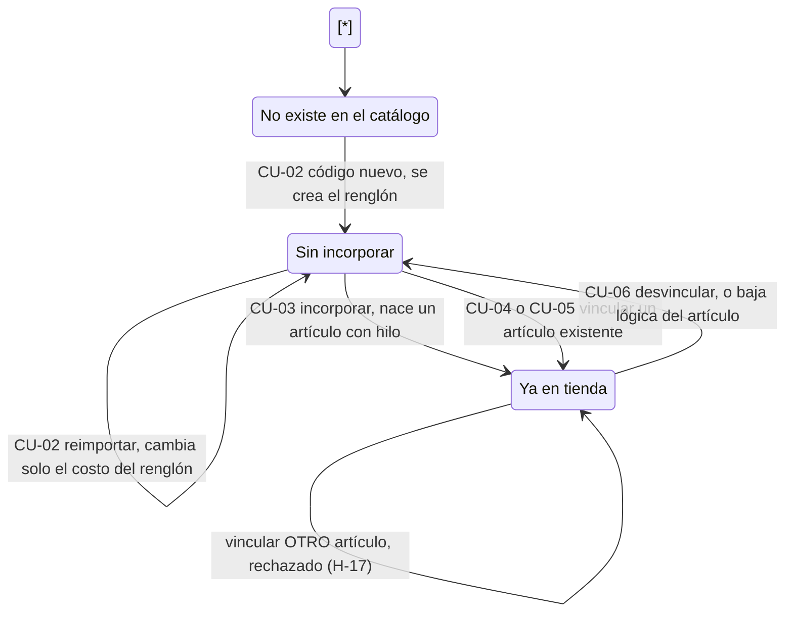

Los estados son los valores del filtro del explorador (`EstadoVinculacionCatalogoEnum`: `SinIncorporar` y `YaEnTienda`). Un renglón tiene **como máximo un artículo activo**. Lo garantiza el índice único filtrado `IX\_ARTICULOS\_id\_catalogo\_proveedor`, que ignora los artículos dados de baja; por eso una baja lógica deja libre el renglón.

Diagrama 0.3 · estado

### El artículo respecto del hilo

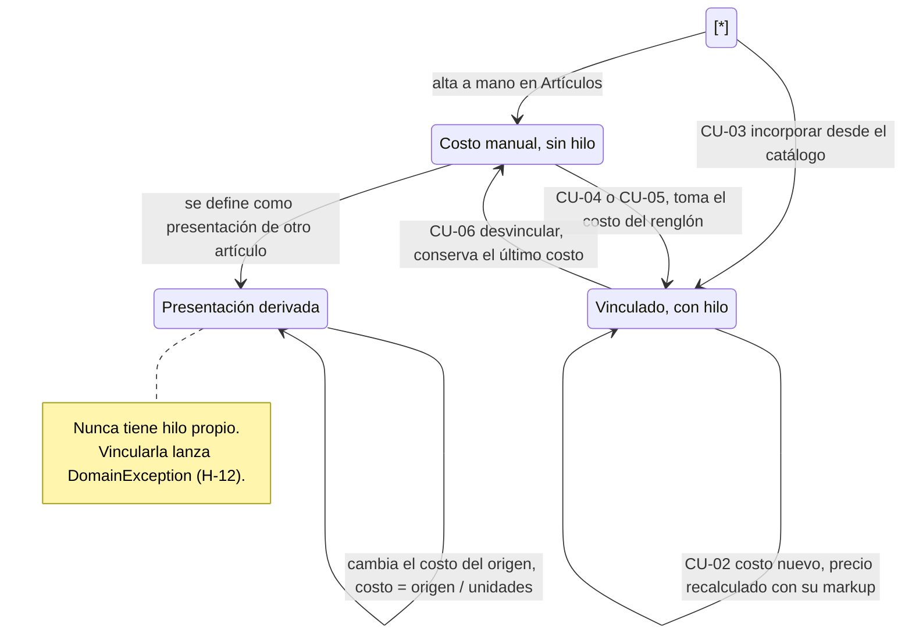

Ejemplo: el pack de 100 sobres tiene hilo; el sobre suelto es una presentación del pack y recibe el costo dividido. Así se puede vender fraccionado (`RF-21`) sin romper la regla de un renglón por artículo.

Autoevaluación N0: ¿por qué una importación no crea artículos en la tienda?

Porque el catálogo del distribuidor y la tienda son libretas separadas (`RF-07`: evitar sobrecargar el inventario propio). Un renglón nuevo queda "Sin incorporar" hasta que alguien decida incorporarlo (CU-03) o atarlo a un artículo existente (CU-04/05).

Caja negra

## Nivel 1 · Lo que ve el usuario

Tres participantes: el usuario, el sistema como un todo y la base de datos. Todavía no aparecen clases ni capas. Fijate en **cuántas veces** se consulta la base y **cuántas veces se guarda**: una sola, en todos los casos.

Diagrama 1.1 · secuencia · CU-02

### Importar una planilla

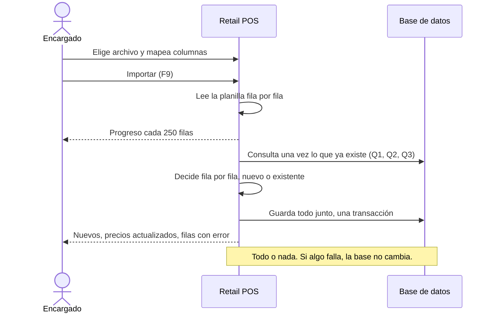

Diagrama 1.2 · secuencia · CU-03

### Incorporar a la tienda

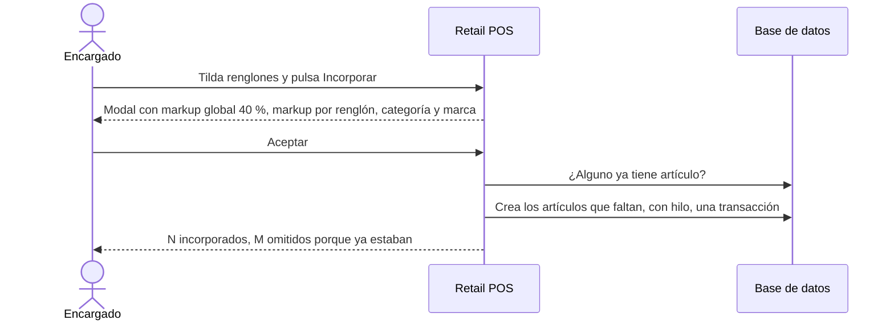

Diagrama 1.3 · secuencia · CU-04

### Vincular desde el importador

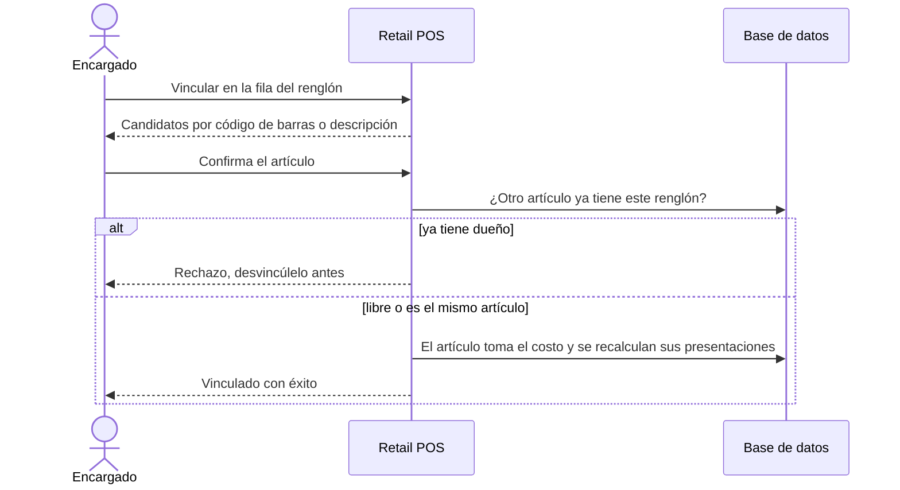

La coincidencia por código de barras es una **sugerencia**: el sistema preselecciona el candidato, pero el usuario confirma. No se atan costos sin que alguien revise.

Diagrama 1.4 · secuencia · CU-05 y CU-06

### Vincular o desvincular desde la ficha del artículo

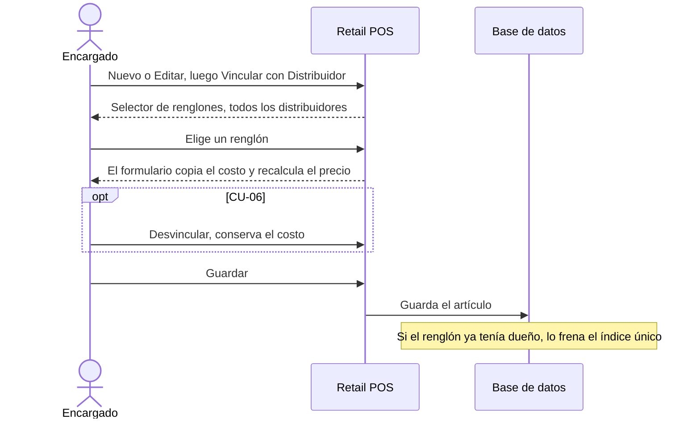

**Diferencia entre CU-04 y CU-05.** CU-04 verifica antes de guardar si otro artículo ya tiene el renglón y responde con un mensaje claro. CU-05 no lo verifica: el índice único igual impide el duplicado, pero el mensaje habla de "otra operación realizada al mismo tiempo", lo que confunde al usuario.

Autoevaluación N1: en CU-04, ¿qué pasa si el artículo elegido ya estaba atado a otro renglón?

El vínculo se mueve: un artículo tiene un solo hilo, así que el renglón anterior queda libre. La regla que se verifica es la del lado del renglón (que no tenga otro dueño).

Por capas

## Nivel 2 · Qué capa hace cada cosa

La "caja negra" se abre en las capas de Clean Architecture. El prefijo de cada participante indica la capa: `\[App]` WPF y MVVM, `\[Apl]` casos de uso, `\[Dom]` invariantes, `\[Inf]` adaptadores. Las dependencias apuntan hacia adentro: Aplicación solo conoce interfaces como `IExcelCatalogParser`.

Diagrama 2.1 · secuencia · CU-02

### Importar planilla: `ImportarPlanillaProveedorAsync`

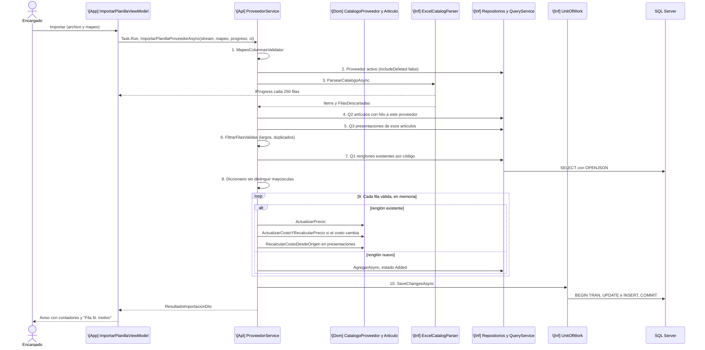

**Qué tenés que llevarte**

* **Consultar una vez, no por fila.** Q1, Q2 y Q3 se hacen antes del bucle; el bucle trabaja solo en memoria. Así se evita el problema N+1.
* **Las reglas viven en el Dominio.** La fórmula `precio = costo × (1 + markup/100)` está en `Articulo.CalcularPrecioVenta`; el servicio solo la invoca.
* **Un único punto de confirmación.** Mientras dura el bucle todo queda en el Change Tracker; recién el paso 10 escribe en la base.

Diagrama 2.2 · secuencia · CU-03

### Incorporar: `IncorporarArticulosATiendaAsync`

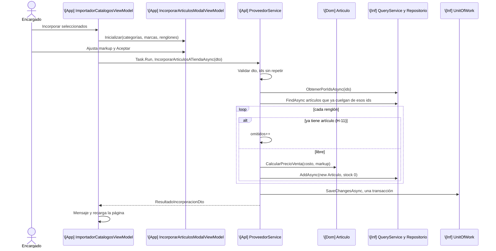

Diagrama 2.3 · secuencia · CU-04

### Vincular: `VincularArticuloACatalogoAsync`

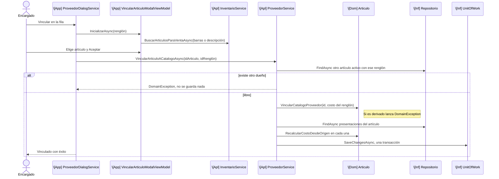

**Dónde vive la regla de un renglón por artículo.** Un `Articulo` no conoce a los demás artículos, así que no puede verificar que nadie más tenga el renglón. Por eso la regla está en Aplicación (para dar un mensaje claro) y en la base (índice único, que también protege cuando dos terminales actúan a la vez). En cambio, "una presentación no tiene hilo" se decide mirando un solo artículo, y por eso está en el Dominio.

Autoevaluación N2: ¿por qué el caso de uso se lanza con `Task.Run` desde el ViewModel?

Porque `async` por sí solo no garantiza que el trabajo salga del hilo de la interfaz: el parseo y el recorrido consumen CPU. `Task.Run` lo manda al ThreadPool y la ventana sigue respondiendo (Ley 4, `RNF-02`).

Mecanismos

## Nivel 3 · Por dentro de la importación

CU-02 es el caso de uso más complejo, y este nivel lo mira desde cinco ángulos: el estado de la ventana, los hilos de ejecución, el estado de cada fila, la atomicidad y la clasificación de errores.

Diagrama 3.1 · estado

### Estados del diálogo `ImportarPlanillaDialog`

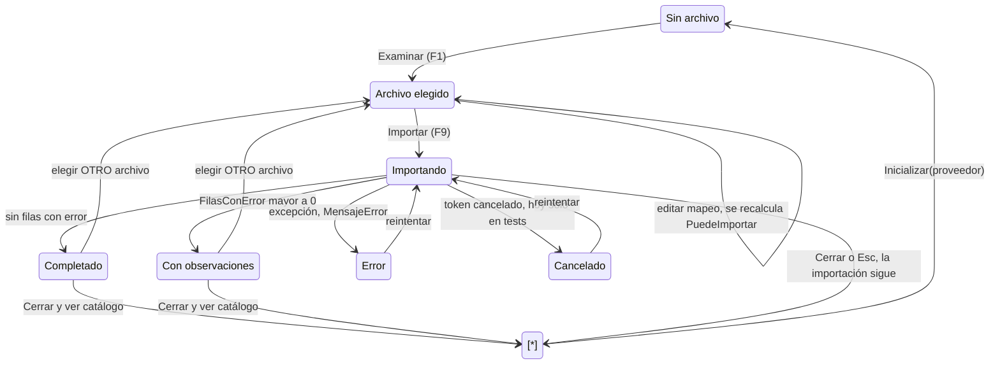

Después de un éxito, el botón Importar queda deshabilitado hasta que se elija un archivo **distinto**. Es la protección contra la reimportación accidental (E-22).

Diagrama 3.2 · secuencia

### Hilos de ejecución y progreso

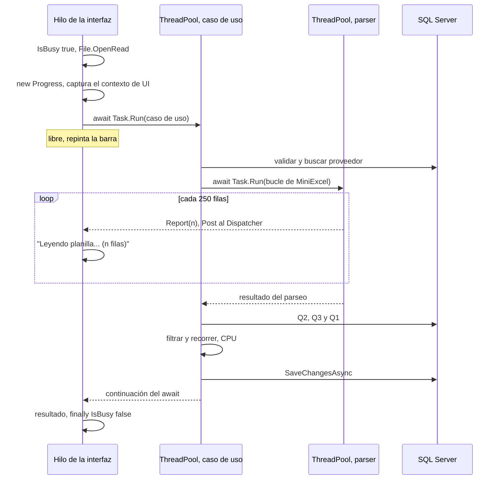

`Progress<T>` captura el contexto del hilo que lo crea; por eso se crea en el ViewModel y no en el servicio. Si se creara en el ThreadPool, el callback no podría tocar la pantalla.

**Cancelación incompleta.** El servicio respeta el `CancellationToken` y descarta los cambios, pero el diálogo no tiene un botón que lo active. Cerrar con la cruz o con Esc no cancela: la ventana se cierra y la importación sigue en segundo plano (E-20).

Diagrama 3.3 · estado

### Estado de una fila de la planilla

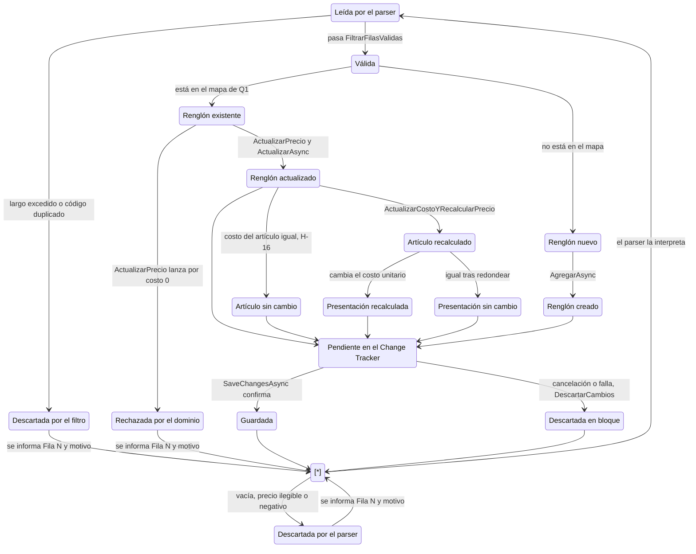

El estado clave es **Pendiente**: ninguna fila llega sola a la base. Todas esperan el mismo `SaveChangesAsync` y, si el recorrido se interrumpe, se descartan todas juntas.

**Costo cero (H-07, abierto).** Si el código ya existe, `ActualizarPrecio` rechaza el costo 0 y la fila se informa como error. Si el código es nuevo, el renglón se crea con un inicializador de objeto sin validación de dominio y se guarda con costo 0. La misma regla da dos resultados según el camino.

Diagrama 3.4 · secuencia

### Atomicidad y `DescartarCambios`

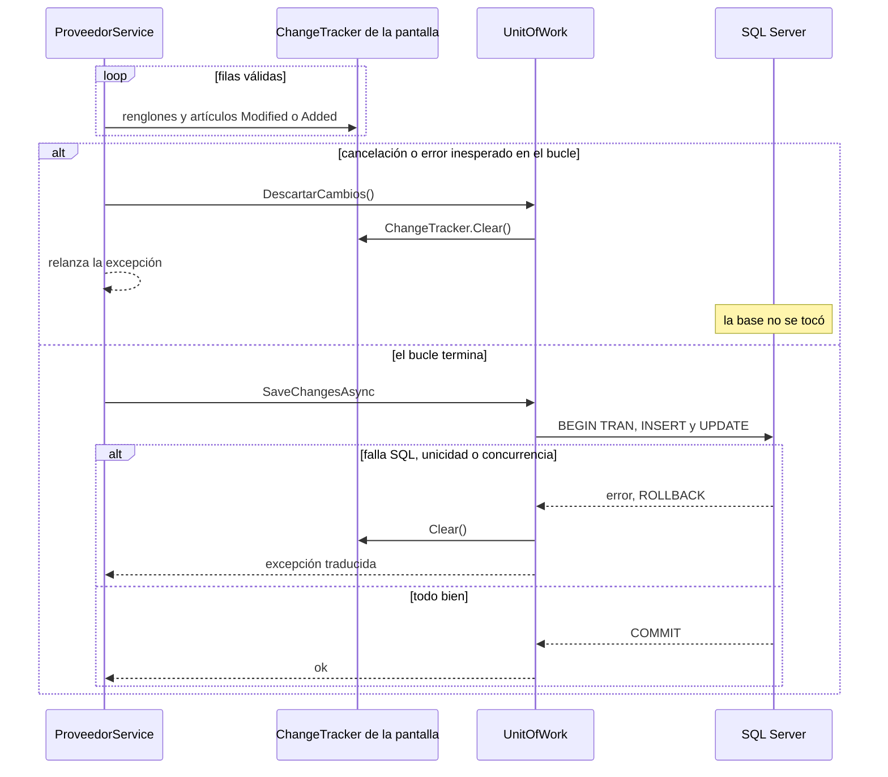

¿Por qué limpiar memoria si la base no se tocó? El `DbContext` vive mientras la pantalla está abierta. Sin `Clear()`, la media planilla cancelada se guardaría "de colado" con la próxima operación de esa pantalla, por ejemplo una incorporación. Eso rompería la atomicidad más tarde.

Diagrama 3.5 · flujo de errores

### Las cuatro redes de errores

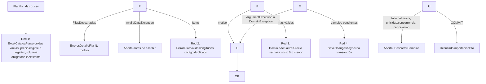

Hay dos políticas en el mismo caso de uso. Un **error de dato** afecta a una fila: esa fila se descarta, se informa y se sigue con las demás. Un **error de configuración o de sistema** afecta a todo el lote: se corta la importación y no se escribe nada.

Autoevaluación N3: el bucle tiene dos `try` anidados. ¿Qué atrapa cada uno?

El interior atrapa solo `ArgumentException` y `DomainException` (con un filtro `when`): son errores de dato, se agrega "Fila N" y se sigue. El exterior atrapa todo lo demás (cancelación, defectos): llama a `DescartarCambios` y relanza la excepción, así que la importación entera se aborta.

Algoritmo

## Nivel 4 · El algoritmo

El nivel más cercano al código: cómo se lee la planilla y qué decide el servicio en cada fila que ya existe.

Diagrama 4.1 · flujo

### `ParsearCatalogoAsync` en streaming

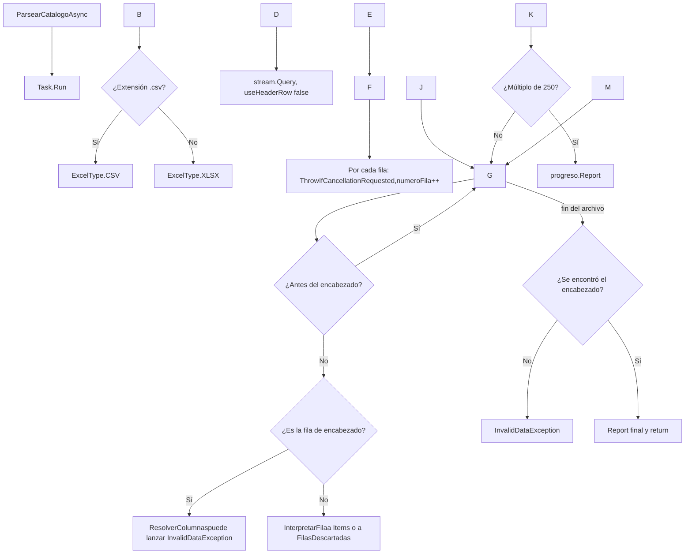

MiniExcel lee **fila por fila** (streaming), sin armar el libro completo en memoria como haría un modelo DOM. Lo que sí se acumula es la lista de renglones válidos. `useHeaderRow: false` permite que cada distribuidor tenga el encabezado en otra fila y con otros nombres.

Diagrama 4.2 · flujo

### Propagación del costo en una fila existente

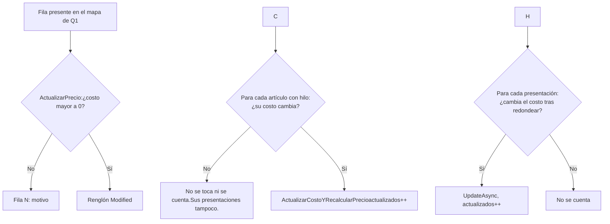

El contador `PreciosActualizados` cuenta solo los cambios reales (H-16). Se compara contra el costo **de cada artículo**, porque un artículo pudo haberse editado a mano.

Ejemplo ilustrativo · números inventados

### Un costo nuevo recorriendo el hilo

La planilla trae el renglón "Sobres x100" con costo nuevo $4.500. El pack tiene markup 40 %; el sobre suelto es su presentación (100 unidades por origen) con markup 60 %. El redondeo es a 2 decimales, con `MidpointRounding.AwayFromZero`.

|Paso|Método|Cálculo|Resultado|
|-|-|-|-|
|Renglón del catálogo|`ActualizarPrecio`|costo = 4500,00|4500,00|
|Pack (artículo con hilo)|`ActualizarCostoYRecalcularPrecio`|4500,00 × (1 + 40/100)|precio 6300,00|
|Sobre suelto: costo|`CalcularCostoPresentacion`|4500,00 / 100|45,00|
|Sobre suelto: precio|`CalcularPrecioVenta`|45,00 × (1 + 60/100)|72,00|

Caso borde: con 1000 unidades por origen, costos de $45,00 y $45,20 dan el mismo costo unitario (0,05). La presentación queda igual y no se cuenta como actualizada.

Autoevaluación N4: ¿por qué `ActualizarCostoYRecalcularPrecio` calcula el precio antes de asignar el costo?

Para no dejar el artículo a medias (H-08). Si el cálculo lanza una excepción (costo o ganancia negativos), el artículo no queda con el costo nuevo y el precio viejo. Primero se valida todo y después se modifica el estado.

Preparación para la defensa · A

## Las consultas Q1, Q2 y Q3

Antes de recorrer las filas, la importación hace tres consultas, cada una **una sola vez**. Cada consulta responde una pregunta distinta y deja en memoria una estructura preparada para que el bucle busque en `O(1)` sin volver a la base. La idea de fondo es evitar el antipatrón **N+1**: con 5.000 filas, preguntar por fila serían más de 10.000 viajes; así son tres.

Diagrama A.1 · qué alcanza cada consulta

### Tres preguntas, tres saltos por las claves foráneas

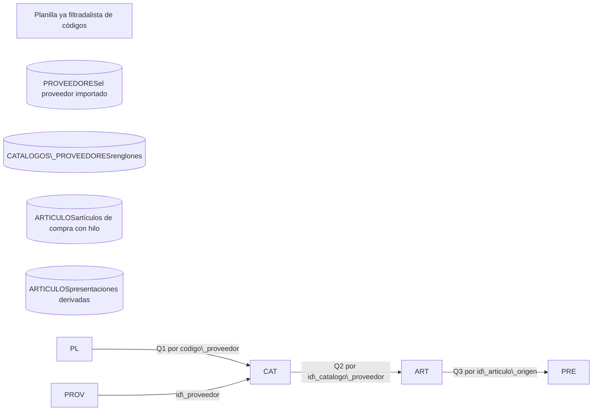

Q1 parte de la **planilla**: busca los renglones que ya existen. Q2 y Q3 parten del **proveedor**: traen todo lo que en la tienda depende de él, primero los artículos atados por el hilo y después las presentaciones de esos artículos, que no tienen hilo propio y solo se alcanzan a través de su origen.

|Consulta|Pregunta que responde|Filtro|Estructura en memoria|Índice que la sirve|
|-|-|-|-|-|
|**Q1**|¿Cuáles de los códigos de la planilla ya existen en el catálogo de este proveedor?|`id\_proveedor = @p` y `codigo\_proveedor IN (OPENJSON(@lista))`|`Dictionary<string, CatalogoProveedor>` que no distingue mayúsculas|`(id\_proveedor, codigo\_proveedor)` único|
|**Q2**|¿Qué artículos de la tienda están atados a algún renglón de este proveedor?|`JOIN` artículo → renglón, `id\_proveedor = @p`|`ILookup<int, Articulo>` por `IdCatalogoProveedor`|`IX\_ARTICULOS\_id\_catalogo\_proveedor`|
|**Q3**|¿Qué presentaciones derivan de esos artículos?|Doble `JOIN` presentación → origen → renglón, `id\_proveedor = @p`|`ILookup<int?, Articulo>` por `IdArticuloOrigen`|`IX\_ARTICULOS\_id\_articulo\_origen`|

Q1 · renglones existentes

### Buscar por los códigos de la planilla

```
// CatalogoProveedorQueryService
var codigoList = codigos.Where(c => !string.IsNullOrWhiteSpace(c))
                        .Distinct().ToList();
var lista = await \_context.CatalogosProveedores
    .Where(c => c.IdProveedor == idProveedor
             \&\& codigoList.Contains(c.CodigoProveedor))
    .ToListAsync(ct);          // CON tracking: se van a modificar
```

```
-- SQL aproximado (EF Core 8, reconstruido)
SELECT c.\* FROM CATALOGOS\_PROVEEDORES c
WHERE c.deleted\_at IS NULL
  AND c.id\_proveedor = @idProveedor
  AND c.codigo\_proveedor IN (
      SELECT value FROM OPENJSON(@codigoList)
      WITH (value nvarchar(50) '$'))
-- @codigoList = '\["BIC-AZ","sob-100","GOMA-1"]'
```

* **Solo los códigos de la planilla**, no el catálogo entero del proveedor: si llega una planilla parcial, no se traen miles de renglones de más.
* **El límite de 2.100 parámetros no aplica.** EF Core 8 manda toda la lista en **un solo parámetro JSON** que SQL Server desarma con `OPENJSON`. Lo prueba un test con 3.000 códigos. Requisito: la base necesita nivel de compatibilidad 130 o más.
* **Diccionario que no distingue mayúsculas.** SQL Server compara con la intercalación `CI`, sin distinguir mayúsculas, así que `sob-100` encuentra `SOB-100`. El diccionario se reconstruye con `OrdinalIgnoreCase` y `Trim()` para que C# compare igual que la base. Si no, esa fila se trataría como nueva, el `INSERT` chocaría con el índice único y se perdería **toda** la planilla.

Q2 y Q3 · lo que depende del proveedor

### Filtrar navegando, no mandando listas de ids

```
// Q2: artículos con hilo a este proveedor
\_articuloRepository.FindAsync(a =>
    a.CatalogoProveedor != null
 \&\& a.CatalogoProveedor.IdProveedor == mapeo.IdProveedor, ...);
var articulosPorCatalogo =
    articulosLocales.ToLookup(a => a.IdCatalogoProveedor!.Value);

// Q3: presentaciones, un salto más
\_articuloRepository.FindAsync(a =>
    a.ArticuloOrigen != null
 \&\& a.ArticuloOrigen.CatalogoProveedor != null
 \&\& a.ArticuloOrigen.CatalogoProveedor.IdProveedor == mapeo.IdProveedor, ...);
var presentacionesPorOrigen =
    presentaciones.ToLookup(a => a.IdArticuloOrigen);
```

```
-- Q2, SQL aproximado: un parámetro escalar
SELECT a.\* FROM ARTICULOS a
LEFT JOIN CATALOGOS\_PROVEEDORES t
       ON a.id\_catalogo\_proveedor = t.id\_catalogo
      AND t.deleted\_at IS NULL
WHERE a.deleted\_at IS NULL
  AND t.id\_proveedor = @idProveedor
```

* **H-14.** La primera versión traía los artículos con hilo de **todos** los proveedores. Ahora el predicado navega `Articulo → CatalogoProveedor → IdProveedor` y EF lo traduce a un `JOIN` con un solo parámetro. Medido: con 2.000 artículos de otro proveedor de ruido, se siguen 2.500 entidades y no 4.500.
* **`ToLookup` y no `ToDictionary`.** Para una clave que no existe, un lookup devuelve una secuencia vacía en vez de lanzar una excepción. Así, `articulosPorCatalogo\[renglon.Id]` nunca falla aunque el renglón no tenga artículo.
* **Q3 existe porque la presentación no tiene hilo** (`CK\_ARTICULOS\_Presentacion` lo prohíbe). Q2 no puede encontrarla.
* **Ambas se hacen con tracking**: los artículos que traen son los que el bucle va a modificar.

Ejemplo ilustrativo · datos inventados

### Qué devuelve cada consulta para el proveedor 7

La planilla del proveedor 7 trae tres códigos: `BIC-AZ`, `sob-100` (en minúsculas) y `GOMA-1` (nuevo).

|CATALOGOS\_PROVEEDORES|prov.|código|
|-|-|-|
|10|7|BIC-AZ|
|11|7|SOB-100|
|12|7|COR-12|
|20|9|X-1|

|ARTICULOS|descripción|hilo|origen|
|-|-|-|-|
|100|Birome azul|10|—|
|101|Sobres x100|11|—|
|102|Sobre suelto|—|101|
|104|Corrector|12|—|
|200|Art. de otro proveedor|20|—|

|Consulta|Devuelve|Estructura resultante|Qué conviene notar|
|-|-|-|-|
|**Q1**|Renglones 10 y 11|`{"BIC-AZ"→10, "SOB-100"→11}`, sin distinguir mayúsculas|`sob-100` encuentra al 11. `GOMA-1` no aparece, así que será renglón nuevo|
|**Q2**|Artículos 100, 101 y 104|`{10→\[100], 11→\[101], 12→\[104]}`|El 200 queda afuera (otro proveedor). El 104 entra aunque `COR-12` no esté en la planilla: Q2 trae lo del proveedor, no lo de la planilla|
|**Q3**|Artículo 102|`{101→\[102]}`|Se alcanza por su origen 101, que tiene hilo al renglón 11 del proveedor 7|

En el bucle, la fila `sob-100` hace tres búsquedas en memoria: `mapa\["sob-100"]` devuelve el renglón 11, `articulosPorCatalogo\[11]` devuelve el artículo 101 y `presentacionesPorOrigen\[101]` devuelve el 102. No hay ningún viaje a la base.

**Precisión aceptada.** Q2 y Q3 dependen del proveedor y no de la planilla. Si un proveedor con 3.000 artículos vinculados manda una planilla de 10 renglones, se cargan igual los 3.000. Es un intercambio deliberado: una consulta simple con un parámetro, a cambio de traer de más en planillas chicas.

Pregunta probable: ¿por qué no partir Q1 en bloques de 1.000 códigos?

Porque el problema que se quería resolver no existe en EF Core 8: `Contains` envía la lista como un único parámetro JSON. Fue un falso positivo de la auditoría (H1) y quedó verificado con un test de 3.000 códigos contra SQL Server. Ese test controla el comportamiento y no la forma del SQL; si una versión futura de EF cambia la traducción, el test avisa.

Pregunta probable: ¿por qué Q2 no usa `Include(a => a.Presentaciones)`?

Funcionaría, pero obligaría a que el repositorio genérico aceptara *includes* o a escribir un método nuevo. Con dos `FindAsync` y predicados de navegación se reutiliza el contrato existente, y cada consulta trae exactamente las entidades que se van a modificar.

Preparación para la defensa · B

## Rendimiento con muchas filas: el viaje de los datos

La pregunta típica del docente es: "¿qué pasa con 50.000 filas?". La respuesta se arma siguiendo los datos desde el archivo hasta la base y diciendo, en cada etapa, qué estructura los contiene, cuánto cuesta y qué está medido.

Diagrama B.1 · tubería de datos

### Del archivo al COMMIT, etapa por etapa

|Etapa|Estructura|Por qué esa estructura|Costo|
|-|-|-|-|
|Lectura|`IEnumerable` diferido de MiniExcel (modo streaming)|No arma el libro completo en memoria como un modelo DOM (ClosedXML, EPPlus). `useHeaderRow: false` conserva el número de fila real y permite el encabezado en cualquier fila|Memoria de una fila. Tiempo O(n)|
|Salida del parser|`List<ItemCatalogoImportadoDto>` (records inmutables) y `List<string>`|El caso de uso **necesita todos los códigos** antes de Q1 y haber visto todas las filas para detectar duplicados|O(n). Unos 1,2 MB para 5.000 filas (estimado)|
|Filtro|`HashSet<string>` con `OrdinalIgnoreCase`|`Add` devuelve `false` si el código ya estaba: detecta y registra en una sola operación|O(1) por fila|
|Mapa de existentes|`Dictionary<string, CatalogoProveedor>`|Búsqueda por código que no distingue mayúsculas, igual que la intercalación de la base|O(1) por fila|
|Dependientes|Dos `ILookup`|Uno a muchos sin excepción para claves ausentes|O(1) por fila más los artículos afectados|
|Cambios pendientes|Change Tracker del `DbContext` de la pantalla|Unit of Work: todo se confirma junto o no se confirma|O(n). Es el cuello de botella de memoria|
|Escritura|Lotes de `UPDATE` e `INSERT` en una transacción|Atomicidad. EF agrupa varios comandos por viaje|Varios viajes de escritura, un solo COMMIT|

Medido y afirmado en tests

### Lo que se puede afirmar con evidencia

|Escenario|Resultado|
|-|-|
|Parseo de 5.000 filas|menos de 3 s, menos de 50 MB (afirmado)|
|Importación de 5.000 filas de punta a punta: 2.500 existentes y 2.500 nuevas, más 2.000 artículos de ruido|unos 13 MB retenidos, afirmado menos de 100 MB. Límite RNF-03: 300 MB|
|Artículos en el Change Tracker|2.500, no 4.500 (H-14)|
|Tiempo total|3,9 a 4,6 s típicos. Medido, no afirmado|
|Viajes de lectura|4: proveedor, Q2, Q3 y Q1, sin importar n|

Cómo crece

### Complejidad y escalabilidad

* **Tiempo O(n)** en filas, más las consultas indexadas: Q1 cuesta O(C · log R), con C códigos de la planilla y R renglones del proveedor.
* **Memoria O(n), no O(1).** El lector es streaming, pero la lista del parser y el Change Tracker crecen con la planilla. Conviene decirlo así: una versión anterior de la documentación prometía "memoria O(1)" y no coincidía con el código (H-15).
* **50.000 filas:** unos 130 MB de punta a punta según extrapolación lineal, **sin medir**. Sigue por debajo de 300 MB, pero con menos margen, porque WPF y el resto de la aplicación también consumen.
* **Procesar por lotes (D-08)** está documentado pero cerrado: la medición no lo justifica. Es el principio de medir antes de optimizar.

**Costos que conviene reconocer.** (1) `DbSet.Update` envía **todas** las columnas, y como `FechaActualizacion` cambia siempre, cada renglón existente genera un `UPDATE` aunque su costo no varíe. (2) Después de un guardado exitoso no se limpia el Change Tracker: las entidades siguen en memoria hasta que se cierra la pantalla. (3) El progreso solo informa la lectura; durante las consultas y el guardado el texto queda fijo en "Leyendo planilla...".

Pregunta probable: ¿por qué el parser no devuelve un `IAsyncEnumerable` para procesar fila por fila?

Porque el diseño anti N+1 necesita la lista completa: para consultar en un solo viaje qué códigos existen (Q1) hay que conocerlos todos, y para detectar duplicados hay que haber visto las filas anteriores. Procesar fila por fila obligaría a consultar la base por fila o a partir en lotes, con más complejidad y sin una necesidad medida.

Pregunta probable: ¿la interfaz se congela con una planilla grande?

No. El ViewModel lanza el caso de uso con `Task.Run`, así que el parseo y el recorrido corren en el ThreadPool y el hilo de la interfaz queda libre (`RNF-02`). El avance cruza de hilo con `Progress<int>`, cada 250 filas para no saturar el Dispatcher: 5.000 filas generan 20 mensajes y no 5.000.

Pregunta probable: ¿qué mide exactamente la cifra de 13 MB?

Memoria administrada retenida (`GC.GetTotalMemory`) al terminar la importación. No es el consumo total del proceso (*working set*), así que es una medición parcial de `RNF-03`. Hay que decirlo con esa precisión.

Preparación para la defensa · C

## Validaciones: quién controla qué

Hay un principio que ordena todo: **cada capa valida lo que solo ella puede saber**. La frontera valida el pedido; el parser valida el archivo; Aplicación valida lo que depende del destino y del conjunto de filas; el Dominio protege sus invariantes; la base garantiza lo que ninguna capa puede ver sola, como la unicidad entre terminales.

Diagrama C.1 · validaciones en orden de ejecución

### De la pantalla a la base

|Capa|Componente|Qué valida|Por qué ahí|Si falla|
|-|-|-|-|-|
|App|`PuedeImportar`|Archivo elegido, columnas cargadas, fila válida|Experiencia de uso. Es defensa en profundidad: la regla que manda es la del validador|Botón deshabilitado|
|Aplicación|`MapeoColumnasValidator` (FluentValidation)|Forma del pedido: proveedor, nombres de columna, fila de encabezado|Validación en la frontera que pide `AGENTS.md`. Se ejecuta antes de tocar el archivo o la base|Corta todo|
|Aplicación|`ProveedorService`|Proveedor existente y activo (`includeDeleted: false`)|Necesita consultar la base|Corta todo|
|Infraestructura|`ResolverColumnas`|Que las columnas del mapeo existan en la fila de encabezado|Solo se sabe al leer el archivo. Es un error de **configuración**: afectaría a todas las filas|Corta todo, con la lista de columnas encontradas|
|Infraestructura|`InterpretarFila` y `ParseadorPrecioTexto`|Código, descripción y precio presentes; precio legible en formato es-AR; precio no negativo; redondeo a 2 decimales|Son reglas del **formato del archivo**. Un único motivo por fila, el primero que falla|Descarta la fila y sigue|
|Aplicación|`FiltrarFilasValidas`|Largos de 50 y 200 caracteres según las columnas `nvarchar`; códigos duplicados (gana la primera aparición)|Dependen del **destino** y del **conjunto**. Sin el control de largo, una sola fila haría fallar el guardado de toda la planilla|Descarta la fila y sigue|
|Dominio|`CatalogoProveedor.ActualizarPrecio`, `Articulo.CalcularPrecioVenta`|Costo estrictamente positivo; costo y ganancia no negativos|Invariantes del agregado. Validan **antes** de modificar (H-08)|Descarta la fila y sigue|
|Base|`CK\_CATALOGOS\_PROVEEDORES\_PrecioCosto`, `CK\_ARTICULOS\_Precios`, `CK\_ARTICULOS\_Presentacion`, índices únicos, `row\_version`|Integridad final y concurrencia entre terminales|Es la única que ve todas las filas a la vez|Rollback de todo|

Dos políticas

### Error de dato contra error de configuración

* **Error de dato:** afecta a una fila. No lanza excepción: se agrega "Fila N: motivo" y se sigue. Un precio ilegible en la fila 4.312 no justifica descartar las otras 4.999.
* **Error de configuración o de sistema:** afecta a todas las filas o a la consistencia del lote. Lanza y corta la importación, y la base no cambia.
* El informe junta en un solo lugar los descartes del parser, del filtro y del dominio (H-03), pero **no** los ordena por número de fila.

Curaduría

### Validaciones de incorporar y vincular

* `IncorporarCatalogoArticulosValidator`: al menos un renglón, ids positivos, markups no negativos, categoría y marca positivas si vienen.
* Un renglón, un artículo (H-17): Aplicación omite (incorporar) o rechaza (vincular desde el importador); el índice único lo garantiza siempre.
* Una presentación no se vincula (H-12): `Articulo.VincularCatalogoProveedor` lanza `DomainException`, respaldado por `CK\_ARTICULOS\_Presentacion`.

**Huecos conocidos.** (1) La extensión del archivo no se valida: todo lo que no es `.csv` se lee como XLSX. (2) Dos campos del mapeo pueden apuntar a la misma columna. (3) Costo 0 en un código nuevo pasa sin validación de dominio (H-07). (4) Los límites 50 y 200 son constantes repetidas en el servicio y no hay test que los ate a la configuración de EF. (5) El parser redondea con `Math.Round` bancario, distinto del `AwayFromZero` del resto del sistema. (6) `"1.500"` se lee como 1500: la ambigüedad de formato no tiene solución sintáctica (H-10).

Pregunta probable: ¿no es duplicación validar el largo en Aplicación si la base ya tiene `nvarchar(50)`?

No, porque las consecuencias son distintas. En Aplicación, una fila larga se descarta y se informa con su número. En la base, esa misma fila haría fallar el `SaveChangesAsync` de toda la planilla con un error de truncamiento. La base es la red final; Aplicación permite la política de "tolerar el dato malo".

Pregunta probable: ¿por qué el parser no usa FluentValidation para cada fila?

Porque un validador de frontera rechaza el pedido entero, y la regla del negocio es omitir la fila mala y seguir. Además, las reglas de la fila (celdas vacías, formato del precio) son del formato del archivo: pertenecen al adaptador de Infraestructura que conoce ese formato.

Pregunta probable: si el parser ya filtra los códigos vacíos, ¿por qué `FiltrarFilasValidas` los vuelve a mirar?

Porque Aplicación no confía en la implementación de su puerto `IExcelCatalogParser`: el parser se puede reemplazar (en los tests se lo sustituye por un doble). La regla de Aplicación tiene que valer para cualquier implementación.

Fuente: `wiki/05-casos-de-uso-y-flujos/importador-de-catalogos`, capítulos 01 a 09. El SQL que se muestra es aproximado: está reconstruido en la wiki a partir del LINQ y no capturado de un log. Varios diagramas de los niveles 2 y 3 son versiones condensadas de los que ya están en los capítulos 04, 05, 07 y 08. Los de los niveles 0 y 1 son síntesis nuevas.

