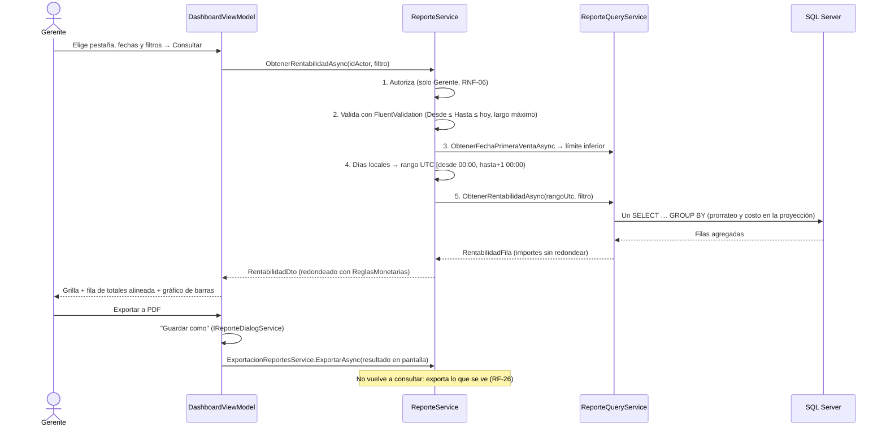
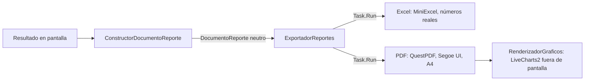

# Flujo del Tablero Gerencial y Reportes: de la Venta Registrada al Informe Exportado

### Módulo: 05. Casos de Uso y Flujos de Negocio de Punta a Punta
**Audiencia:** Desarrolladores, estudiantes universitarios y mesa evaluadora de cátedra  
**Requisitos Vinculados:** `RF-24` (Tablero de Indicadores), `RF-25` (Reportes Parametrizables), `RF-26` (Exportación) y `RNF-09` (Rendimiento de Reportes)  
**Plan de diseño y decisiones (D-1 a D-36):** [`etapa-6-track-6.4-dashboard-reportes.md`](file:///c:/Users/lucas/Proyectos/retail/docs/roadmap/etapa-6-track-6.4-dashboard-reportes.md)  
**Archivos de Código:**
* Dominio: [`DetalleVenta.cs`](file:///c:/Users/lucas/Proyectos/retail/src/Retail.Domain/Entities/DetalleVenta.cs) (`CostoUnitario`) y [`ReglasMonetarias.cs`](file:///c:/Users/lucas/Proyectos/retail/src/Retail.Domain/Common/ReglasMonetarias.cs)
* Aplicación: [`ReporteService.cs`](file:///c:/Users/lucas/Proyectos/retail/src/Retail.Application/Services/ReporteService.cs), [`ExportacionReportesService.cs`](file:///c:/Users/lucas/Proyectos/retail/src/Retail.Application/Services/ExportacionReportesService.cs), [`ConstructorDocumentoReporte.cs`](file:///c:/Users/lucas/Proyectos/retail/src/Retail.Application/Services/Reportes/ConstructorDocumentoReporte.cs) y los DTOs de [`DTOs/Reportes/`](file:///c:/Users/lucas/Proyectos/retail/src/Retail.Application/DTOs/Reportes/)
* Infraestructura: [`ReporteQueryService.cs`](file:///c:/Users/lucas/Proyectos/retail/src/Retail.Infrastructure/Persistence/Services/ReporteQueryService.cs) y [`Reportes/`](file:///c:/Users/lucas/Proyectos/retail/src/Retail.Infrastructure/Reportes/) (Excel, PDF y gráficos)
* Presentación: [`DashboardView.xaml`](file:///c:/Users/lucas/Proyectos/retail/src/Retail.App/Views/Pages/DashboardView.xaml) y [`DashboardViewModel.cs`](file:///c:/Users/lucas/Proyectos/retail/src/Retail.App/ViewModels/Reportes/DashboardViewModel.cs)

---

## 1. 📖 Fundamento Teórico y de Negocio

### 1.1 Qué le pregunta el gerente al sistema
Un tablero gerencial responde preguntas de **lectura**, no de operación: *¿cuánto vendí?, ¿gano plata con lo que vendo?, ¿qué se mueve y qué está inmovilizado?, ¿cómo entró el dinero?* Por eso todo el módulo es del **lado lectura** (CQRS-lite): no modifica agregados, solo los consulta y agrega.

### 1.2 Margen bruto no es *markup*
| Concepto | Fórmula | Dónde se usa |
| :--- | :--- | :--- |
| *Markup* (catálogo, RF-19) | $\frac{\text{Precio} - \text{Costo}}{\text{Costo}}$ | Fija el precio de venta a partir del costo |
| Margen bruto (tablero, RF-24) | $\frac{\text{Ingreso neto} - \text{Costo de lo vendido}}{\text{Ingreso neto}}$ | Mide qué parte de lo vendido es ganancia |

Un artículo con costo $ 60 y precio $ 100 tiene un *markup* de 66,7 % y un margen del 40 %. Son la misma ganancia vista desde dos bases distintas.

### 1.3 Inmutabilidad histórica: el costo se congela al vender
Cada importación de listas (RF-07) o compra (RF-19) cambia el costo de reposición del artículo. Si el reporte de marzo leyera el costo **de hoy**, el margen de una venta pasada cambiaría cada vez que llega una lista nueva. Por eso [`DetalleVenta`](file:///c:/Users/lucas/Proyectos/retail/src/Retail.Domain/Entities/DetalleVenta.cs) guarda `CostoUnitario` en el momento de vender, igual que guarda el precio: **una transacción conserva la foto de los valores con los que se hizo**.

### 1.4 Prorrateo del descuento
El descuento es de la venta completa, no de cada ítem. Para calcular el margen por categoría se reparte en proporción al subtotal:
$$\text{Descuento}_i = \text{Descuento} \times \frac{\text{Subtotal}_i}{\text{Subtotal}} \qquad \text{Ingreso neto}_i = \text{Subtotal}_i - \text{Descuento}_i$$
Así, la suma de los márgenes por categoría coincide exactamente con el margen total.

---

## 2. 🔄 Recorrido de Punta a Punta



**Orden deliberado:** primero se autoriza y recién después se valida. Un Cajero recibe "no autorizado" sin enterarse de si su filtro era válido: no se filtra información a quien no tiene permiso.

---

## 3. 🕐 Las Reglas de Fechas

| Regla | Qué resuelve | Dónde |
| :--- | :--- | :--- |
| **Hora local frente a UTC** | Las ventas se guardan en UTC. Una venta de las 22:30 (hora argentina) es del día siguiente en UTC. El rango local se convierte a UTC **antes** de consultar, y la agrupación por día suma el desfase en SQL (`DATEADD`). | `ReporteService.CrearRango` |
| **Semana desde el lunes** | `DATEPART(week)` depende de la configuración regional del servidor. Se usa `DATEDIFF(day, lunesAncla, fecha) / 7`, que no depende de nada. | `ReporteQueryService` |
| **Comparación calendario** (RF-24) | Un rango dentro de un mes que empieza el día 1 se compara con el mismo tramo del mes anterior; uno que empieza el 01/01, con el mismo tramo del año anterior; cualquier otro, con el período anterior de igual duración. | `ReporteService.CalcularPeriodoAnterior` |
| **Límite inferior** (RF-25) | `Desde` no puede ser anterior a la primera venta registrada (`MIN(fecha_hora)` sobre el índice). | `ReporteService.ValidarLimiteInferiorAsync` |
| **Largo máximo** (RF-25) | 366 días por día, 5 años por semana y 10 años en el resto: el resultado nunca supera unas 366 filas. | Validadores de `Validators/Reportes/` |

**Acotar en lugar de paginar:** los datos ya están agregados (una fila por día como máximo). Paginar complicaría el gráfico y la exportación, que necesitan todos los puntos; acotar el rango resuelve el volumen sin perder nada.

---

## 4. 🗄️ Las Consultas en SQL Server

### 4.1 La "vista en C#"
En lugar de una vista SQL, `ItemsVendidos(rango)` es un `IQueryable` que devuelve cada ítem con su ingreso neto ya prorrateado y su costo histórico. Rentabilidad, ranking y tablero se componen sobre ella y EF Core la traduce dentro de **una sola sentencia** por consulta:

```sql
SELECT [a].[id_categoria],
       SUM([d].[subtotal_item] - CASE WHEN [v].[subtotal] = 0 THEN 0
                                      ELSE [v].[descuento] * [d].[subtotal_item] / [v].[subtotal] END) AS Ingreso,
       SUM([d].[costo_unitario] * [d].[cantidad]) AS Costo
FROM DETALLE_VENTAS d JOIN VENTAS v ON … JOIN ARTICULOS a ON …
WHERE v.deleted_at IS NULL AND d.deleted_at IS NULL AND v.fecha_hora >= @desde AND v.fecha_hora < @hasta
GROUP BY a.id_categoria
```

### 4.2 Ventas de artículos dados de baja
El filtro global de baja lógica de `Articulo` haría desaparecer del historial las ventas de un artículo dado de baja (RF-06 dice que el historial se conserva). La consulta usa `IgnoreQueryFilters()` y filtra **a mano** las ventas y los ítems dados de baja. Cuidado: `IgnoreQueryFilters()` desactiva los filtros de **toda** la consulta, así que en "menos vendidos" (donde un artículo dado de baja no debe aparecer) el filtro del artículo también se escribe a mano.

### 4.3 Desglose por medio de pago: dos consultas, no un JOIN
Unir ventas con pagos repetiría cada venta tantas veces como pagos tenga: una venta pagada con efectivo y tarjeta se contaría dos veces. Por eso se hacen **dos consultas agregadas** con la misma clave de período (una sobre `VENTAS`, otra sobre `PAGOS_VENTA` con `SUM(CASE medio …)`) y se combinan en memoria (como mucho unas 366 filas ya agregadas). Como `Venta.ValidarCierre` exige que los pagos cubran exactamente el total, **la suma de los cinco medios coincide con el total de cada período**.

### 4.4 Rendimiento (RNF-09)
| Medida | Efecto |
| :--- | :--- |
| Índice filtrado `IX_VENTAS_fecha_hora` (`deleted_at IS NULL`, `INCLUDE` de los totales) | Los reportes leen el índice sin ir a la tabla |
| `LEFT JOIN` + un `GROUP BY` en lugar de subconsultas por artículo | "Menos vendidos" pasó de 5,5 s a 588 ms con 50.000 ventas |
| Consultas en secuencia (nunca `Task.WhenAll`) | El `DbContext` no admite dos operaciones a la vez |

---

## 5. 📤 La Exportación



* **Modelo neutro (D-12):** Application arma un `DocumentoReporte` (título, filtros legibles, tablas tipadas y series) y no sabe nada de MiniExcel ni de QuestPDF. Hay un exportador por formato, no uno por reporte.
* **Excel:** los importes se escriben como **números**, no como texto, para que el gerente pueda sumar y graficar.
* **PDF:** encabezado repetido, tablas que continúan en la página siguiente, títulos que nunca quedan separados de su contenido, y A4 horizontal cuando una tabla tiene 8 o más columnas.
* **Reintento sin volver a consultar:** si el archivo está abierto en Excel, se borra el archivo parcial y se ofrece reintentar con el **mismo** resultado.

---

## 6. 🖥️ La Pantalla

| Pestaña | Contenido |
| :--- | :--- |
| Tablero | Cuatro tarjetas (total vendido, ventas, margen bruto, inventario a costo) con su variación, "Comparado con el período del … al …", evolución de ventas y margen por categoría |
| Ventas por período | Grilla con el desglose por medio de pago y fila de totales alineada bajo las columnas |
| Ranking | Más y menos vendidos en dos columnas |
| Rentabilidad | Grilla por categoría, marca o artículo, con fila de totales y gráfico de barras horizontales |
| Stock crítico / Sin movimiento | Listas para reponer o para liquidar, con valorización y capital inmovilizado |

Criterios de visualización aplicados: un indicador actual es una **tarjeta**, no un gráfico de una barra; la variación lleva flecha, signo y texto (nunca solo color); las barras arrancan en cero; las líneas no se suavizan (no inventan valores); un solo color de marca y, siempre, una grilla con los números exactos.

---

## 7. ⚠️ Escenarios Extremos

| Escenario | Comportamiento |
| :--- | :--- |
| El período anterior no tuvo ventas | La variación se informa como "Sin datos del período anterior" (sería una división por cero) |
| Se elige un rango desde 1800 | El calendario no ofrece fechas anteriores a la primera venta y el servicio rechaza el rango |
| Un artículo se dio de baja después de venderse | Sigue en "más vendidos" y en rentabilidad, no en "menos vendidos" |
| El archivo de destino está abierto en Excel | Mensaje claro y reintento con el mismo resultado |
| Se copia solo el `.exe`, sin los archivos que lo acompañan | El PDF se genera igual con la fuente del sistema (D-36) |
| La PC tiene poca RAM libre | Las consultas pueden esperar memoria de SQL Server (riesgo R-10, a revisar en el Track 6.2) |

---

## 8. ❓ Preguntas de Autoevaluación

1. ¿Por qué el costo se guarda en el detalle de la venta si ya está en el artículo?
2. ¿Por qué el margen se calcula en SQL y no en un método de la entidad `Venta`?
3. ¿Qué pasaría con las ventas de un artículo dado de baja si no se usara `IgnoreQueryFilters`?
4. ¿Por qué el desglose por medio de pago usa dos consultas y no un `JOIN`?
5. ¿Por qué la variación del margen porcentual se expresaría en puntos y no en porcentaje?
6. ¿Por qué la exportación no vuelve a consultar la base?
7. ¿Por qué se acota el rango de fechas en lugar de paginar la grilla?
