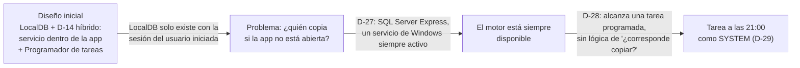
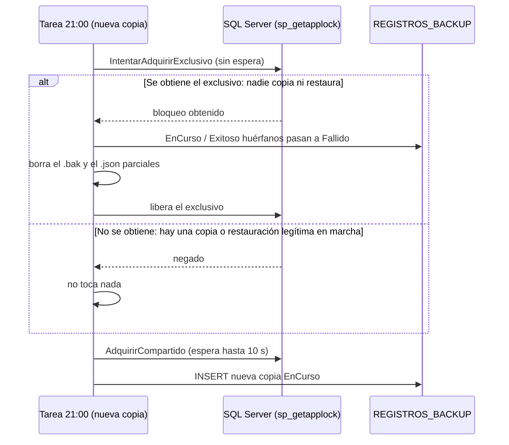

# Respaldo y Restauración — Capítulo 01: Fundamentos y Decisiones

### Módulo: 05. Casos de Uso y Flujos de Negocio de Punta a Punta
**Audiencia:** Desarrolladores, estudiantes universitarios y mesa evaluadora de cátedra  
**Requisitos Vinculados:** `RF-22` (Respaldo y Restauración), `RF-23` (Administración de la Base por Comandos), `RNF-08` (Integridad y Respaldo Diario) y `RF-03` (Roles)  
**Diseño y decisiones:** [`etapa-6-track-6.3-backup-restore.md`](file:///c:/Users/lucas/Proyectos/retail/docs/roadmap/etapa-6-track-6.3-backup-restore.md) (D-1 a D-29, R-1 a R-20)  
**Archivos de Código que ilustran este capítulo:**
* Dominio: [`RegistroBackup.cs`](file:///c:/Users/lucas/Proyectos/retail/src/Retail.Domain/Entities/RegistroBackup.cs) y [`Usuario.cs`](file:///c:/Users/lucas/Proyectos/retail/src/Retail.Domain/Entities/Usuario.cs)
* Infraestructura (SQL): [`SqlServerEjecutorBackup.cs`](file:///c:/Users/lucas/Proyectos/retail/src/Retail.Infrastructure/Backups/SqlServerEjecutorBackup.cs), [`SqlServerBloqueoRestauracion.cs`](file:///c:/Users/lucas/Proyectos/retail/src/Retail.Infrastructure/Backups/SqlServerBloqueoRestauracion.cs), [`BaseRestauradaSqlServer.cs`](file:///c:/Users/lucas/Proyectos/retail/src/Retail.Infrastructure/Backups/BaseRestauradaSqlServer.cs) y [`SqlServerRestauradorBaseDatos.cs`](file:///c:/Users/lucas/Proyectos/retail/src/Retail.Infrastructure/Backups/SqlServerRestauradorBaseDatos.cs)
* Registros de logs: [`UbicacionDeLogs.cs`](file:///c:/Users/lucas/Proyectos/retail/src/Retail.Infrastructure/Logging/UbicacionDeLogs.cs)

---

## 1. 🎯 Fundamento: Por Qué un Comercio Necesita Copias de Seguridad

### 1.1 Qué se puede perder y qué falla en la vida real

Una librería que vende con Retail POS guarda **todo** en una única base de datos: artículos y precios, stock, ventas, cuentas corrientes de clientes, turnos de caja, comprobantes fiscales y las cuentas de los usuarios. Si esa base se pierde o se daña, el comercio no pierde "un archivo": pierde su historia contable y fiscal.

| Qué puede fallar | Ejemplo concreto en el mostrador | Qué lo mitiga |
| :--- | :--- | :--- |
| **Falla de disco** | El disco de la PC deja de responder un martes a la mañana | Una copia en un directorio dedicado y, a futuro, en otro disco o en la nube (D-16) |
| **Corte de luz** | La PC se apaga mientras SQL Server escribe una copia a las 21:00 | El registro `EnCurso` huérfano se cierra solo (B-0) y el archivo parcial nunca es restaurable |
| **Error humano** | Alguien importa una planilla equivocada o borra datos por error | Copia previa a migrar (D-10), copia manual antes de operaciones riesgosas y restauración controlada |
| **Actualización fallida** | Una migración de esquema deja la base inconsistente | La copia `PreMigracion`: **nunca se migra una base con datos sin copia previa** |
| **Archivo de copia dañado** | El `.bak` se corrompió en el disco y nadie lo notó hasta necesitarlo | `CHECKSUM` + `RESTORE VERIFYONLY` + SHA-256 al crear, y SHA-256 otra vez antes de restaurar |

> [!IMPORTANT]
> Una copia que nunca se probó es una esperanza, no una copia (R-8). Por eso el sistema solo ofrece para restaurar las copias en estado `Verificado`, y el proyecto incluye tests de integración que restauran de verdad contra SQL Server Express.

### 1.2 Requisitos que el sistema cumple

| Requisito | Qué exige | Dónde se cumple |
| :--- | :--- | :--- |
| `RNF-08` | Respaldo completo diario automático y bajo demanda, en un directorio dedicado fuera del perfil de usuario, con verificación de integridad y retención configurable | Tarea programada a las 21:00 (D-28), `C:\RetailData\Backups` (D-15), `BackupOptions` |
| `RF-22` | Copias manuales (Gerente con reautenticación) y automáticas, registradas en `REGISTROS_BACKUP`; restauración exclusiva del Gerente, con copia previa, historial conservado y aviso de conciliación con ARCA | `BackupService`, `RestauracionService`, `RegistroBackup`, `RegistroRestauracion` |
| `RF-23` | Migrar, crear el primer Gerente, backup automático y restauración ante desastres por una herramienta de consola; la app verifica al arrancar en lugar de migrar | `Retail.Cli`, `EstadoSistemaService`, `DiagnosticoArranqueDialog` |
| `RF-03` | Roles con permisos diferenciados (incluido el Administrador de soporte) | `Usuario.PuedeGestionarCuentasDeRol`, validación en la capa Aplicación (D-9) |

### 1.3 Datos personales y Ley 25.326

Un `.bak` es **la base completa en un archivo**: incluye nombres, documentos, domicilios y saldos de los clientes, además de los hashes de las contraseñas de los usuarios. La Ley 25.326 de Protección de los Datos Personales obliga al responsable de los datos a custodiarlos. En un comercio chico ese responsable es el dueño, que en el sistema es el **Gerente**. De ahí salen dos consecuencias de diseño:

* Solo el Gerente puede generar una copia manual o restaurar (D-3), y debe volver a escribir su contraseña (D-8).
* El contenido del `.bak` lo protegen los permisos de Windows del directorio de respaldos, no la aplicación (R-6, R-17). Si algún día se copian los archivos a un lugar remoto, deberán cifrarse antes (R-5, D-16).

---

## 2. 🧠 Conceptos de SQL Server Explicados desde Cero

Los lectores conocen C#, EF Core y Clean Architecture, pero no necesariamente la administración de SQL Server. Esta sección explica cada concepto que aparece en los capítulos siguientes. Cada sentencia se copia **literal** del código fuente.

### 2.1 Copia completa: `BACKUP DATABASE`

Una *copia completa* (*full backup*) es un archivo `.bak` con **todas las páginas de datos** de la base más el fragmento del registro de transacciones necesario para dejarla consistente al terminar. Restaurarlo reconstruye la base exactamente como estaba en el momento en que terminó la copia. SQL Server permite hacerla **con la base en uso**: el motor registra qué cambió durante la copia y lo reconcilia, así que no hay que detener la aplicación.

La sentencia real vive en [`SqlServerEjecutorBackup.CrearCopiaAsync`](file:///c:/Users/lucas/Proyectos/retail/src/Retail.Infrastructure/Backups/SqlServerEjecutorBackup.cs). En C# se arma concatenando dos cadenas; el texto resultante, con los marcadores, es:

```sql
BACKUP DATABASE {baseDeDatos} TO DISK = @ruta WITH FORMAT, INIT, CHECKSUM, STATS = 10, NAME = @nombre;
```

| Cláusula | Qué hace | Por qué está |
| :--- | :--- | :--- |
| `BACKUP DATABASE {baseDeDatos}` | Copia la base indicada. `{baseDeDatos}` sale de la cadena de conexión y se delimita con corchetes (`[RetailDb]`) mediante `ComandosSqlServer.Delimitar` | Un identificador no puede viajar como parámetro, así que se delimita para que nunca se salga de su lugar en la sentencia |
| `TO DISK = @ruta` | Archivo de destino. `@ruta` es un **parámetro**: la ruta la arma `ArchivosBackup.PrepararRutaNueva`, nunca texto del operador | Evita inyección de SQL |
| `FORMAT` | Reescribe el encabezado del medio de copia | Cada copia es un archivo nuevo y autónomo |
| `INIT` | Sobrescribe el contenido previo del archivo | El nombre incluye fecha y hora, así que no hay nada que preservar |
| `CHECKSUM` | Verifica la suma de control de cada página al leerla y la registra en la copia | Ver 2.2 |
| `STATS = 10` | El motor informa el avance de a 10 % como mensajes de la conexión | Alimenta la barra de progreso de la UI y de la consola |
| `NAME = @nombre` | Nombre descriptivo del conjunto de copia (`Retail POS - <archivo>`) | Identificación dentro del `.bak` |

> [!NOTE]
> Se usa ADO.NET (`SqlConnection`) y no EF Core porque `BACKUP DATABASE` **no admite una transacción de usuario** y EF no ofrece una API para copias. Es una excepción justificada a la Ley 8, que aplica a consultas de lectura y escritura de datos de negocio.

### 2.2 Suma de control de página (`CHECKSUM`) y `RESTORE VERIFYONLY`

SQL Server guarda los datos en **páginas** de 8 KB. Cada página puede llevar una *suma de control* (*checksum*): un número calculado a partir de su contenido. Con `BACKUP ... WITH CHECKSUM`, el motor:

1. Verifica la suma de cada página mientras la lee de la base. Si una página ya estaba dañada en el disco, **la copia falla** en lugar de guardar basura sin avisar.
2. Calcula y almacena una suma de control de la copia entera.

`RESTORE VERIFYONLY` lee el archivo `.bak` completo y recalcula esas sumas **sin restaurar nada**. La sentencia real de [`SqlServerEjecutorBackup.VerificarCopiaAsync`](file:///c:/Users/lucas/Proyectos/retail/src/Retail.Infrastructure/Backups/SqlServerEjecutorBackup.cs) es:

```sql
RESTORE VERIFYONLY FROM DISK = @ruta WITH CHECKSUM;
```

Prueba que el archivo es **legible, completo y coherente con sus sumas de control**. No prueba que una restauración vaya a funcionar en cualquier circunstancia (espacio, permisos, esquema), y por eso existen además los tests de integración que restauran de verdad (R-8).

### 2.3 Dos controles de integridad distintos: sumas de página y SHA-256 del archivo

Parecen redundantes, pero detectan problemas diferentes:

| | Suma de control de **página** (`CHECKSUM`) | **SHA-256** del archivo `.bak` |
| :--- | :--- | :--- |
| Quién lo calcula | El motor de SQL Server | La aplicación (`HuellaArchivo`), leyendo el archivo por *streaming* |
| Qué cubre | El contenido lógico de cada página de la base | Cada byte del archivo, tal como está en el disco |
| Detecta | Una página de la base ya dañada al copiar; una copia ilegible o truncada | Cualquier cambio posterior del archivo: bit rot, copia incompleta a un pendrive, archivo reemplazado |
| No detecta | Que alguien reemplace el `.bak` por **otro `.bak` válido** | Que el contenido ya estuviera mal al copiar (eso lo cubre el `CHECKSUM`) |
| Cuándo se usa | Al crear (`BACKUP ... WITH CHECKSUM`), al verificar (`VERIFYONLY`) y al restaurar (`RESTORE ... CHECKSUM`) | Al crear (se guarda en el registro y el manifiesto) y **antes de restaurar** (se vuelve a calcular y se compara) |

> [!WARNING]
> El SHA-256 del manifiesto prueba **integridad, no autenticidad**: quien trae un `.bak` puede traer un `.json` acorde con su huella. La autenticidad la aporta la credencial de un Gerente verificada *dentro de la copia* (D-18); el riesgo residual está documentado como R-20.

### 2.4 El manifiesto (`.json`)

Junto a cada `Retail_<fecha>_<tipo>.bak` el sistema escribe un `Retail_<fecha>_<tipo>.json` (UTF-8 sin BOM) con: referencia (GUID), tipo, fecha, operador, nombre del `.bak`, tamaño, SHA-256, última migración, versión de la aplicación y `RegistradaEnHistorial`. Existe porque el historial de copias vive **dentro de la base**: si la base se pierde, el historial se pierde con ella. El manifiesto permite saber qué contiene una copia y restaurarla desde la consola en una PC nueva (R-1, R-2).

### 2.5 Migraciones y "versión del esquema"

Una *migración* de EF Core es un cambio versionado del esquema (crear una tabla, agregar una columna). EF anota cada migración aplicada en la tabla `__EFMigrationsHistory`. La **última migración aplicada** funciona como la *versión del esquema* de esa base:

* `RegistroBackup.UltimaMigracion` guarda la versión que tenía la base cuando se tomó la copia.
* Una copia con migraciones **que esta aplicación no conoce** viene de una versión más nueva: restaurarla dejaría tablas y columnas que el código ignora. Se rechaza (R-7, `MigracionesDesconocidas`).
* Una copia con migraciones **pendientes** viene de una versión más vieja: se restaura en la base temporal y se **pone al día** con `MigrateAsync` antes de leerla.

### 2.6 Nombres lógicos y físicos de una base

Una base de SQL Server tiene dos "nombres":

* **Nombre lógico de la base**: el que aparece en `sys.databases` y se usa en `USE RetailDb`. Es el que ve la aplicación.
* **Archivos físicos**: un `.mdf` (datos) y un `.ldf` (registro de transacciones) en disco, con su propia ruta. Dentro de cada copia, cada archivo tiene además un *nombre lógico de archivo* (`LogicalName`), que no es la ruta.

Para restaurar una copia con otro nombre (la base temporal `RetailDb_Restaurando`) hay que decirle al motor dónde poner cada archivo, con `WITH MOVE <nombre lógico> TO <ruta física>`. El código lo hace en [`SqlServerRestauradorBaseDatos.RestaurarAsync`](file:///c:/Users/lucas/Proyectos/retail/src/Retail.Infrastructure/Backups/SqlServerRestauradorBaseDatos.cs), y la plantilla del texto es:

```sql
RESTORE DATABASE {temporal} FROM DISK = @ruta WITH MOVE @logico0 TO @fisico0, MOVE @logico1 TO @fisico1, CHECKSUM, RECOVERY, STATS = 10;
```

(La lista de `MOVE` se arma según la cantidad de archivos que informa `RESTORE FILELISTONLY`; típicamente dos: datos y registro.)

### 2.7 Por qué `MODIFY NAME` no renombra los archivos

El intercambio final de bases usa dos renombrados de la forma:

```sql
ALTER DATABASE {origen} MODIFY NAME = {destino};
```

`MODIFY NAME` cambia **solo el nombre lógico de la base** en el catálogo del motor. Los archivos `.mdf` y `.ldf` conservan el nombre físico que tenían. Esto es importante por dos razones:

1. **Evita colisiones.** Los archivos de la base temporal se crean con nombres únicos (`RetailDb_<marca>_<n>.mdf`, ver `AsignarRutasFisicas`). Si la restauración intentara reutilizar `RetailDb.mdf`, chocaría con los archivos de la base vigente que sigue en uso.
2. **El intercambio es barato.** Al ser solo un cambio de catálogo, el "reemplazo" de la base tarda instantes aunque pese gigabytes: no se copia ni se mueve ningún archivo.

La consecuencia visible es que, después de una restauración, la base `RetailDb` tiene archivos con nombre `RetailDb_20261015_103000_0.mdf`. Es normal y esperado.

### 2.8 La cuenta del servicio de SQL Server

Con SQL Server Express, el **motor corre como un servicio de Windows con su propia cuenta** (`NT SERVICE\MSSQL$SQLEXPRESS`), distinta de la del usuario que usa la aplicación. Cuando se ejecuta `BACKUP ... TO DISK` o `RESTORE ... FROM DISK`, **el archivo lo escribe y lo lee el servicio, no el usuario**. Consecuencias:

* La carpeta `C:\RetailData\Backups` necesita permisos de modificación para la cuenta del servicio (y para `SYSTEM`, que ejecuta la tarea programada). Los configura el script de registro de la tarea (B-2).
* Si el Gerente elige para restaurar un `.bak` que está en su carpeta de Descargas, **el motor no puede leerlo**. Por eso la restauración desde cualquier ruta primero copia el `.bak` y su manifiesto al directorio de respaldos (B-3, `IArchivosBackup.PrepararParaRestaurarAsync`).
* Una ruta de red (`\\servidor\...`) haría que la cuenta del servicio se conecte a otra máquina. Se rechaza (`RutaCopiaBackup`).

### 2.9 Bloqueo de lectores y escritor con `sp_getapplock`

**Analogía: la sala de lectura de una biblioteca.** Varias personas pueden leer a la vez el mismo libro de consulta (**lectores**: no se molestan entre sí). Pero si el bibliotecario va a **reordenar todo el estante** (**escritor**), exige que la sala esté vacía y no deja entrar a nadie hasta terminar.

Traducido al sistema:

| Rol | Quién | Modo de bloqueo | Convive con |
| :--- | :--- | :--- | :--- |
| Lector | Una **copia de seguridad** (manual, automática, previa a migrar) | `Shared` | Otras copias |
| Escritor | Una **restauración** (reemplaza la base) | `Exclusive` | Nadie |

`sp_getapplock` es un procedimiento de SQL Server que administra un **bloqueo con nombre elegido por la aplicación** (no bloquea tablas, solo una "bandera" compartida). Como el bloqueo vive en el motor, vale **entre procesos distintos**: la aplicación WPF, `Retail.Cli` y la tarea programada de las 21:00. La sentencia real, de [`SqlServerBloqueoRestauracion.TomarAsync`](file:///c:/Users/lucas/Proyectos/retail/src/Retail.Infrastructure/Backups/SqlServerBloqueoRestauracion.cs), es:

```sql
DECLARE @r int; EXEC @r = sp_getapplock @Resource = @recurso, @LockMode = @modo, @LockOwner = 'Session', @LockTimeout = @espera; SELECT @r;
```

* `@Resource`: nombre del recurso, `Retail.Restauracion.` más el nombre de la base. Bases distintas no se bloquean entre sí.
* `@LockMode`: `'Shared'` o `'Exclusive'`.
* `@LockOwner = 'Session'`: el bloqueo dura mientras viva la **conexión** que lo tomó. Si el proceso muere, el motor suelta el bloqueo. Esta propiedad es la que permite detectar copias huérfanas sin heurísticas de tiempo (ver 3.5).
* `@LockTimeout`: milisegundos de espera. La restauración no espera (cero); las copias esperan 10 segundos como máximo.

El valor devuelto (`@r`) es negativo si no se obtuvo el bloqueo.

### 2.10 Reautenticación (*step-up authentication*)

La *autenticación escalonada* (*step-up*) consiste en **volver a pedir la contraseña** a un usuario que ya inició sesión, antes de una operación sensible. En un mostrador la sesión del Gerente puede quedar abierta mientras se aleja unos minutos; sin reautenticación, cualquier persona podría generar o restaurar una copia. En el código la hace `IAuthService.VerificarCredencialAsync` (BCrypt), y responde con la misma excepción genérica `CredencialesInvalidasException` tanto para una contraseña incorrecta como para un usuario inexistente, así no revela el estado de otras cuentas.

---

## 3. 🏗️ Las Decisiones de Diseño, por Tema

Cada decisión tiene identificador (D-n) en el [registro de diseño](file:///c:/Users/lucas/Proyectos/retail/docs/roadmap/etapa-6-track-6.3-backup-restore.md). Las marcadas como cerradas no se reabren sin un motivo nuevo. Cuando el registro no documenta una alternativa descartada, lo decimos ("No consta en el registro"); las alternativas que aparecen sin esa leyenda están en el registro o se deducen directamente de su fundamento (D-1, D-3, D-11, D-19, D-20), y conviene presentarlas como tales ante la mesa.

### 3.1 Roles y permisos

| Decisión | Qué se decidió | Por qué | Alternativas descartadas |
| :--- | :--- | :--- | :--- |
| **D-1** | Se **agrega** `RolUsuarioEnum.Administrador = 4`; no se renombra Gerente | Cambio aditivo (Open/Closed): `IdRol = 3` conserva su significado y no se tocan los `EsGerente` existentes | Renombrar el rol Gerente (rompería datos y código existentes) |
| **D-2** | El Gerente tiene todos los permisos, incluido el ABM de usuarios de cualquier rol | En un negocio chico el Gerente es el dueño; no puede depender de otro para dar de alta a un cajero | No consta en el registro |
| **D-3** | El Administrador es un rol **opcional** de soporte: ABM y blanqueo de Cajeros y Encargados; lectura del historial de backups | **Mínimo privilegio.** El backup es la base completa (datos personales, Ley 25.326): solo el responsable (Gerente) puede generarlo o restaurarlo | Un Administrador con acceso total (anularía el sentido del mínimo privilegio) |
| **D-4** | Solo un Gerente crea Gerentes o Administradores | Evita la escalada de privilegios | No consta en el registro |
| **D-5** | No se siembra un Administrador ni existe "último Administrador"; se mantiene `UltimoGerenteException` | El Gerente es la raíz de autoridad: sin Gerentes el sistema queda sin gobierno; sin Administradores sigue operando | Proteger también al último Administrador (no aporta: es opcional) |
| **D-6** | `DebeCambiarPassword`: toda cuenta creada o blanqueada por otro usuario cambia la contraseña en el primer login | Quien crea la cuenta conoce la contraseña inicial: sin cambio obligatorio podría suplantar al titular | No consta en el registro |
| **D-7** | `EmailRecuperacion` en `Usuario`: obligatorio para Gerente, opcional para el resto, no único | El dato se carga ahora; el envío de correos es futuro | Exigir unicidad (el flujo futuro pide nombre de usuario, no hace falta) |
| **D-8** | Backup manual y restore piden **reautenticación** del Gerente logueado | *Step-up authentication* (2.10): protege ante una sesión que quedó abierta | Confiar solo en la sesión iniciada |
| **D-9** | La autorización por rol se valida **en Application**, no solo en la UI | **Defensa en profundidad:** ocultar el botón no es seguridad; el servicio debe rechazar igual | Controlar permisos solo en `MainViewModel` (como se hacía hasta entonces) |

Cómo se ve D-3 y D-9 en el código: el servicio rechaza aunque la UI se salte.

```csharp
// BackupService.CrearBackupManualAsync
// La copia contiene la base completa (datos personales, Ley 25.326): solo la pide su responsable (D-3).
if (!actor.EsGerente())
{
    throw new OperacionNoAutorizadaException("Solo un Gerente puede generar una copia de seguridad manual.");
}

// Reautenticación (D-8): una sesión abierta en el mostrador no alcanza.
await _authService.VerificarCredencialAsync(idActor, password, cancellationToken);
```

Matriz resultante (sección 3 del registro de diseño):

| Función | Cajero | Encargado | Gerente | Administrador |
| :--- | :-: | :-: | :-: | :-: |
| Backup manual y restore (con reautenticación) | No | No | Sí | No |
| Historial y estado de backups (lectura) | No | No | Sí | Sí |
| ABM y blanqueo de Cajeros y Encargados | No | No | Sí | Sí |
| ABM de Gerentes y Administradores | No | No | Sí | No |

### 3.2 La herramienta de consola y el arranque de la aplicación

| Decisión | Qué se decidió | Por qué | Alternativas descartadas |
| :--- | :--- | :--- | :--- |
| **D-10** | Migraciones y seed salen de `OnStartup` y pasan a **`Retail.Cli`** (proyecto de consola) | Arrancar la app no debe modificar el esquema. Permite el backup previo a migrar, la recuperación ante desastres sin login y reutiliza los servicios de Application (los `.ps1` son envoltorios finos) | Migrar automáticamente al arrancar (no hay lugar para una copia previa ni control del operador); lógica propia en scripts de PowerShell (duplicaría reglas de negocio) |
| **D-11** | Al arrancar, la app **verifica** y bloquea con un mensaje accionable: base sin conexión, migraciones pendientes, base más nueva que la app, sin Gerente activo | Falla temprana en lugar de efectos secundarios | Dejar que la app falle más adelante con errores técnicos |
| **D-12** | Roles por migración (`InsertData`). Primer Gerente con `Retail.Cli inicializar`. `datos-demo` = un proveedor + categorías + marcas. Se eliminan `Admin123!` y los 20 artículos | Roles = datos de referencia del esquema. Usuarios = datos operativos con secretos | Sembrar un usuario con contraseña conocida (`Admin123!`) |
| **D-13 (revisada)** | La recuperación de contraseña es **exclusivamente por correo electrónico** (futuro). Se eliminó `blanquear-gerente` y **no se usan códigos de recuperación** | En un comercio el personal comparte la sesión de Windows: "acceso al equipo" no es un límite de confianza. Un cajero podía ejecutar el comando y tomar la cuenta del Gerente | `blanquear-gerente` por consola; códigos de recuperación |
| **D-16** | Futuro: correo de recuperación, copia cifrada a una carpeta sincronizada, CRUD de Categorías y Marcas | Fuera del alcance de este track | — |

**Evolución de D-13.** Al cerrar la Fase 2 existía `Retail.Cli blanquear-gerente`, pensado para el Gerente que olvida su contraseña. Se revisó al descubrir que, con una sesión de Windows compartida, **cualquier empleado podía ejecutarlo y quedarse con la cuenta del Gerente**. Se eliminó. El costo (R-16) es que mientras no exista el envío de correos, un Gerente que olvida su contraseña solo puede ser blanqueado por **otro Gerente** desde la aplicación; la recomendación operativa es dar de alta al menos dos Gerentes. La regla que quedó: **ningún comando de `Retail.Cli` otorga acceso a una cuenta existente**.

Esta regla explica un detalle de inyección de dependencias que se retoma en el capítulo 02: `IAdministracionSistemaService` (migrar, crear el primer Gerente) solo se registra en `AddAdministracionSistema`, que invoca únicamente `Retail.Cli`, y un test lo garantiza:

```csharp
// DependencyInjectionTests.AddApplicationServices_NoRegistraLasOperacionesPrivilegiadasDeAdministracion
services.Should().Contain(d => d.ServiceType == typeof(Retail.Application.Interfaces.Services.IEstadoSistemaService));
services.Should().NotContain(d => d.ServiceType == typeof(Retail.Application.Interfaces.Services.IAdministracionSistemaService));
```

### 3.3 La copia de seguridad

| Decisión | Qué se decidió | Por qué | Alternativas descartadas |
| :--- | :--- | :--- | :--- |
| **D-14 → D-28** | Ver 3.5: el backup automático es **solo** la tarea programada de las 21:00 | Ver 3.5 | Servicio en segundo plano dentro de la app |
| **D-15** (parcialmente por D-27) | Copias en un **directorio dedicado** y configurable, por defecto `C:\RetailData\Backups` | Fuera del repo y del perfil de usuario; con SQL Server Express hay que darle permisos a la cuenta del servicio | Carpeta dentro del perfil del usuario o del ejecutable |
| **D-24** | Retención propia para `PreRestauracion`: no cuentan en `CantidadMaximaCopias` y se conservan `DiasRetencionPreRestauracion` días (30 por defecto) | Un restore equivocado puede detectarse tarde; con la retención común (14 copias) la copia de los datos reales desaparecía en unas dos semanas | Retención común para todos los tipos |

**Reglas de una copia** (Fase 4, ver capítulo 03 para el detalle paso a paso):

* El registro se guarda **`EnCurso` antes de copiar**: el índice único filtrado `IX_REGISTROS_BACKUP_EnCurso` impide una segunda copia simultánea (R-12) y un corte deja evidencia del intento.
* Una copia es restaurable solo si el motor la escribió, `RESTORE VERIFYONLY ... WITH CHECKSUM` la leyó entera **y** su manifiesto se escribió. Ante cualquier falla: registro `Fallido`, archivo parcial borrado y `BackupFallidoException`.
* Las copias del sistema (`Automatico`, `PreMigracion`) **no llevan actor**: hacer una copia no da acceso a ninguna cuenta ni modifica datos (D-13). El contenido del `.bak` lo protegen los permisos de Windows del directorio.
* Retención: se conservan las `CantidadMaximaCopias` (14) copias con archivo más recientes; las demás se borran del disco y su registro pasa a `ArchivoPurgado` (Ley 3, borrado lógico de la información).

### 3.4 La restauración

| Decisión | Qué se decidió | Por qué | Alternativas descartadas |
| :--- | :--- | :--- | :--- |
| **D-17** | **Base temporal + intercambio.** La copia se restaura con `WITH MOVE` a `RetailDb_Restaurando`; ahí se validan credenciales, esquema y se rehidrata el historial; recién entonces la vigente se renombra a `RetailDb_Anterior_<fecha>` y la temporal pasa a ser `RetailDb` | Las validaciones ocurren **antes de tocar la base en uso** y la anterior queda intacta como red de seguridad. Costo aceptado: el doble de espacio en disco durante el restore | Restaurar directamente sobre la vigente (cualquier falla a mitad de camino la dejaría destruida) |
| **D-18** | `Retail.Cli restaurar` existe y exige credenciales de un Gerente verificadas **en la copia a restaurar** (BCrypt contra `USUARIOS` de la base temporal) | Cubre el desastre más probable (PC nueva, base corrupta) sin códigos de recuperación. Quien restaura demuestra que **era Gerente en esa copia** | Ver D-19 |
| **D-19** | Se descartan: restore por consola sin autenticación (D-13), verificación contra la base vigente y la recuperación solo por procedimiento manual con SSMS | Sin autenticación, cualquier empleado reemplazaría la base. Contra la vigente fallaría en una PC nueva o con la base corrupta. El procedimiento manual no es repetible ni auditable | Las tres, justamente |
| **D-20** | Red de seguridad: copia `PreRestauracion` de la vigente (si es accesible) **y** se conserva solo la base `RetailDb_Anterior_<fecha>` más reciente | Cumple RF-22, reutiliza retención e historial y acota el disco (R-9). Sin vigente accesible no hay copia previa y se informa | Conservar todas las bases anteriores (llenaría el disco) |
| **D-21** | **Un único mecanismo** para la app y `Retail.Cli`, en `RestauracionService`. Solo cambia la autorización: la app reautentica contra la vigente, la CLI verifica en la copia. En ambos casos la copia debe tener al menos un Gerente activo | Un solo camino de código probado | Dos implementaciones de restore |
| **D-22** | Registro de restauraciones en `REGISTROS_RESTAURACION` (agregado `RegistroRestauracion`), escrita en la base nueva y rehidratada como el historial de copias | Auditoría consultable desde la app: quién restauró qué copia, cuándo, desde dónde y qué base quedó como anterior | No consta en el registro |
| **D-23** | Espacio insuficiente para la temporal: **se bloquea antes de restaurar** (tamaño de `RESTORE FILELISTONLY` + margen contra el espacio libre) | Falla temprana con mensaje accionable, sin restore a medias | Dejar que el motor falle por disco lleno |
| **D-25** | `RestauracionService` **envuelve** toda excepción de un paso en `RestauracionFallidaException`, salvo `OperationCanceledException`, `DomainException` y `CredencialesInvalidasException` | La regla queda en un solo lugar y testeada; la UI y la consola reciben siempre un error legible | Confiar en que cada implementación de Infraestructura envuelva sus errores |
| **D-26** | Estados de la vigente: "se puede conectar" decide la copia previa y los controles; "está al día" decide solo la importación del historial; "existe pero no responde" **aborta**; "no existe" (PC nueva) continúa sin copia previa | Corrige una contradicción con D-20 detectada en la revisión: una base con esquema viejo tiene todos los datos reales y `BACKUP` puede copiarla igual | Decidir la copia previa con `EstaAlDia` (dejaba sin red de seguridad justo a la base más riesgosa) |

El corazón de D-17 es una propiedad del código: **todo lo que puede fallar ocurre antes del punto de no retorno**.

```csharp
// RestauracionService.EjecutarRestauracionAsync (extracto)
await temporal.AgregarRestauracionAsync(restauracion, cancellationToken);
await temporal.GuardarCambiosAsync(cancellationToken);

// Punto de no retorno. Lo que sigue no se cancela: dejar el intercambio a medias sería peor que terminarlo.
await temporal.PromoverAVigenteAsync(CancellationToken.None);
```

Si algo falla antes, la base temporal se libera sin promover (`DisposeAsync` la elimina) y la vigente nunca se tocó. El flujo completo, con su SQL, está en el capítulo 04.

### 3.5 Automatización y entorno

| Decisión | Qué se decidió | Por qué | Alternativas descartadas |
| :--- | :--- | :--- | :--- |
| **D-14 (revisada por D-28)** | ~~Backup periódico híbrido: `BackupAutomaticoHostedService` en la app + Programador de tareas~~ | Se buscaba cubrir LocalDB, que solo existe con la sesión del usuario iniciada; con SQL Server Express ya no hace falta | El servicio en segundo plano, y las reglas intermedias de "24 h", qué copias cuentan y reintentos |
| **D-27** | **SQL Server Express** en desarrollo y producción (`.\SQLEXPRESS`) en lugar de LocalDB. Rama y PR propios (`chore/sql-server-express`) | Producción usa Express: desarrollar sobre el mismo motor hace aparecer los problemas de permisos de la cuenta del servicio y elimina configuraciones que solo tenían sentido para LocalDB (R-4). Afecta a todo el equipo, por eso va aparte | Seguir con LocalDB en desarrollo |
| **D-28** | Backup automático **solo por el Programador de tareas, todos los días a las 21:00** (`Retail.Cli backup`), con "iniciar si se perdió". Sin servicio en segundo plano, sin regla de "24 h", sin reintentos | La alternativa más simple: con Express el motor está siempre disponible y la tarea no depende de que la app o la sesión estén abiertas. La hora vive en la tarea (parámetro del script), no en `appsettings.json` | Ver D-14 |
| **D-29** | La tarea corre como **`SYSTEM`**, con un login `NT AUTHORITY\SYSTEM` creado por el script, con permisos mínimos para copiar y registrar el historial | Corre sin sesión iniciada y sin guardar contraseñas de Windows (una contraseña guardada se rompe en silencio si cambia) | Correr como el usuario de Windows con contraseña guardada |

**Evolución de D-14 → D-28 (y D-15 → D-27).**



La razón de fondo: el servicio dentro de la app existía para compensar una limitación de LocalDB. Al desaparecer la limitación, desaparece el componente y con él una familia de reglas (¿pasaron 24 horas?, ¿cuenta una copia manual?, ¿reintentar?) que habría que diseñar, probar y defender. **La alternativa más simple que cumple el requisito gana** (YAGNI). Del mismo modo, D-15 (el directorio dedicado) se mantiene, pero cambia su justificación: ya no es "evitar el perfil de LocalDB" sino "darle permisos a la cuenta del servicio de Express".

**Cómo detectar copias huérfanas sin heurísticas (B-0).** Un corte de luz a las 21:05 deja un registro `EnCurso` que nadie cerrará, y el índice único bloquearía todas las copias siguientes. La solución usa el bloqueo de 2.9: una copia real **sostiene el bloqueo compartido** mientras corre (incluida su verificación) y es el motor quien lo suelta si el proceso muere. Por lo tanto, **si una copia o restauración logra tomar el bloqueo exclusivo, ninguna otra está corriendo y todo registro `EnCurso` o `Exitoso` es huérfano** (el proceso murió verificando). Es un hecho garantizado por el motor, no una suposición basada en "pasaron 30 minutos".



**Corrección posterior al merge (rama `fix/tarea-backup-cli-instalada`, después del PR #23).** La Fase 7 original copiaba la CLI a `%ProgramFiles%\Retail POS\Cli` para que `SYSTEM` no ejecutara un `.exe` que un usuario pudiera reemplazar (escalada de privilegios). Funcionaba, pero tenía dos defectos que se descubrieron después:

* **La CLI copiada no se actualizaba con la app.** Tras una actualización con migraciones, esa CLI vieja veía "la base es más nueva que la app" y la copia diaria **fallaba todas las noches**, dejando solo una línea en el log. *Ahora* la app se instala descomprimiendo el ZIP en `C:\Program Files\Retail POS` como administrador y la tarea apunta al `Retail.Cli.exe` **de la instalación**: actualizar la app actualiza lo que ejecuta la tarea. El script verifica que ni la instalación ni ninguna carpeta superior pueda ser modificada por un usuario sin privilegios, y ofrece borrar la copia `Cli` de la versión anterior.
* **Los logs dentro de la carpeta del ejecutable abrían una puerta.** Para que el cajero pudiera escribir su log habría hecho falta una carpeta `logs` escribible por usuarios dentro de la instalación, donde también escribe `SYSTEM`: es un patrón conocido de escalada de privilegios (el usuario convierte la carpeta en un punto de montaje y desvía lo que escribe `SYSTEM`). *Ahora* hay una sola regla para todos: `%LOCALAPPDATA%\Retail POS\logs` ([`UbicacionDeLogs`](file:///c:/Users/lucas/Proyectos/retail/src/Retail.Infrastructure/Logging/UbicacionDeLogs.cs)). Para el cajero es su carpeta personal; para `SYSTEM` es `C:\Windows\System32\config\systemprofile\AppData\Local\...`, donde solo escriben `SYSTEM` y los administradores. Se descartó `%ProgramData%` porque cualquier usuario puede crear carpetas ahí y apropiarse de antemano de `Retail POS`.

El resultado es una instalación **sin carpetas escribibles por usuarios, sin excepciones**. El instalador real para el usuario final queda para el Track 6.2 (Empaquetado Release).

---

## 4. 🧱 Defensa en Profundidad: Cómo Se Combinan las Decisiones

Varias decisiones no son independientes: cada riesgo se cubre con **más de una capa**, de modo que la falla de una no deja el sistema desprotegido.

| Riesgo | Capa de Dominio | Capa de Aplicación | Capa de Infraestructura / base |
| :--- | :--- | :--- | :--- |
| Dos copias a la vez (R-12) | — | `CopiarConHistorialAsync` rechaza si hay una `EnCurso` | Índice único filtrado `IX_REGISTROS_BACKUP_EnCurso` |
| Transición de estado inválida | `ExigirEstado` lanza `TransicionBackupInvalidaException` | — | — |
| Copia del sistema con operador (o al revés) | `RegistroBackup.Iniciar` lanza `DomainException` | — | `CK_REGISTROS_BACKUP_Operador` |
| Un no-Gerente restaura | — | `RestaurarDesdeHistorialAsync` exige `EsGerente()` | La UI oculta el botón (solo comodidad, D-9) |
| Archivo `.bak` alterado | — | Compara tamaño y SHA-256 antes de restaurar | `RESTORE ... CHECKSUM` |
| Restauración y copia simultáneas (C-2) | — | Toma `AdquirirCompartido` / `AdquirirExclusivo` | `sp_getapplock` en el motor |

> [!NOTE]
> Este patrón (invariante en el agregado + control en el servicio + restricción en la base) es el mismo que ya usa el proyecto para el turno de caja abierto (`IX_TURNOS_CAJA_TurnoAbierto`).

---

## 5. 📝 Resumen

* Un comercio puede perder datos por disco, corte de luz, error humano, actualización fallida o archivo de copia dañado; `RNF-08` y `RF-22` exigen copias verificadas y restauración controlada, y la Ley 25.326 hace del Gerente el responsable de los datos contenidos en cada `.bak`.
* Una copia completa se hace con `BACKUP DATABASE ... WITH CHECKSUM`, se verifica con `RESTORE VERIFYONLY ... WITH CHECKSUM` y se identifica con un SHA-256 del archivo. Las sumas de página detectan problemas del contenido; el SHA-256 detecta cambios del archivo. Ninguno prueba autenticidad.
* El manifiesto `.json` permite saber qué contiene una copia aunque la base y su historial se hayan perdido.
* La restauración usa una base temporal y un intercambio por `MODIFY NAME` (que no renombra archivos), de modo que todo lo que puede fallar ocurre antes de tocar la base vigente.
* `sp_getapplock` implementa un bloqueo de lectores (copias, `Shared`) y escritor (restauración, `Exclusive`) válido entre procesos, y permite cerrar copias huérfanas sin heurísticas.
* Las decisiones evolucionaron: D-13 eliminó `blanquear-gerente` por seguridad; D-14 se reemplazó por D-28 al migrar a SQL Server Express (D-27); D-15 mantuvo el directorio pero cambió su justificación; y la corrección posterior al merge hizo que la tarea use la CLI instalada y que los logs salgan de `Program Files`.

---

## 6. 🎓 Preguntas de Defensa

### Pregunta 1: *"¿Por qué no alcanza con `BACKUP DATABASE` si ya tienen el SHA-256?"*
> **Respuesta Modelo del Estudiante:**
> "Detectan cosas distintas. `WITH CHECKSUM` hace que el motor verifique cada página al copiarla y falle si la base ya estaba dañada: protege el contenido. El SHA-256 se calcula sobre el archivo `.bak` ya escrito y detecta cualquier cambio posterior (un pendrive que copió mal, bit rot, un archivo reemplazado). Y `RESTORE VERIFYONLY` prueba que el archivo es legible y coherente sin restaurarlo. Ni siquiera juntos prueban autenticidad: eso lo aporta la credencial del Gerente verificada dentro de la copia (D-18)."

### Pregunta 2: *"¿Por qué restaurar en una base temporal y hacer un intercambio, en lugar de restaurar directo sobre la base en uso?"*
> **Respuesta Modelo del Estudiante:**
> "Porque un `RESTORE` directo es destructivo: si falla a mitad de camino o la copia resulta inválida (esquema desconocido, sin Gerente, credenciales que no coinciden), la base en uso ya está perdida. Con la base temporal, todas las validaciones ocurren antes de tocar la vigente, y el intercambio es solo un `MODIFY NAME`, que cambia el nombre en el catálogo sin mover archivos. La vigente queda intacta como `RetailDb_Anterior_<fecha>`. El costo aceptado (D-17) es el doble de espacio en disco durante el restore, y por eso se verifica el espacio antes (D-23)."

### Pregunta 3: *"¿Por qué el Administrador puede ver el historial de copias pero no crear ni restaurar?"*
> **Respuesta Modelo del Estudiante:**
> "Por mínimo privilegio (D-3). Una copia es la base completa con datos personales; la Ley 25.326 hace responsable al dueño del comercio, que es el Gerente. El Administrador es soporte técnico y necesita saber si las copias se están haciendo, pero no tiene por qué poder generar un archivo con todos los datos ni reemplazar la base. Y no alcanza con ocultar los botones: `BackupService` y `RestauracionService` vuelven a verificar el rol (D-9), de modo que una UI alterada tampoco le daría el permiso."

### Pregunta 4: *"¿Por qué eliminaron `blanquear-gerente` si resolvía el olvido de contraseña?"*
> **Respuesta Modelo del Estudiante:**
> "Porque en un comercio el personal comparte la sesión de Windows, así que 'tener acceso al equipo' no prueba que uno sea el dueño. Cualquier empleado podía ejecutar el comando y tomar la cuenta del Gerente (D-13 revisada). La regla que quedó es que ningún comando de `Retail.Cli` otorga acceso a una cuenta existente. El costo, asumido en R-16, es que hoy un Gerente que olvida su contraseña solo se recupera por otro Gerente; por eso se recomienda tener dos."

### Pregunta 5: *"¿Cómo saben que un registro `EnCurso` quedó huérfano y no es una copia que está corriendo?"*
> **Respuesta Modelo del Estudiante:**
> "No usamos un plazo de tiempo. Cada copia sostiene un bloqueo compartido de `sp_getapplock` de sesión durante toda su ejecución, y el motor lo suelta si el proceso muere. Si otra operación consigue el bloqueo exclusivo, ninguna copia ni restauración está corriendo, y entonces todo registro `EnCurso` o `Exitoso` es huérfano con certeza. Esa es la garantía (B-0); una heurística como '30 minutos sin avance' podría cerrar una copia legítima de una base grande."

### Pregunta 6: *"¿Por qué la tarea programada ya no usa una copia de la CLI y por qué los logs se movieron a `%LOCALAPPDATA%`?"*
> **Respuesta Modelo del Estudiante:**
> "La copia de la CLI no se actualizaba con la aplicación: tras una actualización con migraciones, la CLI vieja decía que la base era más nueva y la copia diaria fallaba todas las noches. Ahora la tarea ejecuta el `Retail.Cli.exe` de la instalación en `Program Files`, que solo modifican los administradores. Y los logs salieron de esa carpeta porque `SYSTEM` también escribe ahí: una carpeta de logs escribible por usuarios permitiría desviar lo que escribe `SYSTEM` con un punto de montaje, una escalada de privilegios conocida. Con una sola regla (`%LOCALAPPDATA%` de la cuenta que ejecuta) la instalación queda sin carpetas escribibles por usuarios."

---

[⬅️ Índice de la guía](README.md) | [Siguiente: 02 Componentes por capa ➡️](02-componentes-por-capa.md)
