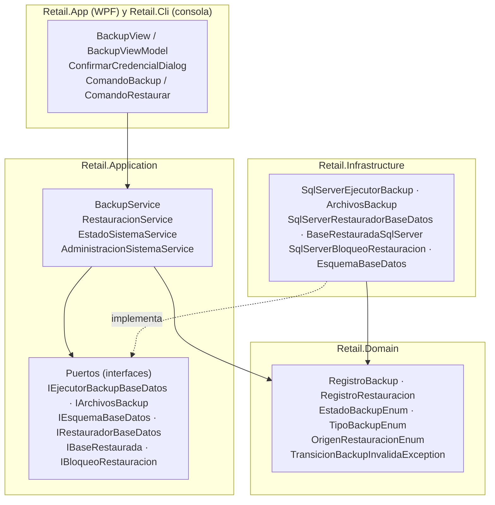
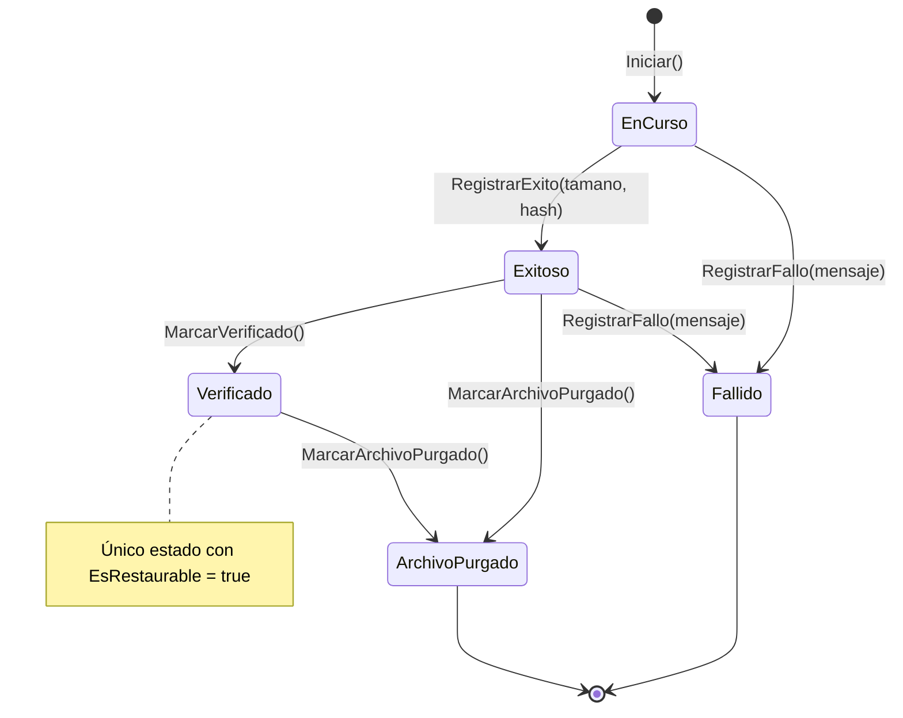
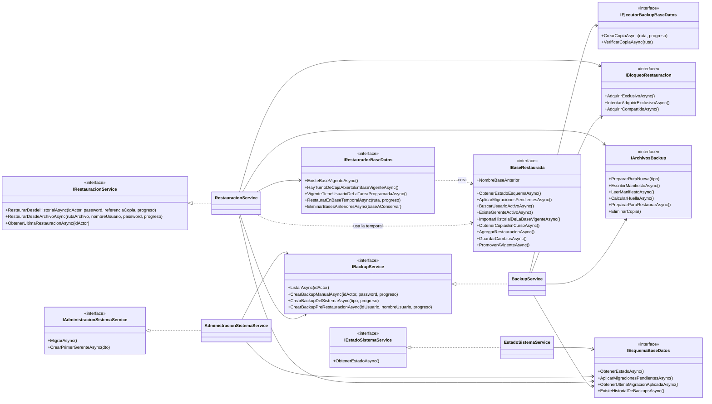
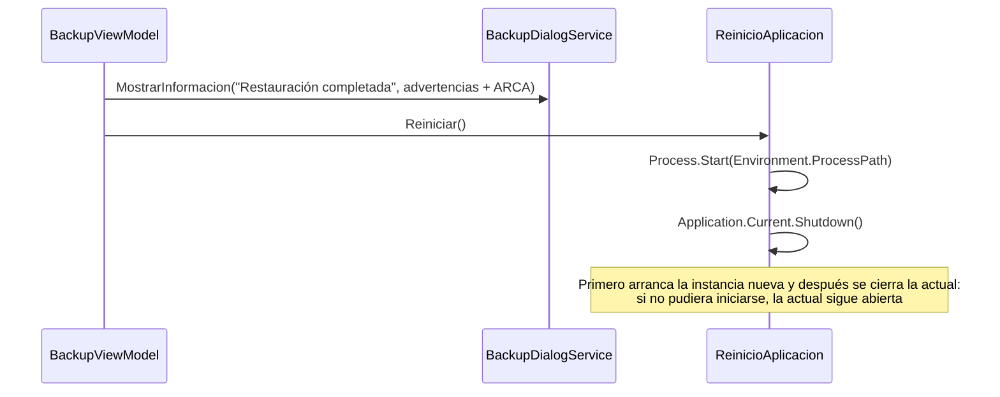
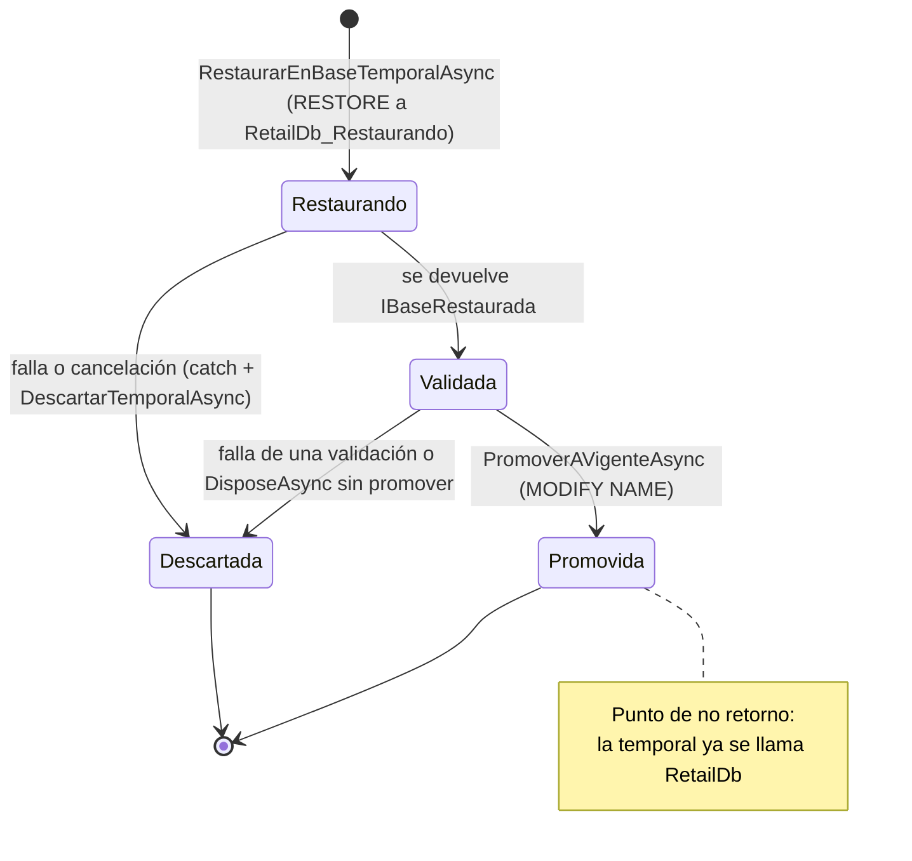

# Respaldo y Restauración — Capítulo 02: Componentes por Capa

### Módulo: 05. Casos de Uso y Flujos de Negocio de Punta a Punta
**Audiencia:** Desarrolladores, estudiantes universitarios y mesa evaluadora de cátedra  
**Requisitos Vinculados:** `RF-22` (Respaldo y Restauración), `RF-23` (Administración de la Base por Comandos), `RNF-08` (Integridad y Respaldo Diario) y `RF-03` (Roles)  
**Diseño y decisiones:** [`etapa-6-track-6.3-backup-restore.md`](file:///c:/Users/lucas/Proyectos/retail/docs/roadmap/etapa-6-track-6.3-backup-restore.md) · **Mapa del proyecto:** [`MAPA_DEL_PROYECTO.md`](file:///c:/Users/lucas/Proyectos/retail/docs/MAPA_DEL_PROYECTO.md)  
**Archivos de Código (por capa):**
* Dominio: [`Entities/`](file:///c:/Users/lucas/Proyectos/retail/src/Retail.Domain/Entities/), [`Enums/`](file:///c:/Users/lucas/Proyectos/retail/src/Retail.Domain/Enums/), [`Exceptions/`](file:///c:/Users/lucas/Proyectos/retail/src/Retail.Domain/Exceptions/)
* Aplicación: [`Services/`](file:///c:/Users/lucas/Proyectos/retail/src/Retail.Application/Services/), [`Interfaces/`](file:///c:/Users/lucas/Proyectos/retail/src/Retail.Application/Interfaces/), [`DTOs/Backups/`](file:///c:/Users/lucas/Proyectos/retail/src/Retail.Application/DTOs/Backups/), [`DTOs/Sistema/`](file:///c:/Users/lucas/Proyectos/retail/src/Retail.Application/DTOs/Sistema/)
* Infraestructura: [`Backups/`](file:///c:/Users/lucas/Proyectos/retail/src/Retail.Infrastructure/Backups/), [`Persistence/Configurations/`](file:///c:/Users/lucas/Proyectos/retail/src/Retail.Infrastructure/Persistence/Configurations/)
* Aplicación de escritorio: [`Retail.App`](file:///c:/Users/lucas/Proyectos/retail/src/Retail.App/) · Consola: [`Retail.Cli`](file:///c:/Users/lucas/Proyectos/retail/src/Retail.Cli/)

---

## 1. 📖 Fundamento: Un Mismo Caso de Uso Repartido en Capas

El respaldo y la restauración involucran **tres mundos muy distintos**: reglas de negocio (¿una copia `Fallido` puede pasar a `Verificado`?), orquestación (¿en qué orden se autoriza, se bloquea, se copia y se registra?) y tecnología (sentencias `BACKUP`, archivos en disco, `sp_getapplock`). Clean Architecture obliga a separarlos para que la regla no dependa de la tecnología.

### 1.1 La regla de dependencia aplicada a este caso



La flecha punteada es la clave: los **puertos** (interfaces) los define `Retail.Application`, y los **implementa** `Retail.Infrastructure`. Las flechas de dependencia de código apuntan siempre hacia adentro:

$$\text{Retail.App} \longrightarrow \text{Retail.Application} \longleftarrow \text{Retail.Infrastructure}, \qquad \text{Retail.Application} \longrightarrow \text{Retail.Domain}$$

### 1.2 Principio de Inversión de Dependencias, con un caso concreto

El *Dependency Inversion Principle* (la "D" de SOLID) dice: **los módulos de alto nivel no deben depender de los de bajo nivel; ambos deben depender de abstracciones**. Aquí:

* **Alto nivel:** `BackupService` sabe *qué* hay que hacer: registrar el intento, copiar, verificar, escribir el manifiesto, aplicar la retención.
* **Bajo nivel:** `SqlServerEjecutorBackup` sabe *cómo* se hace con SQL Server: `BACKUP DATABASE ... WITH CHECKSUM`.
* **Abstracción:** `IEjecutorBackupBaseDatos`, con solo dos métodos (`CrearCopiaAsync`, `VerificarCopiaAsync`), vive en `Retail.Application` y no menciona `SqlConnection`, ni EF, ni SQL Server.

Sin inversión, `BackupService` tendría `using Microsoft.Data.SqlClient` y no se podría probar sin un SQL Server real. Con inversión, `BackupServiceTests` le entrega un sustituto de `IEjecutorBackupBaseDatos` y verifica la orquestación en milisegundos; el SQL real se prueba aparte en `BackupIntegracionTests` contra SQL Server Express. Y si mañana el motor cambiara, solo se reemplaza la implementación.

> [!NOTE]
> El proyecto sigue la **Ley 1** de [`AGENTS.md`](file:///c:/Users/lucas/Proyectos/retail/AGENTS.md): `Retail.Domain` no tiene dependencias externas; `Retail.Application` solo depende de Domain; y la UI jamás toca `RetailDbContext`, sino que todo pasa por servicios de Aplicación. `Retail.Cli` es otra *raíz de composición* que reutiliza exactamente los mismos servicios que la UI.

---

## 2. 🏛️ Capa de Dominio (`Retail.Domain`)

### 2.1 `RegistroBackup`: el ciclo de vida de una copia

[`RegistroBackup.cs`](file:///c:/Users/lucas/Proyectos/retail/src/Retail.Domain/Entities/RegistroBackup.cs) es una **Raíz de Agregado** (`BaseEntity, IAggregateRoot`; tiene repositorio, tabla `REGISTROS_BACKUP`). Custodia su ciclo de vida: nadie puede cambiar `Estado` desde afuera porque todos los setters son `private`; el constructor sin parámetros también es privado (lo usa EF) y la única forma de crear una instancia es el método de fábrica `Iniciar`.

| Miembro | Rol |
| :--- | :--- |
| `Referencia` (`Guid`) | Identidad **estable entre bases**: sobrevive a una restauración, donde el `Id` numérico puede cambiar. Permite reinsertar el historial sin duplicarlo (R-1) |
| `Tipo`, `Estado` | Origen de la copia y posición en el ciclo de vida |
| `IdUsuario?`, `NombreUsuario?` | El operador como **foto** (sin clave foránea). `null` si la copia la hizo el sistema |
| `FechaInicio`, `FechaFin?` | Duración |
| `RutaArchivo`, `TamanoBytes?`, `HashSha256?` | Ubicación e integridad |
| `UltimaMigracion`, `VersionApp` | Versión del esquema y de la aplicación al tomar la copia (R-7) |
| `MensajeError?` | Diagnóstico de un fallo |
| `EsRestaurable` | `Estado == Verificado`: **solo una copia verificada se restaura** |
| `EsDelSistema` | `IdUsuario is null` |
| `MensajeCopiaHuerfana` (constante) | Motivo con el que se cierra una copia cuyo proceso murió (B-0) |

**Métodos que mueven el estado** (los únicos):

| Método | Transición | Precondición (`ExigirEstado`) | Qué más hace |
| :--- | :--- | :--- | :--- |
| `Iniciar(...)` (estático) | → `EnCurso` | — | Valida tipo y operador, asigna `Referencia = Guid.NewGuid()`, `FechaInicio = UtcNow`, valida textos |
| `RegistrarExito(tamano, hash)` | `EnCurso` → `Exitoso` | Solo desde `EnCurso` | Exige tamaño > 0 y hash de 64 hex (lo normaliza a minúsculas); fija `FechaFin` |
| `MarcarVerificado()` | `Exitoso` → `Verificado` | Solo desde `Exitoso` | — |
| `RegistrarFallo(mensaje)` | `EnCurso` o `Exitoso` → `Fallido` | Desde `EnCurso` o `Exitoso` | Recorta el mensaje a 1000 caracteres; `FechaFin ??= UtcNow` |
| `MarcarArchivoPurgado()` | `Exitoso` o `Verificado` → `ArchivoPurgado` | Desde `Exitoso` o `Verificado` | — |



`Fallido` y `ArchivoPurgado` son **estados finales**: ningún método sale de ellos. Cualquier otra combinación lanza `TransicionBackupInvalidaException` (por ejemplo, verificar una copia `Fallido`). La guarda es una sola función privada:

```csharp
private void ExigirEstado(string operacion, params EstadoBackupEnum[] permitidos)
{
    if (!permitidos.Contains(Estado))
    {
        throw new TransicionBackupInvalidaException(Estado, operacion);
    }
}
```

**Invariantes de `Iniciar`** (quién puede tener operador):

```csharp
var pideOperador = tipo is TipoBackupEnum.Manual or TipoBackupEnum.PreRestauracion;
var tieneOperador = idUsuario is not null || !string.IsNullOrWhiteSpace(nombreUsuario);

if (pideOperador && (idUsuario is null or <= 0 || string.IsNullOrWhiteSpace(nombreUsuario)))
{
    throw new DomainException($"Una copia de tipo {tipo} debe registrar el operador que la pidió.");
}

if (!pideOperador && tieneOperador)
{
    throw new DomainException($"Una copia de tipo {tipo} la ejecuta el sistema: no admite operador.");
}
```

Un registro **no puede mentir sobre su origen**: las copias que pide una persona (`Manual`, `PreRestauracion`) exigen operador; las que dispara el sistema (`Automatico`, `PreMigracion`) no lo admiten. La misma regla se repite como `CK_REGISTROS_BACKUP_Operador` en la base (defensa en profundidad).

**Quién lo usa:** `BackupService` (crea, mueve y lista), `RestauracionService` (cierra las `EnCurso` de la vigente y de la temporal), `BaseRestauradaSqlServer` (lo reinserta entre bases) y `RegistroBackupConfiguration` (lo mapea).

**Tests:** [`RegistroBackupTests`](file:///c:/Users/lucas/Proyectos/retail/tests/Retail.Domain.UnitTests/Entities/RegistroBackupTests.cs), por ejemplo `Iniciar_TipoPedidoPorUnaPersonaSinOperador_LanzaDomainException`, `MarcarVerificado_Fallido_LanzaTransicionBackupInvalidaException` y `MarcarArchivoPurgado_EnCurso_LanzaTransicionBackupInvalidaException`.

### 2.2 `RegistroRestauracion`: la constancia de un restore

[`RegistroRestauracion.cs`](file:///c:/Users/lucas/Proyectos/retail/src/Retail.Domain/Entities/RegistroRestauracion.cs) es otra Raíz de Agregado (`REGISTROS_RESTAURACION`), pero **inmutable y sin ciclo de vida**: no tiene métodos de transición. Se crea con el método de fábrica `Registrar(...)` recién cuando la copia ya pasó todas las validaciones y se escribe en la base temporal antes del intercambio. Un intento fallido **no deja registro aquí** (la temporal se descarta): queda en el log.

| Miembro | Rol |
| :--- | :--- |
| `Referencia` | Identidad estable entre bases, para rehidratarse sin duplicarse (R-1) |
| `Origen` (`OrigenRestauracionEnum`) | `Aplicacion` o `Consola` |
| `IdUsuario`, `NombreUsuario` | Gerente que autorizó, como foto. **El dato confiable es `NombreUsuario`**: en la vía app, `IdUsuario` es el de la base *reemplazada* y en la restaurada puede apuntar a otra cuenta |
| `Fecha` | `UtcNow` al registrar |
| `ReferenciaCopia` | `Referencia` de la copia restaurada (del historial o del manifiesto) |
| `RutaArchivo`, `MigracionCopia` | Archivo usado y migración que traía la copia antes de ponerla al día |
| `ReferenciaCopiaPrevia?` | La copia `PreRestauracion` de la base reemplazada; `null` si no era accesible |
| `BaseAnterior?` | Nombre `RetailDb_Anterior_<fecha>`; `null` si no había vigente (PC nueva) |

Invariantes de `Registrar`: origen definido, `idUsuario > 0` ("toda restauración la autoriza un Gerente con su contraseña, también desde la consola", D-18), `referenciaCopia` no vacía, `referenciaCopiaPrevia` distinta de `Guid.Empty` (si no hubo copia, es `null`) y textos obligatorios con su longitud máxima.

### 2.3 Enumeraciones

| Enum | Valores | Notas |
| :--- | :--- | :--- |
| [`EstadoBackupEnum`](file:///c:/Users/lucas/Proyectos/retail/src/Retail.Domain/Enums/EstadoBackupEnum.cs) | `EnCurso = 1`, `Exitoso = 2`, `Verificado = 3`, `Fallido = 4`, `ArchivoPurgado = 5` | Se guarda como **texto** (`HasConversion<string>()`), no como número |
| [`TipoBackupEnum`](file:///c:/Users/lucas/Proyectos/retail/src/Retail.Domain/Enums/TipoBackupEnum.cs) | `Manual = 1`, `Automatico = 2`, `PreRestauracion = 3`, `PreMigracion = 4` | También como texto; define quién puede tener operador |
| [`OrigenRestauracionEnum`](file:///c:/Users/lucas/Proyectos/retail/src/Retail.Domain/Enums/OrigenRestauracionEnum.cs) | `Aplicacion = 1`, `Consola = 2` | Cada origen se autoriza de forma distinta (D-21) |

### 2.4 Excepciones del Dominio relacionadas

| Excepción | Cuándo se lanza |
| :--- | :--- |
| [`TransicionBackupInvalidaException`](file:///c:/Users/lucas/Proyectos/retail/src/Retail.Domain/Exceptions/TransicionBackupInvalidaException.cs) | Una transición del ciclo de vida no permitida. Expone `EstadoActual`. Mensaje: "No se puede {operacion} una copia de seguridad en estado {Estado}." |
| `DomainException` | Violación de una invariante (operador incoherente, hash inválido, texto vacío) |
| [`CredencialesInvalidasException`](file:///c:/Users/lucas/Proyectos/retail/src/Retail.Domain/Exceptions/CredencialesInvalidasException.cs) | Contraseña incorrecta o usuario inexistente: **un solo mensaje para todo**, "Nombre de usuario o contraseña incorrectos." |
| [`OperacionNoAutorizadaException`](file:///c:/Users/lucas/Proyectos/retail/src/Retail.Domain/Exceptions/OperacionNoAutorizadaException.cs) | Un actor sin el rol necesario (por ejemplo, un Cajero que pide una copia) |

### 2.5 `Usuario`: lo que el módulo usa

[`Usuario.cs`](file:///c:/Users/lucas/Proyectos/retail/src/Retail.Domain/Entities/Usuario.cs) no es del módulo de respaldos, pero lo condiciona:

| Miembro | Uso en este módulo |
| :--- | :--- |
| `IdRol`, `EsGerente()`, `EsAdministrador()` | `BackupService`/`RestauracionService` deciden con ellos quién puede operar y quién solo consultar |
| `DebeCambiarPassword` | `RestauracionService.VerificarCredencialEnLaCopiaAsync` **rechaza** un Gerente de la copia con cambio obligatorio pendiente (por ejemplo, el `admin/Admin123!` sembrado en bases viejas) con la misma `CredencialesInvalidasException` genérica (C-7) |
| `EmailRecuperacion` | Obligatorio para Gerente (`ActualizarDatos`). `EstadoSistemaService` informa los Gerentes que no lo tienen y la app lo avisa al arrancar |
| `PuedeGestionarCuentasDeRol(rol)` | Matriz de autoridad sobre cuentas: el Gerente gestiona cualquier rol; el Administrador solo Cajeros y Encargados |
| `RolUsuarioEnum.Administrador = 4` | Soporte técnico: ve el historial de copias, no opera (D-3) |

---

## 3. ⚙️ Capa de Aplicación (`Retail.Application`)

### 3.1 Servicios y sus contratos



#### `IBackupService` / `BackupService`

[`BackupService.cs`](file:///c:/Users/lucas/Proyectos/retail/src/Retail.Application/Services/BackupService.cs) orquesta una copia. Depende de repositorios genéricos de `RegistroBackup` y `Usuario`, `IUnitOfWork`, `IAuthService`, los puertos `IEjecutorBackupBaseDatos`, `IArchivosBackup`, `IEsquemaBaseDatos` e `IBloqueoRestauracion`, y la `PoliticaBackup`.

| Método público | Quién lo llama | Autorización |
| :--- | :--- | :--- |
| `ListarAsync(idActor)` | `BackupViewModel.CargarAsync` | Gerente **o** Administrador |
| `CrearBackupManualAsync(idActor, password, ...)` | `BackupViewModel` (vía el diálogo de credencial) | Solo Gerente + reautenticación (D-8) |
| `CrearBackupDelSistemaAsync(tipo, ...)` | `ComandoBackup` (`Automatico`), `AdministracionSistemaService.MigrarAsync` (`PreMigracion`) | Sin actor; rechaza otros tipos con `DomainException` |
| `CrearBackupPreRestauracionAsync(idUsuario, nombre, ...)` | `RestauracionService.TomarCopiaPreviaAsync` | Sin autorización propia: ya la dio la restauración que lo invoca |

Métodos privados que conviene conocer (todos se detallan en el capítulo 03): `CopiarConHistorialAsync` (el camino normal), `CopiarSinHistorialAsync` (base anterior a la tabla del historial: copia igual y documenta solo en el manifiesto), `CerrarCopiasInterrumpidasAsync` (B-0), `AplicarRetencionAsync`, `RegistrarFalloAsync`.

El punto de decisión central de la copia, con la regla "recién con el archivo verificado y su manifiesto escrito la copia es restaurable":

```csharp
var archivo = await _ejecutor.CrearCopiaAsync(ruta, progreso, cancellationToken);
registro.RegistrarExito(archivo.TamanoBytes, archivo.HashSha256);
await GuardarAsync(registro, cancellationToken);

await _ejecutor.VerificarCopiaAsync(ruta, cancellationToken);
await _archivos.EscribirManifiestoAsync(ruta, CrearManifiesto(registro, archivo), cancellationToken);

// Recién con el archivo verificado y su manifiesto escrito la copia es apta para restaurar.
registro.MarcarVerificado();
await GuardarAsync(registro, cancellationToken);
```

#### `IRestauracionService` / `RestauracionService`

[`RestauracionService.cs`](file:///c:/Users/lucas/Proyectos/retail/src/Retail.Application/Services/RestauracionService.cs) orquesta el restore con base temporal e intercambio. Es el servicio más grande (11 dependencias) porque coordina a todos: usuarios, registros de copias y de restauraciones, unidad de trabajo, autenticación, `IBackupService`, restaurador, bloqueo, archivos, esquema y `IPasswordHasher`.

| Método público | Quién lo llama | Cómo se autoriza |
| :--- | :--- | :--- |
| `RestaurarDesdeHistorialAsync(idActor, password, referenciaCopia, ...)` | `BackupViewModel` | Gerente + `VerificarCredencialAsync` contra la base **vigente**; la copia debe ser `EsRestaurable` |
| `RestaurarDesdeArchivoAsync(rutaArchivo, nombreUsuario, password, ...)` | `ComandoRestaurar` (`Retail.Cli`) | Credencial de un Gerente verificada **dentro de la copia** (BCrypt contra la temporal), sin cambio de contraseña pendiente (D-18, C-7) |
| `ObtenerUltimaRestauracionAsync(idActor)` | `BackupViewModel` y `MainViewModel` (aviso R-20) | Gerente o Administrador; solo lectura |

Las dos entradas convergen en un único `RestaurarAsync` (D-21) al que solo se le pasa **cómo autorizar dentro de la copia**, como una función:

```csharp
return await RestaurarAsync(
    OrigenRestauracionEnum.Aplicacion,
    copia,
    (temporal, ct) => ExigirGerenteEnLaCopiaAsync(temporal, actor, ct),
    progreso,
    cancellationToken);
```

y la envoltura de errores de D-25, en un solo lugar:

```csharp
private static bool DebeEnvolverse(Exception ex) =>
    ex is not (OperationCanceledException or DomainException or RestauracionFallidaException);
```

#### `IEstadoSistemaService` / `EstadoSistemaService`

[`EstadoSistemaService.cs`](file:///c:/Users/lucas/Proyectos/retail/src/Retail.Application/Services/EstadoSistemaService.cs) es de **solo lectura**: la usa `App.OnStartup` (RF-23) para decidir si la app puede abrir el login. Devuelve un `EstadoSistemaDto` con el estado del esquema, si existe un Gerente activo y los Gerentes sin email. Si el esquema no está al día **no consulta usuarios** (la tabla o columna podría no existir) y devuelve `ExisteGerenteActivo = false`.

#### `IAdministracionSistemaService` / `AdministracionSistemaService`

[`AdministracionSistemaService.cs`](file:///c:/Users/lucas/Proyectos/retail/src/Retail.Application/Services/AdministracionSistemaService.cs) tiene dos operaciones **privilegiadas y sin actor**: `MigrarAsync` (con copia `PreMigracion` obligatoria si la base existe y hay migraciones pendientes; si la copia falla, no se migra) y `CrearPrimerGerenteAsync` (se rechaza si ya existe un Gerente activo). Solo `Retail.Cli` puede resolverlo (ver 3.5).

### 3.2 Puertos de salida (interfaces de infraestructura)

Todos en [`Interfaces/Infrastructure/`](file:///c:/Users/lucas/Proyectos/retail/src/Retail.Application/Interfaces/Infrastructure/). No mencionan tipos de SQL Server ni de EF; sus firmas hablan el idioma del negocio.

| Puerto | Responsabilidad | Implementación | Lo usan |
| :--- | :--- | :--- | :--- |
| `IEjecutorBackupBaseDatos` | Escribir una copia y verificarla (devuelve tamaño y SHA-256) | `SqlServerEjecutorBackup` | `BackupService` |
| `IArchivosBackup` | Directorio dedicado: ruta nueva, manifiesto (escribir/leer), huella, traer un `.bak` externo al directorio, borrar | `ArchivosBackup` | `BackupService`, `RestauracionService` |
| `IEsquemaBaseDatos` | Estado de migraciones, aplicarlas, última migración, ¿existe la tabla del historial? | `EsquemaBaseDatos` | `BackupService`, `RestauracionService`, `EstadoSistemaService`, `AdministracionSistemaService`, `ComandoBackup` |
| `IRestauradorBaseDatos` | Operar sobre `master`: ¿existe la vigente?, ¿turno abierto?, ¿tiene el usuario de la tarea?, restaurar a la temporal, eliminar bases anteriores | `SqlServerRestauradorBaseDatos` | `RestauracionService` |
| `IBaseRestaurada` | Trabajar **sobre la base temporal**: estado del esquema, migrar, buscar usuario, importar historial, cerrar `EnCurso`, agregar la restauración, guardar y **promover a vigente** | `BaseRestauradaSqlServer` | `RestauracionService` |
| `IBloqueoRestauracion` | Bloqueo de lectores y escritor (exclusivo, intento de exclusivo, compartido) | `SqlServerBloqueoRestauracion` | `BackupService`, `RestauracionService` |

> [!NOTE]
> `IBaseRestaurada` es **amplia a propósito**: opera sobre *otra base* que no es la del `IUnitOfWork` de la aplicación, así que necesita su propio ciclo de lectura, cambios y guardado. Concentrarlo en un puerto evita abrir un segundo contexto de EF desde Application. Además hereda de `IAsyncDisposable`: **liberarla sin promover la elimina**, lo que hace trivial la limpieza ante cualquier falla (`await using var temporal = ...`).

### 3.3 DTOs

| Carpeta | DTO | Para qué |
| :--- | :--- | :--- |
| `DTOs/Backups/` | `ArchivoBackupDto(TamanoBytes, HashSha256)` | Huella de un archivo |
| | `ManifiestoBackupDto` | Contenido del `.json`: referencia, tipo, fecha, operador, archivo, tamaño, hash, migración, versión, `RegistradaEnHistorial` |
| | `RegistroBackupDto` | Fila del historial para la UI (incluye `EsRestaurable`) |
| | `ResultadoBackupDto` | Resultado de una copia: ruta, tamaño, hash, `RegistradaEnHistorial`, `CopiasPurgadas`, `ErroresDeRetencion` |
| | `RegistroRestauracionDto` | La última restauración, para el aviso (R-20) |
| | `ResultadoRestauracionDto` | Referencias, base anterior, migraciones aplicadas y `Advertencias`; contiene la constante `AvisoConciliacionArca` (R-3) |
| | `PoliticaBackup(CantidadMaximaCopias, VersionApp, DiasRetencionPreRestauracion = 30)` | Política de retención y versión, **inyectada como singleton** |
| `DTOs/Sistema/` | `EstadoEsquemaDto` | `PuedeConectar`, `MigracionesPendientes`, `MigracionesDesconocidas`; propiedad calculada `EstaAlDia` |
| | `EstadoSistemaDto` | `Esquema`, `ExisteGerenteActivo`, `GerentesSinEmail`; calculada `PuedeOperar` |
| | `ResultadoMigracionDto(Aplicadas, CopiaPrevia)` | Resultado de `migrar` |

### 3.4 Excepciones y mensajes para el operador

* [`BackupFallidoException`](file:///c:/Users/lucas/Proyectos/retail/src/Retail.Application/Exceptions/BackupFallidoException.cs): falla del motor o del disco al copiar (no es una regla de negocio, por eso no es de Dominio).
* [`RestauracionFallidaException`](file:///c:/Users/lucas/Proyectos/retail/src/Retail.Application/Exceptions/RestauracionFallidaException.cs): cualquier falla de la restauración (D-25). El mensaje incluye "La base vigente no cambió."
* [`DescripcionDeFalla.Para(ex)`](file:///c:/Users/lucas/Proyectos/retail/src/Retail.Application/Services/DescripcionDeFalla.cs): muestra el mensaje solo si la excepción es propia o de E/S; para cualquier otra (errores crudos del motor) devuelve un texto genérico y el detalle viaja en la `InnerException` hacia el log.

### 3.5 Registro en inyección de dependencias

[`Application/DependencyInjection.cs`](file:///c:/Users/lucas/Proyectos/retail/src/Retail.Application/DependencyInjection.cs) tiene **dos métodos**:

```csharp
services.AddScoped<IEstadoSistemaService, EstadoSistemaService>();
services.AddScoped<IBackupService, BackupService>();
services.AddScoped<IRestauracionService, RestauracionService>();
// ...
public static IServiceCollection AddAdministracionSistema(this IServiceCollection services)
{
    services.AddScoped<IAdministracionSistemaService, AdministracionSistemaService>();
    return services;
}
```

**Por qué `IAdministracionSistemaService` está aparte.** Es la única superficie que puede migrar la base o crear un Gerente **sin actor autenticado**. La app WPF invoca solo `AddApplicationServices`, así que ni siquiera puede resolver ese servicio: la separación se hace cumplir por construcción y no por convención. `Retail.Cli` (el único que llama a `AddAdministracionSistema`) es una herramienta que puede ejecutar cualquiera con acceso al equipo, y por eso ninguna de sus operaciones otorga acceso a una cuenta existente (D-13). El test `AddApplicationServices_NoRegistraLasOperacionesPrivilegiadasDeAdministracion` lo verifica. `IRestauracionService`, en cambio, sí se registra en ambos mundos (D-21): no es privilegiado porque toda restauración exige la contraseña de un Gerente.

---

## 4. 🔌 Capa de Infraestructura (`Retail.Infrastructure`)

### 4.1 Componentes de `Backups/`

| Clase | Rol | Miembros clave | Implementa / usa |
| :--- | :--- | :--- | :--- |
| [`SqlServerEjecutorBackup`](file:///c:/Users/lucas/Proyectos/retail/src/Retail.Infrastructure/Backups/SqlServerEjecutorBackup.cs) | `BACKUP DATABASE` y `RESTORE VERIFYONLY` por ADO.NET | `CrearCopiaAsync` (copia + SHA-256), `VerificarCopiaAsync` | `IEjecutorBackupBaseDatos` |
| [`ArchivosBackup`](file:///c:/Users/lucas/Proyectos/retail/src/Retail.Infrastructure/Backups/ArchivosBackup.cs) | Directorio dedicado | `PrepararRutaNueva` (prueba de escritura, espacio libre, nombre `Retail_<fecha>_<tipo>.bak`), `EscribirManifiestoAsync`, `LeerManifiestoAsync` (valida cada campo), `PrepararParaRestaurarAsync`, `EliminarCopia`, `RutaManifiesto` | `IArchivosBackup`, `BackupOptions`, `RutaCopiaBackup`, `HuellaArchivo` |
| [`RutaCopiaBackup`](file:///c:/Users/lucas/Proyectos/retail/src/Retail.Infrastructure/Backups/RutaCopiaBackup.cs) | Valida la ruta de un `.bak` elegido por el operador | `Normalizar`: rechaza vacías, UNC (`\\...`), de dispositivo (`\\?\`, `\\.\`) y extensiones distintas de `.bak` | `ArchivosBackup`, `SqlServerRestauradorBaseDatos` |
| [`HuellaArchivo`](file:///c:/Users/lucas/Proyectos/retail/src/Retail.Infrastructure/Backups/HuellaArchivo.cs) | Tamaño + SHA-256 por *streaming* (no carga el archivo en memoria, RNF-03) | `CalcularAsync` | `SqlServerEjecutorBackup`, `ArchivosBackup` |
| [`ComandosSqlServer`](file:///c:/Users/lucas/Proyectos/retail/src/Retail.Infrastructure/Backups/ComandosSqlServer.cs) | Piezas comunes de SQL | `Delimitar` (corchetes, duplica `]`), `CadenaParaBase`, `SuscribirProgreso`, `LimpiarPool`, `EliminarBaseAsync`, `CuentaDeLaTareaProgramada` | Todas las anteriores y las de restauración |
| [`SqlServerRestauradorBaseDatos`](file:///c:/Users/lucas/Proyectos/retail/src/Retail.Infrastructure/Backups/SqlServerRestauradorBaseDatos.cs) | Operaciones sobre `master` | `ExisteBaseVigenteAsync`, `HayTurnoDeCajaAbiertoEnBaseVigenteAsync`, `VigenteTieneUsuarioDeLaTareaProgramadaAsync`, `RestaurarEnBaseTemporalAsync` (`FILELISTONLY`, espacio D-23, `WITH MOVE`), `EliminarBasesAnterioresAsync` | `IRestauradorBaseDatos` |
| [`BaseRestauradaSqlServer`](file:///c:/Users/lucas/Proyectos/retail/src/Retail.Infrastructure/Backups/BaseRestauradaSqlServer.cs) | Es la base temporal: tiene su propio `RetailDbContext` | `ImportarHistorialDeLaBaseVigenteAsync`, `PromoverAVigenteAsync` (intercambio por `MODIFY NAME`), `DisposeAsync` (elimina si no se promovió) | `IBaseRestaurada` |
| [`SqlServerBloqueoRestauracion`](file:///c:/Users/lucas/Proyectos/retail/src/Retail.Infrastructure/Backups/SqlServerBloqueoRestauracion.cs) | `sp_getapplock` sobre `master`, con conexión propia y sin pool | `AdquirirExclusivoAsync`, `IntentarAdquirirExclusivoAsync`, `AdquirirCompartidoAsync`, `EsperaCompartidoPorDefecto` (10 s) | `IBloqueoRestauracion` |
| [`BackupOptions`](file:///c:/Users/lucas/Proyectos/retail/src/Retail.Infrastructure/Backups/BackupOptions.cs) | Sección `BackupSettings` de `appsettings.json` | `Directorio` (`C:\RetailData\Backups`), `CantidadMaximaCopias` (14), `DiasRetencionPreRestauracion` (30), `EspacioLibreMinimoMb` (500) | `ArchivosBackup`, `SqlServerRestauradorBaseDatos`, DI |

Fuera de `Backups/`: [`EsquemaBaseDatos`](file:///c:/Users/lucas/Proyectos/retail/src/Retail.Infrastructure/Persistence/Services/EsquemaBaseDatos.cs) (en `Persistence/Services/`, implementa `IEsquemaBaseDatos`) y [`UbicacionDeLogs`](file:///c:/Users/lucas/Proyectos/retail/src/Retail.Infrastructure/Logging/UbicacionDeLogs.cs).

> [!NOTE]
> **`BaseRestauradaSqlServer` no se registra en DI.** La crea `SqlServerRestauradorBaseDatos.RestaurarEnBaseTemporalAsync` con `new`, porque su vida es una sola restauración y su cadena de conexión apunta a una base que no existe hasta ese momento. Es un recurso desechable (`IAsyncDisposable`), no un servicio.

### 4.2 `EsquemaBaseDatos` y sus tres preguntas

`EsquemaBaseDatos` responde, sobre la base vigente, con EF Core (`CanConnectAsync`, `GetMigrations`, `GetAppliedMigrationsAsync`, `GetPendingMigrationsAsync`):

* ¿Se puede conectar? (`false` tanto si el servidor no responde como si la base aún no existe).
* ¿Qué migraciones faltan (`MigracionesPendientes`) y cuáles aplicó una versión más nueva (`MigracionesDesconocidas`)?
* ¿Existe la tabla del historial? Es la única consulta con SQL crudo, copiada literal:

```sql
SELECT CASE WHEN OBJECT_ID(N'dbo.REGISTROS_BACKUP', N'U') IS NULL THEN 0 ELSE 1 END AS [Value]
```

`OBJECT_ID(N'dbo.REGISTROS_BACKUP', N'U')` devuelve `NULL` si no hay una tabla de usuario (`U`) con ese nombre. Se usa para poder respaldar (y migrar) una base de una versión anterior a la Fase 3, donde la tabla todavía no existe.

### 4.3 Diseño de las tablas

Las configuraciones Fluent API están en [`RegistroBackupConfiguration`](file:///c:/Users/lucas/Proyectos/retail/src/Retail.Infrastructure/Persistence/Configurations/RegistroBackupConfiguration.cs) y [`RegistroRestauracionConfiguration`](file:///c:/Users/lucas/Proyectos/retail/src/Retail.Infrastructure/Persistence/Configurations/RegistroRestauracionConfiguration.cs). Las migraciones son `AgregarRegistrosBackup` y `AgregarRegistrosRestauracion`.

#### `REGISTROS_BACKUP`

| Columna | Tipo | Nulo | Notas |
| :--- | :--- | :-: | :--- |
| `id_registro_backup` | `int` identidad | No | Clave primaria |
| `referencia` | `uniqueidentifier` | No | **Índice único**: clave para reinsertar el historial sin duplicar |
| `tipo` | `nvarchar(20)` | No | Texto (`Manual`, `Automatico`, `PreRestauracion`, `PreMigracion`) |
| `estado` | `nvarchar(20)` | No | Texto (`EnCurso`, `Exitoso`, ...). Con **índice único filtrado** |
| `id_usuario` | `int` | Sí | Sin clave foránea (foto del operador) |
| `nombre_usuario` | `nvarchar(50)` | Sí | Foto del operador |
| `fecha_inicio` | `datetime2` | No | Índice descendente (el historial se lista de lo más reciente a lo más antiguo) |
| `fecha_fin` | `datetime2` | Sí | |
| `ruta_archivo` | `nvarchar(400)` | No | |
| `tamano_bytes` | `bigint` | Sí | |
| `hash_sha256` | `char(64)` | Sí | Longitud fija, no Unicode |
| `ultima_migracion` | `nvarchar(150)` | No | |
| `version_app` | `nvarchar(50)` | No | |
| `mensaje_error` | `nvarchar(1000)` | Sí | |
| `created_at`, `deleted_at` | `datetime2` | No / Sí | Herencia de `BaseEntity` (borrado lógico, Ley 3) |

**Restricciones y su porqué:**

| Restricción | Definición literal | Qué protege |
| :--- | :--- | :--- |
| `IX_REGISTROS_BACKUP_EnCurso` (índice único filtrado) | `[estado] = 'EnCurso' AND [deleted_at] IS NULL` | A lo sumo **una** copia `EnCurso` a la vez (R-12). Mismo patrón que `IX_TURNOS_CAJA_TurnoAbierto` |
| `CK_REGISTROS_BACKUP_Tamano` | `[tamano_bytes] IS NULL OR [tamano_bytes] > 0` | Un tamaño, si existe, es positivo |
| `CK_REGISTROS_BACKUP_Operador` | `([tipo] IN ('Manual', 'PreRestauracion') AND [id_usuario] IS NOT NULL AND [nombre_usuario] IS NOT NULL) OR ([tipo] IN ('Automatico', 'PreMigracion') AND [id_usuario] IS NULL AND [nombre_usuario] IS NULL)` | La coherencia tipo/operador del dominio, también a nivel de base |
| Índice único en `referencia` | — | Idempotencia al rehidratar el historial |

#### `REGISTROS_RESTAURACION`

| Columna | Tipo | Nulo | Notas |
| :--- | :--- | :-: | :--- |
| `id_registro_restauracion` | `int` identidad | No | Clave primaria |
| `referencia` | `uniqueidentifier` | No | Índice único (se rehidrata entre bases) |
| `origen` | `nvarchar(20)` | No | `Aplicacion` o `Consola` |
| `id_usuario` | `int` | No | `CK_REGISTROS_RESTAURACION_IdUsuario`: `[id_usuario] > 0` |
| `nombre_usuario` | `nvarchar(50)` | No | El dato confiable del operador |
| `fecha` | `datetime2` | No | Índice descendente |
| `referencia_copia` | `uniqueidentifier` | No | `Guid` estable, **no** FK a `REGISTROS_BACKUP` |
| `ruta_archivo` | `nvarchar(400)` | No | |
| `migracion_copia` | `nvarchar(150)` | No | |
| `referencia_copia_previa` | `uniqueidentifier` | Sí | La copia `PreRestauracion` |
| `base_anterior` | `nvarchar(128)` | Sí | `RetailDb_Anterior_<fecha>` |
| `created_at`, `deleted_at` | `datetime2` | No / Sí | |

> [!IMPORTANT]
> **Ninguna de las dos tablas tiene claves foráneas.** Parece una omisión, pero es deliberado: ambas se **reinsertan en la base restaurada** (R-1), donde el usuario o la copia a la que apuntarían pueden no existir. Por eso el operador es una *foto* y las referencias entre registros son `Guid` estables en lugar de claves de tabla. Es una decisión de consistencia entre bases, no entre filas.

### 4.4 Registro en inyección de dependencias

[`Infrastructure/DependencyInjection.cs`](file:///c:/Users/lucas/Proyectos/retail/src/Retail.Infrastructure/DependencyInjection.cs), secciones 4 y 5:

| Servicio | Ciclo de vida | Por qué |
| :--- | :--- | :--- |
| `RetailDbContext`, `IUnitOfWork`, `IRepository<>`, `IEsquemaBaseDatos` | `Scoped` | Comparten el contexto de EF de la operación |
| `IEjecutorBackupBaseDatos` → `SqlServerEjecutorBackup` | `Scoped` | Obtiene la cadena de conexión del `RetailDbContext` del scope |
| `IBloqueoRestauracion` → `SqlServerBloqueoRestauracion` | `Scoped` | Idem; cada bloqueo abre su propia conexión |
| `IRestauradorBaseDatos` → `SqlServerRestauradorBaseDatos` | `Scoped` | Idem |
| `IArchivosBackup` → `ArchivosBackup` | `Singleton` | Sin estado de operación: solo opciones y acceso a disco |
| `PoliticaBackup` | `Singleton` | Se calcula una vez desde `BackupOptions` y la versión del ensamblado |
| `IOptions<BackupOptions>` | `Configure<>` | Sección `BackupSettings` |

La `PoliticaBackup` **falla al arrancar** si la configuración es peligrosa:

```csharp
if (opciones.CantidadMaximaCopias < 1)
{
    throw new InvalidOperationException(
        $"{BackupOptions.SectionName}:CantidadMaximaCopias debe ser al menos 1: si no, la retención borraría la copia recién hecha.");
}
```

(y lo mismo para `DiasRetencionPreRestauracion < 1`). Es validación en la frontera: un error de configuración se detecta de inmediato, no en la noche en que la retención borre todo.

### 4.5 `UbicacionDeLogs`

[`UbicacionDeLogs`](file:///c:/Users/lucas/Proyectos/retail/src/Retail.Infrastructure/Logging/UbicacionDeLogs.cs) es la **única regla** (la usan `Retail.App` y `Retail.Cli`) para ubicar los registros de Serilog: `%LOCALAPPDATA%\Retail POS\logs`, de la cuenta que ejecuta el proceso. Tiene un método sin parámetros (`Directorio()`) y otro que recibe la carpeta base (`Directorio(string? carpetaBase)`) para poder probar la regla; si la base viene vacía usa la carpeta temporal del sistema. El porqué de seguridad (nada escribible por usuarios dentro de `Program Files`) está en el [capítulo 01](01-fundamentos-y-decisiones.md), sección 3.5.

---

## 5. 🖥️ Capa de Presentación (`Retail.App`, WPF + MVVM)

### 5.1 Componentes

| Componente | Archivo | Rol |
| :--- | :--- | :--- |
| `BackupView` | [`Views/Pages/BackupView.xaml`](file:///c:/Users/lucas/Proyectos/retail/src/Retail.App/Views/Pages/BackupView.xaml) | Pantalla "Respaldos": grilla del historial con estado como *badge*, cabecera de última restauración, botones |
| `BackupViewModel` | [`ViewModels/Backups/BackupViewModel.cs`](file:///c:/Users/lucas/Proyectos/retail/src/Retail.App/ViewModels/Backups/BackupViewModel.cs) | `CargarAsync`, `CrearBackupManualAsync`, `RestaurarCopiaAsync`; `PuedeOperar` (= `_session.EsGerente`) y `EsSoloLectura` |
| `RegistroBackupFila` | [`ViewModels/Backups/RegistroBackupFila.cs`](file:///c:/Users/lucas/Proyectos/retail/src/Retail.App/ViewModels/Backups/RegistroBackupFila.cs) | Envuelve el DTO: hora local (EF devuelve la fecha sin zona, se declara UTC antes de convertir) y tamaño legible |
| `ConfirmarCredencialDialog` + `ConfirmarCredencialViewModel` | [`Views/Dialogs/`](file:///c:/Users/lucas/Proyectos/retail/src/Retail.App/Views/Dialogs/ConfirmarCredencialDialog.xaml), [`ViewModels/Backups/`](file:///c:/Users/lucas/Proyectos/retail/src/Retail.App/ViewModels/Backups/ConfirmarCredencialViewModel.cs) | Un único diálogo para reautenticar y **ejecutar** la operación (copia o restauración) con barra de progreso |
| `IBackupDialogService` / `BackupDialogService` | [`Services/`](file:///c:/Users/lucas/Proyectos/retail/src/Retail.App/Services/IBackupDialogService.cs) | Abstracción para abrir diálogos y mostrar mensajes; permite probar el ViewModel sin ventanas |
| `IReinicioAplicacion` / `ReinicioAplicacion` | [`Services/`](file:///c:/Users/lucas/Proyectos/retail/src/Retail.App/Services/IReinicioAplicacion.cs) | Reinicia la app tras restaurar |
| `DiagnosticoArranqueDialog` | [`Views/Dialogs/`](file:///c:/Users/lucas/Proyectos/retail/src/Retail.App/Views/Dialogs/DiagnosticoArranqueDialog.xaml) | Bloqueo de arranque con comandos de `Retail.Cli` listos para copiar |
| `MensajeEstadoSistema` | [`Helpers/MensajeEstadoSistema.cs`](file:///c:/Users/lucas/Proyectos/retail/src/Retail.App/Helpers/MensajeEstadoSistema.cs) | Traduce `EstadoSistemaDto` a un `DiagnosticoArranque` (¿bloquea?, mensaje, argumentos) |
| `ComandoCli` | [`Helpers/ComandoCli.cs`](file:///c:/Users/lucas/Proyectos/retail/src/Retail.App/Helpers/ComandoCli.cs) | Formatea la línea para PowerShell |
| `ComandoCopiableViewModel` | [`ViewModels/Sistema/`](file:///c:/Users/lucas/Proyectos/retail/src/Retail.App/ViewModels/Sistema/ComandoCopiableViewModel.cs) | Fila de un comando con su botón "Copiar" |
| Aviso de restauración | [`MainViewModel.cs`](file:///c:/Users/lucas/Proyectos/retail/src/Retail.App/ViewModels/MainViewModel.cs) | `CargarAvisoRestauracionAsync`, `AvisoRestauracion`, `CerrarAvisoRestauracion` |

### 5.2 El diálogo de credencial: quien ejecuta es el diálogo

El flujo no es "pedir la contraseña y devolverla": **el diálogo ejecuta la operación**, porque solo el servicio puede decir si la contraseña es correcta (D-8). Si es incorrecta (`CredencialesInvalidasException`), el diálogo se queda abierto para reintentar; cualquier otro fallo cierra el diálogo y se devuelve al `BackupViewModel` para mostrarlo.

```csharp
// ConfirmarCredencialViewModel.EjecutarAsync (extracto)
try
{
    await _operacion(Password, new Progress<int>(valor => Progreso = Math.Clamp(valor, 0, 100)));
    Completada = true;
    return true;
}
catch (CredencialesInvalidasException ex)
{
    // La contraseña se corrige en el mismo diálogo; la operación no empezó.
    MensajeError = ex.Message;
    Password = string.Empty;
    return false;
}
catch (Exception ex)
{
    FalloOperacion = ex;
    return true;
}
```

Dos fábricas estáticas definen los dos modos: `ParaBackupManual` y `ParaRestauracion`. Esta última exige escribir la frase `RESTAURAR` (`FraseRestauracion`), muestra el aviso de conciliación con ARCA y usa el botón de peligro (`EsDestructiva`). `ConfirmarCredencialDialog.OnClosing` cancela el cierre mientras `IsBusy`: **una copia o restauración a medias no se interrumpe cerrando la ventana**.

### 5.3 Ley 4 en acción: nada de base de datos en el hilo de la UI

`BackupViewModel` delega todo con `Task.Run`:

```csharp
creada = await Task.Run(() => _backupService.CrearBackupManualAsync(idActor, password, progreso));
```

y la carga del historial usa `CargaSerializada` para serializar las cargas sobre el `DbContext` de la pantalla y cancelarlas al salir.

### 5.4 Después de restaurar: reinicio obligatorio



Las conexiones abiertas y las pantallas en memoria apuntan a la base reemplazada; la única salida segura es arrancar de nuevo. `PromoverAVigenteAsync` ya hizo `SqlConnection.ClearAllPools()`. Si `Reiniciar` falla, el ViewModel muestra "Reinicio manual necesario".

### 5.5 Aviso de restauración reciente en el Shell

`MainViewModel` es **Singleton** (Ley 10) y `IRestauracionService` es **Scoped**: inyectar el servicio directamente capturaría un `DbContext` de vida infinita. Por eso `MainViewModel` recibe `IServiceScopeFactory` y abre un scope propio solo para consultar:

```csharp
using var scope = _scopeFactory.CreateScope();
var servicio = scope.ServiceProvider.GetRequiredService<IRestauracionService>();
return await servicio.ObtenerUltimaRestauracionAsync(idActor);
```

Si la última restauración ocurrió en los últimos 7 días (`DiasAvisoRestauracion`), muestra un aviso no bloqueante a Gerente y Administrador (R-20). El método **nunca lanza**: si falla, lo registra como `Warning` y la app sigue. Se dispara en cada cambio de sesión (`OnSessionChanged`).

### 5.6 Diagnóstico de arranque (RF-23)

`App.OnStartup` ya no migra ni siembra. Abre un scope, consulta `IEstadoSistemaService` y delega la interpretación a `MensajeEstadoSistema.Describir`, que devuelve un `DiagnosticoArranque(Bloquea, Mensaje, Argumentos)`. Los casos, en el orden en que se evalúan:

| Condición | Bloquea | Comandos sugeridos |
| :--- | :-: | :--- |
| No conecta o la base no existe | Sí | `migrar`, `inicializar` |
| Migraciones desconocidas (base más nueva que la app) | Sí | Ninguno: "Actualice la aplicación" |
| Migraciones pendientes | Sí | `migrar` |
| Sin Gerente activo | Sí | `inicializar` |
| Gerentes sin email | No (solo aviso) | Ninguno: cargarlo desde Usuarios |

`ComandoCli.Formatear` produce la línea según el entorno: si existe `Retail.Cli.exe` junto a la app, `& "<ruta>\Retail.Cli.exe" migrar`; si no (desarrollo), `dotnet run --project src/Retail.Cli -- migrar`, con una nota de que debe ejecutarse desde la raíz del repositorio. El diálogo **no ejecuta nada**: solo muestra comandos seleccionables con botones "Copiar" y "Copiar todos", y cerrarlo equivale a salir (`Shutdown()`).

### 5.7 Navegación por rol y F11

| Elemento | Regla |
| :--- | :--- |
| Botón del menú y atajo **F11** (`MainWindow.xaml.cs`: `case Key.F11 when ViewModel.PuedeGestionarUsuarios`) | Visibles y activos para **Gerente y Administrador** (`PuedeGestionarUsuarios = EsGerente || EsAdministrador`) |
| Botones "Crear copia" y "Restaurar" en `BackupView` | Solo `PuedeOperar` (Gerente); el Administrador ve el aviso de solo lectura (`EsSoloLectura`) |
| Autoridad real | Los servicios de Aplicación (D-9), no la UI |
| POS, caja, inventario | `PuedeOperarNegocio = !EsAdministrador`: el Administrador no los ve |

### 5.8 Ciclos de vida registrados en `App.xaml.cs`

| Registro | Ciclo | Motivo |
| :--- | :--- | :--- |
| `MainViewModel`, `MainWindow` | `Singleton` | Shell (Ley 10) |
| `IReinicioAplicacion` | `Singleton` | Sin estado |
| `IBackupDialogService` | `Scoped` | Como los demás servicios de diálogo del módulo |
| `BackupViewModel`, `BackupView` | `Transient` | Una instancia por navegación; se desecha al salir |

**Tests de humo STA (Ley 9):** `BackupView_InstanciacionEnHiloSTA_DebeCargarXAMLSinExcepciones` y `ConfirmarCredencialDialog_InstanciacionEnHiloSTA_DebeCargarXAMLSinExcepciones` en [`AppSmokeTests.cs`](file:///c:/Users/lucas/Proyectos/retail/tests/Retail.App.UnitTests/AppSmokeTests.cs).

---

## 6. 🖱️ Consola (`Retail.Cli`): Vista Rápida

[`Retail.Cli`](file:///c:/Users/lucas/Proyectos/retail/src/Retail.Cli/) es una segunda *raíz de composición*: un host de consola que reutiliza `AddApplicationServices()`, `AddAdministracionSistema()` e `AddInfrastructureServices()`, y despacha seis comandos en `Program.cs`: `estado`, `migrar`, `inicializar`, `datos-demo`, `backup` y `restaurar`. No tiene reglas de negocio propias. El detalle de cada comando, qué valida y por qué no otorga poder extra está en el **capítulo 05** ([`05-retail-cli.md`](05-retail-cli.md)).

---

## 7. 📝 Resumen: Componente → Capa → Responsabilidad → Archivo

| Componente | Capa | Responsabilidad | Archivo |
| :--- | :--- | :--- | :--- |
| `RegistroBackup` | Dominio | Ciclo de vida de una copia e invariantes de origen | `Retail.Domain/Entities/RegistroBackup.cs` |
| `RegistroRestauracion` | Dominio | Constancia inmutable de una restauración | `Retail.Domain/Entities/RegistroRestauracion.cs` |
| `EstadoBackupEnum`, `TipoBackupEnum`, `OrigenRestauracionEnum` | Dominio | Vocabulario del módulo | `Retail.Domain/Enums/` |
| `TransicionBackupInvalidaException` | Dominio | Transición de estado no permitida | `Retail.Domain/Exceptions/TransicionBackupInvalidaException.cs` |
| `Usuario` (rol, `DebeCambiarPassword`, `EmailRecuperacion`) | Dominio | Quién puede operar y quién es un Gerente válido en una copia | `Retail.Domain/Entities/Usuario.cs` |
| `BackupService` | Aplicación | Orquestar copias: autorizar, registrar, copiar, verificar, retener | `Retail.Application/Services/BackupService.cs` |
| `RestauracionService` | Aplicación | Orquestar el restore con temporal e intercambio | `Retail.Application/Services/RestauracionService.cs` |
| `EstadoSistemaService` | Aplicación | Verificación de arranque de solo lectura | `Retail.Application/Services/EstadoSistemaService.cs` |
| `AdministracionSistemaService` | Aplicación | Migrar con copia previa y crear el primer Gerente | `Retail.Application/Services/AdministracionSistemaService.cs` |
| Puertos (6) | Aplicación | Contratos que implementa Infraestructura | `Retail.Application/Interfaces/Infrastructure/` |
| DTOs de `Backups/` y `Sistema/`, `PoliticaBackup` | Aplicación | Datos de entrada, salida y política | `Retail.Application/DTOs/` |
| `BackupFallidoException`, `RestauracionFallidaException` | Aplicación | Fallos técnicos con mensaje legible | `Retail.Application/Exceptions/` |
| `SqlServerEjecutorBackup` | Infraestructura | `BACKUP` y `VERIFYONLY` | `Retail.Infrastructure/Backups/SqlServerEjecutorBackup.cs` |
| `ArchivosBackup`, `RutaCopiaBackup`, `HuellaArchivo` | Infraestructura | Directorio, manifiestos, rutas seguras y SHA-256 | `Retail.Infrastructure/Backups/` |
| `SqlServerRestauradorBaseDatos` | Infraestructura | Operaciones sobre `master` y restore a la temporal | `Retail.Infrastructure/Backups/SqlServerRestauradorBaseDatos.cs` |
| `BaseRestauradaSqlServer` | Infraestructura | La temporal: validar, importar historial, intercambiar | `Retail.Infrastructure/Backups/BaseRestauradaSqlServer.cs` |
| `SqlServerBloqueoRestauracion` | Infraestructura | Lectores y escritor con `sp_getapplock` | `Retail.Infrastructure/Backups/SqlServerBloqueoRestauracion.cs` |
| `ComandosSqlServer`, `BackupOptions` | Infraestructura | Utilidades SQL y configuración | `Retail.Infrastructure/Backups/` |
| `EsquemaBaseDatos` | Infraestructura | Estado de migraciones y existencia del historial | `Retail.Infrastructure/Persistence/Services/EsquemaBaseDatos.cs` |
| `RegistroBackupConfiguration`, `RegistroRestauracionConfiguration` | Infraestructura | Tablas, índices y restricciones | `Retail.Infrastructure/Persistence/Configurations/` |
| `UbicacionDeLogs` | Infraestructura | Regla única de carpeta de logs | `Retail.Infrastructure/Logging/UbicacionDeLogs.cs` |
| `BackupView`, `BackupViewModel`, `RegistroBackupFila` | Presentación | Pantalla de respaldos | `Retail.App/Views/Pages/`, `Retail.App/ViewModels/Backups/` |
| `ConfirmarCredencialDialog` y su ViewModel | Presentación | Reautenticar y ejecutar con progreso | `Retail.App/Views/Dialogs/`, `Retail.App/ViewModels/Backups/` |
| `IBackupDialogService`, `IReinicioAplicacion` | Presentación | Diálogos y reinicio, detrás de interfaces | `Retail.App/Services/` |
| `DiagnosticoArranqueDialog`, `MensajeEstadoSistema`, `ComandoCli` | Presentación | Bloqueo de arranque accionable | `Retail.App/Views/Dialogs/`, `Retail.App/Helpers/` |
| `MainViewModel` (aviso) | Presentación | Aviso de restauración reciente | `Retail.App/ViewModels/MainViewModel.cs` |
| `Retail.Cli` | Raíz de composición | Comandos de administración | `Retail.Cli/` |

### Diagrama del ciclo de vida de la base temporal

`IBaseRestaurada` no persiste un estado, pero su ciclo de vida condiciona todo el diseño del restore (banderas internas `_promovida` y `_liberada` de `BaseRestauradaSqlServer`):



---

## 8. 🎓 Preguntas de Defensa

### Pregunta 1: *"¿Por qué `RegistroBackup` tiene todos los setters privados y un método `Iniciar`?"*
> **Respuesta Modelo del Estudiante:**
> "Porque es una Raíz de Agregado: custodia sus invariantes. Si `Estado` fuera público, cualquier capa podría pasar una copia `Fallido` a `Verificado` y ofrecerla para restaurar. Con setters privados, el único camino son los métodos `RegistrarExito`, `MarcarVerificado`, `RegistrarFallo` y `MarcarArchivoPurgado`, que validan el estado de origen con `ExigirEstado` y lanzan `TransicionBackupInvalidaException`. `Iniciar` además impide que el registro mienta sobre su origen: una copia del sistema no puede tener operador y una manual sí lo exige. Esas mismas reglas están duplicadas como restricciones `CHECK` y un índice filtrado en la base, como defensa en profundidad."

### Pregunta 2: *"Muestren un caso concreto de inversión de dependencias en este módulo."*
> **Respuesta Modelo del Estudiante:**
> "`BackupService` (alto nivel, en Application) necesita copiar una base, pero no debe saber cómo. Define la interfaz `IEjecutorBackupBaseDatos` con `CrearCopiaAsync` y `VerificarCopiaAsync`. La implementación `SqlServerEjecutorBackup`, en Infrastructure, usa `SqlConnection` y `BACKUP DATABASE`. La dependencia de código apunta de Infrastructure hacia Application, no al revés. Gracias a eso `BackupServiceTests` prueba la orquestación con un sustituto, sin SQL Server, y el SQL real se prueba aparte en tests de integración contra SQL Server Express."

### Pregunta 3: *"¿Por qué `IAdministracionSistemaService` no se registra en `AddApplicationServices`?"*
> **Respuesta Modelo del Estudiante:**
> "Porque es la única superficie que puede migrar la base o crear un Gerente sin un actor autenticado. Si estuviera en el registro común, la app WPF podría resolverlo y un error de programación (o un atacante con acceso a código) podría invocarlo. Al exponerlo solo en `AddAdministracionSistema`, que llama únicamente `Retail.Cli`, la separación la hace cumplir la composición y no una convención. Un test, `AddApplicationServices_NoRegistraLasOperacionesPrivilegiadasDeAdministracion`, lo garantiza. `IRestauracionService` sí se comparte porque toda restauración exige la contraseña de un Gerente."

### Pregunta 4: *"Las tablas de respaldo no tienen claves foráneas. ¿No es un error de modelado?"*
> **Respuesta Modelo del Estudiante:**
> "Es deliberado. Ambas tablas se reinsertan en la base restaurada (R-1), donde el usuario o la copia referida pueden no existir porque se crearon después de la copia. Una clave foránea haría fallar esa importación. Por eso el operador es una foto (`id_usuario` + `nombre_usuario`) y las referencias entre registros son `Guid` estables (`referencia`, `referencia_copia`). Además sirve a la auditoría: el registro conserva quién fue aunque la cuenta cambie o desaparezca. La integridad que importa acá es entre bases, y se garantiza con el índice único sobre `referencia`."

### Pregunta 5: *"¿Por qué `MainViewModel` usa `IServiceScopeFactory` en lugar de inyectar `IRestauracionService`?"*
> **Respuesta Modelo del Estudiante:**
> "Por los ciclos de vida. El Shell es Singleton por la Ley 10 e `IRestauracionService` es Scoped, porque depende del `DbContext`. Inyectar un servicio Scoped en un Singleton lo convertiría en la práctica en Singleton y mantendría un contexto de EF vivo toda la sesión, con datos obsoletos y problemas de concurrencia. En cambio, `MainViewModel` abre un scope corto, consulta la última restauración y lo descarta. Tampoco se modificó el ciclo de vida del Shell para resolverlo, lo que la Ley 10 prohíbe."

### Pregunta 6: *"¿Por qué el diálogo de credencial ejecuta la operación en lugar de devolver la contraseña al ViewModel?"*
> **Respuesta Modelo del Estudiante:**
> "Porque la única que puede decidir si la contraseña es correcta es la capa de Aplicación (D-8), y se verifica dentro del mismo servicio que hace la copia o la restauración. Si el diálogo solo devolviera la contraseña, habría que cerrar el diálogo para descubrir que estaba mal y reabrirlo. Así, ante una `CredencialesInvalidasException` el diálogo queda abierto y vacía el campo para reintentar, y ante cualquier otra falla se cierra y el ViewModel muestra el error. Además la contraseña no viaja por más capas de las necesarias."

---

[⬅️ Anterior: 01 Fundamentos y decisiones](01-fundamentos-y-decisiones.md) | [Índice de la guía](README.md) | [Siguiente: 03 Flujo de copia ➡️](03-flujo-de-copia.md)
