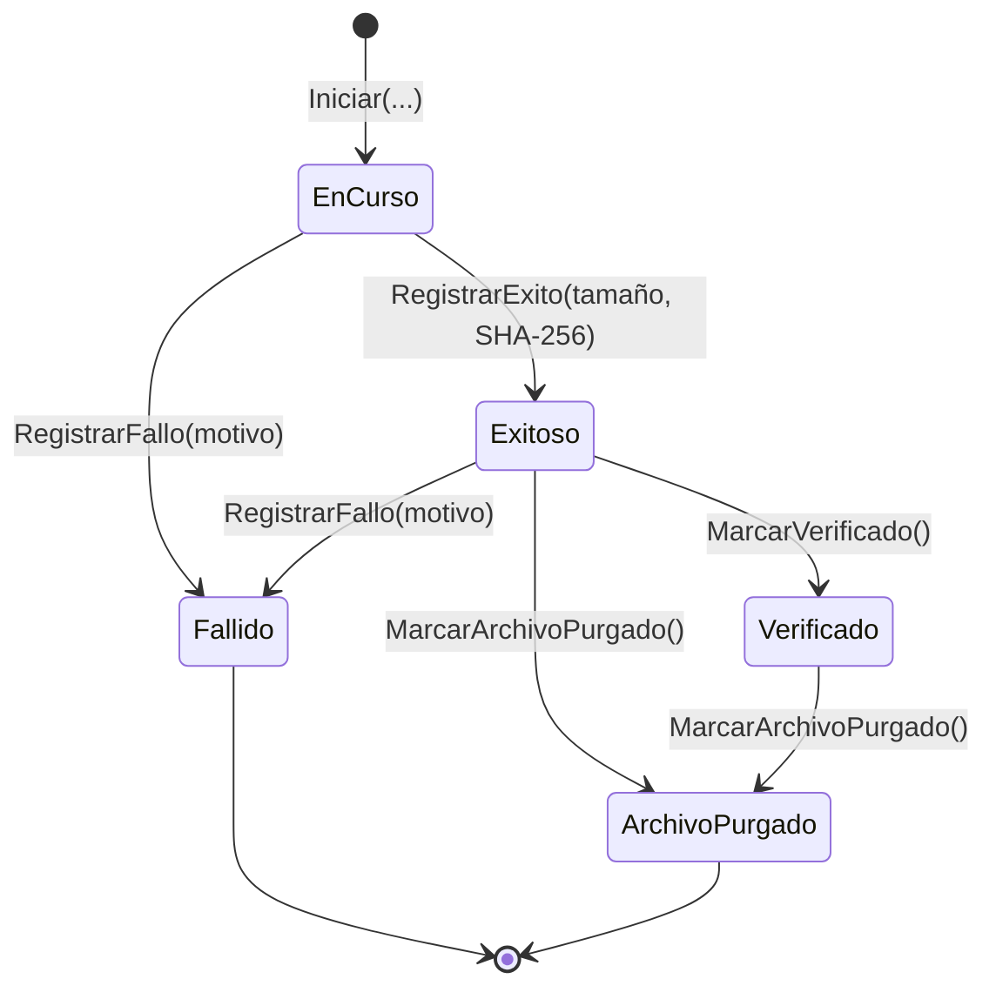
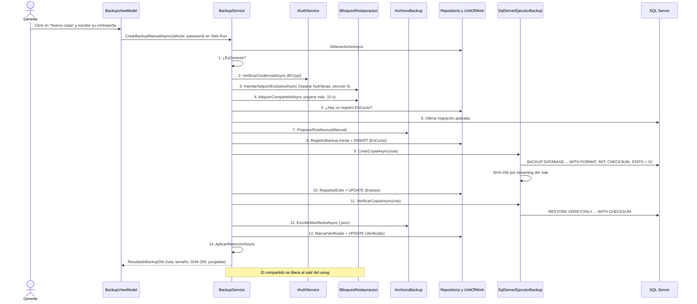
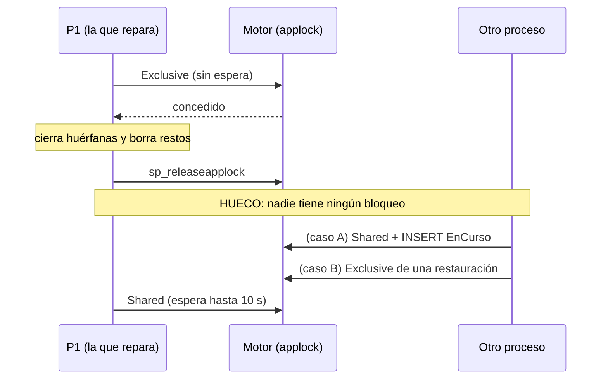
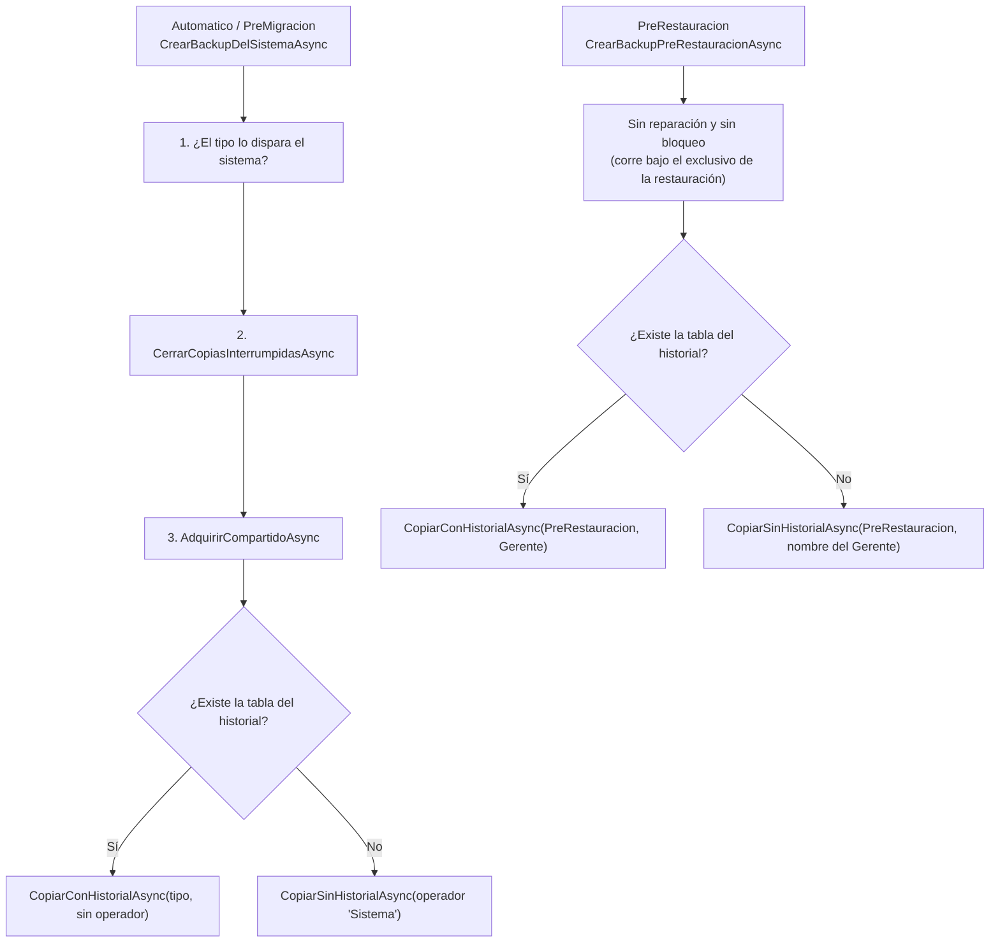

# Flujo de Copia: de la Orden al Registro Verificado

### Módulo: 05. Casos de Uso y Flujos de Negocio de Punta a Punta
**Audiencia:** Desarrolladores, estudiantes universitarios y mesa evaluadora de cátedra  
**Requisitos Vinculados:** `RF-22` (Respaldo y Restauración), `RNF-08` (Integridad y Respaldo Diario) y `RF-03` (Roles)  
**Diseño y decisiones:** [`docs/roadmap/etapa-6-track-6.3-backup-restore.md`](file:///c:/Users/lucas/Proyectos/retail/docs/roadmap/etapa-6-track-6.3-backup-restore.md) (D-3, D-8, D-13, D-15, D-24, D-28; R-1, R-5, R-6, R-9, R-12, R-18)  
**Archivos de Código:**
* Aplicación: [`BackupService.cs`](file:///c:/Users/lucas/Proyectos/retail/src/Retail.Application/Services/BackupService.cs) y [`ManifiestoBackupDto.cs`](file:///c:/Users/lucas/Proyectos/retail/src/Retail.Application/DTOs/Backups/ManifiestoBackupDto.cs)
* Dominio: [`RegistroBackup.cs`](file:///c:/Users/lucas/Proyectos/retail/src/Retail.Domain/Entities/RegistroBackup.cs)
* Infraestructura: [`SqlServerEjecutorBackup.cs`](file:///c:/Users/lucas/Proyectos/retail/src/Retail.Infrastructure/Backups/SqlServerEjecutorBackup.cs), [`SqlServerBloqueoRestauracion.cs`](file:///c:/Users/lucas/Proyectos/retail/src/Retail.Infrastructure/Backups/SqlServerBloqueoRestauracion.cs), [`ArchivosBackup.cs`](file:///c:/Users/lucas/Proyectos/retail/src/Retail.Infrastructure/Backups/ArchivosBackup.cs), [`HuellaArchivo.cs`](file:///c:/Users/lucas/Proyectos/retail/src/Retail.Infrastructure/Backups/HuellaArchivo.cs), [`ComandosSqlServer.cs`](file:///c:/Users/lucas/Proyectos/retail/src/Retail.Infrastructure/Backups/ComandosSqlServer.cs), [`BackupOptions.cs`](file:///c:/Users/lucas/Proyectos/retail/src/Retail.Infrastructure/Backups/BackupOptions.cs) y [`EsquemaBaseDatos.cs`](file:///c:/Users/lucas/Proyectos/retail/src/Retail.Infrastructure/Persistence/Services/EsquemaBaseDatos.cs)

---

## 1. 📖 Fundamento: Qué Es "Hacer una Copia" y Cuándo Se Puede Confiar en Ella

### 1.1 El problema
Una copia de seguridad que nunca se probó es una **esperanza**, no una copia (R-8). Hacer una copia útil exige resolver cuatro problemas distintos:

| Problema | Pregunta que responde | Mecanismo de Retail POS |
| :--- | :--- | :--- |
| **Autorización** | ¿Quién puede pedirla? | Solo el Gerente, reautenticado, para la copia manual (D-3, D-8). Las del sistema no dan acceso a nada (D-13) |
| **Concurrencia** | ¿Qué pasa si dos copias, o una copia y una restauración, corren a la vez? | Bloqueo de lectores y escritor con `sp_getapplock` (sección 5) más un índice único en la base (R-12) |
| **Integridad** | ¿El archivo escrito es completo y legible? | `BACKUP ... WITH CHECKSUM`, `RESTORE VERIFYONLY ... WITH CHECKSUM` y una huella SHA-256 |
| **Supervivencia a las fallas** | ¿Qué queda si el proceso muere a la mitad? | El registro se guarda `EnCurso` *antes* de copiar, y la **autorreparación de huérfanas** (B-0) lo cierra después |

### 1.2 Una copia es restaurable solo si pasó por todos los estados
El agregado [`RegistroBackup`](file:///c:/Users/lucas/Proyectos/retail/src/Retail.Domain/Entities/RegistroBackup.cs) custodia el ciclo de vida (patrón de máquina de estados dentro de la raíz de agregado, Ley 2). Las transiciones inválidas lanzan `TransicionBackupInvalidaException`.



* **`EnCurso`**: el registro existe y la copia se está escribiendo.
* **`Exitoso`**: el motor terminó de escribir el archivo y la app calculó su huella. *Todavía no es restaurable.*
* **`Verificado`**: `RESTORE VERIFYONLY` leyó el archivo y el manifiesto `.json` quedó escrito. Es el **único** estado con `EsRestaurable == true`.
* **`Fallido`** y **`ArchivoPurgado`**: finales. El primero conserva el motivo (`MensajeError`); el segundo, la historia de una copia cuyo archivo ya se borró por retención.

> [!NOTE]
> Los estados `EnCurso` y `Exitoso` son los dos **transitorios**. Si un registro se queda en alguno de ellos para siempre, el proceso que lo escribía murió. Esa es la definición de **copia huérfana** (sección 4).

---

## 2. 🧭 Las Cuatro Clases de Copia

`TipoBackupEnum` tiene cuatro valores. Cada uno nace en un lugar distinto, con una autorización y un bloqueo distintos:

| Tipo | Quién la dispara | Método de `BackupService` | Autorización | Bloqueo que toma | Operador en el registro |
| :--- | :--- | :--- | :--- | :--- | :--- |
| **`Manual`** | El Gerente, desde la pantalla Respaldos de la app (`BackupViewModel` → `CrearBackupManualAsync`, dentro de `Task.Run` por la Ley 4) | `CrearBackupManualAsync` | Rol Gerente **y** reautenticación (contraseña) | Intento de exclusivo (para reparar huérfanas) y luego **compartido** | Obligatorio (`IdUsuario` + `NombreUsuario`) |
| **`Automatico`** | La tarea programada de las 21:00 → `Retail.Cli backup` (`ComandoBackup`) | `CrearBackupDelSistemaAsync` | Ninguna | Igual que la manual | Ninguno (la UI muestra "Sistema") |
| **`PreMigracion`** | `Retail.Cli migrar` → `AdministracionSistemaService.MigrarAsync`, solo si la base responde y hay migraciones pendientes | `CrearBackupDelSistemaAsync` | Ninguna | Igual que la manual | Ninguno |
| **`PreRestauracion`** | `RestauracionService`, justo antes del intercambio de bases | `CrearBackupPreRestauracionAsync` | La de la restauración que la pide (Gerente) | **Ninguno**: corre bajo el exclusivo de su restauración | Obligatorio (el Gerente que restaura) |

### 2.1 ¿Por qué las copias del sistema no piden autorización? (D-13)
La decisión D-13 estableció un principio: **ningún comando de `Retail.Cli` otorga acceso a una cuenta existente ni modifica datos**. En un comercio la sesión de Windows se comparte; si un cajero ejecuta `Retail.Cli backup`, lo único que consigue es **otro archivo `.bak`** dentro de una carpeta que él no puede leer (ACL de la carpeta, capítulo 8). El costo de permitirlo es disco, y la retención lo acota. El costo de exigir contraseña sería que la tarea programada de las 21:00 no pudiera correr sola.

Dos defensas impiden que esa puerta se use para fingir una copia manual:

```csharp
if (tipo is not (TipoBackupEnum.Automatico or TipoBackupEnum.PreMigracion))
{
    throw new DomainException($"Una copia de tipo {tipo} no la dispara el sistema.");
}
```

1. El servicio rechaza en `CrearBackupDelSistemaAsync` cualquier tipo que pida una persona (test `CrearBackupDelSistemaAsync_TipoQuePideUnaPersona_LanzaDomainException`).
2. `RegistroBackup.Iniciar` y la restricción `CK_REGISTROS_BACKUP_Operador` de la base exigen operador para `Manual`/`PreRestauracion` y **prohíben** operador para `Automatico`/`PreMigracion`: *un registro no puede mentir sobre su origen*.

### 2.2 ¿Por qué la manual sí? (D-3 y D-8)
El `.bak` contiene **la base completa**, con datos personales de clientes y hashes de contraseñas (Ley 25.326, R-6). Solo el responsable de los datos (el Gerente) puede generarlo (D-3). Y no basta con que la sesión sea de un Gerente: una sesión que quedó abierta en el mostrador no debe alcanzar. Por eso se pide la contraseña otra vez (*step-up authentication*, D-8).

---

## 3. 🔄 Secuencia de una Copia Manual, Paso a Paso



### 3.1 Cada paso: qué se valida y qué pasa si falla

| # | Paso | Qué valida | Si falla |
| :-: | :--- | :--- | :--- |
| 1 | `ObtenerActorAsync` y `EsGerente()` | Que `idActor > 0`, que el usuario exista y no esté dado de baja, y que sea Gerente | `OperacionNoAutorizadaException` ("usuario inexistente o dado de baja" o "Solo un Gerente puede generar una copia..."). No se toca nada (test `CrearBackupManualAsync_ActorQueNoEsGerente_LanzaOperacionNoAutorizadaSinCopiar`) |
| 2 | `VerificarCredencialAsync` | Que la contraseña coincida con el hash BCrypt del actor | `CredencialesInvalidasException`, propagada sin cambios. La UI deja abierto el diálogo para reintentar (test `CrearBackupManualAsync_PasswordIncorrecta_PropagaCredencialesInvalidasSinRegistrarNada`) |
| 3 | `CerrarCopiasInterrumpidasAsync` | Ver sección 4 | Si no obtiene el exclusivo, simplemente sigue: no es un error |
| 4 | `AdquirirCompartidoAsync` | Que no haya una restauración en curso | `BackupFallidoException`: "Hay una restauración de la base u otra copia iniciándose en este momento. Intente de nuevo en unos segundos." No se creó ningún registro (test `CrearBackupManualAsync_RestauracionEnCurso_RechazaSinRegistrarNiCopiar`) |
| 5 | Consulta de registros `EnCurso` | Que no haya otra copia viva (R-12) | `DomainException`: "Ya hay una copia de seguridad en curso (iniciada a las HH:mm). Espere a que termine." (test `CrearBackupManualAsync_YaHayUnaCopiaEnCurso_LanzaDomainExceptionSinTocarElDisco`) |
| 6 | `ObtenerUltimaMigracionAsync` | Que la base tenga migraciones aplicadas | `DomainException` "no hay nada que respaldar" |
| 7 | `PrepararRutaNueva` | Que el directorio exista, que se pueda escribir en él (archivo de prueba) y que haya al menos `EspacioLibreMinimoMb` (500 MB) libres | `BackupFallidoException` con el directorio o el disco en el mensaje. **No hay registro todavía**: este paso corre antes del `INSERT`, por eso un directorio sin permisos no deja un `EnCurso` huérfano |
| 8 | `RegistroBackup.Iniciar` y `INSERT` | Invariantes del dominio (operador coherente con el tipo, textos no vacíos y con longitud máxima) y el índice único `IX_REGISTROS_BACKUP_EnCurso` | Excepción de dominio, o, si dos copias llegaran a insertar a la vez, violación del índice único: es la **última barrera de R-12**. Esa excepción de EF no se envuelve en esta capa (no verificado con un test) |
| 9 | `CrearCopiaAsync` | Que el motor escriba el archivo sin error (incluye los checksums de página) | Entra al `catch`: registro `Fallido`, archivo parcial borrado, `BackupFallidoException` |
| 10 | `RegistrarExito` y `UPDATE` | Tamaño > 0 y hash de 64 caracteres hexadecimales | Igual que el paso 9 |
| 11 | `VerificarCopiaAsync` | Que el motor pueda leer el archivo completo y las sumas de control coincidan | Igual: el registro estaba `Exitoso`, pasa a `Fallido` (el dominio permite `Fallido` desde `EnCurso` y `Exitoso`). Queda **no restaurable** (test `CrearBackupManualAsync_ArchivoQueNoPasaLaVerificacion_QuedaFallidoYNoRestaurable`) |
| 12 | `EscribirManifiestoAsync` | Que se pueda escribir el `.json` | Igual |
| 13 | `MarcarVerificado` y `UPDATE` | Estado previo `Exitoso` | Igual |
| 14 | `AplicarRetencionAsync` | Ver sección 9 | Un archivo que no se pueda borrar **no invalida** la copia nueva: se informa en `ErroresDeRetencion` |

### 3.2 El bloque que decide qué es una falla
Pasos 9 a 13 viven dentro de un único `try`. Es el corazón del servicio:

```csharp
catch (Exception ex)
{
    await RegistrarFalloAsync(registro, ex);

    if (ex is OperationCanceledException)
    {
        throw;
    }

    throw new BackupFallidoException($"No se pudo completar la copia de seguridad: {DescripcionDeFalla.Para(ex)}", ex);
}
```

`RegistrarFalloAsync` hace tres cosas, en este orden:

1. **Borra el `.bak` parcial y el manifiesto** (`EliminarSinPropagar`: si no puede, lo ignora).
2. **Marca el registro `Fallido`** con `registro.RegistrarFallo(...)`, usando `CancellationToken.None`. Es deliberado: *aunque el operador haya cancelado, el historial debe reflejar lo que pasó* (test `CrearBackupManualAsync_Cancelada_RegistraElFalloYPropagaLaCancelacion`).
3. Si **ni siquiera** se puede guardar el fallo (por ejemplo, el servidor dejó de responder), se traga esa segunda excepción para que prevalezca la original, que es la que explica el problema. El registro queda `EnCurso`, y para eso existe la sección 4.

Luego, la cancelación se relanza tal cual, y cualquier otra falla se envuelve en `BackupFallidoException`. El texto para el operador sale de `DescripcionDeFalla.Para`: los errores de archivo o disco (`IOException`, `UnauthorizedAccessException`) y las excepciones propias de la aplicación muestran su mensaje; **los del motor de base de datos se reemplazan** por "error del motor de base de datos o del sistema (el detalle técnico quedó en el registro de la aplicación)". El detalle técnico viaja como `InnerException` para el log.

> [!NOTE]
> Lo que se muestra al operador nunca repite el texto crudo del motor, pero el campo `MensajeError` del registro sí guarda `causa.Message` (hasta 1000 caracteres, el límite del dominio). Ese texto es para diagnóstico técnico en el historial; si la pantalla Respaldos lo muestra o no, no se verificó en este capítulo.

### 3.3 Por qué se guarda el registro *antes* de copiar
```csharp
await _registros.AddAsync(registro, cancellationToken);
await _unitOfWork.SaveChangesAsync(cancellationToken);

try
{
    var archivo = await _ejecutor.CrearCopiaAsync(ruta, progreso, cancellationToken);
    // ...
```

Guardar primero tiene dos beneficios que escribir el registro al final no daría:

* **Exclusión entre procesos.** El índice único filtrado `IX_REGISTROS_BACKUP_EnCurso` (`[estado] = 'EnCurso' AND [deleted_at] IS NULL`) impide que dos procesos tengan una copia en curso a la vez. Es el mismo patrón que `IX_TURNOS_CAJA_TurnoAbierto`: la regla vive también en la base, no solo en el código (defensa en profundidad).
* **Evidencia del intento.** Si el proceso muere, queda una fila `EnCurso` que cuenta que hubo un intento. Sin ella, una copia a medias sería invisible.

El precio es la huérfana. La sección siguiente es cómo se paga.

---

## 4. 🩹 Autorrepararse de una Copia Huérfana (B-0)

### 4.1 El problema
Imaginemos la copia de las 21:00 y un corte de luz a las 21:00:30. El archivo quedó a medias y el registro quedó `EnCurso`. Al encender la PC:

* El índice único hace que **toda copia nueva** choque con ese registro fantasma.
* La restauración rechazaría con "hay una copia en curso".

Sin reparación, el sistema quedaría bloqueado **para siempre**. Una solución con *heurística de tiempo* ("si lleva más de 30 minutos, está muerta") sería frágil: una base grande puede tardar más. El hallazgo #1 de la revisión (B-0) pidió una solución **garantizada por el motor**, no estimada.

### 4.2 La idea: el bloqueo exclusivo es una prueba
Recordatorio de la semántica de lectores y escritor (capítulo 1 y sección 5 de este capítulo):

| Quien pide | Modo | Compatible con |
| :--- | :--- | :--- |
| Una copia | `Shared` (lector) | Otras copias (`Shared`) |
| Una restauración | `Exclusive` (escritor) | Nadie |

Cada copia sostiene el bloqueo compartido **durante toda su vida**, verificación incluida, porque el `await using` abarca `CopiarConHistorialAsync` completo. Y el motor lo suelta si la sesión que lo tiene desaparece (proceso muerto, conexión caída, servidor reiniciado). Entonces:

> **Si `CerrarCopiasInterrumpidasAsync` logra tomar el exclusivo, ninguna copia ni restauración está corriendo.** Por lo tanto, todo registro `EnCurso` o `Exitoso` de la base es huérfano: nadie puede estar terminándolo.

No es una heurística; es una consecuencia de la compatibilidad de modos. Los registros legítimos `EnCurso` o `Exitoso` solo existen mientras su dueño sostiene el compartido (o, para `PreRestauracion`, el exclusivo de su restauración).

### 4.3 El código
```csharp
private async Task CerrarCopiasInterrumpidasAsync(CancellationToken cancellationToken)
{
    await using var exclusivo = await _bloqueo.IntentarAdquirirExclusivoAsync(cancellationToken);
    if (exclusivo is null)
    {
        return;
    }

    // Una base de una versión anterior al historial no tiene registros que puedan estar en curso.
    if (!await _esquema.ExisteHistorialDeBackupsAsync(cancellationToken))
    {
        return;
    }

    var huerfanos = await _registros.FindAsync(
        r => r.Estado == EstadoBackupEnum.EnCurso || r.Estado == EstadoBackupEnum.Exitoso,
        includeDeleted: false,
        cancellationToken);
    if (huerfanos.Count == 0)
    {
        return;
    }

    foreach (var registro in huerfanos)
    {
        registro.RegistrarFallo(RegistroBackup.MensajeCopiaHuerfana);
        await _registros.UpdateAsync(registro, cancellationToken);
    }

    await _unitOfWork.SaveChangesAsync(cancellationToken);

    foreach (var registro in huerfanos)
    {
        EliminarSinPropagar(registro.RutaArchivo);
    }
}
```

Paso a paso:

1. **`IntentarAdquirirExclusivoAsync`**: pide el exclusivo **sin esperar** (`LockTimeout` 0). Devuelve `null` si no lo obtiene. Si es `null`, hay una copia o una restauración *real* en marcha, y su registro es legítimo: no se toca nada.
2. **`ExisteHistorialDeBackupsAsync`**: una base anterior a la Fase 3 no tiene la tabla `REGISTROS_BACKUP`; consultarla fallaría. Sin tabla no hay nada que reparar (sección 7).
3. **Qué se considera huérfano:** `EnCurso` (murió escribiendo) **o** `Exitoso` (murió *verificando*, después de escribir pero antes de `MarcarVerificado`). Una copia `Exitoso` no verificada no es restaurable, así que no puede quedar como si fuera válida.
4. **El cierre pasa por el agregado:** `RegistrarFallo(MensajeCopiaHuerfana)` ("Copia interrumpida: el proceso terminó antes de completarla."). La transición la valida el dominio (Ley 8: la regla de estado no está en un `UPDATE` suelto).
5. **Los archivos se borran *después* de cerrar el registro** (`EliminarSinPropagar`). El orden importa: si se borrara primero y fallara el guardado, el registro quedaría `EnCurso` sin archivo. Y una vez `Fallido`, la retención (que mira solo `Exitoso` y `Verificado`) jamás vería ese archivo, así que si no se borra acá quedaría como residuo para siempre. Si el motor todavía lo tiene abierto, el borrado falla y se ignora: queda un residuo no restaurable que se limpia a mano (test `CrearBackupDelSistemaAsync_NoSePuedeBorrarElRestoDeLaHuerfana_IgualCopia`).
6. El `await using` **libera el exclusivo** al salir del método.

Los tests que lo prueban: `CrearBackupManualAsync_HuerfanaYExclusivoDisponible_LaCierraYCopia`, `CrearBackupDelSistemaAsync_CopiaExitosaSinVerificarYExclusivoDisponible_LaCierraYBorraSusRestos`, `CrearBackupDelSistemaAsync_CopiaExitosaSinVerificarYExclusivoNoDisponible_NoLaToca` y, en integración, `IntentarAdquirirExclusivoAsync_ElProcesoDeLaCopiaMuere_ElMotorSueltaElCompartidoYSeObtiene` (mata la sesión con `KILL` y comprueba que el motor soltó el bloqueo) y `CrearBackupManualAsync_OtraCopiaViva_NoCierraNiTocaSuRegistro` (una copia viva es intocable).

### 4.4 El hueco entre soltar el exclusivo y tomar el compartido
`CerrarCopiasInterrumpidasAsync` libera el exclusivo **antes** de que el método llamador tome el compartido. Entre ambos hay un instante sin ningún bloqueo. El comentario del código afirma que es **inofensivo**; veamos por qué, caso por caso. Llamemos **P1** a la copia que repara.



| Caso | Qué pasa en el hueco | Resultado para P1 | ¿Por qué es seguro? |
| :-: | :--- | :--- | :--- |
| **A** | Otra copia legítima P2 toma el compartido e inserta su registro `EnCurso` | P1 consigue el compartido (los lectores conviven), llega a `CopiarConHistorialAsync` y el control "copia en curso" la **rechaza** con `DomainException` | P2 es legítima y sigue. P1 no destruye nada: sus huérfanas ya estaban cerradas y P2 no existía cuando se cerraron (si P2 hubiera tenido un registro, habría tenido el compartido y P1 no habría obtenido el exclusivo) |
| **B** | Arranca una restauración y toma el exclusivo | P1 espera hasta 10 s; si la restauración sigue, `AdquirirCompartidoAsync` lanza `BackupFallidoException` | La restauración dura minutos: P1 se rechaza sin haber creado registro ni archivo. La restauración tampoco se perjudica |
| **C** | Otra copia P3 intenta *su* reparación en el mismo instante en que P1 tiene el exclusivo | P3 no obtiene el exclusivo (timeout 0) y sigue sin reparar; luego pide el compartido y **espera** a que P1 lo suelte | Por eso `EsperaCompartidoPorDefecto` es de 10 segundos: cubre el instante en que otra copia, al iniciar, tiene el exclusivo para reparar (test `AdquirirCompartidoAsync_ElExclusivoSeLiberaDentroDeLaEspera_SeConcede`) |
| **D** | P1 y otra copia P2 pasan juntas por el hueco y las dos llegan a insertar | La segunda inserción choca con `IX_REGISTROS_BACKUP_EnCurso` | Es la barrera en la base (R-12), la que no depende del orden de ejecución en el código |

> [!IMPORTANT]
> ¿Por qué no mantener el exclusivo y convertirlo en compartido? Porque el código simplifica con dos operaciones independientes y obtiene una garantía igual de fuerte a través de los casos anteriores. Si `sp_getapplock` permite "bajar" un bloqueo de una misma sesión no se verificó, y no hace falta para que el diseño sea correcto.

La copia previa a restaurar **no** llama a esta reparación: corre bajo el exclusivo de su restauración, y esa ya cerró las huérfanas de la base vigente en su propio paso (capítulo 4). Un test lo fija: `CrearBackupPreRestauracionAsync_NuncaIntentaElExclusivo`.

---

## 5. 🔒 El Bloqueo de Lectores y Escritor (`sp_getapplock`)

[`SqlServerBloqueoRestauracion`](file:///c:/Users/lucas/Proyectos/retail/src/Retail.Infrastructure/Backups/SqlServerBloqueoRestauracion.cs) implementa `IBloqueoRestauracion`. Un `sp_getapplock` es un bloqueo **con nombre** que administra el motor, sin relación con tablas ni filas. Como vive en el servidor, vale entre procesos distintos: la app, `Retail.Cli` y la tarea programada.

### 5.1 La sentencia, literal
```sql
DECLARE @r int; EXEC @r = sp_getapplock @Resource = @recurso, @LockMode = @modo, @LockOwner = 'Session', @LockTimeout = @espera; SELECT @r;
```

| Elemento | Qué es |
| :--- | :--- |
| `DECLARE @r int;` | Variable local para capturar el **código de retorno** del procedimiento |
| `EXEC @r = sp_getapplock ...` | Llama al procedimiento del sistema y guarda su retorno en `@r` |
| `@Resource = @recurso` | Nombre del bloqueo, que el código arma como `"Retail.Restauracion." + <nombre de la base>`; por ejemplo `Retail.Restauracion.RetailDb`. Incluir el nombre de la base hace que bases distintas (las de los tests en paralelo) no se bloqueen entre sí (test `AdquirirExclusivoAsync_BasesDistintas_NoSeBloqueanEntreSi`) |
| `@LockMode = @modo` | `'Exclusive'` (escritor) o `'Shared'` (lector) |
| `@LockOwner = 'Session'` | El bloqueo pertenece a la **sesión** (la conexión), no a una transacción. Con el valor por defecto (`'Transaction'`) exigiría una transacción abierta y se liberaría al terminarla. Con `'Session'` dura hasta `sp_releaseapplock` o hasta que la sesión termina |
| `@LockTimeout = @espera` | Milisegundos que está dispuesto a esperar. `0` significa "no esperar": falla en el acto |
| `SELECT @r;` | Devuelve el código de retorno a ADO.NET, que lo lee con `ExecuteScalarAsync` |

Los valores de `@recurso`, `@modo` y `@espera` viajan como **parámetros** (`AddWithValue`), no concatenados.

**Códigos de retorno** (según la documentación de SQL Server; el código solo distingue el signo):

| Valor | Significado |
| :-: | :--- |
| `0` | Concedido en el acto |
| `1` | Concedido después de esperar |
| `-1` | Vencido el `LockTimeout` |
| `-2` | Cancelado |
| `-3` | La sesión fue elegida como víctima de un interbloqueo |
| `-999` | Error de validación de parámetros u otro error de la llamada |

El código aplica `if (resultado < 0) { ...return null; }`: cualquier negativo significa "no disponible". Esa regla trata igual `-1` (alguien lo tiene) y `-999` (error de parámetros), que el motor devuelve en lugar de lanzar. Con parámetros fijos del propio código no debería ocurrir, pero conviene saberlo para entender un "no disponible" inexplicable.

### 5.2 La liberación, literal
```sql
EXEC sp_releaseapplock @Resource = @recurso, @LockOwner = 'Session';
```
Debe repetir el mismo `@Resource` y el mismo `@LockOwner` con que se tomó. `DisposeAsync` es **idempotente** (`Interlocked.Exchange`), y si falla con `SqlException` o `InvalidOperationException` lo ignora: cerrar la conexión también libera el bloqueo de sesión.

### 5.3 Por qué una conexión propia, a `master` y sin *pool*
```csharp
var constructor = new SqlConnectionStringBuilder(cadena);
var recurso = PrefijoRecurso + constructor.InitialCatalog;
constructor.InitialCatalog = "master";
constructor.Pooling = false;
```

* **Conexión propia por bloqueo:** el bloqueo pertenece a la sesión, así que debe vivir en una conexión que nadie más use y que se mantenga abierta todo el tiempo de la operación.
* **Sin *pool*:** con *pool*, al cerrar la conexión la sesión física volvería al *pool* **con el bloqueo todavía tomado** y contaminaría a otra operación. Sin *pool*, cerrar la conexión mata la sesión y el motor suelta el bloqueo.
* **A `master`:** la base vigente puede estar siendo reemplazada o no existir (PC nueva); el bloqueo no debe depender de ella.
* **Consecuencia importante:** el bloqueo es por **sesión**, no por proceso. Una copia que corriera *dentro* de la misma restauración abriría otra sesión y se bloquearía contra el exclusivo de su propia restauración (esperaría 10 s y fallaría). Es la razón de fondo por la que `PreRestauracion` no toma el compartido.

### 5.4 Las tres operaciones del puerto

| Método | Modo | Espera | Si no lo consigue |
| :--- | :--- | :--- | :--- |
| `AdquirirExclusivoAsync` | `Exclusive` | 0 (no espera) | `RestauracionFallidaException`: "Hay otra restauración o una copia de seguridad en curso..." |
| `IntentarAdquirirExclusivoAsync` | `Exclusive` | 0 | Devuelve `null` (lo usa la reparación B-0) |
| `AdquirirCompartidoAsync` | `Shared` | 10 s (`EsperaCompartidoPorDefecto`) | `BackupFallidoException` |

El `CommandTimeout` del comando es `Math.Max(30, (int)espera.TotalSeconds + 30)`: siempre mayor que la espera del bloqueo, para que el tiempo de ADO.NET no venza antes que el del motor.

---

## 6. 🗃️ Las Sentencias de la Copia, Cláusula por Cláusula

### 6.1 `BACKUP DATABASE`
Está en [`SqlServerEjecutorBackup.CrearCopiaAsync`](file:///c:/Users/lucas/Proyectos/retail/src/Retail.Infrastructure/Backups/SqlServerEjecutorBackup.cs). La plantilla, tal como aparece en el código (C# concatena dos cadenas):

```sql
BACKUP DATABASE {ComandosSqlServer.Delimitar(baseDeDatos)} TO DISK = @ruta WITH FORMAT, INIT, CHECKSUM, STATS = 10, NAME = @nombre;
```

Con la base `RetailDb` y una ruta de ejemplo, el motor recibe:

```sql
BACKUP DATABASE [RetailDb] TO DISK = @ruta WITH FORMAT, INIT, CHECKSUM, STATS = 10, NAME = @nombre;
-- @ruta   = 'C:\RetailData\Backups\Retail_20261014_210003_Automatico.bak'
-- @nombre = 'Retail POS - Retail_20261014_210003_Automatico'
```

| Cláusula | Qué hace | Por qué está |
| :--- | :--- | :--- |
| `BACKUP DATABASE [RetailDb]` | Copia completa (todas las páginas con datos más el registro de transacciones necesario) | La copia completa es el único tipo que usa el sistema (capítulo 1) |
| `TO DISK = @ruta` | El destino es un archivo. **Lo escribe la cuenta del servicio de SQL Server**, no el usuario de Windows | Por eso la carpeta debe darle permiso a `NT SERVICE\MSSQL$SQLEXPRESS` (capítulo 6) |
| `WITH FORMAT` | Escribe un encabezado de medios nuevo, sobrescribiendo el existente | Garantiza que el archivo sea un conjunto de medios nuevo |
| `INIT` | Sobrescribe los conjuntos de copia que hubiera en el archivo | Garantiza que el `.bak` contenga **solo** esta copia (nunca copias apiladas). Los nombres son únicos, pero la garantía no depende de esa coincidencia |
| `CHECKSUM` | El motor calcula una suma de control **por página** al leer, la verifica contra la que la página trae si la base usa `PAGE_VERIFY CHECKSUM`, y guarda una suma de control de toda la copia | Si hay una página dañada en disco, la copia **falla** en lugar de guardar corrupción en silencio |
| `STATS = 10` | El motor informa el avance cada 10 % | Alimenta la barra de progreso (sección 6.3) |
| `NAME = @nombre` | Etiqueta del conjunto de copia dentro del archivo | Identifica la copia ("Retail POS - " + nombre del archivo) |

**Por qué es seguro (sin inyección de SQL):**

* `@ruta` y `@nombre` son **parámetros**: ADO.NET los envía como valores `nvarchar`, jamás como texto SQL. Aunque una ruta contuviera comillas o `;`, no cambiaría la sentencia.
* El nombre de la base **no puede ser un parámetro** (los identificadores no viajan como parámetros en T-SQL). Sale de `InitialCatalog` de la cadena de conexión, que es **configuración de confianza**, y además se **delimita** con `ComandosSqlServer.Delimitar`: lo encierra entre corchetes y duplica cualquier `]`, así que ningún nombre puede "salirse" del lugar que ocupa:

```csharp
return $"[{identificador.Replace("]", "]]", StringComparison.Ordinal)}]";
```

Otras decisiones del método:

* **ADO.NET y no EF Core:** `BACKUP DATABASE` no admite una transacción de usuario y EF no ofrece una API para copias. Se abre un `SqlConnection` propio con la cadena del contexto.
* **`CommandTimeout = 0`:** sin límite, porque una base grande puede tardar minutos. Se cancela con el `CancellationToken`.
* **El hilo de la UI no participa:** la UI invoca todo dentro de `Task.Run` (Ley 4).

### 6.2 `RESTORE VERIFYONLY`
```sql
RESTORE VERIFYONLY FROM DISK = @ruta WITH CHECKSUM;
```

| Cláusula | Qué hace |
| :--- | :--- |
| `RESTORE VERIFYONLY` | Lee la copia y la **valida sin restaurar nada**: comprueba que el conjunto de copia esté completo y que todos los volúmenes sean legibles |
| `FROM DISK = @ruta` | El archivo a verificar (parámetro) |
| `WITH CHECKSUM` | Recalcula las sumas de control de las páginas y de la copia, y las compara con las guardadas por `BACKUP ... WITH CHECKSUM` |

Si el archivo está truncado o tiene bytes alterados, lanza `SqlException`, el `catch` del servicio la convierte en `Fallido` y la copia **nunca** llega a `Verificado` (test de integración `VerificarCopiaAsync_ArchivoCorrupto_LanzaSqlException`).

> [!WARNING]
> `VERIFYONLY` prueba que el archivo **se puede leer y está íntegro**, no que se vaya a poder restaurar en cualquier circunstancia (por ejemplo, no mide el espacio libre necesario). Por eso la restauración verifica además el espacio y restaura primero en una base temporal (capítulo 4).

### 6.3 El avance: mensajes `STATS`
Con `STATS = 10` el motor emite mensajes informativos ("10 percent processed."). En ADO.NET llegan por el evento `SqlConnection.InfoMessage`, no por excepciones:

```csharp
conexion.InfoMessage += (_, e) =>
{
    foreach (SqlError mensaje in e.Errors)
    {
        InformarProgreso(mensaje.Message, progreso);
    }
};
```

* **Se recorren todos los mensajes del evento** (`e.Errors`): el motor puede agrupar varios en uno solo.
* **La suscripción ocurre antes de `OpenAsync`**, para no perder mensajes tempranos.
* Se extrae el porcentaje con una expresión regular que acepta cualquier idioma del motor:

```csharp
[GeneratedRegex(@"^\s*(\d{1,3})\s")]
private static partial Regex PorcentajeInformado();
```

  `^\s*(\d{1,3})\s` significa: desde el inicio, espacios opcionales, **uno a tres dígitos** capturados, y un espacio. Coincide con "10 percent processed." y con "10 por ciento procesado." sin depender del texto. Los demás mensajes (por ejemplo, "Processed 1234 pages...") empiezan con letras y no coinciden.
* El valor pasa por `int.TryParse(..., NumberStyles.None, CultureInfo.InvariantCulture)` y por `Math.Clamp(porcentaje, 0, 100)` antes de llamar a `progreso.Report`.

> [!NOTE]
> La UI usa `Progress<int>`, que publica en el contexto de la interfaz. En la consola se usa un reportero sincrónico (`ProgresoEnConsola`): `Progress<T>` sin contexto de UI publica los eventos en el *thread pool* y los muestra desordenados (nota de la Fase 4 del diseño).

---

## 7. 🗂️ Copias sobre una Base sin Tabla de Historial

### 7.1 El caso
`Retail.Cli migrar` **nunca migra una base con datos sin una copia previa** (D-10). Pero una base creada antes de la Fase 3 todavía no tiene la tabla `REGISTROS_BACKUP`: precisamente la migración que está por aplicarse la va a crear. Si la copia previa dependiera de esa tabla, jamás podría tomarse.

### 7.2 La consulta que lo detecta
```sql
SELECT CASE WHEN OBJECT_ID(N'dbo.REGISTROS_BACKUP', N'U') IS NULL THEN 0 ELSE 1 END AS [Value]
```

| Elemento | Qué hace |
| :--- | :--- |
| `OBJECT_ID(N'dbo.REGISTROS_BACKUP', N'U')` | Devuelve el identificador del objeto, o `NULL` si no existe. `N'U'` limita la búsqueda a **tablas de usuario** |
| `CASE WHEN ... IS NULL THEN 0 ELSE 1 END` | Convierte "existe / no existe" en 1 / 0 |
| `AS [Value]` | `SqlQueryRaw<int>` de EF Core exige que la columna se llame `Value` |

La ejecuta `EsquemaBaseDatos.ExisteHistorialDeBackupsAsync` con `_context.Database.SqlQueryRaw<int>(...)`. La consulta no tiene valores externos.

### 7.3 `CopiarSinHistorialAsync`
Se usa en `CrearBackupDelSistemaAsync` y en `CrearBackupPreRestauracionAsync` cuando la tabla no existe. Diferencias con `CopiarConHistorialAsync`:

| Aspecto | Con historial | Sin historial |
| :--- | :--- | :--- |
| Registro `RegistroBackup` | Sí (`EnCurso` → `Verificado`) | **No** (no hay tabla) |
| Protección contra copias simultáneas | Índice único + control | Solo el bloqueo compartido y la exclusión que da el nombre de archivo (`PrepararRutaNueva` evita pisar) |
| Constancia de la copia | Fila + manifiesto | **Solo el manifiesto**, con `RegistradaEnHistorial = false` |
| Operador | Del registro | Parámetro `operador` ("Sistema" o el nombre del Gerente) escrito en el manifiesto |
| Retención | Sí | **No** (se apoya en registros que no existen) |
| Falla | Registro `Fallido` + archivo borrado | Archivo borrado + `BackupFallidoException` |

La referencia (`Guid.NewGuid()`) y la fecha se generan en el momento y se vuelcan al manifiesto. Test: `CrearBackupDelSistemaAsync_BaseSinTablaDeHistorial_CopiaYDocumentaSoloEnElManifiesto` y, en integración, `Migrar_BaseDeUnaVersionAnteriorAlHistorial_CopiaVerificaYDocumentaAntesDeMigrar`.

> [!WARNING]
> En `CopiarSinHistorialAsync` el `catch` es `when (ex is not OperationCanceledException)`: ante una **cancelación** el archivo parcial **no se borra** (en la variante con historial sí, porque `RegistrarFalloAsync` borra siempre). Es una diferencia observada en el código; no se verificó con un test si ese residuo queda en el directorio.

---

## 8. 📄 Nombres de Archivo, Manifiesto y Huella SHA-256

### 8.1 Nombre del archivo
Lo arma `ArchivosBackup.PrepararRutaNueva`:

```csharp
var nombreBase = $"Retail_{DateTime.Now:yyyyMMdd_HHmmss}_{tipo}";
var ruta = Path.Combine(directorio, $"{nombreBase}.bak");
for (var intento = 2; File.Exists(ruta); intento++)
{
    ruta = Path.Combine(directorio, $"{nombreBase}_{intento}.bak");
}
```

* **Hora local, no UTC:** es lo que lee una persona que busca la copia de "anoche". Ejemplo: `Retail_20261014_210003_Automatico.bak`.
* **El tipo va en el nombre**, y si dos copias del mismo tipo caen en el mismo segundo se agrega el sufijo `_2`, `_3`...
* El directorio sale de `BackupSettings:Directorio` (por defecto `C:\RetailData\Backups`, D-15), con variables de entorno expandidas.
* Antes de elegir el nombre se **prueba la escritura** creando y borrando un archivo `.prueba-escritura-<guid>`: el error del motor ("Operating system error 5") no le dice al operador qué carpeta revisar, y este mensaje sí.

### 8.2 El manifiesto: qué es y por qué existe (R-1, R-2)
El historial vive **dentro** de la base que se respalda: si la base se pierde, el historial también. El manifiesto `.json` junto a cada `.bak` permite saber qué contiene cada archivo con solo mirar la carpeta, sin base. Se escribe con `JsonSerializer` (indentado, UTF-8 **sin BOM** para que lo lean scripts y editores sin sorpresas) en la misma ruta del `.bak` con extensión `.json`.

La estructura sale de [`ManifiestoBackupDto`](file:///c:/Users/lucas/Proyectos/retail/src/Retail.Application/DTOs/Backups/ManifiestoBackupDto.cs). Un ejemplo con **la forma real y valores ilustrativos** (no es una copia verdadera):

```json
{
  "Referencia": "3f2b9c7e-5a41-4d8e-9a3c-1f6b0c2d7e11",
  "Tipo": "Automatico",
  "FechaInicioUtc": "2026-10-15T00:00:03.1234567Z",
  "Operador": "Sistema",
  "ArchivoBak": "Retail_20261014_210003_Automatico.bak",
  "TamanoBytes": 12582912,
  "HashSha256": "9f86d081884c7d659a2feaa0c55ad015a3bf4f1b2b0b822cd15d6c15b0f00a08",
  "UltimaMigracion": "20261010120000_NombreDeLaUltimaMigracion",
  "VersionApp": "1.0.0",
  "RegistradaEnHistorial": true
}
```

| Campo | Qué guarda | Para qué sirve |
| :--- | :--- | :--- |
| `Referencia` | `Guid` del `RegistroBackup` | Identidad estable entre bases: permite reinsertar el historial sin duplicarlo (R-1) |
| `Tipo` | `Manual`, `Automatico`, `PreMigracion` o `PreRestauracion` (texto) | Saber el origen sin base |
| `FechaInicioUtc` | Inicio de la copia, en UTC | Ordenar y mostrar (la restauración desde consola la convierte a hora local) |
| `Operador` | Nombre de usuario o `"Sistema"` | Auditoría |
| `ArchivoBak` | Nombre del archivo (sin carpeta) | Detecta un manifiesto **copiado de otra copia**: al leerlo se exige que coincida con el nombre del `.bak` |
| `TamanoBytes` | Tamaño en bytes | Primera comparación barata antes de calcular el hash |
| `HashSha256` | SHA-256 del `.bak` en hexadecimal minúscula | Integridad (sección 8.3) |
| `UltimaMigracion` | Última migración EF aplicada al tomar la copia | Rechazar restaurar un esquema que esta versión no conoce (R-7) |
| `VersionApp` | Versión de la aplicación | Diagnóstico |
| `RegistradaEnHistorial` | `false` solo si la copia se tomó sin la tabla de historial (sección 7) | Distinguir las copias que no figuran en `REGISTROS_BACKUP` |

Todos los campos son `required` en el DTO. Eso solo exige que la propiedad **figure** en el JSON; acepta `null`. Por eso `ArchivosBackup.LeerManifiestoAsync` (usado en la restauración) valida cada campo explícitamente (referencia no vacía, textos no vacíos, tamaño positivo, hash de 64 caracteres hexadecimales).

> [!IMPORTANT]
> El hash del manifiesto prueba **integridad, no autenticidad**: detecta un archivo dañado o reemplazado sin actualizar su manifiesto, pero quien trae un `.bak` puede traer también un `.json` acorde. La autenticidad la aporta la credencial de un Gerente verificada dentro de la copia (D-18; capítulo 4).

### 8.3 La huella SHA-256 por *streaming*
```csharp
await using var archivo = new FileStream(
    rutaArchivo, FileMode.Open, FileAccess.Read, FileShare.Read, bufferSize: 81920, useAsync: true);

var hash = await SHA256.HashDataAsync(archivo, cancellationToken);
return new ArchivoBackupDto(archivo.Length, Convert.ToHexString(hash).ToLowerInvariant());
```

* **Streaming:** `SHA256.HashDataAsync(Stream, ...)` lee el archivo por bloques y no lo carga entero en memoria. Una copia de varios cientos de MB no rompe el techo de RAM de `RNF-03` (≤ 300 MB).
* **`FileShare.Read`:** otros pueden leer a la vez; nadie puede escribir mientras se calcula.
* **`useAsync: true`:** lectura asíncrona real, sin bloquear hilos.
* **`Convert.ToHexString(...).ToLowerInvariant()`:** 64 caracteres hexadecimales en minúscula. El dominio (`RegistroBackup.RegistrarExito`) y el manifiesto exigen exactamente ese formato (`^[0-9a-f]{64}$`).
* Se calcula **inmediatamente después** de que el motor termina de escribir, antes de `VERIFYONLY`; es el valor que después compara la restauración.

---

## 9. 🧹 Retención: Cuántas Copias Se Conservan

### 9.1 La regla
`AplicarRetencionAsync` corre al final de una copia con historial, ya `Verificado`. Hay **dos reglas** independientes:

| Regla | A quién aplica | Criterio |
| :--- | :--- | :--- |
| **Por cantidad** | Todas las copias con archivo (`Exitoso` o `Verificado`) **excepto** `PreRestauracion` | Se ordenan de la más reciente a la más vieja (`FechaInicio`, luego `Id`) y se conservan `CantidadMaximaCopias` (14 por defecto); el resto se purga (`Skip`) |
| **Por antigüedad (D-24)** | Solo `PreRestauracion` | Se conservan `DiasRetencionPreRestauracion` días (30 por defecto); las más viejas se purgan. **No cuentan** dentro de las 14 |

```csharp
var excedentesPorCantidad = conArchivo
    .Where(r => r.Tipo != TipoBackupEnum.PreRestauracion)
    .OrderByDescending(r => r.FechaInicio)
    .ThenByDescending(r => r.Id)
    .Skip(_politica.CantidadMaximaCopias);

var limitePreRestauracion = DateTime.UtcNow.AddDays(-_politica.DiasRetencionPreRestauracion);
var excedentesPorAntiguedad = conArchivo
    .Where(r => r.Tipo == TipoBackupEnum.PreRestauracion && r.FechaInicio < limitePreRestauracion);
```

### 9.2 ¿Por qué una regla aparte para `PreRestauracion`? (D-24)
La copia previa a restaurar es la **última foto de los datos reales** antes de reemplazarlos. Un restore equivocado, o malicioso (R-20), puede detectarse tarde. Con la retención común (14 copias diarias) esa foto desaparecía en unas dos semanas, o antes si había dos restauraciones seguidas. Los restores son raros, así que guardar sus copias 30 días cuesta poco disco. Los tests: `CrearBackupDelSistemaAsync_CopiasPreviasARestaurarRecientes_NoCuentanEnLaCantidadMaxima` y `CrearBackupDelSistemaAsync_CopiaPreviaARestaurarVencida_SePurgaPorAntiguedad`.

### 9.3 Qué significa "purgar": `ArchivoPurgado` y la Ley 3
```csharp
foreach (var excedente in excedentes)
{
    try
    {
        _archivos.EliminarCopia(excedente.RutaArchivo);
    }
    catch (Exception ex) when (ex is IOException or UnauthorizedAccessException)
    {
        errores.Add($"{excedente.RutaArchivo}: {ex.Message}");
        continue;
    }

    excedente.MarcarArchivoPurgado();
    await _registros.UpdateAsync(excedente, cancellationToken);
    purgadas.Add(excedente.RutaArchivo);
}
```

* Se borran del disco el `.bak` **y** su manifiesto (`EliminarCopia`).
* La **fila no se borra ni se marca con `MarkAsDeleted()`**: cambia de estado a `ArchivoPurgado`. La Ley 3 (borrado lógico) prohíbe el `DELETE` físico de entidades de negocio; el historial de copias es una constancia de auditoría y se conserva siempre. El borrado físico es del **archivo**, que no es una entidad del dominio. La fila deja de ser restaurable (`EsRestaurable` solo es verdadero para `Verificado`) y sigue visible en el historial.
* **Si el archivo no se puede borrar** (por ejemplo, abierto por otro programa), no se cambia el estado: se informa en `ErroresDeRetencion` y se reintenta la próxima vez. No invalida la copia nueva.
* `MarcarArchivoPurgado` solo se permite desde `Exitoso` o `Verificado`; los `Fallido` no entran porque la consulta solo trae esos dos estados.

> [!NOTE]
> Las copias que `Retail.Cli restaurar` trae desde una carpeta externa al directorio de respaldos no tienen registro en el historial y, por lo tanto, **no entran en esta retención** (riesgo menor documentado en el diseño, B-3).

---

## 10. 🔁 Qué Cambia en las Otras Tres Clases

Todo lo anterior describe la copia manual. En las demás cambia lo siguiente:



| Aspecto | `Manual` | `Automatico` | `PreMigracion` | `PreRestauracion` |
| :--- | :--- | :--- | :--- | :--- |
| Autorización | Gerente + contraseña | Ninguna | Ninguna | La de la restauración |
| Reparación de huérfanas (B-0) | Sí | Sí | Sí | **No** (la restauración ya cerró las de la base vigente) |
| Bloqueo | Compartido | Compartido | Compartido | **Ninguno** |
| Base sin historial | No lo contempla (la app no arranca con un esquema viejo, D-11) | Sí | Sí (caso típico) | Sí (desde la consola) |
| Si falla | `BackupFallidoException` | `BackupFallidoException` | `BackupFallidoException`: **corta la migración** | App: aborta la restauración. Consola: advertencia y continúa (la base anterior se conserva igual) |
| Retención | Sí | Sí | Sí | Sí, con su propia regla (D-24) |
| Disparador | Botón de la app | Tarea programada (21:00, `SYSTEM`) | `Retail.Cli migrar` | `RestauracionService` |

### 10.1 ¿Por qué `PreRestauracion` no toma el bloqueo compartido?
Recapitulemos la razón (sección 5.3): la restauración ya sostiene el **exclusivo**. El bloqueo es por **sesión**, y la copia previa abriría otra sesión. El compartido de esa nueva sesión sería incompatible con el exclusivo de la restauración que la está llamando: esperaría 10 segundos y fallaría con `BackupFallidoException`. Es un interbloqueo contra uno mismo. Por eso no lo toma, y el contrato lo deja escrito en el comentario de `CrearBackupPreRestauracionAsync` (test `CrearBackupPreRestauracionAsync_NoTomaElBloqueoCompartido`).

### 10.2 La copia `PreMigracion`
`AdministracionSistemaService.MigrarAsync` pide la copia solo si `estado.PuedeConectar && estado.MigracionesPendientes.Count > 0`: una base que no existe no tiene nada que respaldar. Si la copia falla, la excepción corta ahí y **no se aplica ninguna migración**. Así se cumple D-10: nunca se migra una base con datos sin red de seguridad.

### 10.3 La copia `Automatico` desde la CLI
`ComandoBackup` primero espera al motor (la tarea puede correr al encender la PC, antes de que SQL Server acepte conexiones) y comprueba que la base esté al día; solo entonces llama a `CrearBackupDelSistemaAsync(TipoBackupEnum.Automatico, ...)`. Imprime la ruta, el tamaño, el SHA-256 y las copias purgadas. El detalle de sus códigos de salida y del script que la programa está en los capítulos 5 y 6.

---

## 11. 📝 Resumen

| Tema | Idea central |
| :--- | :--- |
| Máquina de estados | `EnCurso → Exitoso → Verificado`; solo `Verificado` es restaurable. Las transiciones las custodia el agregado |
| Cuatro tipos | `Manual` (Gerente + contraseña), `Automatico` y `PreMigracion` (sistema, sin autorización por D-13), `PreRestauracion` (bajo el exclusivo de la restauración) |
| Registro antes de copiar | Habilita el índice único (una sola copia en curso) y deja evidencia ante un corte |
| Integridad en tres capas | `CHECKSUM` al escribir, `VERIFYONLY ... CHECKSUM` al leer y SHA-256 del archivo |
| Bloqueo | `sp_getapplock` de sesión, en una conexión propia a `master` sin *pool*; copias `Shared`, restauración `Exclusive` |
| Huérfanas (B-0) | Si se obtiene el exclusivo, nadie copia ni restaura: todo `EnCurso`/`Exitoso` es huérfano, se cierra con `RegistrarFallo` y se borran sus restos |
| Hueco inofensivo | Cuatro casos (A a D) se resuelven con el control "copia en curso", la espera de 10 s o el índice único |
| Base vieja | Sin tabla de historial, la copia se hace igual y queda documentada solo en el manifiesto |
| Retención | 14 copias con archivo; `PreRestauracion` aparte, 30 días (D-24). Se borra el archivo, la fila queda `ArchivoPurgado` (Ley 3) |
| Seguridad del SQL | Valores como parámetros; el nombre de la base delimitado con corchetes y `]` duplicado |

---

## 12. 🎓 Preguntas de Defensa

**1. Si un corte de luz deja una copia `EnCurso`, ¿cómo se recupera el sistema sin intervención y por qué no se usa un límite de tiempo?**  
Cada copia sostiene un bloqueo compartido de sesión durante toda su vida. Al iniciar, la siguiente copia intenta el bloqueo exclusivo sin esperar: si lo obtiene, ninguna copia ni restauración está corriendo, así que todo `EnCurso` o `Exitoso` es huérfano y se cierra como `Fallido` (y se borran sus restos). Un límite de tiempo sería una suposición (una base grande puede tardar), mientras que el bloqueo es una garantía del motor, que lo suelta cuando muere la sesión.

**2. Entre soltar el exclusivo y tomar el compartido hay un instante sin bloqueo. ¿Por qué no es un error de concurrencia?**  
Porque cada carrera posible termina bien: si otra copia legítima entró en el hueco, la nuestra la ve en el control "copia en curso" (o choca con el índice único) y se rechaza sin tocar nada; si entró una restauración, la toma del compartido falla tras 10 s; si otra copia intenta reparar a la vez, espera a que se libere. Y nunca se cierra un registro vivo, porque un registro vivo implica un compartido tomado, que habría impedido obtener el exclusivo.

**3. ¿Por qué la copia automática no pide contraseña pero la manual sí? ¿Eso no es un agujero?**  
D-13: ningún comando de la CLI da acceso a una cuenta ni modifica datos. Disparar una copia solo genera un `.bak` en una carpeta protegida por permisos de Windows. La manual la pide una persona desde una sesión que puede haber quedado abierta, y el `.bak` es la base completa con datos personales (R-6), por eso exige rol Gerente y reautenticación (D-3 y D-8). Además, el servicio rechaza que el sistema genere una copia `Manual`, y una restricción `CHECK` en la base exige que el operador coincida con el tipo.

**4. ¿Qué garantiza que un `.bak` marcado `Verificado` sea confiable?**  
Que pasó cuatro filtros en orden: el motor lo escribió con `CHECKSUM` (falla ante una página dañada), se calculó su SHA-256, `RESTORE VERIFYONLY ... WITH CHECKSUM` lo leyó completo y se escribió su manifiesto. Solo entonces el agregado permite `MarcarVerificado`. Limitación honesta: `VERIFYONLY` no prueba todo (por ejemplo, el espacio libre); por eso la restauración vuelve a controlar la huella y restaura primero en una base temporal.

**5. ¿Por qué la retención deja la fila como `ArchivoPurgado` en lugar de borrarla?**  
Por la Ley 3: en un sistema comercial no se borra físicamente la constancia de lo ocurrido. Se borra el archivo (ocupa disco), no el registro (no ocupa nada y documenta que esa copia existió). Además, `PreRestauracion` tiene retención propia de 30 días (D-24) porque un restore equivocado puede detectarse tarde.

**6. ¿Cómo se evita la inyección de SQL en `BACKUP DATABASE` si el nombre de la base no puede ser un parámetro?**  
La ruta y el nombre del conjunto viajan como parámetros. El nombre de la base viene de la cadena de conexión (configuración de confianza, no de un operador) y se delimita con corchetes duplicando cualquier `]`, de modo que no puede cerrar el identificador. Así no hay concatenación de datos externos sin delimitar.

---

**Navegación:** ⬅️ [Capítulo 02: Componentes por capa](02-componentes-por-capa.md) | 📚 [Índice](README.md) | ➡️ [Capítulo 04: Flujo de restauración](04-flujo-de-restauracion.md)
