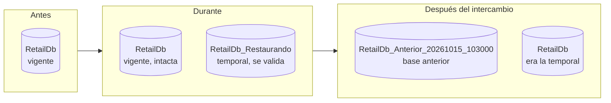
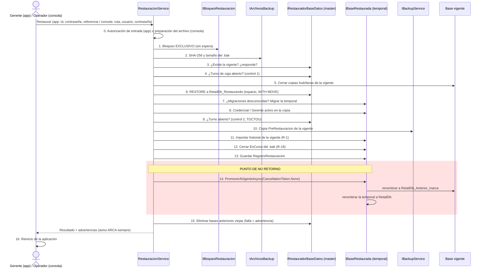
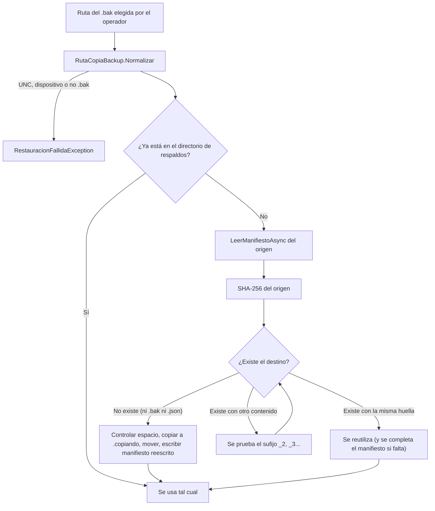
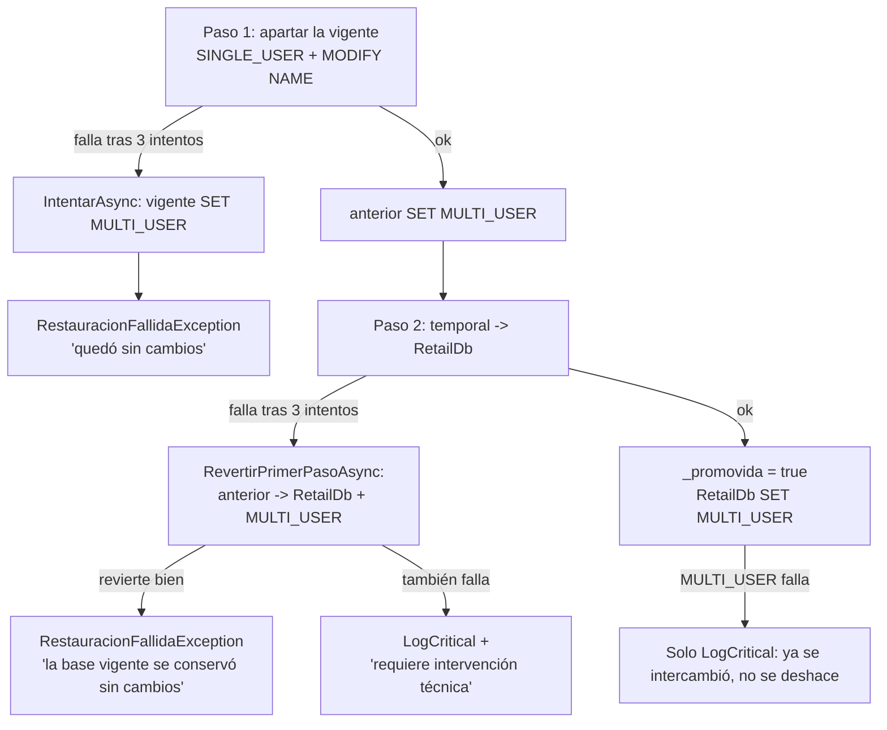

# Flujo de Restauración: Base Temporal, Validaciones e Intercambio

### Módulo: 05. Casos de Uso y Flujos de Negocio de Punta a Punta
**Audiencia:** Desarrolladores, estudiantes universitarios y mesa evaluadora de cátedra  
**Requisitos Vinculados:** `RF-22` (Respaldo y Restauración), `RF-23` (Administración de la Base por Comandos), `RNF-08` (Integridad) y `RF-03` (Roles)  
**Diseño y decisiones:** [`docs/roadmap/etapa-6-track-6.3-backup-restore.md`](file:///c:/Users/lucas/Proyectos/retail/docs/roadmap/etapa-6-track-6.3-backup-restore.md) (D-8, D-17 a D-26; R-1, R-3, R-7, R-11, R-18, R-19, R-20)  
**Archivos de Código:**
* Aplicación: [`RestauracionService.cs`](file:///c:/Users/lucas/Proyectos/retail/src/Retail.Application/Services/RestauracionService.cs) y [`ResultadoRestauracionDto.cs`](file:///c:/Users/lucas/Proyectos/retail/src/Retail.Application/DTOs/Backups/ResultadoRestauracionDto.cs)
* Dominio: [`RegistroRestauracion.cs`](file:///c:/Users/lucas/Proyectos/retail/src/Retail.Domain/Entities/RegistroRestauracion.cs) y [`RegistroBackup.cs`](file:///c:/Users/lucas/Proyectos/retail/src/Retail.Domain/Entities/RegistroBackup.cs)
* Infraestructura: [`SqlServerRestauradorBaseDatos.cs`](file:///c:/Users/lucas/Proyectos/retail/src/Retail.Infrastructure/Backups/SqlServerRestauradorBaseDatos.cs), [`BaseRestauradaSqlServer.cs`](file:///c:/Users/lucas/Proyectos/retail/src/Retail.Infrastructure/Backups/BaseRestauradaSqlServer.cs), [`ArchivosBackup.cs`](file:///c:/Users/lucas/Proyectos/retail/src/Retail.Infrastructure/Backups/ArchivosBackup.cs), [`RutaCopiaBackup.cs`](file:///c:/Users/lucas/Proyectos/retail/src/Retail.Infrastructure/Backups/RutaCopiaBackup.cs), [`ComandosSqlServer.cs`](file:///c:/Users/lucas/Proyectos/retail/src/Retail.Infrastructure/Backups/ComandosSqlServer.cs) y [`SqlServerBloqueoRestauracion.cs`](file:///c:/Users/lucas/Proyectos/retail/src/Retail.Infrastructure/Backups/SqlServerBloqueoRestauracion.cs)

---

## 1. 📖 Fundamento: Cómo Reemplazar la Base Sin Jugársela

### 1.1 El problema
Restaurar es la operación más peligrosa de todo el sistema: **destruye el estado actual** para volver al de una copia. Las preguntas que el diseño tuvo que contestar son:

* ¿Cómo se sabe que la copia sirve **antes** de tocar la base en uso?
* ¿Qué pasa si falla a la mitad (corte de luz, disco lleno, copia dañada)?
* ¿Quién puede hacerlo, incluso cuando la base está rota y no hay login posible?
* ¿Qué se pierde, y cómo se avisa?

### 1.2 La idea central (D-17): base temporal más intercambio
La forma ingenua es `RESTORE DATABASE RetailDb ... WITH REPLACE` directamente sobre la base en uso. El motor sobrescribe los archivos de `RetailDb` mientras la restaura. Si algo sale mal, **no hay vuelta atrás**: la base vigente ya se destruyó y la restaurada puede estar incompleta.

Retail POS hace otra cosa:

1. Restaura la copia en una base **nueva y separada**, `RetailDb_Restaurando` (la *base temporal*), con archivos físicos propios.
2. En la temporal valida todo lo que pueda fallar: esquema, credenciales, historial, estados.
3. Recién cuando todo está validado, hace el **intercambio**: renombra la vigente a `RetailDb_Anterior_<fecha>` (la *base anterior*) y la temporal pasa a llamarse `RetailDb`.

| Criterio | `RESTORE ... WITH REPLACE` sobre la vigente | Base temporal e intercambio (D-17) |
| :--- | :--- | :--- |
| Qué se destruye si la copia está dañada | **La base vigente** | Nada: se descarta la temporal |
| Validar credenciales y esquema antes de reemplazar | Imposible (ya reemplazó) | Sí, sobre la temporal |
| Red de seguridad | Solo una copia previa, si se pudo tomar | Copia previa **y** la base anterior intacta |
| Duración de la indisponibilidad | Todo el `RESTORE` | Solo el renombrado (segundos) |
| Costo | Ninguno | El doble de espacio en disco durante la operación (aceptado, D-23) |

La base anterior no se borra: es una red de seguridad que se conserva hasta la próxima restauración (D-20).



### 1.3 Las dos puertas de entrada (D-21)
Hay dos formas de pedir una restauración, con **autorizaciones distintas** que convergen en **un solo mecanismo**:

| | Desde el historial (app) | Desde un archivo (consola) |
| :--- | :--- | :--- |
| Quién | Gerente logueado en la pantalla Respaldos | Técnico u operador con `Retail.Cli restaurar` |
| Método | `RestaurarDesdeHistorialAsync` | `RestaurarDesdeArchivoAsync` |
| Origen guardado | `OrigenRestauracionEnum.Aplicacion` | `OrigenRestauracionEnum.Consola` |
| Autorización | Rol Gerente + contraseña verificada contra la base **vigente** (D-8) | Usuario y contraseña de un Gerente verificados **dentro de la copia** (D-18) |
| De dónde salen tamaño, hash y migración | Del registro `REGISTROS_BACKUP` (la copia debe ser `Verificado`) | Del manifiesto `.json` junto al `.bak` |
| Copia previa si falla | Aborta la restauración | Advertencia y continúa (la vigente puede estar dañada justamente por eso) |
| Pensado para | Uso normal con la base sana | Desastre: PC nueva o base corrupta, donde el login de la app no existe |

Ambos métodos construyen un `CopiaARestaurar` (referencia, ruta, tamaño, hash, migración) y llaman a **`RestaurarAsync`** con una *función de autorización* distinta:

```csharp
return await RestaurarAsync(
    OrigenRestauracionEnum.Aplicacion,
    copia,
    (temporal, ct) => ExigirGerenteEnLaCopiaAsync(temporal, actor, ct),
    progreso,
    cancellationToken);
```

```csharp
return await RestaurarAsync(
    OrigenRestauracionEnum.Consola,
    copia,
    (temporal, ct) => VerificarCredencialEnLaCopiaAsync(temporal, nombreUsuario, password, ct),
    progreso,
    cancellationToken);
```

Es el patrón **Strategy** con un delegado: el algoritmo de 18 pasos es uno solo, y lo único que varía es *cómo se prueba que quien restaura es Gerente*. Un solo camino de código implica un solo camino probado.

> [!IMPORTANT]
> ¿Por qué la consola no verifica contra la base vigente? Porque en una PC nueva o con la base corrupta **no existe** esa base (D-19). Por eso la credencial se prueba dentro de la copia: quien restaura demuestra que **era Gerente en esa copia**. Un cajero necesitaría la contraseña de un Gerente, igual que en la app. El riesgo residual (alguien con una copia vieja y la contraseña de un ex-Gerente) está aceptado y documentado como R-20, con las mitigaciones D-24, la base anterior y `REGISTROS_RESTAURACION`.

---

## 2. 🔄 Secuencia Completa, de la Solicitud al Reinicio



Una frase resume la garantía: **antes del paso 14, cualquier falla descarta la temporal y la base vigente sigue en pie**. Con precisión: los pasos 5 y 10 sí escriben en la vigente (cierran registros huérfanos y agregan la fila y el archivo de la copia previa), pero son cambios de historial, no de datos de negocio.

---

## 3. 🚪 Los Primeros Pasos: Autorización y Preparación

### 3.1 Desde la app: `RestaurarDesdeHistorialAsync`
```csharp
// Restaurar reemplaza la base completa: es exclusivo del Gerente (D-3), con reautenticación (D-8).
if (actor is null || !actor.EsGerente())
{
    throw new OperacionNoAutorizadaException("Solo un Gerente puede restaurar una copia de seguridad.");
}

await _authService.VerificarCredencialAsync(idActor, password, cancellationToken);

var encontrados = await _registros.FindAsync(r => r.Referencia == referenciaCopia, includeDeleted: false, cancellationToken);
var registro = encontrados.SingleOrDefault();
if (registro is null || !registro.EsRestaurable)
{
    throw new RestauracionFallidaException(
        "La copia elegida no es restaurable: solo se restauran copias verificadas cuyo archivo se conserva.");
}
```

| Validación | Qué evita | Si falla |
| :--- | :--- | :--- |
| Actor existente y Gerente | Que un Administrador o un cajero restauren (el rol lo lee el **servicio** de la base, no solo la UI, D-9) | `OperacionNoAutorizadaException` |
| `VerificarCredencialAsync` | Una sesión abierta en el mostrador | `CredencialesInvalidasException` (la UI deja el diálogo abierto para reintentar) |
| `EsRestaurable` | Restaurar una copia `Fallido`, `Exitoso` sin verificar o `ArchivoPurgado` | `RestauracionFallidaException` |

El diálogo de la UI (`ConfirmarCredencialDialog`) ejecuta la operación *adentro*, porque solo el servicio puede decir si la contraseña es correcta; además exige escribir "RESTAURAR" y muestra el aviso ARCA.

### 3.2 Desde la consola: `RestaurarDesdeArchivoAsync` y la preparación del archivo
El `RESTORE` lo ejecuta **la cuenta del servicio de SQL Server**, no el usuario de Windows. Esa cuenta no puede leer, por ejemplo, la carpeta de Descargas del Gerente. Por eso, si el `.bak` está fuera del directorio de respaldos, se **trae primero** al directorio (B-3):



**`RutaCopiaBackup.Normalizar`** rechaza, con mensajes que no repiten texto del motor:

* Ruta vacía.
* Rutas que empiezan con `\\` o `//`: cubre **UNC** (`\\servidor\recurso`) y de **dispositivo** (`\\?\`, `\\.\`). Una ruta UNC haría que la cuenta del servicio se conecte a otra máquina; las de dispositivo saltean la normalización de Windows.
* Rutas inválidas (`Path.GetFullPath` falla) y extensiones distintas de `.bak` (en cualquier combinación de mayúsculas).

**`PrepararParaRestaurarAsync`**, cuando el archivo está fuera:

1. Lee y valida el **manifiesto de origen antes de copiar nada**: sin manifiesto la copia no es restaurable (test `PrepararParaRestaurarAsync_SinManifiesto_LanzaRestauracionFallidaYNoCopiaNada`).
2. Calcula el SHA-256 del origen.
3. Elige un nombre de destino: si no hay colisión, `nombre.bak`; si ya hay un archivo con **la misma huella**, lo reutiliza; si hay otro contenido con el mismo nombre, agrega `_2`, `_3`... (tests `PrepararParaRestaurarAsync_MismoNombreYMismoContenido_ReutilizaLaCopiaExistente` y `PrepararParaRestaurarAsync_MismoNombreYContenidoDistinto_AgregaSufijoAlBakYAlManifiesto`).
4. **Controla el espacio** antes de copiar: tamaño del archivo más `EspacioLibreMinimoMb` (500 MB) contra el espacio libre del disco del directorio (`ExigirEspacioParaCopiar`).
5. Copia a un archivo temporal `<destino>.copiando` y recién entonces lo **renombra**: un corte a mitad de camino no deja un `.bak` truncado con nombre de copia válida.
6. **Reescribe el manifiesto** del destino con `manifiesto with { ArchivoBak = Path.GetFileName(destino) }`: como el nombre del `.bak` cambió (por ejemplo, ganó un sufijo), el manifiesto debe nombrar al archivo nuevo, o `LeerManifiestoAsync` lo rechazaría por "pertenece a otra copia".
7. Si algo falla, borra **solo lo que esta operación creó** (el temporal y, si ya existía, el destino y su manifiesto). Nunca borra archivos ajenos.

La ruta resultante es la que se usa **para todo lo demás, incluido el registro de auditoría**. Se vuelve a normalizar y se controla que no supere 400 caracteres (`RegistroBackup.LongitudMaximaRuta`): así una ruta larga falla al principio y no después de un `RESTORE` completo (B-3 de la revisión final). La ruta de *origen* larga no se controla, porque justamente la preparación la acorta al traerla a la carpeta de respaldos.

A continuación se lee el manifiesto del destino (`LeerManifiestoAsync`). Esa lectura valida: ruta `.bak`, que el archivo y el `.json` existan, que el JSON sea válido, que **cada campo** cumpla (referencia no vacía, textos no vacíos, tamaño > 0, hash de 64 hexadecimales) y que `ArchivoBak` coincida con el nombre del archivo.

> [!NOTE]
> Cualquier excepción que no sea de dominio ni de cancelación, ocurrida en la preparación o en la lectura del manifiesto, se envuelve en `RestauracionFallidaException` con un texto de `DescripcionDeFalla` (tests `RestaurarDesdeArchivoAsync_FallaInesperadaAlPrepararLaCopia_OcultaElDetalleTecnicoYConservaLaCausa` y `RestaurarDesdeArchivoAsync_ElPuertoRechazaLaCopia_PropagaSuMensajeSinEnvolver`).

---

## 4. 🧩 El Núcleo: `EjecutarRestauracionAsync`, Paso por Paso

Todo ocurre dentro de `RestaurarAsync`, que aplica la regla de errores D-25 (sección 5). A continuación, cada paso con lo que valida y lo que pasa si falla.

### Paso 1. Bloqueo exclusivo
```csharp
await using var exclusividad = await _bloqueo.AdquirirExclusivoAsync(cancellationToken);
```
Toma el `sp_getapplock` en modo `Exclusive` con `LockTimeout` 0 (capítulo 3, sección 5). Garantiza que **no hay otra restauración ni ninguna copia corriendo** durante toda la operación. Si no lo obtiene: `RestauracionFallidaException` ("Hay otra restauración o una copia de seguridad en curso..."). Se libera al salir, con o sin error (tests `RestaurarDesdeHistorialAsync_TodoValido_LiberaLaExclusividad` y `RestaurarDesdeHistorialAsync_FallaUnaValidacion_LiberaLaExclusividad`).

### Paso 2. El archivo no cambió (SHA-256 y tamaño)
```csharp
if (huella.TamanoBytes != copia.TamanoBytes
    || !string.Equals(huella.HashSha256, copia.HashSha256, StringComparison.OrdinalIgnoreCase))
{
    throw new RestauracionFallidaException(
        "El archivo de copia cambió desde que se verificó (tamaño o SHA-256 distintos): está dañado o fue reemplazado.");
}
```
Calcula la huella del `.bak` por *streaming* (capítulo 3, sección 8.3) y la compara con la del registro (app) o la del manifiesto (consola). Detecta un archivo dañado o reemplazado *después* de verificarse. Un error de lectura se informa con el nombre del archivo.

> [!WARNING]
> Esto prueba **integridad, no autenticidad**: quien trae el `.bak` puede traer también un `.json` acorde. Y entre este cálculo y la lectura real del `RESTORE` hay una ventana que el código no cierra por sí mismo; la mitigación es el permiso de la carpeta de respaldos (capítulo 8). La autenticidad real la aporta la credencial de Gerente dentro de la copia (D-18).

### Paso 3. Estado de la base vigente (D-26)
```sql
SELECT DB_ID(@nombre);
```
Esta consulta (con `@nombre` = nombre de la vigente) corre en `master`. `DB_ID` devuelve el identificador de la base o `NULL` si no existe en el servidor. Es la forma correcta de preguntar "¿existe?" sin conectarse a ella (`CanConnect` de EF no distingue "no existe" de "no responde").

```csharp
if (!await _restaurador.ExisteBaseVigenteAsync(cancellationToken))
{
    return (false, false);
}

var estado = await _esquema.ObtenerEstadoAsync(cancellationToken);
if (!estado.PuedeConectar)
{
    throw new RestauracionFallidaException(
        "La base vigente existe pero no responde. No se restaura sobre ella sin poder tomar una copia previa: " +
        "revise el servidor de base de datos.");
}

return (true, estado.EstaAlDia);
```

| Estado de la vigente | `Existe` | `EstaAlDia` | Qué hace la restauración |
| :--- | :-: | :-: | :--- |
| **No existe** (PC nueva) | no | no | Continúa **sin copia previa, sin controles de turno ni de copias, sin historial**; agrega la advertencia "No existe una base vigente..." |
| **Existe pero no responde** | sí | — | **Aborta**: puede tener los únicos datos reales y no se la reemplaza a ciegas |
| **Responde, esquema viejo** | sí | no | Copia previa y controles **sí** (tiene todos los datos reales y `BACKUP` la copia igual); el historial **no** se importa (el modelo actual no podría leer su esquema) y se advierte |
| **Responde, al día** | sí | sí | Todo: copia previa, controles e importación del historial |

La regla es: **"existe y responde" decide la red de seguridad; "está al día" decide solo la importación del historial.** Corrige una contradicción detectada en la revisión (C-1): una base con esquema viejo igual debe tener copia previa (D-20). Tests: `RestaurarDesdeArchivoAsync_VigenteQueExistePeroNoResponde_AbortaSinRestaurar`, `RestaurarDesdeArchivoAsync_VigenteDesactualizada_TomaCopiaPreviaYControlaPeroNoImportaElHistorial` y `RestaurarDesdeArchivoAsync_SinBaseVigente_RestauraSinCopiaPreviaNiHistorialYLoAdvierte`.

### Paso 4. Turno de caja abierto (R-11), control 1
Restaurar con la caja abierta **perdería los movimientos del turno** y dejaría el arqueo inconsistente, así que se bloquea:

```csharp
if (await _restaurador.HayTurnoDeCajaAbiertoEnBaseVigenteAsync(cancellationToken))
{
    throw new RestauracionFallidaException("Hay un turno de caja abierto. Ciérrelo antes de restaurar una copia.");
}
```

**¿Por qué SQL mínimo y no el repositorio de EF?** Porque la vigente puede tener un esquema **viejo** (el caso de D-26) que el modelo actual de EF no sabe leer: la consulta de EF fallaría y la restauración se abortaría sin motivo (hallazgo B-2 de la revisión final). El método `HayTurnoDeCajaAbiertoEnBaseVigenteAsync` arma la consulta con lo que exista. Hace dos sentencias.

**Sentencia 1: inspección**
```sql
SELECT CASE WHEN OBJECT_ID(@tabla, N'U') IS NULL THEN 0 ELSE 1 END, CASE WHEN COL_LENGTH(@tabla, N'estado') IS NULL THEN 0 ELSE 1 END, CASE WHEN COL_LENGTH(@tabla, N'deleted_at') IS NULL THEN 0 ELSE 1 END;
```

* `@tabla` es un **parámetro** cuyo valor es un nombre de tres partes desde `master`: `[RetailDb].dbo.[TURNOS_CAJA]` (la base se delimita con `ComandosSqlServer.Delimitar`). Desde `master` se puede consultar otra base con nombre de tres partes, sin conectarse a ella.
* `OBJECT_ID(@tabla, N'U')`: ¿existe la tabla de usuario?
* `COL_LENGTH(@tabla, N'estado')`: devuelve la longitud de la columna o `NULL` si **no existe**; se usa como detector de existencia de columna. Se pregunta por `estado` y por `deleted_at` (borrado lógico, Ley 3).
* Resultado: tres banderas (0 o 1). Si falta la tabla o la columna `estado`, devuelve `false` (no hay turno que bloquear).

**Sentencia 2: la consulta real**, con la forma final (para `RetailDb`, con `deleted_at` presente):
```sql
SELECT CASE WHEN EXISTS (SELECT 1 FROM [RetailDb].dbo.[TURNOS_CAJA] WHERE estado = @abierto AND deleted_at IS NULL) THEN 1 ELSE 0 END;
```
La plantilla en C# es:
```csharp
$"SELECT CASE WHEN EXISTS (SELECT 1 FROM {tabla} WHERE estado = @abierto" +
(tieneBajaLogica ? " AND deleted_at IS NULL" : string.Empty) +
") THEN 1 ELSE 0 END;"
```
* `EXISTS (SELECT 1 ...)`: el motor se detiene en la primera fila; no cuenta ni trae datos.
* `@abierto = 'Abierto'`: el estado `Abierto` del turno se guarda como texto en `estado`, **desde la migración inicial** (supuesto de estabilidad documentado en el código).
* `AND deleted_at IS NULL` solo si esa columna existe: excluye los turnos dados de baja.
* `{tabla}` está delimitado; el único dato variable (`@abierto`) es parámetro. Tests de integración: `HayTurnoDeCajaAbiertoEnBaseVigenteAsync_EsquemaDeLaMigracionInicial_DevuelveTrue`, `HayTurnoDeCajaAbiertoEnBaseVigenteAsync_BaseSinLaTabla_DevuelveFalse` y `HayTurnoDeCajaAbiertoEnBaseVigenteAsync_TurnoAbiertoDadoDeBaja_DevuelveFalse`.

### Paso 5. Cerrar copias huérfanas de la vigente (B-0)
Con el exclusivo tomado, ninguna copia está corriendo, así que toda copia `EnCurso` o `Exitoso` de la vigente es huérfana (capítulo 3, sección 4). Se las cierra como `Fallido` con el motivo `MensajeCopiaHuerfana`, **antes** de la copia previa: de lo contrario la fila `EnCurso` chocaría con el índice único de copia en curso (R-12) y la copia previa no podría ni iniciarse. Se agrega la advertencia ("Se cerró 1 copia..." o "Se cerraron N copias...") y se borran los restos de archivo, tolerando errores de disco. Si la vigente no tiene la tabla del historial, se omite.

### Paso 6. `RESTORE` en la base temporal
Es `SqlServerRestauradorBaseDatos.RestaurarEnBaseTemporalAsync`. Todas las sentencias de servidor corren sobre una conexión a **`master`**, porque la vigente puede no existir o estar a punto de ser reemplazada. Subpasos:

**6.1 Preparación en `master`**
* Normaliza la ruta (otra vez, defensa en profundidad).
* Nombre de la temporal: `{vigente}_Restaurando`. Si **ya existe** (quedó de una restauración interrumpida), se la descarta: bajo el exclusivo, nadie más puede estar usándola.
* `marca = DateTime.Now.ToString("yyyyMMdd_HHmmss")`, que forma parte de los nombres físicos y del nombre de la base anterior.

**6.2 Lista de archivos de la copia**
```sql
RESTORE FILELISTONLY FROM DISK = @ruta;
```
Devuelve **una fila por cada archivo** contenido en el `.bak` sin restaurar nada. Se leen las columnas `LogicalName` (nombre lógico), `Type` (`D` datos, `L` registro de transacciones; cualquier otro se trata como datos) y `Size` (tamaño en bytes; `bigint` o `numeric(20,0)` según la versión, por eso `Convert.ToInt64`). Si falla (archivo inexistente, no es una copia, la cuenta del servicio no tiene acceso) se lanza `RestauracionFallidaException` con un texto genérico y el detalle va al log. Una copia sin archivos también se rechaza.

**6.3 Carpetas de destino**
```sql
SELECT CAST(SERVERPROPERTY('InstanceDefaultDataPath') AS nvarchar(512)), CAST(SERVERPROPERTY('InstanceDefaultLogPath') AS nvarchar(512)), (SELECT TOP (1) physical_name FROM sys.master_files WHERE database_id = 1 AND file_id = 1);
```

| Elemento | Qué devuelve |
| :--- | :--- |
| `SERVERPROPERTY('InstanceDefaultDataPath')` | Carpeta por defecto de los archivos de datos de la instancia |
| `SERVERPROPERTY('InstanceDefaultLogPath')` | Carpeta por defecto de los archivos de registro |
| `CAST(... AS nvarchar(512))` | `SERVERPROPERTY` devuelve `sql_variant`; el `CAST` lo vuelve texto |
| `(SELECT TOP (1) physical_name FROM sys.master_files WHERE database_id = 1 AND file_id = 1)` | Ruta del archivo de datos de `master` (`database_id = 1`, `file_id = 1`) |

La tercera columna es el **respaldo**: si el motor no informa las carpetas por defecto (devuelven `NULL`), se usa la carpeta de los archivos de `master`. Si tampoco hay, `RestauracionFallidaException` ("No se pudo determinar la carpeta de datos del servidor SQL."). La carpeta del registro cae en la de datos si no hay una propia.

**6.4 Tamaño que la vigente tiene asignado** (para estimar la copia previa)
```sql
SELECT SUM(CAST(size AS bigint)) * 8192 FROM sys.master_files WHERE database_id = DB_ID(@nombre);
```
`sys.master_files` lista todos los archivos de todas las bases; `size` está en **páginas de 8 KB**; `CAST(... AS bigint)` evita desbordar un `int` al sumar bases grandes; `* 8192` lo pasa a bytes; `DB_ID(@nombre)` filtra por la vigente. Si no hay vigente, el tamaño es 0.

**6.5 Nombres físicos únicos**
`AsignarRutasFisicas` arma, para cada archivo, `{vigente}_{marca}_{n}{ext}` dentro de la carpeta de datos o de registro: la extensión es `.mdf` para el primer archivo de datos, `.ndf` para los siguientes y `.ldf` para el registro. Ejemplo: `RetailDb_20261015_103000_0.mdf` y `RetailDb_20261015_103000_1.ldf`. Si el archivo ya existe se suma `archivos.Count` al sufijo y se vuelve a probar.

**¿Por qué nombres únicos y no los de la copia?** Por dos motivos:
1. **Mientras la vigente existe**, `RESTORE` no puede escribir sobre los archivos que ya usa la vigente (`RetailDb.mdf`): la temporal necesita archivos propios.
2. `MODIFY NAME` renombra la **base**, pero **no sus archivos**. La temporal que se vuelve vigente conserva sus archivos con el nombre de la marca; con nombres fijos, la siguiente restauración chocaría con ellos (test de integración `PromoverAVigenteAsync_DosCiclosSeguidos_FuncionanYSoloSeConservaLaUltimaAnterior`).

**6.6 Control de espacio (D-23)**
`VerificarEspacio` calcula, **por disco**, lo que se necesita y lo compara con `DriveInfo.AvailableFreeSpace`:

| Se suma al disco de... | Cuánto |
| :--- | :--- |
| La carpeta de datos | Tamaño (`Size` de `FILELISTONLY`) de cada archivo de datos de la copia |
| La carpeta de registro | Tamaño de cada archivo de registro |
| El directorio de respaldos | Tamaño asignado de la vigente (estimación de la copia previa; es una cota superior, porque el `.bak` no ocupa más que lo asignado) |

A cada disco se le suma además el margen `EspacioLibreMinimoMb` (500 MB, **una vez por disco**). Los discos se agrupan por raíz (`Path.GetPathRoot`), de modo que si todo está en `C:` se suma todo junto. Si algún disco no alcanza: `RestauracionFallidaException` "No hay espacio suficiente en el disco C:\ para restaurar la copia: disponible X MB, necesario Y MB." (test `RestaurarEnBaseTemporalAsync_EspacioInsuficiente_LanzaAntesDeRestaurar`). Si el disco no se puede medir (por ejemplo, un servidor remoto) se omite el control y el motor dará el error. Es "falla temprana con mensaje accionable, sin restore a medias".

**6.7 La sentencia `RESTORE DATABASE`**
Plantilla tal como se arma en C#:
```sql
RESTORE DATABASE {ComandosSqlServer.Delimitar(temporal)} FROM DISK = @ruta WITH {string.Join(", ", movimientos)}, CHECKSUM, RECOVERY, STATS = 10;
```
donde cada elemento de `movimientos` es `MOVE @logico{i} TO @fisico{i}`. Para una copia con dos archivos (un `.mdf` y un `.ldf`), la sentencia concreta es:

```sql
RESTORE DATABASE [RetailDb_Restaurando] FROM DISK = @ruta WITH MOVE @logico0 TO @fisico0, MOVE @logico1 TO @fisico1, CHECKSUM, RECOVERY, STATS = 10;
-- @ruta     = 'C:\RetailData\Backups\Retail_20261014_210003_Automatico.bak'
-- @logico0  = nombre lógico del archivo de datos, tal como lo informó FILELISTONLY
-- @fisico0  = '<carpeta de datos>\RetailDb_20261015_103000_0.mdf'
-- @logico1  = nombre lógico del archivo de registro
-- @fisico1  = '<carpeta de registro>\RetailDb_20261015_103000_1.ldf'
```
Los nombres lógicos y las carpetas dependen de cada instalación; son valores ilustrativos.

| Cláusula | Qué hace |
| :--- | :--- |
| `RESTORE DATABASE [RetailDb_Restaurando]` | Crea la base **con otro nombre**, distinto del que tenía en la copia |
| `FROM DISK = @ruta` | El `.bak` (parámetro) |
| `MOVE @logico TO @fisico` | Redirige cada archivo lógico a una ruta física nueva. Por eso la vigente no se toca |
| `CHECKSUM` | Verifica las sumas de control de la copia mientras restaura; falla si hay corrupción |
| `RECOVERY` | Termina la restauración y deja la base **en línea** (es el comportamiento por defecto; se escribe explícito). `NORECOVERY` la dejaría en estado `RESTORING` esperando más copias |
| `STATS = 10` | Avance cada 10 %, hacia el mismo `InfoMessage` que usa la copia |

**Seguridad:** `MOVE` admite variables, de modo que los nombres lógicos y físicos viajan como **parámetros**. Solo el nombre de la base (de configuración, no del operador) se delimita en el texto. Por eso no hay riesgo de inyección en ninguna de las rutas.

**Qué pasa si falla** (todo se limpia con `DescartarTemporalAsync`, que usa `CancellationToken.None`):

| Falla | Resultado |
| :--- | :--- |
| `SqlException` con cancelación pedida | Se descarta la temporal y se lanza `OperationCanceledException` (el driver informa la cancelación como `SqlException`; test `RestaurarEnBaseTemporalAsync_CanceladaDuranteElRestore_LanzaCancelacionYNoDejaTemporal`) |
| Cancelación pedida cuando el `RESTORE` ya terminó (copia chica) | Se respeta: `cancellationToken.ThrowIfCancellationRequested()` y el `catch` general descartan la temporal |
| Otra `SqlException` | `RestauracionFallidaException`: "El motor no pudo restaurar la copia: el archivo está dañado o no es una copia de esta base." El detalle va al log (test `RestaurarEnBaseTemporalAsync_ArchivoCorrupto_LanzaRestauracionFallidaYNoDejaTemporal`) |
| Cualquier otra | Se descarta la temporal y se relanza |

Al terminar, devuelve una `BaseRestauradaSqlServer` con su propio `RetailDbContext` apuntado a la temporal y `NombreBaseAnterior = {vigente}_Anterior_{marca}` (o `null` si no había vigente). Es `IAsyncDisposable`: si se libera sin promoverla, **elimina la base temporal** (sección 7 de este capítulo).

### Paso 7. Esquema de la copia: migraciones desconocidas y migración (R-7)
```csharp
var estadoCopia = await temporal.ObtenerEstadoEsquemaAsync(cancellationToken);
if (estadoCopia.MigracionesDesconocidas.Count > 0)
{
    throw new RestauracionFallidaException(
        "La copia fue tomada con una versión más nueva de la aplicación. Actualice la aplicación antes de " +
        $"restaurarla (migraciones desconocidas: {string.Join(", ", estadoCopia.MigracionesDesconocidas)}).");
}

await temporal.AplicarMigracionesPendientesAsync(cancellationToken);
```
* **Migraciones desconocidas:** una copia de una versión **posterior** tiene tablas o columnas que esta aplicación no conoce. Restaurarla rompería la app. Se compara `__EFMigrationsHistory` de la temporal con las migraciones compiladas (la lectura usa `EsquemaBaseDatos`, con la API de migraciones de EF).
* **Migrar la temporal:** una copia **vieja** se pone al día antes de leer sus datos, porque el modelo actual no podría leer un esquema anterior. Se hace sobre la temporal, no sobre la vigente: si falla, la vigente no se enteró. `MigracionesAplicadas` del resultado muestra qué se aplicó.

### Paso 8. Autorización dentro de la copia
**Desde la app:** `ExigirGerenteEnLaCopiaAsync` solo exige que la copia tenga **al menos un Gerente activo** (`ExisteGerenteActivoAsync`). Si no, después de restaurar nadie podría administrar el sistema y la app arrancaría bloqueada: `RestauracionFallidaException`. El actor ya se autenticó contra la vigente.

**Desde la consola:** `VerificarCredencialEnLaCopiaAsync`:
```csharp
var usuario = await temporal.BuscarUsuarioActivoAsync(ReglasTexto.NormalizarNombreUsuario(nombreUsuario), cancellationToken);

if (usuario is null || !usuario.EsGerente() || usuario.DebeCambiarPassword || string.IsNullOrEmpty(password)
    || !_passwordHasher.VerifyPassword(password, usuario.PasswordHash))
{
    throw new CredencialesInvalidasException();
}
```
* Busca al usuario en la **temporal** (el filtro global del borrado lógico, Ley 3, ya excluye a los dados de baja).
* Rechaza si es inexistente, no es Gerente, tiene `DebeCambiarPassword` (C-7: por ejemplo, la cuenta `admin/Admin123!` sembrada en bases viejas, cuya contraseña no la eligió el dueño) o la contraseña no coincide con el hash BCrypt.
* **Todas** las causas devuelven la **misma** `CredencialesInvalidasException` genérica, para no revelar cuál falló (error uniforme).
* Devuelve el usuario de la copia: se registra como quien autorizó (`gerente.Id`, `gerente.NombreUsuario`). Tests: `RestaurarDesdeArchivoAsync_CredencialInvalidaEnLaCopia_LanzaCredencialesInvalidasSinIntercambiar` y `RestaurarDesdeArchivoAsync_GerenteConCambioDePasswordPendiente_LanzaCredencialesInvalidas`.

> [!NOTE]
> R-19 (aceptado): la consola no limita intentos y un usuario inexistente responde más rápido que una contraseña incorrecta. Cada intento cuesta un `RESTORE` completo y los hashes ya están dentro del `.bak` (R-17), por lo que no justifica más código.

### Paso 9. Advertencia por permisos de la copia automática
Los permisos de la tarea programada (el usuario `NT AUTHORITY\SYSTEM` dentro de la base) **viven dentro de la base**. Una copia tomada antes de registrar la tarea no los tiene y la tarea de esta noche fallaría. Se advierte solo si la vigente **lo tenía y la copia no**:

```sql
SELECT CASE WHEN EXISTS (SELECT 1 FROM [RetailDb].sys.database_principals WHERE name = @cuenta) THEN 1 ELSE 0 END;
```
```sql
SELECT COUNT(*) AS [Value] FROM sys.database_principals WHERE name = @cuenta
```
La primera (`VigenteTieneUsuarioDeLaTareaProgramadaAsync`) corre desde `master` sobre el catálogo de la vigente con nombre de tres partes (`[RetailDb].sys.database_principals`); la segunda (`TieneUsuarioDeLaTareaProgramadaAsync`) corre sobre la propia temporal. `sys.database_principals` lista los usuarios y roles de la base; `@cuenta = 'NT AUTHORITY\SYSTEM'` viaja como parámetro. El aviso es: *"La copia restaurada no tiene los permisos de la copia automática diaria: vuelva a ejecutar scripts\registrar-tarea-backup.ps1 como administrador."* Es solo un dato de aviso: si la consulta a la vigente falla con `SqlException`, se registra y se asume que no hay nada que advertir, en lugar de impedir restaurar.

### Paso 10. Turno de caja, control 2, y copia previa (D-20)
```csharp
// El restore puede llevar minutos: los controles se repiten justo antes de la copia previa, que es la
// última foto de los datos reales (TOCTOU).
await ExigirSinTurnoDeCajaAbiertoAsync(cancellationToken);
referenciaCopiaPrevia = await TomarCopiaPreviaAsync(origen, gerente, advertencias, cancellationToken);
```
**TOCTOU** (*time of check, time of use*): el primer control se hizo hace minutos, antes del `RESTORE`. En ese tiempo alguien pudo abrir un turno. Se repite justo antes de tomar la copia previa (C-2; test `RestaurarDesdeHistorialAsync_SeAbreUnTurnoDuranteLaRestauracion_AbortaAntesDeLaCopiaPrevia`).

`TomarCopiaPreviaAsync` llama a `IBackupService.CrearBackupPreRestauracionAsync` con el Gerente que autoriza (capítulo 3, sección 10). **Qué pasa si falla:**

| Origen | Comportamiento |
| :--- | :--- |
| `Aplicacion` | La excepción se propaga y la restauración **se aborta** (se envuelve por D-25). La vigente está sana: que la copia falle indica un problema real (disco, permisos) |
| `Consola` | `BackupFallidoException` se convierte en una **advertencia** y la restauración continúa sin copia previa (`ReferenciaCopiaPrevia = null`). En un desastre la vigente puede estar dañada justamente por eso. La base anterior se conserva igual (D-17) |

Tests: `RestaurarDesdeHistorialAsync_FallaLaCopiaPrevia_LanzaRestauracionFallidaSinIntercambiar` y `RestaurarDesdeArchivoAsync_FallaLaCopiaPrevia_ContinuaYLoAdvierte`.

### Paso 11. Importar el historial a la temporal (R-1)
**El problema:** la tabla de historial (`REGISTROS_BACKUP`) y el registro de restauraciones (`REGISTROS_RESTAURACION`) están **dentro** de la base. Al reemplazarla por una copia vieja, el historial volvería al de ese momento: se perderían las copias hechas después y la constancia de las restauraciones previas. Por eso, si la vigente está al día, se **importa su historial a la temporal** (incluida la copia previa recién tomada).

La plantilla de `ImportarTablaAsync<TEntidad>`:
```sql
DELETE FROM {destino} WHERE {columnaReferencia} IN (SELECT {columnaReferencia} FROM {origen}); INSERT INTO {destino} ({lista}) SELECT {lista} FROM {origen};
```
Los marcadores salen del **modelo de EF** (`FindEntityType`, `GetTableName`, `GetColumnName`), no de texto del operador, y todos están delimitados:

| Marcador | De dónde sale | Ejemplo para `RegistroBackup` |
| :--- | :--- | :--- |
| `{destino}` | `[esquema].[tabla]` en la temporal (se conecta a ella) | `[dbo].[REGISTROS_BACKUP]` |
| `{origen}` | `[vigente]` + `{destino}` (nombre de tres partes) | `[RetailDb].[dbo].[REGISTROS_BACKUP]` |
| `{columnaReferencia}` | Columna de la propiedad `Referencia` | `[referencia]` |
| `{lista}` | Todas las columnas **menos la clave primaria**, delimitadas | ver abajo |

Sentencia expandida para `RegistroBackup` (las columnas se enumeran en el orden en que EF las entrega; el orden exacto no cambia el resultado y no se verificó):
```sql
DELETE FROM [dbo].[REGISTROS_BACKUP] WHERE [referencia] IN (SELECT [referencia] FROM [RetailDb].[dbo].[REGISTROS_BACKUP]);
INSERT INTO [dbo].[REGISTROS_BACKUP] ([referencia], [tipo], [estado], [id_usuario], [nombre_usuario], [fecha_inicio], [fecha_fin], [ruta_archivo], [tamano_bytes], [hash_sha256], [ultima_migracion], [version_app], [mensaje_error], [created_at], [deleted_at]) SELECT [referencia], [tipo], [estado], [id_usuario], [nombre_usuario], [fecha_inicio], [fecha_fin], [ruta_archivo], [tamano_bytes], [hash_sha256], [ultima_migracion], [version_app], [mensaje_error], [created_at], [deleted_at] FROM [RetailDb].[dbo].[REGISTROS_BACKUP];
```
Y lo mismo para `RegistroRestauracion` con `[dbo].[REGISTROS_RESTAURACION]` y sus columnas (`referencia`, `origen`, `id_usuario`, `nombre_usuario`, `fecha`, `referencia_copia`, `ruta_archivo`, `migracion_copia`, `referencia_copia_previa`, `base_anterior`, `created_at`, `deleted_at`).

Explicación cláusula por cláusula:

| Parte | Por qué |
| :--- | :--- |
| `DELETE ... WHERE [referencia] IN (SELECT [referencia] FROM [RetailDb]...)` | Borra de la temporal los registros cuya `Referencia` **también está en la vigente**. Así **la vigente gana** en los duplicados: es la versión más reciente de ese hecho. Es el caso típico: la copia que se restaura figura en su propio historial |
| `INSERT INTO ... SELECT ... FROM [RetailDb]...` | Inserta **todos** los registros de la vigente, incluidos los dados de baja (`deleted_at`) |
| Sin columna de clave primaria | Cada base numera su identidad (`IDENTITY`). La identidad estable entre bases es la `Referencia` (por eso no hace falta `IDENTITY_INSERT`) |
| `DELETE` **antes** de `INSERT` | `referencia` tiene un índice único: insertar primero violaría la unicidad |
| Una transacción que abarca ambas tablas | `BeginTransactionAsync` del contexto de la temporal: o se importan las dos o ninguna |
| `[RetailDb].[dbo].[...]` desde la conexión de la temporal | Un nombre de tres partes permite leer otra base del mismo servidor |

Hay un `#pragma warning disable EF1002` sobre `ExecuteSqlRawAsync`: el analizador de EF avisa siempre que se interpola texto en SQL crudo, y el proyecto compila con `TreatWarningsAsErrors`. Se silencia solo ahí, con el comentario que justifica que los identificadores son del modelo y están delimitados.

Se hace **solo si `vigente.EstaAlDia`**: con un esquema viejo las columnas pueden no coincidir. En ese caso el aviso dice que el historial queda en la base anterior. Test de integración: `ImportarHistorialDeLaBaseVigenteAsync_RegistrosEnAmbasBases_PrevalecenLosDeLaVigente`.

### Paso 12. Cerrar las copias `EnCurso` que venían dentro del `.bak` (R-18)
El `.bak` se tomó **mientras su propio registro estaba `EnCurso`** (el registro se guarda antes de copiar). Al restaurarlo, esa fila vuelve `EnCurso`, y el índice único de "una sola copia en curso" **bloquearía todas las copias siguientes**. Si la importación del historial no la reemplazó (porque la vigente no existía o no estaba al día), hay que cerrarla:

```csharp
foreach (var registro in enCurso)
{
    if (registro.Referencia == copia.Referencia)
    {
        // Es la copia que se acaba de restaurar: se completó y se verificó, porque su huella coincide.
        registro.RegistrarExito(copia.TamanoBytes, copia.HashSha256);
        registro.MarcarVerificado();
    }
    else
    {
        registro.RegistrarFallo(MensajeCopiaInterrumpida);
    }
}
```
* La fila de **la copia que se restaura** pasa a `Verificado` (con el tamaño y hash que ya se comprobaron en el paso 2). Es correcto: si no, la copia recién restaurada figuraría como "en curso" para siempre.
* Cualquier **otra** `EnCurso` (otra copia interrumpida cuando se tomó el `.bak`) pasa a `Fallido` con "Copia interrumpida: quedó en curso dentro de la copia restaurada."
* Las transiciones las hace el agregado (Ley 8). Tests: `RestaurarDesdeHistorialAsync_CopiaRestauradaEnCursoDentroDelBak_QuedaVerificada` y `RestaurarDesdeArchivoAsync_CopiasEnCursoDentroDelBak_VerificaLaRestauradaYCierraLasDemasComoFallidas`.

### Paso 13. Constancia de la restauración (D-22)
```csharp
var restauracion = RegistroRestauracion.Registrar(
    origen, gerente.Id, gerente.NombreUsuario, copia.Referencia, copia.RutaArchivo,
    copia.UltimaMigracion, referenciaCopiaPrevia, temporal.NombreBaseAnterior);

await temporal.AgregarRestauracionAsync(restauracion, cancellationToken);
await temporal.GuardarCambiosAsync(cancellationToken);
```
El agregado `RegistroRestauracion` es un **hecho consumado e inmutable**: se crea recién ahora que todas las validaciones pasaron, y se escribe en la **temporal**, antes del intercambio, para que viaje con ella. Un intento fallido no deja registro acá (la temporal se descarta), sino en el log. `Registrar` exige un Gerente (`idUsuario > 0`), una referencia de copia no vacía y textos con su longitud máxima. Como en `RegistroBackup`, el operador es una **foto** (`id` + `nombre`) sin clave foránea: el dato confiable es `NombreUsuario`, porque en la vía app el `IdUsuario` es el de la base **reemplazada**.

### Paso 14. El intercambio: el punto de no retorno
```csharp
// Punto de no retorno. Lo que sigue no se cancela: dejar el intercambio a medias sería peor que terminarlo.
await temporal.PromoverAVigenteAsync(CancellationToken.None);
```
Hasta acá todo era reversible descartando la temporal. Desde ahora se pasa `CancellationToken.None`: un Ctrl+C no puede dejar las bases a medio renombrar (en la consola, además, `Ctrl+C` nunca termina el proceso; las pulsaciones siguientes solo avisan, B-4). Test: `RestaurarDesdeHistorialAsync_IntercambioConTokenCancelable_PromueveSinCancelacion`.

El detalle del intercambio, sentencia por sentencia, está en la sección 6.

### Paso 15. Limpiar bases anteriores viejas (D-20)
Se conserva **solo la base anterior más reciente** (la recién creada); las `_Anterior_` anteriores se eliminan. Esto acota el disco (R-9). Está **después** del punto de no retorno, así que una falla acá **no puede informarse como restauración fallida**: se convierte en advertencia (C-4).

```sql
SELECT name FROM sys.databases WHERE name LIKE @patron ESCAPE '\';
```
Con `@patron = EscaparParaLike(vigente) + '\_Anterior\_%'`; para `RetailDb`, el patrón es `RetailDb\_Anterior\_%`.

| Parte | Por qué |
| :--- | :--- |
| `sys.databases` | Catálogo de todas las bases del servidor |
| `LIKE @patron` | Coincidencia por patrón |
| `ESCAPE '\'` | Declara `\` como carácter de escape dentro del patrón |
| `\_` | En `LIKE`, `_` significa "un carácter cualquiera". Hay que escaparlo para que sea un guion bajo **literal**; sin eso, `RetailDb_Anterior_%` también coincidiría con `RetailDbXAnteriorX...` |
| `%` final | "Cualquier cosa" después de `_Anterior_`: la fecha y hora |

`EscaparParaLike` protege además el nombre de la propia base: escapa `\`, `_`, `%` y `[` con `\`. El orden importa (primero la barra, para no escapar dos veces las barras que agrega). Después se descartan las candidatas que coincidan con la que hay que conservar (sin distinguir mayúsculas) y cada otra se elimina con `ComandosSqlServer.EliminarBaseAsync`, cuya sentencia aparece en la sección 7. Una base que no se pueda eliminar (por ejemplo, alguien la tiene abierta con SSMS) genera la advertencia "No se pudo eliminar la base anterior 'X'; se reintentará en la próxima restauración."

Una defensa extra: `EliminarBasesAnterioresAsync(null)` no hace nada, porque "conservar ninguna" borraría también la anterior recién creada, la única copia de lo que se acaba de reemplazar.

### Paso 16. Resultado y reinicio
`ResultadoRestauracionDto` devuelve las referencias de la restauración, de la copia y de la copia previa, el nombre de la `BaseAnterior`, las `MigracionesAplicadas` y las `Advertencias`. Las advertencias posibles, en el orden en que pueden agregarse:

| Advertencia | Cuándo |
| :--- | :--- |
| **Aviso de conciliación con ARCA** (`AvisoConciliacionArca`) | **Siempre**, es la primera (R-3, C-3) |
| "Se cerró(aron) N copia(s) de seguridad interrumpida(s)..." | Había huérfanas en la vigente |
| "No existe una base vigente..." | PC nueva |
| "La base vigente no tiene el esquema de esta versión..." | La vigente respondía pero estaba desactualizada |
| Permisos de la copia automática (`AvisoPermisosDeLaCopiaAutomatica`) | La vigente tenía el usuario de la tarea y la copia no |
| "No se pudo tomar la copia previa..." | Solo desde la consola |
| Bases anteriores que no se pudieron eliminar | Falla de limpieza |

> [!IMPORTANT]
> **El aviso ARCA (R-3).** La base vuelve al estado de la copia. Los comprobantes que ARCA ya autorizó *después* de esa fecha no figuran en el sistema. La restauración **no anula ventas ante ARCA**: hay que conciliar la numeración con el último comprobante autorizado antes de volver a facturar. Por eso el aviso acompaña a toda restauración exitosa, sin excepción.

**El reinicio.** Tras el intercambio, las conexiones y las pantallas abiertas apuntan a la base reemplazada. `BackupViewModel.ReiniciarTrasRestaurar` muestra todas las advertencias y llama a `IReinicioAplicacion.Reiniciar()`, que primero **arranca la instancia nueva** (`Process.Start`) y después cierra la actual: si la nueva no pudiera iniciarse, la actual sigue abierta. Si el reinicio falla, se muestra "Reinicio manual necesario". En la consola, se imprime "Reinicie Retail POS en todas las terminales."

---

## 5. 🛡️ D-25: Qué Excepciones Se Envuelven y Cuáles Pasan

La regla está en **un solo lugar** (`RestaurarAsync`), en lugar de depender de que cada implementación de Infraestructura la respete:

```csharp
catch (Exception ex) when (DebeEnvolverse(ex))
{
    throw new RestauracionFallidaException(
        $"No se pudo completar la restauración: {DescripcionDeFalla.Para(ex)}. La base vigente no cambió.", ex);
}
```
```csharp
private static bool DebeEnvolverse(Exception ex) =>
    ex is not (OperationCanceledException or DomainException or RestauracionFallidaException);
```

| Excepción | ¿Se envuelve? | Por qué |
| :--- | :-: | :--- |
| `OperationCanceledException` | **No** | La cancelación no es una falla: la UI y la consola la distinguen |
| `DomainException` (incluye `OperacionNoAutorizadaException` y `CredencialesInvalidasException`) | **No** | Son reglas de negocio o de autorización; su mensaje ya está pensado para el operador y la UI reacciona a su tipo (por ejemplo, dejar el diálogo abierto ante una contraseña incorrecta) |
| `RestauracionFallidaException` | **No** | Ya es el tipo final, con mensaje legible; envolverla la duplicaría. Este caso **no figura en el texto de D-25** del documento de diseño, pero el código lo exceptúa |
| `BackupFallidoException` (copia previa desde la app) | **Sí** | No es `DomainException`: se envuelve y su mensaje, propio de la aplicación, se muestra |
| `SqlException`, `InvalidOperationException`, `IOException` no previstas, etc. | **Sí** | Cualquier otra cosa |

**Por qué los mensajes nunca repiten el texto crudo del motor.** `DescripcionDeFalla.Para` decide qué se muestra:

* Se muestra el `Message` de: `IOException`, `UnauthorizedAccessException`, `BackupFallidoException`, `RestauracionFallidaException` y `DomainException`. Los errores de disco ("acceso denegado", "no se encuentra el archivo") los entiende un operador; los demás son mensajes **propios** de la aplicación.
* Todo lo demás (típicamente una `SqlException`) se reemplaza por *"error del motor de base de datos o del sistema (el detalle técnico quedó en el registro de la aplicación)"*.

La razón: los mensajes del motor traen nombres de bases, rutas internas y códigos que no ayudan a quien opera la caja y pueden filtrar información interna. **El detalle no se pierde**: viaja como `InnerException` y la app y la consola lo registran en el log (B-1). Por eso la infraestructura, cuando captura una `SqlException`, lanza `RestauracionFallidaException` con un texto fijo y le pasa la excepción original como `inner`. La frase final "La base vigente no cambió" se agrega a toda excepción envuelta. Es exacta mientras la falla ocurra antes del intercambio; el propio `PromoverAVigenteAsync` lanza `RestauracionFallidaException` (que no se envuelve) con el estado exacto de cada base cuando un renombrado falla. Una excepción de otro tipo *dentro* del intercambio (por ejemplo, al abrir su conexión) saldría envuelta con esa frase; en ese punto todavía no se renombró nada, pero el código no distingue ese caso de forma explícita.

---

## 6. 🔁 El Intercambio, Sentencia por Sentencia

El intercambio vive en `BaseRestauradaSqlServer.PromoverAVigenteAsync` / `IntercambiarAsync`. Una conexión a `master` ejecuta cada `ALTER DATABASE` **por separado**, porque ante una falla parcial hay que saber exactamente en qué estado quedó cada base.

### 6.1 Preparación
```csharp
// La temporal no debe tener conexiones propias abiertas durante el renombrado.
await _context.DisposeAsync();
ComandosSqlServer.LimpiarPool(_cadenaMaster, _temporal);
```
Se libera el contexto de EF de la temporal y se vacía el *pool* de conexiones hacia ella (`SqlConnection.ClearPool`), para que nada la mantenga ocupada.

### 6.2 Las seis sentencias (caso normal)
Con `RetailDb`, `RetailDb_Restaurando` y la base anterior `RetailDb_Anterior_20261015_103000` (valores de ejemplo):

```sql
-- Paso 1: la vigente se aparta (dentro de RenombrarConReintentosAsync)
ALTER DATABASE [RetailDb] SET SINGLE_USER WITH ROLLBACK IMMEDIATE;
ALTER DATABASE [RetailDb] MODIFY NAME = [RetailDb_Anterior_20261015_103000];
ALTER DATABASE [RetailDb_Anterior_20261015_103000] SET MULTI_USER;

-- Paso 2: la temporal ocupa el nombre de la vigente
ALTER DATABASE [RetailDb_Restaurando] SET SINGLE_USER WITH ROLLBACK IMMEDIATE;
ALTER DATABASE [RetailDb_Restaurando] MODIFY NAME = [RetailDb];
ALTER DATABASE [RetailDb] SET MULTI_USER;
```
Las plantillas en C# son `$"ALTER DATABASE {origenDelimitado} SET SINGLE_USER WITH ROLLBACK IMMEDIATE;"`, `$"ALTER DATABASE {origenDelimitado} MODIFY NAME = {destinoDelimitado};"` y `$"ALTER DATABASE {vigente} SET MULTI_USER;"`. Los nombres no son parámetros (los identificadores no pueden serlo): todos pasan por `Delimitar`.

| Sentencia | Qué hace | Por qué |
| :--- | :--- | :--- |
| `SET SINGLE_USER` | Deja la base con **una sola conexión permitida** | Para poder renombrarla, ninguna otra conexión puede estar usándola |
| `WITH ROLLBACK IMMEDIATE` | Cierra de inmediato las conexiones existentes y **deshace sus transacciones abiertas** | Sin esto, `ALTER DATABASE` esperaría indefinidamente a que las demás conexiones terminen. Por eso la app debe reiniciarse y las demás terminales cerrarse |
| `MODIFY NAME = [...]` | Cambia el nombre lógico de la base en el servidor (no renombra sus archivos físicos) | Es el "intercambio" propiamente dicho |
| `SET MULTI_USER` | Vuelve a permitir muchas conexiones | `SINGLE_USER` no puede quedar activo: la app se cerraría al reconectar |

### 6.3 Reintentos acotados (M-1)
Entre `SET SINGLE_USER` y `MODIFY NAME` otra conexión (otra terminal, un *pool* que reconecta) puede ocupar la **única plaza** de la base y hacer fallar el renombrado. `RenombrarConReintentosAsync` repite el **par completo** hasta 3 veces, con 500 ms de pausa:

```csharp
for (var intento = 1; ; intento++)
{
    try
    {
        await EjecutarAsync(conexion, $"ALTER DATABASE {origenDelimitado} SET SINGLE_USER WITH ROLLBACK IMMEDIATE;", cancellationToken);
        await EjecutarAsync(conexion, $"ALTER DATABASE {origenDelimitado} MODIFY NAME = {destinoDelimitado};", cancellationToken);
        return;
    }
    catch (SqlException) when (intento < IntentosDeRenombrado)
    {
        await Task.Delay(PausaEntreIntentos, cancellationToken);
    }
}
```
Repetir `SET SINGLE_USER ... ROLLBACK IMMEDIATE` expulsa al intruso. En el último intento la excepción sale (el filtro `when (intento < 3)` ya no la atrapa).

### 6.4 Lógica de recuperación ante cada falla



| Momento de la falla | Estado de las bases | Qué hace el código |
| :--- | :--- | :--- |
| Paso 1 (apartar la vigente) | La vigente conserva su nombre, quizá en `SINGLE_USER` | `IntentarAsync("... SET MULTI_USER")` sobre la vigente y `RestauracionFallidaException` "quedó sin cambios". La temporal se descarta en `Dispose` |
| Paso 2 (nombrar la temporal) | La vigente ya se llama `..._Anterior_...`; no hay `RetailDb` | `RevertirPrimerPasoAsync` renombra la anterior de vuelta a `RetailDb` (con reintentos, token `None`) y le devuelve `MULTI_USER`. Si lo logra, "la base vigente se conservó sin cambios" (test `PromoverAVigenteAsync_FallaElSegundoRenombrado_RevierteElPrimeroYLaVigenteQuedaIntacta`). Si **no** lo logra, `LogCritical` y el mensaje avisa que la vigente quedó con el nombre de la anterior y **requiere intervención técnica** |
| Después del paso 2 | Intercambio hecho | Si `SET MULTI_USER` falla, solo `LogCritical` ("la base quedó restaurada pero en SINGLE_USER"): el intercambio **no se deshace** |

`IntentarAsync` ejecuta una sentencia de recuperación sin propagar el error (registra el `LogWarning`): cuando se está recuperando de una falla, lo importante es la excepción original.

Si **no había vigente** (`NombreBaseAnterior is null`), el paso 1 se omite y solo se hace el renombrado de la temporal.

### 6.5 `ClearAllPools` y el `finally`
```csharp
finally
{
    // Las conexiones que el intercambio cortó (ROLLBACK IMMEDIATE) quedan inservibles en el pool, salga bien o
    // mal: se descartan siempre (B-6). Si salió bien, la aplicación además debe reiniciarse.
    SqlConnection.ClearAllPools();
}
```
`WITH ROLLBACK IMMEDIATE` cortó las conexiones físicas, pero el *pool* de ADO.NET no lo sabe: guarda conexiones muertas que explotarían en el próximo uso. `ClearAllPools()` las descarta. Antes (hallazgo B-6) se hacía solo si el intercambio salía bien; ahora está en un `finally`.

---

## 7. 🗑️ El Ayudante `EliminarBaseAsync` y el Estado `RESTORING`

Lo usan tres cosas: descartar una temporal sobrante o fallida, liberar la temporal sin promover (`DisposeAsync`) y purgar bases anteriores viejas. Primero vacía el *pool* hacia esa base y consulta su estado:

```sql
SELECT state_desc FROM sys.databases WHERE name = @nombre;
```
`state_desc` es el estado de la base en texto (`ONLINE`, `RESTORING`, `OFFLINE`...). Si no hay fila, la base no existe y no se hace nada. Después, según el estado:

```csharp
comando.CommandText = string.Equals(estado, "RESTORING", StringComparison.OrdinalIgnoreCase)
    ? $"DROP DATABASE {delimitado};"
    : $"ALTER DATABASE {delimitado} SET SINGLE_USER WITH ROLLBACK IMMEDIATE; DROP DATABASE {delimitado};";
```

```sql
-- Si la base está en estado RESTORING (una restauración cortada):
DROP DATABASE [RetailDb_Restaurando];

-- En cualquier otro estado:
ALTER DATABASE [RetailDb_Restaurando] SET SINGLE_USER WITH ROLLBACK IMMEDIATE; DROP DATABASE [RetailDb_Restaurando];
```

* **`RESTORING`:** una restauración interrumpida a mitad deja la base en ese estado, y el motor **no admite `ALTER DATABASE`** sobre ella; se elimina directamente.
* **Otros estados:** se la pasa a `SINGLE_USER WITH ROLLBACK IMMEDIATE` para cortar cualquier conexión que la tenga abierta (si no, `DROP DATABASE` fallaría por estar "en uso"), y recién entonces se la elimina.
* El nombre se delimita; el estado se consulta con parámetro. `CommandTimeout = 0` y, si el motor no puede eliminarla, la excepción sube.

`BaseRestauradaSqlServer.DisposeAsync` es el garante de D-17: si la base **no se promovió**, elimina la temporal; nunca lanza (si no puede, registra `LogError` y la próxima restauración la descarta como "temporal huérfana", test `RestaurarEnBaseTemporalAsync_TemporalHuerfana_LaReemplaza`). Test: `DisposeAsync_SinPromover_EliminaLaBaseTemporal`.

---

## 8. 📝 Resumen

| Tema | Idea central |
| :--- | :--- |
| Mecanismo (D-17) | Restaurar en una temporal, validar y recién entonces intercambiar. La vigente queda como base anterior |
| Un solo camino (D-21) | `RestaurarAsync` recibe una función de autorización: app (contraseña contra la vigente, D-8) o consola (Gerente verificado en la copia, D-18) |
| Antes de tocar nada | Exclusivo, huella SHA-256, estado de la vigente (D-26), turno abierto, huérfanas, espacio por disco (D-23) |
| Dentro de la temporal | `WITH MOVE` con nombres únicos, migraciones desconocidas (R-7), migrar, credenciales, historial (R-1), `EnCurso` del `.bak` (R-18) |
| Red de seguridad | Copia `PreRestauracion` (30 días, D-24) y base `_Anterior_` más reciente |
| Punto de no retorno | `PromoverAVigenteAsync(CancellationToken.None)`: dos renombrados con reintentos acotados y reversión del primero si falla el segundo |
| Errores (D-25) | Todo se envuelve en `RestauracionFallidaException` salvo cancelación, `DomainException` y la propia `RestauracionFallidaException`; sin texto crudo del motor |
| Después | Aviso ARCA siempre (R-3), advertencias, `ClearAllPools`, reinicio de la app |

**Lo aprendido:** (1) la seguridad de una operación destructiva se logra *moviendo lo que puede fallar a un lugar descartable* y dejando para el final un cambio pequeño y rápido (un renombrado); (2) un mismo algoritmo con una política inyectable (Strategy) evita duplicar caminos críticos; (3) cada decisión se apoya en una garantía del motor (bloqueo de sesión, estados de la base, transacciones), no en suposiciones de tiempo.

---

## 9. 🎓 Preguntas de Defensa

**1. ¿Por qué no hacen `RESTORE ... WITH REPLACE` sobre la base en uso, que es más simple?**  
Porque destruiría la base vigente antes de saber si la copia sirve. Con la base temporal, todo lo que puede fallar (copia dañada, esquema más nuevo, sin Gerente, disco lleno, credencial incorrecta) ocurre en una base descartable. El cambio sobre la vigente se reduce a dos renombrados que duran segundos, y la anterior queda intacta. El costo es el doble de espacio mientras dura la operación, que se controla antes de empezar (D-23).

**2. ¿Cómo garantizan que si la restauración falla la base vigente no se pierde?**  
Todo lo que falla ocurre antes de `PromoverAVigenteAsync`; la base temporal se elimina en el `DisposeAsync`. Dentro del intercambio, si falla el segundo renombrado se revierte el primero. Con rigor: antes del punto de no retorno la vigente solo recibe cambios de historial (cierre de huérfanas y registro de la copia previa), nunca de datos de negocio.

**3. ¿Por qué la consola verifica la contraseña dentro de la copia y no contra la base actual?**  
En una PC nueva o con la base corrupta no hay base vigente contra la cual autenticar. Quien restaura demuestra que era Gerente en la copia (D-18). Se rechazan usuarios inexistentes, dados de baja, no Gerentes o con cambio de contraseña pendiente (una contraseña que no eligió el dueño), siempre con el mismo error. El riesgo residual de un ex-Gerente con una copia vieja es R-20, mitigado con D-24, la base anterior y el registro de restauraciones.

**4. ¿Qué es el punto de no retorno y por qué no es cancelable?**  
Es `PromoverAVigenteAsync`. Se invoca con `CancellationToken.None` porque cancelar entre los dos renombrados dejaría una base sin su nombre original: peor que terminar el intercambio. Antes de ese punto, cancelar o fallar descarta la temporal sin consecuencias.

**5. ¿Qué pasa con la facturación electrónica (ARCA) después de restaurar?**  
La base vuelve al estado de la copia: los comprobantes autorizados por ARCA después de esa fecha ya no figuran. La restauración no anula ventas ante ARCA. Por eso el aviso de conciliación se agrega siempre al resultado (R-3), se muestra en el diálogo antes de confirmar y en la consola con un encabezado destacado.

**6. ¿Por qué restaurar con un turno de caja abierto se bloquea, y por qué se chequea dos veces?**  
Restaurar perdería los movimientos del turno y dejaría el arqueo inconsistente (R-11). Se chequea antes (falla temprana) y de nuevo justo antes de la copia previa, porque el `RESTORE` dura minutos y alguien pudo abrir un turno en ese lapso (TOCTOU). El control usa SQL mínimo para funcionar aun si la vigente tiene un esquema que el modelo de EF no puede leer.

**7. ¿Cómo se evita la inyección de SQL en un `RESTORE` con tantos nombres dinámicos?**  
Las rutas y los nombres lógicos y físicos viajan como parámetros (`MOVE` admite variables). Los identificadores (nombres de bases y tablas) no pueden ser parámetros, así que salen de la configuración o del modelo de EF y se delimitan con corchetes duplicando cualquier `]`. En los patrones `LIKE` se escapan `\`, `_`, `%` y `[`.

---

**Navegación:** ⬅️ [Capítulo 03: Flujo de copia](03-flujo-de-copia.md) | 📚 [Índice](README.md) | ➡️ [Capítulo 05: La herramienta `Retail.Cli`](05-retail-cli.md)
