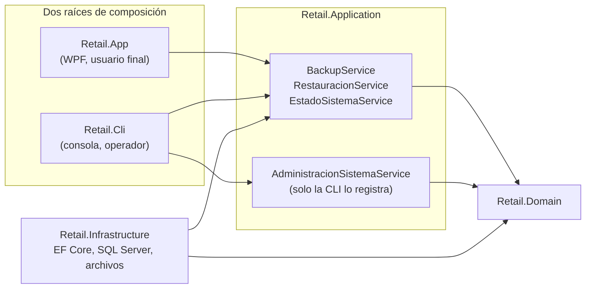
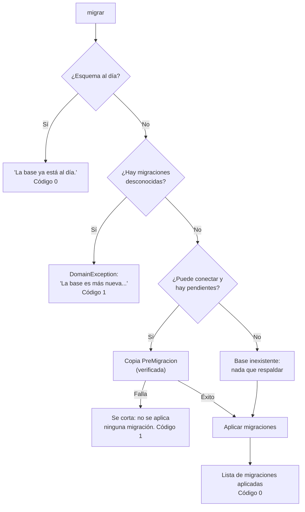
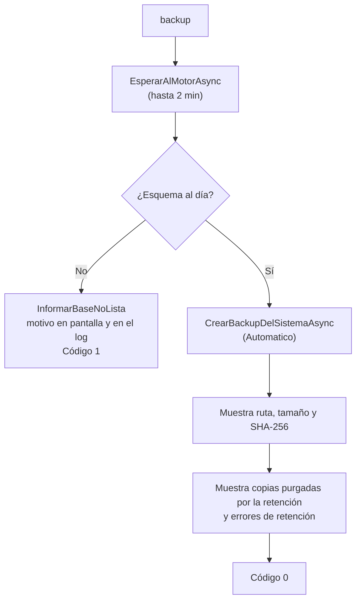
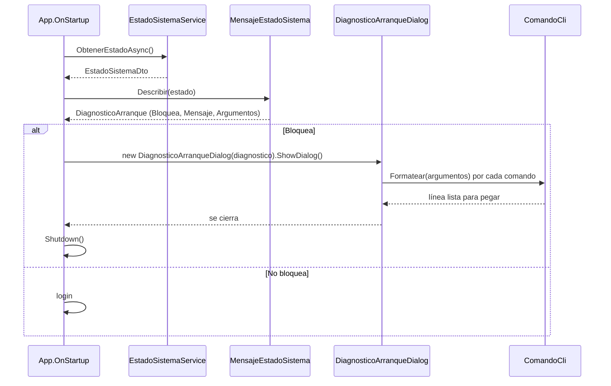

# La Herramienta `Retail.Cli`: Administrar la Base Fuera de la Aplicación

### Módulo: 05. Casos de Uso y Flujos de Negocio de Punta a Punta
**Audiencia:** Desarrolladores, estudiantes universitarios y mesa evaluadora de cátedra  
**Requisitos Vinculados:** `RF-23` (Administración de la Base por Comandos), `RF-22` (Respaldo y Restauración), `RNF-08` (Integridad y Respaldo Diario) y `RF-03` (Roles)  
**Decisiones citadas:** D-10, D-11, D-12, D-13, D-18, D-28 y D-29 de [`etapa-6-track-6.3-backup-restore.md`](file:///c:/Users/lucas/Proyectos/retail/docs/roadmap/etapa-6-track-6.3-backup-restore.md)  
**Archivos de Código:**
* Punto de entrada: [`Program.cs`](file:///c:/Users/lucas/Proyectos/retail/src/Retail.Cli/Program.cs), [`Ayuda.cs`](file:///c:/Users/lucas/Proyectos/retail/src/Retail.Cli/Ayuda.cs) y [`CodigoSalida.cs`](file:///c:/Users/lucas/Proyectos/retail/src/Retail.Cli/CodigoSalida.cs)
* Comandos: [`Comandos/`](file:///c:/Users/lucas/Proyectos/retail/src/Retail.Cli/Comandos/) (`ComandoEstado`, `ComandoMigrar`, `ComandoInicializar`, `ComandoDatosDemo`, `ComandoBackup`, `ComandoRestaurar`)
* Consola: [`Consola/`](file:///c:/Users/lucas/Proyectos/retail/src/Retail.Cli/Consola/) (`EntradaConsola`, `SalidaConsola`, `ProgresoEnConsola`, `CancelacionConsola`, `EntradaInvalidaException`)
* Servicios que invoca: [`AdministracionSistemaService.cs`](file:///c:/Users/lucas/Proyectos/retail/src/Retail.Application/Services/AdministracionSistemaService.cs), [`EstadoSistemaService.cs`](file:///c:/Users/lucas/Proyectos/retail/src/Retail.Application/Services/EstadoSistemaService.cs), [`BackupService.cs`](file:///c:/Users/lucas/Proyectos/retail/src/Retail.Application/Services/BackupService.cs) y [`RestauracionService.cs`](file:///c:/Users/lucas/Proyectos/retail/src/Retail.Application/Services/RestauracionService.cs)
* Lado de la aplicación: [`MensajeEstadoSistema.cs`](file:///c:/Users/lucas/Proyectos/retail/src/Retail.App/Helpers/MensajeEstadoSistema.cs), [`ComandoCli.cs`](file:///c:/Users/lucas/Proyectos/retail/src/Retail.App/Helpers/ComandoCli.cs) y [`DiagnosticoArranqueDialog.xaml.cs`](file:///c:/Users/lucas/Proyectos/retail/src/Retail.App/Views/Dialogs/DiagnosticoArranqueDialog.xaml.cs)

---

## 1. 📖 Fundamento: Por Qué Existe una Herramienta de Consola

### 1.1 El problema: ¿quién crea y actualiza la base?

Hasta la Etapa 5 la aplicación hacía todo sola al arrancar: aplicaba las migraciones (`MigrateAsync`) y sembraba un usuario `admin` con contraseña fija. Ese diseño tiene tres defectos que el Track 6.3 corrige:

| Defecto del diseño anterior | Por qué es un problema | Cómo lo resuelve `Retail.Cli` |
| :--- | :--- | :--- |
| Migrar al abrir la app | Abrir un programa **no debería modificar el esquema** de la base. Si la migración falla a medias, el cajero se queda sin sistema en el mostrador | La app solo **verifica** y, si algo falta, explica qué comando ejecutar (D-11) |
| Migrar sin copia previa | Una migración es la operación más riesgosa: si sale mal no hay vuelta atrás (R-10) | `migrar` toma una copia `PreMigracion` antes de tocar nada (D-10) |
| Usuario `admin` con contraseña conocida | Cualquiera que leyera el código conocía la clave del Gerente | `inicializar` pide al titular que **elija** su contraseña frente al equipo (D-12) |
| No hay forma de recuperar la base si el login no abre | Si la base está dañada, no se puede entrar a la pantalla Respaldos para restaurar | `restaurar` funciona **sin la app y sin login** (D-18, R-2) |

> [!NOTE]
> Concepto teórico: es el principio de **separación de responsabilidades** aplicado a la operación. La aplicación de escritorio es una herramienta del *usuario final* (cajero, gerente); administrar el esquema y recuperar desastres es una tarea de *operación*. Mezclarlas obliga a darle a todos los usuarios de la app los privilegios del operador.

### 1.2 Una segunda raíz de composición

En Clean Architecture la **raíz de composición** (*composition root*) es el único lugar donde se arma el grafo de objetos: se registran las implementaciones concretas en el contenedor de inyección de dependencias (DI). `Retail.App` es una; `Retail.Cli` es **la segunda**. Ambas reutilizan exactamente las mismas capas:



Esto respeta la Ley 1 (regla de dependencia): `Retail.Cli` depende de `Application` e `Infrastructure`, y ninguna de ellas depende de la CLI. La consecuencia práctica es que **no hay reglas duplicadas**: `AdministracionSistemaService` reutiliza el mismo validador (`FluentValidation`) y el mismo agregado `Usuario.Crear(...)` que el ABM de usuarios de la aplicación, tal como lo declara su comentario de clase.

### 1.3 La separación de privilegios en la inyección de dependencias

El contenedor de [`DependencyInjection.cs`](file:///c:/Users/lucas/Proyectos/retail/src/Retail.Application/DependencyInjection.cs) expone **dos** métodos de registro. Esa diferencia es una decisión de seguridad:

```csharp
public static IServiceCollection AddApplicationServices(this IServiceCollection services)
{
    // ...
    services.AddScoped<IEstadoSistemaService, EstadoSistemaService>();
    services.AddScoped<IBackupService, BackupService>();

    // La aplicación y Retail.Cli comparten el mecanismo (D-21). No requiere ser una operación privilegiada: toda
    // restauración exige la contraseña de un Gerente.
    services.AddScoped<IRestauracionService, RestauracionService>();

    return services;
}

/// <summary>
/// Operaciones privilegiadas de administración de la base (RF-23). Solo la invoca la herramienta de comandos:
/// la aplicación WPF no las registra y, por lo tanto, no puede ejecutarlas.
/// </summary>
public static IServiceCollection AddAdministracionSistema(this IServiceCollection services)
{
    services.AddScoped<IAdministracionSistemaService, AdministracionSistemaService>();

    return services;
}
```

| Servicio | ¿Lo registra la app? | ¿Lo registra la CLI? | Qué permite |
| :--- | :-: | :-: | :--- |
| `IEstadoSistemaService` | Sí | Sí | Solo **leer** el diagnóstico (no modifica nada) |
| `IBackupService`, `IRestauracionService` | Sí | Sí | Copias y restauraciones, siempre con sus propias autorizaciones |
| `IAdministracionSistemaService` | **No** | Sí | `MigrarAsync` y `CrearPrimerGerenteAsync` |

La app **no puede** migrar ni crear el primer Gerente porque el contenedor ni siquiera conoce el servicio: no es una validación que se pueda saltear con un `if`, es una **imposibilidad estructural** (el compilador y el contenedor lo garantizan). Es defensa en profundidad (D-9).

### 1.4 El principio rector: ningún comando da acceso a una cuenta existente (D-13)

El comentario de clase de `Program` lo resume:

> *Cualquiera con acceso al equipo puede ejecutarla, por eso ninguno de sus comandos otorga acceso a una cuenta existente (D-13); `restaurar` exige la contraseña de un Gerente verificada dentro de la copia (D-18).*

La razón (D-13) es realista: en un comercio el personal comparte la sesión de Windows, así que "tener acceso al equipo" **no es un límite de confianza**. Una versión anterior del diseño tenía un comando `blanquear-gerente`: un cajero habría podido ejecutarlo y tomar la cuenta del Gerente. Se eliminó. Cada comando se evalúa con una pregunta: *¿le permite a alguien sin credenciales hacerse pasar por una cuenta que ya existe?* Si la respuesta es sí, el comando no existe.

---

## 2. 🗺️ Mapa de los Comandos

La ayuda de la herramienta ([`Ayuda.cs`](file:///c:/Users/lucas/Proyectos/retail/src/Retail.Cli/Ayuda.cs)) imprime:

```text
Retail.Cli - Administración de la base de datos de Retail POS (RF-23)

Uso: Retail.Cli <comando> [argumento]

Comandos:
  estado        Informa si la base está al día y si hay un Gerente activo.
  migrar        Actualiza el esquema de la base (la crea si no existe), con copia previa.
  inicializar   Crea la cuenta del primer Gerente (solo si no hay ninguno).
  datos-demo    Carga un proveedor, categorías y marcas de demostración.
  backup        Copia completa y verificada de la base. La tarea programada diaria (21:00, como SYSTEM)
                la ejecuta; se registra con scripts\registrar-tarea-backup.ps1 como administrador.
  restaurar <ruta.bak>
                Reemplaza la base por una copia; exige usuario y contraseña de un Gerente de esa copia.
  ayuda         Muestra este mensaje.

Instalación nueva: migrar, inicializar y, opcionalmente, datos-demo.
En desarrollo: dotnet run --project src/Retail.Cli -- <comando>
```

| Comando | Quién lo ejecuta | Cuándo | Pide datos | Toca la base |
| :--- | :--- | :--- | :-: | :-: |
| `estado` | Cualquiera que dé soporte | Ante cualquier duda sobre por qué la app no abre | No | No (solo lectura) |
| `migrar` | Quien instala o actualiza | Instalación nueva y después de cada actualización con migraciones | No | Sí (esquema) |
| `inicializar` | El titular, frente al equipo | Una sola vez, tras la primera migración | Sí | Sí (crea 1 usuario) |
| `datos-demo` | Desarrollo o demostración | Opcional, repetible | No | Sí (agrega maestros) |
| `backup` | La tarea programada (`SYSTEM`) o un técnico a mano | Todos los días a las 21:00 | No | Solo agrega al historial |
| `restaurar` | El técnico en un desastre | Cuando la base se perdió o se dañó | Sí | Sí (reemplaza la base) |

---

## 3. 🧱 Anatomía de `Program.cs`

### 3.1 Arranque: codificación y ayuda

```csharp
try
{
    Console.OutputEncoding = System.Text.Encoding.UTF8;
}
catch (IOException)
{
}

if (args.Length == 0 || args[0] is "ayuda" or "-h" or "--help")
{
    Ayuda.Mostrar();
    return args.Length == 0 ? CodigoSalida.UsoIncorrecto : CodigoSalida.Exito;
}
```

* **`Console.OutputEncoding = UTF8`**: la consola de Windows usa por defecto una página de códigos que corrompe las tildes ("Operación" saldría como "Operaci¢n"). Se configura al inicio.
* **El `try/catch (IOException)` vacío es deliberado.** El Programador de tareas puede ejecutar la herramienta *sin consola* o con la salida cerrada. En ese caso asignar `OutputEncoding` lanza `IOException`; como "sin consola no hay nada que configurar", se ignora. Que falle algo cosmético **no debe impedir hacer la copia de seguridad**.
* Sin argumentos devuelve `UsoIncorrecto` (2) y con `ayuda`/`-h`/`--help` devuelve `Exito` (0): pedir ayuda no es un error, olvidarse el comando sí.

### 3.2 Registro de logs

```csharp
Log.Logger = new LoggerConfiguration()
    .MinimumLevel.Information()
    .MinimumLevel.Override("Microsoft", LogEventLevel.Warning)
    .MinimumLevel.Override("Microsoft.EntityFrameworkCore", LogEventLevel.Warning)
    .Enrich.FromLogContext()
    // Solo a archivo: la consola es del operador y la escriben los comandos (SalidaConsola).
    .WriteTo.File(
        path: Path.Combine(UbicacionDeLogs.Directorio(), "retail-cli-.log"),
        rollingInterval: RollingInterval.Day,
        retainedFileCountLimit: 31,
        formatProvider: CultureInfo.InvariantCulture,
        outputTemplate: "{Timestamp:yyyy-MM-dd HH:mm:ss.fff zzz} [{Level:u3}] {Message:lj}{NewLine}{Exception}")
    .CreateLogger();
```

| Aspecto | Valor | Por qué |
| :--- | :--- | :--- |
| Destino | **Solo archivo**, no consola | La consola es del operador: la escriben los comandos con mensajes pensados para una persona. Mezclar logs técnicos ensuciaría esa salida |
| Nombre | `retail-cli-AAAAMMDD.log` (rotación diaria, 31 archivos) | Un archivo por día; los viejos se borran solos |
| Carpeta | `UbicacionDeLogs.Directorio()` = `%LOCALAPPDATA%\Retail POS\logs` **de la cuenta que ejecuta el proceso** | Ver 3.3 |
| Nivel de EF Core | `Warning` (override) | EF Core escribe **cada sentencia SQL** en `Information`: una sola copia dejaba 19 entradas con el SQL completo. Los errores y advertencias de EF Core siguen apareciendo |
| Nivel propio | `Information` | Los registros de la herramienta (quién ejecutó qué) se conservan |

El primer registro de cada ejecución deja la huella de auditoría mínima:

```csharp
Log.Information("Retail.Cli: comando '{Comando}' ejecutado por {UsuarioWindows} en {Equipo}",
    args[0], Environment.UserName, Environment.MachineName);
```

### 3.3 Dónde queda el log (`UbicacionDeLogs`)

La regla vive en un solo lugar, [`UbicacionDeLogs.cs`](file:///c:/Users/lucas/Proyectos/retail/src/Retail.Infrastructure/Logging/UbicacionDeLogs.cs), y usa `Environment.SpecialFolder.LocalApplicationData`, que se resuelve contra **la cuenta que ejecuta el proceso**:

| Quién ejecuta | Carpeta del log | Quién puede escribirla |
| :--- | :--- | :--- |
| Un usuario (cajero, gerente, técnico) | `C:\Users\<usuario>\AppData\Local\Retail POS\logs` | Ese usuario |
| La tarea programada (`SYSTEM`) | `C:\Windows\System32\config\systemprofile\AppData\Local\Retail POS\logs` | Solo `SYSTEM` y los administradores |

> [!IMPORTANT]
> **Por qué los logs ya no están junto al ejecutable.** Antes de la corrección posterior al PR #23 los registros se guardaban en una carpeta `logs` dentro de la instalación. Para que el cajero pudiera escribir ahí habría hecho falta una carpeta escribible por usuarios, y la tarea programada (`SYSTEM`) también escribe en ella. Es un patrón conocido de **escalada de privilegios**: el usuario convierte la carpeta vacía en un punto de montaje (*junction*) y desvía lo que escribe `SYSTEM` a donde quiera. Hoy la regla es una sola para todos y no requiere detectar la identidad ni tocar permisos. `%ProgramData%` se descartó porque cualquier usuario puede crear carpetas ahí y apropiarse de antemano de `Retail POS`.

Para el estudiante que ejecuta `dotnet run --project src/Retail.Cli -- ...` en desarrollo, el comportamiento es idéntico; solo cambia dónde queda el log.

### 3.4 El host y el despacho de comandos

```csharp
// Los argumentos son del comando, no de configuración: no se pasan al host.
var builder = Host.CreateApplicationBuilder(new HostApplicationBuilderSettings
{
    ContentRootPath = AppContext.BaseDirectory
});

builder.Services.AddSerilog();
builder.Services.AddApplicationServices();
builder.Services.AddAdministracionSistema();
builder.Services.AddInfrastructureServices(builder.Configuration);

builder.Services.AddTransient<ComandoEstado>();
// ... (uno por comando)
builder.Services.AddTransient<ComandoRestaurar>();

using var host = builder.Build();
using var scope = host.Services.CreateScope();
var servicios = scope.ServiceProvider;
```

* **`ContentRootPath = AppContext.BaseDirectory`**: la configuración (`appsettings.json`) se busca **junto al ejecutable**, no en el directorio de trabajo. Es lo que permite que la tarea programada, que no arranca en la carpeta de la instalación, encuentre la cadena de conexión. (El script de registro también fija el directorio de trabajo de la tarea; ver capítulo 06.) El `Retail.Cli.csproj` incluye `appsettings.json` como **archivo enlazado** de `Retail.App`: la cadena de conexión existe en un único lugar.
* **`CreateScope()`**: los servicios de Application son `Scoped` (comparten un `DbContext` durante la operación). La CLI crea un único alcance para toda la ejecución del comando, equivalente a una "petición".
* **Cada comando es `Transient`** y se resuelve del contenedor, por lo que recibe sus dependencias por constructor, igual que un ViewModel.

El despacho es un `switch` de expresión:

```csharp
return args[0] switch
{
    "estado" => await servicios.GetRequiredService<ComandoEstado>().EjecutarAsync(),
    "migrar" => await servicios.GetRequiredService<ComandoMigrar>().EjecutarAsync(),
    "inicializar" => await servicios.GetRequiredService<ComandoInicializar>().EjecutarAsync(),
    "datos-demo" => await servicios.GetRequiredService<ComandoDatosDemo>().EjecutarAsync(),
    "backup" => await servicios.GetRequiredService<ComandoBackup>().EjecutarAsync(),
    "restaurar" => await servicios.GetRequiredService<ComandoRestaurar>().EjecutarAsync(args[1..]),
    _ => ComandoDesconocido(args[0])
};
```

Solo `restaurar` recibe argumentos (`args[1..]`, todo lo que sigue al nombre del comando). Un comando desconocido imprime el error, la ayuda y devuelve 2.

### 3.5 Códigos de salida

[`CodigoSalida.cs`](file:///c:/Users/lucas/Proyectos/retail/src/Retail.Cli/CodigoSalida.cs) define tres constantes. Existen porque "los scripts y el Programador de tareas los usan para saber si el comando funcionó **sin leer la salida de texto**":

| Código | Constante | Cuándo |
| :-: | :--- | :--- |
| `0` | `Exito` | El comando hizo lo pedido; también `ayuda` |
| `1` | `Fallo` | No pudo completarse: base inaccesible, datos inválidos, regla de negocio, cancelación del operador, confirmación de `restaurar` incorrecta |
| `2` | `UsoIncorrecto` | Sin argumentos, comando desconocido, o `restaurar` sin exactamente una ruta |

El Programador de tareas guarda ese número como `LastTaskResult`; es lo único que queda a la vista cuando nadie mira la consola (capítulo 06).

### 3.6 Manejo de errores: esperados versus inesperados

Los `catch` de `Main` están **ordenados de lo más específico a lo más general**, y la diferencia entre ellos es una decisión de diseño:

```csharp
catch (OperationCanceledException)
{
    Console.Error.WriteLine();
    Console.Error.WriteLine("Operación cancelada.");
    Log.Warning("Retail.Cli: el comando '{Comando}' fue cancelado por el operador", args[0]);
    return CodigoSalida.Fallo;
}
catch (Exception ex) when (ex is BackupFallidoException or RestauracionFallidaException)
{
    // Error esperado: a la consola va el mensaje claro; al log, también la excepción, para conservar el detalle
    // técnico de la causa (InnerException) que el operador no necesita ver.
    Log.Warning(ex, "Retail.Cli: el comando '{Comando}' fue rechazado: {Motivo}", args[0], ex.Message);
    SalidaConsola.Error(ex);
    return CodigoSalida.Fallo;
}
catch (Exception ex) when (ex is ValidationException or DomainException or EntradaInvalidaException)
{
    // Error esperado (datos inválidos o regla de negocio): se informa sin el stack trace.
    Log.Warning("Retail.Cli: el comando '{Comando}' fue rechazado: {Motivo}", args[0], ex.Message);
    SalidaConsola.Error(ex);
    return CodigoSalida.Fallo;
}
catch (Exception ex)
{
    Log.Error(ex, "Retail.Cli: el comando '{Comando}' falló", args[0]);
    SalidaConsola.Error(ex);
    return CodigoSalida.Fallo;
}
finally
{
    await Log.CloseAndFlushAsync();
}
```

| Tipo de error | Ejemplos | Nivel de log | Qué ve el operador |
| :--- | :--- | :-: | :--- |
| **Cancelación** (`OperationCanceledException`) | Ctrl+C | `Warning` | "Operación cancelada." |
| **Falla controlada de copia/restauración** | Disco lleno, copia dañada, huella distinta, base ocupada | `Warning` **con** la excepción (conserva la causa interna) | `Error: <mensaje claro>` |
| **Regla de negocio o dato inválido** | Contraseña incorrecta (`CredencialesInvalidasException`), Gerente ya existente, validación de FluentValidation, contraseñas que no coinciden | `Warning` sin stack trace | Mensaje claro; las validaciones, **una por línea** |
| **Inesperado** | Cualquier otra excepción (bug) | `Error` con stack trace | `Error inesperado (<Tipo>): <mensaje>` y la ruta del log |

[`SalidaConsola.Error`](file:///c:/Users/lucas/Proyectos/retail/src/Retail.Cli/Consola/SalidaConsola.cs) produce esos textos. Para una validación:

```text
Los datos ingresados no son válidos:
  - <mensaje 1>
  - <mensaje 2>
```

y para un error inesperado, además del tipo y el mensaje, indica `El detalle completo quedó registrado en <carpeta>\retail-cli-*.log.`

> [!NOTE]
> Criterio general: **una persona no debe ver un stack trace** por un error que el sistema esperaba (contraseña mal escrita). El detalle técnico va al log, donde lo lee quien da soporte. El `finally` con `CloseAndFlushAsync` garantiza que, aun ante un error, el log se vacíe a disco antes de terminar el proceso: es lo que permite diagnosticar después una ejecución de la tarea que nadie vio.

---

## 4. 🛑 Ctrl+C y Ejecución Sin Consola: `CancelacionConsola`

[`CancelacionConsola.cs`](file:///c:/Users/lucas/Proyectos/retail/src/Retail.Cli/Consola/CancelacionConsola.cs) convierte Ctrl+C en una **cancelación ordenada** mediante un `CancellationTokenSource`. Sin esto, Windows mataría el proceso en el acto y dejaría trabajo a medias (por ejemplo, una base temporal a medio restaurar).

```csharp
public CancelacionConsola()
{
    // Sin consola (Programador de tareas, B-5) no hay Ctrl+C que escuchar: la operación corre sin esa cancelación.
    try
    {
        Console.CancelKeyPress += AlPresionarCtrlC;
        _suscripto = true;
    }
    catch (Exception ex) when (ex is IOException or PlatformNotSupportedException)
    {
    }
}

private void AlPresionarCtrlC(object? sender, ConsoleCancelEventArgs e)
{
    // Nunca se deja que Windows mate el proceso: un corte entre los dos renombrados del intercambio dejaría el
    // sistema sin base vigente (B-4). Las pulsaciones siguientes solo repiten el aviso.
    e.Cancel = true;

    if (_fuente.IsCancellationRequested)
    {
        Console.Error.WriteLine("La cancelación ya fue pedida. Espere: cerrar la ventana ahora puede dañar la base.");
        return;
    }

    Console.Error.WriteLine();
    Console.Error.WriteLine("Cancelando... espere a que la operación se detenga de forma segura.");

    try
    {
        _fuente.Cancel();
    }
    catch (ObjectDisposedException)
    {
        // La operación terminó justo ahora: no hay nada que cancelar.
    }
}
```

Puntos para entender y defender:

1. **`e.Cancel = true`** le dice a .NET "yo me ocupo": el proceso no termina por Ctrl+C. La primera pulsación solicita la cancelación; el token llega al servicio, que detiene el trabajo y limpia (por ejemplo descarta la base temporal).
2. **Las pulsaciones siguientes no terminan el proceso.** Pasado el *punto de no retorno* de una restauración (los dos renombrados del intercambio, capítulo 04), el servicio **ignora** la cancelación para poder completar el intercambio. Un segundo Ctrl+C que matara el proceso entre ambos renombrados dejaría al sistema sin base vigente. Por eso solo repite el aviso. (Fue el hallazgo B-4 de la revisión final.)
3. **Sin consola, no hay nada que suscribir.** Si la tarea corre sin consola, `CancelKeyPress` puede lanzar `IOException` o `PlatformNotSupportedException`; el constructor lo traga y la copia corre igual, solo que sin cancelación por teclado. La bandera `_suscripto` evita desuscribirse de algo que nunca se suscribió.
4. Se usa en `backup` y en `restaurar`; son los dos comandos de larga duración. `migrar` no lo usa.

También para el avance: [`ProgresoEnConsola`](file:///c:/Users/lucas/Proyectos/retail/src/Retail.Cli/Consola/ProgresoEnConsola.cs) implementa `IProgress<int>` y escribe ` 10% 20% ...` en la misma línea, descartando valores menores o iguales al último. No usa `Progress<T>`: sin contexto de sincronización (la consola no tiene uno) ese tipo publica en hilos del pool y los porcentajes podrían salir desordenados; en WPF sí sirve, porque el contexto de la interfaz los ordena.

---

## 5. ⌨️ Entrada Interactiva: `EntradaConsola`

[`EntradaConsola.cs`](file:///c:/Users/lucas/Proyectos/retail/src/Retail.Cli/Consola/EntradaConsola.cs) ofrece tres lecturas:

| Método | Qué hace | Detalle |
| :--- | :--- | :--- |
| `LeerTexto(etiqueta)` | Muestra `etiqueta: ` y lee una línea | Aplica `Trim()`; si no hay entrada devuelve cadena vacía |
| `LeerSecreto(etiqueta)` | Lee una contraseña sin mostrarla | Por cada carácter muestra `*`; admite Backspace (`\b \b` borra el asterisco); ignora teclas de control; termina con Enter |
| `LeerSecretoConfirmado(etiqueta)` | Pide la contraseña dos veces | Repite hasta que coincidan |

```csharp
var tecla = Console.ReadKey(intercept: true);
// ...
if (!char.IsControl(tecla.KeyChar))
{
    secreto.Append(tecla.KeyChar);
    Console.Write('*');
}
```

`intercept: true` evita que la tecla se imprima; el programa imprime un asterisco en su lugar. Si la entrada está **redirigida** (`Console.IsInputRedirected`, por ejemplo un script que canaliza texto), no hay teclas que leer y se toma la línea completa. En `LeerSecretoConfirmado`, si las dos no coinciden con entrada redirigida se lanza `EntradaInvalidaException("Las contraseñas ingresadas no coinciden.")` para **no entrar en un ciclo infinito** (nadie podría corregir). Con teclado real simplemente vuelve a preguntar.

---

## 6. 🔎 Los Seis Comandos, Uno por Uno

### 6.1 `estado`: el diagnóstico

**Sintaxis:** `Retail.Cli estado` (sin argumentos).  
**Quién/cuándo:** cualquiera que dé soporte, cuando la app no abre o ante cualquier duda. Es el mismo diagnóstico que la aplicación hace al arrancar, pero en texto.

**Qué valida** ([`ComandoEstado`](file:///c:/Users/lucas/Proyectos/retail/src/Retail.Cli/Comandos/ComandoEstado.cs) → `EstadoSistemaService.ObtenerEstadoAsync`):

1. ¿Se puede conectar con la base?
2. ¿Hay migraciones pendientes (la base está atrasada)?
3. ¿Hay migraciones **desconocidas** (la base es más nueva que esta versión del programa)?
4. Solo si el esquema está al día: ¿hay un Gerente activo? ¿Hay Gerentes sin email de recuperación?

El orden importa: `EstadoSistemaService` **no consulta la tabla de usuarios si el esquema no está al día**, "porque podría fallar (tabla o columna inexistente)".

**Salida de ejemplo** (instalación sin migrar):

```text
Conexión con la base:      OK
Migraciones pendientes:    3
    - 20260101000000_Inicial
    - ...
Migraciones desconocidas:  0

La aplicación NO puede operar con la base en este estado.
```

Los nombres de migración son ilustrativos. **Código de salida:** `0` si `PuedeOperar`, `1` si no. No pide credenciales ni modifica nada: es de solo lectura, por eso cualquiera puede ejecutarlo sin riesgo.

### 6.2 `migrar`: actualizar el esquema con red de seguridad

**Sintaxis:** `Retail.Cli migrar`.  
**Quién/cuándo:** quien instala o actualiza, en la instalación nueva y tras cada actualización que traiga migraciones. En desarrollo, después de cada `git pull` que traiga migraciones.

**Flujo** ([`ComandoMigrar`](file:///c:/Users/lucas/Proyectos/retail/src/Retail.Cli/Comandos/ComandoMigrar.cs) y `AdministracionSistemaService.MigrarAsync`):



El tramo decisivo está en el servicio:

```csharp
// Si la base es más nueva que esta versión, migrar no lo resuelve y podría empeorarlo.
if (estado.MigracionesDesconocidas.Count > 0)
{
    throw new DomainException(
        $"La base es más nueva que esta versión ({estado.MigracionesDesconocidas.Count} migraciones desconocidas). " +
        "Actualice Retail POS antes de migrar.");
}

// D-10: nunca se migra una base con datos sin una copia previa. Si la copia falla, la excepción corta acá
// y no se aplica ninguna migración. Una base que no existe no tiene nada que respaldar.
ResultadoBackupDto? copiaPrevia = null;
if (estado.PuedeConectar && estado.MigracionesPendientes.Count > 0)
{
    copiaPrevia = await _backupService.CrearBackupDelSistemaAsync(TipoBackupEnum.PreMigracion, null, cancellationToken);
}

var aplicadas = await _esquema.AplicarMigracionesPendientesAsync(cancellationToken);
```

**Qué imprime:** "Hay N migraciones pendientes. Primero se toma una copia de seguridad..." (o "La base no existe o no responde: se intentará crearla y aplicar todas las migraciones..."), luego `Copia previa verificada: <ruta> (<N> KB)`, una línea `+ <migración>` por cada migración aplicada y `Listo: N migraciones aplicadas.` Si la base todavía no tenía historial de copias, aclara que "quedó documentada en su manifiesto .json".

**Seguridad:** `migrar` no crea ni modifica cuentas; solo cambia el esquema. Su riesgo es la pérdida de datos si la migración sale mal, y se mitiga con la copia previa obligatoria. Además la cuenta de Windows que lo ejecuta necesita permisos de esquema en SQL Server (en desarrollo y en la instalación, quien instaló Express es `sysadmin`, D-27/A-1).

### 6.3 `inicializar`: el primer Gerente

**Sintaxis:** `Retail.Cli inicializar`.  
**Quién/cuándo:** el titular del negocio, **frente al equipo**, una sola vez después de `migrar`. Reemplaza al usuario `admin` con contraseña fija (D-12): ahora la contraseña la elige el titular y nadie más la conoce.

**Validaciones, en el orden en que ocurren:**

| # | Dónde | Validación | Si falla |
| :-: | :--- | :--- | :--- |
| 1 | `ComandoInicializar` | La base está al día | "La base no está al día. Ejecute primero: Retail.Cli migrar" (código 1) |
| 2 | `ComandoInicializar` | **No existe** un Gerente activo | "Ya existe un Gerente activo. Las demás cuentas se crean desde la aplicación (módulo Usuarios)." (código 1) |
| 3 | `CrearPrimerGerenteAsync` | El rol del DTO es Gerente | `DomainException` |
| 4 | `CrearPrimerGerenteAsync` | Pasa el `FluentValidation` del alta de usuarios (nombre, email, política de contraseña) | `ValidationException`: lista de mensajes |
| 5 | `CrearPrimerGerenteAsync` | Sigue sin haber Gerentes activos (doble control) | `OperacionNoAutorizadaException` |
| 6 | `CrearPrimerGerenteAsync` | El nombre de usuario normalizado no está registrado | `DomainException` |

El control #2 se repite en el servicio: el comentario lo explica, "también lo rechaza el servicio; se verifica antes para no pedir datos que no se van a usar". El servicio es la **autoridad** (una regla en Application nunca depende de que la CLI la haya revisado antes).

**Datos que pide:** `Nombre de usuario (login)`, `Nombre`, `Apellido`, `Email de recuperación` (obligatorio para Gerente, D-7) y `Contraseña` dos veces (`LeerSecretoConfirmado`, con asteriscos).

```csharp
var passwordHash = _passwordHasher.HashPassword(dto.Password);
var gerente = Usuario.Crear(dto.NombreUsuario, dto.Nombre, dto.Apellido, passwordHash, dto.Rol, dto.EmailRecuperacion);

// A diferencia de un alta desde la aplicación, la contraseña la eligió el propio titular frente al equipo:
// no hay otra persona que la conozca, así que no se le exige cambiarla al ingresar.
gerente.CambiarPasswordPropia(passwordHash);
```

La contraseña se guarda **con hash BCrypt**; nunca se registra ni se muestra. Se invoca `CambiarPasswordPropia` para que `DebeCambiarPassword` quede en falso: D-6 exige el cambio forzado para cuentas creadas por *otra* persona, y acá no hay otra persona.

**Qué registra el log:** un `Warning` (nivel elevado a propósito, para que el alta del primer Gerente resalte en una auditoría): `Primer Gerente '<usuario>' creado desde Retail.Cli por <UsuarioWindows> en <Equipo>`. **Salida:** `Gerente '<usuario>' (<nombre completo>) creado. Ya puede iniciar sesión en Retail POS.`

**Por qué es seguro (D-13):** solo funciona **cuando no hay ningún Gerente activo**. No puede usarse para tomar una cuenta existente ni para agregar un segundo Gerente; las demás cuentas se crean desde la aplicación con la autorización de un Gerente (D-4). En una base sin Gerentes no hay nada que robar: el sistema ya estaba sin gobierno.

### 6.4 `datos-demo`: maestros de demostración

**Sintaxis:** `Retail.Cli datos-demo`. **Quién/cuándo:** desarrollo o demostración; opcional y repetible.  
Verifica que la base esté al día (si no, indica ejecutar `migrar`, código 1) y llama a `SemilleroDatosDemo.CargarAsync`, que "solo agrega lo que falta". Imprime `Se agregaron N registros de demostración (proveedor, categorías y marcas).` o `Los datos de demostración ya estaban cargados. No se agregó nada.`

Por D-12 los datos de demostración son **un proveedor, categorías y marcas**; ya no se siembran 20 artículos ni usuarios. No crea cuentas, por lo que no afecta la seguridad.

### 6.5 `backup`: la copia diaria

**Sintaxis:** `Retail.Cli backup` (sin argumentos).  
**Quién/cuándo:** la **tarea programada** todos los días a las 21:00 como `SYSTEM` (D-28, D-29); también un técnico a mano. Tiene una función específica: dejar una copia `Automatico` verificada.

**Por qué no pide credenciales.** Es la decisión más cuestionable y la más fácil de defender si se entiende: una copia **no da acceso a ninguna cuenta ni modifica datos** (D-13). Además, la tarea corre sin nadie presente: no podría escribir una contraseña, y guardar una en el equipo sería peor (una contraseña guardada se rompe en silencio cuando cambia). El contenido del `.bak` (que sí tiene datos personales y hashes) lo protegen los **permisos de Windows de la carpeta de respaldos**, no una contraseña de la herramienta: es el mismo riesgo aceptado que R-17. Los permisos de la carpeta son responsabilidad del script de registro (capítulo 06).

**Flujo de [`ComandoBackup`](file:///c:/Users/lucas/Proyectos/retail/src/Retail.Cli/Comandos/ComandoBackup.cs):**



**La espera al motor.** Con la opción "iniciar si se perdió", el Programador de tareas puede lanzar la copia apenas se enciende la PC, **antes** de que SQL Server termine de arrancar. En lugar de fallar, la herramienta espera:

```csharp
private static readonly TimeSpan IntervaloDeEspera = TimeSpan.FromSeconds(10);
private static readonly TimeSpan EsperaMaxima = TimeSpan.FromMinutes(2);

while (!esquema.PuedeConectar && cronometro.Elapsed < EsperaMaxima)
{
    // ... avisa por consola y registra una advertencia en el log
    await Task.Delay(IntervaloDeEspera, cancellationToken);
    esquema = await _esquema.ObtenerEstadoAsync(cancellationToken);
}
```

Cada intento muestra `SQL Server todavía no responde (<n> s de 120 s): se vuelve a intentar en 10 s...`. **No es un reintento de la copia** (D-28 lo excluye): se espera a que el motor responda y, cuando responde, se copia **una vez**. Si pasados los 2 minutos sigue sin responder, se informa y se termina.

**Mensajes distintos según el motivo** (`InformarBaseNoLista`): como el Programador de tareas solo conserva un código de salida, el motivo exacto debe quedar **en el log**; a la consola se escribe lo mismo para quien lo ejecute a mano.

| Situación | Mensaje a la consola | Log |
| :--- | :--- | :--- |
| No conecta (servicio detenido o base inexistente) | "No se pudo conectar con la base: SQL Server no responde o la base no existe. Revise que el servicio de SQL Server esté iniciado y que la base exista (Retail.Cli estado)." | `Error` con `PuedeConectar`, pendientes y desconocidas |
| La base es más nueva que la CLI | "La base es más nueva que esta versión de Retail.Cli ...: actualice la aplicación. No se copia con una versión anterior." | `Error` con las listas de migraciones pendientes y desconocidas |
| La base no está migrada | "La base no está migrada (faltan migraciones). Ejecute primero: Retail.Cli migrar (ya incluye una copia previa)." | ídem |

Todos devuelven `Fallo` (1).

> [!NOTE]
> **Historia: por qué existe el segundo mensaje.** Antes de la corrección posterior al PR #23, la tarea ejecutaba una copia de la CLI que no se actualizaba junto con la app. Tras una actualización con migraciones, esa CLI vieja veía "la base es más nueva que la app" y la copia diaria fallaba todas las noches, dejando solo un renglón en el log. Hoy la tarea apunta al `Retail.Cli.exe` de la instalación (capítulo 06), y el mensaje deja el motivo exacto.

**Mínimo privilegio: solo consulta el esquema.** El comentario del código lo dice: "Solo se consulta el esquema (migraciones), no el estado de los usuarios: la cuenta de la tarea programada no tiene ni necesita permiso sobre `USUARIOS`". Por eso `ComandoBackup` inyecta `IEsquemaBaseDatos` y no `IEstadoSistemaService` (que lee Gerentes con su hash). Esa es la razón por la que el script de registro no concede ningún permiso sobre `USUARIOS` (capítulo 06).

**Salida de ejemplo:**

```text
Copiando la base 10% 20% 30% 40% 50% 60% 70% 80% 90% 100%
Copia verificada: C:\RetailData\Backups\<archivo>.bak (12.345 KB)
SHA-256: <64 caracteres hexadecimales>
```

Si la retención borró copias viejas se agrega, por cada una, `  Retención: se borró <archivo>`; si no pudo borrar alguna, `  Retención: no se pudo borrar <detalle>` y un `Warning` en el log (la copia nueva igual se considera exitosa). La ruta y el formato de nombre son los reales de cada ejecución; los valores del ejemplo son ilustrativos.

**Qué hace por dentro** (`BackupService.CrearBackupDelSistemaAsync`, ver capítulo 03): rechaza cualquier tipo que no sea `Automatico` o `PreMigracion`, cierra copias interrumpidas, toma el **bloqueo compartido** (ninguna copia corre mientras se restaura) y, si la base es tan vieja que no tiene la tabla del historial, copia igual y deja el registro en el manifiesto.

### 6.6 `restaurar`: recuperación ante desastres

**Sintaxis:** `Retail.Cli restaurar <ruta-del-archivo.bak>` (exactamente un argumento; con otra cantidad imprime `Uso: Retail.Cli restaurar <ruta-del-archivo.bak>` y devuelve **2**).  
**Quién/cuándo:** el técnico, cuando la base se perdió o se dañó, o para volver a una copia anterior. El script [`restore-retail.ps1`](file:///c:/Users/lucas/Proyectos/retail/scripts/restore-retail.ps1) es un envoltorio fino de este comando (capítulo 06).

**Por qué exige credenciales y por qué se verifican *dentro de la copia* (D-18).** Restaurar es la operación más destructiva: reemplaza la base. Debe exigir una autorización, y tiene que ser la de un Gerente. Pero **no se puede verificar contra la base vigente**: en el desastre más probable (PC nueva, base corrupta) esa base no existe o no responde. La solución es que quien restaura demuestre que **era Gerente en esa copia**: el servicio restaura primero a una base temporal y ahí verifica usuario y contraseña con BCrypt.

```csharp
var usuario = await temporal.BuscarUsuarioActivoAsync(ReglasTexto.NormalizarNombreUsuario(nombreUsuario), cancellationToken);

if (usuario is null || !usuario.EsGerente() || usuario.DebeCambiarPassword || string.IsNullOrEmpty(password)
    || !_passwordHasher.VerifyPassword(password, usuario.PasswordHash))
{
    throw new CredencialesInvalidasException();
}
```

Los cuatro rechazos (usuario inexistente o dado de baja, no es Gerente, tiene un cambio de contraseña pendiente, contraseña incorrecta) reciben **la misma respuesta**: `Nombre de usuario o contraseña incorrectos.` Así no se revela qué parte falló. El rechazo por `DebeCambiarPassword` (hallazgo C-7) evita que sirva como autorizante, por ejemplo, el `admin/Admin123!` que las bases viejas traían sembrado.

**Interacción paso a paso** ([`ComandoRestaurar`](file:///c:/Users/lucas/Proyectos/retail/src/Retail.Cli/Comandos/ComandoRestaurar.cs)):

1. **Lee el manifiesto** de la copia (`LeerManifiestoAsync`). Si el `.bak` o su `.json` no existen o son ilegibles, lanza `RestauracionFallidaException` y `Program` la informa.
2. **Muestra el resumen de la copia**: archivo, fecha (en hora local), tipo, operador, tamaño, última migración, versión de la app y SHA-256 abreviado (16 caracteres y `...`).
3. **Imprime el aviso `ATENCIÓN`**: la base actual será reemplazada; no se borra, queda renombrada como `<base>_Anterior_<fecha>`; se intenta antes una copia `PreRestauracion`; hay que cerrar Retail POS en **todas** las terminales (las conexiones abiertas se cortan) y reiniciar al terminar.
4. **Pide `Usuario` y `Contraseña`** (esta última con asteriscos).
5. **Pide escribir `RESTAURAR`** para confirmar:

```csharp
var confirmacion = EntradaConsola.LeerTexto($"Escriba {PalabraDeConfirmacion} para confirmar");
if (!string.Equals(confirmacion, PalabraDeConfirmacion, StringComparison.Ordinal))
{
    // Se devuelve Fallo y no Exito: una operación cancelada no hizo lo que el script o el operador pidieron.
    Console.Error.WriteLine("Restauración cancelada.");
    return CodigoSalida.Fallo;
}
```

   La comparación es `Ordinal`: exactamente `RESTAURAR`, en mayúsculas. Cancelar devuelve **1**, no 0: un script que llamó a `restaurar` debe enterarse de que la base no se restauró.
6. **Restaura** con avance en porcentaje y Ctrl+C ordenado (`CancelacionConsola`). Las validaciones del servicio (huella SHA-256 sin cambios, ausencia de turno de caja abierto, espacio, migraciones desconocidas, credencial del Gerente en la copia) se describen en el capítulo 04.
7. **Informa el resultado**: `Restauración completada.`, la base anterior (`conservada como <nombre>` o `no había una base vigente`), la copia previa (su referencia o `sin copia previa`), las migraciones aplicadas a la copia si la copia era vieja, y las **advertencias**.

```csharp
// La primera advertencia es siempre la conciliación con ARCA (R-3): se destaca para que no pase inadvertida.
for (var i = 0; i < resultado.Advertencias.Count; i++)
{
    Console.WriteLine();
    Console.WriteLine(i == 0 ? "!!! IMPORTANTE !!!" : "Advertencia:");
    Console.WriteLine($"  {resultado.Advertencias[i]}");
}
```

El cierre es siempre `Reinicie Retail POS en todas las terminales.`

**Una diferencia con la app para recordar:** si la copia previa de la base vigente falla, desde la **consola** se continúa con una advertencia (la vigente puede estar dañada y por eso mismo no se puede copiar; la base anterior igual se conserva intacta), mientras que desde la **aplicación** se aborta (la vigente está sana y una copia que falla indica un problema real). Está en `TomarCopiaPreviaAsync`.

**Qué se registra:** el origen de la restauración queda como `Consola` en `REGISTROS_RESTAURACION` (D-22) y un `Information` en el log con la referencia, el usuario de Windows y el equipo. En los casos de rechazo (contraseña incorrecta, copia dañada) se registra un `Warning`.

---

## 7. 🪟 Cómo la Aplicación Muestra los Comandos (Diagnóstico de Arranque)

La contracara de D-10 es D-11: **la aplicación nunca ejecuta** los comandos. Al arrancar solo verifica y, si algo falta, explica qué hacer y deja los comandos listos para copiar y pegar.



### 7.1 Qué mensaje y qué comandos: `MensajeEstadoSistema.Describir`

Es **presentación pura**: el estado lo calcula `IEstadoSistemaService`; acá solo se decide cómo contarlo. El orden de los controles es significativo:

| Orden | Estado de la base | ¿Bloquea? | Argumentos de la CLI |
| :-: | :--- | :-: | :--- |
| 1 | No conecta (servidor caído o base inexistente) | Sí | `migrar`, `inicializar` (en ese orden) |
| 2 | Hay migraciones **desconocidas** (la base es más nueva) | Sí | ninguno: "Actualice la aplicación" |
| 3 | Hay migraciones pendientes | Sí | `migrar` |
| 4 | No hay Gerente activo | Sí | `inicializar` |
| 5 | Hay Gerentes sin email | No (aviso) | ninguno: se carga desde Usuarios |
| 6 | Todo en orden | No | ninguno |

Las desconocidas se informan **antes** que las pendientes: si la base es más nueva, `migrar` no lo resuelve (y la CLI se negaría con la `DomainException` vista antes).

### 7.2 Cómo se arma la línea: `ComandoCli.Formatear`

```csharp
var rutaEjecutable = Path.Combine(directorioBase ?? AppContext.BaseDirectory, NombreEjecutable);
if (existeArchivo(rutaEjecutable))
{
    return new ComandoCliFormateado($"& \"{rutaEjecutable}\" {argumentos}", false);
}

return new ComandoCliFormateado($"dotnet run --project {ProyectoDesarrollo} -- {argumentos}", true);
```

| Entorno | Condición | Línea generada | `RequiereRaizDelRepositorio` |
| :--- | :--- | :--- | :-: |
| **Producción** (instalada) | Existe `Retail.Cli.exe` junto a la aplicación | `& "C:\Program Files\Retail POS\Retail.Cli.exe" migrar` | `false` |
| **Desarrollo** | No existe el ejecutable | `dotnet run --project src/Retail.Cli -- migrar` | `true` |

* El **operador de llamada `&`** y las **comillas** son necesarios porque la ruta tiene espacios (`Program Files`) y PowerShell no ejecuta una cadena entre comillas sin `&`: la interpretaría como un texto.
* En desarrollo la ruta de `dotnet run --project` es relativa, así que el diálogo muestra una nota (`TxtNotaDesarrollo`) recordando que hay que estar parado en la raíz del repositorio.
* Los tests de [`ComandoCliTests`](file:///c:/Users/lucas/Proyectos/retail/tests/Retail.App.UnitTests/Helpers/ComandoCliTests.cs) fijan estos comportamientos, por ejemplo `Formatear_EjecutablePresente_UsaRutaCompletaEntreComillasConOperadorDeLlamada` y `Formatear_EjecutableAusente_CaeADotnetRunYAvisaQueHayQueEstarEnLaRaiz`. La comprobación de existencia se inyecta como función (`existeArchivo`) justamente para poder probarlo sin tocar el disco.

### 7.3 El diálogo

[`DiagnosticoArranqueDialog`](file:///c:/Users/lucas/Proyectos/retail/src/Retail.App/Views/Dialogs/DiagnosticoArranqueDialog.xaml.cs) arma un botón **Copiar** por comando y, si hay más de uno, **Copiar todos** (une las líneas con salto de línea). Usa `PortapapelesSeguro.TryCopiar` y muestra `Copiado` o `No se pudo copiar` durante dos segundos. No hay botón "Ejecutar", a propósito. Se muestra **antes del login** y no depende de la inyección de dependencias ni de `MainWindow` (Ley 10); cerrarlo equivale a salir de la aplicación (`Shutdown()` en `App.OnStartup`).

---

## 8. 🎬 Sesiones de Ejemplo

> [!NOTE]
> Los textos de las líneas del programa son los reales del código. Los valores variables (fechas, tamaños, nombres de archivo, migraciones y huellas) son ilustrativos.

### 8.1 Instalación nueva: `migrar` → `inicializar` → `backup`

Quien instaló la aplicación en `C:\Program Files\Retail POS` abre PowerShell. Al abrir Retail POS, el diálogo de diagnóstico le ofreció estas dos líneas.

```text
PS C:\> & "C:\Program Files\Retail POS\Retail.Cli.exe" migrar
La base no existe o no responde: se intentará crearla y aplicar todas las migraciones...
  + 20260101000000_Inicial
  + ...
Listo: 24 migraciones aplicadas.

PS C:\> & "C:\Program Files\Retail POS\Retail.Cli.exe" inicializar
Alta del primer Gerente. Esta cuenta podrá crear el resto de los usuarios desde la aplicación.

Nombre de usuario (login): mgarcia
Nombre: María
Apellido: García
Email de recuperación: maria@ejemplo.com
Contraseña: ************
Repita la contraseña: ************

Gerente 'mgarcia' (María García) creado. Ya puede iniciar sesión en Retail POS.

PS C:\> & "C:\Program Files\Retail POS\Retail.Cli.exe" backup
Copiando la base 10% 20% 30% 40% 50% 60% 70% 80% 90% 100%
Copia verificada: C:\RetailData\Backups\<archivo>.bak (3.210 KB)
SHA-256: <huella>
```

Observaciones: la base no existía, así que `migrar` no tomó copia previa ("una base que no existe no tiene nada que respaldar") y por eso no aparece la línea `Copia previa verificada`. El `backup` manual quedó registrado como `Automatico` porque `ComandoBackup` siempre usa ese tipo. Para que las copias se repitan solas todos los días hace falta registrar la tarea programada (capítulo 06).

### 8.2 Recuperación ante un desastre

La PC de la librería se rompió. En la PC nueva se instaló la aplicación y SQL Server Express; el archivo `.bak` y su `.json` se copiaron a un pendrive (`E:\`). No existe la base vigente.

```text
PS C:\> & "C:\Program Files\Retail POS\Retail.Cli.exe" restaurar "E:\respaldos\<archivo>.bak"
Copia a restaurar
  Archivo:           <archivo>.bak
  Fecha:             14/10/2026 21:00
  Tipo:              Automatico
  Operador:          Sistema
  Tamaño:            3.210 KB
  Última migración:  20261013190351_AgregarRegistrosRestauracion
  Versión de la app: 1.0.0
  SHA-256:           3fa9c1d27b8e45a0...

ATENCIÓN
  - La base de datos actual será REEMPLAZADA por esta copia.
  - La base actual no se borra: queda renombrada como <base>_Anterior_<fecha>, y si es posible
    se toma antes una copia de tipo PreRestauracion.
  - Cierre Retail POS en TODAS las terminales antes de continuar: las conexiones abiertas se cortarán.
  - Al terminar, toda aplicación abierta debe reiniciarse.

Para autorizar la restauración ingrese un Gerente que exista en ESTA copia
(las credenciales se verifican dentro de la copia, no contra la base actual).
Usuario: mgarcia
Contraseña: ************

Escriba RESTAURAR para confirmar: RESTAURAR
Restaurando la base 10% 20% 30% ... 100%

Restauración completada.
  Base anterior:  no había una base vigente.
  Copia previa:   sin copia previa.

!!! IMPORTANTE !!!
  La base volvió al estado de la copia. Los comprobantes autorizados por ARCA después de esa fecha no figuran en el sistema: concilie la numeración con el último comprobante autorizado antes de volver a facturar. La restauración no anula ventas ante ARCA.

Advertencia:
  No existe una base vigente (por ejemplo, un equipo nuevo): no se tomó una copia previa ni hay historial de respaldos que conservar.

Reinicie Retail POS en todas las terminales.
```

Dos advertencias aparecen en este escenario: la de ARCA (siempre es la primera) y la de "no existe una base vigente". Si la contraseña fuera incorrecta, la herramienta imprimiría `Error: Nombre de usuario o contraseña incorrectos.`, devolvería 1 y **la base vigente no cambiaría** (todo ocurre antes sobre la base temporal; capítulo 04).

---

## 9. 📝 Resumen

| Tema | Idea clave | Dónde está |
| :--- | :--- | :--- |
| Por qué existe | La app verifica pero no migra; la operación privilegiada vive fuera (D-10, D-11) | `Program`, `MensajeEstadoSistema` |
| Segunda raíz de composición | Mismas capas, distinto registro de DI: `AddAdministracionSistema` solo lo llama la CLI | `DependencyInjection.cs` |
| Principio de seguridad | Ningún comando da acceso a una cuenta existente (D-13) | `Program`, `ComandoInicializar`, `ComandoRestaurar` |
| `inicializar` | Solo si no hay Gerentes activos; el titular elige su contraseña (D-12) | `AdministracionSistemaService.CrearPrimerGerenteAsync` |
| `migrar` | Copia `PreMigracion` obligatoria; si falla, no se migra (D-10) | `AdministracionSistemaService.MigrarAsync` |
| `backup` | Sin credenciales; espera hasta 2 min al motor; solo lee el esquema (mínimo privilegio) | `ComandoBackup` |
| `restaurar` | Credencial de un Gerente verificada **dentro de la copia** (D-18); confirmación `RESTAURAR` | `ComandoRestaurar`, `RestauracionService` |
| Errores | Esperados: mensaje sin stack trace; inesperados: tipo + ruta del log; códigos 0/1/2 | `Program`, `SalidaConsola`, `CodigoSalida` |
| Ctrl+C | Cancelación ordenada; nunca mata el proceso (B-4); tolera no tener consola | `CancelacionConsola` |
| Logs | `%LOCALAPPDATA%\Retail POS\logs\retail-cli-AAAAMMDD.log` de la cuenta que ejecuta; EF Core en `Warning` | `UbicacionDeLogs`, `Program` |

---

## 10. 🎓 Preguntas de Defensa

**1. ¿Por qué la aplicación ya no migra la base al arrancar y para eso existe una herramienta aparte?**  
Porque abrir un programa no debería modificar el esquema (D-11): si una migración falla a medias, el mostrador queda sin sistema, y migrar sin copia previa es la operación más riesgosa (R-10). `Retail.Cli migrar` toma una copia `PreMigracion` verificada antes de tocar nada y, si la copia falla, no aplica ninguna migración (D-10). La app solo verifica y explica qué comando ejecutar.

**2. ¿Cómo se garantiza que un usuario de la aplicación no pueda crear el primer Gerente o migrar?**  
`AdministracionSistemaService` se registra en `AddAdministracionSistema`, que solo invoca `Retail.Cli`; el contenedor de la app ni lo conoce. No es un `if` que se pueda saltear: es una imposibilidad estructural. Además `inicializar` solo funciona si no hay ningún Gerente activo y el servicio lo vuelve a comprobar.

**3. `backup` no pide contraseña. ¿No es un agujero?**  
No cambia el modelo de acceso: una copia no otorga acceso a ninguna cuenta ni modifica datos (D-13), y la tarea programada corre sin nadie presente (una contraseña guardada se rompería en silencio al cambiar). El riesgo real es que alguien *lea* el `.bak`, que contiene datos personales y hashes; eso se controla con los permisos de Windows de la carpeta de respaldos (R-17), que el script de registro deja solo para Administradores, `SYSTEM`, el servicio de SQL Server y la cuenta de la app.

**4. Si la base está corrupta y no se puede iniciar sesión, ¿quién autoriza `restaurar` y contra qué se verifica?**  
Un Gerente cuyas credenciales se verifican con BCrypt **dentro de la copia a restaurar** (D-18), una vez restaurada a una base temporal. Verificar contra la base vigente fallaría justo en el desastre más probable. Si el usuario no existe, no es Gerente, tiene un cambio de contraseña pendiente o la contraseña es incorrecta, la respuesta es la misma (no se revela qué falló) y la vigente queda intacta.

**5. ¿Qué pasa si el operador presiona Ctrl+C durante una restauración?**  
La primera pulsación solicita una cancelación ordenada: el servicio se detiene y descarta la base temporal. Las siguientes no matan el proceso, solo repiten el aviso, porque pasado el punto de no retorno el servicio debe poder completar los dos renombrados del intercambio; interrumpirlos dejaría el sistema sin base vigente (hallazgo B-4).

**6. La tarea programada puede arrancar antes que SQL Server al encender la PC. ¿Cómo lo maneja `backup` y por qué no reintenta la copia?**  
Espera al motor consultando el esquema cada 10 segundos hasta 2 minutos; cuando responde, copia una sola vez. No hay reintentos de la copia (D-28): una copia que falla por una causa real debe verse como falla, no repetirse a ciegas. Si el motor no responde o la base no está al día, deja el motivo exacto en pantalla y en el log (el Programador de tareas solo guarda el código de salida) y devuelve 1.

---

[⬅️ 04. Flujo de restauración](04-flujo-de-restauracion.md) | [📚 Índice de la guía](README.md) | [➡️ 06. Scripts y SQL](06-scripts-y-sql.md)
