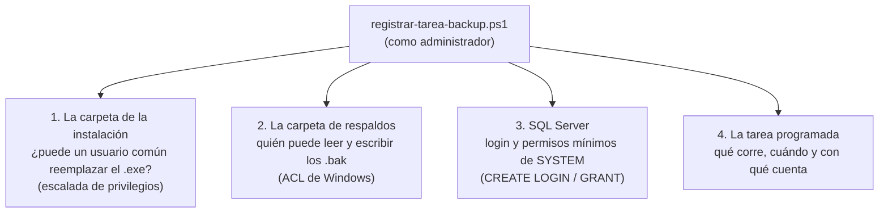
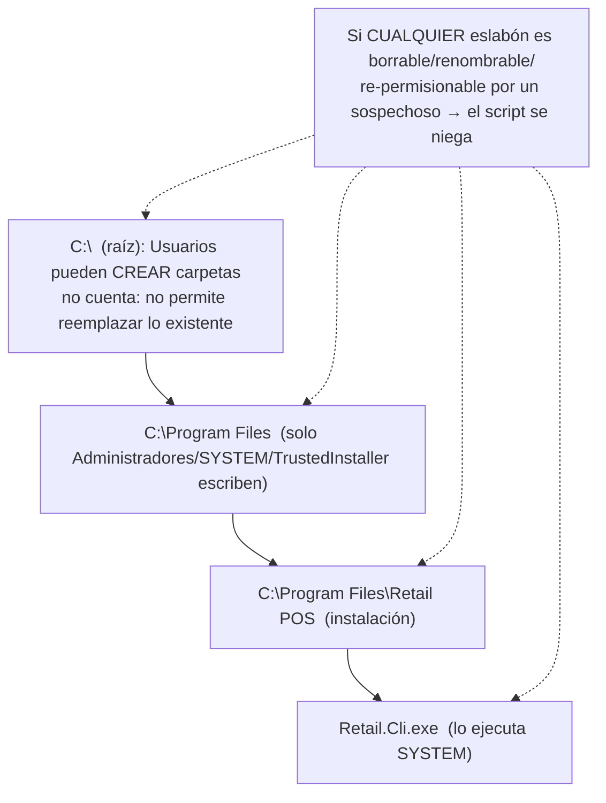

# Scripts de PowerShell y SQL: La Tarea Programada, Tramo por Tramo

### Módulo: 05. Casos de Uso y Flujos de Negocio de Punta a Punta
**Audiencia:** Desarrolladores, estudiantes universitarios y mesa evaluadora de cátedra  
**Requisitos Vinculados:** `RF-22` (Respaldo y Restauración), `RF-23` (Administración de la Base por Comandos), `RNF-08` (Integridad y Respaldo Diario)  
**Decisiones citadas:** D-15, D-18, D-27, D-28 y D-29, y los hallazgos #1 y #2 de la revisión de la Fase 7, de [`etapa-6-track-6.3-backup-restore.md`](file:///c:/Users/lucas/Proyectos/retail/docs/roadmap/etapa-6-track-6.3-backup-restore.md)  
**Archivos de Código:**
* [`scripts/registrar-tarea-backup.ps1`](file:///c:/Users/lucas/Proyectos/retail/scripts/registrar-tarea-backup.ps1): registra la tarea programada y prepara carpeta y permisos
* [`scripts/RetailPermisos.psm1`](file:///c:/Users/lucas/Proyectos/retail/scripts/RetailPermisos.psm1): módulo con las funciones de permisos y de configuración
* [`scripts/restore-retail.ps1`](file:///c:/Users/lucas/Proyectos/retail/scripts/restore-retail.ps1): envoltorio de `Retail.Cli restaurar`
* [`.github/workflows/release.yml`](file:///c:/Users/lucas/Proyectos/retail/.github/workflows/release.yml): empaqueta los scripts en el ZIP
* Tests: [`ScriptsDePermisosIntegracionTests.cs`](file:///c:/Users/lucas/Proyectos/retail/tests/Retail.Infrastructure.IntegrationTests/Backups/ScriptsDePermisosIntegracionTests.cs), [`PermisosTareaProgramadaIntegracionTests.cs`](file:///c:/Users/lucas/Proyectos/retail/tests/Retail.Infrastructure.IntegrationTests/Backups/PermisosTareaProgramadaIntegracionTests.cs) y [`PermisosTareaProgramadaFixture.cs`](file:///c:/Users/lucas/Proyectos/retail/tests/Retail.Infrastructure.IntegrationTests/Backups/PermisosTareaProgramadaFixture.cs)

---

## 1. 📖 Fundamento: Qué Hay Que Preparar Para Que una Copia Corra Sola

### 1.1 El problema

`Retail.Cli backup` sabe copiar la base, pero **alguien tiene que ejecutarlo todos los días a las 21:00**, aunque nadie haya iniciado sesión en la PC. D-28 decide que lo haga el **Programador de tareas de Windows** y D-29 que lo haga como `SYSTEM`. Eso obliga a resolver cuatro cosas, que son exactamente las del script:



| Pieza | Qué es | Por qué hace falta |
| :--- | :--- | :--- |
| **Cuenta `SYSTEM`** | La cuenta de Windows con más privilegios, que existe siempre | Corre sin sesión iniciada y **sin guardar contraseñas** (una contraseña guardada se rompe en silencio si cambia) |
| **Login de SQL Server** | Identidad con la que `SYSTEM` se presenta ante el motor | SQL Server no deja entrar a una cuenta de Windows que no tenga login |
| **Permisos mínimos** | Solo lo necesario para copiar y registrar el historial | Si `SYSTEM` fuera `sysadmin` de la instancia, un fallo en la herramienta podría hacer cualquier cosa |
| **ACL de la carpeta** | Lista de control de acceso: quién puede hacer qué | Los `.bak` contienen datos personales (Ley 25.326, R-6) |
| **Protección de la instalación** | El `.exe` que ejecuta `SYSTEM` no lo puede poder reemplazar un usuario común | Si no, cualquier cajero ejecutaría código como `SYSTEM` |

> [!IMPORTANT]
> **Escalada de privilegios, la idea central del capítulo.** Cada vez que un proceso privilegiado (`SYSTEM`) ejecuta o escribe algo que un usuario sin privilegios puede controlar, ese usuario puede hacer que `SYSTEM` actúe en su nombre. Casi todo lo complejo del script se reduce a evitar eso: no ejecutar un `.exe` reemplazable, no escribir logs en una carpeta que el usuario pueda redirigir, no leer datos de usuarios.

### 1.2 PowerShell desde cero: los conceptos que usa el script

| Concepto | Qué es | Dónde aparece |
| :--- | :--- | :--- |
| **Ayuda en comentarios** (*comment-based help*) | Un bloque `<# ... #>` con etiquetas `.SYNOPSIS`, `.DESCRIPTION`, `.PARAMETER`, `.EXAMPLE` que PowerShell usa como ayuda oficial: `Get-Help .\registrar-tarea-backup.ps1 -Full` | Al principio de los tres archivos |
| **`[CmdletBinding()]`** | Convierte al script en una "función avanzada": agrega parámetros comunes como `-Verbose` y `-WhatIf` | `[CmdletBinding(SupportsShouldProcess = $true)]` |
| **`-WhatIf` / `ShouldProcess`** | Modo de **vista previa**: cada acción que cambia algo se envuelve en `if ($PSCmdlet.ShouldProcess(destino, acción))`. Con `-WhatIf` esa llamada devuelve `false` y PowerShell imprime "Se realizaría la acción...", sin ejecutarla | Todo el script |
| **Módulo (`.psm1`)** | Archivo con funciones reutilizables que se carga con `Import-Module`. Solo se ven las funciones listadas en `Export-ModuleMember`; las demás quedan internas | `RetailPermisos.psm1` |
| **Administrador / UAC** | Un administrador de Windows corre sus programas **sin privilegios** salvo que los abra con "Ejecutar como administrador" (el *Control de Cuentas de Usuario*, UAC, pide confirmación). El script necesita esa elevación para crear tareas y cambiar permisos | `Test-Administrador` |
| **`$ErrorActionPreference = "Stop"`** | Convierte los errores que PowerShell considera "no terminantes" en excepciones que cortan el script. Sin esto, PowerShell seguiría ejecutando con valores vacíos | Todos los archivos |
| **`throw`** | Lanza una excepción con un mensaje; si nadie la captura, el script termina con error | Cada requisito no cumplido |
| **Código de salida** | Número que devuelve el proceso: 0 = éxito. `exit N` lo fija explícitamente; `$LASTEXITCODE` guarda el del último programa externo | `restore-retail.ps1` |
| **SID** | *Security Identifier*: el identificador numérico real de una cuenta o grupo (ej. `S-1-5-18` = `SYSTEM`). Los **nombres** cambian según el idioma de Windows; los SID no | `RetailPermisos.psm1` |

> [!NOTE]
> `registrar-tarea-backup.ps1` y `RetailPermisos.psm1` son archivos **ASCII puros**: están escritos sin tildes ni eñes ("sesion", "contrasenas", "espanol"), y por eso los mensajes que imprimen no las llevan. El repositorio no documenta el motivo; la explicación habitual es que Windows PowerShell 5.1 lee un `.ps1` UTF-8 sin marca de orden de bytes (BOM) con la página de códigos del sistema y corrompería las tildes (no verificado en este proyecto). `restore-retail.ps1` es UTF-8 sin BOM pero solo tiene una tilde, en un comentario.

---

## 2. 📦 Cómo Llegan los Scripts a la PC: el ZIP de la Versión

El flujo de publicación ([`release.yml`](file:///c:/Users/lucas/Proyectos/retail/.github/workflows/release.yml)) publica `Retail.App` y `Retail.Cli` **en la misma carpeta** y copia allí los scripts:

```yaml
- name: Incluir los scripts de recuperacion (R-2) y de copia automatica (Fase 7)
  # Ambos buscan Retail.Cli.exe en su misma carpeta: se copian junto a los ejecutables.
  # registrar-tarea-backup.ps1 importa RetailPermisos.psm1 desde su misma carpeta.
  run: Copy-Item scripts/restore-retail.ps1, scripts/registrar-tarea-backup.ps1, scripts/RetailPermisos.psm1 ./publish/Retail-POS/

- name: Comprimir paquete distribuible en formato ZIP
  run: Compress-Archive -Path ./publish/Retail-POS/* -DestinationPath ./Retail-POS-win-x64.zip
```

Resultado: al descomprimir `Retail-POS-win-x64.zip` en `C:\Program Files\Retail POS` quedan juntos `Retail.App.exe`, `Retail.Cli.exe`, `appsettings.json` y los tres scripts. Esa vecindad es la que usan los scripts para encontrar la CLI y su configuración (`$PSScriptRoot` es la carpeta donde vive el script).

Es importante que **`RetailPermisos.psm1` viaje con el script**: `registrar-tarea-backup.ps1` lo carga con `Import-Module (Join-Path $PSScriptRoot "RetailPermisos.psm1") -Force`. Si faltara, el script fallaría al principio.

---

## 3. 🧩 `registrar-tarea-backup.ps1`, Sección por Sección

### 3.1 Cabecera, parámetros y valores por defecto

```powershell
[CmdletBinding(SupportsShouldProcess = $true)]
param(
    [ValidatePattern('^([01]\d|2[0-3]):[0-5]\d$')]
    [string]$Hora = "21:00",

    [string]$RutaCli,

    [string]$Instancia,

    [ValidatePattern('^[A-Za-z0-9_\-]+$')]
    [string]$BaseDeDatos,

    [string]$Directorio,

    [string]$UsuarioApp = [Security.Principal.WindowsIdentity]::GetCurrent().Name,

    [switch]$Desregistrar,

    [switch]$RevocarPermisos
)
```

| Parámetro | Por defecto | Validación y razón |
| :--- | :--- | :--- |
| `-Hora` | `21:00` | `ValidatePattern` exige `HH:mm` de 24 horas. Se valida **antes** de ejecutar nada |
| `-RutaCli` | Se busca `Retail.Cli.exe` junto al script o en su carpeta padre | Debe ser el ejecutable **publicado**: `dotnet run` no sirve para una tarea |
| `-Instancia` | Sale de `ConnectionStrings:DefaultConnection` del `appsettings.json` junto a la CLI; si no figura, `.\SQLEXPRESS` | Se valida con `Test-InstanciaValida` (ver 3.2) |
| `-BaseDeDatos` | Del mismo `appsettings.json`; si no, `RetailDb` | `ValidatePattern`: solo letras, números, guion y guion bajo. Se inserta en sentencias SQL (3.6) |
| `-Directorio` | De `BackupSettings:Directorio` (con variables de entorno expandidas); si no, `C:\RetailData\Backups` | Debe coincidir con lo que usa la herramienta: si difiere del `appsettings.json`, las copias seguirían yendo a la carpeta del `appsettings.json` |
| `-UsuarioApp` | El usuario que ejecuta el script | Cuenta de Windows con la que se **usa** Retail POS. Si el script lo ejecuta *otro* administrador hay que indicarla, o las copias manuales desde la app fallarían por falta de permiso |
| `-Desregistrar` | — | Elimina la tarea (3.9) |
| `-RevocarPermisos` | — | Solo junto con `-Desregistrar` |

La idea de fondo: **un parámetro explícito siempre gana**; si no hay, manda el `appsettings.json` (la fuente de verdad que también usa la herramienta, D-15); si tampoco figura, el valor de fábrica. Así script y CLI no pueden desincronizarse por accidente. Lo resuelve:

```powershell
function Resolve-Configuracion([string]$CarpetaConfiguracion)
{
    # Un parametro explicito siempre gana; si no, manda el appsettings.json de la herramienta; si tampoco figura, el valor de fabrica.
    $configuracion = if ($CarpetaConfiguracion) { Read-ConfiguracionDeCli $CarpetaConfiguracion } else { [pscustomobject]@{ Instancia = $null; BaseDeDatos = $null; Directorio = $null } }

    if (-not $script:Instancia)
    {
        $script:Instancia = if ($configuracion.Instancia) { $configuracion.Instancia } else { ".\SQLEXPRESS" }
    }
    # ... lo mismo para BaseDeDatos ("RetailDb") y Directorio ("C:\RetailData\Backups")
```

### 3.2 Validación de `-Instancia`: por qué importa

El valor de `-Instancia` se inserta en una **cadena de conexión** que el script (corriendo como administrador) abre contra SQL Server. Sin validar, un valor como `x;Initial Catalog=otra` cambiaría la conexión (*inyección en la cadena de conexión*). `Test-InstanciaValida` del módulo lo impide:

```powershell
return [bool]($Instancia -match '^[A-Za-z0-9_.\-\\,:()]+$')
```

Acepta letras, números y `. _ - \ , : ( )` (cubre `.\SQLEXPRESS`, `(localdb)\MSSQLLocalDB`, `localhost,1433` y `PC-CAJA`); rechaza `;`, `=`, comillas y espacios. Lo prueba `TestInstanciaValida_SegunLosCaracteres_AceptaORechaza` con diez casos (`.\SQLEXPRESS;Initial Catalog=otra`, `a=b`, `a'b`, `a"b`, `a b` y la cadena vacía son rechazados). La función `Resolve-Configuracion` lanza un `throw` con el mensaje "La instancia '...' no es valida: solo se admiten letras, numeros y . _ - \ , : ( ) ..." si falla.

`Read-ConfiguracionDeCli` extrae la instancia y la base con `SqlConnectionStringBuilder` (`DataSource` e `InitialCatalog`), no con expresiones regulares: delega en el mismo analizador que usa .NET, que entiende `Server=`, `Data Source=`, etc.

### 3.3 Verificación de administrador y por qué `-WhatIf` funciona sin elevarse

```powershell
$vistaPrevia = [bool]$WhatIfPreference
if (-not (Test-Administrador))
{
    if (-not $vistaPrevia)
    {
        throw "Este script debe ejecutarse como administrador: abra PowerShell con 'Ejecutar como administrador' y vuelva a intentarlo (con -WhatIf se puede ver la vista previa sin permisos)."
    }

    Write-Warning "Vista previa sin permisos de administrador: para aplicar los cambios hay que ejecutar el script como administrador."
}
```

`Test-Administrador` pregunta si la identidad actual está en el rol `Administrator`:

```powershell
$identidad = [Security.Principal.WindowsIdentity]::GetCurrent()
return ([Security.Principal.WindowsPrincipal]$identidad).IsInRole([Security.Principal.WindowsBuiltInRole]::Administrator)
```

* Sin elevación y **sin** `-WhatIf` el script se detiene de inmediato con un mensaje que dice qué hacer.
* Con `-WhatIf` no hace falta ser administrador **porque no se cambia nada**; la vista previa permite al estudiante ver el plan (y a la mesa, una demostración) sin riesgo.

> [!WARNING]
> Con `-WhatIf` el script **sí ejecuta consultas de solo lectura** (los `SELECT` del apartado 3.5) y la verificación de la instalación (3.4), porque necesita datos reales para mostrar una vista previa fiel. Por lo tanto, sin ser `sysadmin` de la instancia el `-WhatIf` igualmente falla en la comprobación de `sysadmin`. Lo que garantiza `-WhatIf` es que ninguna **modificación** se ejecuta, y su último mensaje lo confirma: `Vista previa (-WhatIf): no se cambio nada.`

Luego valida que `-RevocarPermisos` se use junto con `-Desregistrar` y lee la tarea actual (`Get-ScheduledTask ... -ErrorAction SilentlyContinue`).

### 3.4 Ubicar la CLI y proteger la instalación (escalada de privilegios)

Primero se localiza `Retail.Cli.exe`, se resuelve la configuración desde su carpeta y se comprueban las precondiciones de la carpeta de respaldos y de la cuenta:

```powershell
function Find-RutaCli
{
    $candidatos = @(
        (Join-Path $PSScriptRoot "Retail.Cli.exe"),
        (Join-Path (Split-Path $PSScriptRoot -Parent) "Retail.Cli.exe")
    )
    return $candidatos | Where-Object { Test-Path -LiteralPath $_ } | Select-Object -First 1
}
```

```powershell
# Se cambian los permisos de la carpeta: nunca de la raiz de un disco.
if ($Directorio -eq [System.IO.Path]::GetPathRoot($Directorio).TrimEnd('\'))
{
    throw "El directorio de respaldos no puede ser la raiz de un disco: use una carpeta dedicada (por ejemplo, C:\RetailData\Backups)."
}
```

Esta última guarda evita un error catastrófico: un `-Directorio C:\` haría que el script corte la herencia y reescriba los permisos de **todo el disco**.

Después viene la **protección de la instalación**, el hallazgo #2 de la revisión de la Fase 7:

```powershell
$escribibles = @(Get-EscrituraEnInstalacion -Ruta $CarpetaCli -CuentasExtra @($UsuarioApp))
if ($escribibles.Count -gt 0)
{
    $detalle = ($escribibles | Select-Object -First 5) -join [Environment]::NewLine
    throw ("Instale Retail POS en una carpeta que solo puedan modificar los administradores, por ejemplo C:\Program Files\Retail POS (descomprima el ZIP ahi como administrador), y vuelva a ejecutar el script desde esa carpeta." +
        "$([Environment]::NewLine)La carpeta '$CarpetaCli' (o su contenido, o una carpeta superior) puede ser modificada por usuarios sin privilegios y la tarea corre como SYSTEM; esos usuarios podrian reemplazar el ejecutable y obtener SYSTEM. Hallazgos:$([Environment]::NewLine)$detalle")
}
```

Se comprueba **también con `-WhatIf` y antes de consultar SQL Server**: es un requisito de seguridad, no una acción.

#### 3.4.1 La historia: el defecto y su corrección

| Versión | Qué hacía | Problema |
| :--- | :--- | :--- |
| Fase 7 inicial | La tarea ejecutaba como `SYSTEM` el `.exe` desde la carpeta donde estuviera el script | Si estaba en Descargas o en el perfil, **el usuario podía reemplazar el `.exe`** y obtener `SYSTEM` (hallazgo #2) |
| Corrección en el PR #23 | El script **copiaba** la CLI a `%ProgramFiles%\Retail POS\Cli` y registraba esa copia | Esa copia **no se actualizaba con la app**: tras una actualización con migraciones, la CLI vieja decía "la base es más nueva que la app" y la copia diaria fallaba todas las noches |
| Corrección posterior (PR #24, rama `fix/tarea-backup-cli-instalada`) | La app se instala como administrador en `C:\Program Files\Retail POS` y la tarea apunta al `Retail.Cli.exe` **de la instalación**, sin copia aparte | El script solo se niega a continuar si esa carpeta no está protegida |

Hoy la regla es: **la tarea ejecuta el `.exe` de la instalación y el script verifica que esa instalación sea inviolable**. Actualizar la app (reemplazar los archivos como administrador) actualiza lo que ejecuta la tarea, sin volver a registrarla.

#### 3.4.2 `Get-EscrituraEnInstalacion`: la cadena completa

Revisa dos cosas: la propia carpeta (con todo su contenido) y **cada carpeta superior hasta la raíz del disco**.

```powershell
# 1. La carpeta y todo lo que contiene, sin excepciones.
$elementos = @(Get-Item -LiteralPath $carpeta -Force) + @(Get-ChildItem -LiteralPath $carpeta -Recurse -Force)
foreach ($elemento in $elementos)
{
    Get-ReglasDeEscrituraAjena $elemento $sospechosos $script:DerechosDeEscritura $false
}

# 2. Cada carpeta superior, hasta la raiz del disco.
$derechosSobreSuperiores =
    [System.Security.AccessControl.FileSystemRights]::Delete -bor
    [System.Security.AccessControl.FileSystemRights]::DeleteSubdirectoriesAndFiles -bor
    [System.Security.AccessControl.FileSystemRights]::ChangePermissions -bor
    [System.Security.AccessControl.FileSystemRights]::TakeOwnership

for ($superior = [System.IO.Path]::GetDirectoryName($carpeta); $superior; $superior = [System.IO.Path]::GetDirectoryName($superior))
{
    Get-ReglasDeEscrituraAjena (Get-Item -LiteralPath $superior -Force) $sospechosos $derechosSobreSuperiores $true
}
```

**¿Quiénes son "sospechosos"?** Los grupos amplios `Todos` (`S-1-1-0`), `Usuarios autenticados` (`S-1-5-11`) y `Usuarios` (`S-1-5-32-545`), más las cuentas de `-CuentasExtra` (acá, `-UsuarioApp`, la cuenta con que se usa Retail POS). Una regla de **denegación** se ignora; solo se miran las reglas `Allow`.

**¿Por qué las carpetas superiores?** Quien pueda **borrar, renombrar o cambiar los permisos** de `Retail POS` (o de `Program Files`, o del disco) puede mover la carpeta original y poner otra con su propio ejecutable. No hace falta poder escribir *dentro* de la instalación.

**¿Qué derechos cuentan y por qué difieren?**

| Dónde | Derechos que cuentan | Qué reglas se miran |
| :--- | :--- | :--- |
| La instalación y su contenido | `WriteData`, `AppendData`, `WriteExtendedAttributes`, `WriteAttributes`, `DeleteSubdirectoriesAndFiles`, `Delete`, `ChangePermissions`, `TakeOwnership` | Todas |
| Cada carpeta **superior** | Solo `Delete`, `DeleteSubdirectoriesAndFiles`, `ChangePermissions`, `TakeOwnership` | Solo las que se aplican **a esa carpeta** (se descartan las marcadas `InheritOnly`) |

La razón de este recorte, ya en el comentario del módulo: **"crear carpetas" en la raíz del disco** (que Windows da a `Usuarios` por defecto, es `AppendData`) **no permite reemplazar nada que ya exista**; contarlo haría que el script rechazara siempre cualquier instalación. Y las reglas "solo subcarpetas y archivos" de la raíz (`InheritOnly`) no alcanzan a `Program Files`, que no hereda de ella.

El diagrama muestra la idea:



Los hallazgos salen como texto legible, uno por hallazgo: `C:\ruta: S-1-5-11 tiene Modify, Synchronize` (el SID y los derechos). Si la lista está vacía, la cadena completa está protegida. Los tests lo prueban:

| Test | Qué demuestra |
| :--- | :--- |
| `GetEscrituraEnInstalacion_CarpetaSuperiorEscribiblePorUsuariosAutenticados_InformaLaCarpetaSuperior` | Instalación protegida cuyo **padre** da Modificar a Usuarios autenticados: se informa el padre y **no** la instalación |
| `GetEscrituraEnInstalacion_CadenaProtegida_NoInformaNadaBajoLaRaizDeLaPrueba` | Con toda la cadena protegida, no hay hallazgos |
| `GetEscrituraEnInstalacion_CuentaDeLaAppConModificarEnLaInstalacion_InformaElHallazgo` | La cuenta de la app (`-CuentasExtra`) con permiso de modificar el ejecutable es un hallazgo |
| `GetEscrituraEnInstalacion_CarpetaLogsEscribibleParaUsuarios_LaInforma` | Una subcarpeta `logs` escribible por `Usuarios` **también** es hallazgo: no hay excepciones, porque los logs ya no están en la instalación |

> [!NOTE]
> El módulo exporta además `Get-EscrituraDeNoAdministradores`, una versión anterior que revisa solo una carpeta y su contenido (sin las carpetas superiores). **El script ya no la usa** (usa `Get-EscrituraEnInstalacion`); se conserva exportada y con tests (`GetEscrituraDeNoAdministradores_...`). Es la clase de detalle que conviene conocer si la mesa pregunta qué funciones hay en el módulo.

### 3.5 Consultas a la instancia (solo lectura)

Antes de cambiar nada, el script interroga a SQL Server. Estas son **las cuatro sentencias**, copiadas literalmente del script:

```sql
SELECT IS_SRVROLEMEMBER('sysadmin');
```
Devuelve 1 si quien ejecuta el script es `sysadmin` de la instancia (administrador total del servidor). Hace falta para crear logins y conceder permisos de servidor; si no, el script lanza "El usuario actual no es sysadmin de '<instancia>'...".

```sql
SELECT TOP (1) service_account FROM sys.dm_server_services WHERE servicename LIKE 'SQL Server (%';
```
`sys.dm_server_services` es una *vista de administración dinámica* con los servicios del motor. Se pide la **cuenta de Windows con que corre SQL Server** (en Express, `NT SERVICE\MSSQL$SQLEXPRESS`). Es la cuenta que de verdad escribe y lee los `.bak` y a la que hay que darle permisos en la carpeta. Si viene vacía, el script lanza "SQL Server no informo la cuenta de su servicio...".

```sql
SELECT DB_ID(N'<base>');
```
`DB_ID` devuelve el identificador de la base o `NULL` si no existe. El script lo usa para exigir que la base ya esté creada y migrada ("Cree y migre la base primero (Retail.Cli migrar)"). El nombre `<base>` está validado por `ValidatePattern`, y además se duplican las comillas simples (`.Replace("'", "''")`) como segunda barrera.

```sql
SELECT COUNT(*) FROM sys.server_permissions p JOIN sys.server_principals s ON s.principal_id = p.grantee_principal_id WHERE s.name = N'NT AUTHORITY\SYSTEM' AND p.permission_name = N'CREATE ANY DATABASE' AND p.state IN ('G', 'W');
```
Cuenta cuántas veces `NT AUTHORITY\SYSTEM` ya tiene concedido `CREATE ANY DATABASE` (`state` `G` = *Grant*, `W` = *Grant With grant option*). Sirve para decidir si el permiso lo concede **este script** o ya existía (ver 3.7 y 3.9).

Todas se ejecutan con la función `Invoke-Sql`, que abre la conexión con **autenticación integrada** (la cuenta Windows de quien corre el script), cierra siempre la conexión en un `finally` y distingue entre un valor escalar y un comando sin resultado:

```powershell
$cadena = "Server=$Instancia;Database=$Base;Integrated Security=true;TrustServerCertificate=true;Connect Timeout=15"
```

Si cualquiera de las cuatro consultas falla, el script lo informa: `No se pudo consultar la instancia '<instancia>': <causa>`.

### 3.6 Carpeta de respaldos y su ACL

```powershell
if ($PSCmdlet.ShouldProcess($Directorio, "Crear la carpeta si falta y dejarla solo para Administradores y SYSTEM (control total) y Modificar a: $cuentaMotor, $CuentaSistema, $UsuarioApp (sin herencia ni grupos amplios)"))
{
    if (-not (Test-Path -LiteralPath $Directorio))
    {
        [void](New-Item -ItemType Directory -Path $Directorio)
    }

    Set-PermisoDeCarpeta -Ruta $Directorio -CuentasModificar @($cuentaMotor, $CuentaSistema, $UsuarioApp)
    Write-Host "Carpeta de respaldos lista."
}
```

La función `Set-PermisoDeCarpeta` del módulo:

```powershell
$carpeta = New-Object System.IO.DirectoryInfo $Ruta
$acl = $carpeta.GetAccessControl([System.Security.AccessControl.AccessControlSections]::Access)

$acl.SetAccessRuleProtection($true, $false)

foreach ($sidAmplio in $script:SidsAmplios)
{
    $acl.PurgeAccessRules((New-Object System.Security.Principal.SecurityIdentifier $sidAmplio))
}

$control = [System.Security.AccessControl.FileSystemRights]::FullControl
$modificar = [System.Security.AccessControl.FileSystemRights]::Modify

$acl.AddAccessRule((New-ReglaDeCarpeta (New-Object System.Security.Principal.SecurityIdentifier $script:SidAdministradores) $control))
$acl.AddAccessRule((New-ReglaDeCarpeta (New-Object System.Security.Principal.SecurityIdentifier $script:SidSistema) $control))

foreach ($cuenta in $CuentasModificar)
{
    $acl.AddAccessRule((New-ReglaDeCarpeta (Get-SidDeCuenta $cuenta) $modificar))
}

$carpeta.SetAccessControl($acl)
```

**Conceptos de ACL de Windows:**

| Término | Significado |
| :--- | :--- |
| **DACL** (*Discretionary Access Control List*) | La lista de reglas "quién puede qué" de un archivo o carpeta |
| **Regla heredada** | Una regla que la carpeta recibe de su padre. Si C:\ da "Usuarios autenticados: Modificar", **toda carpeta nueva lo hereda** |
| **Cortar la herencia** | Desvincular la carpeta de las reglas de su padre (`SetAccessRuleProtection`) |
| `ContainerInherit \| ObjectInherit` | Las reglas se propagan a las subcarpetas y a los archivos nuevos: los `.bak` que cree el motor heredan estos permisos |
| `FullControl` vs `Modify` | `Modify` permite leer, escribir y borrar, **pero no** cambiar permisos ni tomar posesión. Solo Administradores y `SYSTEM` administran permisos |

**Paso a paso del algoritmo:**

1. **Leer solo la DACL** (`AccessControlSections.Access`). El comentario del módulo explica por qué: `Set-Acl` intenta reescribir también el propietario y la auditoría, y eso exige privilegios que no hacen falta.
2. **`SetAccessRuleProtection($true, $false)`**: el primer argumento corta la herencia; el segundo (`false`) indica **no copiar** las reglas heredadas.
3. **Purgar** cualquier regla explícita de los grupos amplios (`Todos`, `Usuarios autenticados`, `Usuarios`) que hubiera dejado una ejecución anterior.
4. **Agregar explícitamente**: Administradores y `SYSTEM` con control total; el motor, `SYSTEM` y la app con `Modify`.
5. Escribir la DACL con `SetAccessControl`.

**Por qué por SID y no por nombre.** `Get-SidDeCuenta` acepta tanto nombres como SID en texto (si coincide con `^S-\d-\d+(-\d+)+$` crea el `SecurityIdentifier` directamente; si no, traduce el `NTAccount`). Las cuentas conocidas (`Administradores` = `S-1-5-32-544`, `SYSTEM` = `S-1-5-18` y los tres grupos amplios) se nombran **siempre por SID** porque el nombre cambia con el idioma de Windows ("Administradores"/"Administrators", "Usuarios"/"Users"): el script funcionaría en una instalación en español y fallaría en una en inglés. Si una cuenta no existe lanza "La cuenta de Windows '<cuenta>' no existe en este equipo."

**Quién queda y con qué derechos:**

| Cuenta | Derecho | Por qué |
| :--- | :--- | :--- |
| Administradores (`S-1-5-32-544`) | Control total | Administrar la carpeta |
| `SYSTEM` (`S-1-5-18`) | Control total | La tarea escribe manifiestos y aplica la retención |
| Cuenta del servicio de SQL Server (la devuelve la consulta de 3.5) | Modificar | **Es quien escribe y lee los `.bak`** (BACKUP y RESTORE los ejecuta el motor, no el usuario) |
| `-UsuarioApp` | Modificar | Las copias manuales desde la app calculan el SHA-256 y escriben el manifiesto |
| `Todos`, `Usuarios autenticados`, `Usuarios` | **Nada** | Los `.bak` tienen datos personales (R-6) |

#### 3.6.1 El bug que existió y cómo se corrigió (hallazgo #1)

En la **primera ejecución real** el script dejaba en la carpeta de respaldos a "Usuarios autenticados (Modificar)" y "Usuarios (leer y ejecutar)", confirmado con `icacls` en la máquina. La causa es sutil: la primera versión cortaba la herencia **copiando** las reglas heredadas (`SetAccessRuleProtection($true, $true)`). Eso las deja como reglas heredadas "congeladas": en memoria, Windows las sigue marcando como *heredadas* y `RemoveAccessRule` **las ignora**. Quitar permisos "no hacía nada".

| | Primera versión (con defecto) | Versión corregida |
| :--- | :--- | :--- |
| Cortar herencia | `SetAccessRuleProtection($true, $true)`: **copia** las reglas heredadas | `SetAccessRuleProtection($true, $false)`: **no copia** nada |
| Quitar grupos amplios | `RemoveAccessRule` (no afectaba a las heredadas) | `PurgeAccessRules` por SID de cada grupo amplio, además de que ya no hay reglas copiadas |
| Resultado | Grupos amplios con acceso | Solo las cuatro cuentas permitidas |
| Idempotencia | No verificada | Se puede ejecutar varias veces: no quedan reglas duplicadas ni sobrantes |

La corrección y su prueba se hicieron en el mismo cambio. Los tests de [`ScriptsDePermisosIntegracionTests`](file:///c:/Users/lucas/Proyectos/retail/tests/Retail.Infrastructure.IntegrationTests/Backups/ScriptsDePermisosIntegracionTests.cs) construyen **la situación real**: una carpeta padre que da `Modificar` a "Usuarios autenticados" por herencia (como `C:\`) y una carpeta hija que lo hereda (`CrearHijaQueHeredaUsuariosAutenticados`):

| Test | Qué demuestra |
| :--- | :--- |
| `SetPermisoDeCarpeta_ConPermisoAmplioHeredado_LoQuitaYDejaSoloLosCuatroPrincipales` | No quedan `Todos`/`Usuarios autenticados`/`Usuarios`; sí Administradores, `SYSTEM`, el motor y la app; la carpeta está protegida (`AreAccessRulesProtected`) y **ninguna regla es heredada** |
| `SetPermisoDeCarpeta_ConLosPermisosDeCadaPrincipal_AdministradoresYSistemaControlTotalYElRestoModificar` | Administradores y `SYSTEM` tienen `FullControl`; el motor y la app tienen `Modify` y **no** `FullControl`; todas las reglas propagan a archivos nuevos |
| `SetPermisoDeCarpeta_ConReglasExplicitasDeUnaEjecucionAnteriorConError_LasPurga` | Simula lo que dejó la versión con el defecto y ejecuta **dos veces**: queda exactamente el conjunto correcto |
| `SetPermisoDeCarpeta_SinCuentasAdicionales_DejaSoloAdministradoresYSistema` | Con `-CuentasModificar @()` quedan solo Administradores y `SYSTEM` |

Los tests no requieren ser administrador (quien crea una carpeta puede cambiar su ACL) y trabajan siempre bajo una carpeta temporal propia: nunca tocan `C:\RetailData` ni `Program Files`.

### 3.7 El login y los permisos de SQL Server

Se usa la función `Get-Delimitado` para construir un identificador de SQL Server seguro entre corchetes:

```powershell
function Get-Delimitado([string]$Identificador)
{
    return "[" + $Identificador.Replace("]", "]]") + "]"
}
```

Con `NT AUTHORITY\SYSTEM` el resultado es `[NT AUTHORITY\SYSTEM]`. (Duplicar `]` es la forma estándar de escapar un corchete de cierre dentro de un identificador delimitado.) Las sentencias, **literalmente como las arma el script**:

```sql
IF SUSER_ID(N'NT AUTHORITY\SYSTEM') IS NULL CREATE LOGIN [NT AUTHORITY\SYSTEM] FROM WINDOWS;
```
Se ejecuta en `master`. `SUSER_ID` devuelve el id del login o `NULL` si no existe; la guarda `IF ... IS NULL` hace que la sentencia sea **idempotente** (no falla si ya existe: según la instalación de SQL Server, el login de `SYSTEM` puede o no existir de antemano; no verificado). `FROM WINDOWS` crea un login de **autenticación de Windows**: no tiene contraseña de SQL Server.

```sql
IF DATABASE_PRINCIPAL_ID(N'NT AUTHORITY\SYSTEM') IS NULL CREATE USER [NT AUTHORITY\SYSTEM] FOR LOGIN [NT AUTHORITY\SYSTEM];
```
Se ejecuta **dentro de la base de Retail**. Un *login* es la identidad ante el servidor; un *usuario* es esa misma identidad *dentro de una base*. `DATABASE_PRINCIPAL_ID` es la guarda equivalente para usuarios. Ejemplo para recordar: el login es la tarjeta de entrada al edificio; el usuario es el permiso para entrar a una oficina concreta.

Los permisos viven en la lista `$Permisos`, **la única fuente de verdad**:

```powershell
$Permisos = @(
    @{ Ambito = 'Servidor'; Sql = 'GRANT CREATE ANY DATABASE TO {0};'; Motivo = 'RESTORE VERIFYONLY (verificacion de la copia) lo exige aunque no cree ninguna base' },
    @{ Ambito = 'BaseDeDatos'; Sql = 'ALTER ROLE db_backupoperator ADD MEMBER {0};'; Motivo = 'BACKUP DATABASE de la base' },
    @{ Ambito = 'BaseDeDatos'; Sql = 'GRANT SELECT ON OBJECT::dbo.[__EFMigrationsHistory] TO {0};'; Motivo = 'Leer el estado del esquema: la copia solo corre si la base esta al dia' },
    @{ Ambito = 'BaseDeDatos'; Sql = 'GRANT SELECT, INSERT, UPDATE ON OBJECT::dbo.REGISTROS_BACKUP TO {0};'; Motivo = 'Historial de copias: alta, cambios de estado y retencion (sin DELETE: el borrado es logico)' }
    # sp_getapplock sobre master (bloqueo contra restauraciones) no necesita permiso propio: lo permite el rol public.
)
```

El bucle de aplicación sustituye `{0}` (operador `-f` de formato) por la cuenta delimitada y elige en qué base ejecutarla según el `Ambito`:

```powershell
foreach ($permiso in $Permisos)
{
    $sql = $permiso.Sql -f $cuentaSql
    $base = if ($permiso.Ambito -eq 'Servidor') { "master" } else { $BaseDeDatos }

    if ($PSCmdlet.ShouldProcess("$Instancia ($base)", "$sql  -- $($permiso.Motivo)"))
    {
        Invoke-Sql $base $sql
    }
}
```

Con `-WhatIf`, el mensaje de vista previa muestra la sentencia **y** su motivo: sirve de documentación viva.

**Cada permiso, qué otorga y por qué es necesario:**

| # | Sentencia ya expandida | Ámbito | Qué da | Por qué hace falta |
| :-: | :--- | :-: | :--- | :--- |
| 1 | `GRANT CREATE ANY DATABASE TO [NT AUTHORITY\SYSTEM];` | `master` (servidor) | Permiso de servidor para crear bases | `RESTORE VERIFYONLY` lo exige **aunque no cree ninguna base**. Lo prueba el test `Verificacion_SinElPermisoDeServidor_FallaPorFaltaDeCreateDatabase`: sin este permiso el `BACKUP` funciona y `VERIFYONLY` falla con un mensaje que menciona `CREATE DATABASE` |
| 2 | `ALTER ROLE db_backupoperator ADD MEMBER [NT AUTHORITY\SYSTEM];` | La base | Pertenecer al rol fijo `db_backupoperator`: ejecutar `BACKUP DATABASE` (y `BACKUP LOG`, `CHECKPOINT`) | Para copiar la base. **No** da lectura de las tablas |
| 3 | `GRANT SELECT ON OBJECT::dbo.[__EFMigrationsHistory] TO [NT AUTHORITY\SYSTEM];` | La base | Leer la tabla de migraciones de EF Core | `ComandoBackup` consulta el esquema para decidir si la base está al día (solo copia si lo está). Los corchetes de `[__EFMigrationsHistory]` protegen el nombre con guiones bajos iniciales |
| 4 | `GRANT SELECT, INSERT, UPDATE ON OBJECT::dbo.REGISTROS_BACKUP TO [NT AUTHORITY\SYSTEM];` | La base | Leer, insertar y actualizar el historial de copias | La copia crea su registro `EnCurso`, lo pasa a `Exitoso`/`Verificado` o `Fallido`, y la retención lo marca `ArchivoPurgado` |

**Lo que deliberadamente NO se concede, y quién lo prueba:**

| No se concede | Razón | Prueba |
| :--- | :--- | :--- |
| `DELETE` sobre `REGISTROS_BACKUP` | El borrado de una copia es **lógico** (estado `ArchivoPurgado`, Ley 3): la fila nunca se elimina | `CuentaDeLaTarea_FueraDeLoNecesario_NoTienePermiso` con `DELETE FROM REGISTROS_BACKUP WHERE 1 = 0` |
| Cualquier permiso sobre `USUARIOS` | Tiene los **hashes de las contraseñas**. `ComandoBackup` ya no lee esa tabla (solo el esquema). Antes de la revisión de la Fase 7 existía un `SELECT` sobre `USUARIOS`; se eliminó (hallazgo 8 a 14) | `ConsultasDeUsuarios_ConLosPermisosDelScript_NoPuedeLeerNiElHashDeLasContrasenas` y el caso `UPDATE USUARIOS ...` |
| Leer tablas de negocio (ventas, clientes) | La tarea no las necesita; `db_backupoperator` copia el archivo completo sin darle lectura de las tablas | Caso `SELECT TOP (1) 1 FROM VENTAS` |
| Cambiar el esquema | Un copiador no debe poder alterar tablas | Caso `CREATE TABLE dbo.PRUEBA_PERMISOS (id int)` |
| Ningún permiso para `sp_getapplock` | El bloqueo sobre `master` contra restauraciones lo permite el rol `public`, al que pertenece todo login | `BloqueoDeRestauracion_ConLosPermisosDelScript_ElBloqueoSobreMasterSeObtieneYSeSuelta` (la cuenta entra a `master` como `guest`) |

> [!IMPORTANT]
> **Mínimo privilegio.** Si la herramienta tuviera un defecto, o si alguien lograra ejecutar código como esa cuenta, lo máximo que puede hacer en SQL Server es **copiar la base y escribir en el historial de copias**: no puede leer una venta, ni un hash, ni borrar ni cambiar el esquema. El `.bak` sí lo contiene todo, por eso la protección de la carpeta (3.6) es la otra mitad de la defensa.

### 3.8 La tarea programada

```powershell
$horaDelDia = [datetime]::ParseExact($Hora, "HH:mm", [System.Globalization.CultureInfo]::InvariantCulture)

$descripcion = "Copia de seguridad diaria de Retail POS (Retail.Cli backup). Si la PC estaba apagada, corre al encenderla."
if ($concedeElScript)
{
    $descripcion = "$descripcion $MarcaPermisoDeServidor"
}

$accion = New-ScheduledTaskAction -Execute $RutaCliTarea -Argument "backup" -WorkingDirectory $CarpetaCli
$disparador = New-ScheduledTaskTrigger -Daily -At $horaDelDia
$principal = New-ScheduledTaskPrincipal -UserId $CuentaSistema -LogonType ServiceAccount -RunLevel Highest
$configuracion = New-ScheduledTaskSettingsSet `
    -StartWhenAvailable `
    -MultipleInstances IgnoreNew `
    -ExecutionTimeLimit (New-TimeSpan -Hours 2) `
    -AllowStartIfOnBatteries `
    -DontStopIfGoingOnBatteries

[void](Register-ScheduledTask `
    -TaskName $NombreTarea `
    -Description $descripcion `
    -Action $accion `
    -Trigger $disparador `
    -Principal $principal `
    -Settings $configuracion `
    -Force)
```

| Elemento | Valor | Qué significa y por qué |
| :--- | :--- | :--- |
| **Nombre** | `Retail POS - Copia de seguridad diaria` | Fijo: sirve para encontrarla, actualizarla y desregistrarla |
| **Acción** | `Retail.Cli.exe` de la instalación, argumento `backup`, directorio de trabajo = carpeta de la instalación | Ejecuta el `.exe` instalado (3.4). El directorio de trabajo fijo evita depender de dónde arranque el Programador |
| **Disparador** | `-Daily -At <hora>` | Todos los días a la hora indicada (por defecto 21:00, D-28) |
| **Principal** | `NT AUTHORITY\SYSTEM`, `LogonType ServiceAccount`, `RunLevel Highest` | Corre como `SYSTEM` sin contraseña guardada (D-29); `Highest` es el máximo nivel de privilegio |
| `-StartWhenAvailable` | activado | **"Iniciar si se perdió"**: si la PC estaba apagada a las 21:00, la tarea corre apenas se enciende. Por eso `ComandoBackup` espera hasta 2 min al motor (capítulo 05) |
| `-MultipleInstances IgnoreNew` | activado | Si una ejecución todavía está en curso, se ignora la nueva en lugar de lanzar dos copias a la vez |
| `-ExecutionTimeLimit` | 2 horas | Si la copia se cuelga, Windows la termina; evita un proceso eterno |
| `-AllowStartIfOnBatteries`, `-DontStopIfGoingOnBatteries` | activados | Por defecto Windows no inicia (ni deja correr) tareas con la notebook a batería: una copia diaria no debe perderse por eso |
| `-Force` en `Register-ScheduledTask` | activado | Si la tarea ya existe, la **reemplaza**: el script es **idempotente** (se puede volver a ejecutar para cambiar la hora o la ruta) |

La descripción de la tarea lleva una **marca** (`[permiso-de-servidor-concedido-por-el-script]`) cuando fue este script quien concedió `CREATE ANY DATABASE`, para poder saber después si es seguro revocarlo (3.9). La lógica:

```powershell
$yaMarcado = $tareaActual -and $tareaActual.Description -and $tareaActual.Description.Contains($MarcaPermisoDeServidor)
$concedeElScript = $yaMarcado -or ($cantidadPermisoServidor -eq 0)
```

Es decir: el script se considera autor del permiso si **ya lo marcó en una ejecución anterior** o si **`SYSTEM` no lo tenía** antes de empezar. Si `SYSTEM` ya tenía `CREATE ANY DATABASE` por otro software, el script no lo marca y nunca lo revocará.

### 3.9 Migración desde la copia antigua de la CLI

Las versiones anteriores del script copiaban la CLI a `C:\Program Files\Retail POS\Cli`. Esa carpeta ya no se usa; después de registrar la tarea (para no dejar nunca una tarea apuntando a una carpeta borrada) el script ofrece eliminarla:

```powershell
if ((Test-Path -LiteralPath $CopiaAnteriorCli) -and -not (Test-MismaRuta $CarpetaCli $CopiaAnteriorCli) -and -not (Test-EstaDentroDe $CarpetaCli $CopiaAnteriorCli))
{
    if ($PSCmdlet.ShouldProcess($CopiaAnteriorCli, "Eliminar la copia del CLI que creaba la version anterior de este script (sus registros incluidos): la tarea ya usa la instalacion"))
    {
        Remove-Item -LiteralPath $CopiaAnteriorCli -Recurse -Force
        $copiaAnteriorEliminada = $true
        Write-Host "Copia anterior eliminada: $CopiaAnteriorCli."
    }
}
```

Las dos condiciones `-not (Test-MismaRuta ...)` y `-not (Test-EstaDentroDe ...)` impiden la peor ocurrencia posible: **borrar la propia instalación** si alguien instaló la app *dentro* de esa carpeta antigua (`...\Retail POS\Cli`). `Test-MismaRuta` compara rutas completas ignorando mayúsculas y la barra final; `Test-EstaDentroDe` comprueba que la instalación no cuelgue de ella.

### 3.10 `-Desregistrar` y `-RevocarPermisos`

```powershell
if ($RevocarPermisos)
{
    $cuentaSqlDesregistro = Get-Delimitado $CuentaSistema
    if ($tareaActual -and $tareaActual.Description -and $tareaActual.Description.Contains($MarcaPermisoDeServidor))
    {
        if ($PSCmdlet.ShouldProcess("$Instancia (master)", "REVOKE CREATE ANY DATABASE FROM $cuentaSqlDesregistro  -- otro software que corra como SYSTEM podria necesitarlo"))
        {
            Invoke-Sql "master" "IF SUSER_ID(N'$CuentaSistema') IS NOT NULL REVOKE CREATE ANY DATABASE FROM $cuentaSqlDesregistro;"
            Write-Host "Permiso CREATE ANY DATABASE revocado a $CuentaSistema."
        }
    }
    else
    {
        Write-Host "No se revoca CREATE ANY DATABASE: este script no lo concedio (o la tarea ya no esta registrada), asi que no se sabe si otro software lo necesita."
    }
}
```

La sentencia expandida es:

```sql
IF SUSER_ID(N'NT AUTHORITY\SYSTEM') IS NOT NULL REVOKE CREATE ANY DATABASE FROM [NT AUTHORITY\SYSTEM];
```

| Opción | Qué hace | Qué **no** hace |
| :--- | :--- | :--- |
| `-Desregistrar` | Elimina la tarea (`Unregister-ScheduledTask -TaskName ... -Confirm:$false`) | No borra la carpeta de respaldos ni sus copias, ni el login de SQL Server, ni la aplicación instalada (lo dice al final) |
| `-Desregistrar -RevocarPermisos` | Además, **con confirmación**, revoca `CREATE ANY DATABASE` si la marca de la tarea indica que lo concedió el script | No toca los permisos dentro de la base de Retail. Es opcional porque otro software que corra como `SYSTEM` podría necesitar el permiso |

Si la tarea no está registrada, informa `La tarea '...' no estaba registrada: no hay nada que eliminar.` y termina con `return`.

### 3.11 Resumen final y prueba inmediata

Si es una vista previa (`-WhatIf`) el script termina con `Vista previa (-WhatIf): no se cambio nada.`. Si no, imprime un **resumen** con: la hora y el ejecutable que corre; que la copia se hace al encender si la PC estaba apagada (esperando hasta 2 minutos a SQL Server); dónde se guardan las copias; que la tarea usa la CLI de la instalación (al actualizar no hay que volver a registrar); y el aviso crucial de que hay que volver a ejecutar el script como administrador **si se restaura una copia tomada antes del script o si una migración agrega tablas que usa la copia**, porque "los permisos de SQL Server viven dentro de la base". Termina indicando cómo probarla y dónde mirar:

```text
Para probarla ahora:
  Start-ScheduledTask -TaskName "Retail POS - Copia de seguridad diaria"
  Get-ScheduledTaskInfo -TaskName "Retail POS - Copia de seguridad diaria"   (LastTaskResult 0 = exito)

Donde mirar el resultado:
  - Registros de la tarea (como SYSTEM, legibles por administradores): C:\Windows\System32\config\systemprofile\AppData\Local\Retail POS\logs
  - Registros de la aplicacion de cada usuario: %LOCALAPPDATA%\Retail POS\logs
  - Historial de copias en Retail POS (pantalla de Respaldos): la copia figura como Automatica.
```

> [!NOTE]
> **Por qué "los permisos viven dentro de la base".** El *usuario* `NT AUTHORITY\SYSTEM` y sus `GRANT` de base son objetos de la base de datos. Una restauración reemplaza toda la base por la de la copia: si la copia se tomó **antes** de ejecutar el script, ese usuario no existe en ella y la tarea de esa noche fallaría. Por eso `RestauracionService` agrega la advertencia `AvisoPermisosDeLaCopiaAutomatica` cuando la vigente tenía el usuario de la tarea y la copia restaurada no (hallazgo 4 de la revisión). El login de servidor y `CREATE ANY DATABASE` no se pierden: viven en `master`.

---

## 4. 🧰 `RetailPermisos.psm1`: Las Seis Funciones Exportadas

El módulo existe para **poder probar la lógica de permisos aparte**: los tests lo importan en un `powershell.exe` real sin ejecutar el script entero (que registraría una tarea). Empieza con `Set-StrictMode -Version Latest` (error ante variables no definidas) y `$ErrorActionPreference = "Stop"`, de modo que "un error en cualquier función detenga el script que las importa, no que siga con valores vacíos". Termina con:

```powershell
Export-ModuleMember -Function Get-SidDeCuenta, Set-PermisoDeCarpeta, Get-EscrituraDeNoAdministradores, Get-EscrituraEnInstalacion, Read-ConfiguracionDeCli, Test-InstanciaValida
```

Dentro hay además dos funciones **internas** (no exportadas): `New-ReglaDeCarpeta` (construye una regla `Allow` con herencia a subcarpetas y archivos) y `Get-ReglasDeEscrituraAjena` (la auxiliar que emite un hallazgo por cada regla `Allow` de un sospechoso que incluya algún derecho de la lista).

| Función | Qué hace | Qué comprueba / devuelve | Test |
| :--- | :--- | :--- | :--- |
| `Get-SidDeCuenta` | Traduce un nombre o un SID en texto a `SecurityIdentifier` | Lanza "La cuenta de Windows '...' no existe en este equipo." si no se puede traducir | (cubierta indirectamente por los tests de `Set-PermisoDeCarpeta`) |
| `Set-PermisoDeCarpeta` | Deja una carpeta accesible solo para Administradores/`SYSTEM` (control total) y las cuentas indicadas (Modificar) | Corta la herencia sin copiar, purga grupos amplios, agrega reglas explícitas. Idempotente (3.6) | Cuatro tests `SetPermisoDeCarpeta_...` |
| `Get-EscrituraDeNoAdministradores` | Lista permisos de escritura de no administradores sobre una carpeta y su contenido | Una línea de texto por hallazgo; vacía = nada que informar. Hoy sin uso en el script (3.4.2) | `GetEscrituraDeNoAdministradores_CarpetaQueHeredaPermisoDeEscrituraAmplio_InformaElHallazgo`, `..._CarpetaProtegida_NoInformaNada`, `..._CuentaExtraConPermisoDeEscritura_InformaElHallazgo` |
| `Get-EscrituraEnInstalacion` | Lo mismo, pero sobre la instalación **y toda la cadena de carpetas superiores** | Ver 3.4.2 | Cuatro tests `GetEscrituraEnInstalacion_...` |
| `Read-ConfiguracionDeCli` | Lee `Instancia`, `BaseDeDatos` y `Directorio` del `appsettings.json` junto a la CLI | Devuelve un objeto con tres propiedades; las que faltan (o todas, si no hay archivo) quedan en `$null`. El directorio sale con las **variables de entorno expandidas** (`%TEMP%` se reemplaza), igual que en la app | `ReadConfiguracionDeCli_ConAppsettings_DevuelveInstanciaBaseYDirectorioExpandido`, `ReadConfiguracionDeCli_SinAppsettings_DevuelveValoresNulos` |
| `Test-InstanciaValida` | Valida el nombre de instancia | `true`/`false` con el patrón de 3.2 | `TestInstanciaValida_SegunLosCaracteres_AceptaORechaza` |

Un detalle de `Read-ConfiguracionDeCli`: lee el archivo con `-Encoding UTF8` y, para cada sección, consulta con `PSObject.Properties["..."]` antes de acceder. Es una consulta defensiva: con `Set-StrictMode`, acceder a una propiedad inexistente lanzaría un error en lugar de devolver `$null`.

---

## 5. 🛟 `restore-retail.ps1`: el Envoltorio de la Recuperación

Es un **envoltorio fino** (*thin wrapper*): toda la lógica de restauración vive en `Retail.Cli restaurar` y en `RestauracionService`. El script solo localiza la herramienta, la ejecuta y propaga su resultado. No maneja credenciales (las pide la propia CLI) y no contiene sentencias SQL.

**Parámetros:**

```powershell
[CmdletBinding()]
param(
    [Parameter(Mandatory = $true)]
    [string]$Archivo,

    [string]$RutaCli
)
```

`-Archivo` es obligatorio (PowerShell lo pide si falta). `-RutaCli` es opcional.

**Cómo localiza la CLI:**

```powershell
if (-not $RutaCli) {
    $candidatos = @(
        (Join-Path $PSScriptRoot "Retail.Cli.exe"),
        (Join-Path (Split-Path $PSScriptRoot -Parent) "Retail.Cli.exe")
    )
    $RutaCli = $candidatos | Where-Object { Test-Path $_ } | Select-Object -First 1
}
```

Busca `Retail.Cli.exe` junto al script (instalación publicada) o en su carpeta padre. Si no aparece, **cae al código fuente**:

```powershell
$proyecto = Join-Path (Split-Path $PSScriptRoot -Parent) "src\Retail.Cli"
if (-not (Test-Path $proyecto)) {
    Write-Error "No se encontro Retail.Cli.exe ni el proyecto en: $proyecto"
    exit 1
}

& dotnet run --project $proyecto -c Release -- restaurar $Archivo
```

**La nota sobre `ErrorActionPreference`.** El script lo fija en `"Stop"` para la búsqueda y luego lo baja a `"Continue"` **antes de llamar a la herramienta**. El comentario del código lo explica: la CLI escribe avisos en la salida de error estándar (por ejemplo "Cancelando..."); con `Stop`, PowerShell 5.1 los convierte en errores terminantes si el host captura esa salida, y un aviso inofensivo cortaría el script a mitad de una restauración. El resultado lo decide el **código de salida**, no stderr (hallazgo "PS" de la revisión final).

**Propagación del código de salida:**

```powershell
exit $LASTEXITCODE
```

Devuelve el código de `Retail.Cli` (0 = éxito, 1 = fallo o cancelado, 2 = uso incorrecto; ver capítulo 05), de modo que quien automatice el script sabe si la base se restauró.

**Procedimiento (resumen del propio script):** cerrar Retail POS en todas las terminales; ejecutar el script con el `.bak` (su `.json` debe estar en la misma carpeta); revisar el resumen e ingresar usuario y contraseña de un Gerente **de esa copia**; escribir `RESTAURAR`; leer las advertencias (en especial la conciliación con ARCA) y reiniciar. La base reemplazada queda como `<base>_Anterior_<fecha>`.

---

## 6. 🧪 Cómo los Tests Prueban Estos Scripts

El script y los permisos reales no se pueden ejercitar como `SYSTEM` desde un test (solo el Programador de tareas corre como `SYSTEM`). La estrategia es **probar exactamente lo que el script concede**, de dos maneras complementarias.

### 6.1 Permisos de SQL: `EXECUTE AS LOGIN`

La fixture [`PermisosTareaProgramadaFixture`](file:///c:/Users/lucas/Proyectos/retail/tests/Retail.Infrastructure.IntegrationTests/Backups/PermisosTareaProgramadaFixture.cs):

1. Crea una **base de pruebas** (`RetailDb_Test_Permisos_<guid>`), la migra y crea **dos logins de prueba**: uno con *exactamente* los permisos del script (`LoginCompleto`) y otro con los mismos **menos** el permiso de servidor (`LoginSinPermisoDeServidor`).
2. **No repite la lista de permisos: la lee del script** con una expresión regular sobre `registrar-tarea-backup.ps1` (`LeerPermisosDelScript`):

```csharp
[GeneratedRegex(@"Ambito\s*=\s*'(?<ambito>Servidor|BaseDeDatos)'\s*;\s*Sql\s*=\s*'(?<sql>[^']+)'")]
private static partial Regex PermisoDelScript();
```

   Así la prueba verifica **lo que el script realmente otorga**. Si alguien agrega o quita una línea de `$Permisos`, las pruebas ejercitan ese cambio solas. Si cambia el formato y la expresión no encuentra nada, la fixture lanza una excepción explícita (¿cambió el formato?).
3. Para ejecutar cada prueba, abre una conexión y **suplanta** al login con `EXECUTE AS LOGIN = N'<login>'`: desde ese momento todo lo que se ejecuta en esa conexión se evalúa con los permisos del login suplantado. El pool de conexiones se desactiva, para que una conexión que suplantó a otra no vuelva al pool con esa identidad puesta.

Las pruebas de [`PermisosTareaProgramadaIntegracionTests`](file:///c:/Users/lucas/Proyectos/retail/tests/Retail.Infrastructure.IntegrationTests/Backups/PermisosTareaProgramadaIntegracionTests.cs):

| Test | Qué prueba |
| :--- | :--- |
| `EstadoDelEsquema_ConLosPermisosDelScript_LeeMigracionesSinTocarUsuarios` | Lo primero que hace `backup` (leer el esquema) funciona con esos permisos |
| `PermisosDelScript_NoIncluyenNingunaTablaDeNegocioNiDeUsuarios` | La lista **completa y exacta** de las cuatro sentencias. Un permiso nuevo obliga a actualizar el test a propósito |
| `HistorialDeCopias_ConLosPermisosDelScript_AltaCambiosDeEstadoYRetencion` | El ciclo de vida de una copia automática (`EnCurso`, `Exitoso`, `Verificado`, `ArchivoPurgado`) funciona con `SELECT/INSERT/UPDATE` |
| `CopiaYVerificacion_ConLosPermisosDelScript_LaCopiaSeCreaYSeVerifica` | `BACKUP DATABASE ... WITH FORMAT, INIT, CHECKSUM, STATS = 10, NAME = @nombre;` y `RESTORE VERIFYONLY FROM DISK = @ruta WITH CHECKSUM;` (las mismas sentencias que `SqlServerEjecutorBackup`) |
| `Verificacion_SinElPermisoDeServidor_FallaPorFaltaDeCreateDatabase` | **Prueba negativa**: sin `CREATE ANY DATABASE`, el `BACKUP` anda y el `VERIFYONLY` no |
| `BloqueoDeRestauracion_ConLosPermisosDelScript_ElBloqueoSobreMasterSeObtieneYSeSuelta` | `sp_getapplock` sobre `master` funciona sin permiso propio |
| `ConsultasDeUsuarios_ConLosPermisosDelScript_NoPuedeLeerNiElHashDeLasContrasenas` | No se puede leer `password_hash` ni consultar `USUARIOS` (tres variantes, todas con "denied") |
| `CuentaDeLaTarea_FueraDeLoNecesario_NoTienePermiso` (`Theory` con 4 casos) | Denegado: leer `VENTAS`, modificar `USUARIOS`, `DELETE` del historial y `CREATE TABLE` |

> [!NOTE]
> Los propios autores documentan **dos límites** de esta estrategia (comentario de la clase): (1) los `.bak` los escribe la cuenta del servicio del motor, no la cuenta suplantada, así que los permisos de carpeta de la tarea no se prueban acá (los prueban los tests de ACL); (2) la cuenta es un login de SQL Server de prueba, no el login real `NT AUTHORITY\SYSTEM`, que solo se puede ejercitar desde el Programador de tareas (por eso existe la prueba manual de la sección 7). La clase corre en una colección de xUnit **sin paralelismo** (`PermisosTareaProgramadaColeccion`) como endurecimiento por descarte de una falla intermitente que no se pudo reproducir.

### 6.2 ACL: un `powershell.exe` real y una carpeta que hereda permisos amplios

[`ScriptsDePermisosIntegracionTests`](file:///c:/Users/lucas/Proyectos/retail/tests/Retail.Infrastructure.IntegrationTests/Backups/ScriptsDePermisosIntegracionTests.cs) prueba el módulo ejecutándolo en un `powershell.exe` nuevo (con `-NoProfile -NonInteractive -ExecutionPolicy Bypass -EncodedCommand`) que importa `RetailPermisos.psm1` y corre la función; después **lee la ACL resultante desde C#** con `DirectorySecurity`. Prueba el resultado real, no el código.

La clave es `CrearHijaQueHeredaUsuariosAutenticados`: crea una carpeta padre con `Usuarios autenticados: Modificar` por herencia y una hija que lo hereda. Verifica la **precondición** (la hija hereda el permiso amplio) para que la prueba reproduzca el caso real que falló en la primera ejecución. Sobre esa carpeta se aplican `Set-PermisoDeCarpeta` y las funciones de revisión, con los tests de las secciones 3.4.2 y 3.6.1.

---

## 7. 🛠️ Procedimiento de Prueba Manual (como administrador)

> [!WARNING]
> Este procedimiento **modifica el equipo** (crea una tarea programada, un login de SQL Server y cambia permisos). Hay que ejecutarlo en una PC de prueba, con una base ya creada y migrada, no en la de producción. Se describe para que lo puedas ejecutar y entender cada resultado.

**Requisitos previos:** SQL Server Express instalado (instancia `.\SQLEXPRESS`), tu usuario es `sysadmin` de la instancia (quien instaló Express lo es), la base creada con `Retail.Cli migrar`.

1. **Instalar como administrador.** Abre PowerShell *como administrador* y descomprime el ZIP de la versión en `C:\Program Files\Retail POS` (por ejemplo: `Expand-Archive -Path .\Retail-POS-win-x64.zip -DestinationPath "C:\Program Files\Retail POS"`). Es obligatorio hacerlo con elevación: es lo que deja la carpeta con permisos que solo los administradores pueden modificar.
2. **Ver la vista previa.** `cd "C:\Program Files\Retail POS"` y luego `.\registrar-tarea-backup.ps1 -WhatIf`. Revisa que muestre la instancia, la cuenta del servicio, la carpeta de respaldos y cada acción (con las sentencias SQL y sus motivos) terminando en `Vista previa (-WhatIf): no se cambio nada.`
3. **Ejecución real.** `.\registrar-tarea-backup.ps1`. Al final aparece el resumen. Si se queja de la instalación ("Instale Retail POS en una carpeta que solo puedan modificar los administradores..."), la carpeta o alguna superior es escribible por usuarios comunes: corrige los permisos y repite.
4. **Verificar la carpeta de respaldos** con `icacls C:\RetailData\Backups`. Debe listar solo Administradores y `SYSTEM` con control total (`(OI)(CI)(F)`) y la cuenta del servicio de SQL Server (`NT SERVICE\MSSQL$SQLEXPRESS`) y tu cuenta con modificar (`(OI)(CI)(M)`). **No** deben figurar `Todos`, `Usuarios autenticados` ni `Usuarios`, ni reglas heredadas (`(I)`). Es lo que no pasaba con el defecto de la primera versión.
5. **Verificar el login** en una consulta como `sysadmin` (por ejemplo con `sqlcmd -S .\SQLEXPRESS -E -Q "SELECT name FROM sys.server_principals WHERE name = N'NT AUTHORITY\SYSTEM'"`).
6. **Ejecutar la tarea ahora.** `Start-ScheduledTask -TaskName "Retail POS - Copia de seguridad diaria"` y, pasados unos segundos, `Get-ScheduledTaskInfo -TaskName "Retail POS - Copia de seguridad diaria"`. `LastTaskResult` en `0` significa éxito (cualquier otro número es el código de salida de la CLI; ver capítulo 05). Se puede consultar el estado general con `Get-ScheduledTask -TaskName "Retail POS - Copia de seguridad diaria"`.
7. **Verificar la copia.** Debe haber un `.bak` y un `.json` nuevos en `C:\RetailData\Backups`, y en la pantalla **Respaldos** de la app una copia de origen `Automatica` ejecutada por `Sistema`.
8. **Revisar el log de la tarea.** Como corre como `SYSTEM`, su log está en `C:\Windows\System32\config\systemprofile\AppData\Local\Retail POS\logs\retail-cli-AAAAMMDD.log` (lo lee un administrador). Ahí quedan "comando 'backup' ejecutado por SYSTEM..." y, si falló, el motivo exacto.
9. **Idempotencia.** Vuelve a ejecutar el script: debe terminar bien y dejar **una sola** tarea y las mismas reglas de carpeta.
10. **Quitarla.** `.\registrar-tarea-backup.ps1 -Desregistrar` (con `-RevocarPermisos` pide además confirmación para quitar `CREATE ANY DATABASE` si el script lo concedió). Conserva copias, login e instalación.

---

## 8. 📝 Resumen

| Tema | Idea clave | Dónde está |
| :--- | :--- | :--- |
| Objetivo | Que `Retail.Cli backup` corra solo cada día, como `SYSTEM`, con el mínimo privilegio (D-28, D-29) | `registrar-tarea-backup.ps1` |
| Parámetros | Un valor explícito gana; si no, el `appsettings.json` de la CLI; si no, el valor de fábrica. `-Instancia` y `-BaseDeDatos` se validan | `Resolve-Configuracion`, `Test-InstanciaValida` |
| Administrador | Se exige salvo con `-WhatIf`, que no cambia nada | `Test-Administrador` |
| Protección de la instalación | La tarea corre el `.exe` instalado: se verifica que ni la carpeta, ni su contenido, ni ninguna carpeta superior sea modificable por un usuario común | `Get-EscrituraEnInstalacion` |
| Carpeta de respaldos | Herencia cortada **sin copiar**, grupos amplios purgados, cuentas por **SID**, motor/app con Modificar | `Set-PermisoDeCarpeta` |
| SQL | Login y usuario con guardas idempotentes; cuatro permisos exactos; sin `USUARIOS`, sin `DELETE`, sin tablas de negocio | `$Permisos` |
| Tarea | `SYSTEM` + `ServiceAccount`, diaria, "iniciar si se perdió", una instancia, 2 h, con batería | `Register-ScheduledTask` |
| Desinstalar | `-Desregistrar` (conserva todo); `-RevocarPermisos` solo si lo concedió el script (marca en la descripción) | Sección 3.10 |
| Recuperación | `restore-retail.ps1` es un envoltorio: localiza la CLI, evita que los avisos de stderr corten el script, propaga el código de salida | `restore-retail.ps1` |
| Pruebas | Los permisos se **leen del script** y se prueban con `EXECUTE AS LOGIN`; las ACL, en un `powershell.exe` real con una carpeta que hereda permisos amplios | Fixture y dos clases de tests |

---

## 9. 🎓 Preguntas de Defensa

**1. ¿Por qué la tarea corre como `SYSTEM` y no con la cuenta del usuario?**  
Para que corra sin sesión iniciada y sin guardar una contraseña de Windows (D-29): una contraseña guardada se rompe en silencio cuando cambia y nadie se entera de que las copias dejaron de hacerse. El costo es que `SYSTEM` es muy poderosa, y por eso el script reduce al mínimo lo que puede hacer en SQL Server y se niega a ejecutar un `.exe` que un usuario común pueda reemplazar.

**2. ¿Qué es la escalada de privilegios en este contexto y cómo la previene el script?**  
Es que un usuario sin privilegios consiga que `SYSTEM` ejecute o escriba algo que él controla. El script la previene en tres frentes: (1) verifica que la instalación, su contenido y todas las carpetas superiores no sean modificables por grupos amplios ni por la cuenta de la app (`Get-EscrituraEnInstalacion`); (2) los logs no se escriben en la instalación sino en `%LOCALAPPDATA%` de cada cuenta, para que nadie redirija las escrituras de `SYSTEM` con un punto de montaje; (3) el login de SQL de `SYSTEM` no puede leer usuarios ni datos de negocio.

**3. ¿Por qué se corta la herencia *sin copiar* las reglas y cuál fue el defecto original?**  
La primera versión cortaba la herencia copiando las reglas heredadas. Eso las deja como heredadas en memoria y `RemoveAccessRule` las ignora, así que "Usuarios autenticados (Modificar)" y "Usuarios" seguían con acceso a los respaldos (hallazgo #1, confirmado con `icacls`). Ahora `SetAccessRuleProtection($true, $false)` no copia nada, se purgan los SID amplios y se agregan solo las cuentas permitidas, de forma idempotente. Lo cubren cuatro tests que reproducen la situación real con una carpeta que hereda el permiso.

**4. ¿Cómo se garantiza que los permisos de SQL son *suficientes* y a la vez *mínimos*?**  
Una fixture lee la lista `$Permisos` del propio script, crea una cuenta con exactamente esos permisos y, suplantándola con `EXECUTE AS LOGIN`, ejecuta las mismas sentencias que la herramienta (copia, verificación, historial, bloqueo): funcionan. Además prueba lo que se deniega (leer `VENTAS`, tocar `USUARIOS`, `DELETE` del historial, crear tablas) y que sin `CREATE ANY DATABASE` el `RESTORE VERIFYONLY` falla. Un test fija la lista exacta de las cuatro sentencias.

**5. ¿Por qué `CREATE ANY DATABASE` si la tarea no crea ninguna base?**  
Porque `RESTORE VERIFYONLY`, el paso que comprueba que el `.bak` es legible, lo exige aunque no cree nada. Se prueba con el test que le quita ese permiso: el `BACKUP` funciona y la verificación falla. Es el permiso más sensible de la lista, por eso el script recuerda si lo concedió él y solo en ese caso ofrece revocarlo con `-Desregistrar -RevocarPermisos`.

**6. Si se restaura una copia antigua, ¿la copia automática sigue funcionando?**  
No necesariamente. El *login* de `SYSTEM` y `CREATE ANY DATABASE` viven en `master` y sobreviven, pero el *usuario* de la base y sus permisos (`db_backupoperator`, `SELECT` del esquema, acceso al historial) viven dentro de la base: una copia tomada antes de ejecutar el script no los tiene. Por eso la restauración agrega una advertencia y se debe volver a ejecutar `registrar-tarea-backup.ps1` como administrador.

---

[⬅️ 05. La herramienta Retail.Cli](05-retail-cli.md) | [📚 Índice de la guía](README.md) | [➡️ 07. Escenarios de error y corrupción](07-escenarios-de-error-y-corrupcion.md)
