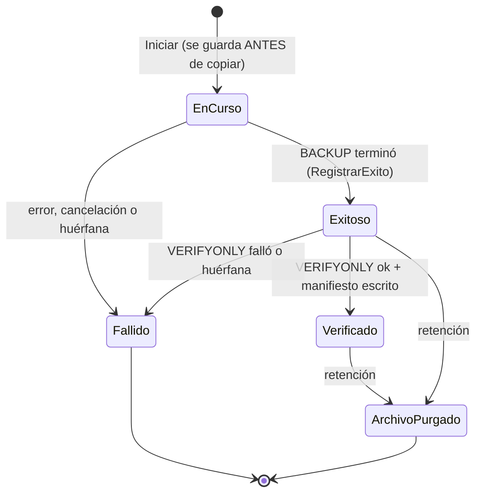
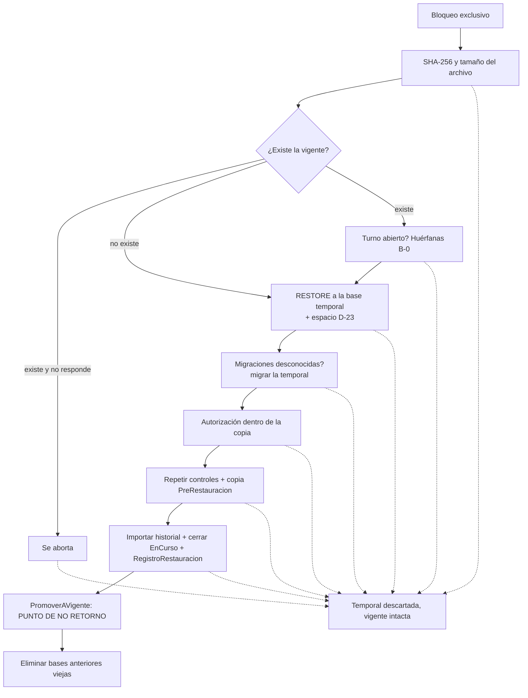
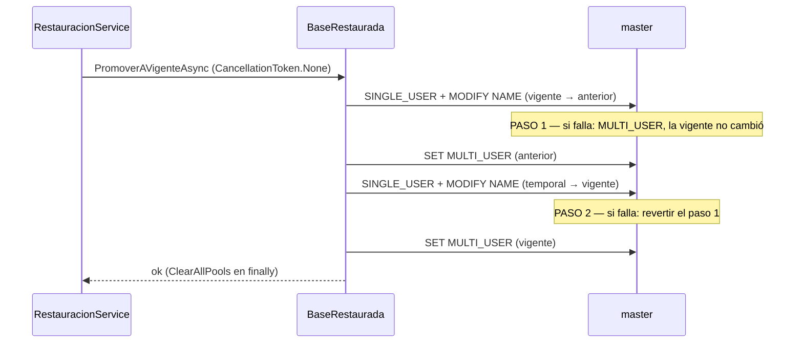

# Escenarios de Error y Corrupción: Qué Pasa Cuando Algo Sale Mal

### Módulo: 05. Casos de Uso y Flujos de Negocio de Punta a Punta
**Audiencia:** Desarrolladores, estudiantes universitarios y mesa evaluadora de cátedra  
**Requisitos Vinculados:** `RF-22` (Respaldo y Restauración), `RF-23` (Administración de la Base por Comandos) y `RNF-08` (Integridad ACID y Respaldos)  
**Diseño y decisiones:** [`docs/roadmap/etapa-6-track-6.3-backup-restore.md`](file:///c:/Users/lucas/Proyectos/retail/docs/roadmap/etapa-6-track-6.3-backup-restore.md) (riesgos R-1 a R-20, hallazgos de las revisiones independientes de las secciones 1.2, 1.3 y 1.4)  
**Archivos de Código:**
* Servicios: [`BackupService.cs`](file:///c:/Users/lucas/Proyectos/retail/src/Retail.Application/Services/BackupService.cs) y [`RestauracionService.cs`](file:///c:/Users/lucas/Proyectos/retail/src/Retail.Application/Services/RestauracionService.cs)
* Infraestructura: [`SqlServerEjecutorBackup.cs`](file:///c:/Users/lucas/Proyectos/retail/src/Retail.Infrastructure/Backups/SqlServerEjecutorBackup.cs), [`SqlServerRestauradorBaseDatos.cs`](file:///c:/Users/lucas/Proyectos/retail/src/Retail.Infrastructure/Backups/SqlServerRestauradorBaseDatos.cs), [`BaseRestauradaSqlServer.cs`](file:///c:/Users/lucas/Proyectos/retail/src/Retail.Infrastructure/Backups/BaseRestauradaSqlServer.cs), [`SqlServerBloqueoRestauracion.cs`](file:///c:/Users/lucas/Proyectos/retail/src/Retail.Infrastructure/Backups/SqlServerBloqueoRestauracion.cs), [`ArchivosBackup.cs`](file:///c:/Users/lucas/Proyectos/retail/src/Retail.Infrastructure/Backups/ArchivosBackup.cs) y [`RutaCopiaBackup.cs`](file:///c:/Users/lucas/Proyectos/retail/src/Retail.Infrastructure/Backups/RutaCopiaBackup.cs)
* Consola: [`ComandoBackup.cs`](file:///c:/Users/lucas/Proyectos/retail/src/Retail.Cli/Comandos/ComandoBackup.cs), [`ComandoRestaurar.cs`](file:///c:/Users/lucas/Proyectos/retail/src/Retail.Cli/Comandos/ComandoRestaurar.cs) y [`CancelacionConsola.cs`](file:///c:/Users/lucas/Proyectos/retail/src/Retail.Cli/Consola/CancelacionConsola.cs)

---

## 1. 📖 Fundamento: Diseñar Para Fallar Sin Dañar

### 1.1 Un respaldo se mide en su peor día
Una copia de seguridad casi nunca se usa, y cuando se usa es porque algo ya salió mal: un disco roto, una base corrupta, una PC nueva. Por eso el código de respaldo y restauración tiene una particularidad: **gran parte de su tamaño no está en el camino feliz, sino en lo que hace cuando el camino feliz se rompe**. Un respaldo que falla en silencio es peor que no tener respaldo, porque da una falsa sensación de seguridad.

La teoría que ordena este capítulo es la de las propiedades **ACID** y, en particular, la **atomicidad** (*atomicity*): una operación o se completa entera o no deja huella. SQL Server la garantiza para una transacción, pero un restore completo involucra archivos, varias bases y renombrados que **ninguna transacción abarca**. La atomicidad hay que construirla a mano, con un orden de pasos pensado para que cada falla caiga en un estado conocido y seguro.

### 1.2 Las cuatro redes de seguridad
El diseño apila cuatro defensas. Cada escenario del catálogo se explica diciendo cuál de ellas actuó.

| # | Defensa | Qué protege | Dónde vive |
| :-: | :--- | :--- | :--- |
| 1 | **Validar antes de tocar** | La base vigente no se modifica hasta que la copia fue leída, comparada con su huella SHA-256, restaurada aparte y autorizada | `RestauracionService.EjecutarRestauracionAsync` |
| 2 | **Base temporal descartable** (`RetailDb_Restaurando`) | Cualquier falla antes del intercambio elimina la temporal y la vigente queda intacta (D-17) | `BaseRestauradaSqlServer.DisposeAsync` |
| 3 | **Base anterior** (`RetailDb_Anterior_<fecha>`) | Aun después del intercambio, los datos reemplazados siguen en el servidor, íntegros | `BaseRestauradaSqlServer.IntercambiarAsync` |
| 4 | **Historial y estados** | Cada copia está en un estado explícito (`EnCurso`, `Exitoso`, `Verificado`, `Fallido`, `ArchivoPurgado`); solo `Verificado` es restaurable | `RegistroBackup` (Dominio) |

Y dos mecanismos transversales: el **bloqueo de lectores y escritor** (`sp_getapplock`), que impide que copias y restauraciones se pisen, y la **autorreparación de copias huérfanas** (B-0), que evita que un corte de luz bloquee el sistema para siempre.

### 1.3 Cómo leer cada ficha
Cada escenario tiene cinco líneas:

* **Qué pasa:** la situación, en lenguaje llano.
* **Detección:** la comprobación exacta del código que se da cuenta.
* **Qué hace el sistema:** el estado en que queda y el mensaje real que ve el operador (copiado del código, entre comillas).
* **Queda a salvo:** qué dato no se perdió y por qué.
* **Pruebas:** nombres reales de métodos de test. Si no hay prueba, se dice.

> [!NOTE]
> Los mensajes del motor de SQL Server **nunca** llegan crudos al operador: `DescripcionDeFalla.Para` los reemplaza por *"error del motor de base de datos o del sistema (el detalle técnico quedó en el registro de la aplicación)"*. Solo se muestran tal cual los errores de archivo y disco (`IOException`, `UnauthorizedAccessException`) y las excepciones propias de la aplicación. El detalle técnico va a la `InnerException` y al log (corrección B-1 de la revisión final de la Fase 5).

---

## 2. 💾 Fallas Durante una Copia

El ciclo de vida de una copia es `EnCurso → Exitoso → Verificado`, con `Fallido` y `ArchivoPurgado` como estados finales. Cada ficha de esta sección es una forma de no llegar a `Verificado`.



### A-01. Corte de luz o proceso muerto a mitad del `BACKUP` (copia huérfana, B-0)
* **Qué pasa:** la PC se apaga, o el proceso de la app o de `Retail.Cli` muere, mientras el motor escribe el `.bak`. El registro se había guardado `EnCurso` *antes* de copiar, así que queda un registro "en curso" que nadie va a cerrar.
* **Detección:** la **siguiente** copia (o restauración) ejecuta `CerrarCopiasInterrumpidasAsync`. Intenta tomar el bloqueo **exclusivo** sin esperar; si lo obtiene, ninguna copia ni restauración está corriendo, y por lo tanto todo registro `EnCurso` o `Exitoso` es huérfano. No hay heurística de tiempo: el motor garantiza que el bloqueo de una copia viva sigue tomado.
* **Qué hace el sistema:** cierra cada huérfano con `RegistrarFallo(RegistroBackup.MensajeCopiaHuerfana)`, cuyo texto es *"Copia interrumpida: el proceso terminó antes de completarla."*; guarda; **recién entonces** borra el `.bak` y el `.json` parciales (sin propagar errores de disco). En una restauración, la advertencia al operador es *"Se cerró 1 copia de seguridad interrumpida en la base vigente."* (o *"Se cerraron N copias de seguridad interrumpidas en la base vigente."*).
* **Queda a salvo:** la base vigente (`BACKUP` solo lee). El `.bak` parcial no es restaurable porque su registro nunca llegó a `Verificado`. Sin B-0, el índice único filtrado `IX_REGISTROS_BACKUP_EnCurso` rechazaría para siempre toda copia nueva: fue el hallazgo #1 (severidad alta) de la revisión de la Fase 7.
* **Pruebas:** `CrearBackupManualAsync_HuerfanaYExclusivoDisponible_LaCierraYCopia`, `CrearBackupDelSistemaAsync_HuerfanaYExclusivoDisponible_LaCierraYCopia` (unitarias); `CrearBackupDelSistemaAsync_ConUnaCopiaHuerfana_LaCierraComoFallidaYCopia` y `CrearBackupManualAsync_ConUnaCopiaHuerfanaEnLaVigente_LaCierraComoFallidaYCopia` (integración con un huérfano real); `RestaurarDesdeHistorialAsync_CopiaEnCursoHuerfanaEnLaVigente_LaCierraComoFallidaYContinua` y `RestaurarDesdeHistorialAsync_VariasCopiasHuerfanasEnLaVigente_AdvierteEnPlural` (restore).

El código que toma la decisión:

```csharp
await using var exclusivo = await _bloqueo.IntentarAdquirirExclusivoAsync(cancellationToken);
if (exclusivo is null)
{
    return;
}
```

Si `exclusivo` es `null`, otra copia o restauración **está viva** y su registro es legítimo: no se toca (A-03).

### A-02. El proceso muere durante `RESTORE VERIFYONLY` (huérfana en `Exitoso`)
* **Qué pasa:** el `BACKUP` terminó y el registro pasó a `Exitoso`, pero el proceso murió verificando. El archivo existe pero nunca se verificó.
* **Detección:** la misma consulta de B-0 incluye `r.Estado == EstadoBackupEnum.EnCurso || r.Estado == EstadoBackupEnum.Exitoso`. `RegistroBackup.RegistrarFallo` admite ambos estados de origen (`ExigirEstado(..., EnCurso, Exitoso)`).
* **Qué hace el sistema:** igual que A-01: `Fallido` con el motivo de la huérfana y borrado de `.bak` y `.json`. La revisión independiente detectó que la primera versión de B-0 solo cerraba `EnCurso` y dejaba esta copia en un limbo (hallazgos 5 y 6).
* **Queda a salvo:** una copia no verificada no se ofrece para restaurar (`EsRestaurable` exige `Verificado`).
* **Pruebas:** `CrearBackupDelSistemaAsync_CopiaExitosaSinVerificarYExclusivoDisponible_LaCierraYBorraSusRestos`, `CrearBackupDelSistemaAsync_CopiaExitosaSinVerificarYExclusivoNoDisponible_NoLaToca`, `CrearBackupManualAsync_ConUnaCopiaExitosaSinVerificarYSusRestos_LaCierraComoFallidaYBorraLosArchivos` (integración), `RestaurarDesdeHistorialAsync_CopiaExitosaSinVerificarEnLaVigente_LaCierraComoFallidaYBorraSusRestos`.

### A-03. Una copia viva no debe confundirse con una huérfana
* **Qué pasa:** hay una copia realmente en marcha (otro proceso) y llega una segunda.
* **Detección:** `IntentarAdquirirExclusivoAsync` devuelve `null` porque la copia viva sostiene el bloqueo compartido. Luego `CopiarConHistorialAsync` consulta los registros `EnCurso`.
* **Qué hace el sistema:** no toca el registro ajeno y rechaza con `DomainException`: *"Ya hay una copia de seguridad en curso (iniciada a las HH:mm). Espere a que termine."*
* **Queda a salvo:** la copia viva termina normalmente. Es el error simétrico de A-01 (cerrar como huérfana una copia sana) y es el que más daño haría.
* **Pruebas:** `CrearBackupManualAsync_YaHayUnaCopiaEnCurso_LanzaDomainExceptionSinTocarElDisco`, `CrearBackupManualAsync_EnCursoYExclusivoNoDisponible_NoTocaElRegistroYRechaza`, `CrearBackupDelSistemaAsync_CopiaExitosaSinVerificarYExclusivoNoDisponible_NoLaToca`; integración: `CrearBackupManualAsync_OtraCopiaViva_NoCierraNiTocaSuRegistro`.

### A-04. Sesión que sobrevive a una copia matada
* **Qué pasa:** el proceso de la copia muere, pero el motor todavía conserva su sesión (y con ella el bloqueo compartido) unos instantes.
* **Detección:** el bloqueo es de **sesión** (`@LockOwner = 'Session'`) y vive en una conexión propia a `master` con el pool desactivado. Cuando la sesión desaparece, el motor suelta el bloqueo; mientras exista, `IntentarAdquirirExclusivoAsync` devuelve `null`.
* **Qué hace el sistema:** mientras la sesión viva, la copia nueva se comporta como en A-03 (rechazo seguro, sin cerrar nada). Apenas el motor suelta el bloqueo, B-0 puede cerrar la huérfana.
* **Queda a salvo:** nunca se cierra una copia que el motor todavía considera viva. Cuánto tarda el motor en descartar la sesión de un proceso cliente muerto no se verificó: la prueba simula la caída con `KILL`.
* **Pruebas:** `IntentarAdquirirExclusivoAsync_ElProcesoDeLaCopiaMuere_ElMotorSueltaElCompartidoYSeObtiene` (mata la sesión con `KILL`), `IntentarAdquirirExclusivoAsync_ConUnCompartidoTomado_DevuelveNulo`, `IntentarAdquirirExclusivoAsync_LiberadoElCompartido_DevuelveElBloqueo`.

La consulta del bloqueo, literal de `SqlServerBloqueoRestauracion.TomarAsync`:

```sql
DECLARE @r int; EXEC @r = sp_getapplock @Resource = @recurso, @LockMode = @modo, @LockOwner = 'Session', @LockTimeout = @espera; SELECT @r;
```

`@recurso` es `"Retail.Restauracion." + nombre de la base`; `@modo` es `'Exclusive'` (restauración) o `'Shared'` (copias); `@espera` está en milisegundos (cero para no esperar, 10 000 para las copias). Un resultado negativo significa "no se pudo tomar".

### A-05. Cancelación con Ctrl+C en `Retail.Cli backup`
* **Qué pasa:** el operador presiona Ctrl+C durante la copia.
* **Detección:** `CancelacionConsola` captura `Console.CancelKeyPress`, pone `e.Cancel = true` (Windows no mata el proceso) y cancela el `CancellationToken`.
* **Qué hace el sistema:** la consola dice *"Cancelando... espere a que la operación se detenga de forma segura."*. El `catch` de `CopiarConHistorialAsync` llama a `RegistrarFalloAsync`: borra el parcial y deja el registro `Fallido` con *"Copia cancelada."*, usando `CancellationToken.None` para que el historial refleje lo ocurrido aunque la operación se haya cancelado. Luego relanza `OperationCanceledException`; `Program` muestra *"Operación cancelada."* y sale con código 1. Una segunda pulsación solo repite el aviso *"La cancelación ya fue pedida. Espere: cerrar la ventana ahora puede dañar la base."*
* **Queda a salvo:** la base vigente y todas las demás copias.
* **Pruebas:** `CrearBackupManualAsync_Cancelada_RegistraElFalloYPropagaLaCancelacion` (unitaria, con un doble de prueba que lanza `OperationCanceledException`). **No verificado con el motor real:** en la restauración, `SqlServerRestauradorBaseDatos` comenta que el controlador informa la cancelación del comando como `SqlException` ("Operation cancelled by user") y la traduce a mano; `SqlServerEjecutorBackup` no hace esa traducción, así que una cancelación real durante el `BACKUP` podría terminar como `BackupFallidoException` en lugar de `OperationCanceledException`. El estado resultante (copia `Fallido`, archivo borrado) sería el mismo; solo cambiaría el mensaje. No hay test de integración que lo confirme. `CancelacionConsola` no tiene tests (no existe un proyecto de pruebas de `Retail.Cli`).

### A-06. Cierre de la aplicación durante una copia manual
* **Qué pasa:** el Gerente intenta cerrar la app mientras la copia corre.
* **Detección:** `ConfirmarCredencialDialog.OnClosing` cancela el cierre cuando `ViewModel.IsBusy`. La app no pasa ningún `CancellationToken` a la copia (`Task.Run(() => _backupService.CrearBackupManualAsync(idActor, password, progreso))`): **desde la pantalla una copia no se cancela**, se espera.
* **Qué hace el sistema:** la ventana no se cierra hasta que la operación termina. Si el proceso muere igual (apagado forzado, cierre desde el Administrador de tareas), el caso pasa a ser A-01.
* **Queda a salvo:** lo mismo que A-01.
* **Pruebas:** ninguna automática para el bloqueo del cierre del diálogo (la prueba de humo `AppSmokeTests` solo instancia las vistas).

### A-07. Error del motor durante el `BACKUP`
* **Qué pasa:** el motor falla al escribir: sin permiso en la carpeta (error 5 del sistema operativo), disco que se llena durante la copia, base dañada.
* **Detección:** `SqlServerEjecutorBackup.CrearCopiaAsync` lanza `SqlException`; el `catch (Exception ex)` de `CopiarConHistorialAsync` la atrapa.
* **Qué hace el sistema:** `RegistrarFalloAsync` borra el archivo parcial y deja el registro `Fallido` (con el texto original del motor en `MensajeError`, truncado a 1000 caracteres). Al operador le llega `BackupFallidoException`: *"No se pudo completar la copia de seguridad: error del motor de base de datos o del sistema (el detalle técnico quedó en el registro de la aplicación)"*. Si el error fuera de archivo o de disco (`IOException`), se muestra su mensaje.
* **Queda a salvo:** la base vigente; las copias anteriores.
* **Pruebas:** `CrearBackupManualAsync_FallaElMotor_RegistraFallidoBorraElParcialYLanzaBackupFallido`.

> [!NOTE]
> El texto original del motor queda guardado en `MensajeError` y la pantalla de Respaldos lo muestra como *tooltip* de la fila (`ToolTip="{Binding MensajeError}"` en `BackupView.xaml`). Es una excepción consciente a la regla "nada crudo al operador": solo lo ve un Gerente o un Administrador, y le sirve para el diagnóstico.

La sentencia es:

```sql
BACKUP DATABASE [RetailDb] TO DISK = @ruta WITH FORMAT, INIT, CHECKSUM, STATS = 10, NAME = @nombre;
```

(En el código el nombre de la base se delimita con `ComandosSqlServer.Delimitar`, que lo encierra entre corchetes y duplica los `]`; aquí se muestra con el valor por defecto.) `@ruta` y `@nombre` viajan como parámetros.

### A-08. La copia queda escrita pero `RESTORE VERIFYONLY` falla
* **Qué pasa:** el `BACKUP` terminó, pero al releer el archivo el motor encuentra un problema (por ejemplo, una página dañada al escribir).
* **Detección:** `VerificarCopiaAsync` ejecuta `RESTORE VERIFYONLY FROM DISK = @ruta WITH CHECKSUM;` y lanza `SqlException`.
* **Qué hace el sistema:** el registro estaba `Exitoso`; pasa a `Fallido` (`RegistrarFallo` admite ese origen), se borra el archivo y el operador recibe el `BackupFallidoException` genérico de A-07. La copia **no** llega a `Verificado`, así que jamás se ofrece para restaurar.
* **Queda a salvo:** los datos vigentes. Es exactamente el motivo por el que existe el estado intermedio `Exitoso`.
* **Pruebas:** `CrearBackupManualAsync_ArchivoQueNoPasaLaVerificacion_QuedaFallidoYNoRestaurable`; integración: `VerificarCopiaAsync_ArchivoCorrupto_LanzaSqlException`, `VerificarCopiaAsync_ArchivoIntacto_NoLanza`.

### A-09. La carpeta de respaldos no se puede escribir
* **Qué pasa:** el directorio no existe y no se puede crear, o la cuenta de la aplicación no tiene permiso de escritura.
* **Detección:** `ArchivosBackup.PrepararRutaNueva` crea el directorio y escribe y borra un archivo `.prueba-escritura-{guid}` *antes* de pedirle la copia al motor.
* **Qué hace el sistema:** `BackupFallidoException`: *"No se puede escribir en el directorio de respaldos '{directorio}': verifique que exista y que la cuenta tenga permiso de escritura."* Como `PrepararRutaNueva` se llama **antes** de `RegistroBackup.Iniciar`, no queda ningún registro `EnCurso`.
* **Queda a salvo:** todo. El mensaje existe porque el error crudo del motor ("Operating system error 5") no le dice al operador qué carpeta revisar.
* **Pruebas:** **ninguna** de `PrepararRutaNueva` en sí (los tests de `BackupService` la reemplazan por un doble de prueba). Ojo con el límite de esta comprobación: prueba la escritura de la cuenta de la **aplicación**; el `.bak` lo escribe la cuenta del **servicio de SQL Server**, que es otra. Si esa cuenta no tiene permiso, falla en el motor (A-07).

### A-10. Disco lleno o con poco espacio al copiar
* **Qué pasa:** el disco del directorio de respaldos no tiene espacio.
* **Detección:** `PrepararRutaNueva` compara el espacio libre contra `EspacioLibreMinimoMb` (500 MB por defecto en `appsettings.json`).
* **Qué hace el sistema:** `BackupFallidoException`: *"Espacio insuficiente en {disco.Name}: hay {libreMb} MB libres y se requieren al menos {EspacioLibreMinimoMb} MB para iniciar una copia."* Si el disco se llena **durante** el `BACKUP`, el motor falla y se aplica A-07.
* **Queda a salvo:** la base vigente. El límite del control: es un margen fijo, no una estimación del tamaño de la base; el espacio exacto se mide solo al restaurar (B-16).
* **Pruebas:** ninguna para esta comprobación puntual de copia.

### A-11. La retención no puede borrar un archivo viejo
* **Qué pasa:** al terminar una copia, la política conserva las 14 copias más recientes (`CantidadMaximaCopias`) y debe borrar las demás. Un archivo está abierto o protegido.
* **Detección:** `AplicarRetencionAsync` atrapa `IOException` o `UnauthorizedAccessException` al llamar a `EliminarCopia`.
* **Qué hace el sistema:** agrega el motivo a `ErroresDeRetencion`, **no** marca el registro como `ArchivoPurgado` (sigue contando como copia con archivo) y sigue con el resto. La consola imprime *"  Retención: no se pudo borrar {error}"* y escribe una advertencia en el log. Se reintenta en la próxima copia.
* **Queda a salvo:** la copia nueva, que ya está `Verificado`. La retención nunca invalida una copia correcta.
* **Pruebas:** `CrearBackupDelSistemaAsync_ArchivoViejoQueNoSePuedeBorrar_LoInformaSinInvalidarLaCopiaNueva`, `CrearBackupDelSistemaAsync_SuperaLaCantidadMaxima_PurgaLasMasViejasYConservaSusRegistros`; integración: `CrearBackupDelSistemaAsync_ConRetencionDeUna_ConservaSoloLaUltimaYRegistraElHistorial`.

> [!WARNING]
> `ArchivosBackup.EliminarCopia` borra primero el `.bak` y después el `.json`. Si el `.bak` se borra y el `.json` falla, la excepción impide marcar el registro como `ArchivoPurgado`: queda `Verificado` con el archivo ya inexistente. Es seguro (una restauración falla en `ExigirArchivoSinCambiosAsync` con *"No se puede leer el archivo de la copia ..."*, ver B-02) pero el registro miente hasta la próxima retención. Este caso se deduce del código; no hay test específico.

### A-12. Dos copias a la vez, o una copia con una restauración (y al revés)
* **Qué pasa:** dos copias simultáneas (por ejemplo, la tarea de las 21:00 y una manual), o una copia y una restauración.
* **Detección:** el **bloqueo de lectores y escritor**. Las copias toman `Shared` (conviven entre sí), la restauración toma `Exclusive` (no convive con nadie). Entre dos copias, la exclusión la hace el control de "copia en curso" y el índice único filtrado de la base (A-03).
* **Qué hace el sistema:**

| Situación | Resultado | Mensaje |
| :--- | :--- | :--- |
| Copia mientras hay una restauración | Espera hasta 10 s y rechaza | `BackupFallidoException`: *"Hay una restauración de la base u otra copia iniciándose en este momento. Intente de nuevo en unos segundos."* |
| Restauración mientras hay una copia | Rechaza al instante | `RestauracionFallidaException`: *"Hay otra restauración o una copia de seguridad en curso. Espere a que termine e intente de nuevo."* |
| Dos restauraciones | La segunda rechaza | el mismo de la fila anterior |
| Dos copias | La segunda rechaza | *"Ya hay una copia de seguridad en curso (iniciada a las HH:mm). Espere a que termine."* |

* **Queda a salvo:** una restauración no reemplaza la base mientras una copia la lee, y viceversa. La espera corta de 10 s de las copias cubre solo el instante en que otra copia toma el exclusivo para cerrar huérfanos; no hace esperar a una copia detrás de una restauración, que dura minutos.
* **Pruebas:** unitarias `CrearBackupManualAsync_RestauracionEnCurso_RechazaSinRegistrarNiCopiar`, `CrearBackupDelSistemaAsync_RestauracionEnCurso_RechazaSinCopiar`, `CrearBackupDelSistemaAsync_CopiaTerminada_LiberaElBloqueoCompartido`, `RestaurarDesdeHistorialAsync_OtraRestauracionEnCurso_LanzaRestauracionFallidaSinRestaurar`; integración `AdquirirCompartidoAsync_ConExclusivoTomado_LanzaBackupFallido`, `AdquirirExclusivoAsync_ConUnCompartidoTomado_LanzaRestauracionFallida`, `AdquirirExclusivoAsync_ConOtroExclusivoTomado_LanzaRestauracionFallida`, `AdquirirCompartidoAsync_DosALaVez_AmbosSeConceden`, `AdquirirCompartidoAsync_ElExclusivoSeLiberaDentroDeLaEspera_SeConcede`, `AdquirirCompartidoAsync_ConExclusivoTomado_ElMensajeNoAcusaSoloALaRestauracion`, `CrearBackupManualAsync_RestauracionEnCurso_LanzaBackupFallidoYFuncionaAlLiberar`, `DisposeAsync_LlamadoDosVeces_NoLanza`, `AdquirirExclusivoAsync_BasesDistintas_NoSeBloqueanEntreSi`. El índice en sí lo prueba `Guardar_DosBackupsEnCurso_LaBaseRechazaElSegundo` (con el mensaje `IX_REGISTROS_BACKUP_EnCurso`).

> [!NOTE]
> Si dos procesos superaran el control de "copia en curso" exactamente a la vez, el que pierde la carrera chocaría con el índice único al guardar y recibiría la excepción de EF Core sin traducir (el `AddAsync`/`SaveChangesAsync` de `CopiarConHistorialAsync` está fuera del `try`). No se verificó este caso con una prueba de concurrencia real.

---

## 3. 🔄 Fallas Durante una Restauración

Una restauración sigue este orden. El recuadro marca hasta dónde puede fallar **sin consecuencias** para la base vigente.



Toda falla en los recuadros previos al punto de no retorno termina igual: la excepción sube a `RestauracionService.RestaurarAsync`, que la convierte (D-25) en:

```csharp
throw new RestauracionFallidaException(
    $"No se pudo completar la restauración: {DescripcionDeFalla.Para(ex)}. La base vigente no cambió.", ex);
```

salvo que sea `OperationCanceledException`, `DomainException` (incluye `OperacionNoAutorizadaException` y `CredencialesInvalidasException`) o ya una `RestauracionFallidaException`, que se propagan sin cambios (`DebeEnvolverse`). Y la base temporal se elimina porque `EjecutarRestauracionAsync` la declara con `await using`: al salir sin promoverla, `BaseRestauradaSqlServer.DisposeAsync` ejecuta `ComandosSqlServer.EliminarBaseAsync`.

### B-01. El `.bak` fue modificado después de la copia (bytes cambiados)
* **Qué pasa:** un disco con sectores dañados, un antivirus, o alguien editó el archivo. Cambió un solo byte.
* **Detección:** `ExigirArchivoSinCambiosAsync` recalcula el SHA-256 y el tamaño y los compara con los guardados al crear la copia (en el registro, o en el manifiesto desde la consola). Ocurre **bajo el bloqueo exclusivo y antes de cualquier otra cosa**.
* **Qué hace el sistema:** `RestauracionFallidaException`: *"El archivo de la copia cambió desde que se verificó (tamaño o SHA-256 distintos): está dañado o fue reemplazado."*
* **Queda a salvo:** todo: aún no se tocó nada.
* **Pruebas:** `RestaurarDesdeHistorialAsync_ArchivoModificado_LanzaRestauracionFallidaSinRestaurar`, `RestaurarDesdeArchivoAsync_ArchivoQueNoCoincideConSuManifiesto_LanzaRestauracionFallida`; integración `RestaurarDesdeArchivoAsync_ArchivoModificadoDespuesDeLaCopia_LanzaRestauracionFallidaYNoToca`.

### B-02. El `.bak` no se puede leer o ya no existe
* **Qué pasa:** el archivo fue borrado a mano, la unidad no está, o un permiso lo bloquea.
* **Detección:** `CalcularHuellaAsync` lanza `IOException` o `UnauthorizedAccessException`, atrapadas en `ExigirArchivoSinCambiosAsync`.
* **Qué hace el sistema:** `RestauracionFallidaException`: *"No se puede leer el archivo de la copia '{ruta}': {mensaje del sistema operativo}"*.
* **Queda a salvo:** todo. Desde el historial, una copia con `ArchivoPurgado` ni siquiera llega acá: *"La copia elegida no es restaurable: solo se restauran copias verificadas cuyo archivo se conserva."* (`registro is null || !registro.EsRestaurable`).
* **Pruebas:** `RestaurarDesdeHistorialAsync_ArchivoIlegible_LanzaRestauracionFallida`, `RestaurarDesdeHistorialAsync_CopiaInexistente_LanzaRestauracionFallida`, `RestaurarDesdeHistorialAsync_CopiaNoVerificada_LanzaRestauracionFallida`.

### B-03. El `.bak` fue reemplazado por otro archivo
* **Qué pasa:** alguien dejó otro `.bak` con el mismo nombre.
* **Detección:** igual que B-01: la huella del archivo nuevo no coincide con la registrada. Si además el manifiesto describiera otro archivo, lo frena `LeerManifiestoAsync` (B-05).
* **Qué hace el sistema:** el mismo mensaje de B-01.
* **Queda a salvo:** todo. **Límite importante:** si quien reemplaza el `.bak` también fabrica un `.json` con la huella nueva, la comprobación de huella pasa (prueba *integridad*, no *autenticidad*). Lo que frena entonces es la credencial de un Gerente verificada dentro de la copia (D-18) y su límite se analiza en el [capítulo 08](08-seguridad-y-permisos.md) (R-20).
* **Pruebas:** las de B-01.

### B-04. La corrupción pasa la huella pero el motor la detecta
* **Qué pasa:** el archivo coincide con su huella (porque se fabricó el manifiesto, o la huella se calculó sobre un archivo ya dañado) pero tiene páginas inválidas.
* **Detección:** `RESTORE DATABASE ... WITH ..., CHECKSUM, RECOVERY, STATS = 10` verifica las sumas de control de página mientras restaura; y `RESTORE FILELISTONLY` falla antes si el archivo no es una copia de SQL Server.
* **Qué hace el sistema:** `RestauracionFallidaException`: *"El motor no pudo restaurar la copia: el archivo está dañado o no es una copia de esta base."* (o, si falla la lectura de la lista de archivos: *"No se pudo leer la copia: el archivo no existe, no es una copia de SQL Server o el servicio de SQL Server no tiene acceso a esa carpeta."*). `DescartarTemporalAsync` elimina la temporal a medio restaurar.
* **Queda a salvo:** la base vigente.
* **Pruebas:** `RestaurarEnBaseTemporalAsync_ArchivoCorrupto_LanzaRestauracionFallidaYNoDejaTemporal`, `RestaurarEnBaseTemporalAsync_ArchivoInexistente_LanzaRestauracionFallida`.

> [!WARNING]
> El mensaje de `RestaurarAsync` usa la misma redacción ante **cualquier** `SqlException` del `RESTORE` (incluido un disco que se llenó durante la restauración, B-16). El texto "dañado o no es una copia de esta base" puede ser engañoso en ese caso; el log conserva la causa real.

La sentencia, literal de `SqlServerRestauradorBaseDatos.RestaurarAsync`:

```sql
RESTORE DATABASE [RetailDb_Restaurando] FROM DISK = @ruta WITH MOVE @logico0 TO @fisico0, MOVE @logico1 TO @fisico1, CHECKSUM, RECOVERY, STATS = 10;
```

El nombre de la temporal sale de la configuración (no del operador) y se delimita; los pares `MOVE` tienen tantos elementos como archivos tenga la copia; los nombres lógicos y físicos viajan como parámetros. La ruta física incluye una marca de fecha y hora para no chocar con los archivos de una restauración anterior (porque `MODIFY NAME` renombra la base, no sus archivos).

### B-05. El manifiesto falta, está dañado, es de otro archivo o tiene campos vacíos
* **Qué pasa:** solo afecta a la restauración **desde la consola** (`Retail.Cli restaurar <archivo.bak>`), que no tiene el historial y depende del `.json`. La restauración desde la pantalla usa los datos del registro y no lee el manifiesto.
* **Detección:** `ArchivosBackup.LeerManifiestoAsync` y `ValidarCampos`.
* **Qué hace el sistema:** `RestauracionFallidaException` con el mensaje que corresponda:

| Situación | Mensaje |
| :--- | :--- |
| El `.bak` no existe | *"No se encontró el archivo de la copia (.bak) en la ruta indicada."* |
| Falta el `.json` | *"La copia no tiene su manifiesto .json junto al archivo .bak: no se puede verificar su contenido."* |
| JSON inválido | *"El manifiesto .json de la copia está dañado o no es válido."* |
| JSON `null` | *"El manifiesto .json de la copia está vacío."* |
| De otra copia (`ArchivoBak` distinto) | *"El manifiesto .json pertenece a otra copia, no a este archivo .bak."* |
| `Referencia` vacía | *"El manifiesto .json de la copia no tiene una referencia válida."* |
| `ArchivoBak` en blanco | *"El manifiesto .json de la copia no indica el nombre del archivo .bak."* |
| Tipo, operador, migración o versión en blanco | *"El manifiesto .json de la copia está incompleto: faltan datos obligatorios."* |
| Tamaño no positivo | *"El manifiesto .json de la copia indica un tamaño no válido."* |
| Huella que no es SHA-256 (64 hexadecimales) | *"El manifiesto .json de la copia tiene una huella SHA-256 no válida."* |

* **Queda a salvo:** todo (se rechaza antes del bloqueo). Se valida cada campo de forma explícita porque `required` de C# solo exige que la propiedad figure en el JSON y acepta `null`.
* **Pruebas:** `LeerManifiestoAsync_SinManifiestoJson_LanzaRestauracionFallida`, `LeerManifiestoAsync_JsonCorrupto_LanzaRestauracionFallidaConLaCausaInterna`, `LeerManifiestoAsync_JsonNull_LanzaRestauracionFallida`, `LeerManifiestoAsync_ManifiestoDeOtraCopia_LanzaRestauracionFallida`, `LeerManifiestoAsync_ReferenciaVacia_LanzaRestauracionFallida`, `LeerManifiestoAsync_ArchivoBakEnBlanco_LanzaRestauracionFallida`, `LeerManifiestoAsync_UltimaMigracionNula_LanzaRestauracionFallida`, `LeerManifiestoAsync_JsonConUltimaMigracionNull_LanzaRestauracionFallida`, `LeerManifiestoAsync_OperadorTipoOVersionEnBlanco_LanzaRestauracionFallida`, `LeerManifiestoAsync_TamanoNoPositivo_LanzaRestauracionFallida`, `LeerManifiestoAsync_HashQueNoEsSha256_LanzaRestauracionFallida`, `LeerManifiestoAsync_ArchivoBakInexistente_LanzaRestauracionFallida`; en el servicio, `RestaurarDesdeArchivoAsync_ManifiestoIlegible_LanzaRestauracionFallida`.

### B-06. Ruta de red o de dispositivo, o archivo que no es `.bak`
* **Qué pasa:** el operador indica `\\servidor\recurso\copia.bak` o `\\?\C:\...`.
* **Detección:** `RutaCopiaBackup.Normalizar` rechaza cualquier ruta que empiece con `\\` o `//` (cubre UNC y de dispositivo `\\?\`, `\\.\`) y exige la extensión `.bak` (sin distinguir mayúsculas).
* **Qué hace el sistema:** *"No se admiten rutas de red ni de dispositivo: copie el archivo .bak a una carpeta local de esta PC."* o *"El archivo de copia debe tener la extensión .bak."*
* **Queda a salvo:** el servidor. El archivo lo lee la **cuenta del servicio de SQL Server**, no el usuario: una ruta UNC haría que esa cuenta se conecte a otra máquina. (Una letra de unidad de red mapeada no se detecta por el nombre; el motor tampoco ve las unidades mapeadas del usuario y fallaría al leerla, B-04. No se probó.)
* **Pruebas:** `LeerManifiestoAsync_RutaNoAceptable_LanzaRestauracionFallida`, `LeerManifiestoAsync_ExtensionDistintaDeBak_LanzaRestauracionFallida`, `LeerManifiestoAsync_ExtensionBakEnMayusculas_LaAcepta`, `CalcularHuellaAsync_RutaUnc_LanzaRestauracionFallida`, `PrepararParaRestaurarAsync_RutaDeRed_LanzaRestauracionFallida`, `RestaurarEnBaseTemporalAsync_RutaDeRed_LanzaRestauracionFallida`.

### B-07. Archivo fuera de la carpeta de respaldos que el motor no puede leer
* **Qué pasa:** el Gerente trae un `.bak` desde Descargas o un pendrive. El motor corre con otra cuenta de Windows y no puede leer esa carpeta.
* **Detección:** `PrepararParaRestaurarAsync` comprueba si el archivo ya está en el directorio de respaldos (`EstaEnElDirectorio`); si no, lo **trae**.
* **Qué hace el sistema:** valida el manifiesto de origen, controla el espacio, copia a `{destino}.copiando` y recién entonces renombra (un corte no deja un `.bak` truncado con nombre válido), y escribe el manifiesto con el nombre nuevo. Si el nombre ya existe con otro contenido agrega un sufijo `_2`, `_3`...; si ya existe con la misma huella, lo reutiliza. Las fallas se informan así:
  * Sin espacio: *"Espacio insuficiente en {disco} para traer la copia al directorio de respaldos: hay X MB libres y se requieren Y MB (el archivo más un margen de N MB)."*
  * Error de E/S: *"No se pudo copiar la copia al directorio de respaldos '{directorio}': {mensaje}"*.
  * Ruta registrable demasiado larga (más de `RegistroBackup.LongitudMaximaRuta`, 400): *"La ruta de la copia supera los 400 caracteres: muévala a una carpeta con una ruta más corta (por ejemplo, la carpeta de respaldos) y vuelva a intentar."* Se controla sobre la ruta **ya preparada**, no sobre la de origen.
* **Queda a salvo:** el archivo original y la carpeta de respaldos: solo se borra lo que esta operación creó. Un riesgo menor documentado: estas copias traídas no tienen registro en el historial y no entran en la retención.
* **Pruebas:** `PrepararParaRestaurarAsync_ArchivoFueraDelDirectorio_CopiaElBakYSuManifiesto`, `PrepararParaRestaurarAsync_SinEspacioLibreSuficiente_LanzaRestauracionFallidaYNoCopiaNada`, `PrepararParaRestaurarAsync_CanceladaMientrasCopia_NoDejaTemporalesNiElDestino`, `PrepararParaRestaurarAsync_ElDestinoYaEstaOcupadoPorOtraCosa_ConservaLaCausaOriginalYNoBorraLoAjeno`, `PrepararParaRestaurarAsync_FallaElManifiestoDelDestino_BorraLoQueCreoYDejaLoAjeno`, `PrepararParaRestaurarAsync_SinManifiesto_LanzaRestauracionFallidaYNoCopiaNada`, `PrepararParaRestaurarAsync_MismoNombreYContenidoDistinto_AgregaSufijoAlBakYAlManifiesto`, `PrepararParaRestaurarAsync_MismoNombreYMismoContenido_ReutilizaLaCopiaExistente`, `RestaurarDesdeArchivoAsync_CopiaEnCarpetaSinPermisosParaElMotor_LaCopiaAlDirectorioYRestaura` (el control negativo que destapó un test que pasaba en falso, hallazgo 15), `RestaurarDesdeArchivoAsync_RutaMasLargaQueLaColumna_LanzaRestauracionFallidaSinLeerNiRestaurar`, `RestaurarDesdeArchivoAsync_OrigenMuyLargoPeroPreparadoCorto_RestauraDesdeLaRutaPreparada`, `RestaurarDesdeArchivoAsync_FallaLaPreparacionPorEntradaSalida_LanzaRestauracionFallidaConLaCausa`.

### B-08. Copia de una versión más nueva de la aplicación (migraciones desconocidas)
* **Qué pasa:** la copia se tomó con una versión posterior; tiene tablas o columnas que esta aplicación no conoce (R-7).
* **Detección:** después de restaurar en la temporal, `ObtenerEstadoEsquemaAsync` compara las migraciones aplicadas de la **copia** con las que esta versión conoce (`EsquemaBaseDatos.ObtenerEstadoAsync`).
* **Qué hace el sistema:** *"La copia fue tomada con una versión más nueva de la aplicación. Actualice la aplicación antes de restaurarla (migraciones desconocidas: ...)."*; la temporal se descarta.
* **Queda a salvo:** la vigente. Costo: el chequeo ocurre después del `RESTORE` completo, porque la información está dentro del `.bak`.
* **Pruebas:** `RestaurarDesdeHistorialAsync_CopiaDeUnaVersionMasNueva_LanzaRestauracionFallidaYDescartaLaTemporal` (unitaria); la detección de migraciones desconocidas contra un motor real está en `EsquemaBaseDatosTests` (migración ficticia `20991231000000_MigracionDelFuturo`). No hay una prueba de integración que restaure una copia "del futuro" de punta a punta.

### B-09. Copia de una versión anterior (migraciones pendientes)
* **Qué pasa:** la copia es vieja y le faltan migraciones.
* **Detección:** el mismo estado de esquema: `MigracionesPendientes`.
* **Qué hace el sistema:** `temporal.AplicarMigracionesPendientesAsync` la pone al día **en la temporal**, antes de leer sus datos con el modelo actual; el resultado informa las migraciones aplicadas (`MigracionesAplicadas`). Si la migración falla, se aplica el envoltorio de D-25 y se descarta la temporal.
* **Queda a salvo:** la vigente. La copia en disco no se modifica (se migra la restaurada).
* **Pruebas:** `RestaurarDesdeHistorialAsync_TodoValido_ValidaYPreparaLaTemporalAntesDeIntercambiar` (verifica el orden en el servicio) y `RestaurarDesdeHistorialAsync_TodoValido_RegistraLaRestauracionYDevuelveElResultado`; `ObtenerEstadoEsquemaAsync_CopiaAlDia_NoTieneMigracionesPendientes` (integración). No encontré una prueba de integración que restaure una copia con migraciones pendientes y la migre.

### B-10. La copia no tiene un Gerente activo
* **Qué pasa:** todos los Gerentes de la copia están dados de baja, o ninguno existió. Tras restaurarla, la aplicación arrancaría bloqueada ("no hay ningún Gerente activo").
* **Detección:** vía app, `ExigirGerenteEnLaCopiaAsync` consulta `ExisteGerenteActivoAsync` (con el filtro global de borrado lógico). Vía consola, `BuscarUsuarioActivoAsync` no encuentra a nadie y se aplica B-11.
* **Qué hace el sistema:** *"La copia no tiene ningún Gerente activo: después de restaurarla nadie podría administrar el sistema."*
* **Queda a salvo:** la vigente.
* **Pruebas:** `RestaurarDesdeHistorialAsync_CopiaSinGerenteActivo_LanzaRestauracionFallidaSinIntercambiar`; integración `ExisteGerenteActivoAsync_SoloGerenteDadoDeBaja_DevuelveFalse`, `BuscarUsuarioActivoAsync_UsuarioActivoYDadoDeBaja_SoloDevuelveElActivo`.

### B-11. Credenciales incorrectas, usuario que no es Gerente, o con cambio de contraseña pendiente
* **Qué pasa:** vía app, el Gerente se equivoca de contraseña; vía consola, el operador ingresa un usuario inexistente, dado de baja, de otro rol, o un Gerente con `DebeCambiarPassword = true` en la copia (por ejemplo, el `admin` sembrado en bases viejas).
* **Detección:** vía app, `IAuthService.VerificarCredencialAsync` contra la vigente (**antes** de todo trabajo). Vía consola, `VerificarCredencialEnLaCopiaAsync`:

```csharp
if (usuario is null || !usuario.EsGerente() || usuario.DebeCambiarPassword || string.IsNullOrEmpty(password)
    || !_passwordHasher.VerifyPassword(password, usuario.PasswordHash))
{
    throw new CredencialesInvalidasException();
}
```

* **Qué hace el sistema:** siempre la misma `CredencialesInvalidasException`: *"Nombre de usuario o contraseña incorrectos."* En la pantalla, el diálogo queda abierto, vacía el campo y deja reintentar (la operación no empezó). En la consola, el comando termina (la temporal se descarta).
* **Queda a salvo:** la vigente. La uniformidad del mensaje evita que alguien descubra qué cuentas existen en la copia ([capítulo 08](08-seguridad-y-permisos.md)). Límite documentado (R-19): la consola no limita intentos y, como la verificación ocurre sobre la copia restaurada, cada intento cuesta un `RESTORE` completo.
* **Pruebas:** `RestaurarDesdeArchivoAsync_CredencialInvalidaEnLaCopia_LanzaCredencialesInvalidasSinIntercambiar` (casos: contraseña incorrecta, usuario desconocido, cajero, contraseña vacía), `RestaurarDesdeArchivoAsync_GerenteConCambioDePasswordPendiente_LanzaCredencialesInvalidas`, `RestaurarDesdeArchivoAsync_CredencialDeUnGerenteDeLaCopia_RegistraAlGerenteDeLaCopia` (camino feliz); integración `RestaurarDesdeArchivoAsync_PasswordIncorrectaEnLaCopia_LanzaCredencialesInvalidasYNoToca`; vía app `RestaurarDesdeHistorialAsync_PasswordIncorrecta_PropagaCredencialesInvalidasSinRestaurar`, `RestaurarDesdeHistorialAsync_ActorQueNoEsGerente_LanzaOperacionNoAutorizadaSinRestaurar`, `VerificarCredencialAsync_PasswordIncorrecta_LanzaCredencialesInvalidasException`, `VerificarCredencialAsync_UsuarioInexistenteOInactivo_LanzaCredencialesInvalidasSinConsultarElHash`.

### B-12. Base vigente: no existe, o existe pero no responde (D-26)
* **Qué pasa:** (a) PC nueva o base borrada: no hay vigente. (b) la base existe pero el servidor no la deja usar (dañada, `SUSPECT`, sin conexión).
* **Detección:** `EvaluarBaseVigenteAsync` primero consulta `ExisteBaseVigenteAsync` (`SELECT DB_ID(@nombre);` desde `master`) y recién después `PuedeConectar`. Se separan porque `PuedeConectar` es `false` en ambos casos.
* **Qué hace el sistema:**

| Caso | Resultado |
| :--- | :--- |
| No existe | Continúa sin copia previa ni historial; advierte *"No existe una base vigente (por ejemplo, un equipo nuevo): no se tomó una copia previa ni hay historial de respaldos que conservar."*. El intercambio crea la vigente sin base anterior. |
| Existe y no responde | Aborta: *"La base vigente existe pero no responde. No se restaura sobre ella sin poder tomar una copia previa: revise el servidor de base de datos."* |
| Existe con esquema viejo | Toma la copia previa y los controles, pero no importa el historial; advierte *"La base vigente no tiene el esquema de esta versión: se tomó la copia previa, pero su historial de respaldos no se pasó a la base restaurada (queda en la base anterior)."* |

* **Queda a salvo:** en el segundo caso, la base que puede contener los únicos datos reales. En el tercero, el historial queda en la base anterior (no se pierde, no se mezcla).
* **Pruebas:** `RestaurarDesdeArchivoAsync_VigenteQueExistePeroNoResponde_AbortaSinRestaurar`, `RestaurarDesdeArchivoAsync_SinBaseVigente_RestauraSinCopiaPreviaNiHistorialYLoAdvierte`, `RestaurarDesdeArchivoAsync_VigenteDesactualizada_TomaCopiaPreviaYControlaPeroNoImportaElHistorial`, `RestaurarDesdeArchivoAsync_VigenteSinTablaDeHistorial_NoConsultaCopiasEnCurso`; integración `RestaurarDesdeArchivoAsync_SinBaseVigente_RestauraSinCopiaPreviaYAdvierte`, `ExisteBaseVigenteAsync_BaseCreada_DevuelveTrue`, `ExisteBaseVigenteAsync_BaseInexistente_DevuelveFalse`, `PromoverAVigenteAsync_SinBaseVigente_CreaLaVigenteSinAnterior`.

### B-13. Turno de caja abierto (y turno que se abre durante la restauración)
* **Qué pasa:** hay un turno de caja abierto en la vigente, o alguien lo abre mientras el `RESTORE` corre (minutos).
* **Detección:** `HayTurnoDeCajaAbiertoEnBaseVigenteAsync` usa SQL mínimo contra `TURNOS_CAJA` desde `master` (verifica antes con `OBJECT_ID` y `COL_LENGTH` que existan la tabla y las columnas, para soportar esquemas viejos). El control se hace **dos veces**: al empezar y justo antes de la copia previa (TOCTOU, corrección C-2).
* **Qué hace el sistema:** *"Hay un turno de caja abierto. Ciérrelo antes de restaurar una copia."* y la temporal se descarta.
* **Queda a salvo:** los movimientos del turno y el arqueo. Restaurar con la caja abierta perdería lo registrado desde la copia (R-11).
* **Pruebas:** `RestaurarDesdeHistorialAsync_TurnoDeCajaAbierto_LanzaRestauracionFallidaSinRestaurar`, `RestaurarDesdeHistorialAsync_SeAbreUnTurnoDuranteLaRestauracion_AbortaAntesDeLaCopiaPrevia`; integración `RestaurarDesdeHistorialAsync_TurnoDeCajaAbierto_LanzaRestauracionFallidaYNoRestauraNada` y seis pruebas `HayTurnoDeCajaAbiertoEnBaseVigenteAsync_*` (sin tabla, base inexistente, sin turno, turno abierto y cerrado, turno dado de baja, esquema de la migración inicial).

> [!NOTE]
> Queda una ventana mínima: un turno abierto entre el segundo control y el intercambio. Ni siquiera ese caso pierde datos, porque la base anterior los conserva (la restauración es un reemplazo, no una destrucción); pero esos movimientos no aparecerían en la base nueva. Es un razonamiento sobre el código, sin prueba.

### B-14. Copias `EnCurso` dentro del `.bak` (R-18)
* **Qué pasa:** el `.bak` se tomó mientras su propio registro estaba `EnCurso` (es lo normal: el registro se guarda antes de copiar). Restaurado tal cual, el índice único bloquearía todas las copias siguientes.
* **Detección:** `CerrarCopiasEnCursoAsync` consulta `ObtenerCopiasEnCursoAsync` en la temporal.
* **Qué hace el sistema:** el registro de la copia que se restaura pasa a `Exitoso` y `Verificado` (su huella ya coincidió); cualquier otro `EnCurso` pasa a `Fallido` con *"Copia interrumpida: quedó en curso dentro de la copia restaurada."* Además, si la vigente estaba al día, el historial se importa **reemplazando** los registros de igual `Referencia` por los de la vigente (la vigente es la versión más reciente de ese hecho).
* **Queda a salvo:** la capacidad de seguir copiando después de restaurar, y la integridad del historial.
* **Pruebas:** `RestaurarDesdeArchivoAsync_CopiasEnCursoDentroDelBak_VerificaLaRestauradaYCierraLasDemasComoFallidas`, `RestaurarDesdeHistorialAsync_CopiaRestauradaEnCursoDentroDelBak_QuedaVerificada`, `RestaurarDesdeHistorialAsync_SinCopiasEnCurso_NoGuardaNiAdvierte`; integración `ObtenerCopiasEnCursoAsync_SinImportarHistorial_DevuelveLasEnCursoDeLaCopia`, `ImportarHistorialDeLaBaseVigenteAsync_RegistrosEnAmbasBases_PrevalecenLosDeLaVigente`, `RestaurarDesdeHistorialAsync_ConUnaCopiaHuerfanaEnLaVigente_LaCierraYElHistorialRestauradoLaConserva`.

### B-15. Falla en cualquier paso antes del intercambio
* **Qué pasa:** una excepción inesperada en el `RESTORE`, la migración, la importación del historial, la copia previa o el guardado.
* **Detección:** el `try/catch` de `RestaurarAsync` (D-25).
* **Qué hace el sistema:** `RestauracionFallidaException` *"No se pudo completar la restauración: ... La base vigente no cambió."*; la temporal se elimina; la exclusividad se libera (`await using`). Excepción deliberada: **si falla la copia previa y el origen es la consola**, el sistema continúa y advierte *"No se pudo tomar la copia previa de la base vigente: ..."* (en una recuperación ante desastres la vigente puede estar dañada justamente por eso); **desde la app se aborta**, porque la vigente está sana y una copia que falla indica un problema real.
* **Queda a salvo:** la vigente, siempre. En el caso de la consola sin copia previa, la base anterior igual se conserva intacta por el intercambio.
* **Pruebas:** `RestaurarDesdeHistorialAsync_FallaUnPasoDeInfraestructura_LanzaRestauracionFallidaYDescartaLaTemporal`, `RestaurarDesdeHistorialAsync_FallaLaCopiaPrevia_LanzaRestauracionFallidaSinIntercambiar`, `RestaurarDesdeArchivoAsync_FallaLaCopiaPrevia_ContinuaYLoAdvierte`, `RestaurarDesdeHistorialAsync_FallaUnaValidacion_LiberaLaExclusividad`, `RestaurarDesdeHistorialAsync_TodoValido_LiberaLaExclusividad`, `RestaurarDesdeArchivoAsync_FallaInesperadaAlPrepararLaCopia_OcultaElDetalleTecnicoYConservaLaCausa`, `RestaurarDesdeArchivoAsync_ElPuertoRechazaLaCopia_PropagaSuMensajeSinEnvolver`; integración `DisposeAsync_SinPromover_EliminaLaBaseTemporal`.

### B-16. Espacio insuficiente para restaurar
* **Qué pasa:** el disco de datos (o el de la copia previa) no alcanza para la base temporal.
* **Detección:** `VerificarEspacio` suma el tamaño de cada archivo de `RESTORE FILELISTONLY` por disco, más el margen `EspacioLibreMinimoMb`, y agrega el tamaño asignado de la vigente en el disco de respaldos (para la copia previa). Lo compara con `DriveInfo.AvailableFreeSpace`.
* **Qué hace el sistema:** falla **antes** de restaurar: *"No hay espacio suficiente en el disco {raiz} para restaurar la copia: disponible X MB, necesario Y MB."* (D-23). Si el disco no se puede medir (por ejemplo, remoto), no bloquea y el motor dará el error.
* **Queda a salvo:** todo; no hay restauración a medias. Si el disco se llena **durante** el `RESTORE`, se aplica B-04 (con el matiz de redacción de la advertencia de esa ficha).
* **Pruebas:** `RestaurarEnBaseTemporalAsync_EspacioInsuficiente_LanzaAntesDeRestaurar`.

### B-17. Cancelación durante la restauración y base temporal huérfana
* **Qué pasa:** (a) Ctrl+C durante el `RESTORE`. (b) el proceso muere o se apaga la PC durante el `RESTORE` y queda una base `RetailDb_Restaurando` en estado `RESTORING`.
* **Detección:** (a) el token cancelado; el controlador informa la cancelación como `SqlException`, que se traduce a `OperationCanceledException` si `cancellationToken.IsCancellationRequested`. (b) al empezar la **siguiente** restauración, `RestaurarEnBaseTemporalAsync` consulta si ya existe la temporal.
* **Qué hace el sistema:** (a) descarta la temporal con `CancellationToken.None`; la consola muestra *"Operación cancelada."*. (b) registra *"Quedó una base temporal {Base} de una restauración interrumpida: se descarta."* y la elimina antes de seguir. Una base en `RESTORING` no admite `ALTER DATABASE`, por eso `EliminarBaseAsync` usa directamente:

```sql
DROP DATABASE [RetailDb_Restaurando];
```

y, para una base en cualquier otro estado:

```sql
ALTER DATABASE [RetailDb_Restaurando] SET SINGLE_USER WITH ROLLBACK IMMEDIATE; DROP DATABASE [RetailDb_Restaurando];
```

(`SET SINGLE_USER ... WITH ROLLBACK IMMEDIATE` corta cualquier conexión que la tenga abierta, para que el `DROP` no falle por estar en uso.)

* **Queda a salvo:** la vigente. Una temporal huérfana solo ocupa disco hasta la próxima restauración.
* **Pruebas:** `RestaurarEnBaseTemporalAsync_CanceladaDuranteElRestore_LanzaCancelacionYNoDejaTemporal`, `RestaurarEnBaseTemporalAsync_TemporalHuerfana_LaReemplaza`, `RestaurarDesdeHistorialAsync_CancelacionAntesDelIntercambio_NoIntercambia`.

---

## 4. 🔀 Fallas en el Intercambio

El intercambio (`BaseRestauradaSqlServer.IntercambiarAsync`) es el único tramo donde **dos bases cambian de nombre** y no existe una transacción que las proteja. Por eso cada sentencia se ejecuta por separado: ante una falla hay que saber exactamente en qué estado quedó cada base.



Las sentencias, literales de `IntercambiarAsync` y `RenombrarConReintentosAsync` (`{origen}` y `{destino}` son nombres ya delimitados con corchetes):

```sql
ALTER DATABASE {origen} SET SINGLE_USER WITH ROLLBACK IMMEDIATE;
ALTER DATABASE {origen} MODIFY NAME = {destino};
ALTER DATABASE {vigente} SET MULTI_USER;
```

Se ejecutan **una por una**. Los nombres no vienen del operador: salen de la cadena de conexión (la vigente) y de una marca de fecha y hora generada por el código (la anterior y la temporal).

### C-01. No se puede apartar la base vigente (primer renombrado)
* **Qué pasa:** otra conexión ocupa la única plaza de la base en `SINGLE_USER` entre las dos sentencias (otra terminal, un *pool* que reconecta).
* **Detección:** `SqlException` en `RenombrarConReintentosAsync`, que reintenta **3 veces** (500 ms de pausa) el par `SINGLE_USER` + `MODIFY NAME` (corrección M-1).
* **Qué hace el sistema:** si agota los intentos intenta `ALTER DATABASE {vigente} SET MULTI_USER;` y lanza *"No se pudo apartar la base vigente para el intercambio: quedó sin cambios."*
* **Queda a salvo:** la vigente conserva su nombre y vuelve a multiusuario.
* **Pruebas:** ninguna específica de este primer renombrado fallido (la prueba de reintentos no existe; sí existe la de falla del segundo, C-02).

### C-02. Falla el segundo renombrado: se revierte el primero
* **Qué pasa:** la vigente ya se apartó como `RetailDb_Anterior_<fecha>` y falla renombrar la temporal a `RetailDb`.
* **Detección:** `SqlException` en el segundo `RenombrarConReintentosAsync`.
* **Qué hace el sistema:** `RevertirPrimerPasoAsync` devuelve la anterior a su nombre original y la deja `MULTI_USER`. Lanza *"No se pudo completar el intercambio de bases: la base vigente se conservó sin cambios."*
* **Queda a salvo:** la vigente, intacta.
* **Pruebas:** `PromoverAVigenteAsync_FallaElSegundoRenombrado_RevierteElPrimeroYLaVigenteQuedaIntacta` (pone la temporal `OFFLINE` antes del intercambio para forzar la falla).

### C-03. Falla también la reversión
* **Qué pasa:** el peor caso: el segundo renombrado falla y el intento de devolver el nombre a la anterior también.
* **Detección:** `RevertirPrimerPasoAsync` devuelve `false`.
* **Qué hace el sistema:** lanza *"No se pudo completar el intercambio de bases ni devolver la base vigente a su nombre: quedó como '{NombreBaseAnterior}' y requiere intervención técnica (ver el log)."* y escribe un `LogCritical`. En ese estado **no existe una base llamada `RetailDb`**; la app mostrará el diagnóstico de arranque *"No se pudo conectar con la base de datos, o la base todavía no existe."*
* **Queda a salvo:** los datos: siguen íntegros en `RetailDb_Anterior_<fecha>`. La recuperación es manual (renombrarla a `RetailDb` con `ALTER DATABASE ... MODIFY NAME`).
* **Pruebas:** **ninguna** (es la rama de último recurso).

### C-04. El proceso muere entre los dos renombrados
* **Qué pasa:** corte de luz o proceso eliminado justo entre el paso 1 y el paso 2.
* **Detección:** no hay detección en el momento. Al volver el servidor, no existe `RetailDb`; existen `RetailDb_Anterior_<fecha>` (los datos reemplazados) y `RetailDb_Restaurando` (la copia ya validada).
* **Qué hace el sistema:** nada automático. La mitigación está en **evitar** que ocurra por una causa controlable: `CancelacionConsola` nunca deja que Ctrl+C mate el proceso (`e.Cancel = true`), el servicio ignora la cancelación después del punto de no retorno (`PromoverAVigenteAsync(CancellationToken.None)`) y la UI bloquea el cierre del diálogo (A-06). Contra un corte de energía no hay defensa en la aplicación.
* **Queda a salvo:** ambos conjuntos de datos están en el servidor. La recuperación es manual: renombrar una de las dos a `RetailDb`. Una nueva ejecución de `Retail.Cli restaurar` también sirve: como no hay vigente, se trata como PC nueva (B-12).
* **Pruebas:** ninguna (razonamiento sobre el código; el caso no es reproducible sin cortar el proceso en la ventana exacta).

### C-05. No se puede restablecer `MULTI_USER` tras un intercambio exitoso
* **Qué pasa:** el intercambio se completó, pero `ALTER DATABASE {vigente} SET MULTI_USER;` falla.
* **Detección:** `IntentarAsync` devuelve `false`.
* **Qué hace el sistema:** no deshace el intercambio ya hecho; escribe `LogCritical`: *"La base {Vigente} quedó restaurada pero en modo SINGLE_USER: ejecute ALTER DATABASE ... SET MULTI_USER."* y la restauración se informa como exitosa.
* **Queda a salvo:** los datos restaurados. El efecto práctico es que una sola conexión podría usar la base, hasta que alguien ejecute la sentencia. El operador **no** recibe ninguna advertencia en pantalla por este caso, solo el log.
* **Pruebas:** solo el camino normal: `PromoverAVigenteAsync_CasoNormal_AmbasBasesQuedanMultiusuario`. La rama de falla no tiene prueba.

### C-06. Conexiones abiertas de otras terminales o del *pool*
* **Qué pasa:** hay otras instancias de la app conectadas a la vigente.
* **Detección:** `SET SINGLE_USER WITH ROLLBACK IMMEDIATE` las corta; el `finally` de `PromoverAVigenteAsync` ejecuta `SqlConnection.ClearAllPools()` aunque el intercambio falle (corrección B-6), porque las conexiones cortadas quedan inservibles en el *pool*.
* **Qué hace el sistema:** las demás terminales fallan en su próxima consulta hasta que se reinicien; la aplicación que restauró se reinicia sola (`IReinicioAplicacion`: arranca la instancia nueva y después cierra la actual); si no puede, muestra *"Reinicio manual necesario"*. `Retail.Cli restaurar` pide cerrar la app en todas las terminales antes de continuar.
* **Queda a salvo:** la integridad de la base; lo que se pierde es la sesión de trabajo en curso en las otras terminales.
* **Pruebas:** `PromoverAVigenteAsync_ConDatosPosterioresALaCopia_LaVigenteRecuperaLaCopiaYLaAnteriorConservaLoDemas`, `PromoverAVigenteAsync_DosCiclosSeguidos_FuncionanYSoloSeConservaLaUltimaAnterior`. El reinicio real de la app nunca se ejecutó en una prueba manual (pendiente según el registro de diseño).

### C-07. No se puede purgar una base `_Anterior_` vieja
* **Qué pasa:** después del intercambio, la limpieza de bases anteriores viejas falla (la base está en uso, o el motor no la deja eliminar).
* **Detección:** `EliminarBasesAnterioresAsync` devuelve las no eliminadas, o lanza; `EliminarBasesAnterioresSinPropagarAsync` atrapa todo (corrección C-4: pasado el punto de no retorno, una falla de limpieza **no puede informarse como restauración fallida**).
* **Qué hace el sistema:** la restauración termina bien con una advertencia: *"No se pudo eliminar la base anterior '{b}'; se reintentará en la próxima restauración."* o *"No se pudieron eliminar las bases anteriores viejas ({motivo}); se reintentará en la próxima restauración."*
* **Queda a salvo:** todo. Defensa en profundidad: si no hay base a conservar (`baseAConservar is null`), el método devuelve `[]` sin borrar nada, porque "conservar ninguna" borraría también la base anterior recién creada.
* **Pruebas:** `RestaurarDesdeHistorialAsync_NoSePudoEliminarUnaBaseAnteriorVieja_LoInformaComoAdvertencia`, `RestaurarDesdeHistorialAsync_LaLimpiezaDeBasesAnterioresLanza_TerminaBienConAdvertencia`; integración `EliminarBasesAnterioresAsync_SinBaseAConservar_NoEliminaNada`, `RestaurarDesdeArchivoAsync_DosVecesSeguidas_ConservaSoloLaBaseAnteriorMasReciente`.

La búsqueda de candidatas es:

```sql
SELECT name FROM sys.databases WHERE name LIKE @patron ESCAPE '\';
```

`@patron` es `EscaparParaLike(vigente) + @"\_Anterior\_%"`: se escapan `\`, `_`, `%` y `[` del nombre para que el guion bajo de `_Anterior_` y los del nombre de la base no actúen como comodines.

### C-08. Cancelación después del punto de no retorno
* **Qué pasa:** el operador presiona Ctrl+C cuando la base ya se está reemplazando.
* **Qué hace el sistema:** el servicio llama a `PromoverAVigenteAsync(CancellationToken.None)`: la cancelación se ignora a propósito (*"Lo que sigue no se cancela: dejar el intercambio a medias sería peor que terminarlo"*).
* **Queda a salvo:** el intercambio se completa; ver C-04 para el caso del proceso muerto.
* **Pruebas:** `RestaurarDesdeHistorialAsync_IntercambioConTokenCancelable_PromueveSinCancelacion`.

---

## 5. 🖥️ Entorno y Operación

### D-01. SQL Server todavía no está listo cuando corre la tarea (arranque de la PC)
* **Qué pasa:** la tarea tiene "iniciar si se perdió": si la PC estaba apagada a las 21:00, corre al encenderla, quizás antes de que el servicio de SQL Server acepte conexiones.
* **Detección:** `ComandoBackup.EsperarAlMotorAsync` consulta el esquema; mientras `PuedeConectar` sea `false` y hayan pasado menos de 2 minutos, reintenta cada 10 s.
* **Qué hace el sistema:** imprime *"SQL Server todavía no responde ({t} s de {max} s): se vuelve a intentar en 10 s..."* y lo registra. Si el motor responde, copia **una sola vez** (no es un reintento de la copia: D-28). Si sigue sin responder, informa *"No se pudo conectar con la base: SQL Server no responde o la base no existe. Revise que el servicio de SQL Server esté iniciado y que la base exista (Retail.Cli estado)."*, deja el motivo en el log (el Programador de tareas solo guarda un código de salida) y sale con código 1.
* **Queda a salvo:** la base y las copias previas; no hay copia ese día, y la de la noche siguiente corre normalmente.
* **Pruebas:** **ninguna**: `Retail.Cli` no tiene proyecto de pruebas. El comportamiento se probó manualmente (registro de diseño, sección 1.4).

### D-02. La base no está al día para copiar (migraciones pendientes o desconocidas)
* **Qué pasa:** la copia automática corre sobre una base sin migrar, o más nueva que la versión del `Retail.Cli` que se ejecuta.
* **Detección:** `ComandoBackup.EjecutarAsync` exige `esquema.EstaAlDia`.
* **Qué hace el sistema:** no copia; imprime *"La base es más nueva que esta versión de Retail.Cli (tiene migraciones que esta versión no conoce): actualice la aplicación. No se copia con una versión anterior."* o *"La base no está migrada (faltan migraciones). Ejecute primero: Retail.Cli migrar (ya incluye una copia previa)."*; deja el detalle en el log; sale con código 1.
* **Queda a salvo:** la base. Es la razón histórica de la corrección posterior al PR #23: **antes**, la tarea ejecutaba una copia de la CLI que no se actualizaba con la aplicación; tras una actualización con migraciones, esa CLI vieja veía "la base es más nueva que la app" y la copia diaria fallaba todas las noches, con un único registro en el log. **Ahora** la tarea apunta al `Retail.Cli.exe` de la instalación: actualizar la app actualiza lo que ejecuta la tarea.
* **Pruebas:** la protección de la instalación se prueba con `GetEscrituraEnInstalacion_*` (ver [capítulo 08](08-seguridad-y-permisos.md)). No hay prueba automática de que la tarea quede apuntando a la instalación: el registro de diseño indica que falta repetir la prueba manual con el script corregido.

### D-03. La aplicación se abre con la base no lista (diagnóstico de arranque)
* **Qué pasa:** el servidor no responde, la base no existe, faltan migraciones, la base es más nueva que la app, o no hay Gerente activo.
* **Detección:** `App.OnStartup` llama a `IEstadoSistemaService.ObtenerEstadoAsync` y `MensajeEstadoSistema.Describir` traduce el estado.
* **Qué hace el sistema:** muestra `DiagnosticoArranqueDialog` con el mensaje y los comandos de `Retail.Cli` listos para copiar, y llama a `Shutdown()`: no abre el login. La app **nunca** ejecuta esos comandos (D-10, D-11). Mensajes: *"No se pudo conectar con la base de datos, o la base todavía no existe."*, *"La base de datos es más nueva que esta versión de Retail POS (N migraciones desconocidas, la última: ...). Actualice la aplicación antes de continuar."*, *"La base de datos debe actualizarse (N migraciones pendientes)."*, *"No hay ningún Gerente activo, por lo que nadie podría administrar el sistema."* Los Gerentes sin email solo generan un aviso que no bloquea.
* **Queda a salvo:** la base: arrancar nunca la modifica. Es también la red de seguridad si un intercambio queda a medias (C-03, C-04).
* **Pruebas:** `Describir_SinConexion_BloqueaYPideMigrarYLuegoInicializar`, `Describir_MigracionesPendientes_BloqueaYPideMigrar`, `Describir_BaseMasNuevaQueLaApp_BloqueaPideActualizarLaAppYNoOfreceComandos`, `Describir_SinGerente_BloqueaYPideInicializar`, `Describir_GerentesSinEmail_AvisaSinBloquearNiOfrecerComandos`, `Describir_TodoEnOrden_NoBloqueaNiMuestraMensaje`, y la prueba de humo STA `DiagnosticoArranqueDialog_InstanciacionEnHiloSTA_DebeCargarXAMLSinExcepciones`.

### D-04. Restaurar una copia tomada antes de que existieran los permisos de la tarea
* **Qué pasa:** el usuario de base `NT AUTHORITY\SYSTEM` y sus permisos viven **dentro** de la base. Una copia tomada antes de ejecutar `scripts/registrar-tarea-backup.ps1` (o antes de una migración que agregue tablas que use la copia) no los tiene; tras restaurarla, la tarea de esta noche fallaría.
* **Detección:** `VigenteTieneUsuarioDeLaTareaProgramadaAsync` y `temporal.TieneUsuarioDeLaTareaProgramadaAsync` consultan `sys.database_principals`. Solo advierte si la vigente **lo tenía** y la copia **no**.
* **Qué hace el sistema:** la restauración se completa con la advertencia `RestauracionService.AvisoPermisosDeLaCopiaAutomatica`: *"La copia restaurada no tiene los permisos de la copia automática diaria: vuelva a ejecutar scripts\registrar-tarea-backup.ps1 como administrador."* Si la consulta de catálogo falla (por ejemplo, falta de permiso de metadatos), se asume que no hay nada que advertir y se registra: es un aviso, no una condición.
* **Queda a salvo:** los datos; lo que se pierde (hasta volver a ejecutar el script) es la copia automática.
* **Pruebas:** `RestaurarDesdeHistorialAsync_UsuarioDeLaTareaProgramada_AdvierteSoloSiLaVigenteLoTeniaYLaCopiaNo`, `RestaurarDesdeHistorialAsync_SinBaseVigente_NoConsultaElUsuarioDeLaTareaProgramada`; integración `VigenteTieneUsuarioDeLaTareaProgramadaAsync_SegunLaBase_ReflejaSiElUsuarioExiste`, `TieneUsuarioDeLaTareaProgramadaAsync_CopiaTomadaConYSinElUsuario_DistingueUnaDeOtra`, `VigenteTieneUsuarioDeLaTareaProgramadaAsync_BaseInexistente_DevuelveFalso`.

### D-05. Tabla del historial inexistente (base de una versión anterior)
* **Qué pasa:** `migrar` debe copiar una base anterior a la existencia de `REGISTROS_BACKUP`.
* **Detección:** `IEsquemaBaseDatos.ExisteHistorialDeBackupsAsync`.
* **Qué hace el sistema:** `CopiarSinHistorialAsync`: copia, verifica y escribe el manifiesto con `RegistradaEnHistorial = false`, sin registro en tabla; ante una falla borra el archivo parcial. Principio: **nunca se migra sin red de seguridad**. Si la base ni siquiera tiene migraciones aplicadas: *"La base no tiene migraciones aplicadas: no hay nada que respaldar."*
* **Queda a salvo:** la base antes de migrarla.
* **Pruebas:** `CrearBackupDelSistemaAsync_BaseSinTablaDeHistorial_CopiaYDocumentaSoloEnElManifiesto`, `CrearBackupPreRestauracionAsync_BaseSinTablaDeHistorial_DocumentaAlOperadorEnElManifiesto`, `CrearBackupDelSistemaAsync_ExclusivoDisponibleSinTablaDeHistorial_NoConsultaRegistros`; integración `Migrar_BaseDeUnaVersionAnteriorAlHistorial_CopiaVerificaYDocumentaAntesDeMigrar`, `EsquemaBaseDatos_BaseAnteriorAlHistorial_InformaQueNoTieneTablaYSuUltimaMigracion`.

### D-06. Dos disparos de la tarea a la vez, o una tarea que se cuelga
* **Qué pasa:** la tarea se dispara de nuevo mientras la anterior sigue corriendo, o la copia nunca termina.
* **Detección y respuesta:** la tarea se registra con `-MultipleInstances IgnoreNew` y `-ExecutionTimeLimit (New-TimeSpan -Hours 2)`: la segunda instancia se ignora y el Programador de tareas detiene la que supere las 2 horas (lo que cae en A-01, y B-0 limpia el registro la próxima vez). Si igual se cruzara con una copia manual, rige A-03.
* **Pruebas:** ninguna automática (es configuración del Programador de tareas, que solo se ejercita a mano).

### D-07. El historial de fallas intermitentes de las pruebas (una lección de método)
Durante la Fase 7, dos pruebas de `PermisosTareaProgramadaIntegracionTests` fallaron juntas **una vez de cinco corridas completas**, y no se pudieron reproducir en once corridas más ni aisladas. El error no se capturó.

La respuesta fue un **endurecimiento por descarte, no una causa probada**: la clase corre ahora en una colección de xUnit con paralelismo deshabilitado (`PermisosTareaProgramadaColeccion`, `DisableParallelization = true`). La hipótesis es que competía por la misma instancia de SQL Express con las pruebas de restauración (`RESTORE`, `DROP`, `SINGLE_USER`, `ClearAllPools`), pero **no está demostrada**: aislarlas elimina la competencia sin tocar lo que las pruebas verifican.

La lección para la defensa: cuando no se puede reproducir un error, se documenta honestamente que es una medida preventiva y no una corrección, y se deja la instrucción de qué hacer si reaparece (capturar con `dotnet test --logger trx`). Afirmar "se arregló" sin evidencia sería peor que reconocer la incertidumbre.

---

## 6. 📊 Matriz de Resultados: Qué Se Conserva en Cada Escenario

Tres preguntas por escenario: ¿quedan intactos los **datos de la base vigente**? ¿qué pasa con el **historial** de copias (`REGISTROS_BACKUP`)? ¿qué pasa con los **archivos** (`.bak`, `.json`, bases temporal y anterior)?

| Escenario | Datos de la base vigente | Historial | Archivos |
| :--- | :--- | :--- | :--- |
| A-01 Corte durante el `BACKUP` | Intactos | Registro `EnCurso` huérfano; la próxima copia lo cierra `Fallido` | `.bak` parcial borrado por B-0 |
| A-02 Muerte durante `VERIFYONLY` | Intactos | `Exitoso` huérfano → `Fallido` | `.bak` y `.json` borrados por B-0 |
| A-05 Ctrl+C en la copia | Intactos | `Fallido` ("Copia cancelada.") | Parcial borrado |
| A-07 Error del motor | Intactos | `Fallido` con el texto del motor | Parcial borrado |
| A-08 `VERIFYONLY` falla | Intactos | `Exitoso` → `Fallido` | `.bak` borrado |
| A-09 Carpeta no escribible | Intactos | Sin registro (falla antes de `Iniciar`) | Ninguno |
| A-11 Retención no borra | Intactos | La copia vieja sigue contando; no pasa a `ArchivoPurgado` | Archivo viejo queda; reintento posterior |
| A-12 Copia vs. restauración | Intactos | Sin cambios | Sin cambios |
| B-01/B-03 `.bak` alterado o reemplazado | Intactos | Sin cambios | Sin temporal (no se llegó a crearla) |
| B-04 Corrupción detectada por el motor | Intactos | Sin cambios | Temporal descartada |
| B-05 Manifiesto inválido | Intactos | Sin cambios | Sin cambios |
| B-08 Versión más nueva | Intactos | Sin cambios | Temporal descartada |
| B-11 Credencial inválida | Intactos | Sin cambios | Temporal descartada |
| B-12 Vigente existe y no responde | Intactos (no se toca) | Sin cambios | Sin temporal |
| B-13 Turno abierto | Intactos | Sin cambios | Temporal descartada |
| B-15 Falla previa al intercambio | Intactos | Sin cambios | Temporal descartada |
| B-17 Proceso muerto en el `RESTORE` | Intactos | Sin cambios | Temporal huérfana hasta la próxima restauración |
| C-01 No se puede apartar la vigente | Intactos | Sin cambios | Temporal descartada |
| C-02 Falla el 2.º renombrado | Intactos (se revierte) | Sin cambios | Temporal descartada |
| C-03 Falla la reversión | En `RetailDb_Anterior_<fecha>` (intervención manual) | En la base anterior | Temporal y anterior presentes |
| C-04 Proceso muerto entre renombrados | En `RetailDb_Anterior_<fecha>` (intervención manual) | En la base anterior | Temporal y anterior presentes |
| Restauración exitosa | Reemplazados por la copia; los previos quedan en `RetailDb_Anterior_<fecha>` | Importado de la vigente (si estaba al día) y copia previa registrada | Anterior conservada; anteriores viejas purgadas; copia `PreRestauracion` 30 días |
| C-07 No se purga una anterior vieja | Restaurados correctamente | Sin cambios | Anterior vieja queda; se reintenta |

---

## 7. 🧪 Cobertura: Qué Está Probado y Qué No

| Escenario sin prueba automática | Motivo / cómo se cubre |
| :--- | :--- |
| A-06 Bloqueo del cierre del diálogo | Comportamiento de UI; sin prueba de interacción |
| A-09 Carpeta no escribible (`PrepararRutaNueva`) | El método real no se prueba; los tests de `BackupService` lo reemplazan por un doble |
| A-10 Margen de espacio al copiar | Ídem |
| A-05 Cancelación real del `BACKUP` con el motor | Solo hay prueba con un doble que lanza `OperationCanceledException`; posible diferencia de excepción no verificada |
| C-01 Primer renombrado fallido y los reintentos | No hay prueba |
| C-03 Falla la reversión del intercambio | No hay prueba (rama de último recurso) |
| C-04 Proceso muerto entre renombrados | No reproducible; razonamiento sobre el código |
| C-05 Falla al restablecer `MULTI_USER` | Solo el camino normal está probado |
| B-09 Restauración de una copia con migraciones pendientes, de punta a punta | Hay prueba de orden en el servicio, no una restauración real de una copia vieja |
| B-08 Restauración real de una copia "del futuro" | Solo prueba unitaria más la detección en `EsquemaBaseDatosTests` |
| D-01 Espera de 2 minutos del motor y D-02 mensajes de `ComandoBackup` | `Retail.Cli` no tiene proyecto de pruebas |
| D-02 La tarea apunta a la instalación | Se verifica a mano; pendiente repetir la prueba manual con el script corregido |
| D-06 `IgnoreNew` y límite de 2 horas | Configuración del Programador de tareas |

> [!IMPORTANT]
> Tener un hueco documentado es parte de una defensa honesta. Cuando un docente pregunte "¿esto está probado?", la respuesta correcta distingue entre **comportamiento verificado por una prueba**, **comportamiento deducido del código** y **comportamiento verificado a mano**.

---

## 8. 🎓 Resumen y Preguntas de Defensa

### 8.1 Resumen

| Idea | Dónde se aplica |
| :--- | :--- |
| **Validar antes de tocar** | Huella SHA-256, manifiesto, controles de turno y credencial, todo antes del intercambio |
| **Trabajar en una base descartable** | La base temporal; cualquier falla la elimina |
| **Nunca destruir lo reemplazado** | La base anterior y la copia `PreRestauracion` |
| **Estados explícitos** | `Fallido`/`ArchivoPurgado` documentan lo que pasó; solo `Verificado` se restaura |
| **El motor es árbitro de quién está vivo** | `sp_getapplock` de sesión: B-0 cierra huérfanas sin heurísticas de tiempo |
| **Fallar con un mensaje accionable** | Mensajes propios; el texto del motor va al log, no a la pantalla |
| **Honestidad sobre los límites** | Casos sin prueba (sección 7) y la lección D-07 |

### 8.2 Preguntas de defensa

1. **Si la PC se apaga a mitad de una copia, ¿qué pasa con la siguiente?**
   La siguiente copia (o una restauración) intenta tomar el bloqueo exclusivo sin esperar. Si lo obtiene, ninguna operación está viva y todo registro `EnCurso` o `Exitoso` es huérfano: lo cierra como `Fallido` y borra los restos. Sin esto, el índice único `IX_REGISTROS_BACKUP_EnCurso` bloquearía las copias para siempre (A-01, B-0).

2. **¿Cómo distinguen una copia huérfana de una copia que está corriendo de verdad?**
   No miran el reloj: el bloqueo compartido de la copia es de sesión y lo sostiene el motor mientras la sesión viva. Si el exclusivo se puede tomar, nadie lo tiene; si no se puede, hay una copia o restauración viva y no se toca (A-03, A-04).

3. **¿Qué garantiza que una restauración fallida no daña la base en uso?**
   Que todo lo que puede fallar ocurre en la base temporal antes de `PromoverAVigenteAsync`, y que una temporal liberada sin promover se elimina. El envoltorio de D-25 convierte cualquier error en un mensaje claro que termina con "La base vigente no cambió" (B-15).

4. **¿Qué pasa si falla el segundo renombrado? ¿Y si falla también la reversión?**
   Si falla el segundo, se devuelve la anterior a su nombre y la vigente queda intacta. Si falla también la reversión, no queda base llamada `RetailDb`, pero los datos siguen en `RetailDb_Anterior_<fecha>`; se registra un log crítico y se requiere intervención manual. Esa rama no tiene prueba (C-02, C-03).

5. **¿Por qué el hash del manifiesto no alcanza para confiar en la copia?**
   Prueba integridad, no autenticidad: quien trae un `.bak` puede traer un `.json` acorde. Lo que aporta autenticidad es la credencial de un Gerente verificada dentro de la copia (D-18), con el límite R-20 desarrollado en el [capítulo 08](08-seguridad-y-permisos.md) (B-03).

6. **¿Por qué el intento de cancelar con Ctrl+C no mata el proceso?**
   Porque un corte entre los dos renombrados dejaría el sistema sin base vigente. `CancelacionConsola` cancela el token, deja que la operación se detenga sola y, pasado el punto de no retorno, el servicio ignora la cancelación (C-04, C-08).

---

**Navegación:** [← 06 Scripts y SQL](06-scripts-y-sql.md) · [Índice](README.md) · [08 Seguridad y permisos →](08-seguridad-y-permisos.md)
