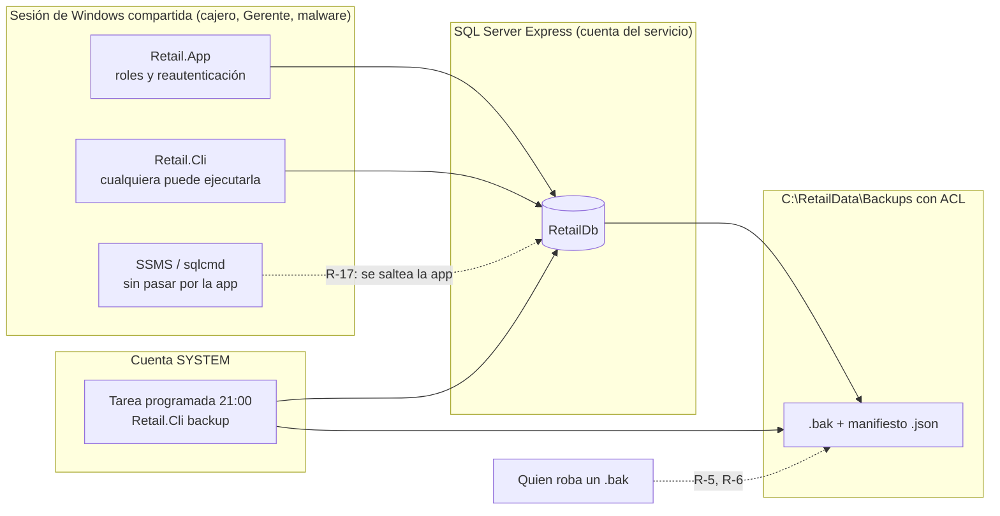
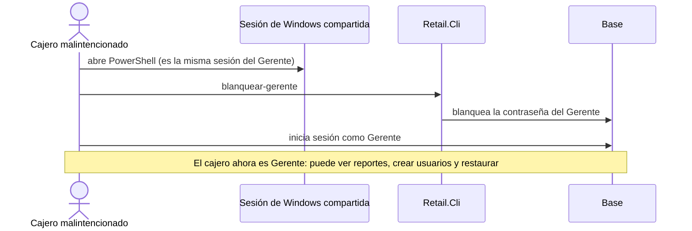
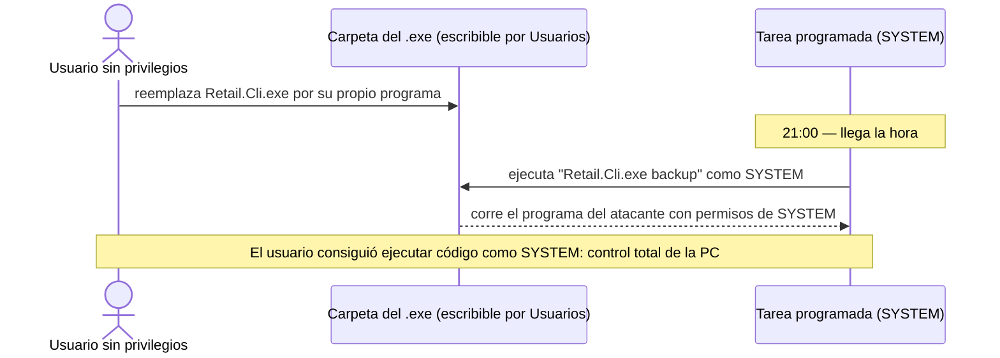
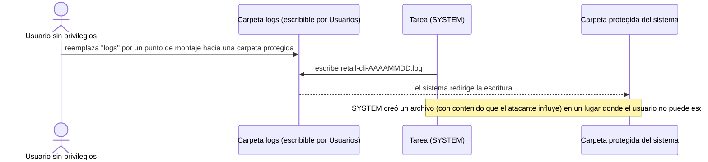

# Seguridad y Permisos del Respaldo y la Restauración: Lo Que se Protege y Lo Que No

### Módulo: 05. Casos de Uso y Flujos de Negocio de Punta a Punta
**Audiencia:** Desarrolladores, estudiantes universitarios y mesa evaluadora de cátedra  
**Requisitos Vinculados:** `RF-03` (Administración de Usuarios y roles), `RF-22` (Respaldo y Restauración), `RF-23` (Administración de la Base por Comandos), `RNF-05` (Seguridad de Persistencia) y `RNF-08` (Integridad ACID y Respaldos)  
**Diseño y decisiones:** [`docs/roadmap/etapa-6-track-6.3-backup-restore.md`](file:///c:/Users/lucas/Proyectos/retail/docs/roadmap/etapa-6-track-6.3-backup-restore.md) (decisiones D-1 a D-9, D-13, D-18, D-19, D-29; riesgos R-5, R-6, R-14, R-16, R-17, R-19, R-20; hallazgos 1 y 2 de la revisión de la Fase 7)  
**Archivos de Código:**
* Autorización: [`BackupService.cs`](file:///c:/Users/lucas/Proyectos/retail/src/Retail.Application/Services/BackupService.cs), [`RestauracionService.cs`](file:///c:/Users/lucas/Proyectos/retail/src/Retail.Application/Services/RestauracionService.cs), [`AuthService.cs`](file:///c:/Users/lucas/Proyectos/retail/src/Retail.Application/Services/AuthService.cs), [`UsuarioService.cs`](file:///c:/Users/lucas/Proyectos/retail/src/Retail.Application/Services/UsuarioService.cs), [`Usuario.cs`](file:///c:/Users/lucas/Proyectos/retail/src/Retail.Domain/Entities/Usuario.cs)
* Consola: [`Program.cs`](file:///c:/Users/lucas/Proyectos/retail/src/Retail.Cli/Program.cs), [`ComandoBackup.cs`](file:///c:/Users/lucas/Proyectos/retail/src/Retail.Cli/Comandos/ComandoBackup.cs), [`ComandoRestaurar.cs`](file:///c:/Users/lucas/Proyectos/retail/src/Retail.Cli/Comandos/ComandoRestaurar.cs), [`ComandoInicializar.cs`](file:///c:/Users/lucas/Proyectos/retail/src/Retail.Cli/Comandos/ComandoInicializar.cs)
* Scripts: [`registrar-tarea-backup.ps1`](file:///c:/Users/lucas/Proyectos/retail/scripts/registrar-tarea-backup.ps1) y [`RetailPermisos.psm1`](file:///c:/Users/lucas/Proyectos/retail/scripts/RetailPermisos.psm1)
* Registros: [`UbicacionDeLogs.cs`](file:///c:/Users/lucas/Proyectos/retail/src/Retail.Infrastructure/Logging/UbicacionDeLogs.cs)

---

## 1. 📖 Fundamento: Pensar Como un Atacante Para Defender Como Ingeniero

### 1.1 La seguridad no es una lista de funciones, es una pregunta
Un respaldo es, al mismo tiempo, **la mejor defensa y el mejor botín**. Defiende los datos del negocio contra pérdidas, pero un archivo `.bak` contiene *toda* la base: ventas, clientes con sus datos personales (protegidos por la Ley 25.326 de Protección de Datos Personales de la República Argentina) y los *hashes* de las contraseñas. Y la capacidad de **restaurar** es, en sí misma, un poder enorme: quien puede restaurar puede reemplazar todo el negocio por otro estado.

La disciplina que se aplica es el **modelo de amenazas** (*threat modeling*). En lugar de preguntar "¿qué medidas de seguridad tiene?", se preguntan cuatro cosas, en este orden:

1. ¿Qué **activos** hay que proteger?
2. ¿Quiénes son los **actores** y qué pueden hacer realmente?
3. ¿Por dónde pueden entrar (**puntos de entrada**)?
4. ¿Qué defensa corta cada camino y cuál es su **límite**?

Los principios que guían las respuestas son tres, y conviene tenerlos presentes en cada sección:

| Principio | Idea | Dónde se ve |
| :--- | :--- | :--- |
| **Mínimo privilegio** | Cada componente recibe solo los permisos que necesita, ni uno más | La cuenta `SYSTEM` en SQL (sección 4), el Administrador (sección 2) |
| **Defensa en profundidad** | Varias barreras independientes; que una falle no alcance | UI + servicio (D-9), reautenticación (D-8), ACL, permisos de SQL |
| **Tríada CIA** | Confidencialidad, Integridad, Disponibilidad | Confidencialidad: ACL y roles. Integridad: SHA-256 y credencial en la copia. Disponibilidad: tarea diaria y base anterior |

### 1.2 Los activos

| Activo | Por qué importa | Dónde vive |
| :--- | :--- | :--- |
| **Datos del negocio y personales** | Ventas, caja, clientes; datos personales bajo la Ley 25.326 (R-6) | La base y cada `.bak` |
| **Hashes de contraseñas** | Con ellos se puede intentar adivinar contraseñas fuera de línea | Tabla `USUARIOS` (BCrypt, `workFactor: 11` en `PasswordHasher`) y, por lo tanto, dentro de cada `.bak` |
| **La capacidad de restaurar** | Reemplaza toda la base; es irreversible para quien no tenga la base anterior | `RestauracionService`, `Retail.Cli restaurar` |
| **La capacidad de copiar y el historial** | Sin copias no hay recuperación; el historial es la evidencia de qué pasó | Tarea programada, `REGISTROS_BACKUP`, `REGISTROS_RESTAURACION` |
| **La identidad `SYSTEM`** | Es la cuenta más poderosa de Windows; si alguien la hace ejecutar lo que él quiere, controla la PC | La tarea programada (sección 4) |

### 1.3 Los actores
Una librería chica no es un banco: hay **una PC de mostrador, a menudo con una sola sesión de Windows compartida** por todos. Ese hecho condiciona todo el diseño (D-13).

| Actor | Qué puede hacer realmente |
| :--- | :--- |
| **Cajero** | Usa la app con su rol. Si comparte la sesión de Windows, también puede abrir una consola y ejecutar `Retail.Cli` |
| **Gerente** (dueño o responsable de los datos) | Todos los permisos de la app; es el único que copia manualmente y restaura (D-2, D-3) |
| **Administrador** (rol opcional de soporte) | ABM de Cajeros y Encargados y lectura del historial de copias; no copia ni restaura (D-3) |
| **Técnico externo** | Tiene la cuenta de administrador de Windows y suele ser `sysadmin` de SQL Server; instala la tarea y los permisos |
| **Malware con la sesión del usuario** | Ejecuta con la **misma identidad** de Windows que la app: puede lo mismo que el usuario logueado |
| **Quien roba un `.bak`** | Un pendrive perdido, un disco desechado: tiene el archivo, no tiene la PC |
| **Usuario de Windows sin privilegios** | Otra cuenta de la misma PC. Su interés es **escalar privilegios** hasta `SYSTEM` (sección 4) |

### 1.4 Los límites de confianza



Hay una frontera que el diseño **no puede** cerrar con código: la que separa a la app de SQL Server cuando ambos se usan con la misma identidad de Windows (línea punteada "R-17"). Todo lo demás de este capítulo son defensas para los demás caminos. La sección 7 explica ese límite con honestidad.

---

## 2. 🔐 Autorización en la Aplicación

### 2.1 Roles y matriz de permisos
Los roles son `Cajero = 1`, `Encargado = 2`, `Gerente = 3` y `Administrador = 4` (`RolUsuarioEnum`). El Gerente es la **raíz de autoridad** (D-5); el Administrador es un rol opcional de soporte técnico con un subconjunto de permisos (D-3). La matriz de la sección 3 del registro de diseño, para respaldo y restauración:

| Función | Cajero | Encargado | Gerente | Administrador |
| :--- | :-: | :-: | :-: | :-: |
| Backup manual y restauración (con reautenticación) | ❌ | ❌ | ✅ | ❌ |
| Historial y estado de copias (lectura) | ❌ | ❌ | ✅ | ✅ |
| ABM y blanqueo de Cajeros y Encargados | ❌ | ❌ | ✅ | ✅ |
| ABM de Gerentes y Administradores | ❌ | ❌ | ✅ | ❌ |

**Por qué el Administrador no copia ni restaura:** una copia es la base completa, con datos personales (R-6). Solo el responsable de los datos puede generarla o restaurarla (D-3). El Administrador sí lee el historial porque necesita diagnosticar problemas (¿corrió la copia de anoche?) sin poder extraer datos.

La matriz de autoridad **sobre cuentas** vive en el Dominio, no en la interfaz:

```csharp
public bool PuedeGestionarCuentasDeRol(RolUsuarioEnum rolObjetivo)
{
    if (!Enum.IsDefined(rolObjetivo))
    {
        return false;
    }

    if (EsGerente())
    {
        return true;
    }

    return EsAdministrador()
        && rolObjetivo is RolUsuarioEnum.Cajero or RolUsuarioEnum.Encargado;
}
```

El Administrador no puede otorgarse a sí mismo ni a otros un rol con más poder que el suyo: de esta forma se previene la **escalada de privilegios** dentro de la propia aplicación (D-4).

### 2.2 Autorización en Application, no solo en la UI (D-9)
Ocultar un botón no es seguridad: es comodidad. Un botón oculto no impide que otro código (un ViewModel modificado, un test, otra pantalla futura) llame al servicio. Por eso la regla se verifica **en la capa de Aplicación**, que es la que todos atraviesan. La UI solo refleja lo que el servicio ya exige (`PuedeOperar => _session.EsGerente`, que además deshabilita los comandos).

```csharp
var actor = await ObtenerActorAsync(idActor, cancellationToken);

// La copia contiene la base completa (datos personales, Ley 25.326): solo la pide su responsable (D-3).
if (!actor.EsGerente())
{
    throw new OperacionNoAutorizadaException("Solo un Gerente puede generar una copia de seguridad manual.");
}
```

Dos detalles de diseño importantes:

1. **El rol se lee de la base en cada operación** (`ObtenerActorAsync` hace `GetByIdAsync(idActor, includeDeleted: false, ...)`). Si el Gerente fue degradado o dado de baja mientras tenía la sesión abierta, la autorización usa su estado *actual*, no el que tenía al loguearse. Un `idActor` inexistente o dado de baja recibe *"La operación fue solicitada por un usuario inexistente o dado de baja."*
2. **El orden es: autorización de rol → reautenticación → trabajo.** Primero se descarta al que no tiene derecho (barato), luego se verifica la contraseña (BCrypt es lento a propósito), y recién después se toca el disco.

| Operación | Quién | Excepción si no | Prueba |
| :--- | :--- | :--- | :--- |
| `CrearBackupManualAsync` | Gerente | `OperacionNoAutorizadaException`: *"Solo un Gerente puede generar una copia de seguridad manual."* | `CrearBackupManualAsync_ActorQueNoEsGerente_LanzaOperacionNoAutorizadaSinCopiar` |
| `RestaurarDesdeHistorialAsync` | Gerente | *"Solo un Gerente puede restaurar una copia de seguridad."* | `RestaurarDesdeHistorialAsync_ActorQueNoEsGerente_LanzaOperacionNoAutorizadaSinRestaurar` (con Administrador y Cajero) |
| `ListarAsync` | Gerente o Administrador | *"Solo un Gerente o un Administrador puede consultar el historial de copias."* | `ListarAsync_ActorAdministrador_DevuelveElHistorialDelMasRecienteAlMasViejo`, `ListarAsync_ActorCajero_LanzaOperacionNoAutorizada` |
| `ObtenerUltimaRestauracionAsync` | Gerente o Administrador | *"Solo un Gerente o un Administrador puede consultar las restauraciones."* | `ObtenerUltimaRestauracionAsync_ActorSinPermiso_LanzaOperacionNoAutorizadaSinLeer` |

### 2.3 Reautenticación escalonada (*step-up authentication*, D-8)
**El problema:** una sesión abierta en el mostrador. El Gerente se levanta a atender y deja la app logueada; cualquiera que se siente podría presionar "Restaurar". **La solución** es pedir la contraseña de nuevo justo antes de la operación sensible. Esto se llama *step-up authentication*: la sesión sirve para operar, pero las acciones destructivas o de alto valor exigen volver a demostrar quién se es.

```csharp
// Reautenticación (D-8): una sesión abierta en el mostrador no alcanza.
await _authService.VerificarCredencialAsync(idActor, password, cancellationToken);
```

La verificación **la decide el servicio**, no la pantalla: `ConfirmarCredencialViewModel` no compara nada; ejecuta la operación y, si el servicio lanza `CredencialesInvalidasException`, deja el diálogo abierto, vacía el campo y permite reintentar (porque la operación no empezó). La restauración, además, exige escribir la palabra `RESTAURAR` y muestra el aviso fiscal de ARCA antes de habilitar el botón de peligro.

> [!NOTE]
> La reautenticación es **con la contraseña del Gerente logueado**, contra la base vigente. En el camino de consola (donde la vigente puede no existir) se usa otro mecanismo: la credencial se verifica *dentro de la copia* (sección 3.2).

### 2.4 Mensajes uniformes: no revelar qué cuentas existen
Una respuesta distinta para "no existe ese usuario" y "contraseña incorrecta" le regala información al atacante (le permite enumerar cuentas válidas). Por eso:

```csharp
// Un usuario inexistente o dado de baja recibe la misma respuesta que una contraseña incorrecta: la
// reautenticación no debe revelar el estado de otras cuentas.
if (usuario == null || string.IsNullOrEmpty(password)
    || !_passwordHasher.VerifyPassword(password, usuario.PasswordHash))
{
    throw new CredencialesInvalidasException();
}
```

El mensaje es siempre *"Nombre de usuario o contraseña incorrectos."* Se aplica en `AuthService.VerificarCredencialAsync` (reautenticación) y en `RestauracionService.VerificarCredencialEnLaCopiaAsync` (consola), donde además la misma respuesta cubre: usuario inexistente, dado de baja, que no es Gerente, o con `DebeCambiarPassword = true`.

Pruebas: `VerificarCredencialAsync_UsuarioInexistenteOInactivo_LanzaCredencialesInvalidasSinConsultarElHash` y `RestaurarDesdeArchivoAsync_CredencialInvalidaEnLaCopia_LanzaCredencialesInvalidasSinIntercambiar`.

> [!WARNING]
> **Salvedad honesta.** El *login* normal (`AuthService.LoginAsync`) sí distingue un caso: si el nombre existe pero está dado de baja lanza `UsuarioInactivoException` (*"El usuario '...' se encuentra inactivo o dado de baja."*), que revela que esa cuenta existió. La uniformidad total rige para la reautenticación y para la consola, que son las dos puertas del respaldo y la restauración.

### 2.5 La invariante del último Gerente
Si el sistema pudiera quedarse **sin Gerentes activos**, nadie podría administrarlo: ni crear usuarios, ni copiar, ni restaurar. Por eso `UsuarioService` lanza `UltimoGerenteException` cuando se intenta dar de baja o quitar el rol al único Gerente activo (`ExigirQueNoSeaElUltimoGerenteAsync`). No existe una invariante equivalente para el Administrador (D-5): sin Administradores el sistema sigue operando.

Pruebas: `BajaUsuarioAsync_EsUltimoGerente_LanzaUltimoGerenteException`, `ModificarUsuarioAsync_CambiaRolDeUltimoGerente_LanzaUltimoGerenteException`, `BajaUsuarioAsync_UltimoAdministrador_AplicaBajaPorqueElRolEsOpcional`.

Dos riesgos aceptados y documentados rodean esta invariante:

* **R-14:** la verificación no está protegida contra **dos degradaciones simultáneas** desde terminales distintas (se leen los Gerentes, ambos ven que hay otro, y ambos se degradan). Con un solo puesto de trabajo no ocurre; hay que revisarlo si el sistema pasa a multipuesto.
* **R-16:** hasta que exista la recuperación por correo (futuro), un Gerente que olvida su contraseña solo puede ser blanqueado por **otro Gerente**. Con un único Gerente no hay recuperación sin intervención técnica sobre la base. Recomendación operativa: dar de alta **al menos dos Gerentes**.

Además, al arrancar la app, `MensajeEstadoSistema` bloquea el acceso si no hay un Gerente activo (*"No hay ningún Gerente activo, por lo que nadie podría administrar el sistema."*), con el comando `inicializar` para resolverlo.

### 2.6 Dos límites de la autorización
* **Las operaciones del sistema no llevan actor.** `CrearBackupDelSistemaAsync` (tarea programada y `migrar`) no verifica rol ni contraseña, porque lo ejecuta la consola, no una persona. Su alcance está acotado por código: solo acepta los tipos `Automatico` y `PreMigracion` (*"Una copia de tipo {tipo} no la dispara el sistema."* en cualquier otro caso). Está registrada también en el contenedor de la app, pero ninguna pantalla la llama; lo que la protege es que **una copia no otorga acceso a ninguna cuenta ni modifica datos** (sección 3.4).
* **Los servicios operativos (POS, caja) todavía no verifican el rol.** El registro de diseño lo documenta: hoy la restricción del Administrador sobre ellos es solo de navegación; los permisos completos por rol quedan para la auditoría del Track 6.1. Para el respaldo y la restauración, en cambio, sí está verificado en el servicio.

---

## 3. 💻 El Modelo de Confianza de `Retail.Cli`

### 3.1 La premisa incómoda: cualquiera puede ejecutar la consola
En un comercio chico, el personal comparte la sesión de Windows. Entonces "tener acceso a la PC" **no es un límite de confianza**: un cajero puede abrir PowerShell y ejecutar `Retail.Cli`. La consecuencia de diseño, decidida en D-13, es una regla de oro:

> **Ningún comando de `Retail.Cli` otorga acceso a una cuenta existente.**

La consola es una caja de herramientas de *operación* (migrar, copiar, restaurar), no un atajo para convertirse en Gerente. Cada comando se evalúa contra esa regla:

| Comando | Qué puede hacer | Por qué no otorga acceso a una cuenta |
| :--- | :--- | :--- |
| `estado` | Informa el estado de la base | Solo lectura |
| `migrar` | Aplica migraciones, con copia `PreMigracion` antes | No toca cuentas; si la copia falla, no migra |
| `inicializar` | Crea el **primer** Gerente | Solo funciona si **no hay Gerentes activos** (lo verifica la consola y el servicio); la contraseña la elige el titular frente al equipo |
| `datos-demo` | Siembra un proveedor, categorías y marcas | No toca cuentas |
| `backup` | Copia la base | Una copia no da acceso a ninguna cuenta (sección 3.4) |
| `restaurar` | Reemplaza la base | **Exige** usuario y contraseña de un Gerente verificados dentro de la copia (D-18) |

Una prueba de arquitectura refuerza la separación de privilegios: `AddApplicationServices_NoRegistraLasOperacionesPrivilegiadasDeAdministracion` verifica que `IAdministracionSistemaService` (migrar, primer Gerente) **no** esté registrado en el contenedor de la app WPF, solo en `AddAdministracionSistema`, que invoca únicamente `Retail.Cli`.

### 3.2 `blanquear-gerente`: el comando que se eliminó, y por qué
La Fase 2 incluyó, según la decisión D-13 original, un comando `Retail.Cli blanquear-gerente` para el caso "el Gerente olvidó su contraseña". Se **eliminó** en la revisión posterior de D-13, por esta historia de ataque:



El comando convertía el acceso a la consola en el acceso a la cuenta más poderosa. Se descartaron también los **códigos de recuperación** (un secreto más que guardar y perder). La recuperación de contraseñas quedó **exclusivamente por correo electrónico** (funcionalidad futura, D-13), y mientras tanto rige R-16.

### 3.3 `restaurar`: la credencial se verifica *dentro de la copia* (D-18)
`restaurar` es el comando más sensible, y existe por una razón de disponibilidad: el desastre más probable es una **PC nueva** o una base corrupta, donde la app no puede ni arrancar el login (R-2). ¿Contra qué se verifica entonces la identidad de quien restaura?

| Opción | Problema | Decisión |
| :--- | :--- | :--- |
| Sin autenticación | Un cajero podría reemplazar toda la base (viola D-13) | Descartada (D-19) |
| Contra la base vigente | Falla en una PC nueva o con la base corrupta | Descartada (D-19) |
| Solo procedimiento manual con SSMS | Sin control ni auditoría; peor para el usuario no técnico | Descartada (D-19) |
| **Credencial de un Gerente verificada en la copia** | Cubre el desastre y exige conocimiento real | **Elegida (D-18)** |

La lógica, literal de `RestauracionService.VerificarCredencialEnLaCopiaAsync`: se busca al usuario en la **base temporal** (la copia ya restaurada aparte) y se verifica el BCrypt contra el hash que viene dentro del `.bak`:

```csharp
var usuario = await temporal.BuscarUsuarioActivoAsync(ReglasTexto.NormalizarNombreUsuario(nombreUsuario), cancellationToken);

if (usuario is null || !usuario.EsGerente() || usuario.DebeCambiarPassword || string.IsNullOrEmpty(password)
    || !_passwordHasher.VerifyPassword(password, usuario.PasswordHash))
{
    throw new CredencialesInvalidasException();
}
```

Quien restaura demuestra que **era Gerente en esa copia**. Un cajero necesitaría la contraseña de un Gerente, igual que en la app. La condición `DebeCambiarPassword` cierra un caso concreto (corrección C-7): una base vieja con el `admin/Admin123!` sembrado, cuya contraseña no la eligió su titular, no sirve como autorización.

### 3.4 El límite de D-18: integridad no es autenticidad
Acá está la pregunta que más seguro hace un docente: *"si el hash SHA-256 del manifiesto coincide, ¿la copia es auténtica?"* La respuesta es **no**: prueba **integridad, no autenticidad**.

| Propiedad | Pregunta que responde | Qué la da | Qué no cubre |
| :--- | :--- | :--- | :--- |
| **Integridad** | ¿Este archivo es el mismo que se escribió? | SHA-256 en el registro o el manifiesto; `RESTORE ... WITH CHECKSUM` | Detecta un archivo dañado o cambiado **sin** actualizar su huella |
| **Autenticidad** | ¿Quién lo creó? ¿Es realmente de *este* negocio? | La credencial de un Gerente dentro de la copia (D-18) | No distingue una copia **fabricada** que trae su propio Gerente |

El escenario del límite: un atacante (por ejemplo, el cajero con acceso a la PC) fabrica en **otra** instalación de SQL Server una base con una estructura válida, con **su propio** Gerente y una contraseña que él conoce, genera el `.bak` y el `.json` con la huella correcta, lo copia a la PC y ejecuta `Retail.Cli restaurar`. La huella coincide (porque la calculó él), la credencial coincide (porque la fijó él), y la base vigente se reemplaza.

Este riesgo está documentado como **R-20** y se **mitiga**, no se elimina:

| Mitigación | Efecto | Dónde |
| :--- | :--- | :--- |
| Copia `PreRestauracion` de la vigente | La foto de los datos reales se conserva **30 días** (D-24, `DiasRetencionPreRestauracion`), fuera de la retención común de 14 | `BackupService.AplicarRetencionAsync` |
| Base `RetailDb_Anterior_<fecha>` | La base reemplazada sigue intacta en el servidor hasta la próxima restauración | `BaseRestauradaSqlServer.IntercambiarAsync` |
| `REGISTROS_RESTAURACION` | Constancia inmutable de quién (`NombreUsuario`), cuándo, desde dónde (`Aplicacion` o `Consola`) y qué copia; sobrevive a nuevos restores | `RegistroRestauracion` |
| Aviso visible en la app | `MainViewModel` muestra un aviso si hubo una restauración en los últimos 7 días | `MainViewModel` (Singleton, con scope propio) |
| Advertencia ARCA | Todo restore recuerda conciliar la numeración fiscal | `ResultadoRestauracionDto.AvisoConciliacionArca` |

> [!IMPORTANT]
> En `REGISTROS_RESTAURACION` el dato confiable del operador es `NombreUsuario`. En la vía app, `IdUsuario` es el Id del Gerente en la base **reemplazada**, que en la restaurada puede corresponder a otra cuenta o no existir (por eso el operador se guarda como foto, sin clave foránea).

### 3.5 Por qué `backup` no necesita credenciales
Podría parecer incoherente: restaurar exige credenciales y copiar no. La razón es que **el derecho a copiar no es el derecho a leer**. `Retail.Cli backup` produce un archivo dentro de una carpeta que protegen los permisos de Windows (sección 5). No muestra datos ni da acceso a ninguna cuenta ni modifica nada, y su ejecución está acotada: una sola copia en curso (A-03 del [capítulo 07](07-escenarios-de-error-y-corrupcion.md)) y la retención de 14 copias limita el disco que puede ocupar. Y hay una razón operativa decisiva: la **tarea programada** corre sin nadie presente, así que no podría pedir ninguna contraseña (D-13, nota de la Fase 4).

El contenido de la copia lo protege la ACL (sección 5), y el límite de esa protección es R-17 (sección 7).

### 3.6 Auditoría de la consola
Cada ejecución deja un rastro en el log (`Program.cs`), con el usuario de Windows y el equipo:

```csharp
Log.Information("Retail.Cli: comando '{Comando}' ejecutado por {UsuarioWindows} en {Equipo}",
    args[0], Environment.UserName, Environment.MachineName);
```

`restaurar` agrega su propio registro (*"Restauración {Referencia} completada desde Retail.Cli por {UsuarioWindows} en {Equipo}"*) y `inicializar` deja una advertencia con el Gerente creado. Es un rastro, no una barrera: quien tiene la sesión de Windows puede borrar sus propios logs.

### 3.7 Intentos ilimitados en la consola (R-19)
La consola no limita intentos de contraseña, y un usuario inexistente responde más rápido que una contraseña incorrecta (se evita el BCrypt). El registro de diseño lo acepta como riesgo: es una herramienta local, cada intento requiere un `RESTORE` completo a una base temporal, y quien podría intentar adivinar ya tendría acceso a los hashes dentro del `.bak` (R-17); más código de bloqueo no cambiaría el modelo de amenazas.

---

## 4. ⚙️ La Tarea Programada como `SYSTEM`

### 4.1 Por qué `SYSTEM` (D-29)
La copia diaria debe correr **sin sesión iniciada**. Las alternativas: (a) con la cuenta de un usuario y su contraseña guardada: la contraseña guardada se rompe en silencio el día que cambia y es un secreto más; (b) un servicio dentro de la app: depende de que la app esté abierta. `SYSTEM` no necesita contraseña ni sesión. El costo es que es la cuenta más poderosa de la PC, por lo que todo lo que ejecuta o escribe debe estar blindado (secciones 4.3 y 4.4).

Su registro, literal de `registrar-tarea-backup.ps1`:

```powershell
$accion = New-ScheduledTaskAction -Execute $RutaCliTarea -Argument "backup" -WorkingDirectory $CarpetaCli
$disparador = New-ScheduledTaskTrigger -Daily -At $horaDelDia
$principal = New-ScheduledTaskPrincipal -UserId $CuentaSistema -LogonType ServiceAccount -RunLevel Highest
```

`-LogonType ServiceAccount` es lo que permite correr como `SYSTEM` sin contraseña.

### 4.2 Mínimo privilegio en SQL Server
El script crea, **si faltan**, el login y el usuario de base de `NT AUTHORITY\SYSTEM`:

```powershell
Invoke-Sql "master" "IF SUSER_ID(N'$CuentaSistema') IS NULL CREATE LOGIN $cuentaSql FROM WINDOWS;"
Invoke-Sql $BaseDeDatos "IF DATABASE_PRINCIPAL_ID(N'$CuentaSistema') IS NULL CREATE USER $cuentaSql FOR LOGIN $cuentaSql;"
```

`$CuentaSistema` es la constante `NT AUTHORITY\SYSTEM` del propio script y `$cuentaSql` es esa misma cuenta delimitada entre corchetes por `Get-Delimitado` (que duplica los `]`); la instancia y el nombre de la base se validan contra patrones estrictos antes de usarse en una cadena de conexión. El `IF ... IS NULL` hace el script idempotente. Además, le otorga **exactamente cuatro permisos**, que están en la lista `$Permisos` del propio script:

```sql
GRANT CREATE ANY DATABASE TO {0};
ALTER ROLE db_backupoperator ADD MEMBER {0};
GRANT SELECT ON OBJECT::dbo.[__EFMigrationsHistory] TO {0};
GRANT SELECT, INSERT, UPDATE ON OBJECT::dbo.REGISTROS_BACKUP TO {0};
```

`{0}` es la cuenta ya delimitada. Cláusula por cláusula:

| Permiso | Alcance | Para qué se necesita | Qué **no** concede |
| :--- | :--- | :--- | :--- |
| `CREATE ANY DATABASE` | Servidor (`master`) | `RESTORE VERIFYONLY` lo exige aunque no cree ninguna base | Leer, modificar ni borrar bases existentes |
| `db_backupoperator` | Base `RetailDb` | Ejecutar `BACKUP DATABASE` | Leer tablas: el rol permite copiar, no consultar (la copia la escribe el motor) |
| `SELECT` sobre `__EFMigrationsHistory` | Una tabla | Saber si la base está al día antes de copiar | Ninguna tabla de datos |
| `SELECT, INSERT, UPDATE` sobre `REGISTROS_BACKUP` | Una tabla | Alta, cambios de estado y retención del historial | **`DELETE`**: el borrado es lógico (Ley 3) |

Lo que **queda explícitamente fuera**: `USUARIOS` (y por lo tanto `password_hash`), `VENTAS` y todo el resto, modificar `USUARIOS`, cambiar el esquema, borrar del historial. Uno de los hallazgos de baja severidad de la revisión (el grupo 8 a 14) hizo que `ComandoBackup` dejara de consultar el estado de los usuarios (que leía al Gerente completo con su hash) para que **no hiciera falta ningún permiso sobre `USUARIOS`**. Un comentario del propio script lo dice: *"La copia NO lee USUARIOS"*. `sp_getapplock` sobre `master` tampoco necesita permiso propio: lo permite el rol `public`.

**Cómo se verifica.** `PermisosTareaProgramadaIntegracionTests` suplanta (`EXECUTE AS LOGIN`) una cuenta de prueba con **exactamente** esos permisos (leídos del script, para que un cambio en el script cambie la prueba sola) y ejecuta lo mismo que hace la herramienta:

| Prueba | Qué demuestra |
| :--- | :--- |
| `EstadoDelEsquema_ConLosPermisosDelScript_LeeMigracionesSinTocarUsuarios` | La copia funciona sin tocar `USUARIOS` |
| `ConsultasDeUsuarios_ConLosPermisosDelScript_NoPuedeLeerNiElHashDeLasContrasenas` | `SELECT password_hash FROM USUARIOS` falla con *denied* |
| `HistorialDeCopias_ConLosPermisosDelScript_AltaCambiosDeEstadoYRetencion` | El historial funciona |
| `CopiaYVerificacion_ConLosPermisosDelScript_LaCopiaSeCreaYSeVerifica` | `BACKUP` y `VERIFYONLY` funcionan |
| `Verificacion_SinElPermisoDeServidor_FallaPorFaltaDeCreateDatabase` | Sin `CREATE ANY DATABASE`, `VERIFYONLY` falla: prueba que el permiso hace falta |
| `BloqueoDeRestauracion_ConLosPermisosDelScript_ElBloqueoSobreMasterSeObtieneYSeSuelta` | El bloqueo no necesita permiso extra |
| `CuentaDeLaTarea_FueraDeLoNecesario_NoTienePermiso` (cuatro casos) | `SELECT` de `VENTAS`, `UPDATE` de `USUARIOS`, `DELETE` de `REGISTROS_BACKUP` y `CREATE TABLE` fallan con *denied* |
| `PermisosDelScript_NoIncluyenNingunaTablaDeNegocioNiDeUsuarios` | La lista del script no menciona esas tablas |

> [!NOTE]
> **Límites de estas pruebas** (documentados en la propia clase): la cuenta suplantada es un *login* de prueba, no el `NT AUTHORITY\SYSTEM` real, que solo se ejercita desde el Programador de tareas (la primera prueba manual con `SYSTEM` real fue exitosa, pero el registro de diseño indica que falta repetirla con el script corregido). Y los permisos de **carpeta** de la tarea no se prueban acá, porque los `.bak` los escribe la cuenta del servicio del motor, no la cuenta suplantada.

### 4.3 ¿Por qué `CREATE ANY DATABASE` es aceptable?
Es el permiso que más llama la atención, porque su nombre suena a poder. El análisis:

* **Es necesario:** `RESTORE VERIFYONLY` lo exige. La prueba `Verificacion_SinElPermisoDeServidor_FallaPorFaltaDeCreateDatabase` lo demuestra: sin el permiso, la verificación falla con un mensaje que menciona `CREATE DATABASE`. Y sin `VERIFYONLY` no hay copia `Verificado`.
* **Es estrecho:** permite *crear* bases nuevas (de las que quien las crea queda dueño), no acceder a las existentes. No da lectura de `RetailDb`.
* **El riesgo residual es de disponibilidad, no de confidencialidad:** alguien que controle el proceso podría crear bases vacías y consumir disco.
* **No se impone a otros:** `-Desregistrar -RevocarPermisos` ofrece revocarlo, **pero solo si lo concedió este script** (la tarea registrada lo recuerda con una marca en su descripción), porque otro software del equipo que corra como `SYSTEM` podría necesitarlo.

Esta evaluación es de diseño; el comportamiento exacto de los permisos de SQL Server (por ejemplo, la propiedad de las bases creadas) responde a la documentación del producto y no se probó en este proyecto.

### 4.4 Escalada de privilegios 1: `SYSTEM` ejecutando un `.exe` que un usuario puede reemplazar
**Qué es una escalada de privilegios.** Un usuario con pocos permisos consigue ejecutar código con más permisos de los que tiene. La técnica más simple es aprovecharse de un proceso privilegiado que **confía** en algo que el atacante controla.

**La historia del ataque.** La tarea corre todas las noches `Retail.Cli.exe` como `SYSTEM`. Imaginemos que ese `.exe` estuviera en una carpeta donde cualquier usuario de la PC puede escribir (el perfil, Descargas, o una carpeta suelta). Entonces:



Esto fue el **hallazgo #2 (severidad alta)** de la revisión independiente de la Fase 7.

**Primera defensa y su límite.** La primera versión copiaba la CLI a `C:\Program Files\Retail POS\Cli` (una carpeta que solo administradores pueden modificar) y registraba la tarea contra esa copia. Resolvía la escalada, pero tenía un defecto operativo grave: la copia **no se actualizaba con la aplicación**. Tras una actualización con migraciones, esa CLI vieja veía "la base es más nueva que la app" y la copia diaria fallaba todas las noches, con un único registro en el log (corrección posterior al PR #23). Esa copia ya no existe: el script ofrece eliminarla.

**La defensa actual.** La app se instala descomprimiendo el ZIP **como administrador** en `C:\Program Files\Retail POS`, y la tarea apunta directamente al `Retail.Cli.exe` de esa instalación. Actualizar la app actualiza lo que ejecuta la tarea. Para que eso sea seguro, el script **se niega a registrar la tarea** si alguien sin privilegios podría reemplazar el ejecutable:

```powershell
$escribibles = @(Get-EscrituraEnInstalacion -Ruta $CarpetaCli -CuentasExtra @($UsuarioApp))
if ($escribibles.Count -gt 0)
{
    $detalle = ($escribibles | Select-Object -First 5) -join [Environment]::NewLine
    throw ("Instale Retail POS en una carpeta que solo puedan modificar los administradores, ...")
}
```

`Get-EscrituraEnInstalacion` (en `RetailPermisos.psm1`) revisa **tres cosas**:

1. **La carpeta de instalación**, con permisos de escritura (`WriteData`, `AppendData`, `Delete`, `ChangePermissions`, `TakeOwnership`, etc.).
2. **Todo su contenido**, recursivamente, sin excepciones (ni una subcarpeta `logs`).
3. **Cada carpeta superior hasta la raíz del disco.** Este es el punto sutil: quien puede **renombrar o borrar** `Retail POS` (o `Program Files`, o el disco) puede apartar la carpeta original y poner en su lugar otra con su propio ejecutable. Por eso, para las carpetas superiores cuentan los derechos de borrar, borrar subcarpetas y archivos, cambiar permisos y tomar posesión; **no** "crear carpetas", porque la raíz `C:\` permite crear carpetas a todos por defecto y eso no permite reemplazar nada que ya exista.

Los "sospechosos" son los grupos amplios (SID `S-1-1-0` Todos, `S-1-5-11` Usuarios autenticados, `S-1-5-32-545` Usuarios) y la cuenta con la que se usa la app. Se nombran **por SID, no por nombre**, para que funcione igual en Windows en español y en inglés.

Pruebas (`ScriptsDePermisosIntegracionTests`): `GetEscrituraEnInstalacion_CarpetaSuperiorEscribiblePorUsuariosAutenticados_InformaLaCarpetaSuperior`, `GetEscrituraEnInstalacion_CuentaDeLaAppConModificarEnLaInstalacion_InformaElHallazgo`, `GetEscrituraEnInstalacion_CadenaProtegida_NoInformaNadaBajoLaRaizDeLaPrueba`.

Y registrar la tarea contra la CLI **del proyecto** (la carpeta de desarrollo) se rechaza a propósito, porque esa carpeta la puede modificar el desarrollador.

### 4.5 Escalada de privilegios 2: `SYSTEM` escribiendo logs en una carpeta que un usuario controla
**El mecanismo (*mount point* o *junction*).** Windows permite convertir una carpeta vacía en un **punto de montaje** (o *junction*): un acceso directo a nivel del sistema de archivos, que redirige cualquier acceso a esa carpeta hacia **otro lugar**, y que un usuario común puede crear en carpetas donde tiene permiso de escritura. Los programas que escriben en la carpeta no se enteran de la redirección.

**La historia del ataque.** El log es un archivo que `SYSTEM` escribe todas las noches. Si el log se escribiera en una carpeta `logs` dentro de la instalación y esa carpeta tuviera que ser escribible por usuarios (para que el cajero pudiera escribir su propio log), entonces:



Es un patrón conocido de escalada: el atacante **desvía lo que escribe un proceso privilegiado**. Por eso la regla del diseño es que **`SYSTEM` nunca escribe en una carpeta que un usuario sin privilegios pueda controlar**, sin excepciones.

**La defensa: una única regla de ubicación.** Todos los logs (app y consola) van a `%LOCALAPPDATA%\Retail POS\logs`, de la cuenta que ejecuta el proceso:

```csharp
public static string Directorio(string? carpetaBase)
{
    var raiz = string.IsNullOrWhiteSpace(carpetaBase) ? Path.GetTempPath() : carpetaBase;
    return Path.Combine(raiz, CarpetaDeLaAplicacion, CarpetaDeLogs);
}
```

* Para el cajero o el desarrollador es su **carpeta personal** (`C:\Users\<usuario>\AppData\Local\Retail POS\logs`): si la redirigen, solo se perjudican a sí mismos.
* Para `SYSTEM` es `C:\Windows\System32\config\systemprofile\AppData\Local\Retail POS\logs`, donde **solo escriben `SYSTEM` y los administradores**. No hay que detectar la identidad ni tocar permisos: la misma regla da resultados seguros para cada cuenta.
* La instalación queda **sin carpetas escribibles por usuarios**, sin excepciones (por eso `Get-EscrituraEnInstalacion` revisa todo su contenido).

**Por qué no `%ProgramData%`.** Parece una opción natural (es la carpeta de datos compartidos de la máquina), pero se descartó por *folder squatting* (ocupar una carpeta antes que el dueño legítimo): cualquier usuario puede **crear carpetas** en `C:\ProgramData`. Un atacante crearía `C:\ProgramData\Retail POS` antes de que lo haga la instalación, quedando como dueño con sus propios permisos; cuando `SYSTEM` escribe ahí, escribe en una carpeta controlada por el atacante, que puede además convertirla en un punto de montaje.

Pruebas: `UbicacionDeLogsTests` (`Directorio_ConCarpetaBase_DevuelveRetailPosLogsDentroDeLaBase`, `Directorio_ConCarpetaBaseVacia_UsaLaCarpetaTemporalDelSistema`, `Directorio_SinParametros_UsaLaCarpetaLocalApplicationDataDeLaCuentaActual`) y `GetEscrituraEnInstalacion_CarpetaLogsEscribibleParaUsuarios_LaInforma`, que verifica que ni siquiera una subcarpeta `logs` escribible por usuarios dentro de la instalación se tolera.

---

## 5. 🗂️ Protección de los Respaldos en el Sistema de Archivos

### 5.1 La lista de control de acceso (ACL) de `C:\RetailData\Backups`
Una **ACL** (*Access Control List*) es la lista de quién puede hacer qué sobre una carpeta. `Set-PermisoDeCarpeta` deja exactamente esta (cada regla se hereda a las subcarpetas y archivos):

| Quién | Derecho | Por qué |
| :--- | :--- | :--- |
| **Administradores** (`S-1-5-32-544`) | Control total | Administrar la carpeta |
| **`SYSTEM`** (`S-1-5-18`) | Control total | La tarea escribe manifiestos y aplica la retención |
| **Cuenta del servicio de SQL Server** (`NT SERVICE\MSSQL$SQLEXPRESS`) | Modificar | El motor **escribe** los `.bak` y los **lee** al verificar y restaurar |
| **Cuenta que usa Retail POS** (parámetro `-UsuarioApp`) | Modificar | Las copias manuales calculan el SHA-256 y escriben el manifiesto; la restauración desde otra ruta trae el archivo acá |
| ~~Todos, Usuarios autenticados, Usuarios~~ | **Ninguno** | Los `.bak` contienen datos personales (R-6) |

"Modificar" no incluye "cambiar permisos" ni "tomar posesión": las pruebas verifican que el motor y la app **modifican, no administran** la carpeta. El script además se niega a operar sobre la raíz de un disco, para no cambiar permisos de todo el volumen.

### 5.2 El bug de herencia que apareció en la primera prueba manual
En Windows, una carpeta normalmente **hereda** permisos de su carpeta padre. Para blindar la carpeta de respaldos hay que *cortar la herencia*. Según el registro de diseño, la primera versión del script llamaba a `SetAccessRuleProtection($true, $true)`: el primer `$true` protege la carpeta de la herencia y el segundo **copia** las reglas heredadas como propias. Después intentaba quitar los grupos amplios con `RemoveAccessRule`.

**El resultado en la máquina real** (confirmado con `icacls`): en la **primera** ejecución quedaban *Usuarios autenticados (M)* y *Usuarios (RX)* en la carpeta. El motivo: tras copiar las reglas, Windows las sigue marcando como heredadas **en memoria**, y `RemoveAccessRule` las ignora. Los respaldos con datos personales quedaban legibles por todos los usuarios de la PC. (Hallazgo #1 de la revisión, severidad alta.)

**La corrección.** Cortar la herencia **sin copiar** reglas, purgar los grupos amplios, y agregar explícitamente cada cuenta permitida:

```powershell
$acl.SetAccessRuleProtection($true, $false)

foreach ($sidAmplio in $script:SidsAmplios)
{
    $acl.PurgeAccessRules((New-Object System.Security.Principal.SecurityIdentifier $sidAmplio))
}
```

El segundo parámetro en `$false` significa "no copiar las reglas heredadas": la carpeta queda **sin reglas** y se le agregan, una por una, las cuatro cuentas de la tabla. Es idempotente (se puede volver a ejecutar) y solo escribe la DACL, sin intentar reescribir propietario ni auditoría, que exigirían privilegios innecesarios.

Pruebas (`ScriptsDePermisosIntegracionTests`, con un `powershell.exe` real que importa el módulo y lee la ACL resultante):
* `SetPermisoDeCarpeta_ConPermisoAmplioHeredado_LoQuitaYDejaSoloLosCuatroPrincipales` aplica el módulo sobre una carpeta que **hereda** permisos amplios (el caso exacto del bug) y verifica que no quede ninguna regla heredada.
* `SetPermisoDeCarpeta_ConLosPermisosDeCadaPrincipal_AdministradoresYSistemaControlTotalYElRestoModificar`, `SetPermisoDeCarpeta_ConReglasExplicitasDeUnaEjecucionAnteriorConError_LasPurga` y `SetPermisoDeCarpeta_SinCuentasAdicionales_DejaSoloAdministradoresYSistema`.

> [!WARNING]
> **Lección de método.** Este bug solo apareció en la **primera** ejecución sobre la máquina real, no en una segunda. Una prueba sobre una carpeta ya "limpia" no lo habría encontrado. Por eso el test nuevo reproduce el estado inicial (una carpeta que hereda permisos amplios), y por eso las revisiones independientes y las pruebas manuales siguen siendo necesarias aunque haya pruebas automáticas.

---

## 6. 🔌 Transporte: `TrustServerCertificate=True` en una Conexión Local

La cadena de conexión de `appsettings.json` es:

```
Server=.\SQLEXPRESS;Database=RetailDb;Trusted_Connection=True;TrustServerCertificate=True;MultipleActiveResultSets=true
```

* `Trusted_Connection=True` es **autenticación integrada de Windows**: no hay usuario ni contraseña de SQL guardados en el archivo; el motor identifica al proceso por su identidad de Windows.
* El controlador de SQL Server **cifra la conexión por defecto**. El cifrado usa un certificado, y el que genera la instancia local es **autofirmado**: sin una autoridad que lo avale, el cliente lo rechaza. `TrustServerCertificate=True` le dice al cliente "confiá igual en este certificado". El cifrado se mantiene; lo que se omite es la **verificación de que el servidor es quien dice ser**.

**Por qué es aceptable acá.** Esa verificación sirve contra el ataque del *hombre en el medio* (*man-in-the-middle*), donde alguien en la red se hace pasar por el servidor. Con el cliente y el servidor en la **misma PC**, el tráfico no recorre ninguna red (habitualmente se usa memoria compartida; no se verificó el protocolo efectivo en esta instalación), así que no hay un "medio" donde ubicarse. El script de registro usa la misma opción (`TrustServerCertificate=true`) por la misma razón.

**Cuándo dejaría de ser aceptable.** En cuanto el sistema pase a **varios puestos** que se conecten al servidor por la red local: ahí sí hay un camino de red que un intruso podría interceptar o suplantar. Habría que:
1. Instalar un **certificado real** en el servidor (emitido por una autoridad que los clientes reconozcan).
2. Poner `Encrypt=True` y **quitar** `TrustServerCertificate`.
3. Revisar la autenticación (cuentas de dominio o *logins* de SQL con mínimo privilegio) y los demás riesgos de multipuesto; entre ellos R-14 (la invariante del último Gerente sin protección ante concurrencia, sección 2.5).

Y un punto relacionado: **SQL Express no cifra ni comprime copias** (R-5). Mientras las copias se queden en el disco local, la ACL basta. Antes de enviarlas a cualquier destino remoto (una carpeta sincronizada, un servicio en la nube, un pendrive) el cifrado pasa a ser **obligatorio**; el registro de diseño lo anticipa con `ZipArchive` y `Aes` de .NET, sin dependencias nuevas (D-16, futuro).

---

## 7. 🚧 Lo Que el Sistema NO Protege (R-17)

### 7.1 El límite: la misma identidad de Windows
> [!IMPORTANT]
> **R-17 (riesgo aceptado):** un empleado con conocimientos técnicos que use la cuenta de Windows que tiene permisos en SQL Server puede saltearse la aplicación entera con SSMS o `sqlcmd`.

La app protege el acceso **a través de la app**. Pero SQL Server es un servicio independiente al que puede conectarse cualquier programa que tenga una identidad con permiso. Si el cajero, el Gerente y la app comparten la identidad de Windows, y esa identidad es dueña de la base (o es `sysadmin`, como exige la instalación y el script), entonces quien abra SSMS puede:

| Acción directa | Efecto | Sin pasar por |
| :--- | :--- | :--- |
| `SELECT ... FROM USUARIOS` | Leer los hashes BCrypt (e intentar adivinarlos fuera de línea) | Roles y login |
| `UPDATE USUARIOS SET id_rol = 3` | Hacerse Gerente | Matriz de permisos, D-4 |
| `UPDATE` de ventas, caja o stock | Alterar la contabilidad | Reglas de dominio, auditoría |
| `BACKUP` a una carpeta propia | Llevarse toda la base | Rol, reautenticación (D-8) |
| `RESTORE` / `DROP DATABASE` | Reemplazar o destruir la base | Credencial en la copia (D-18) |
| Leer los `.bak` de la carpeta (la cuenta de la app tiene *Modificar*) | Obtener toda la base | La ACL no distingue entre la app y el usuario |

**Por qué no se resuelve en el código.** No es un descuido de la aplicación: es una propiedad de la arquitectura de escritorio con SQL Server local. La aplicación cliente es **no confiable por definición** (corre en la PC de quien podría atacarla); la única barrera real es lo que el motor le deja hacer a la identidad con la que se conecta. Resolverlo requiere **separar identidades y permisos**, que es una decisión de despliegue y de infraestructura (RNF-05), no de código.

### 7.2 Un hallazgo derivado del código: la retención y la ruta que guarda el historial
Al revisar el flujo para este capítulo se encontró una consecuencia concreta del límite anterior que el registro de diseño no menciona. `BackupService.AplicarRetencionAsync` borra los archivos usando la ruta que figura en `REGISTROS_BACKUP.RutaArchivo`, y `CerrarCopiasInterrumpidasAsync` hace lo mismo con los registros huérfanos. En ningún punto se comprueba que esa ruta esté **dentro** del directorio de respaldos:

```csharp
_archivos.EliminarCopia(excedente.RutaArchivo);
```

```csharp
// ArchivosBackup.EliminarCopia
File.Delete(rutaArchivo);
File.Delete(RutaManifiesto(rutaArchivo));
```

La tarea corre como `SYSTEM` y tiene `INSERT, UPDATE` sobre `REGISTROS_BACKUP`. Alguien que pueda escribir en esa tabla (con la misma identidad de R-17) podría insertar un registro `Verificado` con la ruta de un archivo ajeno; la siguiente copia diaria, ya como `SYSTEM`, lo borraría al aplicar la retención si ese registro quedara fuera de las 14 más recientes (el atacante controla también la `FechaInicio`), junto con el archivo del mismo nombre y extensión `.json`. Sería una escalada de **borrado arbitrario como `SYSTEM`** a partir de poder escribir en la base. Importa justamente en el despliegue recomendado de la sección 7.3: un cajero sin privilegios de Windows, pero cuya identidad aún pueda escribir en la tabla, ganaría así una capacidad que no tiene. **Esto es una deducción del código; no hay prueba que lo reproduzca ni mención en el registro de diseño.** Una mitigación posible, fuera del alcance de este documento, sería exigir en `EliminarCopia` que la ruta normalizada esté dentro del directorio de respaldos.

### 7.3 Práctica recomendada para producción
Lo siguiente **no está implementado**: son recomendaciones de despliegue para cerrar la brecha de R-17 sin cambiar el código.

| Medida | Qué cierra |
| :--- | :--- |
| **Cuentas de Windows separadas** por persona, nunca una sesión compartida | Atribución (quién hizo qué) y que el cajero no tenga la identidad del Gerente |
| **Cajero como usuario estándar de Windows** (no administrador) | Que no pueda instalar herramientas ni cambiar permisos |
| **Cuentas con permisos mínimos en SQL Server**: la app diaria no necesita ser `sysadmin` (solo lectura y escritura de datos); el rol que restaura (`RESTORE`, `ALTER DATABASE`, `DROP DATABASE`) queda para el Gerente o el técnico | Que SSMS en manos del cajero no pueda leer `USUARIOS` ni restaurar |
| **Copias fuera de la PC y cifradas** (D-16, R-5) | Pérdida del disco o robo de la PC; el `.bak` robado |
| **Al menos dos Gerentes** (R-16) | Recuperación de contraseña sin intervención técnica |
| **Revisar `REGISTROS_RESTAURACION` y el aviso de 7 días** | Detectar una restauración no esperada (R-20) |

### 7.4 Opciones futuras
* **Un servicio de Windows privilegiado intermediario** (*privileged broker service*): un servicio que corre con los permisos necesarios y expone solo operaciones concretas ("hacer una copia", "restaurar tal copia") a la app por un canal autenticado. La app dejaría de necesitar permisos de `sysadmin`: el cliente no confiable pediría y el servicio decidiría. Es la solución estructural para R-17, pero agrega un componente y su propia superficie de ataque; hoy se evalúa fuera del alcance (YAGNI).
* **Recuperación de contraseña por correo** (D-13, D-16), para no depender de otro Gerente (R-16).
* **Copias cifradas hacia una carpeta sincronizada** (D-16), obligatorio antes de cualquier destino remoto (R-5).
* **Límite de intentos y bloqueo en la consola** (R-19), si el modelo de amenazas cambia.

---

## 8. 🎓 Resumen y Preguntas de Defensa

### 8.1 Amenaza → defensa → dónde está → límite

| Amenaza | Defensa | Dónde está | Límite |
| :--- | :--- | :--- | :--- |
| Un cajero abre la pantalla de Respaldos y copia o restaura | Rol Gerente exigido en el servicio (D-3, D-9) | `BackupService`, `RestauracionService`, `PuedeOperar` en la UI | Solo vale a través de la app (R-17) |
| Sesión abierta en el mostrador | Reautenticación con la contraseña (D-8) | `AuthService.VerificarCredencialAsync`, `ConfirmarCredencialDialog` | No frena a quien ya conoce la contraseña |
| Enumerar qué cuentas existen | `CredencialesInvalidasException` única y uniforme | `AuthService`, `RestauracionService` | El *login* normal distingue una cuenta dada de baja |
| Quedarse sin Gerente | `UltimoGerenteException`; bloqueo de arranque | `UsuarioService`, `MensajeEstadoSistema` | No protege dos degradaciones simultáneas (R-14) |
| Un cajero usa la consola para tomar el control | Ningún comando concede acceso a una cuenta; `blanquear-gerente` eliminado (D-13) | `Retail.Cli`, `AddAdministracionSistema` | R-16: sin recuperación automática de contraseña |
| Restaurar una copia ajena o alterada | SHA-256 + credencial de Gerente en la copia (D-18) | `ExigirArchivoSinCambiosAsync`, `VerificarCredencialEnLaCopiaAsync` | Una copia fabricada trae su propio Gerente: integridad ≠ autenticidad (R-20) |
| Fuerza bruta de contraseña en la consola | Costo del `RESTORE` por intento | `RestauracionService` | Sin límite de intentos (R-19) |
| `SYSTEM` con más poder del necesario | 4 permisos mínimos, sin `USUARIOS`, sin `DELETE` | `registrar-tarea-backup.ps1`, `PermisosTareaProgramadaIntegracionTests` | `CREATE ANY DATABASE` es de servidor; pruebas con login de prueba, no el `SYSTEM` real |
| `SYSTEM` ejecuta un `.exe` reemplazable | Instalación en carpeta solo de administradores; se revisan carpeta, contenido y ancestros | `Get-EscrituraEnInstalacion` | Requiere instalar como administrador; hay que repetir la prueba manual |
| `SYSTEM` escribe logs en una carpeta redirigible | Logs en `%LOCALAPPDATA%` (el `systemprofile` de `SYSTEM`); `%ProgramData%` descartado por *folder squatting* | `UbicacionDeLogs` | Sin logs centralizados |
| Leer los `.bak` desde otra cuenta de Windows | ACL: sin Todos / Usuarios autenticados / Usuarios | `Set-PermisoDeCarpeta` | La cuenta de la app (*Modificar*) y los administradores pueden leerlos (R-17) |
| Quien roba un `.bak` | La carpeta y su ACL; copias solo locales | ACL, D-16 | El `.bak` no está cifrado (R-5): quien lo tenga lee todo |
| Interceptar el tráfico con SQL Server | Conexión local; `TrustServerCertificate=True` aceptado | `appsettings.json` | Deja de ser aceptable al pasar a multipuesto |
| Saltear la app con SSMS o `sqlcmd` | **Ninguna en el código** | — | **R-17**: requiere separar cuentas y permisos |
| Borrado arbitrario como `SYSTEM` vía una ruta del historial | **Ninguna** (hallazgo de este capítulo, sección 7.2) | `AplicarRetencionAsync`, `EliminarCopia` | Deducción del código, sin prueba |

### 8.2 Preguntas de defensa

1. **¿Por qué no alcanza con ocultar el botón "Restaurar" a quien no es Gerente?**
   Porque ocultar es comodidad, no seguridad: cualquier otro código puede llamar al servicio. La regla se verifica en `Retail.Application` (D-9), que todos los caminos atraviesan; además el rol se lee de la base en cada operación, de modo que una degradación o baja con la sesión abierta se respeta.

2. **Si cualquier empleado puede abrir la consola, ¿qué impide que use `Retail.Cli` para tomar el control?**
   Que ningún comando concede acceso a una cuenta existente (D-13). Por eso se eliminó `blanquear-gerente`. `restaurar` exige usuario y contraseña de un Gerente verificados *dentro de la copia* (D-18), y `inicializar` solo funciona sin Gerentes activos.

3. **El hash SHA-256 coincide: ¿la copia es auténtica?**
   No: prueba *integridad*, no *autenticidad*. Quien trae un `.bak` puede traer un `.json` acorde, y una copia fabricada trae su propio Gerente. El riesgo residual es R-20, mitigado con la copia `PreRestauracion` (30 días), la base anterior, el registro de restauraciones y el aviso de 7 días.

4. **¿Por qué la tarea corre como `SYSTEM` y no como el usuario?, ¿no es peligroso?**
   Corre sin sesión iniciada y sin contraseña guardada (D-29). El peligro es real y por eso se blindan sus dos puntos de contacto: el `.exe` que ejecuta (instalación solo escribible por administradores, validada por el script) y lo que escribe (logs en el perfil de `SYSTEM`, no en una carpeta que un usuario controle). Y en SQL tiene cuatro permisos, sin acceso a `USUARIOS`.

5. **¿Qué ataque evita no usar `%ProgramData%` para los logs?**
   El *folder squatting*: cualquier usuario puede crear carpetas en `ProgramData`, así que podría crear `Retail POS` antes que la instalación y quedar como dueño. Cuando `SYSTEM` escribiera ahí, lo haría en una carpeta controlada por el atacante (que puede convertirla en un punto de montaje).

6. **¿Qué es lo que el sistema NO protege?**
   R-17: quien use la misma identidad de Windows que tiene permisos en SQL Server puede saltearse la app con SSMS o `sqlcmd`. No se resuelve en el código: requiere cuentas de Windows separadas y permisos mínimos en SQL Server (o, a futuro, un servicio intermediario privilegiado).

---

**Navegación:** [← 07 Escenarios de error y corrupción](07-escenarios-de-error-y-corrupcion.md) · [Índice](README.md) · [09 Cómo se prueba →](09-como-se-prueba.md)
