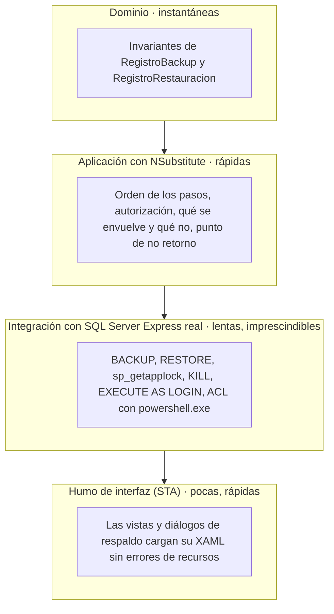

# Respaldo y Restauración — Capítulo 09: Cómo Se Prueba

### Módulo: 05. Casos de Uso y Flujos de Negocio de Punta a Punta
**Audiencia:** Desarrolladores, estudiantes universitarios y mesa evaluadora de cátedra  
**Requisitos Vinculados:** `RF-22` (Respaldo y Restauración), `RF-23` (Administración de la Base por Comandos), `RNF-08` (Integridad y Respaldo Diario) y `RNF-05` (Seguridad de Persistencia)  
**Diseño y decisiones:** [`docs/roadmap/etapa-6-track-6.3-backup-restore.md`](file:///c:/Users/lucas/Proyectos/retail/docs/roadmap/etapa-6-track-6.3-backup-restore.md) (riesgo R-8 "un backup que nunca se probó"; hallazgo 15 de la revisión final)  
**Archivos de Código que ilustran este capítulo:**
* Dominio: [`RegistroBackupTests.cs`](file:///c:/Users/lucas/Proyectos/retail/tests/Retail.Domain.UnitTests/Entities/RegistroBackupTests.cs) y [`RegistroRestauracionTests.cs`](file:///c:/Users/lucas/Proyectos/retail/tests/Retail.Domain.UnitTests/Entities/RegistroRestauracionTests.cs)
* Aplicación: [`BackupServiceTests.cs`](file:///c:/Users/lucas/Proyectos/retail/tests/Retail.Application.UnitTests/Services/BackupServiceTests.cs) y [`RestauracionServiceTests.cs`](file:///c:/Users/lucas/Proyectos/retail/tests/Retail.Application.UnitTests/Services/RestauracionServiceTests.cs)
* Integración: [`ServidorDePruebas.cs`](file:///c:/Users/lucas/Proyectos/retail/tests/Retail.Infrastructure.IntegrationTests/ServidorDePruebas.cs) y la carpeta [`Backups/`](file:///c:/Users/lucas/Proyectos/retail/tests/Retail.Infrastructure.IntegrationTests/Backups/) (incluye [`BloqueoRestauracionIntegracionTests.cs`](file:///c:/Users/lucas/Proyectos/retail/tests/Retail.Infrastructure.IntegrationTests/Backups/BloqueoRestauracionIntegracionTests.cs), [`PermisosTareaProgramadaIntegracionTests.cs`](file:///c:/Users/lucas/Proyectos/retail/tests/Retail.Infrastructure.IntegrationTests/Backups/PermisosTareaProgramadaIntegracionTests.cs), [`PermisosTareaProgramadaFixture.cs`](file:///c:/Users/lucas/Proyectos/retail/tests/Retail.Infrastructure.IntegrationTests/Backups/PermisosTareaProgramadaFixture.cs), [`PermisosTareaProgramadaColeccion.cs`](file:///c:/Users/lucas/Proyectos/retail/tests/Retail.Infrastructure.IntegrationTests/Backups/PermisosTareaProgramadaColeccion.cs), [`ScriptsDePermisosIntegracionTests.cs`](file:///c:/Users/lucas/Proyectos/retail/tests/Retail.Infrastructure.IntegrationTests/Backups/ScriptsDePermisosIntegracionTests.cs), [`RestauradorIntegracionTests.cs`](file:///c:/Users/lucas/Proyectos/retail/tests/Retail.Infrastructure.IntegrationTests/Backups/RestauradorIntegracionTests.cs) y [`RestauracionIntegracionTests.cs`](file:///c:/Users/lucas/Proyectos/retail/tests/Retail.Infrastructure.IntegrationTests/Backups/RestauracionIntegracionTests.cs)) y [`UbicacionDeLogsTests.cs`](file:///c:/Users/lucas/Proyectos/retail/tests/Retail.Infrastructure.IntegrationTests/Logging/UbicacionDeLogsTests.cs)
* Interfaz y consola: [`AppSmokeTests.cs`](file:///c:/Users/lucas/Proyectos/retail/tests/Retail.App.UnitTests/AppSmokeTests.cs), [`MensajeEstadoSistemaTests.cs`](file:///c:/Users/lucas/Proyectos/retail/tests/Retail.App.UnitTests/Helpers/MensajeEstadoSistemaTests.cs) y [`ComandoCliTests.cs`](file:///c:/Users/lucas/Proyectos/retail/tests/Retail.App.UnitTests/Helpers/ComandoCliTests.cs)
* Integración continua: [`ci.yml`](file:///c:/Users/lucas/Proyectos/retail/.github/workflows/ci.yml) y [`SISTEMA_DE_CI_CD.md`](file:///c:/Users/lucas/Proyectos/retail/docs/SISTEMA_DE_CI_CD.md)

---

## 1. 📖 Fundamento: Qué Significa "Probar" un Respaldo

### 1.1 Una copia que nunca se probó es una esperanza

El riesgo R-8 del registro de diseño lo dice sin vueltas: *"un backup que nunca se probó"*. Un `.bak` puede existir, tener un tamaño razonable y hasta pasar `RESTORE VERIFYONLY`, y aun así no servir el día que se lo necesita (falta un permiso, la carpeta no es legible para el motor, el esquema no coincide). La única prueba definitiva de una copia es **restaurarla de verdad** y comparar datos. El proyecto aplica esa idea a su propio código: no alcanza con tests que "llamen" a los métodos de respaldo; hay tests que **hacen una copia real, la restauran en un SQL Server real y comprueban qué datos quedaron**.

### 1.2 La pirámide de tests, aplicada a este módulo

La *pirámide de tests* (Mike Cohn) propone muchos tests rápidos y baratos en la base, y pocos tests lentos y caros en la punta. Cada nivel prueba algo que el de abajo no puede probar:



| Nivel | Proyecto de tests | Qué prueba | Qué **no** puede probar | Doble de prueba |
| :--- | :--- | :--- | :--- | :--- |
| Dominio | `Retail.Domain.UnitTests` | Reglas del agregado: quién puede ser operador de cada tipo, qué transiciones de estado son válidas, límites de longitud | Nada de persistencia | Ninguno (C# puro) |
| Aplicación | `Retail.Application.UnitTests` | **Orquestación**: el orden de los pasos, la autorización por rol, la reautenticación, el envoltorio D-25, la liberación del bloqueo | Que el motor realmente copie, restaure o bloquee | `NSubstitute` para todos los puertos |
| Infraestructura | `Retail.Infrastructure.IntegrationTests` | Lo que solo existe en el motor y en Windows: sentencias SQL, bloqueos de sesión, permisos, ACL | Pantallas | Ninguno: SQL Server Express real |
| Interfaz | `Retail.App.UnitTests` | Que el XAML de las vistas y diálogos se resuelve (Ley 9) y que los textos de diagnóstico son correctos | Que un clic haga lo correcto | `NSubstitute` para los servicios |

Los números que siguen son los de la corrida de este capítulo (ver sección 7): el dominio aporta **49** casos de prueba para las dos entidades; la capa de Aplicación, **99** casos para los dos servicios (cuentan los casos de cada `[Theory]`).

### 1.3 Por qué BACKUP y RESTORE no se prueban con mocks

Un mock responde lo que el programador le dice que responda. Si se sustituye `IEjecutorBackupBaseDatos` por un doble que "devuelve un archivo", el test demuestra que el servicio **llama** al ejecutor, pero no demuestra nada de lo que realmente importa:

* que el motor tiene **permiso** para escribir en la carpeta (error 5 si no lo tiene);
* que `RESTORE ... WITH MOVE` ubica bien los archivos y no choca con la base en uso;
* que `ALTER DATABASE ... MODIFY NAME` funciona con conexiones abiertas;
* que el bloqueo `sp_getapplock` de sesión **se suelta solo** cuando la sesión muere;
* que un archivo con un byte cambiado **realmente** es rechazado por `VERIFYONLY`.

Esos comportamientos pertenecen al **motor y al sistema operativo**, no al código C#. Un mock los reemplazaría por la opinión del autor del test. La regla del proyecto es: la lógica de orquestación se prueba con dobles (rápido, determinista, cubre muchas ramas); lo que solo el motor sabe se prueba contra el motor.

> [!NOTE]
> Esto conecta con la Ley 8 (delegar al motor relacional): si el trabajo lo hace SQL Server, la prueba también debe pasar por SQL Server. Y con el principio de la pirámide: los tests de integración son pocos y lentos *a propósito*; cada uno protege algo que ningún test unitario puede proteger.

---

## 2. 🧱 Capa por Capa

### 2.1 Dominio: las invariantes del agregado

Los tests de [`RegistroBackupTests`](file:///c:/Users/lucas/Proyectos/retail/tests/Retail.Domain.UnitTests/Entities/RegistroBackupTests.cs) y [`RegistroRestauracionTests`](file:///c:/Users/lucas/Proyectos/retail/tests/Retail.Domain.UnitTests/Entities/RegistroRestauracionTests.cs) no usan base de datos ni dobles: construyen la entidad con sus métodos de fábrica y comprueban que **rechaza lo inválido**. Son los más rápidos del módulo (milisegundos). Dos ejemplos literales de `RegistroBackupTests`:

```csharp
[Theory]
[InlineData(TipoBackupEnum.Automatico)]
[InlineData(TipoBackupEnum.PreMigracion)]
public void Iniciar_TipoDelSistemaConOperador_LanzaDomainException(TipoBackupEnum tipo)
{
    // Un registro no puede mentir sobre su origen: una copia automática no la pidió nadie.
    var act = () => RegistroBackup.Iniciar(tipo, 1, "gerente", Ruta, Migracion, "1.0.0");
    // ...
}

[Fact]
public void MarcarVerificado_EnCurso_LanzaTransicionBackupInvalidaException()
{
    var registro = Manual();

    var act = () => registro.MarcarVerificado();

    act.Should().Throw<TransicionBackupInvalidaException>()
        .Which.EstadoActual.Should().Be(EstadoBackupEnum.EnCurso);
}
```

| Grupo | Tests (nombres reales) | Invariante que protege |
| :--- | :--- | :--- |
| Quién es el operador | `Iniciar_TipoPedidoPorUnaPersonaSinOperador_LanzaDomainException`, `Iniciar_TipoDelSistemaConOperador_LanzaDomainException`, `Iniciar_TipoDelSistemaSinOperador_QuedaComoCopiaDelSistema` | Coherencia tipo/operador (la misma regla que la restricción `CK_REGISTROS_BACKUP_Operador` de la base) |
| Transiciones | `MarcarVerificado_EnCurso_LanzaTransicionBackupInvalidaException`, `RegistrarExito_YaVerificado_LanzaTransicionBackupInvalidaException`, `RegistrarFallo_Verificado_LanzaTransicionBackupInvalidaException`, `MarcarArchivoPurgado_YaPurgado_LanzaTransicionBackupInvalidaException` | El ciclo `EnCurso → Exitoso → Verificado` no admite atajos: solo una copia verificada es restaurable |
| Datos | `RegistrarExito_TamanoNoPositivo_...`, `RegistrarExito_HashInvalido_...`, `Iniciar_RutaDemasiadoLarga_LanzaDomainException`, `RegistrarFallo_MensajeMuyLargo_LoRecortaAlMaximoPersistible` | Nunca se persiste un registro que la columna no pueda guardar |
| Constancia de restauración | `Registrar_SinGerente_LanzaDomainException`, `Registrar_CopiaPreviaConReferenciaVacia_LanzaDomainException`, `Registrar_TextoObligatorioVacio_LanzaDomainExceptionNombrandoElCampo` | Una restauración no deja constancia sin quién, qué copia y desde dónde |

Es la primera capa de la **defensa en profundidad** del [capítulo 01](01-fundamentos-y-decisiones.md) (sección 4): el agregado, el servicio y la base repiten la misma regla, y cada capa tiene su prueba.

### 2.2 Aplicación: orquestación con NSubstitute

`BackupService` y `RestauracionService` **no saben** de SQL Server: hablan con puertos (`IEjecutorBackupBaseDatos`, `IBloqueoRestauracion`, `IRestauradorBaseDatos`, `IBaseRestaurada`, `IArchivosBackup`, `IEsquemaBaseDatos`). Gracias a la inversión de dependencias del [capítulo 02](02-componentes-por-capa.md), el test sustituye cada puerto con `NSubstitute` y se concentra en la **decisión** del servicio. El constructor de `RestauracionServiceTests` muestra qué se sustituye:

```csharp
// Repositorios en memoria: los sustitutos evalúan los predicados reales que usa el servicio.
private readonly List<RegistroBackup> _historial = [];
private readonly IRepository<RegistroBackup> _registros = Substitute.For<IRepository<RegistroBackup>>();
private readonly IBackupService _backupService = Substitute.For<IBackupService>();
private readonly IRestauradorBaseDatos _restaurador = Substitute.For<IRestauradorBaseDatos>();
private readonly IBloqueoRestauracion _bloqueo = Substitute.For<IBloqueoRestauracion>();
private readonly IBaseRestaurada _temporal = Substitute.For<IBaseRestaurada>();
private readonly IArchivosBackup _archivos = Substitute.For<IArchivosBackup>();
private readonly IEsquemaBaseDatos _esquema = Substitute.For<IEsquemaBaseDatos>();
```

| Qué es **real** | Qué se **sustituye** | Por qué |
| :--- | :--- | :--- |
| `RestauracionService`, `BackupService` (el sistema bajo prueba) | Todos los puertos de infraestructura y persistencia | Se prueba la decisión, no el motor |
| `RegistroBackup`, `RegistroRestauracion`, `Usuario` (entidades de dominio) | — | Son C# puro y baratas: usar las reales hace que los estados que se comprueban (`Fallido`, `MensajeCopiaHuerfana`) sean los del dominio auténtico |
| Los **predicados** de `FindAsync` | El repositorio | El sustituto ejecuta `_historial.Where(predicado.Compile())`: si el servicio escribe mal su consulta (por ejemplo, filtra por el estado equivocado), el test lo detecta |

El truco de los **repositorios en memoria** merece atención: en vez de configurar "cuando me pidan X devolvé Y" para cada test, el sustituto de `FindAsync` evalúa el predicado real contra una lista. Así el test comprueba la *consulta* del servicio y no solo su resultado.

#### 2.2.1 Probar el orden: `Received.InOrder` y el punto de no retorno

La propiedad más importante de la restauración (D-17) es de **orden**: todo lo que puede fallar ocurre *antes* del intercambio. Un orden no se puede probar con un `Received(1)`, que solo cuenta llamadas. NSubstitute ofrece `Received.InOrder`, que falla si las llamadas ocurrieron en otra secuencia. Literal de `RestaurarDesdeHistorialAsync_TodoValido_ValidaYPreparaLaTemporalAntesDeIntercambiar`:

```csharp
// Assert: el intercambio es el último paso; antes de él, todo lo que puede fallar (D-17).
Received.InOrder(() =>
{
    _ = _bloqueo.AdquirirExclusivoAsync(Arg.Any<CancellationToken>());
    _ = _archivos.CalcularHuellaAsync(RutaBak, Arg.Any<CancellationToken>());
    _ = _restaurador.ExisteBaseVigenteAsync(Arg.Any<CancellationToken>());
    _ = _esquema.ObtenerEstadoAsync(Arg.Any<CancellationToken>());
    _ = _restaurador.RestaurarEnBaseTemporalAsync(RutaBak, Arg.Any<IProgress<int>?>(), Arg.Any<CancellationToken>());
    _ = _temporal.ObtenerEstadoEsquemaAsync(Arg.Any<CancellationToken>());
    _ = _temporal.AplicarMigracionesPendientesAsync(Arg.Any<CancellationToken>());
    _ = _temporal.ExisteGerenteActivoAsync(Arg.Any<CancellationToken>());
    _ = _backupService.CrearBackupPreRestauracionAsync(IdGerente, "gerente", Arg.Any<IProgress<int>?>(), Arg.Any<CancellationToken>());
    _ = _temporal.ImportarHistorialDeLaBaseVigenteAsync(Arg.Any<CancellationToken>());
    _ = _temporal.ObtenerCopiasEnCursoAsync(Arg.Any<CancellationToken>());
    _ = _temporal.AgregarRestauracionAsync(Arg.Any<RegistroRestauracion>(), Arg.Any<CancellationToken>());
    _ = _temporal.GuardarCambiosAsync(Arg.Any<CancellationToken>());
    _ = _temporal.PromoverAVigenteAsync(Arg.Any<CancellationToken>());
    _ = _restaurador.EliminarBasesAnterioresAsync(BaseAnterior, Arg.Any<CancellationToken>());
});
```

Leído de arriba abajo es el **resumen de la restauración** del [capítulo 04](04-flujo-de-restauracion.md): bloqueo exclusivo, huella, estado de la vigente, `RESTORE` en la temporal, esquema, migraciones, Gerente en la copia, copia previa, historial, constancia, **`PromoverAVigenteAsync`** y, recién después, la limpieza. Si alguien mueve el intercambio una línea más arriba, este test se rompe.

El segundo test del punto de no retorno prueba que, una vez ahí, la cancelación **se ignora** (el servicio pasa `CancellationToken.None` a propósito):

```csharp
await _sut.RestaurarDesdeHistorialAsync(IdGerente, Password, copia.Referencia, cancellationToken: cancelacion.Token);

// Assert: después del punto de no retorno, cancelar dejaría el intercambio a medias.
await _temporal.Received(1).PromoverAVigenteAsync(CancellationToken.None);
await _restaurador.Received(1).EliminarBasesAnterioresAsync(BaseAnterior, CancellationToken.None);
```

(`RestaurarDesdeHistorialAsync_IntercambioConTokenCancelable_PromueveSinCancelacion`.) El mismo patrón verifica la autorreparación de huérfanas del [capítulo 07](07-escenarios-de-error-y-corrupcion.md) (A-01): en `CrearBackupManualAsync_HuerfanaYExclusivoDisponible_LaCierraYCopia`, `Received.InOrder` exige que `IntentarAdquirirExclusivoAsync` ocurra **antes** de `AdquirirCompartidoAsync`.

#### 2.2.2 Probar lo que *no* debe pasar

Un buen test de orquestación también demuestra ausencias. Ejemplos reales:

* `RestaurarDesdeHistorialAsync_TurnoDeCajaAbierto_LanzaRestauracionFallidaSinRestaurar` termina con `_restaurador.DidNotReceiveWithAnyArgs().RestaurarEnBaseTemporalAsync(...)`: ni siquiera se empezó a restaurar.
* `RestaurarDesdeHistorialAsync_FallaUnPasoDeInfraestructura_LanzaRestauracionFallidaYDescartaLaTemporal` es un `[Theory]` que hace fallar cada paso por turno y comprueba tres cosas: el mensaje termina en *"La base vigente no cambió"*, el texto técnico **no** llega al operador (queda en `InnerException`) y `_exclusividad.Received(1).DisposeAsync()` (el bloqueo se libera siempre).
* `RestaurarDesdeHistorialAsync_ActorQueNoEsGerente_LanzaOperacionNoAutorizadaSinRestaurar` prueba D-9: aunque la UI se saltee, el servicio rechaza.

### 2.3 Integración: contra el motor real

Es el nivel que justifica el módulo. Detalles en las secciones 3 y 4. Resumen de los archivos de [`Backups/`](file:///c:/Users/lucas/Proyectos/retail/tests/Retail.Infrastructure.IntegrationTests/Backups/):

| Archivo | Qué ejercita contra el motor real | Casos (atributos `[Fact]`/`[Theory]`) |
| :--- | :--- | :-: |
| `BackupIntegracionTests` | `BACKUP`, `VERIFYONLY` (con un archivo corrupto), `migrar` de punta a punta, retención, huérfana real | 8 |
| `BloqueoRestauracionIntegracionTests` | `sp_getapplock`: compartido/exclusivo, esperas, `KILL` | 14 |
| `ArchivosBackupRestauracionTests` y `ArchivosBackupPrepararParaRestaurarTests` | Manifiesto, huella SHA-256, rutas de red, traer un `.bak` desde otra carpeta | 20 y 13 |
| `RestauradorIntegracionTests` | `RESTORE` a la temporal, intercambio, reversión, bases anteriores, estado `RESTORING` | 30 |
| `RestauracionIntegracionTests` | La restauración completa con la inyección de dependencias de producción | 15 |
| `PermisosTareaProgramadaIntegracionTests` | Los permisos mínimos de la cuenta de la tarea (`EXECUTE AS LOGIN`) | 8 |
| `ScriptsDePermisosIntegracionTests` | `RetailPermisos.psm1` con un `powershell.exe` real y ACL de verdad | 14 |
| `UbicacionDeLogsTests` | La regla única de ubicación de los logs | 3 |

### 2.4 Interfaz: pruebas de humo en hilo STA

La Ley 9 exige que todo `UserControl` o ventana nueva tenga una prueba de instanciación en un hilo STA (*Single-Threaded Apartment*, el modelo de hilos que WPF requiere) que invoque `Measure()`, `Arrange()` y `UpdateLayout()`: eso obliga al motor BAML (el compilador de XAML de WPF) a resolver **todos** los recursos visuales, de modo que un `{StaticResource}` inexistente explota en el test y no en el mostrador. Para este módulo existen tres, en [`AppSmokeTests`](file:///c:/Users/lucas/Proyectos/retail/tests/Retail.App.UnitTests/AppSmokeTests.cs):

| Test | Qué carga |
| :--- | :--- |
| `BackupView_InstanciacionEnHiloSTA_DebeCargarXAMLSinExcepciones` | La pantalla Respaldos, con una fila de ejemplo por **cada** valor de `EstadoBackupEnum` (así se ejercitan los estilos de cada estado) |
| `ConfirmarCredencialDialog_InstanciacionEnHiloSTA_DebeCargarXAMLSinExcepciones` | El diálogo de reautenticación, en sus dos modos (`[Theory]`: copia y restauración) |
| `DiagnosticoArranqueDialog_InstanciacionEnHiloSTA_DebeCargarXAMLSinExcepciones` | El diálogo de diagnóstico de arranque, con distinta cantidad de comandos de `Retail.Cli` |

Además, dos grupos de tests unitarios de la app cubren la lógica de texto que alimenta el diagnóstico de arranque (D-03 del [capítulo 07](07-escenarios-de-error-y-corrupcion.md)): [`MensajeEstadoSistemaTests`](file:///c:/Users/lucas/Proyectos/retail/tests/Retail.App.UnitTests/Helpers/MensajeEstadoSistemaTests.cs) (un test por situación: `Describir_SinConexion_BloqueaYPideMigrarYLuegoInicializar`, `Describir_BaseMasNuevaQueLaApp_BloqueaPideActualizarLaAppYNoOfreceComandos`, etc.) y [`ComandoCliTests`](file:///c:/Users/lucas/Proyectos/retail/tests/Retail.App.UnitTests/Helpers/ComandoCliTests.cs), que comprueba cómo se arma la línea de comando copiable (`Formatear_EjecutablePresente_UsaRutaCompletaEntreComillasConOperadorDeLlamada`, `Formatear_EjecutableAusente_CaeADotnetRunYAvisaQueHayQueEstarEnLaRaiz`).

---

## 3. 🖥️ El Servidor de las Pruebas de Integración

### 3.1 `ServidorDePruebas`: un solo punto de elección

Todas las pruebas de integración obtienen su cadena de conexión de [`ServidorDePruebas.CadenaDeConexion`](file:///c:/Users/lucas/Proyectos/retail/tests/Retail.Infrastructure.IntegrationTests/ServidorDePruebas.cs), que lee la variable de entorno `RETAIL_TEST_SQLSERVER` y, si no está definida, usa la instancia local de desarrollo `.\SQLEXPRESS`:

```csharp
private const string VariableDeEntorno = "RETAIL_TEST_SQLSERVER";
private const string ServidorPorDefecto = @".\SQLEXPRESS";

public static string CadenaDeConexion(string nombreBase)
{
    var servidor = Environment.GetEnvironmentVariable(VariableDeEntorno);

    var builder = new SqlConnectionStringBuilder
    {
        DataSource = string.IsNullOrWhiteSpace(servidor) ? ServidorPorDefecto : servidor,
        InitialCatalog = nombreBase,
        IntegratedSecurity = true,
        TrustServerCertificate = true,
        MultipleActiveResultSets = true
    };

    return builder.ConnectionString;
}
```

Por qué así:

* **Un único lugar** para cambiar de servidor (una máquina con otro nombre de instancia, o el *runner* de CI) evita cadenas de conexión desperdigadas por decenas de archivos de prueba.
* `IntegratedSecurity = true`: autenticación de Windows, igual que en producción (no hay contraseñas de SQL en el repositorio).
* `TrustServerCertificate = true` por la misma razón que en el [capítulo 08](08-seguridad-y-permisos.md) (sección 6): el certificado de una instancia local es autofirmado y el cliente cifra por defecto.
* Cada prueba recibe el **nombre de la base** como parámetro, y por convención usa `RetailDb_Test_<algo>_<Guid>`: así dos tests nunca comparten base y pueden correr en paralelo.

### 3.2 Por qué `%TEMP%` falla con Express

Con SQL Server Express, `BACKUP` y `RESTORE` los ejecuta el **servicio del motor**, con su propia cuenta de Windows (`NT SERVICE\MSSQL$SQLEXPRESS`), no el usuario que corre `dotnet test` (ver el [capítulo 01](01-fundamentos-y-decisiones.md), sección 2.8). El `%TEMP%` del usuario no es legible ni escribible por esa cuenta. Un test que escribiera ahí fallaría con el *error 5 del sistema operativo* (`ERROR_ACCESS_DENIED`), que no tiene nada que ver con lo que el test quiere probar. La solución es `CrearCarpetaAccesibleParaElMotor`, que crea una carpeta temporal **única** y le da `Modify` con herencia a la cuenta del motor:

```csharp
var cuentaDelMotor = ObtenerCuentaDelServicioDelMotor();

var ruta = Path.Combine(Path.GetTempPath(), $"{prefijo}_{Guid.NewGuid():N}");
var carpeta = Directory.CreateDirectory(ruta);

var seguridad = carpeta.GetAccessControl();
seguridad.AddAccessRule(new FileSystemAccessRule(
    new NTAccount(cuentaDelMotor),
    FileSystemRights.Modify,
    InheritanceFlags.ContainerInherit | InheritanceFlags.ObjectInherit,
    PropagationFlags.None,
    AccessControlType.Allow));
carpeta.SetAccessControl(seguridad);
```

La cuenta no se supone: se **pregunta al motor**, con esta sentencia literal de `ObtenerCuentaDelServicioDelMotor`:

```sql
SELECT TOP (1) service_account FROM sys.dm_server_services WHERE servicename LIKE 'SQL Server (%';
```

| Elemento | Qué hace |
| :--- | :--- |
| `sys.dm_server_services` | Vista de administración dinámica con los servicios del motor y la cuenta con la que corre cada uno |
| `servicename LIKE 'SQL Server (%'` | Filtra el servicio del motor (por ejemplo `SQL Server (SQLEXPRESS)`) y descarta, por ejemplo, el del Agente |
| `TOP (1)` | Basta una fila |

Si la consulta falla (la vista exige el permiso `VIEW SERVER STATE`), el método lanza una excepción con un mensaje claro: *seguir sin permisos produciría errores de acceso denegado difíciles de rastrear*. Es la misma filosofía que los mensajes accionables de producción.

Las carpetas **padre** (`%TEMP%` y sus ancestros) no necesitan permisos: Windows omite la verificación de recorrido por defecto, así que el motor llega a la carpeta hija por su ruta completa.

### 3.3 Reglas de limpieza: que no queden bases ni carpetas

Un test de integración deja basura si falla a mitad de camino. Las reglas que aplica el proyecto:

1. **Nombres únicos** (`RetailDb_Test_..._<Guid>`): nunca se reutiliza un nombre, así un resto de una corrida anterior no contamina la siguiente.
2. **Toda limpieza va en `DisposeAsync` / `Dispose`**, que xUnit invoca aunque el test haya fallado.
3. **Antes de borrar, `SqlConnection.ClearAllPools()`**: el *pool* de conexiones mantiene sesiones abiertas contra la base, y un `DROP DATABASE` fallaría por "base en uso".
4. **El borrado tolera estados raros.** El de `RestauracionIntegracionTests` limpia la vigente, la temporal y todas las bases `_Anterior_`, y fuerza `SINGLE_USER` dentro de un `TRY/CATCH` porque una base en estado `RESTORING` no admite `ALTER DATABASE`:

```sql
IF DB_ID(@nombre) IS NOT NULL BEGIN BEGIN TRY ALTER DATABASE {delimitado} SET SINGLE_USER WITH ROLLBACK IMMEDIATE; END TRY BEGIN CATCH END CATCH; DROP DATABASE {delimitado}; END
```

   (`{delimitado}` es el nombre encerrado entre corchetes con los `]` duplicados; `@nombre` viaja como parámetro y solo se usa en el `DB_ID`. El `TRY/CATCH` vacío ignora el error de `ALTER DATABASE` sobre una base en `RESTORING` y sigue con el `DROP`.)
5. **Se borran también las carpetas** (`Directory.Delete(..., recursive: true)`), la del motor y la "externa".
6. **Los logins de prueba se eliminan** (`DROP LOGIN`) en la fixture de permisos.

---

## 4. 🔬 Los Tests Notables, Explicados

### 4.1 El test del `KILL`: la prueba de que la autorreparación funciona

**La afirmación central.** La autorreparación de copias huérfanas (B-0, [capítulo 03](03-flujo-de-copia.md) sección 4) descansa en una propiedad *del motor*: *si el proceso que hace una copia muere, SQL Server suelta el bloqueo compartido que tenía*. Si eso no fuera cierto, "si logro el exclusivo, todo `EnCurso` es huérfano" sería falso. Un test con mocks no puede probarlo; hay que **matar una sesión de verdad**. Literal de `IntentarAdquirirExclusivoAsync_ElProcesoDeLaCopiaMuere_ElMotorSueltaElCompartidoYSeObtiene`:

```csharp
var copia = await _sut.AdquirirCompartidoAsync();
var antesDeMorir = await _sut.IntentarAdquirirExclusivoAsync();

var sesion = await BuscarSesionQueSostieneElBloqueoAsync();

// Act
await using (var master = new SqlConnection(ServidorDePruebas.CadenaDeConexion("master")))
{
    await master.OpenAsync();
    await using var matar = master.CreateCommand();
    matar.CommandText = $"KILL {sesion};";
    await matar.ExecuteNonQueryAsync();
}

// La sesión muerta tarda unos instantes en retirarse del motor: se espera hasta 10 segundos.
IAsyncDisposable? despuesDeMorir = null;
for (var intento = 0; intento < 40 && despuesDeMorir is null; intento++)
{
    despuesDeMorir = await _sut.IntentarAdquirirExclusivoAsync();
    if (despuesDeMorir is null)
    {
        await Task.Delay(250);
    }
}

// Assert
antesDeMorir.Should().BeNull("con la copia viva, el exclusivo no está disponible");
despuesDeMorir.Should().NotBeNull("muerta la sesión de la copia, el motor soltó su compartido sin que nadie lo libere");
```

Paso a paso:

1. La "copia" toma el bloqueo **compartido** (`AdquirirCompartidoAsync`) y se comprueba que, estando viva, el exclusivo **no** está disponible (`antesDeMorir` es `null`).
2. `BuscarSesionQueSostieneElBloqueoAsync` averigua **qué sesión del motor** tiene el bloqueo, con esta consulta literal:

```sql
SELECT TOP (1) request_session_id FROM sys.dm_tran_locks WHERE resource_type = 'APPLICATION' AND resource_description LIKE @patron;
```

| Elemento | Qué hace |
| :--- | :--- |
| `sys.dm_tran_locks` | Vista con todos los bloqueos vigentes del servidor |
| `resource_type = 'APPLICATION'` | Los bloqueos de aplicación son los que crea `sp_getapplock` |
| `resource_description LIKE @patron` | Reconoce el bloqueo de *esta* prueba por el nombre del recurso (`%Retail.Restauracion.<base>%`) |
| `request_session_id` | El número de sesión (SPID) que lo tiene: lo que hace falta para matarla |

   Un detalle de ingeniería: el motor muestra en esa vista solo los primeros 32 caracteres del nombre del bloqueo, y `Retail.Restauracion.` ocupa 20. Por eso el nombre de la base de la prueba pone lo que la distingue **al principio** (`{Guid}_RetailDb_Test_Bloqueo`), y el patrón usa `_nombreBase[..12]`.
3. `KILL {sesion};` termina esa sesión a la fuerza: es lo que le pasa a una copia cuando su proceso muere de golpe o se corta la luz.
4. Se reintenta tomar el exclusivo hasta 10 segundos (40 intentos de 250 ms), porque la sesión muerta tarda instantes en retirarse. Cuando lo consigue, queda demostrado que **el motor soltó el compartido sin que nadie lo liberara**.
5. Al final se comprueba que liberar la copia ya muerta (`copia.DisposeAsync()`) **no lanza**.

> [!NOTE]
> El [capítulo 07](07-escenarios-de-error-y-corrupcion.md) (A-04) deja una salvedad honesta: *cuánto tarda* el motor en descartar la sesión de un proceso cliente muerto de otra forma (no por `KILL`) no se verificó. El test simula la caída con `KILL`, que es determinista; la hipótesis de que un corte de luz produce el mismo efecto es razonable, pero no se probó cortando la luz.

### 4.2 Los tests de permisos: leer el script y suplantar la cuenta

**El problema.** La tarea de las 21:00 corre como `NT AUTHORITY\SYSTEM`, que solo se puede ejercitar desde el Programador de tareas. ¿Cómo se prueba que sus **cuatro permisos** alcanzan, y que no tiene ninguno más? Con dos ideas:

**Idea 1: no repetir la lista de permisos, leerla del script.** [`PermisosTareaProgramadaFixture`](file:///c:/Users/lucas/Proyectos/retail/tests/Retail.Infrastructure.IntegrationTests/Backups/PermisosTareaProgramadaFixture.cs) extrae las sentencias de `$Permisos` de `registrar-tarea-backup.ps1` con una expresión regular:

```csharp
[GeneratedRegex(@"Ambito\s*=\s*'(?<ambito>Servidor|BaseDeDatos)'\s*;\s*Sql\s*=\s*'(?<sql>[^']+)'")]
private static partial Regex PermisoDelScript();
```

Si alguien agrega o quita un permiso del script, las pruebas ejercitan el cambio solas. Si el formato cambia y la expresión no encuentra nada, la fixture lanza `"No se encontraron permisos en $Permisos ... ¿cambió el formato?"` en lugar de pasar en falso.

**Idea 2: suplantar con `EXECUTE AS LOGIN`.** La fixture crea un *login* de prueba (con una contraseña descartable que nadie puede usar, porque la instancia solo acepta autenticación de Windows), le concede exactamente esos permisos y abre una conexión que ejecuta todo **como ese login**:

```csharp
var conexion = new SqlConnection(CadenaDeConexion(baseDeDatos ?? BaseDeDatos));
await conexion.OpenAsync();
await EjecutarAsync(conexion, $"EXECUTE AS LOGIN = N'{login}';");
```

El pool de conexiones se desactiva (`Pooling = false`) para que una conexión que suplantó a otra no vuelva al pool con esa identidad puesta. A partir de ahí, las pruebas demuestran **lo permitido** y **lo denegado**:

```csharp
[Theory]
[InlineData("SELECT TOP (1) 1 FROM VENTAS")]
[InlineData("UPDATE USUARIOS SET nombre_usuario = nombre_usuario WHERE 1 = 0")]
[InlineData("DELETE FROM REGISTROS_BACKUP WHERE 1 = 0")]
[InlineData("CREATE TABLE dbo.PRUEBA_PERMISOS (id int)")]
public async Task CuentaDeLaTarea_FueraDeLoNecesario_NoTienePermiso(string sql)
{
    // ...
    (await act.Should().ThrowAsync<SqlException>()).Which.Message.Should().Contain("denied");
}
```

| Prueba | Lo que demuestra |
| :--- | :--- |
| `CopiaYVerificacion_ConLosPermisosDelScript_LaCopiaSeCreaYSeVerifica` | Con esos permisos, `BACKUP ... WITH FORMAT, INIT, CHECKSUM, STATS = 10, NAME = @nombre;` y `RESTORE VERIFYONLY FROM DISK = @ruta WITH CHECKSUM;` funcionan |
| `Verificacion_SinElPermisoDeServidor_FallaPorFaltaDeCreateDatabase` | La cuenta *sin* `CREATE ANY DATABASE` hace el `BACKUP` pero **no** el `VERIFYONLY` (mensaje con `CREATE DATABASE`): el permiso es necesario, no decorativo |
| `ConsultasDeUsuarios_ConLosPermisosDelScript_NoPuedeLeerNiElHashDeLasContrasenas` | `SELECT password_hash FROM USUARIOS`, `contexto.Usuarios.AnyAsync()` y una consulta por rol fallan con *denied* |
| `CuentaDeLaTarea_FueraDeLoNecesario_NoTienePermiso` | Cuatro casos denegados: leer `VENTAS`, modificar `USUARIOS`, **`DELETE` del historial** (el borrado es lógico) y `CREATE TABLE` |
| `PermisosDelScript_NoIncluyenNingunaTablaDeNegocioNiDeUsuarios` | La lista del script es **exactamente** las cuatro sentencias; un permiso nuevo obliga a editar la prueba *a propósito* |
| `BloqueoDeRestauracion_ConLosPermisosDelScript_ElBloqueoSobreMasterSeObtieneYSeSuelta` | `sp_getapplock` sobre `master` no necesita ningún permiso extra |

Probar lo **denegado** es tan importante como probar lo permitido: un test que solo comprueba que "la copia funciona" pasaría igual si la cuenta fuera `sysadmin`. Los dos límites de esta estrategia están en la documentación de la propia clase y en el [capítulo 08](08-seguridad-y-permisos.md): el login suplantado no es el `SYSTEM` real, y los permisos de **carpeta** de la tarea no se prueban acá.

### 4.3 El test de ACL: una carpeta que hereda permisos amplios

**El bug que lo originó** (capítulo 08, sección 5.2): en la primera ejecución real del script, las reglas heredadas de `C:\` (*Usuarios autenticados*, *Usuarios*) quedaban dentro de la carpeta de respaldos. Una prueba sobre una carpeta "limpia" no lo habría visto. Por eso [`ScriptsDePermisosIntegracionTests`](file:///c:/Users/lucas/Proyectos/retail/tests/Retail.Infrastructure.IntegrationTests/Backups/ScriptsDePermisosIntegracionTests.cs) **fabrica el estado inicial del problema**:

```csharp
private string CrearHijaQueHeredaUsuariosAutenticados()
{
    var padre = Directory.CreateDirectory(Path.Combine(_raiz, "padre"));
    var seguridad = padre.GetAccessControl();
    seguridad.AddAccessRule(new FileSystemAccessRule(
        new SecurityIdentifier(SidUsuariosAutenticados),
        FileSystemRights.Modify,
        InheritanceFlags.ContainerInherit | InheritanceFlags.ObjectInherit,
        PropagationFlags.None,
        AccessControlType.Allow));
    padre.SetAccessControl(seguridad);

    var hija = Directory.CreateDirectory(Path.Combine(padre.FullName, "Backups"));
    var heredadas = SidsConPermiso(hija.FullName);
    heredadas.Should().Contain(SidUsuariosAutenticados, "la precondición de la prueba es la situación real: la hija hereda el permiso amplio");
    return hija.FullName;
}
```

Observá la **precondición**: el propio test verifica que la hija realmente hereda el permiso amplio antes de ejecutar nada. Sin eso, el test podría pasar porque la situación peligrosa nunca existió. Después se aplica el módulo y se comprueba el resultado:

```csharp
AplicarPermisosDeRespaldos(carpeta);

var sids = SidsConPermiso(carpeta);
sids.Should().NotContain([SidUsuariosAutenticados, SidUsuarios, SidTodos]);
sids.Should().Contain([SidAdministradores, SidSistema, SidDelMotor, SidDeLaApp]);

Seguridad(carpeta).AreAccessRulesProtected
    .Should().BeTrue("la carpeta ya no hereda de su padre");
Reglas(carpeta).Should().OnlyContain(r => !r.IsInherited, "no queda ninguna regla heredada: todas son propias y explícitas");
```

Tres detalles del diseño del test:

* **Se ejecuta el script de verdad.** `EjecutarConElModulo` lanza un `powershell.exe` nuevo (`-NoProfile -NonInteractive -ExecutionPolicy Bypass -EncodedCommand ...`), importa `RetailPermisos.psm1` y corre `Set-PermisoDeCarpeta`. Después **lee la ACL desde C#** con `DirectorySecurity`. Prueba el resultado, no el código.
* **No hace falta ser administrador:** quien crea una carpeta es su propietario y puede cambiar su ACL. Todo ocurre bajo una carpeta temporal propia (`RetailAclTests_<guid>`); nunca se toca `C:\RetailData` ni `Program Files`.
* **Los grupos se nombran por SID** (`S-1-5-11`, `S-1-5-32-545`, `S-1-1-0`...), no por nombre, para que el test funcione igual en Windows en español y en inglés.

### 4.4 La reversión del intercambio: forzar la falla con `OFFLINE`

**La afirmación.** Si falla el segundo renombrado del intercambio, el primero se revierte y la vigente queda intacta (C-02). ¿Cómo se provoca una falla *real* del segundo `MODIFY NAME` sin tocar el código de producción? Poniendo la base temporal `OFFLINE` justo antes de promoverla. Literal de `PromoverAVigenteAsync_FallaElSegundoRenombrado_RevierteElPrimeroYLaVigenteQuedaIntacta`:

```csharp
// ...
await using (var restaurada = await CrearSut().RestaurarEnBaseTemporalAsync(ruta, progreso: null))
{
    anterior = restaurada.NombreBaseAnterior;
    await EjecutarEnMasterAsync($"ALTER DATABASE [{temporal}] SET OFFLINE WITH ROLLBACK IMMEDIATE;");
    act = () => restaurada.PromoverAVigenteAsync();

    // Assert: falla con un mensaje que dice que la vigente no cambió.
    await act.Should().ThrowAsync<Retail.Application.Exceptions.RestauracionFallidaException>()
        .WithMessage("*se conservó sin cambios*");

    // La temporal vuelve a estar en línea para que el descarte pueda borrar también sus archivos físicos.
    await EjecutarEnMasterAsync($"ALTER DATABASE [{temporal}] SET ONLINE;");
}

// Assert: la vigente recuperó su nombre, su acceso multiusuario y todos sus datos; no quedó una "_Anterior_".
(await ExisteAsync(anterior!)).Should().BeFalse();
(await AccesoDeUsuariosAsync(_vigente)).Should().Be("MULTI_USER");
(await NombresDeUsuariosAsync(_vigente)).Should().Contain("gerente.reversion").And.Contain("posterior.reversion");
(await ExisteAsync(temporal)).Should().BeFalse();
```

Qué sucede en el motor: el paso 1 (`vigente → RetailDb_Anterior_<fecha>`) funciona, el paso 2 (`temporal → vigente`) falla porque una base `OFFLINE` no se puede renombrar, y entonces `RevertirPrimerPasoAsync` devuelve la anterior a su nombre original. El test comprueba **cuatro cosas** del estado final: la anterior ya no existe (se revirtió), la vigente quedó en `MULTI_USER`, conserva **todos** sus datos (incluido el usuario posterior a la copia) y la temporal fue descartada. Es el ejemplo de un test que provoca una falla genuina del motor con una acción externa, sin inyectar excepciones.

### 4.5 La restauración de punta a punta: datos A y datos B

[`RestauracionIntegracionTests`](file:///c:/Users/lucas/Proyectos/retail/tests/Retail.Infrastructure.IntegrationTests/Backups/RestauracionIntegracionTests.cs) usa la inyección de dependencias **de producción** (`AddApplicationServices`, `AddAdministracionSistema`, `AddInfrastructureServices`), con `ValidateScopes` y `ValidateOnBuild` activados, y ejecuta cada operación en su **propio *scope*** como lo haría la aplicación (tras un restore, el contexto viejo apunta a una base reemplazada). El escenario común es:

```csharp
// Escenario común: datos A, copia manual, y luego datos B en la vigente.
await PrepararBaseConGerenteAsync();
await AgregarCategoriaAsync(CadenaVigente, "Datos A");
var copia = await CrearBackupManualAsync();
await AgregarCategoriaAsync(CadenaVigente, "Datos B");
```

Se hace una copia cuando solo existen los "Datos A", se agregan los "Datos B" y se restaura. El test del camino feliz (`RestaurarDesdeHistorialAsync_CopiaVerificada_DejaLosDatosDeLaCopiaYConservaLaBaseAnterior`) comprueba el contrato completo:

```csharp
(await CategoriasDeAsync(_vigente)).Should().ContainSingle().Which.Should().Be("Datos A");
resultado.BaseAnterior.Should().NotBeNullOrWhiteSpace();
(await ExisteBaseAsync(resultado.BaseAnterior!)).Should().BeTrue();
(await CategoriasDeAsync(resultado.BaseAnterior!)).Should().BeEquivalentTo("Datos A", "Datos B");
(await ExisteBaseAsync($"{_vigente}_Restaurando")).Should().BeFalse("la temporal pasó a ser la vigente");
```

| Afirmación | Dónde se ve |
| :--- | :--- |
| La vigente tiene los datos **de la copia** (solo A) | `ContainSingle().Which.Should().Be("Datos A")` |
| La base `_Anterior_` conserva **todo lo que había** (A y B): nada se destruyó | `BeEquivalentTo("Datos A", "Datos B")` |
| La temporal ya no existe (pasó a ser la vigente) | `ExisteBaseAsync(..._Restaurando)` es `false` |
| La copia restaurada, que dentro del `.bak` estaba `EnCurso`, quedó `Verificado` (R-18) | `registros.Single(...).Estado.Should().Be(EstadoBackupEnum.Verificado)` |
| Existe la copia `PreRestauracion` y no queda ninguna `EnCurso` | `previa.Tipo`, `registros.Should().NotContain(r => r.Estado == EstadoBackupEnum.EnCurso)` |
| La constancia registra operador, origen, copia y base anterior | las aserciones sobre `RegistroRestauracion` |

Este mismo escenario se reutiliza para los caminos de falla (archivo modificado, contraseña incorrecta, turno abierto), y en cada uno se comprueba que `CategoriasDeAsync(_vigente)` sigue siendo `"Datos A", "Datos B"`: la base en uso **no cambió**.

#### 4.5.1 La compuerta: probar la concurrencia sin dormir

Para probar `CrearBackupManualAsync_OtraCopiaViva_NoCierraNiTocaSuRegistro` hace falta una copia *a mitad de camino*. En vez de `Task.Delay` y esperar que coincida, el test usa una **compuerta** (`CompuertaDeCopia`) con dos `TaskCompletionSource`: un `EjecutorConCompuerta` envuelve al ejecutor real y, si la compuerta está armada, avisa "entré" y se queda esperando la señal. El test arranca la primera copia, espera `_compuerta.Entro` (con la copia ya `EnCurso` y su bloqueo tomado), lanza una segunda y comprueba que **rechaza** con `DomainException` ("en curso") **sin tocar** el registro ajeno. Después libera la compuerta y la primera termina `Verificado`. Es un test determinista: no depende de tiempos.

---

## 5. 🎓 Lecciones de Método para la Defensa

### 5.1 El control negativo que destapó un test que pasaba por la razón equivocada

El hallazgo 15 de la revisión final del registro de diseño lo cuenta: *"El control negativo de B-3 destapó un test que pasaba en falso: `File.Move` conservaba la ACL del archivo y el motor sí podía leer la 'carpeta externa'; ahora se copia y el motor da 'error 5'"*.

**El contexto.** El caso B-07 del capítulo 07: el Gerente trae un `.bak` desde una carpeta (Descargas) que el motor **no puede leer**; la restauración debe copiarlo primero al directorio de respaldos. Para probarlo, el test necesita un archivo en una carpeta que el motor no pueda leer.

**El error.** La primera versión armaba esa "carpeta externa" **moviendo** el `.bak` con `File.Move`. Pero un `File.Move` dentro del mismo volumen *no copia datos: solo cambia el nombre*, y por lo tanto **conserva la lista de acceso del archivo**, que ya incluía el permiso del motor (heredado de la carpeta de respaldos). El motor podía leer el archivo "externo" sin ningún problema. El test pasaba, pero **no estaba probando nada**: la funcionalidad de "traer el archivo" no era necesaria para que la restauración anduviera.

**Cómo se descubrió: el control negativo.** Un *control negativo* es una verificación de que la **precondición** del test es real: si pido hacer lo que la funcionalidad debería evitar, tiene que fallar. Está en el código actual:

```csharp
// Control negativo: sin la preparación, el motor realmente no puede leer esa carpeta. Si pudiera (otra cuenta de
// servicio, otra configuración de la PC), esta prueba no demostraría nada y debe avisarlo en lugar de pasar en falso.
await using (var master = new SqlConnection(CadenaDe("master")))
{
    await master.OpenAsync();
    await using var verificacion = master.CreateCommand();
    verificacion.CommandText = "RESTORE VERIFYONLY FROM DISK = @ruta;";
    verificacion.Parameters.AddWithValue("@ruta", externa);

    var directa = () => verificacion.ExecuteNonQueryAsync();

    (await directa.Should().ThrowAsync<SqlException>("el motor corre con otra cuenta que no tiene permiso sobre la carpeta externa"))
        .Which.Message.Should().Contain("error 5", "5 es ERROR_ACCESS_DENIED de Windows, en cualquier idioma");
}
```

Con `File.Move`, este bloque **fallaba** (el motor sí leía el archivo), y así quedó a la vista que el test original era vacío. La corrección fue armar la carpeta externa con **copia + borrado** (un archivo nuevo hereda los permisos de la carpeta donde se crea, como en la vida real):

```csharp
File.Copy(rutaBak, destino);
File.Copy(Path.ChangeExtension(rutaBak, ".json"), Path.ChangeExtension(destino, ".json"));
File.Delete(rutaBak);
File.Delete(Path.ChangeExtension(rutaBak, ".json"));
```

**La lección.** Un test verde no prueba que el código funcione; prueba que **el test y el código coinciden**. Para desconfiar de un test que pasa, hay que preguntar *"¿puedo hacer que falle a propósito?"*. Si la situación que el test dice proteger no se puede provocar, el test no protege nada.

### 5.2 La falla intermitente, tratada "por descarte" y no como causa probada

Durante la Fase 7, dos pruebas de `PermisosTareaProgramadaIntegracionTests` fallaron juntas **una vez de cinco corridas completas** y no se pudieron reproducir ni aisladas ni en once corridas más. El error no se capturó. La respuesta fue aislar la clase en una colección de xUnit sin paralelismo. Literal de [`PermisosTareaProgramadaColeccion`](file:///c:/Users/lucas/Proyectos/retail/tests/Retail.Infrastructure.IntegrationTests/Backups/PermisosTareaProgramadaColeccion.cs):

```csharp
/// Dos de estas pruebas fallaron una vez de cada cinco corridas completas y nunca aisladas; no se pudo capturar el error, así que
/// esto es un endurecimiento por descarte: aislarla elimina la competencia por el servidor sin tocar lo que las pruebas verifican.
[CollectionDefinition(Nombre, DisableParallelization = true)]
public sealed class PermisosTareaProgramadaColeccion : ICollectionFixture<PermisosTareaProgramadaFixture>
```

Cómo explicarlo sin exagerar:

| Afirmación | Estado |
| :--- | :--- |
| "Las pruebas de permisos competían con las de restauración por la misma instancia Express" | **Hipótesis**, no demostrada |
| "Aislar la colección elimina esa competencia" | Cierto por construcción (xUnit no corre nada en paralelo con ella) |
| "Con eso, el problema está resuelto" | **No se puede afirmar**: nunca se reprodujo, así que tampoco se puede probar que desapareció |
| Si reaparece | Capturar el error con `dotnet test --logger trx` y analizar la causa |

Es una medida **preventiva**, y la documentación lo dice así. Decir "lo arreglamos" sin evidencia sería peor que reconocer la incertidumbre.

---

## 6. 🚧 Lo Que NO Está Cubierto por Tests Automáticos

Esta lista sale de la sección 7 del [capítulo 07](07-escenarios-de-error-y-corrupcion.md); acá se agrega cómo se compensa cada hueco.

| Escenario sin prueba automática | Por qué | Cómo se cubre hoy |
| :--- | :--- | :--- |
| A-06 Bloqueo del cierre del diálogo durante una copia | Comportamiento de interacción de UI | El smoke test solo instancia; se verifica a mano |
| A-09 Carpeta de respaldos no escribible (`PrepararRutaNueva`) | Los tests de `BackupService` reemplazan `IArchivosBackup` por un doble | Razonamiento sobre el código |
| A-10 Margen de espacio libre al copiar | Ídem | Ídem |
| A-05 Cancelación real del `BACKUP` con el motor | Solo hay prueba con un doble que lanza `OperationCanceledException`; posible diferencia de excepción no verificada | Documentado en A-05 |
| C-01 Primer renombrado fallido y sus reintentos | No hay prueba | — |
| C-03 Falla también la reversión del intercambio | Rama de último recurso, difícil de provocar | `LogCritical` y recuperación manual |
| C-04 Proceso muerto entre los dos renombrados | No es reproducible sin cortar el proceso en la ventana exacta | Mitigaciones preventivas (Ctrl+C no mata el proceso, la UI bloquea el cierre) |
| C-05 Falla al restablecer `MULTI_USER` | Solo el camino normal está probado (`PromoverAVigenteAsync_CasoNormal_AmbasBasesQuedanMultiusuario`) | Solo el log |
| B-08 Restauración real de una copia "del futuro" | Solo prueba unitaria más `EsquemaBaseDatosTests` | — |
| B-09 Restauración real de una copia con migraciones pendientes | Hay prueba de orden en el servicio, no restauración real de una copia vieja | — |
| D-01 y D-02 Mensajes y espera de 2 minutos de `ComandoBackup` | `Retail.Cli` **no tiene proyecto de pruebas** (tampoco `CancelacionConsola`) | Prueba manual |
| D-02 La tarea apunta a la CLI instalada | Es configuración del Programador de tareas | Prueba manual |
| D-06 `IgnoreNew` y límite de 2 horas | Ídem | Se ejercita a mano |
| Concurrencia exacta de dos copias que pasan el control "en curso" a la vez | No se verificó con una prueba de concurrencia real | Nota en A-12 |

> [!WARNING]
> **Brecha de seguridad sin prueba.** El borrado de archivos por la retención y por B-0 usa la ruta guardada en `REGISTROS_BACKUP` (hallazgo del [capítulo 08](08-seguridad-y-permisos.md), sección 7.2). En el estado de `main` que describe este capítulo no existe ningún test que lo cubra.
>
> [!NOTE]
> *Pendiente de confirmación del orquestador:* esa brecha se corrigió en la rama `fix/respaldos-borrado-seguro` (borrado solo dentro de la carpeta de respaldos y solo de archivos `.bak`). Cuando esa rama se integre habrá que agregar acá sus tests y quitar esta advertencia.

### 6.1 Las pruebas manuales

Lo que ningún test automático puede ejercitar es la **tarea real como `SYSTEM`**. El procedimiento está en el [capítulo 06](06-scripts-y-sql.md), sección 7 (diez pasos: instalar como administrador, `-WhatIf`, ejecución real, `icacls`, login, `Start-ScheduledTask`, verificar la copia, revisar el log del perfil de `SYSTEM`, idempotencia y desregistro). Según el registro de diseño, **la primera prueba manual como `SYSTEM` real fue exitosa (2026-10-14)** y queda pendiente **repetirla con el script corregido** (CLI de la instalación y ACL). Tampoco se probó nunca el reinicio real de la aplicación tras una restauración (C-06) ni la pantalla Respaldos "en vivo" en la app real.

Conviene distinguir tres grados de certeza al responder en la defensa:

| Grado | Significado | Ejemplo |
| :--- | :--- | :--- |
| **Verificado por un test automático** | Se rompe el build si deja de ser cierto | El `KILL`, los permisos denegados, la reversión del intercambio |
| **Verificado a mano** | Alguien lo ejecutó una vez y funcionó | La tarea como `SYSTEM` real, la espera del motor al arrancar la PC |
| **Deducido del código** | Razonamiento, sin ejecución | C-04 (muerte entre renombrados), la ventana de un turno abierto entre el segundo control y el intercambio |

---

## 7. ▶️ Cómo Ejecutar los Tests

### 7.1 Ciclo rápido: solo lo que se tocó

El AGENTS.md permite, durante el desarrollo iterativo, ejecutar solo la suite correspondiente. Comandos y duración medidos al redactar este capítulo (incluyen compilación; la duración de la prueba en sí está entre paréntesis):

| Qué | Comando | Resultado y tiempo |
| :--- | :--- | :--- |
| Dominio del respaldo | `dotnet test tests/Retail.Domain.UnitTests --filter "FullyQualifiedName~RegistroBackup\|FullyQualifiedName~RegistroRestauracion"` | 49 casos, 0 fallas (≈ 0,3 s de prueba, ≈ 33 s en total) |
| Servicios de Aplicación | `dotnet test tests/Retail.Application.UnitTests --filter "FullyQualifiedName~BackupServiceTests\|FullyQualifiedName~RestauracionServiceTests"` | 99 casos, 0 fallas (≈ 1 s de prueba, ≈ 38 s en total) |
| Integración del respaldo | `dotnet test tests/Retail.Infrastructure.IntegrationTests --filter "FullyQualifiedName~IntegrationTests.Backups"` | 141 casos, 0 fallas, **≈ 15 min 46 s** de prueba (≈ 17 min 40 s en total, medido en una PC con otra sesión usando también la instancia Express; en una máquina libre debería ser menor, pero no se midió) |
| Un solo test | `dotnet test tests/Retail.Infrastructure.IntegrationTests --filter "FullyQualifiedName~ElProcesoDeLaCopiaMuere"` | Segundos |
| Interfaz y diagnóstico de arranque | `dotnet test tests/Retail.App.UnitTests --filter "FullyQualifiedName~BackupView\|FullyQualifiedName~ConfirmarCredencialDialog\|FullyQualifiedName~DiagnosticoArranqueDialog\|FullyQualifiedName~MensajeEstadoSistemaTests\|FullyQualifiedName~ComandoCliTests"` | 34 casos, 0 fallas (≈ 10 s de prueba; la compilación de la app WPF tardó varios minutos en esa corrida) |

(En PowerShell, el carácter `|` dentro de un `--filter` entre comillas dobles es literal; en otros intérpretes puede requerir escape.)

### 7.2 Requisitos del entorno

* **SQL Server Express** corriendo como instancia `.\SQLEXPRESS`. Si tu instancia se llama distinto: `$env:RETAIL_TEST_SQLSERVER = ".\OTRA"` antes de ejecutar.
* Tu usuario necesita poder crear y borrar bases en la instancia (en una instalación normal de Express quien instaló es `sysadmin`) y `VIEW SERVER STATE` para leer la cuenta del servicio del motor (sección 3.2).
* Los tests de ACL usan `powershell.exe` de Windows y carpetas temporales propias; no requieren ser administrador.
* No hace falta una impresora ni certificados fiscales (Ley 6): estos tests no los tocan.

### 7.3 Verificación completa y CI

Al cerrar un hito, el AGENTS.md exige la verificación completa:

```powershell
powershell -ExecutionPolicy Bypass -File scripts/audit-xaml.ps1
dotnet build Retail.sln --configuration Release
dotnet test Retail.sln --configuration Release --no-build
dotnet format Retail.sln --verify-no-changes
```

(La suite completa **no se ejecutó** al redactar este capítulo: solo los grupos de la tabla anterior. El registro de diseño reporta 1479 tests al cierre de la Fase 7.)

El [`ci.yml`](file:///c:/Users/lucas/Proyectos/retail/.github/workflows/ci.yml) corre en `windows-latest` y, **antes** de las pruebas, instala SQL Server Express por Chocolatey y espera hasta 12 intentos de 10 segundos a que acepte conexiones:

```yaml
- name: Ejecutar suite completa de pruebas automatizadas
  run: dotnet test Retail.sln --configuration Release --no-build --verbosity normal --logger "trx;LogFileName=test_results.trx"
  env:
    RETAIL_TEST_SQLSERVER: .\SQLEXPRESS
```

Sin SQL Server real, los tests de integración del respaldo no podrían correr: por eso el pipeline lo instala (costo documentado en [`SISTEMA_DE_CI_CD.md`](file:///c:/Users/lucas/Proyectos/retail/docs/SISTEMA_DE_CI_CD.md): de 3 a 8 minutos la primera vez). El error típico si el paso falla es `A network-related or instance-specific error` (sección de problemas frecuentes de ese documento).

> [!IMPORTANT]
> La intermitencia de la sección 5.2 (una falla en cinco corridas) es otra razón por la que la suite se corre completa más de una vez antes de un PR de este módulo, y por la que el log de resultados de CI (`test_results.trx`) importa: es la evidencia que faltó para diagnosticar aquel caso.

---

## 8. 📝 Resumen

| Idea | Dónde se aplica |
| :--- | :--- |
| **Pirámide de tests** | Dominio (49 casos) → Aplicación con dobles (99) → Integración con motor real → Humo STA |
| **Doble de prueba donde corresponde** | `NSubstitute` en la orquestación; **nunca** para `BACKUP`, `RESTORE` ni `sp_getapplock` |
| **Probar el orden** | `Received.InOrder` demuestra que el intercambio es el último paso (D-17) |
| **Probar el motor, no la opinión** | `KILL`, `EXECUTE AS LOGIN`, `OFFLINE`, `powershell.exe` real |
| **Probar lo denegado** | Cuatro sentencias *denied* y la ausencia de permisos extra |
| **Control negativo** | Verificar que la precondición del test es real (el `File.Move` que conservaba la ACL) |
| **Honestidad ante lo intermitente** | Aislamiento "por descarte", documentado como hipótesis |
| **Límites explícitos** | Tabla de la sección 6; tres grados de certeza |

---

## 9. 🎓 Preguntas de Defensa

### Pregunta 1: *"¿Por qué no usaron mocks para probar el respaldo? Sería más rápido."*
> **Respuesta Modelo del Estudiante:**
> "Mockeamos la orquestación, no el motor. Con `NSubstitute` probamos el orden de los pasos, la autorización y el manejo de errores, que es lógica nuestra y se beneficia de ser rápida y determinista. Pero que `BACKUP` escriba un archivo legible, que `RESTORE ... WITH MOVE` no choque con la base en uso o que `sp_getapplock` se suelte cuando muere la sesión son comportamientos de SQL Server y de Windows. Un mock los reemplazaría por nuestra opinión. Por eso esos casos corren contra una instancia Express real (R-8: un backup que nunca se probó es una esperanza)."

### Pregunta 2: *"¿Cómo prueban que la autorreparación de copias huérfanas funciona de verdad?"*
> **Respuesta Modelo del Estudiante:**
> "El test toma el bloqueo compartido como lo haría una copia, averigua en `sys.dm_tran_locks` qué sesión lo sostiene y la termina con `KILL`. Después reintenta tomar el exclusivo y comprueba que se obtiene: el motor soltó el compartido sin que nadie lo liberara. Eso demuestra la propiedad en la que se apoya B-0. La salvedad honesta es que simulamos la caída con `KILL`; no cortamos la luz."

### Pregunta 3: *"Un test que pasa, ¿prueba algo?"* (pregunta trampa)
> **Respuesta Modelo del Estudiante:**
> "No necesariamente. Nos pasó: un test de restauración desde una carpeta que el motor no puede leer pasaba porque usábamos `File.Move`, que conserva la lista de acceso y dejaba al motor leer el archivo. Lo descubrió un control negativo: antes de la acción, el test intenta un `RESTORE VERIFYONLY` directo sobre esa carpeta y exige `error 5`. Al fallar esa precondición vimos que el test no probaba nada y pasamos a copiar y borrar. Un test es confiable cuando uno puede hacerlo fallar a propósito."

### Pregunta 4: *"¿Cómo prueban los permisos de `SYSTEM` si no pueden ejecutar un test como `SYSTEM`?"*
> **Respuesta Modelo del Estudiante:**
> "Probamos exactamente lo que el script concede. La fixture lee las sentencias de `$Permisos` del propio `registrar-tarea-backup.ps1`, crea un login de prueba con esos permisos y lo suplanta con `EXECUTE AS LOGIN`. Demostramos lo permitido (copiar, verificar, registrar el historial) y lo denegado (leer `VENTAS`, tocar `USUARIOS`, `DELETE` del historial, `CREATE TABLE`). Los límites: el login no es el `SYSTEM` real, y los permisos de carpeta no se prueban ahí. La tarea real se probó a mano una vez; falta repetirla con el script corregido."

### Pregunta 5: *"Una de sus pruebas falló una vez y nunca más. ¿La arreglaron?"* (pregunta trampa)
> **Respuesta Modelo del Estudiante:**
> "No podemos afirmarlo. Falló una vez en cinco corridas completas y no se reprodujo, ni aislada ni en once corridas más, y no se capturó el error. Aislamos la clase en una colección sin paralelismo como medida preventiva, con la hipótesis de que competía por la instancia Express con las pruebas de restauración. Lo dejamos escrito como hipótesis y con la instrucción de capturar con `--logger trx` si reaparece. Decir 'está arreglado' sin evidencia sería peor que admitir la incertidumbre."

### Pregunta 6: *"¿Qué no está probado automáticamente?"*
> **Respuesta Modelo del Estudiante:**
> "Lo tenemos listado en la sección 6: la rama donde también falla la reversión del intercambio, la muerte del proceso entre los dos renombrados, los mensajes y la espera de `Retail.Cli backup` (no tiene proyecto de tests), la cancelación real del `BACKUP`, y la tarea como `SYSTEM` real, que se prueba a mano. Para cada hueco distinguimos tres grados de certeza: verificado por test, verificado a mano o deducido del código."

---

**Navegación:** [← 08 Seguridad y permisos](08-seguridad-y-permisos.md) · [Índice](README.md) · [Defensa técnica →](../../06-vademecum-defensa-tecnica/defensa-respaldo-y-restauracion.md)
