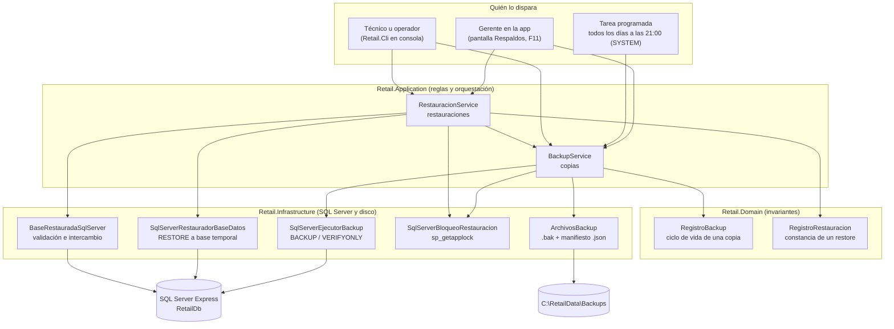

# Respaldo y Restauración de la Base: Guía Completa para Entender y Defender

### Módulo: 05. Casos de Uso y Flujos de Negocio de Punta a Punta
**Audiencia:** Desarrolladores, estudiantes universitarios y mesa evaluadora de cátedra  
**Requisitos Vinculados:** `RF-22` (Respaldo y Restauración), `RF-23` (Administración de la Base por Comandos), `RNF-08` (Integridad y Respaldo Diario) y `RF-03` (Roles)  
**Diseño y decisiones:** [`docs/roadmap/etapa-6-track-6.3-backup-restore.md`](file:///c:/Users/lucas/Proyectos/retail/docs/roadmap/etapa-6-track-6.3-backup-restore.md) (decisiones D-1 a D-29, riesgos R-1 a R-20)

---

## 1. 🎯 Para Qué Existe Esta Guía

Un comercio puede perder sus datos por un disco que falla, un corte de luz, un error humano o una actualización que sale mal. Esta guía explica **cómo Retail POS se protege contra eso**: cómo toma copias de seguridad, cómo las verifica, cómo restaura una copia sin poner en riesgo la base en uso, qué hace ante cada falla y por qué se diseñó así.

Está escrita para dos usos:
* **Entender el funcionamiento al detalle**, desde la regla de negocio hasta la sentencia SQL que la ejecuta.
* **Preparar la defensa**: cada decisión está explicada con su porqué y con las alternativas que se descartaron.

> [!NOTE]
> Todo lo que se afirma acá está verificado contra el código de la rama `main`. Cada sección enlaza al archivo correspondiente; si el código cambia, el enlace lleva a la fuente de verdad.

---

## 2. 🗺️ Mapa General

---

## 3. 📚 Capítulos y Orden de Lectura

| # | Capítulo | Qué vas a entender | Estado |
| :-: | :--- | :--- | :---: |
| 01 | [Fundamentos y decisiones](01-fundamentos-y-decisiones.md) | Qué es una copia completa, cómo se verifica, el bloqueo de lectores y escritor, y por qué se tomó cada decisión | ⏳ |
| 02 | [Componentes por capa](02-componentes-por-capa.md) | El rol y la estructura de cada clase, puerto y pantalla, y cómo se conectan | ⏳ |
| 03 | [Flujo de copia](03-flujo-de-copia.md) | Las cuatro clases de copia paso a paso, con su SQL | ⏳ |
| 04 | [Flujo de restauración](04-flujo-de-restauracion.md) | La base temporal, las validaciones y el intercambio, con su SQL | ⏳ |
| 05 | [La herramienta `Retail.Cli`](05-retail-cli.md) | Cada comando, qué valida y por qué no le da a nadie más poder | ⏳ |
| 06 | [Scripts y SQL](06-scripts-y-sql.md) | Los scripts de PowerShell tramo por tramo, con cada permiso y cada sentencia | ⏳ |
| 07 | [Escenarios de error y corrupción](07-escenarios-de-error-y-corrupcion.md) | Qué pasa ante cada falla, cómo se detecta y qué test lo prueba | ⏳ |
| 08 | [Seguridad y permisos](08-seguridad-y-permisos.md) | El modelo de amenazas, lo que el sistema protege y lo que no | ⏳ |
| 09 | [Cómo se prueba](09-como-se-prueba.md) | La estrategia de tests y cómo ejecutarlos | ⏳ |
| — | [Defensa técnica](../../06-vademecum-defensa-tecnica/defensa-respaldo-y-restauracion.md) | Preguntas de la mesa con sus respuestas | ⏳ |

**Orden recomendado:** 01 → 02 → 03 → 04 para entender el núcleo; 05 y 06 para la operación; 07 y 08 para los casos límite; 09 y la defensa al final.

---

## 4. 📖 Glosario

### Conceptos de base de datos
| Término | Significado |
| :--- | :--- |
| **Copia completa (`.bak`)** | Archivo que contiene **toda** la base en un momento dado, generado por `BACKUP DATABASE`. Restaurarlo reconstruye la base exactamente como estaba. |
| **`CHECKSUM`** | Suma de control que el motor calcula por cada página de datos al escribir la copia, para detectar después cualquier página dañada. |
| **`RESTORE VERIFYONLY`** | Lee la copia entera y recalcula sus sumas de control **sin restaurarla**: prueba que el archivo es legible y completo. |
| **SHA-256 (huella)** | Huella digital del archivo `.bak` completo. Si cambia un solo byte, cambia la huella: detecta un archivo dañado o reemplazado. |
| **Manifiesto (`.json`)** | Archivo que acompaña a cada `.bak` con su descripción (fecha, tipo, operador, huella, migración). Permite saber qué contiene la copia aunque la base se haya perdido. |
| **Migración** | Cambio versionado del esquema de la base (Entity Framework Core). La última migración aplicada identifica la "versión" del esquema. |
| **Base vigente** | La base en uso (`RetailDb`). |
| **Base temporal** | `RetailDb_Restaurando`: donde se restaura una copia para validarla antes de que reemplace a la vigente. |
| **Base anterior** | `RetailDb_Anterior_<fecha>`: la vigente reemplazada por una restauración, que se conserva intacta como red de seguridad. |
| **Intercambio** | El renombrado final (`ALTER DATABASE ... MODIFY NAME`) que convierte a la temporal en vigente. Es el **punto de no retorno**. |
| **`sp_getapplock`** | Bloqueo con nombre que administra SQL Server. Se usa como bloqueo de **lectores y escritor**: las copias toman uno compartido y la restauración uno exclusivo. |

### Conceptos del dominio
| Término | Significado |
| :--- | :--- |
| **`RegistroBackup`** | Raíz de agregado que registra una copia y custodia su ciclo de vida. Tabla `REGISTROS_BACKUP`. |
| **Estados de una copia** | `EnCurso` → `Exitoso` → `Verificado`; además `Fallido` y `ArchivoPurgado`. Solo una copia `Verificado` es restaurable. |
| **Tipos de copia** | `Manual` (Gerente), `Automatico` (tarea programada), `PreMigracion` (antes de `migrar`), `PreRestauracion` (antes de restaurar). |
| **`RegistroRestauracion`** | Raíz de agregado inmutable que deja constancia de una restauración consumada. Tabla `REGISTROS_RESTAURACION`. |
| **Origen de una restauración** | `Aplicacion` (Gerente en la pantalla Respaldos) o `Consola` (`Retail.Cli restaurar`). |
| **`Referencia`** | Identificador (GUID) estable de un registro, que sobrevive a una restauración. Permite reinsertar el historial sin duplicarlo. |
| **Copia huérfana** | Registro que quedó `EnCurso` (o `Exitoso`) porque el proceso que la hacía murió, por ejemplo por un corte de luz. |
| **Retención** | Política que borra los archivos de las copias viejas y deja su registro como `ArchivoPurgado`. |

### Conceptos de operación y seguridad
| Término | Significado |
| :--- | :--- |
| **`Retail.Cli`** | Herramienta de consola para administrar la base fuera de la app: `estado`, `migrar`, `inicializar`, `datos-demo`, `backup` y `restaurar`. |
| **Tarea programada** | Tarea del Programador de tareas de Windows que ejecuta `Retail.Cli backup` todos los días a las 21:00 como `SYSTEM`. |
| **`SYSTEM`** | La cuenta de Windows con más privilegios. La tarea corre con ella para no depender de que haya alguien con la sesión iniciada. |
| **Reautenticación (*step-up*)** | Volver a pedir la contraseña al Gerente ya logueado antes de una operación sensible. |
| **Cuenta del servicio** | La cuenta de Windows con la que corre SQL Server (`NT SERVICE\MSSQL$SQLEXPRESS`). Es la que lee y escribe los `.bak`, no el usuario de la app. |
| **Escalada de privilegios** | Que un usuario con pocos permisos logre actuar con más permisos de los que tiene, por ejemplo haciendo que `SYSTEM` ejecute o escriba algo que él controla. |

---

## 5. 🔗 Dónde Está Cada Cosa

| Capa | Ubicación |
| :--- | :--- |
| Dominio | [`Entities/RegistroBackup.cs`](file:///c:/Users/lucas/Proyectos/retail/src/Retail.Domain/Entities/RegistroBackup.cs), [`Entities/RegistroRestauracion.cs`](file:///c:/Users/lucas/Proyectos/retail/src/Retail.Domain/Entities/RegistroRestauracion.cs), enums `EstadoBackupEnum`, `TipoBackupEnum`, `OrigenRestauracionEnum` |
| Aplicación | [`Services/BackupService.cs`](file:///c:/Users/lucas/Proyectos/retail/src/Retail.Application/Services/BackupService.cs), [`Services/RestauracionService.cs`](file:///c:/Users/lucas/Proyectos/retail/src/Retail.Application/Services/RestauracionService.cs), puertos en [`Interfaces/Infrastructure/`](file:///c:/Users/lucas/Proyectos/retail/src/Retail.Application/Interfaces/Infrastructure/) |
| Infraestructura | [`Backups/`](file:///c:/Users/lucas/Proyectos/retail/src/Retail.Infrastructure/Backups/) y [`Logging/UbicacionDeLogs.cs`](file:///c:/Users/lucas/Proyectos/retail/src/Retail.Infrastructure/Logging/UbicacionDeLogs.cs) |
| Aplicación de escritorio | [`Views/Pages/BackupView.xaml`](file:///c:/Users/lucas/Proyectos/retail/src/Retail.App/Views/Pages/BackupView.xaml), [`Views/Dialogs/ConfirmarCredencialDialog.xaml`](file:///c:/Users/lucas/Proyectos/retail/src/Retail.App/Views/Dialogs/ConfirmarCredencialDialog.xaml), [`Views/Dialogs/DiagnosticoArranqueDialog.xaml`](file:///c:/Users/lucas/Proyectos/retail/src/Retail.App/Views/Dialogs/DiagnosticoArranqueDialog.xaml) |
| Consola | [`src/Retail.Cli/`](file:///c:/Users/lucas/Proyectos/retail/src/Retail.Cli/) |
| Scripts | [`scripts/registrar-tarea-backup.ps1`](file:///c:/Users/lucas/Proyectos/retail/scripts/registrar-tarea-backup.ps1), [`scripts/RetailPermisos.psm1`](file:///c:/Users/lucas/Proyectos/retail/scripts/RetailPermisos.psm1), [`scripts/restore-retail.ps1`](file:///c:/Users/lucas/Proyectos/retail/scripts/restore-retail.ps1) |
| Tests | [`tests/Retail.Application.UnitTests/Services/`](file:///c:/Users/lucas/Proyectos/retail/tests/Retail.Application.UnitTests/Services/) y [`tests/Retail.Infrastructure.IntegrationTests/Backups/`](file:///c:/Users/lucas/Proyectos/retail/tests/Retail.Infrastructure.IntegrationTests/Backups/) |
